> **导读**：在计算机体系结构与 AI 芯片设计中，许多初学者和软件工程师常产生一种直觉误区——以为芯片里一定内置了类似“计算三角函数”的现成硬件电路；或者反过来，认为如果没有专用的**特殊函数计算单元（SFU）**，仅凭由加法器和移位器构成的普通 **ALU（算术逻辑单元）**，硬件就绝对算不出 $\sin(x)$、$\cos(x)$ 或 $\exp(x)$。
>
> 更有甚者，当面对新兴的**固定数据流（Fixed Dataflow）NPU（神经网络处理器）**时，工程师常常纠结于：
>
> 1. **在没有指令跳转、没有循环控制器的固定流水线硬件上，三角函数究竟能否展开为纯静态的数据流图（DFG）？**
> 2. **为什么数学公式在纸面上完美无瑕，放到实际浮点计算中却会因为“区间缩减”产生数亿倍的数值灾难？Minimax 逼近和 Min/Max 指令到底有什么区别？**
> 3. **如果复杂的三角函数都能靠基础 ALU 搞定，那到底什么样的算子才会真正“卡死”固定数据流 NPU，必须强制回退到通用 CPU 或向量核（如 RISC-V RVV）？**
>
> 本文将从底层硬件逻辑、离线数值逼近算法到 AI 编译器（MLIR）端到端 Lowering，彻底拆解这一整套软硬件协同的知识体系。全篇配有详尽的初学者术语精解，并穿插大量 **Graphviz** 与 **Mermaid** 高清架构图，帮助读者建立起扎实立体的体系结构直觉。

---

## 目录导览

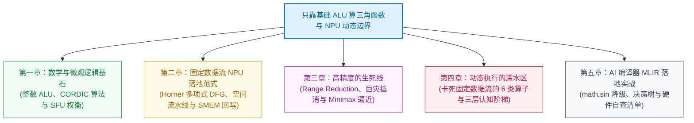

---

## 初学者核心术语先行课

为了让没有硬件背景的同学也能无障碍通读全文，我们首先将本文首次登场的关键专业名词进行直观解剖：

| 专业术语 | 英文全称 | 核心本质与通俗大白话解释 |
| :--- | :--- | :--- |
| **ALU** | **Arithmetic Logic Unit**<br/>(算术逻辑单元) | 处理器的最基础“算盘珠”。通常只能做基础的**整数或浮点加法、减法、移位（Shift）以及大小比较（CMP）**，高级芯片中包含乘法器。 |
| **SFU** | **Special Function Unit**<br/>(特殊函数计算单元) | GPU 或高性能处理器中的“外挂加速器”。由硬件专用的复杂组合逻辑和查找表组成，专为几周期内暴力计算 $\sin$、$\cos$、$1/\sqrt{x}$、$\log_2(x)$ 设计，造价高昂且耗费芯片硅片面积。 |
| **NPU** | **Neural Processing Unit**<br/>(神经网络处理器) | 专门为深度学习张量运算优化的专用集成电路（ASIC）。通常强调极致的乘累加吞吐与能效比。 |
| **固定数据流** | **Fixed Dataflow Architecture** | 一种硬件计算模式。与 CPU 依靠“取指令-译码-执行-循环跳转”不同，固定数据流硬件将多个计算单元（ALU）硬线连接或静态配置为固定的管道，数据像流水线装配车间一样单向流动，**不支持运行时的任意动态分支跳转**。 |
| **CORDIC** | **Coordinate Rotation Digital Computer**<br/>(坐标旋转数字计算机) | 20 世纪 50 年代诞生的绝妙算法。**仅凭加法、减法和二进制移位**，通过旋转二维坐标系向量，就能计算出三角函数与双曲函数。 |
| **FMA** | **Fused Multiply-Add**<br/>(融合乘加) | 硬件指令完成 $A \times B + C$。乘法与加法合二为一，中间不丢弃精度，兼具速度与高精度。 |
| **Horner 形式** | **Horner's Rule**<br/>(霍纳法则 / 秦九韶算法) | 一种多项式代数变形技巧。将 $a_0 + a_1 x + a_2 x^2 + a_3 x^3$ 重写为 $a_0 + x(a_1 + x(a_2 + x \cdot a_3))$，大幅减少乘法次数。 |
| **区间缩减** | **Range Reduction** | 将任意巨大的输入实数角度（如 $x = 10^8$ 弧度），利用数学函数的周期性（$2\pi$）折叠映射到一个很小的主区间（如 $[-\pi/4, \pi/4]$）的过程。 |
| **Minimax 逼近** | **Minimax Approximation**<br/>(极小极大逼近) | 一种离线数学优化策略。利用 Remez 算法求解一组多项式系数，使得在给定区间内的**最大绝对近似误差最小化**（误差波形均匀分布），显著优于只在展开点附近精准的泰勒展开。 |
| **巨灾抵消** | **Catastrophic Cancellation** | 浮点数计算中的恶魔。两个极其接近的大数相减时，有效位数前缀全部抵消为零，导致仅存的低位舍入误差被瞬间放大数百万倍。 |
| **SMEM** | **Scratchpad / Shared Memory**<br/>(片上暂存器 / 共享内存) | NPU 内部极低延迟、高带宽的 SRAM 存储器。通常由编译器显式控制其地址与读写，不同于自动失效淘汰的硬件 Cache。 |
| **AG** | **Address Generator**<br/>(地址生成单元) | 专职硬件计数器，负责按步长（Stride）自动递增生成访存地址（如连续读 Tensor）。 |
| **MLIR** | **Multi-Level Intermediate Representation** | 现代 LLVM 顶级编译器基础设施，允许在多层抽象方言（Dialect）之间进行渐进式降级（Lowering）优化。 |

---

# 第一章：纯整数 ALU 的奇迹——CORDIC 算法

**结论先行**：三角函数 $\sin(x)$、$\cos(x)$、$\tan(x)$ **完全可以仅依赖纯整数加法、减法、二进制移位和比较操作实现**！哪怕芯片上没有专门的硬件浮点乘法器，甚至没有 SFU，依然能够完成计算。

这背后的数学支撑就是大名鼎鼎的 **CORDIC 算法**。

---

## 1.1 旋转矩阵的代数戏法：如何消灭乘法？

在平面直角坐标系中，将一个初始向量 $(x_0, y_0)$ 逆时针旋转 $\theta$ 角度得到新向量 $(x', y')$，其数学解析式为标准二维旋转矩阵变换：

$$
\begin{pmatrix} x' \\ y' \end{pmatrix} = \begin{pmatrix} \cos\theta & -\sin\theta \\ \sin\theta & \cos\theta \end{pmatrix} \begin{pmatrix} x_0 \\ y_0 \end{pmatrix}
$$

展开后即为：

$$
\begin{aligned}
x' &= x_0 \cos\theta - y_0 \sin\theta \\
y' &= y_0 \cos\theta + x_0 \sin\theta
\end{aligned}
$$

观察该式，计算 $x'$ 和 $y'$ 必须已知 $\cos\theta$ 和 $\sin\theta$，这陷入了“为了算三角函数，先得知道三角函数”的逻辑闭环，并且式中充满了昂贵的乘法运算。

**CORDIC 算法提出了三个天才般的代数转化**：

### 转化一：提取公共因子 $\cos\theta$
将公式中的 $\cos\theta$ 强行提取到括号外：

$$
\begin{aligned}
x' &= \cos\theta \cdot (x_0 - y_0 \tan\theta) \\
y' &= \cos\theta \cdot (y_0 + x_0 \tan\theta)
\end{aligned}
$$

此时式中只剩下正切项 $\tan\theta$ 与一个整体缩放因子 $\cos\theta$。

### 转化二：将任意旋转角度离散拆解为“微步旋转序列”
假设我们不一次性旋转 $\theta$，而是分步旋转一系列精心设计的基准角度 $\theta_i$。每一小步的方向由符号变量 $d_i \in \{+1, -1\}$ 控制：

$$
\theta \approx \sum_{i=0}^{n-1} d_i \theta_i
$$

### 转化三：巧设 $\tan\theta_i = 2^{-i}$，乘法瞬间退化为“移位”
这是 CORDIC 最核心的魔法！如果令每一轮迭代的旋转角度满足：

$$
\tan\theta_i = 2^{-i} \quad \Longrightarrow \quad \theta_i = \arctan(2^{-i})
$$

那么乘上 $\tan\theta_i$ 的操作，在定点数二进制硬件中就变成了：**纯粹的算术右移 $i$ 位（Shift Right `>> i`）**！

```
i = 0: tan(θ_0) = 2^0  = 1.0        --> θ_0 = arctan(1)   ≈ 45.000°
i = 1: tan(θ_1) = 2^-1 = 0.5        --> θ_1 = arctan(0.5) ≈ 26.565°
i = 2: tan(θ_2) = 2^-2 = 0.25       --> θ_2 = arctan(0.25)≈ 14.036°
i = 3: tan(θ_3) = 2^-3 = 0.125      --> θ_3 = arctan(0.125)≈ 7.125°
...
```

这些固定的基准角度 $\arctan(2^{-i})$ 在硬件烧录前就已确定，可以直接制成一张极小的**只读常数表（LUT）**存储在芯片内。

---

## 1.2 模长拉伸因子的消除与完整迭代状态机

消除了乘法，提取在最前面的 $\cos\theta_i$ 怎么办？
根据三角恒等式：

$$
\cos\theta_i = \frac{1}{\sqrt{1 + \tan^2\theta_i}} = \frac{1}{\sqrt{1 + 2^{-2i}}}
$$

如果总共迭代 $n$ 步，累积的所有微元缩放因子相乘，将得到一个极限常数 $K_n$：

$$
K_n = \prod_{i=0}^{n-1} \frac{1}{\sqrt{1 + 2^{-2i}}} \xrightarrow{n \to \infty} K \approx 0.6072529350088812561694
$$

> [!NOTE] **关键洞察**
> 无论每一步究竟是顺时针旋转（$d_i = -1$）还是逆时针旋转（$d_i = +1$），因为项是 $2^{-2i}$（平方项），**每一步对模长的拉伸比例完全相同，与旋转方向无关**！
> 
> 这意味着：整个 $n$ 步迭代累积的总拉伸比例 $K$ 是一个**恒定不变的常数**。我们只需要在迭代的最开始，将初始向量长度直接设为 $x_0 = K \approx 0.60725$，后续所有 $\cos\theta_i$ 项就完全被抵消掉了！

因此，CORDIC 每一步的硬件迭代状态机被极简为纯加减与移位：

$$
\begin{aligned}
x_{i+1} &= x_i - d_i \cdot (y_i \gg i) \\
y_{i+1} &= y_i + d_i \cdot (x_i \gg i) \\
z_{i+1} &= z_i - d_i \cdot \arctan(2^{-i})
\end{aligned}
$$

其中：
- $x_i, y_i$：当前旋转坐标向量。
- $z_i$：剩余未旋转的角度（角度残差），每轮旋转根据 $z_i$ 的正负号决定旋转方向：$d_i = +1 \ (\text{若 } z_i \ge 0)$ 或 $d_i = -1 \ (\text{若 } z_i < 0)$。
- 初始条件设定：$x_0 = 0.607252935$，$y_0 = 0$，$z_0 = \theta$。
- 迭代终止时（假设迭代 $16$ 次）：$x_{16} \approx \cos\theta$，$y_{16} \approx \sin\theta$，$z_{16} \to 0$。

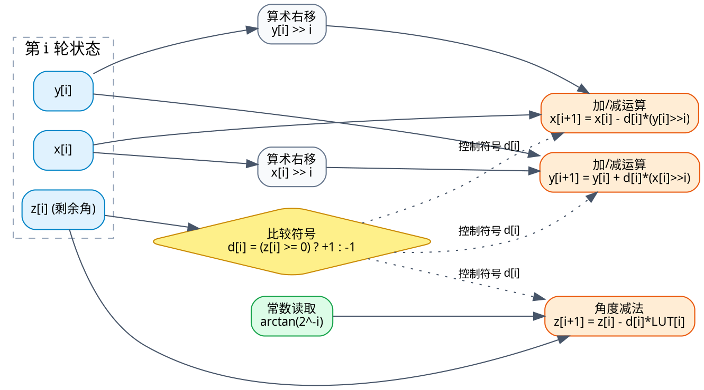

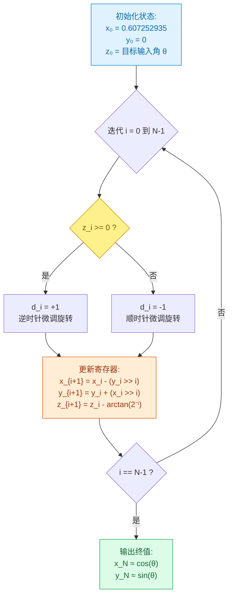

从上述推导与拓扑可以看出：**纯整数加法、减法、二进制移位与比较器，完全可以完整且精确地解算三角函数！**

---

## 1.3 既然基础 ALU 能算，现代芯片为什么还要造专用 SFU？

既然 CORDIC 只用加减和移位就能跑，为什么现代 GPU（如 NVIDIA Hopper / Blackwell）和高性能 NPU 还要耗费宝贵的芯片面积去设计专用的 SFU（特殊函数单元）？

核心原因在于**工程维度的五维权衡（Trade-offs）**：

| 实现路线 | 依赖的硬件底层算力 | 计算延迟 (Latency) | 吞吐率 (Throughput) | 芯片面积与静态功耗 | 精度与灵活性 |
| :--- | :--- | :--- | :--- | :--- | :--- |
| **CORDIC 迭代法** | 纯整数加减法、移位器、小型角度常数表 | **极长**<br/>(需顺序执行 16~24 轮串行依赖) | **较低**<br/>(单组 ALU 逐轮复用) | **极小**<br/>(适合嵌入式/定点极简硬件) | 精度随迭代次数递增；天然输出 $(\sin, \cos)$ 坐标对 |
| **Horner 多项式逼近** | 浮点乘加器 (FMA / MUL+ADD) | **中等**<br/>(依赖乘法位宽，约 4~8 步) | **高**<br/>(向量化流水线易打满) | **中等**<br/>(依赖通用浮点乘法器通路) | 需搭配严苛的区间缩减；精度上限极高 |
| **LUT 查表 + 插值** | SRAM/ROM 存储阵列、轻量插值 ALU | **短**<br/>(查表 1 拍 + 线性插值 1~2 拍) | **极高** | **面积与存储成正比**<br/>(精度翻倍存储指数膨胀) | 精度受表项容量严重制约，容易产生台阶跳跃 |
| **专用流水线 SFU** | 专用非线性插值逻辑、二次逼近、专用硬件压缩表 | **极短**<br/>(深度流水线打满，数周期穿透) | **极高**<br/>(流水填满后每拍吞吐一组结果) | **昂贵**<br/>(专用定制逻辑，无法复用于 GEMM/通用计算) | 硬件硬编码；专为特定浮点格式定制（如 FP32/FP16） |

专用 SFU 存在的唯一理由就是**极致的性能与能效比**。在图形渲染和现代大语言模型（如 Softmax、RoPE、GELU/SwiGLU 激活函数）中，数学函数的调用频次极其高昂。若全部交由普通 ALU 顺序迭代十数拍，处理器的核心利用率将被严重拖垮。

---

# 第二章：固定数据流（Fixed Dataflow）NPU 的实现范式

当问题从“能否用 ALU 计算”进一步下沉到特定的芯片体系结构时，关键挑战浮出水面：**在固定数据流（Fixed Dataflow）NPU 上，能否只靠基础计算单元搞定三角函数？**

## 2.1 冯·诺依曼 CPU vs 固定数据流 NPU：执行模型的本质断层

通用 CPU 与固定数据流 NPU 的计算模型有着本质区别：

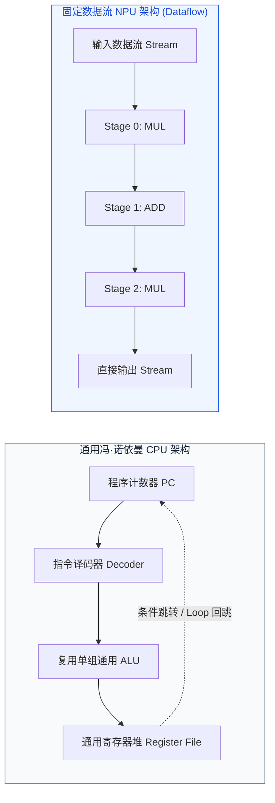

- **通用 CPU**：核心拥有指令计数器（PC）和无限次循环的能力。只要让一段 3 行汇编代码（Add、Shift、Sub）在同一个 ALU 内部循环跳转 16 次，就能轻松跑完 CORDIC。
- **固定数据流 NPU**：**没有运行时自由的 PC 跳转指令**。算子的映射是一张预先在空间或时间上确定依赖关系的**有向无环图（DAG）**。

因此，固定数据流 NPU 要想实现三角函数，核心考验的不是 ALU 的运算种类，而是**硬件拓扑能否承载多轮计算的数据依赖链**。

---

## 2.2 方案 A：Horner 形式的多项式展开（静态 DFG 首选）

如果 NPU 内部的标量核心（SC）或向量单元配备了乘法器（MUL）和加法器（ADD），实现三角函数最顺畅、最优美的方式是**将低阶多项式改写为秦九韶算法（Horner's Rule）**。

以五次麦克劳林展开为例：

$$
\sin(x) \approx x - \frac{x^3}{6} + \frac{x^5}{120}
$$

若直接计算：$x^3 = x \cdot x \cdot x$（2 次乘法），$x^5 = x^3 \cdot x \cdot x$（2 次乘法），再分别乘系数并相加，不仅乘法步数多，而且中间寄存器生命周期冗长。

应用霍纳法则进行因式提取变形：

$$
\sin(x) \approx x \cdot \left( 1 + x^2 \cdot \left( -\frac{1}{6} + x^2 \cdot \frac{1}{120} \right) \right)
$$

引入中间代数变量消元：
1. 令 $t = x^2$（仅需一次平方计算 $x \times x$）
2. 令 $a = t \times \frac{1}{120}$
3. 令 $b = a + \left(-\frac{1}{6}\right)$
4. 令 $c = t \times b$
5. 令 $d = 1.0 + c$
6. 最终输出 $y = x \times d$

这道数学公式在硬件底层展现出极其震撼的纯静态拓扑图：

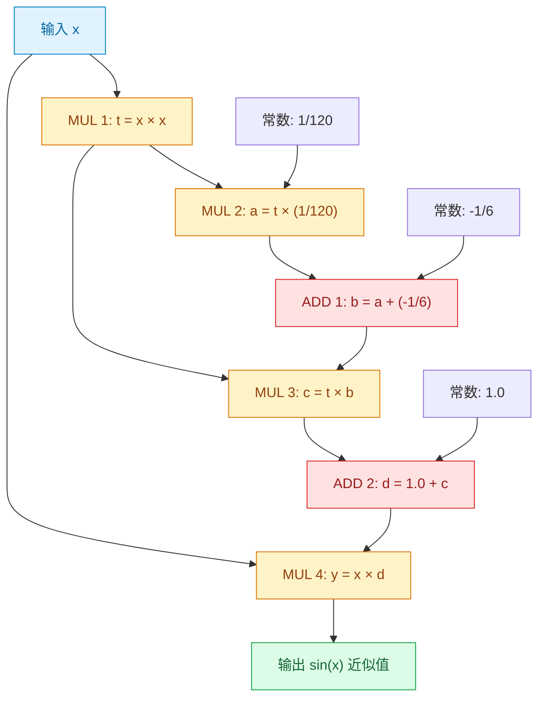

> [!TIP] **为什么该拓扑是固定数据流 NPU 的天作之合？**
> 1. **零运行时控制流分支**：完全没有 `if-else` 条件判断。
> 2. **零运行时循环迭代**：完全没有 `while`、`for` 依赖。
> 3. **静态确定性**：所有的常数（$1.0$、$-1/6$、$1/120$）均在编译期固化。
> 4. **完全由 ADD / MUL 原语构成**：天然映射为无环静态数据流图（DAG）。

---

## 2.3 方案 B：空间展开流水化的 CORDIC（Spatial Unrolling）

如果硬件只有加法和移位器，完全没有乘法器，固定数据流 NPU 能跑 CORDIC 吗？
**能，只要将“时间上的循环”在“芯片空间上物理展开”**。

在通用 CPU 里，1 个 ALU 跑 16 轮循环耗时 16 拍；而在空间展开架构（如 AMD/Xilinx FPGA CORDIC IP）中，我们可以直接在硬件芯片上串联 16 级独立的计算微单元：


- **面积换吞吐**：每一级硬件固化其移位常数（第 $0$ 级不移位，第 $1$ 级固定右移 1 位……）。
- 当流水线排满后，**每个时钟周期都能吐出一组全新的 $\sin(x)$ 与 $\cos(x)$**，具有极致的吞吐率。

---

## 2.4 硬件微架构的三种物理约束模型

在面对一款具体自研的固定数据流 NPU（包含片上存储 SMEM、地址生成器 AG、标量核心 SC/ALU）时，必须审视其底层微架构是否具备承载多步依赖的通路：

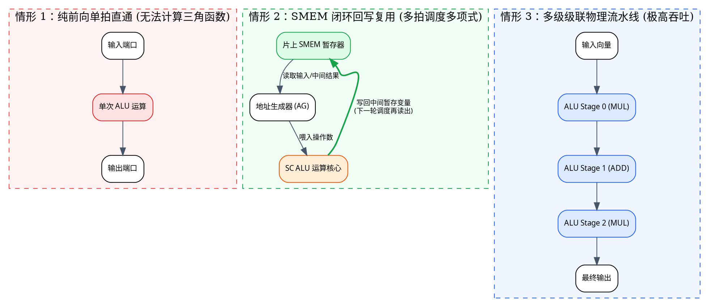

1. **情形 1（单次前向直通，无反馈）**：硬件不支持循环回写，也不支持级联。这种硬件**绝对无法计算通用多项式或 CORDIC**。
2. **情形 2（SMEM 闭环回写多轮复用）**：单组 ALU 算完一步后写回片上 SMEM，编译器安排下一道指令再次将其读出送入 ALU。这种设计灵活性高，但会增加 SMEM 的读写功耗与带宽压力。
3. **情形 3（多级级联流水线）**：内部寄存器直接透传到下一级 ALU，无需经过外部存储循环，兼具高性能与能效比。

---

# 第三章：高精度的生死线——区间缩减与 Minimax 逼近

很多工程师在此处容易产生严重困惑：“既然 Horner 多项式可以在固定数据流 NPU 上完美跑通，那是不是意味着直接在编译器里把 $\sin(x)$ 替换成这段多项式，三角函数就算做完了？”

**答案是：会发生灾难性的数值崩溃！**

---

## 3.1 致命概念排雷：`min/max/clamp` 绝不是区间缩减！

初学者常问：“为了保证输入不越界，我用一条 `min/max` 或者 `clamp` 指令把数据强行卡在 $[-1, 1]$ 之间，不就可以做多项式逼近了吗？”

```cpp
// 致命的错误示范！
float bad_sin(float x) {
    float clamped_x = std::min(std::max(x, -1.0f), 1.0f); // 强行截断至 [-1, 1]
    return evaluate_polynomial(clamped_x);
}
```

> [!CAUTION] **数学原理不可违背**
> `min/max/clamp` 是**数值裁剪（Clipping）**，它会彻底丢弃超出范围的所有数学信息！
> 假设输入角度是 $x = 10.0$ 弧度（真实 $\sin(10) \approx -0.544021$）：
> - 经过 `clamp(10, -1, 1)` 后，输入直接变成了 $1.0$；
> - 最终计算结果为 $\sin(1.0) \approx 0.84147$；
> - 产生高达 $1.38$ 的彻底错误！
>
> **区间缩减（Range Reduction）必须是数学上等价的周期性几何折叠，绝非暴力截断！**

---

## 3.2 为什么走出限定区间，多项式误差会暴增数亿倍？

泰勒展开是典型的**局部逼近**，它以展开中心点（如 $x=0$）为基准向外辐射。五阶泰勒多项式的余项截断误差上界为：

$$
|R_5(x)| \le \frac{|x|^7}{7!} = \frac{|x|^7}{5040}
$$

当输入 $x$ 较小时，误差以极其惊人的速度收敛；但一旦 $x$ 稍微变大，分子的 $|x|^7$ 将呈指数级恶魔般膨胀：

| 输入 $x$ (弧度) | 真实精确值 $\sin(x)$ | 五次泰勒计算结果 $x - \frac{x^3}{6} + \frac{x^5}{120}$ | 绝对误差 | 误差表现与后果评估 |
| :---: | :---: | :---: | :---: | :--- |
| **0.5** | $0.479426$ | $0.479427$ | $0.000001$ | 极其精准，满足 FP16/BF16 要求 |
| **1.0** | $0.841471$ | $0.841667$ | $0.000196$ | 轻微误差，仍在可用容差内 |
| **2.0** | $0.909297$ | $0.933333$ | $0.024036$ | 误差肉眼可见，图形渲染产生瑕疵 |
| **3.0** | $0.141120$ | $0.525000$ | $0.383880$ | 严重失真，相对误差高达 $270\%$ |
| **10.0** | **-0.544021** | **+676.666667** | **677.210688** | **完全崩溃！正弦函数计算值竟然飙到 676！** |

无论你的 ALU 是 FP32 还是 FP64，也无论硬件计算有多精准，**数学公式本身的失效无法被任何硬件电路拯救**。必须在进入多项式计算前，将任意输入角度折叠进小区间。

---

## 3.3 区间缩减（Range Reduction）的数学几何机制

正弦函数具备严格的 $2\pi$ 周期性与关于原点和半周期的对称性：

$$
\sin(x + 2k\pi) = \sin(x), \quad \sin(x) = -\sin(-x), \quad \sin(\pi - x) = \sin(x)
$$

工程上最推荐的黄金做法是：**将任意输入 $x$ 缩减到更小的第一象限主区间 $[-\pi/4, \pi/4]$**。

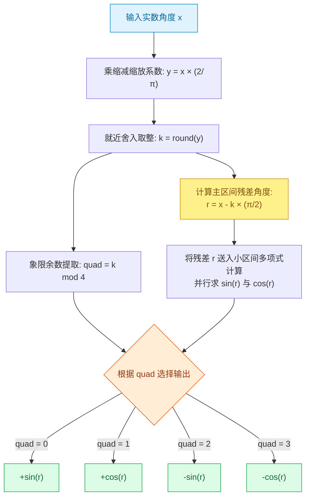

通过这一重映射，多项式运算单元永远只需要处理 $[-\pi/4, \pi/4] \approx [-0.7853, 0.7853]$ 范围内的残差 $r$！在此区间内，五阶多项式的截断误差已被强行压制在 $0.00004$ 以下。

---

## 3.4 灵魂追问：“我直接提取 $\pi$ 前面的整数取模行不行？”

有的同学会提出一个非常自然的想法：
> “既然正弦函数的周期是 $2\pi$，那如果输入是 $x = (N + f)\pi$（$N$ 是整数，$f \in [0, 1)$ 是小数），我直接让 $N \pmod 2$，只保留 $f\pi$ 计算，不就不用除以 $\pi$ 了吗？”

**答案是：这个数学逻辑极其完美，但必须分清场景！**

### 场景 A：上游输入天然保留了 $(N, f)$ 分离格式（例如 RoPE 旋转位置编码）
在 Transformer 大模型的 RoPE 算子中，位置编码角度常常严格按固定步长倍数生成：

$$
\theta_{m, i} = m \cdot \theta_i
$$

此时若编译器在前端就把角度维护为 $\pi$ 的倍数，直接执行：
```cpp
int parity = N & 1; // 仅需读取最低比特位，无需任何除法器！
float r = f * PI;
float y = poly_sin(r);
if (parity) y = -y;
```
这种设计对固定数据流 NPU 是极大的减负，完全绕过了高精度除法与巨灾抵消！

### 场景 B：通用场景输入是普通实数 $x = 10^8$（巨灾抵消陷阱）
但如果输入是一个普通 FP32 浮点数 $x = 100000000.0$：数据本身并没有把 $\pi$ 分离出来！你必须在运行时通过硬件计算：

$$
N = \left\lfloor \frac{x}{\pi} \right\rfloor, \quad r = x - N \cdot \pi
$$

此时将爆发毁灭性的**巨灾抵消（Catastrophic Cancellation）**：
- 真实数学世界中：$\pi \approx 3.141592653589793...$
- 单精度浮点数存储的单精度常数：$\pi_{\text{FP32}} \approx 3.141592741...$
- 两者在第 7 位小数上存在极微小的误差：$\Delta\pi \approx 8.74 \times 10^{-8}$
- 但是当 $x = 10^8$ 时，算出的整数项高达 $N \approx 31830988$！
- 在计算残差 $r = x - N \cdot \pi_{\text{FP32}}$ 时，该微小误差被放大：

$$
\Delta r \approx N \cdot \Delta\pi \approx 3.18 \times 10^7 \times 8.74 \times 10^{-8} \approx \mathbf{2.78 \text{ rad}}
$$
（相差高达 2.78 弧度！）

> [!WARNING] **相差 2.78 弧度意味着什么？**
> 三角函数的总周期也才只有 $6.28$ 弧度！相差 $2.78$ 弧度相当于完全算错了一个半象限，计算结果的正负号和绝对值与真实值完全南辕北辙！无论后续多项式硬件做多少次高精度的加乘，输入源头就已经彻底报废。

### 工业级工程解法：
为了在任意巨大输入下实现高精度，工业级数学库采用专门的范围缩减技术：
1. **Cody-Waite 算法**：将常数 $\pi/2$ 拆解为高低双字定点结构：$\frac{\pi}{2} = P_{\text{head}} + P_{\text{tail}}$，其中 $P_{\text{head}}$ 必须拥有充足的尾数零以保证相减时不产生精度舍入丢失。适合中小范围输入。
2. **Payne-Hanek 算法**：直接在只读存储器中维护 $2/\pi$ 的数千位超长定点二进制展开，通过超长多字定点乘法直接截取所需的小数段，彻底消除大角度下的相位漂移。

---

## 3.5 Minimax（极小极大逼近）：零硬件成本榨取极限精度

即使区间已被严密缩减到 $[-\pi/4, \pi/4]$，在多项式系数的选择上，依然隐藏着一块巨大的性能金矿。

### 核心对比：泰勒逼近 vs Minimax 逼近

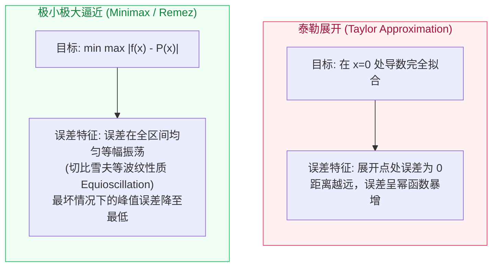

### 一个极简易懂的案例：常数逼近 $\cos(x)$
假设硬件极其简陋，只允许使用一个单项常数 $C$ 来逼近区间 $[0, 1]$ 上的 $\cos(x)$：

- **泰勒策略**：围绕 $x=0$ 展开，取 $C = \cos(0) = 1.0$。
  - 在 $x=0$ 处：误差为 $|1.0 - 1.0| = 0$；
  - 但在区间边缘 $x=1$ 处：真实 $\cos(1) \approx 0.5403$，误差飙升至 $|0.5403 - 1.0| \approx \mathbf{0.4597}$！
- **Minimax 策略**：不盲目追求原点绝对准确，而是追求全区间最大误差最小化。令常数处于峰值与谷值的正中间：

$$
C = \frac{\cos(0) + \cos(1)}{2} = \frac{1.0 + 0.540302}{2} \approx 0.770151
$$

  - 在 $x=0$ 处：误差为 $|1.0 - 0.770151| = +0.2298$；
  - 在 $x=1$ 处：误差为 $|0.540302 - 0.770151| = -0.2298$；
  - **全区间最大绝对误差从 0.4597 瞬间腰斩至 0.2298**！

### 对固定数据流 NPU 的深远价值
Minimax 逼近的系数是**在编译器研发期，利用离线数值算法（如 Remez 算法）一次性求解出来的**！

```cpp
// 泰勒五次展开系数：
float taylor_sin(float x) {
    float t = x * x;
    return x * (1.0f + t * (-0.166666667f + t * 0.008333333f));
}

// Minimax 五次逼近系数 (在 [-π/4, π/4] 区间优化)：
float minimax_sin(float x) {
    float t = x * x;
    // 硬件结构一模一样！乘法和加法次数完全相同！仅系数被数值优化！
    return x * (0.9999966f + t * (-0.1666483f + t * 0.0083175f));
}
```

> [!TIP] **白捡的精度红利**
> 硬件底层执行的代码结构完全一致，没有增加任何一个额外的计算门电路，仅凭编译期常数的微调，就把多项式的最坏误差压低了数倍！这就是数值计算与硬件设计结合的魅力所在。

---

# 第四章：动态执行的深水区——哪些算子固定数据流 NPU 无法仅凭 ALU 实现？

现在我们可以回答最核心的系统级问题：

既然复杂如三角函数的计算，都能通过区间缩减、Horner 展开或 CORDIC 转化为纯静态的 ALU 运算网络，**那到底什么样的算子，固定数据流 NPU 绝对无法仅靠普通 ALU 搞定？**

---

## 4.1 静态数据流 vs 动态控制流的物理分水岭

判定一个算子能否在固定数据流 NPU 上仅凭 ALU 执行的**唯一黄金准则**是：

> **“在编译器生成代码的那一刻，所有数据的流向路径、迭代执行次数、访存物理地址以及输出张量的内存尺寸，是否全部完全确定？”**

如果答案是肯定的，即使公式再繁琐，也是静态数据流；如果任何一个要素取决于**运行时送进来的具体数据值**，就会对固定流水线造成致命阻碍。

---

## 4.2 六类“卡脖子”动态算子深度拆解

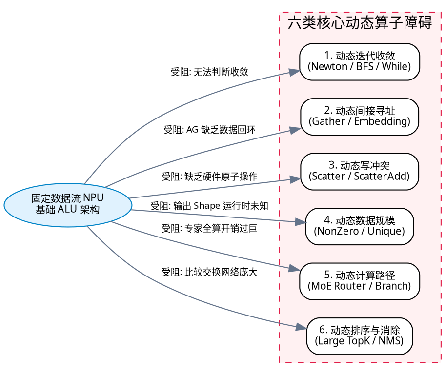

### 1. 动态迭代收敛（Dynamic Iteration：牛顿法 / BFS 遍历）
以牛顿迭代法求平方根为例：

$$
x_{n+1} = \frac{1}{2} \left( x_n + \frac{a}{x_n} \right)
$$

在通用软件中，收敛逻辑写作：
```cpp
while (abs(x_next - x) > eps) { // 循环次数完全由运行时数值决定！
    x = x_next;
    x_next = step(x);
}
```
- **为什么 ALU 搞不定**：固定数据流没有条件分支停机机构。
- **静态化折中手段**：**固定最大上界展开（Bounded Unrolling）**。强制规定一律迭代 8 次，即便第 3 次就已经收敛也必须继续空转。这牺牲了运算效率，但换取了静态流水的可行性。

---

### 2. 动态间接寻址（Gather / Embedding Lookup）
这是 NPU 设计中最容易撞墙的算子。

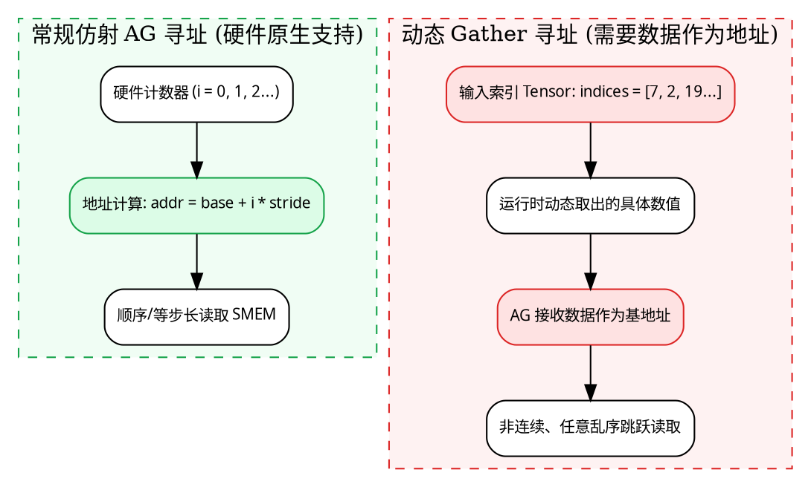

- **为什么 ALU 搞不定**：ALU 就算能够执行乘法和加法算出 `addr = base + index * 4`，但**地址生成单元（AG）如果没有“将 ALU 输出直接回环接管内部存储器地址引脚”的物理布线**，硬件就无法根据计算结果发起存储器读取！

---

### 3. 动态写入与冲突冒险（Scatter / ScatterAdd / Histogram）
直方图统计或图神经网络中的特征汇聚：

```cpp
// input = [2, 1, 2, 2];
for (int i = 0; i < 4; ++i) {
    histogram[input[i]] += 1;
}
```

- **为什么 ALU 搞不定**：如果有 3 个并行流水线 ALU 同时处理第 0、2、3 个元素，它们的目标地址全部是 `histogram[2]`！三路并行 ALU 同时读旧值、加 1、写回，将产生毁灭性的**写写冲突（Write-After-Write Hazard）**，导致更新丢失。必须依赖硬件级原子加法器（Atomic Unit）或仲裁排序网络。

---

### 4. 动态输出规模（Dynamic Shape：NonZero / Unique / 稀疏压缩）
从张量中筛选非零元素的索引：

```text
输入 Tensor: [0, 8, 0, 0, 5, 2]  --> 输出 Tensor 长度为 3: [1, 4, 5]
输入 Tensor: [0, 0, 0, 0, 0, 0]  --> 输出 Tensor 长度为 0: []
```


- **为什么 ALU 搞不定**：虽然前缀和（Prefix Sum / Scan）可以通过加法网络静态完成，但**产出的有效元素总个数在运行时才知道**。固定数据流硬件后续连接的所有张量算子，都会因为无法预知输入 Tensor 的 Buffer 尺寸和循环次数而彻底瘫痪。

---

### 5. 动态专家路由（MoE：Mixture of Experts）
在拥有 64 个 Expert 的大模型中，每个 Token 仅由门控网络（Router）挑选前 2 个专家进行计算。

- **策略 A（纯静态数据流强行做）**：所有 64 个 Expert 无论是否选中全部执行，最后用 Select 指令将未选中的屏蔽丢弃。
  - **致命代价**：算力浪费高达 $\frac{62}{64} \approx 96.8\%$！芯片严重发热降频。
- **策略 B（真正的高效动态路由）**：只将选中的 Token 动态搬运到对应 Expert 的本地 SMEM 中。这必须依赖动态 crossbar 路由开关与控制核的介入。

---

### 6. 动态排序与消除（Large-scale TopK / NMS）
目标检测中的非极大值抑制（NMS）或大词表（Vocabulary 128k）的 TopK：
- 小规模（如 4 个数、8 个数）的排序可以通过**双调排序网络（Bitonic Sorting Network）**使用比较-选择（CMP-SELECT）硬编码展开；
- 但一旦数据量达到数千上万，静态展开的比较网络面积将呈 $O(N \log^2 N)$ 爆炸，必须借助带控制流的循环算法进行分层归约淘汰。

---

## 4.3 算子映射的三层认知阶梯（The Three Tiers）

站在 AI 编译器架构师的视角，面对任何待加速的深度学习算子，都可以划入以下三层判定矩阵：

| 算子层级 | 涵盖算子代表 | 核心计算特征 | 固定数据流 NPU 的应对策略 |
| :--- | :--- | :--- | :--- |
| **第一层：复杂但本质纯静态** | $\sin$、$\cos$、$\exp$、$\log$、$\text{GELU}$、$\text{Softmax}$、$\text{LayerNorm}$ | 公式极其复杂，但输入输出 Shape 固化，计算图为无分支 DAG | **完全由固定流水线 ALU 承担**，利用区间缩减 + Horner 多项式或 Reduce 树硬件展开，追求极致吞吐。 |
| **第二层：可有代价静态化** | 小规模 $\text{TopK}$、固定步长牛顿迭代、谓词选择执行（Predication） | 算法逻辑包含条件判断，但问题规模具有确定的微观上限 | **有条件展开**。以少许冗余计算为代价，消除动态分支，映射进硬件流水。 |
| **第三层：强依赖数据驱动** | $\text{Gather}$、$\text{ScatterAdd}$、$\text{NonZero}$、动态 $\text{MoE}$、动态收敛循环 | 寻址、写回冲突或输出生命周期强依赖运行时数据 | **必须回退至通用控制核心**（如 RISC-V RVV / 标量 CPU / 专用 DMA 路由引擎）。 |

---

# 第五章：AI 编译器（MLIR）端到端落地实战

在理解了算法与硬件微架构之后，现代 AI 编译器（如 MLIR）是如何将上层的数学函数，一步步“大卸八块”并下发给固定数据流 NPU 的？

---

## 5.1 MLIR 官方 `PolynomialApproximation` 源码解密

在 LLVM/MLIR 官方仓库的 `mlir/lib/Dialect/Math/Transforms/PolynomialApproximation.cpp` 中，就原生提供了一套针对 `math.sin` 与 `math.cos` 的多项式降级转换 Pass。

其降级逻辑极为严密：
1. **输入角度范围缩减**：计算 $k = \text{round}\left(x \cdot \frac{2}{\pi}\right)$ 与 $r = x - k \cdot \frac{\pi}{2}$；
2. **象限分支判定**：根据 $k \pmod 4$ 的奇偶性，判断当前位置应该执行 $\sin$ 的多项式逼近，还是执行 $\cos$ 的多项式逼近；
3. **FMA 融合乘加展开**：调用 `math.fma`（乘加）多项式流水线；
4. **符号恢复**：根据象限结果修复正负符号。

原始高层 MLIR IR：
```mlir
// 输入一个形为 1024 的高维张量
func.func @compute_sin(%arg0: tensor<1024xf32>) -> tensor<1024xf32> {
  %0 = math.sin %arg0 : tensor<1024xf32>
  return %0 : tensor<1024xf32>
}
```

经过 `PolynomialApproximation` Pass 降级后的底层 IR 片段：
```mlir
// math.sin 被打散为一连串基础浮点代数算子！
%two_over_pi = arith.constant 0.636619747 : f32
%y = arith.mulf %arg0, %two_over_pi : f32
%k = arith.floorf %y : f32 // 或 round 算子
// 计算主残差 r
%pi_over_two = arith.constant 1.57079637 : f32
%scaled_k = arith.mulf %k, %pi_over_two : f32
%r = arith.subf %arg0, %scaled_k : f32

// 执行 Horner 展开 (多级 FMA / MUL / ADD)
%r2 = arith.mulf %r, %r : f32
%c120 = arith.constant 0.008333333 : f32
%c6 = arith.constant -0.166666667 : f32
%t1 = math.fma %r2, %c120, %c6 : f32
%c1 = arith.constant 1.0 : f32
%t2 = math.fma %r2, %t1, %c1 : f32
%result = arith.mulf %r, %t2 : f32
// 后续根据象限条件执行 arith.select 恢复符号
```

> [!NOTE]
> 观察上述降级代码可知：经过编译器编译后，**抽象的数学函数 `math.sin` 已经不复存在，化为了清一色的 `arith.mulf`、`arith.subf`、`math.fma` 和 `arith.select`**。如果目标 NPU 具备对应的基础 ALU 通路，就能顺理成章地映射为硬件数据流。

---

## 5.2 编译器端到端降级判定决策树（Decision Tree）

在面对不同的输入特征与硬件配置时，现代 AI 编译器应当遵循一套严密的决策流程图进行流水线编译：

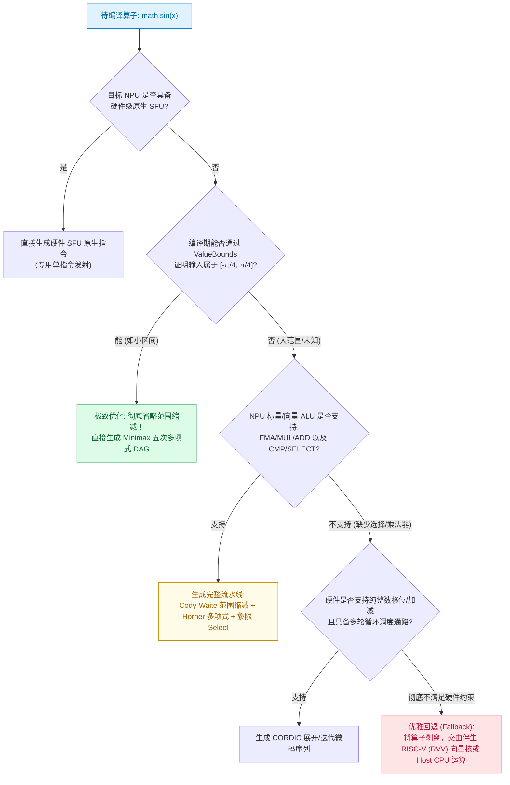

---

## 5.3 芯片架构师与编译器工程师自查清单

当你负责为一款新型固定数据流 NPU 设计数学函数库与编译器后端时，请对照以下清单逐一确认底层硬件规格：

1. **ALU 基础精度保障**：
   - 目标数据类型是 FP16/BF16 还是 FP32？
   - **关键防坑**：中间多项式计算是否支持使用 FP32 累加器暂存？（若中间全程强制 BF16，尾数仅有 7 位，低阶项累加将遭遇严重的下溢截断）。
2. **SMEM 反馈与回写回路**：
   - 如果单次硬件前向深度只有 2 级 ALU，中间计算变量（如 $t = x^2$）能否直接无气泡回写片上暂存器（SMEM），并由 AG 发起下一轮复用读取？
3. **常量参数广播总线**：
   - 编译器生成的 Minimax 系数（如 $0.008333$、$-0.166667$）是通过指令立即数灌入，还是存储在专用的常量 SRAM 中并支持零开销广播（Broadcast）至各个并行通道？
4. **伴生通用核的无缝通信机制**：
   - 当遇到 Gather、动态 MoE 路由等无法由固定数据流承担的算子时，NPU 与伴生向量核心（如 RISC-V RVV）之间是否有统一编址的片上内存共享通路？数据移交是否需要漫长的主存 DMA 拷贝？

---

# 总结与认知升华

回顾全篇，我们从最底层的门电路逻辑出发，穿透了数学数值逼近，最终落脚在芯片体系结构与现代编译器的交汇点上。

我们可以得出三条颠覆初学者直觉的核心结论：

1. **没有专用特殊函数单元（SFU），三角函数依然可以被完美计算**：
   - 仅凭纯整数的加法、减法与二进制移位，**CORDIC 算法**便能在空间或时间上通过向量旋转拟合出正弦与余弦；
   - 搭配浮点乘加器（FMA）与**霍纳法则（Horner）**，多项式逼近可以在无任何跳转分支的纯静态流水线中极速奔流。
2. **高精度三角函数的胜负手不在多项式本身，而在“区间缩减”与“系数优化”**：
   - 绝不可将 `clamp` 误作区间缩减；
   - 简单的低精度 $\pi$ 浮点取模将引发致命的**巨灾抵消**，必须引入 Cody-Waite / Payne-Hanek 双字精度拆分；
   - **Minimax（极小极大逼近）**利用 Remez 算法将区间最大绝对误差降至极限，以零额外硬件开销榨取极致精度。
3. **固定数据流硬件的真正死穴不是数学函数，而是“数据驱动的动态性”**：
   - 只要算子的控制流、迭代步数与寻址规律是编译期静态确定的，它就是固定流水线的天选之子；
   - 真正卡死固定数据流 NPU、必须回退通用处理器的，永远是**间接动态寻址（Gather）、并发写冲突（ScatterAdd）、输出未知维度（NonZero）与动态路由分发（MoE）**。

理解了这些底层原理，未来的你无论是面对一款全新的自研 NPU 架构手册，还是编写 MLIR 的 Lowering Pass，心中都将拥有一份清晰明确的软硬件分界全景地图。
