> **导读**：很多初学 CUDA 编程的同学脑海里往往有一个简化印象：“GPU 里面塞了成千上万个小 CPU 核心，写好 `__global__` 核函数扔上去并发跑就完了。”
>
> 但当你真正掀开现代 NVIDIA GPU 的微架构盖子，会发现它根本不是由单一的通用计算单元堆出来的，而是一座**高度异构的精密流水线工厂**。在这个体系里，绝大部分计算单元住在 **SM（Streaming Multiprocessor，流多处理器）** 内部——包括负责常规算术与控制的 **CUDA Core**、专攻矩阵乘加的 **Tensor Core**、加速光线求交的 **RT Core**，以及只管超越函数的 **SFU**、负责访存的 **LD/ST**、异步张量搬运的 **TMA** 和 **Texture Unit**；而在 SM 之外的芯片级（SoC 层面），还分布着 **NVENC/NVDEC、OFA、NVJPEG、硬件解压缩引擎** 以及一颗嵌入式 **RISC-V GSP** 微控制器。
>
> 更让初学者困惑的问题接踵而至：
> 1. **写 CUDA C++ 代码时，我们并没有写“把这行交给某个核心执行”，编译器和硬件到底是怎么路由的？**
> 2. **反汇编 SASS 看到一条 `MUFU` 单指令，在硬件上是不是“一拍”就算完了？**
> 3. **Tensor Core 必须显式调用，它和 CUDA Core 的线程-数据映射方式一样吗？**
> 4. **Tensor Core 和 CUDA Core 能互相替代吗？为什么它连最普通的 SIMD 张量加法都算不了，却偏偏叫“Tensor Core”？**
>
> 本文将完全照顾**零基础初学者的阅读体验**：**每一个专业术语在第一次出现时都会给出通俗解释**，并配合多张 **Graphviz 架构/流水线图** 与 **Mermaid 流程图**，带你从芯片物理拓扑一路打通到底层 PTX/SASS 指令映射与架构设计哲学。

---

## 零、初学者核心名词破冰速查表

在正式进入正文前，你可以把下面这张表当作“随身词典”。正文第一次提到这些名词时，我们也会结合具体例子展开说明。

| 术语 / 缩写 | 英文全称 | 一句话通俗解释 |
| :--- | :--- | :--- |
| **SM（流多处理器）** | Streaming Multiprocessor | NVIDIA GPU 芯片内部最核心的“基本计算车间”。一颗 GPU 由几十上百个 SM 组成，三大主力核心都住在 SM 里。 |
| **SIMT（单指令多线程）** | Single Instruction, Multiple Threads | NVIDIA GPU 的核心执行模型：由一个指挥官统一发指令，32 个线程拿着各自不同数据同步执行同一动作，同时允许线程走不同分支。 |
| **SIMD（单指令多数据）** | Single Instruction, Multiple Data | 一条指令同时对打包好的多个向量数据执行相同计算（如单个通道一拍同时算 2 个 `half` 加法）。 |
| **Warp（线程束）** | Warp | NVIDIA GPU 硬件调度与发射指令的最小“小队”单位，固定包含 **32 个线程**。 |
| **CUDA Core** | CUDA Core | SM 内数量最多的通用标量计算通道（Lane），本身没有独立的取指/译码器，内部按数据类型分为 `INT32`、`FP32`、`FP64` 流水线。 |
| **Tensor Core（张量核心）** | Tensor Core | 专为深度学习和科学计算中的**矩阵乘加**（$D = A \times B + C$）设计的专用硬件加速单元，以 Warp 或 Warp Group 为粒度协同计算。 |
| **RT Core（光追核心）** | Ray Tracing Core | 专门加速 3D 实时光线追踪的固定功能电路，负责 **BVH 树遍历** 和 **光线-三角形求交**，仅存在于图形/工作站级 GPU。 |
| **SFU（特殊函数单元）** | Special Function Unit | 专门加速 $\sin$、$\cos$、$\exp_2$、$\log_2$、倒数（`rcp`）和平方根倒数（`rsqrt`）等**超越函数**的硬件单元。 |
| **TMA（张量内存加速器）** | Tensor Memory Accelerator | Hopper 及后续架构引入的异步多维张量搬运引擎，无需占用 CUDA Core 算地址即可在显存与共享内存间搬运 1D~5D 数据块。 |
| **NVCC / PTX / `ptxas` / SASS** | CUDA 编译工具链与指令集 | CUDA 代码的编译四部曲：`NVCC` 前端编译为跨代虚拟汇编 `PTX`，再由 `ptxas` 编译成特定架构芯片真正执行的原生机器码 `SASS`。 |
| **Register File / Shared Memory** | 寄存器堆 / 共享内存 | 寄存器堆是每个线程私有的超高速变量工作台；Shared Memory 是同一线程块（CTA）内线程共享的高速片上 SRAM。 |
| **吞吐周期与执行延迟** | Throughput & Latency | **吞吐周期**指“每隔几拍能往流水线发射下一条指令”；**延迟**指“一条指令从进入流水线到结果写回寄存器共耗时几拍”。 |
| **Scoreboard Barrier** | 记分板屏障 | 硬件用来防止“写后读（RAW）数据冒险”的哨卡：前一条长延迟指令没写回前，阻塞依赖其结果的后续指令发射。 |
| **图灵完备** | Turing Complete | 衡量计算系统通用性的标尺：具备条件分支、循环和通用读写能力，理论上可以模拟任何可计算算法。 |

下面这张全景导图展示了整篇教程的知识脉络：

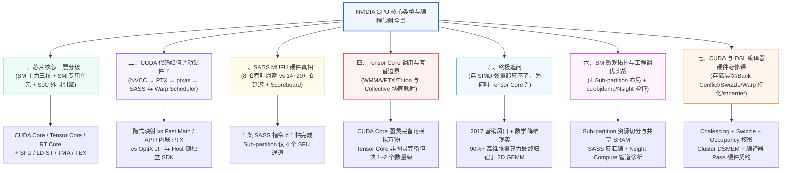

---

## 一、NVIDIA GPU 中有哪些不同的“核心”？

在 NVIDIA GPU 中，所谓的“核心”并不是单一的通用计算单元。现代 NVIDIA GPU 采用的是**高度异构（Heterogeneous，即多种专用与通用硬件混编协作）的微架构设计**：绝大多数计算单元都组织在 **SM（Streaming Multiprocessor，流多处理器）** 内部，同时在 SM 之外的芯片级（SoC 层面）还分布着若干独立的专用硬件引擎。

按照所处的层级与功能职责，NVIDIA GPU 中的核心与专用单元可以分为三大类：

```dot
digraph NVIDIAGPUArch {
    rankdir=TB;
    node [shape=box, style="rounded,filled", fontname="sans-serif", fontsize=11];
    edge [color="#475569", fontname="sans-serif", fontsize=10];

    subgraph cluster_soc {
        label="NVIDIA GPU 完整芯片 (SoC 级架构视图)";
        style="rounded";
        color="#334155";
        bgcolor="#f8fafc";

        subgraph cluster_sm {
            label="SM (Streaming Multiprocessor，流多处理器阵列)";
            style="rounded,dashed";
            color="#2563eb";
            bgcolor="#eff6ff";

            sched [label="Warp Scheduler (线程束调度器)\n读取 SASS 操作码并分发到对应硬件 Pipe", fillcolor="#dbeafe", color="#1d4ed8"];

            subgraph cluster_main_cores {
                label="一、SM 内部三大主力核心";
                style="rounded";
                color="#16a34a";
                bgcolor="#f0fdf4";
                cuda [label="CUDA Core (通用标量计算核)\n• INT32 / FP32 (Ampere+ 复用通路)\n• FP64 (游戏卡 1:64 vs 计算卡 1:2)", fillcolor="#dcfce7", color="#15803d"];
                tensor [label="Tensor Core (张量核心)\n• 矩阵乘加 D = A×B+C\n• 粒度: Warp / WarpGroup (WGMMA) / 跨 CTA (tcgen05)\n• 精度: FP16/TF32/BF16/FP8/FP6/FP4", fillcolor="#dcfce7", color="#15803d"];
                rt [label="RT Core (光线追踪核心)\n• BVH 树遍历 + 光线-三角形求交\n• Ada/Blackwell: OMM/DMM/LSS\n(仅 GeForce RTX / 工作站卡配备)", fillcolor="#fef3c7", color="#d97706"];
            }

            subgraph cluster_aux_units {
                label="二、SM 内部其他关键专用单元";
                style="rounded";
                color="#7c3aed";
                bgcolor="#f5f3ff";
                sfu [label="SFU (特殊函数单元)\nsin/cos/exp2/log2/rcp/rsqrt", fillcolor="#ede9fe", color="#6d28d9"];
                ldst [label="LD/ST Unit (加载/存储单元)\n寻址与读写 GMEM/SMEM/L1", fillcolor="#ede9fe", color="#6d28d9"];
                tma [label="TMA (张量内存加速器)\nHopper/Blackwell 1D~5D 异步搬运", fillcolor="#ede9fe", color="#6d28d9"];
                tex [label="Texture Unit (纹理单元)\n纹理采样过滤 & 只读缓存路径", fillcolor="#ede9fe", color="#6d28d9"];
            }

            mem [label="SM 片上存储：Register File + Shared Memory / L1 Cache + TMEM (Blackwell 专用矩阵累加区)", fillcolor="#ffffff", color="#2563eb"];

            sched -> cuda;
            sched -> tensor;
            sched -> rt;
            sched -> sfu;
            sched -> ldst;
            sched -> tma;
            sched -> tex;

            cuda -> mem [dir=both];
            tensor -> mem [dir=both];
            sfu -> mem [dir=both];
            ldst -> mem [dir=both];
            tma -> mem [dir=both];
            tex -> mem [dir=both];
        }

        subgraph cluster_periph {
            label="三、芯片级 (SM 之外) 专用硬件引擎";
            style="rounded";
            color="#dc2626";
            bgcolor="#fef2f2";
            nvenc [label="NVENC / NVDEC\n硬件视频编解码 (H.264/HEVC/AV1)", fillcolor="#fee2e2", color="#b91c1c"];
            ofa [label="OFA (光流加速器)\n帧间运动矢量 (DLSS 帧生成基础)", fillcolor="#fee2e2", color="#b91c1c"];
            nvjpeg [label="NVJPEG\n数据中心高速图像硬解", fillcolor="#fee2e2", color="#b91c1c"];
            decomp [label="Decompression Engine\nHopper/Blackwell LZ4/Snappy/Deflate 硬解压", fillcolor="#fee2e2", color="#b91c1c"];
            gsp [label="GSP (GPU System Processor)\nTuring+ 嵌入式 RISC-V 固件管理核心", fillcolor="#ffedd5", color="#c2410c"];
        }

        vram [label="全局显存 (Global Memory / HBM / GDDR)", shape=cylinder, fillcolor="#e2e8f0", color="#475569"];

        mem -> vram [dir=both, label="L2 Cache"];
        nvenc -> vram [dir=both];
        ofa -> vram [dir=both];
        nvjpeg -> vram [dir=both];
        decomp -> vram [dir=both];
        gsp -> sched [style=dashed, label="初始化/功耗/调度/虚拟化卸载"];
    }
}
```

### 1.1 SM 内部的三大主力“核心”

在市场宣传和架构白皮书中，最常被称为“Core”的是以下三种位于 SM 内部的计算单元：

#### 1. CUDA Core（通用标量计算核心）

CUDA Core 是 GPU 中数量最多、最基础的算术逻辑单元。严格来说，它并不等同于 CPU 的核心（没有独立的取指、译码和控制逻辑），而更像是一个 **SIMT（Single Instruction, Multiple Threads，单指令多线程）流水线中的单个标量 ALU/FPU 通道（Lane）**。

在微架构上，CUDA Core 内部其实按数据类型细分为三类流水线：

- **INT32 单元**：负责 32 位整数运算（地址计算、循环计数、位运算与逻辑运算等）。
- **FP32 单元**：负责单精度浮点运算（图形渲染、传统科学计算、AI 中的激活函数 / Softmax 等非矩阵算子）。
  - *架构细节*：从 **Ampere** 架构开始，NVIDIA 在部分流水线上采用了 **FP32 / INT32 复用数据通路**设计（每个 SM Sub-partition 中一半通道只做 FP32，另一半既可做 FP32 也可做 INT32），从而在纯浮点负载下将 FP32 吞吐量翻倍。
- **FP64 单元**：负责双精度浮点运算。消费级游戏卡（如 **GeForce RTX** 系列）通常会大幅阉割 FP64 单元（FP64 与 FP32 算力比通常为 `1:64`），而数据中心/HPC 计算卡（如 **A100、H100、B200**）则会完整保留高比例的 FP64 单元（通常为 `1:2`）。

#### 2. Tensor Core（张量核心 / 矩阵计算单元）

Tensor Core 是专为深度学习和 HPC 中的矩阵乘加运算（$D = A \times B + C$）设计的专用硬件加速单元。

- **执行粒度**：与 CUDA Core 按单线程标量执行不同，Tensor Core 是以 **Warp（32 线程）** 或 **Warp Group（128 线程，Hopper 的 `WGMMA`）** 甚至跨 CTA（Cooperative Thread Array，协作线程数组，即线程块）协作（**Blackwell 的 `tcgen05`**）为单位，在单个或少数几个时钟周期内完成整个小矩阵块的乘加。
- **精度演进**：
  - **第一代（Volta）**：支持 `FP16`。
  - **第三代（Ampere）**：引入 `TF32`（TensorFloat-32，保留 FP32 8 位指数与 FP16 10 位尾数）、`BF16`、`FP64` 矩阵运算以及 `2:4` 结构化稀疏加速（每 4 个元素中有 2 个为零即可跳过计算使算力翻倍）。
  - **第四代（Hopper）**：引入 `FP8` 与 **Transformer Engine**，支持异步矩阵指令（`WGMMA`）。
  - **第五代（Blackwell）**：引入 `FP4` / `FP6` 微缩放格式（Micro-tensor Scaling），并专门在 SM 内配套了独立的 **TMEM（Tensor Memory）** 来存放累加器数据，减轻通用寄存器文件（Register File）的压力。

#### 3. RT Core（光线追踪核心）

RT Core 是用于实时光线追踪的固定功能硬件单元，负责将原本在 CUDA Core 上极度消耗算力且极易导致**分支发散（Warp Divergence，即同一 Warp 内线程走入不同条件分支导致硬件串行执行）**的几何求交运算卸载到专用电路中：

- **核心功能**：加速 **BVH（Bounding Volume Hierarchy，层次包围盒）树的遍历** 以及 **光线-三角形求交测试**。
- **演进特性**：较新的架构（**Ada Lovelace 第三代、Blackwell 第四代**）还加入了不透明度微图（OMM）、位移微网格（DMM）以及针对毛发/曲线几何体的线性扫描球体（LSS）硬件求交支持。
- **产品线差异**：RT Core **仅存在于图形与工作站级 GPU**（如 **GeForce RTX、RTX Pro** 系列）中；纯 AI/HPC 计算卡（如 **H100、H200、B200**）为了节省芯片面积和功耗，**不包含** RT Core。

---

### 1.2 SM 内部的其他关键专用单元

虽然官方通常不称它们为“Core”，但在编译优化和性能调优时，它们与上述三大核心处于同等重要的地位：

- **SFU（Special Function Unit，特殊函数单元）**：专门处理超越函数指令，如 `sin`、`cos`、`exp2`、`log2`、`rcp`（倒数）、`rsqrt`（平方根倒数）以及图形渲染中的属性插值。其数量远少于 FP32 CUDA Core，因此在写高性能 Kernel 时，密集的超越函数调用很容易受限于 SFU 吞吐量。
- **LD/ST Unit（加载/存储单元）**：负责计算访存地址，并在寄存器文件与 Shared Memory / L1 Cache / Global Memory 之间发起读写请求。
- **TMA（Tensor Memory Accelerator，张量内存加速器）**：从 **Hopper** 架构引入并延续至 **Blackwell**。它是一个专用的异步数据搬运引擎，支持直接按多维张量坐标（1D~5D）在 Global Memory 和 Shared Memory 之间进行异步拷贝和越界填充（Zero-padding），无需消耗 CUDA Core 和寄存器去算地址。
- **Texture Unit（纹理单元，TEX）**：在图形渲染中负责纹理采样、双线性/各向异性过滤；在通用计算中也可以用来走只读纹理缓存路径（`__ldg`）或利用其硬件插值能力。

---

### 1.3 芯片级（SM 之外）的专用硬件引擎

在一颗完整的 NVIDIA GPU 芯片上，除了由 SM 组成的计算阵列外，还集成了多个独立的外围硬件“核心/引擎”：

- **NVENC / NVDEC**：专用的硬件视频编码器与解码器（支持 H.264、HEVC、AV1 等格式），独立于 SM 运行，用于录屏、推流以及数据中心的视频 AI 推理预处理。
- **OFA（Optical Flow Accelerator，光流加速器）**：硬件计算相邻视频帧之间像素的运动矢量，是 **DLSS 帧生成（Frame Generation）** 和视频插帧的关键硬件基础。
- **NVJPEG**：专用的硬件 JPEG 图像解码引擎，常见于数据中心卡（如 **A100/H100/B200**），用于在视觉模型训练/推理前高速解压海量图片数据。
- **Decompression Engine（硬件解压缩引擎）**：在 **Hopper** 和 **Blackwell** 等数据中心架构中引入，支持硬件级高速解压 LZ4、Snappy、Deflate 等压缩格式，降低数据从主机内存/存储加载到显存时的带宽瓶颈。
- **GSP（GPU System Processor，GPU 系统处理器）**：一颗嵌入在 GPU 芯片内部的 **RISC-V 微控制器核心**。从 **Turing** 架构开始引入，负责接管原本由宿主机 CPU 驱动执行的 GPU 初始化、功耗管理、调度控制和虚拟化等底层任务。

### 1.4 总结对比

| 核心 / 单元名称 | 所在位置 | 主要职责 | 适用产品线 |
| --- | --- | --- | --- |
| **CUDA Core (INT32/FP32/FP64)** | SM 内部 | 通用标量运算、控制流、非矩阵算子 | 全系（消费级阉割 FP64） |
| **Tensor Core** | SM 内部 | 混合精度矩阵乘加（AI 训练/推理、HPC） | 全系（数据中心卡规格更强） |
| **RT Core** | SM 内部 | 光线追踪（BVH 遍历、光线求交） | 仅 GeForce RTX / 工作站卡 |
| **SFU** | SM 内部 | 超越函数（`sin/cos/exp/rsqrt` 等） | 全系 |
| **TMA** | SM / GPC 级 | 异步多维张量内存搬运 | Hopper / Blackwell 及后续架构 |
| **NVENC / NVDEC / OFA** | 芯片外围 | 视频编解码、光流运动估计 | 消费级/工作站为主（计算卡视型号配置） |
| **NVJPEG / 解压缩引擎** | 芯片外围 | 图像硬件解码、数据流硬件解压 | 主要面向数据中心计算卡 |
| **GSP (RISC-V)** | 芯片外围 | GPU 内部固件运行、管理与任务调度卸载 | Turing 及以后绝大多数现代 GPU |

---

## 二、写 CUDA 代码时，到底怎么使用这些 Core 的能力？

在 CUDA 编程中，你不需要手动指定“把这行代码交给某个物理核心去跑”。底层的映射机制是：

> **核心链路**：CUDA C++ 代码经编译器（**NVCC $\rightarrow$ PTX $\rightarrow$ `ptxas` $\rightarrow$ SASS**）生成不同种类的机器指令，运行时由 SM 内的 **Warp Scheduler** 根据 SASS 指令的操作码（Opcode），将其发射（Issue）到对应的硬件执行单元（Pipe）中。

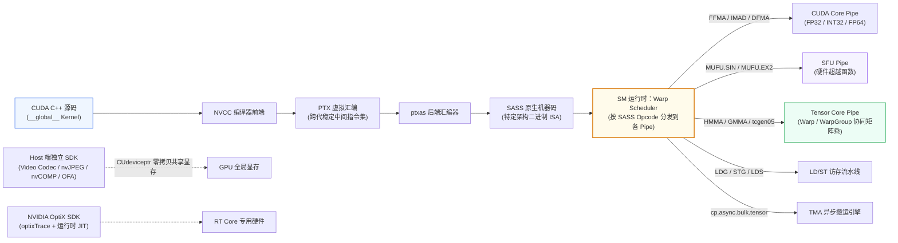

具体到每一类核心和引擎，你在代码层面的调用方式完全不同——有的由编译器自动映射，有的必须显式写内联 PTX 或调用特定 API，还有的根本不能在 CUDA Kernel 内部直接调用：

### 2.1 CUDA Core（INT32 / FP32 / FP64）：隐式自动使用

这是最直接的一类。你在 Kernel 里写的绝大多数常规标量运算、循环控制和地址偏移，都会被编译器自动映射到 CUDA Core 的对应流水线上：

- `float c = a * b + c;` $\rightarrow$ 编译器生成 SASS 指令 `FFMA`，发射到 **FP32 Pipe**。
- `int idx = blockIdx.x * blockDim.x + threadIdx.x;` $\rightarrow$ 生成 `IMAD` / `IADD3`，发射到 **INT32 Pipe**。
- `double d = a * b + c;` $\rightarrow$ 生成 `DFMA`，发射到 **FP64 Pipe**。
- **底层控制**：如果需要强制控制舍入模式或防止编译器自动合并乘加，可以使用数学内建函数（Intrinsics），例如 `__fmaf_rn(a, b, c)`、`__fadd_rz(a, b)`。

### 2.2 SFU（特殊函数单元）：靠 Fast Math Intrinsics 触发

SFU 负责硬件级超越函数，但有一个初学者极易踩中的坑：**直接调用标准 C 数学库函数（如 `sinf(x)`、`expf(x)`）并不一定会走 SFU**。

- 为了满足 IEEE-754 精度要求，标准 `sinf(x)` 通常会被编译器展开成一段包含多次 `FFMA` 的多项式逼近指令，跑在 **FP32 CUDA Core** 上。
- **正确触发 SFU 的方式**：
  1. 显式调用带双下划线的硬件内建函数：`__sinf(x)`、`__cosf(x)`、`__expf(x)`、`__log2f(x)`、`rsqrtf(x)`、`__fdividef(x, y)`。
  2. 或者在编译时加上 `--use_fast_math` 标志。
  - 此时编译器会直接生成 SASS 的 `MUFU`（Multi-Function Unit）指令（如 `MUFU.SIN`、`MUFU.EX2`、`MUFU.RSQ`），直接送进 SFU 执行。

### 2.3 Tensor Core：必须显式调用（编译器不会自动向量化）

与 CPU 编译器能自动把 `for` 循环向量化成 AVX/NEON 不同，**NVCC 不会把你手写的三重循环矩阵乘法自动编译成 Tensor Core 指令**。要调动 Tensor Core，必须在以下三个抽象层级中选择其一：

1. **高层库 / 编译器（最常用）**：直接调 **cuBLAS**、**cuDNN**、**CUTLASS**，或者用 **Triton** 写 `tl.dot(a, b)`。
2. **CUDA C++ Warp 级 API**：使用 `nvcuda::wmma` 命名空间（`load_matrix_sync`、`mma_sync`、`store_matrix_sync`），适合入门或简单场景，但无法发挥 Hopper/Blackwell 的全部特性。
3. **内联 PTX / CUTLASS CuTe（极致性能）**：直接在 CUDA 里嵌入 PTX 指令，或者通过 CuTe 的抽象层调用：
   - **Ampere / Ada**：PTX `mma.sync.aligned...` $\rightarrow$ SASS `HMMA` / `IMMA` / `DMMA`。
   - **Hopper**：PTX `wgmma.mma_async...` $\rightarrow$ SASS `GMMA`（Warp Group 级异步矩阵乘）。
   - **Blackwell**：PTX `tcgen05.mma...` $\rightarrow$ 配合专用 **TMEM（Tensor Memory）** 执行。

### 2.4 LD/ST 单元与 TMA：普通访存 vs 异步张量搬运

- **LD/ST 单元**：只要你在 Kernel 里对指针解引用（`float v = gmem[idx];` 或读写 `__shared__` 数组），编译器就会生成 `LDG`/`STG`（全局内存）或 `LDS`/`STS`（共享内存）指令，交给 LD/ST 单元处理。
- **TMA（Tensor Memory Accelerator，Hopper 及以后）**：普通指针读写用不到 TMA。要启用 TMA，需要 **Host + Device 协同**：
  1. **Host 端**：调用驱动 API `cuTensorMapEncodeTiled()` 创建一个 `CUtensorMap` 描述符（记录张量维度、步长、Swizzle 模式、越界填充方式），传给 Kernel。
  2. **Device 端**：只需要由 Warp 中的**单个线程**调用 `cuda::device::experimental::cp_async_bulk_tensor_2d_global_to_shared()`（底层对应 PTX `cp.async.bulk.tensor`），TMA 硬件引擎就会在后台独立完成多维数据块搬运和地址计算，并配合 `mbarrier` 通知计算线程。

### 2.5 Texture Unit（纹理单元）：纹理对象或只读缓存提示

在通用计算（GPGPU）中，通常通过两种方式借用纹理单元及其只读缓存（Texture Cache）：

- **显式采样**：在 Host 端创建 `cudaTextureObject_t`，在 Kernel 中调用 `tex2D<float>(texObj, u, v)`，可以直接利用硬件的坐标越界处理（Clamp/Wrap）和双线性插值。
- **只读加载**：在 Kernel 中对只读全局内存使用 `__ldg(&ptr[i])`（或给指针加上 `const __restrict__` 修饰让编译器自动推断），编译器会生成 `LDG.E.CONSTANT` / 走纹理只读路径的指令。

### 2.6 RT Core：标准 CUDA C++ 无法直接调用

在普通的 `.cu` Kernel 里，**没有任何 PTX 指令或 CUDA 内建函数可以直接驱动 RT Core**。

- 要使用 RT Core，必须通过 **NVIDIA OptiX SDK**（构建在 CUDA 之上的光线追踪框架）。
- 你依然用类似 CUDA C++ 的语法编写设备端着色器（如 `__raygen__`、`__closesthit__`），并在其中调用 `optixTrace()`。OptiX 的 **JIT（即时编译器）** 会在运行时将其编译为底层私有的硬件指令，驱动 RT Core 完成 BVH 遍历和求交。

### 2.7 芯片级外围引擎（NVENC / NVDEC / OFA / NVJPEG / 解压缩 / GSP）

这些引擎位于 SM 之外，**完全不能在 CUDA Kernel 内部调用**，而是通过 **Host 端的独立 SDK** 提交异步任务，并通过显存指针与 CUDA Kernel 零拷贝衔接：

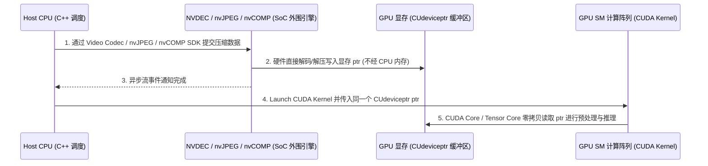

- **NVENC / NVDEC**：调用 **NVIDIA Video Codec SDK**。典型流水线是：NVDEC 把 H.264 视频流硬解码直接输出到显存的 `CUdeviceptr` $\rightarrow$ 你的 CUDA Kernel 直接读取该显存地址做图像预处理或 AI 推理，全程不经过 CPU 内存。
- **NVJPEG / 硬件解压缩引擎**：分别通过 **nvJPEG** 库和 **nvCOMP** 库调用，同样直接操作显存缓冲区。
- **OFA（光流加速器）**：通过 **NVIDIA Optical Flow SDK** 调用。
- **GSP（RISC-V 核心）**：对 CUDA 开发者**完全透明**。它运行的是 NVIDIA 官方固件，负责底层的驱动卸载、功耗管理和任务调度，开发者无法也不需要给它写代码。

### 2.8 速查对照表

| 硬件单元 | 编程介入方式 | 典型代码 / API / 底层指令 |
| --- | --- | --- |
| **CUDA Core** | 隐式自动映射 | 常规 C++ 运算 $\rightarrow$ `FFMA` / `IADD3` / `DFMA` |
| **SFU** | 显式内建函数 / 编译选项 | `__sinf()` / `__expf()` / `--use_fast_math` $\rightarrow$ `MUFU.*` |
| **Tensor Core** | 显式调用库 / API / PTX | `cuBLAS` / `CUTLASS` / `wmma` / `mma.sync` / `wgmma` $\rightarrow$ `HMMA` / `GMMA` |
| **LD/ST Unit** | 隐式指针访存 | `ptr[i]` / `cp.async` $\rightarrow$ `LDG` / `STG` / `LDS` |
| **TMA** | Host 描述符 + Device 异步指令 | `CUtensorMap` + `cp.async.bulk.tensor` + `mbarrier` |
| **Texture Unit** | 纹理对象 / 只读加载 | `tex2D()` / `__ldg()` |
| **RT Core** | 专用框架（非纯 CUDA） | NVIDIA OptiX SDK (`optixTrace`) |
| **外围引擎** | Host 端独立 SDK（共享显存指针） | Video Codec SDK / nvJPEG / nvCOMP / Optical Flow SDK |
| **GSP** | 不可编程（系统固件独占） | 对开发者完全透明 |

---

## 三、SASS 的 `MUFU` 单指令，在硬件上是“一拍”吗？

当开发者加上 `--use_fast_math` 并用工具反汇编 SASS 时，看到一行 `MUFU.SIN` 或 `MUFU.EX2`，很容易误以为“既然只有一条机器指令，那硬件上就是 1 个时钟周期完成”。

**不是。** 单条 SASS 指令只代表前端译码和发射的一个逻辑操作，与硬件实际消耗的时钟周期没有 1:1 关系。在 GPU 微架构中，必须把 **吞吐周期（Throughput / Issue Rate）** 和 **执行延迟（Latency）** 分开看：

### 3.1 吞吐周期：通常需要 8 拍

- GPU 以 **Warp（32 个线程）** 为单位发射指令，但一个 SM Sub-partition（处理块）内的 SFU 数量远少于 32 个。
- 在 **Turing / Ampere / Ada / Hopper** 等架构中，每个 Sub-partition 通常只有 **4 个 SFU 单元**（整个 SM 共 16 个）。
- 因此，一条 `MUFU` 指令要算完整个 Warp 的 32 个线程，硬件需要分 **$32 \div 4 = 8$ 个时钟周期**才能把数据全部喂完（每拍处理 4 个线程）。这意味着同一个 Sub-partition 最快每 8 拍才能再发射下一条 `MUFU` 指令。
- *对比*：Ampere / Ada / Hopper 每个 Sub-partition 有 32 个 FP32 通道，所以 `FFMA` 的吞吐周期是 **1 拍**（每拍可以发射一条新的 `FFMA`）。

### 3.2 执行延迟：通常在 14~20+ 拍

- SFU 内部采用**查表 + 二次多项式插值**的多级流水线，哪怕只算单个线程的 `MUFU.SIN` 或 `MUFU.EX2`，从进入流水线到结果写回寄存器文件（Register File），也需要十几到二十几个周期。
- 如果你反汇编 SASS，会发现 `MUFU` 指令通常会绑定一个 **Scoreboard Barrier（记分板屏障）**，后续依赖其结果的指令必须等待这个屏障解除（Wait Barrier）才能发射，以防读到未写回的脏数据（RAW 冒险）。

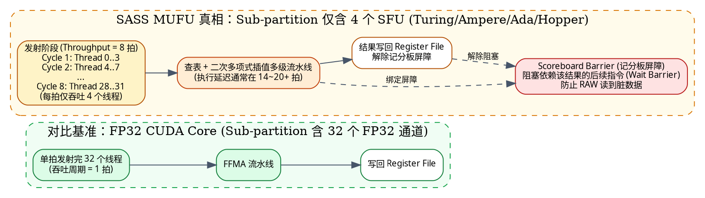

---

## 四、Tensor Core 如何显式调用？它与 CUDA Core 的映射一样吗？

### 4.1 Tensor Core 显式调用的三种工程层级

NVCC 不会把普通 `for` 循环自动向量化为 Tensor Core 指令，必须通过特定 API 或内联汇编显式触发：

#### 1. CUDA C++ WMMA API（入门 / 跨架构兼容）

使用 `nvcuda::wmma` 命名空间，编译器会帮你处理底层寄存器的排布细节：

```cpp
#include <mma.h>
using namespace nvcuda;

// 声明矩阵分片（Fragment），实际数据分布在当前 Warp 的 32 个线程寄存器中
wmma::fragment<wmma::matrix_a, 16, 16, 16, half, wmma::row_major> a_frag;
wmma::fragment<wmma::matrix_b, 16, 16, 16, half, wmma::col_major> b_frag;
wmma::fragment<wmma::accumulator, 16, 16, 16, float> c_frag;

wmma::fill_fragment(c_frag, 0.0f);
wmma::load_matrix_sync(a_frag, smem_a, 16); // Warp 协作加载
wmma::load_matrix_sync(b_frag, smem_b, 16);
wmma::mma_sync(c_frag, a_frag, b_frag, c_frag); // 触发 Tensor Core (HMMA)
wmma::store_matrix_sync(smem_c, c_frag, 16, wmma::mem_row_major);
```

#### 2. 内联 PTX（高性能手写 Kernel / CUTLASS 底层）

WMMA 的抽象太厚，无法精细控制寄存器复用和异步流水线。工业级库（如 **CUTLASS**、**FlashAttention**）都是直接写内联 PTX（或通过 **CuTe** 封装）。

以 **Ampere / Ada** 架构的 `m16n8k16` FP16 矩阵乘为例：

```cpp
// 每个线程只持有矩阵 A 的 8 个 half（4个32位寄存器）、B 的 4 个 half（2个寄存器）、C/D 的 4 个 float
asm volatile(
    "mma.sync.aligned.m16n8k16.row.col.f32.f16.f16.f32 "
    "{%0, %1, %2, %3}, "      // 输出 D (4 个 FP32 寄存器)
    "{%4, %5, %6, %7}, "      // 输入 A (4 个 32-bit 寄存器，存 8 个 FP16)
    "{%8, %9}, "              // 输入 B (2 个 32-bit 寄存器，存 4 个 FP16)
    "{%10, %11, %12, %13};\n" // 输入 C (4 个 FP32 寄存器)
    : "=f"(d[0]), "=f"(d[1]), "=f"(d[2]), "=f"(d[3])
    : "r"(a[0]), "r"(a[1]), "r"(a[2]), "r"(a[3]),
      "r"(b[0]), "r"(b[1]),
      "f"(c[0]), "f"(c[1]), "f"(c[2]), "f"(c[3])
);
```

- 在 **Hopper** 架构上，会换成异步的 `wgmma.mma_async`（由 4 个 Warp 组成的 Warp Group 共同发射，直接从 Shared Memory 读操作数）。
- 在 **Blackwell** 架构上，则是 `tcgen05.mma`（配合专用的 **TMEM** 累加器）。

#### 3. 编译器 / DSL 自动 Lowering（Triton 等）

在 **Triton** 中写 `tl.dot(a, b)`，编译器前端将其转为 IR 里的矩阵乘算子，后端经过 Layout 推导后，自动 Lowering 成上述的 `mma.sync` 或 `wgmma` PTX 指令。

---

### 4.2 Tensor Core 和 CUDA Core 的映射方式一样吗？

**完全不一样。** 两者在**执行粒度**和**数据-线程映射模型**上有本质区别：

- **CUDA Core 是纯粹的“单线程标量”映射（SIMT）**
  - 虽然 32 个线程打包成一个 Warp 同步发射，但每个线程在逻辑上是**完全独立**的。
  - 执行 `FFMA R2, R0, R1, R2` 时，Thread 0 只读自己的 `R0, R1` 并写自己的 `R2`，完全不需要也不关心 Thread 1 的寄存器里存了什么。
- **Tensor Core 是“Warp/WarpGroup 协作式”映射（Collective）**
  - 单线程无法独立调用 Tensor Core。一条 `HMMA` 指令必须由 **整个 Warp（32 个线程）** 共同参与执行（Hopper 的 `GMMA` 更是需要 **128 个线程**）。
  - **数据切分（Fragment Layout）**：一个 $16 \times 8$ 或 $16 \times 16$ 的矩阵块被**打散**存在这 32 个线程的寄存器里。每个线程只持有矩阵的一小部分（例如上面 `m16n8k16` 中，每个线程只拿 8 个 A 元素、4 个 B 元素）。
  - **硬件隐式跨线程交互**：当 `HMMA` 发射到 Tensor Core 时，硬件内部会**自动跨线程收集、广播并交叉相乘**所有 32 个线程寄存器里的数据，算完后再按照严格的硬件 Layout 规则，把结果矩阵 D 的各个元素写回到对应线程的寄存器中。

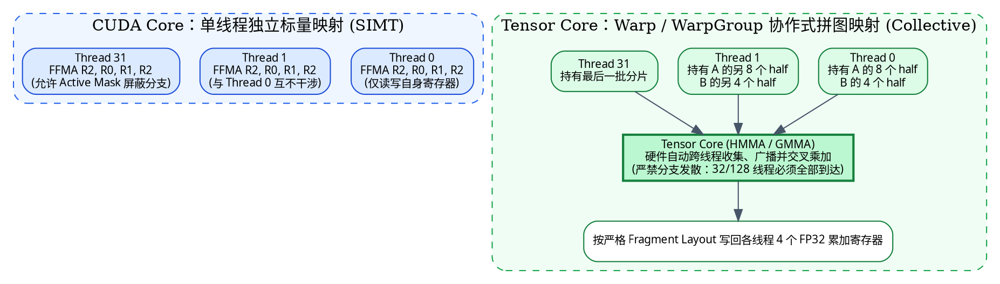

| 对比维度 | CUDA Core | Tensor Core |
| --- | --- | --- |
| **执行粒度** | 单线程标量（Warp 只是控制流打包） | 强协作（32 线程 Warp / 128 线程 WarpGroup） |
| **数据独立性** | 各线程寄存器完全独立，互不干扰 | 矩阵块打散在所有参与线程的寄存器中，硬件内部隐式跨线程交换数据 |
| **寄存器映射** | 开发者自由决定哪个线程存什么数据 | **必须严格遵守架构规定的 Fragment Layout**（否则算出的矩阵是错的） |
| **数据来源** | 寄存器（极少数支持常量/即时数） | Ampere 需先加载进寄存器；Hopper (`wgmma`) 可直接从 Shared Memory 读；Blackwell 累加器独立存放在 **TMEM** |
| **分支发散容忍度** | 允许（硬件通过 Active Mask 屏蔽非活跃线程） | **严禁**（`mma.sync.aligned` 要求 Warp 内所有 32 个线程必须全部到达并同步执行，否则行为未定义） |

---

## 五、能力边界：Tensor Core 与 CUDA Core 能互相实现对方吗？

结论非常明确：**Tensor Core 不能实现所有 CUDA Core 的功能；但 CUDA Core 在功能上可以实现所有 Tensor Core 的功能（只是慢几个数量级）。**

两者本质上是**专用固定功能加速器（ASIC 思路）**与**通用可编程计算单元（图灵完备）**的区别。

### 5.1 Tensor Core 不能实现所有 CUDA Core 的功能

Tensor Core 的硬件电路本质上就是一个高度定制的**矩阵乘加阵列**，它只认识一种数学模式：$D = A \times B + C$（以及部分架构支持的 `XOR` / `AND` 位矩阵乘 `BMMA`）。它**不是图灵完备的**，缺少通用计算必需的绝大多数能力：

- **无控制流与分支能力**：无法执行 `if/else`、循环跳转、谓词判断（Predication）。
- **无地址计算与访存能力**：无法计算数组下标、指针偏移，也无法直接发起通用标量访存。
- **无通用标量/位运算**：无法直接做整数除法、取模、移位、比较（`>` / `<`）、`max`/`min` 等操作。
- **无法直接处理非线性算子**：AI 模型中的 `Softmax`、`LayerNorm`、`RoPE`、`ReLU/GELU` 等逐元素或归约操作，Tensor Core 无法直接完成，必须退回到 CUDA Core 和 SFU 上执行。
- **精度与舍入受限**：Tensor Core 不支持标准的纯 `FP32 × FP32` 矩阵乘（Ampere 引入的 `TF32` 会把尾数从 23 位截断到 10 位），无法替代需要严格 IEEE-754 标量精度的科学计算。

> [!NOTE] 进阶补充：学术界用 Tensor Core 算 Scan / FFT 的局限
> 在学术界和 HPC 领域，确实有人通过数学变换“强行”用 Tensor Core 算非矩阵任务——例如把 **前缀和（Scan）** 转化为乘以上三角全 1 矩阵，把 **FFT** 拆解为小矩阵乘，或者用 Tensor Core 做 **归约（Reduction）**。但即便如此，外围的循环控制、内存索引、数据重排依然必须由 CUDA Core 配合完成，Tensor Core 永远无法独立跑完一个完整的 Kernel。

### 5.2 CUDA Core 可以实现所有 Tensor Core 的功能

CUDA Core（配合 SM 的控制流和 LD/ST 单元）是**图灵完备**的。Tensor Core 能算的任何东西，CUDA Core 在逻辑和数学上都能算出来：

- **常规矩阵乘**：把 $D = A \times B + C$ 写成普通的标量循环，用 CUDA Core 的 `FFMA`（FP32）、`HFMA2`（FP16x2）、`DFMA`（FP64）或 `IMAD`（INT32）就能算完。在 **Volta 架构（2017 年）** 诞生之前，所有深度学习的 GEMM（如早期的 cuBLAS / cuDNN）全都是跑在 CUDA Core 上的。
- **特殊格式与稀疏特性**：哪怕是 Tensor Core 专属的 **FP8、FP4、TF32、2:4 结构化稀疏**，CUDA Core 也可以通过位运算（`LOP3`、移位、查表）手动解包、截断尾数并模拟乘加，甚至能做到**逐比特（Bit-exact）完全一致**。

但用 CUDA Core 去干 Tensor Core 的活，代价是灾难性的：

1. **算力吞吐差 1~2 个数量级**：以 **H100** 为例，FP16 Tensor Core 算力接近 **1000 TFLOPS**，而 FP32 CUDA Core 只有约 **67 TFLOPS**；如果用 CUDA Core 去软件模拟 FP8/FP4 解包，性能差距会进一步拉大到上百倍。
2. **指令发射与寄存器带宽瓶颈**：Tensor Core 一条 `HMMA` / `WGMMA` 指令就能触发成百上千次乘加，极大节省了 Warp Scheduler 的指令发射带宽和 Register File 的读写功耗；而 CUDA Core 需要发射海量 `FFMA` 指令，反复读写寄存器，能效比极低。

| 维度 | Tensor Core 替代 CUDA Core | CUDA Core 替代 Tensor Core |
| --- | --- | --- |
| **功能可行性** | **不可行**（仅支持矩阵乘加，非图灵完备） | **完全可行**（图灵完备，可软件模拟一切特性） |
| **实际工程角色** | 负责算力占比最高（通常 **80%~95%**）的密集矩阵乘 | 负责控制流、地址计算、非线性算子及 Tensor Core 之间的“胶水”逻辑 |
| **协作关系** | 必须依赖 CUDA Core 做前/后处理和调度 | 离开 Tensor Core 仍能跑通所有程序，但 AI 算力会退化回十年前的水平 |

---

## 六、为什么连普通 SIMD 张量运算都算不了，却偏偏叫“Tensor Core”？

**是的**——在硬件指令集（ISA）层面，NVIDIA 的 Tensor Core **确实只做矩阵乘加（MMA）**，它不是一个通用的 SIMD 向量单元，无法直接执行逐元素（Element-wise）的张量运算（如 `A + B`、`A * B`、`ReLU`、`LayerNorm` 等）。

### 6.1 为什么 Tensor Core 不做普通 SIMD 张量计算？

这并不是技术上做不到，而是芯片微架构设计上刻意做的**算力分工**：

- **硬件电路形态不同**：Tensor Core 底层是由大规模点积树（Dot-Product Tree）或脉动阵列组成的固定数据通路，专为高计算密度（Arithmetic Intensity）的 $O(N^3)$ 矩阵乘设计——从寄存器读一次数据，在电路内部复用多次完成大量乘加。
- **SIMD 逐元素运算是访存受限的**：像 `C = A + B`、`C = A * B` 这类 1D/逐元素张量计算，计算复杂度只有 $O(N)$，瓶颈完全在显存/SRAM 带宽，而不是算力。给 Tensor Core 加上通用 SIMD 逻辑只会徒增芯片面积和功耗，却换不来任何端到端加速。

强行用 Tensor Core 算 SIMD 在数学上虽然可以“作弊”（构造单位矩阵算 $A \times I + C$ 实现加法，或填成对角矩阵算逐元素乘法），但工程上**完全不划算**——不仅消耗额外寄存器和带宽构造充满 `0` 的矩阵，还浪费了矩阵乘 $K$ 维度的绝大部分算力。

### 6.2 NVIDIA GPU 上谁来做 SIMD 张量计算？

在 NVIDIA GPU 的分工里，**CUDA Core 就是专门干 SIMD 向量计算的单元**：

- **天然的 32-wide SIMD**：虽然编程模型叫 SIMT，但硬件上 Warp Scheduler 每次发射一条指令，32 个线程在 32 个 CUDA Core 通道上同步执行，本质上就是一个 **32-lane 的 SIMD 向量机**。
- **Packed SIMD（子字并行）**：对于低精度张量，单个 CUDA Core 还支持 2-way 甚至 4-way 的 SIMD 指令。例如：
  - `HADD2` / `HMUL2` / `HFMA2`：单个 CUDA Core 一拍并行处理 2 个 FP16/BF16 元素（一个 Warp 一拍处理 64 个元素）。
  - `DP4A`：一拍完成 4 组 INT8 乘加。

如果横向对比其他 AI 加速器（如 **Google TPU 的 MXU + VPU**，或各类 NPU 的 **Cube 矩阵核 + Vector 向量核**），NVIDIA GPU 的架构逻辑其实完全一致：
- **Tensor Core** = 专用矩阵核（Cube / MXU），只吞吐密集矩阵乘加。
- **CUDA Core (+ SFU)** = 通用向量核（Vector / SIMD Unit）+ 标量控制核，负责所有逐元素张量计算、归约（Reduction）、激活函数和控制流。

### 6.3 命名真相：商业营销风口 + 数学降维归宿

既然只能算矩阵乘加，为什么 NVIDIA 给它取名叫 **Tensor Core**？说白了，一半是**商业营销与历史语境**，另一半是**深度学习底层的数学降维事实**：

1. **商业营销：蹭上了“Tensor”的时代风口**
   Tensor Core 诞生于 **2017 年的 Volta 架构（V100）**。那个时间点，Google 的 **TensorFlow** 正如日中天，而且 Google 刚在 2016 年高调发布了 **TPU（Tensor Processing Unit）**。
   其实 Google TPU 里的核心计算阵列叫 **MXU（Matrix Multiply Unit）**，本质上也只做矩阵乘。但在市场传播上，“Matrix（矩阵）”听起来像传统科学计算或图形学里的老古董，而“Tensor（张量）”直接等同于最火的 AI 深度学习。NVIDIA 顺势起名 **Tensor Core**，属于精准抢占 AI 芯片的心智。
   相比之下，其他厂商的命名就“老实”得多：
   - **AMD**：直接叫 **Matrix Core**（CDNA 架构）
   - **Intel**：叫 **XMX**（Xe **Matrix** Extensions）
   - **Apple**：叫 **AMX**（Apple **Matrix** Coprocessor）
   甚至连 NVIDIA 自己在底层指令集里也装都不装——PTX 指令叫 `mma`（**Matrix** Multiply-Accumulate），SASS 指令叫 `HMMA` / `GMMA`，全程只认 Matrix，绝口不提 Tensor。

2. **数学与编译层：高维张量算力最终都归宿于 GEMM**
   虽然叫法偏营销，但从计算图和编译器的视角看，它也不算完全“名不副实”：
   - **定义上**：标量是 0 阶张量，向量是 1 阶张量，**矩阵本身就是 2 阶张量（Rank-2 Tensor）**。
   - **算子降维（Lowering）**：深度学习里真正消耗 90% 以上算力的高维张量计算——比如 4D 卷积（通过 `im2col` 或 Implicit GEMM 转换）、Transformer 里的多头注意力（Batched GEMM）、以及各种高维张量缩并（Tensor Contraction / `einsum`）——在进入硬件前，几乎都会被框架或编译器**展平、重排成 2D 矩阵乘**。

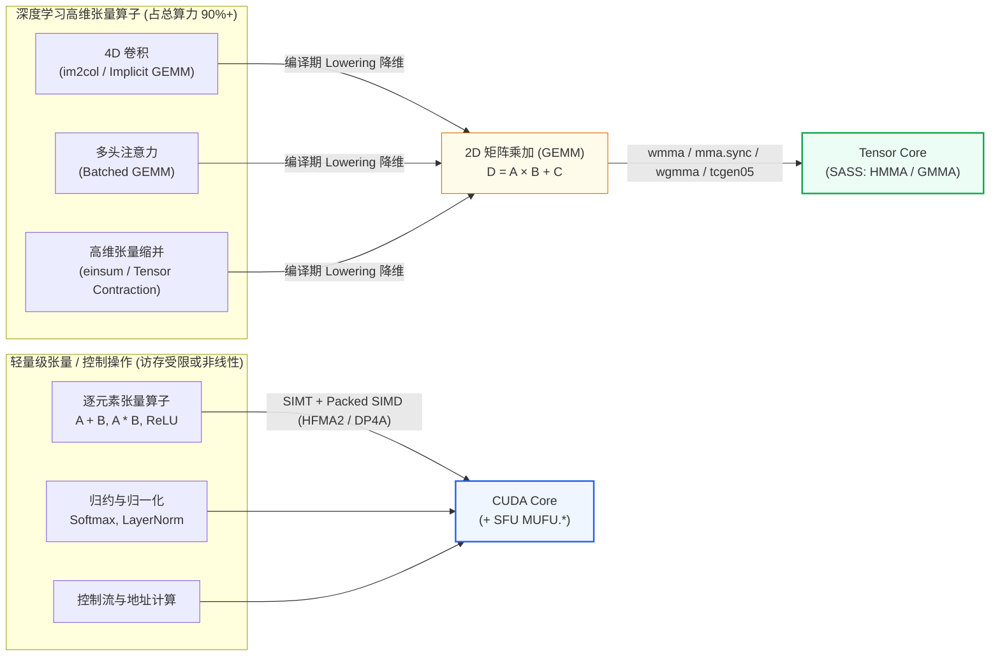

也就是说，Tensor Core 虽然不能直接算所有种类的张量操作，但它吃掉了整个“张量计算”世界里最重、最核心的那块骨头。至于剩下的逐元素加减、激活函数、归一化这些轻量级张量操作，交给旁边的 CUDA Core（SIMD 向量通路）和 SFU 顺手打扫战场就够了。

---

## 七、SM 内部微观拓扑：四个 Sub-partition 是如何协同与切分资源的？

前面我们反复提到 **SM（流多处理器）** 和 **Sub-partition（处理块 / 子分区）**。很多初学者在看芯片参数表时会疑惑：“为什么一块 GPU 动辄几千个 CUDA Core、几百个 Tensor Core，写代码时却经常听到线程块（CTA / Thread Block）、Register File 抢占、Shared Memory 容量限制？这些核心在一个 SM 内部到底是怎么摆放的？”

把单个 SM 放大看，现代 NVIDIA GPU（从 Volta 到 Ampere、Ada、Hopper、Blackwell）普遍采用的是**高度对称的“四象限（4 Sub-partitions）”切分架构**。

### 7.1 私有资源 vs 全 SM 共享资源

在一个 SM 内部，硬件资源清晰地分为两层：**“4 个子分区各自独享的私有计算资源”** 和 **“全 SM 共享的公共存储与外围单元”**：

1. **4 个 Sub-partition（Processing Block）的私有资源**：
   - **1 个 Warp Scheduler + 1 个 Dispatch Unit**：负责在自己管辖的活跃 Warp 池子里挑选已就绪的 Warp，每拍发射指令。
   - **1/4 份 Register File（寄存器文件）**：整个 SM 通常有 `65,536` 个 32 位寄存器（即 **256 KB**），均分给 4 个 Sub-partition，每个 Sub-partition 独占 `16,384` 个（**64 KB**）。
   - **专属的标量通道与 SFU**：例如在 Ampere / Ada 中，每个 Sub-partition 拥有 `16` 个纯 FP32 通道 + `16` 个 FP32/INT32 复用通道 + `4` 个 SFU（Hopper 则是 `32` 个 FP32 + `16` 个 INT32 + `4` 个 SFU）；在 Turing/Ampere/Ada/Hopper 中，每个 Sub-partition 还有专属的 `LD/ST` 发射端口。
   - **专属的 Tensor Core**：在 Ampere / Ada / Hopper / Blackwell 中，每个 Sub-partition 配备 **1 个宽位宽 Tensor Core**（整个 SM 共 4 个；早期 Volta / Turing 则是每 Sub-partition 2 个较窄的 Tensor Core，全 SM 共 8 个）。
2. **全 SM 共享的公共资源**：
   - **Unified Shared Memory / L1 Data Cache（统一片上高速缓存）**：供 SM 内全部 4 个 Sub-partition 共享。同一线程块（Thread Block）内的不同 Warp 可能被分配到不同 Sub-partition 上跑，它们正是通过这块共享 SRAM 交换数据与同步。
   - **Texture Units（纹理单元）** 与 **Instruction Cache（L1 指令缓存）**。
   - **RT Core**（仅图形/工作站卡每 SM 配备 1 个）与 **TMA**（Hopper/Blackwell 每 SM 配备的张量异步搬运引擎）。
   - **TMEM（Tensor Memory，Blackwell 新增）**：每 SM 配备 256 KB 专用矩阵累加内存，供跨 Warp / 跨 CTA 的 `tcgen05` 指令直接存放累加结果。

下面这张 Graphviz 微架构图清晰画出了单个 SM 内部的物理拓扑：

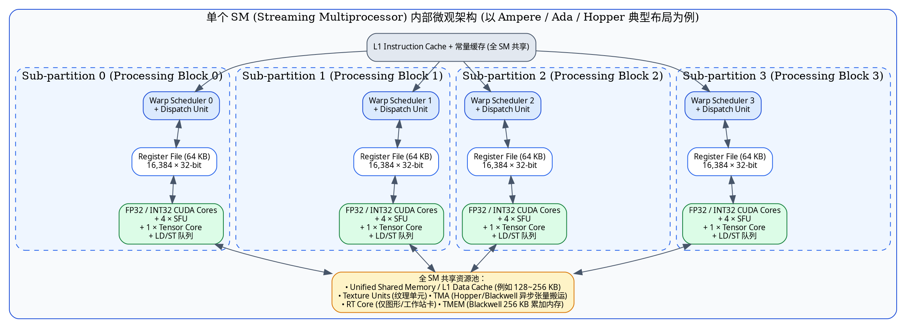

### 7.2 这张架构图解释了哪两个至关重要的编程现象？

1. **为什么单线程块至少要配 128 个线程（4 个 Warp）以上，才不会浪费 SM 算力？**
   因为一个 SM 内部有 **4 个独立工作的 Sub-partition**！如果你启动的线程块里只有 1 个 Warp（32 个线程），它只能被塞进某一个 Sub-partition 里运行，另外 3 个 Sub-partition 里的 Warp Scheduler、CUDA Core 和 Tensor Core 全都在原地空转干瞪眼——算力直接白白损失 **75%**！
2. **为什么 Hopper 要推出 128 线程的 `WGMMA`（Warp Group MMA）？**
   正好 **4 个 Warp = 128 个线程**！当一个 Warp Group 发射 `wgmma.mma_async` 时，刚好可以自然横跨或协同调度 SM 里的硬件资源，并直接从全 SM 共享的 Shared Memory 中持续拉取矩阵块喂给 Tensor Core，避免了大量数据先挤进各自 64 KB 的私有 Register File 导致寄存器溢出（Register Spilling）。

---

## 八、工程实战闭环：如何验证你的代码到底跑在哪个 Core 上？

理解了架构原理，在实际写 CUDA / Triton / PyTorch 算子时，怎么**亲眼验证**自己的代码到底有没有走上 Tensor Core 或 SFU，而不是悄悄退化成了慢速指令？工程上有两把最权威的“照妖镜”。

### 8.1 第一把照妖镜：静态反汇编 `cuobjdump` / `nvdisasm`

你可以直接把编译出来的 `.cubin` 或可执行文件反汇编成原生 **SASS** 机器码，搜索对应的指令助记符：

```bash
# 导出可执行文件或目标文件中的 SASS 汇编代码
cuobjdump --dump-sass ./my_cuda_kernel > kernel.sass

# 快速排查关键核心指令是否命中
grep -E "HMMA|GMMA|QGMMA|tcgen05|MUFU|FFMA|HFMA2|UTMALDG" kernel.sass | head -n 30
```

- 看到 **`HMMA` / `IMMA` / `DMMA` / `GMMA` / `tcgen05`**：恭喜，**Tensor Core** 已成功激活！
- 看到 **`MUFU.SIN` / `MUFU.EX2` / `MUFU.RSQ`**：**SFU** 已成功触发！如果本该走快速数学的地方出现一大串 `FFMA` 而没有 `MUFU`，说明编译器为了满足严格 IEEE-754 精度而退回到了 CUDA Core 多项式展开（检查是否漏加 `--use_fast_math` 或 `__sinf` 等内建函数）。
- 看到 **`UTMALDG` / `UTMASTG`**：**TMA** 异步张量搬运引擎已成功启用。
- 如果本意是矩阵乘却只看到 **`FFMA` / `HFMA2`**：说明矩阵维度未对齐、数据类型不支持或调用路径有误，**完全没有用到 Tensor Core**！

### 8.2 第二把照妖镜：动态硬件性能剖析 `NVIDIA Nsight Compute (ncu)`

静态看到指令还不够——如果 Tensor Core 一直在“饿肚子等显存数据”，实际吞吐率依然很惨。此时需要用 `ncu` 抓取硬件真实运行时的流水线利用率（Pipe Utilization）：

```bash
# 使用 Nsight Compute 采集完整性能报告（含 Compute Workload 与 Roofline 分析）
ncu --set full -o profile_report ./my_cuda_kernel
```

在 `ncu` 报告的 **Compute Workload Analysis** 面板中，重点看各条硬件执行管道（Executed Ipc / Pipe Utilization）的活跃度：

| `ncu` 管道名称 | 对应的物理硬件单元 | 常见诊断结论 |
| :--- | :--- | :--- |
| **`Tensor` (Tensor Pipe)** | Tensor Core | 密集矩阵算子（GEMM / Attention）理想状态下应成为最高占比管道；若接近 0% 说明完全没打中 Tensor Core。 |
| **`FMA` / `FP16` / `ALU`** | CUDA Core (FP32/FP16/INT32) | 若 Tensor Core 算子中 `ALU`/`FMA` 占比过高，说明索引计算、反量化解包或 Epilogue 逐元素后处理拖了后腿。 |
| **`XU` (Transcendental / SFU)** | SFU | 在线 Softmax / RoPE / GELU 算子如果发现 `XU` 接近 100% 满载，说明陷入了 SFU 8 拍吞吐瓶颈（需考虑近似替代或计算融合）。 |
| **`FP64`** | FP64 CUDA Core | 消费级卡若意外看到 `FP64` 占比上升（例如不小心写了 `0.5` 而不是 `0.5f`），算力会瞬间暴跌至 `1/64`！ |
| **`LSU` / `TMA`** | LD/ST Unit / TMA | 若 `LSU` 长期阻塞（Long Scoreboard Stall），且算术强度低于 **Roofline 模型**拐点，说明算子处于 **Memory-Bound（访存受限）**，需要增大 Shared Memory 分块复用或启用 TMA 双缓冲。 |

> [!TIP] 新手最容易中招的“隐形 FP64 降速陷阱”
> 在 CUDA C++ 里写 `float y = x * 0.5 + 1.0;` 时，字面量 `0.5` 和 `1.0` 在 C++ 中默认是 **`double`（FP64）**！编译器会被迫先将 `x` 升格成 `double`，用慢如蜗牛的 `DFMA` 在 FP64 单元算完后再强转回 `float`。永远记得加上 `f` 后缀写成 `0.5f` 和 `1.0f`！

---

## 九、面向 CUDA 编程与 DSL 编译器开发的硬件必修课

弄懂了“有哪些核心”只是第一步。如果你打算手写高性能 CUDA Kernel，或者正在研发 **Triton、CUTLASS CuTe、TVM、MLIR（NVGPU/NVVM 方言）** 这类 GPU DSL 与张量编译器，光知道算力核心远远不够——因为现代 GPU 上 **90% 的性能瓶颈并不是算力不够，而是数据没有以硬件喜欢的方式送进核心里**。

以下是 CUDA 工程师与 DSL 编译器后端开发者必须牢牢刻在脑海里的 **6 大底层硬件契约**：

---

### 9.1 四级存储层次、合并访存（Coalescing）与异步直通路径

GPU 是一台极度“重计算、轻缓存”的机器，算力与显存带宽之间存在巨大的**存储墙（Memory Wall）**。编写 CUDA 或设计编译器 Tiling（分块）Pass 时，必须先摸清这四级存储的物理脾气：

| 存储层级 | 物理位置与作用域 | 典型容量（单 SM / 芯片） | 访存延迟量级 | 编程与 DSL 编译器关注重点 |
| :--- | :--- | :--- | :--- | :--- |
| **Register File** | SM Sub-partition 内（Thread 私有） | 256 KB / SM<br/>（单线程硬上限 **255** 个 32-bit 寄存器） | ~1 拍（零延迟流水） | **警惕溢出（Spilling）**：一旦超出 255 个寄存器或人为限制过多，变量会被编译器悄悄踢到 **Local Memory**（物理上走 L1/L2/HBM，性能暴跌！）。 |
| **Shared Memory / L1** | SM 内共享 SRAM（CTA 内共享） | 128 KB ~ 228 KB / SM（可配置切分比例） | ~20~30 拍 | 编译器 **Tiling** 的主战场。需要精确计算多缓冲（Multi-stage）总字节数，避免超出单 SM 容量上限。 |
| **L2 Cache** | 芯片级共享（所有 SM 互通） | 数十 MB（如 H100 为 50 MB） | ~200+ 拍 | **跨 CTA 复用的唯一硬件缓存**。编译器常通过 **CTA Swizzling（Grid 调度块重排，如 L2 Cache 局部性 Z-order）** 提高 L2 命中率。 |
| **Global Memory (HBM/GDDR)** | 独立显存颗粒（全设备共享） | 数十至上百 GB | ~400~800+ 拍 | 必须保证 **合并访存（Coalescing）** 并通过 `cp.async` / `TMA` 异步预取隐藏长延迟。 |

#### 1. 合并访存（Memory Coalescing）与 32B Sector

Global Memory 控制器并不会按“单个 `float`（4 字节）”去读写显存，而是以 **32 字节扇区（Sector）** 为最小物理传输事务（4 个连续 Sector 组成一条 128 字节 Cache Line）：

- **理想合并**：当一个 Warp 的 32 个线程访问连续且对齐的 32 个 `float`（共 128 字节）时，硬件只需要发起 **4 个 32B Sector 事务（1 条 Cache Line）**，带宽利用率 **100%**。
- **步长灾难**：如果线程按大步长跳跃访问（例如按列读一个行主序二维矩阵），32 个线程的地址落在了 32 个互不相连的 Sector 上，硬件被迫发起 **32 次独立内存事务**，有效带宽瞬间跌至 **1/8 甚至 1/32**！
- **对 DSL 编译器的启示**：Triton / CuTe 在做线程布局推导（Thread Layout Inference）时，有一条铁律——**必须将线程束内相邻的 `lane_id` 映射到张量内存中步长为 1（Contiguous）的最内层维度上**，并且尽可能做向量化宽指令加载（如 `LDG.E.128`，每线程一次加载 16 字节 `float4`）。

#### 2. 绕过寄存器的异步数据通路演进

从显存搬数据进 Shared Memory，硬件经历了三代演进，这也是现代编译器 **Software Pipelining（软件流水线）** Pass 必须区分的路径：

- **传统同步路径（Volta/Turing）**：`LDG`（Global $\rightarrow$ Register）+ `STS`（Register $\rightarrow$ Shared）。数据必须在宝贵的 Register File 里中转一圈，白白占用寄存器名额并拉高延迟。
- **Ampere 异步拷贝（`cp.async` / SASS `LDGSTS`）**：硬件允许数据**直接从 Global Memory（经 L2/L1）写进 Shared Memory，彻底绕过寄存器**！这让双缓冲/多缓冲（Multi-stage Prefetch）流水线正式普及。
- **Hopper/Blackwell 张量异步搬运（`TMA` / `cp.async.bulk.tensor`）**：连每线程算地址和判断边界 `if (row < M)` 都省了——只需要 1 个线程提交 `CUtensorMap` 描述符，TMA 引擎后台自动搬运并自动越界补零，配合 `mbarrier` 完成通知。

---

### 9.2 Shared Memory Bank Conflict 与 Swizzle 硬件消除术

新手好不容易把数据搬进了飞快的 Shared Memory，结果一测性能依然很差，十有八九撞上了 **Bank Conflict（存储体冲突）**。

#### 1. 物理原理：32 个 4 字节宽的 Bank

在物理电路上，SM 里的 Shared Memory 并不是一整块单口内存，而是被切分成了 **32 个独立的存储体（Bank 0 ~ Bank 31）**，每个 Bank 的宽度固定为 **4 字节（32-bit）**。地址映射规则非常简单：

$$
\text{Bank ID} = \left\lfloor \frac{\text{Byte Address}}{4} \right\rfloor \bmod 32
$$

- **无冲突（1 拍完成）**：一个 Warp 的 32 个线程同时读写的地址刚好分散在 32 个不同的 Bank 上，或者多个线程读**同一个 32-bit 地址**（触发硬件 **Broadcast 广播机制**）。
- **$N$-way Bank Conflict（性能下降 $N$ 倍）**：如果 32 个线程中有 $N$ 个线程访问了**同一个 Bank 里的不同地址**（比如线程 0 读 `Bank 0` 的第 0 行，线程 1 读 `Bank 0` 的第 1 行），硬件只能把它们拆成 $N$ 批串行服务！

#### 2. 为什么 Tensor Core 极易触发 Bank Conflict？如何用 `Swizzle` 零成本解决？

在做矩阵乘（GEMM）或矩阵转置时，我们经常需要“按行写入 Shared Memory，再按列读出来喂给 Tensor Core”。如果矩阵的列宽（Stride）恰好是 32 个 `float`（128 字节）或 64 个 `half`，那么同一列上的所有元素全部会落进 **同一个 Bank**，引发灾难性的 **32-way 或 16-way Bank Conflict**！

工程与编译器上有两种解法：
- **老办法：Padding（行尾填充）**：在每行末尾人为多塞 1~4 个无用的空白元素，把行步长错开。缺点是白白浪费稀缺的 Shared Memory 容量，且破坏 **TMA** 要求的 16 字节/128 字节对齐规范。
- **现代编译器核心绝招：Swizzle（异或地址混淆）**：在 **CUTLASS CuTe** 与 **Triton** 编译器中，普遍采用一种零额外空间开销的位运算技巧——**Swizzle**！它利用矩阵元素所在的行号高位与列号进行按位异或（`XOR`）：
  $$\text{Swizzled\_Col} = \text{Col} \oplus (\text{Row} \bmod K)$$
  这样一来，**写入时同一行仍处于不同 Bank，而读取时原本撞在同一列同一个 Bank 的元素，被巧妙地“错位”打散到了不同的 Bank 中**，而且还完美兼容 `TMA` 硬件的 Swizzle 模式（如 32B / 64B / 128B Swizzle）以及 `ldmatrix` 指令！

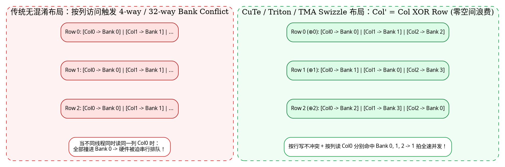

---

### 9.3 Occupancy（占用率）与延迟隐藏：为什么“100% 占用率”反而不一定最快？

GPU 没有 CPU 那样庞大的乱序执行（Out-of-Order）窗口和几兆字节分支预测器，它隐藏几百拍 Global Memory 延迟或 20 拍 `MUFU` / `HMMA` 延迟的唯一法宝，叫做 **零开销硬件线程束切换（Zero-Overhead Warp Switching）**：当前正在跑的 Warp 一旦等数据卡住（Stall），Warp Scheduler 就在**下一个时钟周期**无缝切到另一个已经就绪的 Warp 继续发射指令。

所谓 **Occupancy（占用率）**，就是 **“当前 SM 上实际驻留的活跃 Warp 数 ÷ 该 SM 硬件支持的最大 Warp 数”**。限制占用率的三大硬件天花板分别是：
1. **硬件硬上限**：例如 Ampere GA100 / Hopper GH100 每 SM 最多驻留 `64` 个 Warp（2048 线程），部分消费级/Ada 架构为 `48` 个 Warp（1536 线程）；每 SM 最大 CTA（线程块）数量也有上限（如 `16` 或 `32` 个）。
2. **Register File 瓶颈（256 KB / SM）**：若单个线程消耗了 `128` 个寄存器，整个 SM 最多只能塞 $65,536 \div 128 = 512$ 个线程（`16` 个 Warp），Occupancy 上限立刻跌到 `25%`（64 Warp 架构下）。
3. **Shared Memory 瓶颈**：若每个 CTA 申请了超过半数可用 SMEM（例如 164 KB 中的 96 KB），同一个 SM 就只能放 **1 个 CTA**，剩下几十 KB 的 SMEM 与其他 Sub-partition 算力都会遭遇“木桶效应”浪费。

> [!IMPORTANT] 编译器调优的核心反直觉：低 Occupancy + 大 Tile 往往完胜 100% Occupancy
> 初学者常把“追求 100% Occupancy”当成金科玉律，但在 **CUTLASS / Triton** 编写的高性能 GEMM 与 FlashAttention 算子中，最优内核的 Occupancy 往往只有 **25% ~ 50%**（每个 SM 只驻留 1~2 个巨型 CTA）！
>
> 原因在于：**更大的分块（Tile Size）需要更多寄存器和 Shared Memory，但能换来成倍提升的矩阵数据复用率（Arithmetic Intensity），彻底打破显存带宽瓶颈**；而少量的活跃 Warp 已经足够通过 **ILP（指令级并行，如循环展开同时发射多条独立指令）** 和 **`cp.async`/`TMA` 多阶段预取流水线**把执行单元喂饱。DSL 编译器的 Auto-tuner 本质上就是在 **Tile Size、Register/SMEM Pressure、Stages 与 Occupancy** 之间做帕累托最优搜索。

---

### 9.4 线程层次演化：从 `Grid/Block/Warp` 到 Hopper `Cluster / DSMEM` 与 `Warp Specialization`

在软件层面写 CUDA 或 DSL 时，逻辑层次与物理硬件资源的绑定关系必须一清二楚：

1. **Warp（32 线程）—— 跨线程寄存器直传的秘密通道**
   除了共同执行 Tensor Core `mma` 指令外，同一个 Warp 的 32 个线程之间还可以直接通过 **Warp Shuffle 指令**（如 `__shfl_sync`、`__shfl_xor_sync`，底层 SASS 为 `SHFL`）**直接互读对方寄存器里的值**，完全不需要绕道 Shared Memory 和 `__syncthreads()`！这是实现极速块内归约（Reduction，如 Softmax 求最大值与求和）的核心原语。
2. **CTA / Thread Block $\leftrightarrow$ 绑定至单个 SM**
   同一个 CTA 内的所有 Warp 保证落在**同一个 SM** 上，共享同一个 Shared Memory 池。
3. **Thread Block Cluster + DSMEM（Hopper / Blackwell 第四级层次）**
   从 Hopper 架构开始，NVIDIA 在 Grid 和 CTA 之间新增了一级硬件抽象——**Cluster（线程块集群）**，其物理载体是芯片上的 **GPC（Graphics Processing Cluster，图形处理集群）** 内的多个相邻 SM：
   - 同一 Cluster 内的不同 CTA 会被调度到直连的 SM 上，通过专门的 **SM-to-SM 网络**直接读写彼此的 Shared Memory，这被称为 **Distributed Shared Memory（DSMEM，分布式共享内存）**。
   - **TMA Multicast（硬件多播）**：当多个相邻 SM 需要同一块权重矩阵时，TMA 只需从 HBM 读取**一次**数据，就能像广播电台一样同时复制进 Cluster 内多个 SM 的 Shared Memory，成倍节省宝贵的 HBM 显存与 L2 带宽！
   - **Blackwell 2-CTA 协作矩阵乘（`tcgen05`）**：支持 Cluster 内相邻两个 SM 协同完成一个超大矩阵分片计算，进一步减少权重加载次数。
4. **Warp Specialization（线程束特化：Producer-Consumer 异步接力）**
   这是 **Hopper / Blackwell** 时代 CUTLASS 3.x 与前沿 DSL（如 Triton / TileLang）最核心的编程范式转变：不再让 CTA 里的所有 Warp 干相同的活，而是把它们分成两支专业特种部队：
   - **Producer Warp（搬运工组）**：专门调用 `TMA` 异步把下一批数据搬进 SMEM，甚至主动调用 PTX 指令 `setmaxnreg.dec` **把多余的寄存器让渡出去**。
   - **Consumer Warp Group（算力主力组）**：专门执行 `wgmma` / `tcgen05` 与后处理，调用 `setmaxnreg.inc` **抢占更多的寄存器名额**用来保存巨型累加矩阵块，双方通过 `mbarrier` 无锁接力，把张量核利用率推向物理极限。

---

### 9.5 同步原语、独立线程调度（ITS）与弱内存模型（Weak Memory Model）

写多线程并发代码和编译器后端时，最容易写出“在测试卡上能跑、换张卡就随机死锁或算错”的幽灵 Bug，根源几乎都在以下三点：

1. **Volta+ 独立线程调度（Independent Thread Scheduling, ITS）**：
   早期的老架构（Pascal 及以前）同一 Warp 的 32 个线程共享同一个程序计数器（PC），客观上存在“隐式锁步（Implicit Lockstep）”假象。**从 Volta 架构开始，每个线程都有了自己独立的 PC 和调用栈！** 因此，千万不要再假设同一 Warp 的线程“天然同步”。所有 Warp 级协同操作都必须显式传递活跃线程掩码并同步（例如 `__syncwarp(0xffffffff)` 或 `__shfl_sync(mask, ...)`）。
2. **`mbarrier`（异步内存屏障）与相位翻转（Phase Parity）**：
   在异步时代，如果每次 TMA 搬运完都要用 `__syncthreads()` 让所有线程停下来，异步重叠就毫无意义。Ampere 引入、Hopper/Blackwell 强化的 **`mbarrier`** 运行在 Shared Memory 中，支持 **Arrive-on-Bytes（按预计到达的字节数自动倒计时，TMA 搬够字节后硬件自动触发完成信号）** 和 **奇偶相位（Phase 0 / Phase 1 交替）** 校验，实现无锁、极低开销的生产者-消费者双缓冲同步。
3. **弱内存序（Weak Memory Ordering）与作用域栅栏（Memory Fence Scope）**：
   GPU 出于极致性能考虑采用**弱内存模型**——线程 A 写入了全局显存，并不代表另一颗 SM 上的线程 B 立刻就能看见最新值（可能还停留在线程 A 所在 SM 的 L1 缓存或写缓冲区里）。必须显式指定栅栏与作用域：
   - `__threadfence_block()`（`.cta` 作用域）：确保同 SM 内的其他线程可见。
   - `__threadfence()`（`.gpu` 作用域）：确保整张 GPU 芯片上的所有 SM（经由 L2 持久化）可见。
   - `__threadfence_system()`（`.sys` 作用域）：确保主机 CPU 与多卡互联（NVLink / PCIe）对端可见。

---

### 9.6 DSL 编译器（Triton / CuTe / MLIR）后端必须编码的硬件规则总览

如果你正在构建面向 NVIDIA GPU 的 DSL 编译器，下面这张架构图浓缩了高级张量 IR 到 PTX/SASS 过程中必须嵌入的核心 Pass 与硬件契约：

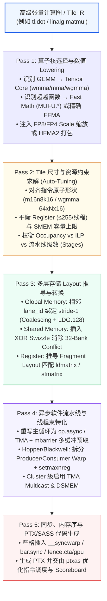

---

## 十、终极选型决策树与全篇自查清单

当你面对一个具体的算子或计算任务时，不知道该把它交由哪个硬件单元处理？下面这张决策树可以作为你的实战路线图：

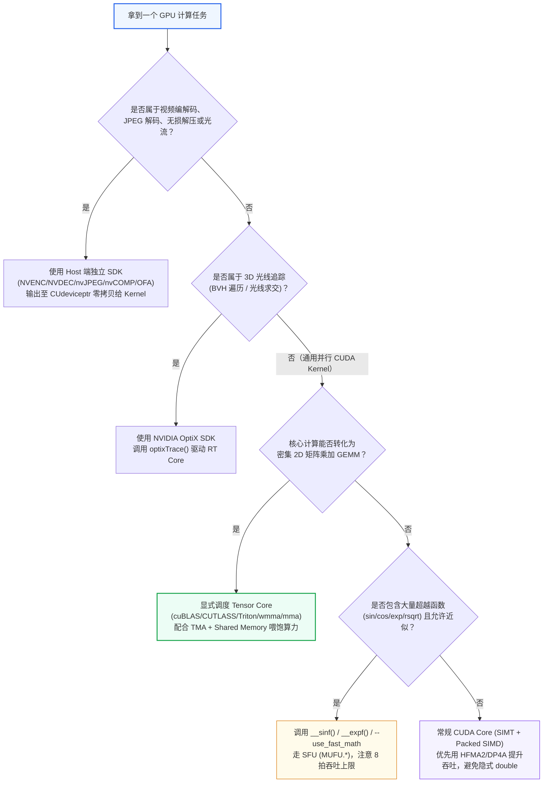

合上教程前，可以用下面 **8 个自查问题**检验自己是否彻底掌握了 NVIDIA GPU 核心体系与编译器硬件契约：

1. **为什么说单个 CUDA Core 不能等同于 CPU 核心？**（它没有独立的取指、译码和控制逻辑，只是 SM 内受 Warp Scheduler 统一指挥的 SIMT 标量通道。）
2. **为什么写了 `sinf(x)` 却未必跑到 SFU 上？**（标准数学库为满足 IEEE-754 精度通常在 FP32 CUDA Core 上展开为 `FFMA` 多项式；需通过 `__sinf()` 等内建函数或 `--use_fast_math` 才能生成 `MUFU.*` 进入 SFU。）
3. **为什么单条 SASS `MUFU` 指令不能在硬件上 1 拍算完？**（每个 Sub-partition 通常只有 4 个 SFU，32 线程的 Warp 至少需要 8 拍发射完毕，且多级查表插值流水线有 14~20+ 拍延迟，需依靠 Scoreboard Barrier 防止 RAW 冒险。）
4. **为什么调用 Tensor Core 时严禁线程发生分支发散？**（矩阵分片被按严格的 Fragment Layout 打散存在整个 Warp/WarpGroup 的寄存器中，硬件内部隐式跨线程收集与交叉乘加，要求所有参与线程必须同步到达。）
5. **为什么 Hopper 架构要引入 128 线程的 `WGMMA` 与 `TMA`？**（128 线程正好匹配 SM 内 4 个 Sub-partition；`WGMMA` 允许直接从 Shared Memory 读操作数减轻寄存器压力，`TMA` 用单线程硬件级多维坐标搬运解放 CUDA Core。）
6. **为什么 Tensor Core 只能算矩阵乘加，却不顺便把 `A + B` 这种逐元素 SIMD 一起算了？**（逐元素运算是 $O(N)$ 访存受限，交由本质上是 32-wide SIMD 且支持 `HFMA2`/`DP4A` 的 CUDA Core 处理性价比最高；而 Tensor Core 专注于吃掉占深度学习 90%+ 算力的 2D GEMM。）
7. **为什么现代 DSL 编译器宁可用位异或 `Swizzle` 也不用 Padding 来解 Shared Memory Bank Conflict？**（Shared Memory 按 32 个 4 字节 Bank 交错映射；`Swizzle` 通过 `Col' = Col XOR Row` 在零额外空间浪费下打散同列碰撞，且完美兼容 `TMA` 对齐约束与 `ldmatrix` 指令。）
8. **为什么高性能 GEMM 算子往往在 25%~50% Occupancy 下跑得比 100% Occupancy 更快？**（更大的分块 Tile 与更深的异步预取 Stages 需要更多寄存器与 SMEM，牺牲部分 Occupancy 换取成倍提升的数据复用率，再靠 ILP 与 `cp.async`/`TMA` 掩盖延迟。）
