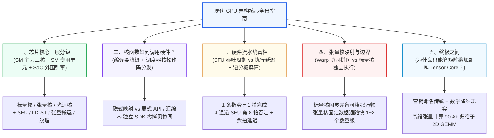
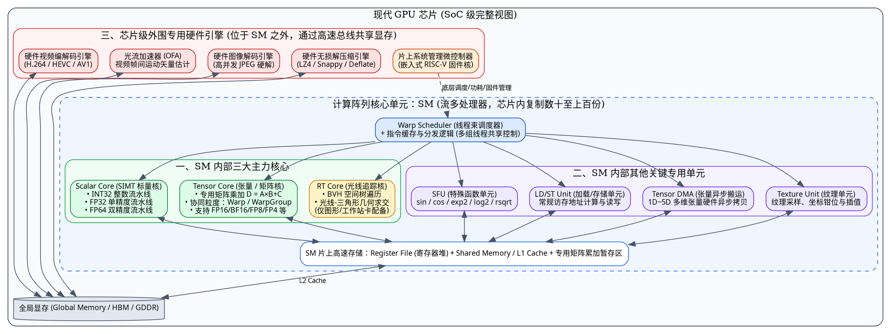
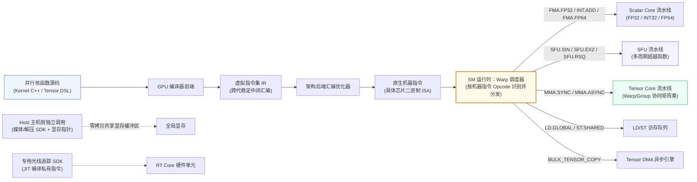
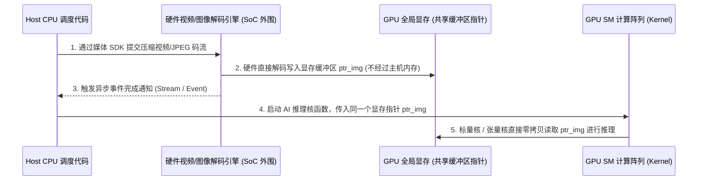
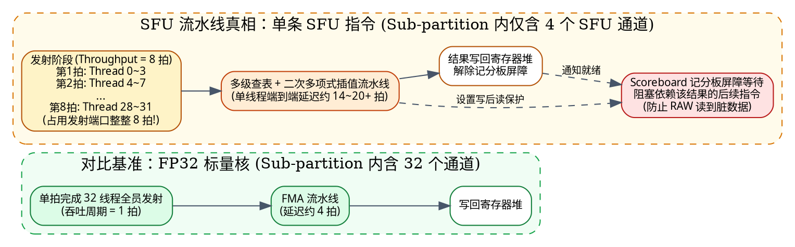
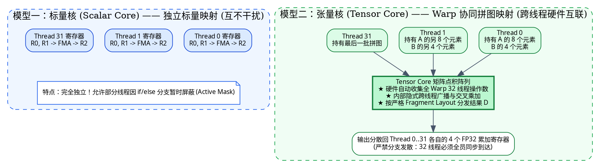
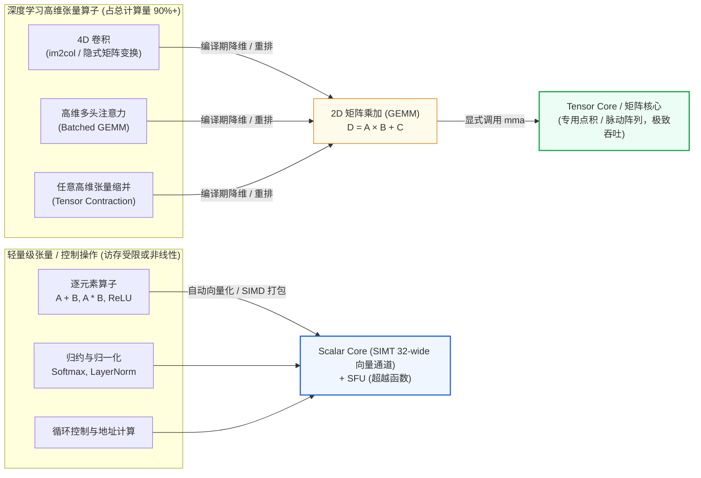

> **导读**：在很多人初学 GPU（图形处理器）编程时，脑海里往往有一个简化图景：“GPU 里面塞了成千上万个小 CPU 核心，写好并行代码扔上去一起算就完了。”
>
> 但当你真正掀开现代 GPU 的微架构盖子，会发现事实远比这精彩——它根本不是由单一的通用计算单元堆出来的，而是一座**高度异构的精密流水线工厂**。在这座工厂里，有负责常规算术与逻辑控制的**通用标量核**，有专攻矩阵乘加、算力爆表的**张量核（矩阵核）**，有专门加速光线几何求交的**光追核**，还有只管三角函数/指数对数的**特殊函数单元（SFU）**、专职多维搬运的**张量内存搬运引擎**，以及独立于计算阵列之外的视频编解码、图像解压和系统管理微控制器。
>
> 更让初学者困惑的问题接踵而至：
> 1. **写并行核函数（Kernel）代码时，我并没有指定“把这行代码交给某个物理核心”，底层硬件究竟是怎么路由的？**
> 2. **为什么反汇编看到一条 `SFU` 机器指令，硬件上却并不是“一拍”就能做完？**
> 3. **张量核（Tensor Core）必须显式调用，它的数据-线程映射和普通标量核到底有什么不同？**
> 4. **张量核和标量核能互相替代吗？为什么它连最普通的张量逐元素加法都算不了，却偏偏叫“Tensor Core”？**
>
> 本文将完全照顾**零基础初学者的阅读体验**：**每一个专业术语在第一次出现时都会给出通俗解释**，并配合多张 **Graphviz 架构/流水线图** 与 **Mermaid 流程图**，带你从芯片物理拓扑一路打通到底层指令映射与架构哲学。

---

## 零、初学者核心名词破冰速查表

在正式进入正文前，你可以把下面这张表当作“随身词典”。正文第一次提到这些名词时，我们也会结合具体例子与类比展开说明。

| 术语 / 缩写 | 英文全称 | 一句话通俗解释 |
| :--- | :--- | :--- |
| **SM（流多处理器）** | Streaming Multiprocessor | GPU 芯片内部最核心的“基本车间”。一颗 GPU 由几十上百个相同的 SM 组成，绝大多数计算核心都住在 SM 里面。 |
| **SIMT（单指令多线程）** | Single Instruction, Multiple Threads | GPU 的核心执行模式：**一个指挥官发一条命令，32 个士兵（线程）拿着各自不同的数据同时执行同一个动作**，既保持硬件极简，又允许各自有独立分支。 |
| **SIMD（单指令多数据）** | Single Instruction, Multiple Data | 处理器用一条指令同时对一组打包好的多个数据（向量）执行相同计算（如一次算 4 个数字加法）。 |
| **Warp（线程束）** | Warp / Wavefront | GPU 硬件调度和发射指令的最小“小队”单位，业界常见规模为 **32 个线程**（也有架构为 64 线程）。同一小队步调高度协同。 |
| **ALU / FPU** | Arithmetic Logic Unit / Floating-Point Unit | **算术逻辑单元 / 浮点单元**。芯片里真正干活的加减乘除计算器电路，分别处理整数和小数。 |
| **Scalar Core（标量核）** | SIMT Scalar Compute Core | 位于 SM 内部、数量最多的基础计算通道。严格来说它不是独立 CPU 核心，而是 SIMT 流水线里服务单个线程的标量 ALU/FPU 通道。 |
| **Tensor Core（张量核 / 矩阵核）** | Tensor / Matrix Core | 专精**矩阵乘加**（$D = A \times B + C$）的固定功能硬件加速器，一拍可以吞吐成百上千次乘加运算，是现代 AI 算力的绝对主力。 |
| **RT Core（光追核）** | Ray Tracing Core | 专门加速 3D 图形实时光线追踪的硬件单元，负责在三维空间树中高速查找光线撞到了哪个三角形。 |
| **SFU（特殊函数单元）** | Special Function Unit | 专门负责计算 $\sin$、$\cos$、$\exp_2$、$\log_2$、倒数与平方根倒数等**超越函数**的硬件加速单元。 |
| **Kernel（核函数）** | Compute Kernel | 开发者编写的、运行在 GPU 设备端的大规模并行函数。成千上万个线程会同时执行这份代码的不同数据分片。 |
| **Virtual ISA / Native ISA** | Virtual / Native Instruction Set Architecture | **虚拟指令集与原生机器指令集**：高级源码先编译成跨代兼容的“虚拟汇编”，再由后端汇编器翻译成特定芯片真正认识的底层硬件机器码。 |
| **Register File（寄存器堆）** | Register File | 紧挨着计算核心、容量有限但速度极快的“手边工作台”，用来存放线程正在计算的临时变量。 |
| **Shared Memory（共享内存）** | On-chip Shared SRAM | 位于 SM 内部的超高速片上公共存储区，同一个线程块（Thread Block）里的线程可以通过它高速交换数据。 |
| **吞吐周期与延迟** | Throughput (Issue Rate) & Latency | **吞吐周期**指“每隔几拍能往流水线里塞进下一条指令”（发车间隔）；**延迟**指“一条指令从进去到结果算出来出来一共要走几拍”（单程耗时）。 |
| **图灵完备** | Turing Complete | 衡量计算系统通用性的标尺：只要拥有条件跳转、循环和通用读写能力，理论上就能模拟计算任何可计算的问题。 |

下面这张全景导图展示了整篇教程的知识脉络：



---

## 一、现代 GPU 里究竟有哪些不同的“核心”？

很多初学者容易把 GPU 里的“核（Core）”和 CPU 里的“核”混为一谈。

在传统 CPU 里，一个核心是一个“全能独行侠”：它自己带有一整套复杂的**取指（Fetch）**、**译码（Decode）**、**分支预测（Branch Prediction）**、**乱序执行（Out-of-Order Execution）**控制电路，以及大容量的多级缓存，能独立高效地跑一个复杂程序。

而现代 GPU 采用的是**高度异构（Heterogeneous，即多种不同专长硬件混编协作）的微架构设计**。在芯片上，绝大多数计算电路被组织成几十到上百个完全相同的计算集群——通常称为 **SM（Streaming Multiprocessor，流多处理器）**。在 SM 内部，控制逻辑被高度共享和简化，省下来的硅片面积全部用来堆砌不同种类的专业计算单元；而在 SM 之外的 **SoC（System on Chip，片上系统）** 层面，还分布着若干独立的专用硬件引擎。

按照所处的物理层级和职责，我们可以把 GPU 中的“核心”清晰地划分为三大类：



下面我们逐层拆解这些硬件单元的真实身份与设计取舍。

### 1.1 SM 内部的三大主力“核心”

在产品宣传和芯片白皮书里，最常被冠以“Core（核心）”称号的，是住在 SM 内部的以下三类主角：

#### （1）通用标量计算核心（Scalar Core / SIMT 通道）

它是 GPU 中数量最多、最基础的算术逻辑单元。严格来说，单个标量核**并不等同于 CPU 的核心**——它没有自己独立的取指、译码和控制逻辑，而更像是 **SIMT（单指令多线程）流水线中的一个标量 ALU/FPU 通道（Lane）**，由 SM 里的线程束调度器统一发号施令。

在微架构内部，标量核通常会按处理的数据类型进一步细分为三类硬件流水线：

- **INT32 单元（32 位整数单元）**：专门处理 32 位整数加减乘、位运算和逻辑比较。别小看整数运算——GPU Kernel 里的数组下标计算、内存偏移寻址、循环计数器递增，全靠它撑着。
- **FP32 单元（单精度浮点单元）**：负责 32 位单精度浮点数运算（`float`）。它是 3D 图形着色、传统科学计算，以及大模型中诸如激活函数、归一化（LayerNorm）、注意力分数缩放（Softmax）等**非矩阵类算子**的主力。
  - *巧妙的数据通路复用设计*：在较新的 GPU 微架构中，工程师发现一个规律：很多计算密集型程序主要在做纯浮点运算，整数通路经常闲着。于是现代设计在每个 SM 子分区（Sub-partition）中采用了一种**混合复用通路**——一半的计算通道专做 FP32，而另一半通道既能做 FP32 也能做 INT32。当遇到纯浮点密集负载时，FP32 的理论峰值吞吐量直接翻倍！
- **FP64 单元（双精度浮点单元）**：负责 64 位双精度浮点数运算（`double`），主要服务于流体力学、气象预测、量子化学等对数值误差极度敏感的**高性能计算（HPC）**。
  - *产品线刻意刀法*：消费级桌面图形卡为了把宝贵的晶体管面积留给游戏渲染和低精度 AI 推理，通常会大幅精简 FP64 单元（FP64 与 FP32 的算力比例往往低至 **1:64**）；而面向科研超算与数据中心的算力卡，则会完整保留高比例的 FP64 单元（通常为 **1:2**）。

#### （2）张量计算核心 / 矩阵核心（Tensor Core / Matrix Core）

这是专门为了彻底加速深度学习与科学计算中的核心运算——**矩阵乘加（MMA, Matrix Multiply-Accumulate）**而设计的专用硬件加速器。它的唯一使命就是高速计算：

$$
D = A \times B + C
$$

其中 $A$、$B$、$C$、$D$ 都是矩阵块（Tile）。与标量核最大的区别在于：

- **协作式执行粒度**：标量核一次指令只算一个线程自己的单个标量（$1 \times 1$）；而张量核必须以整个 **Warp（例如 32 个线程）**，甚至新一代架构里的 **Warp Group（线程束组，例如 4 个 Warp 共 128 个线程）**乃至跨线程块集群协作的方式，在单个或少数几个时钟周期内一口气完成一整块小矩阵（如 $16 \times 8 \times 16$）的乘加。
- **跨代精度与硬件演进**：纵观最近几代 GPU 架构的演进，张量核的进化几乎就是一部 AI 算力狂飙史：
  1. **第一代（早期探索）**：聚焦于 `FP16`（16 位半精度浮点）输入、`FP16/FP32` 累加，开启了混合精度训练时代。
  2. **中间代际（全能扩展）**：引入更适合 AI 的 **`BF16`（Brain Float 16，保留 FP32 动态范围）**、**截断尾数张量浮点格式**（保留 FP32 的 8 位指数，将 23 位尾数截断为 10 位以加速矩阵乘）、`FP64` 矩阵加速（造福 HPC），以及 **`2:4` 结构化稀疏加速**（每 4 个权重里有 2 个为 0 时，硬件跳过零值计算，算力直接翻倍）。
  3. **新一代架构（极简低精与异步化）**：引入 **`FP8`** 浮点格式与动态缩放引擎，并推出**线程束组级异步矩阵指令**——计算单元可以直接从片上共享内存抓取操作数，不再完全卡死在寄存器搬运上。
  4. **前沿架构（微缩放与独立累加区）**：进一步下探到 **`FP4` / `FP6` 微缩放格式（Micro-tensor Scaling，为每小组极低比特数据配备独立缩放因子）**，并专门在 SM 内辟出一块独立的**矩阵累加暂存区（Accumulator Scratchpad / Matrix Memory）**来存放矩阵乘的累加结果，从而极大地解放了原本捉襟见肘的通用寄存器堆。

#### （3）光线追踪核心（RT Core，Ray Tracing Core）

光线追踪是 3D 图形渲染的圣杯——它模拟真实物理世界的光线发射、反射和折射。但如果让通用的标量核去做光线追踪，会遇到两大噩梦：计算量极度庞大，且不同光线弹射方向千差万别，导致同组线程严重**分支发散（Warp Divergence，即一部分线程走 `if`、另一部分走 `else`，硬件不得不轮流串行等待）**。

于是硬件设计师把这两件最脏最累的几何活拆出来，做成了固定功能的专用电路 **RT Core**：

- **核心职责一：BVH 树遍历**：**BVH（Bounding Volume Hierarchy，层次包围盒）** 是把 3D 场景里的物体一层层套进大大小小的透明“快递纸箱”里形成的一棵树。RT Core 硬件电路能极快地沿着树向下查：“这条光线有没有穿过这个大纸箱？没有就直接跳过里面几万个三角形！”
- **核心职责二：光线-三角形求交测试**：一旦光线钻进了最小的叶子节点纸箱，RT Core 立刻用专用几何电路算出光线精准击中了哪个三角形的哪个位置。
- **前沿特性与产品差异**：较新的桌面/工作站架构还加入了**不透明度微图（OMM）**、**位移微网格（DMM）**以及针对毛发/曲线几何体的**线性扫描球体（LSS）**硬件求交支持。需要注意的是，**RT Core 仅存在于图形渲染与工作站级 GPU 中**；纯面向云端 AI 训练与高性能计算的算力 GPU 为了把芯片面积和功耗全让给张量核与高带宽显存，**根本不包含 RT Core**。

---

### 1.2 SM 内部的其他关键专用单元

虽然官方文档通常不把它们叫做“Core”，但在写底层高性能代码做性能调优（Profiling）时，它们的重要程度丝毫不亚于上面三大核心：

- **SFU（Special Function Unit，特殊函数单元）**：专门用硬连线查找表与多项式插值电路加速**超越函数（Transcendental Functions）**，比如 $\sin(x)$、$\cos(x)$、$2^x$、$\log_2(x)$、倒数（`rcp`，$1/x$）、平方根倒数（`rsqrt`，$1/\sqrt{x}$），以及图形渲染中的像素属性插值。**关键陷阱**：SFU 的硬件数量远少于 FP32 标量核，因此在编写包含大量激活函数或 Softmax 的算子时，性能极易撞上 SFU 吞吐天花板。
- **LD/ST Unit（Load/Store Unit，加载/存储单元）**：GPU 里的“普通搬运工”。负责算清楚每个线程要访问的内存地址，然后在**寄存器堆**与**共享内存 / L1 缓存 / 全局显存**之间发起读写请求。
- **异步张量搬运引擎（Tensor DMA / 张量内存加速器）**：新一代架构引入的高级“自动化传送带”。过去搬运一个多维数组需要每个线程自己算一遍复杂的偏移地址，既耗寄存器又占标量核周期；而异步张量搬运引擎支持直接按 **1D 到 5D 的多维张量坐标**，在全局显存与片上共享内存之间后台全异步批量拷贝，甚至顺手把越界部分自动**补零（Zero-padding）**，几乎不占用标量核和寄存器资源。
- **Texture Unit（纹理单元）**：在 3D 游戏里负责贴图采样、边缘钳位（Clamp/Wrap）与双线性/各向异性过滤；而在通用计算（GPGPU）中，工程师经常“借用”它自带的只读纹理缓存路径或硬件插值能力来提速特定算法。

---

### 1.3 芯片级（SM 之外）的专用硬件引擎

在一颗完整的 GPU 芯片上，除了由成百上千个核心组成的计算阵列（SM）外，周边还坐落着多个自成体系的独立硬件引擎：

- **硬件视频编解码引擎（Video Encoder / Decoder）**：独立于 SM 运行的专用视频电路，支持 H.264、HEVC、AV1 等主流视频格式。一边录屏推流或做视频 AI 推理前的高并发解码，一边完全不抢占 SM 的 AI 算力。
- **光流加速器（OFA, Optical Flow Accelerator）**：通过硬件比对相邻两帧画面中像素块的移动，直接算出**光流运动矢量场**。这是现代游戏“超分与帧生成（插帧）”技术以及视频防抖、运动分析的关键硬件底座。
- **硬件图像解码引擎（JPEG Decoder）**：常见于数据中心计算卡。在大规模视觉模型训练时，硬盘里躺着数亿张 JPEG 图片，如果全靠 CPU 或 SM 解压会拖垮整个训练集群；专用硬解引擎可以直接把压缩的 JPEG 码流高速还原成显存里的图像张量。
- **硬件无损解压缩引擎（Decompression Engine）**：常见于高吞吐数据中心 GPU，支持在硬件层级高速解压 LZ4、Snappy、Deflate 等压缩格式，缓解海量数据从主机内存或 NVMe 存储灌入显存时的带宽瓶颈。
- **片上系统管理微控制器（System Management MCU）**：一颗嵌入在 GPU 芯片内部的低功耗微控制器核心（现代架构通常采用开放指令集 **RISC-V** 实现）。它负责接管过去需要宿主机 CPU 驱动程序亲自操心的底层琐事——包括芯片上电初始化、电压功耗动态调控、底层任务调度协调以及虚拟化切分等，大大减轻了 CPU 驱动开销并提升了安全性。

### 1.4 现代 GPU 核心全景对照表

| 核心 / 单元名称 | 物理所在位置 | 核心职责 | 典型产品线差异 |
| :--- | :--- | :--- | :--- |
| **标量核 (Scalar Core)** | SM 内部 | 通用标量运算、控制流、非矩阵算子 | 全系标配（消费级大幅精简 FP64） |
| **张量核 (Tensor / Matrix Core)** | SM 内部 | 混合精度矩阵乘加（AI 训练/推理、HPC） | 全系标配（数据中心卡规格与位宽更强） |
| **光追核 (RT Core)** | SM 内部 | 光线追踪（BVH 遍历、光线-三角形求交） | 仅图形与工作站 GPU 配备；纯算力卡省去 |
| **SFU（特殊函数单元）** | SM 内部 | 超越函数（`sin/cos/exp2/log2/rsqrt`） | 全系标配（数量远少于 FP32 通道） |
| **LD/ST（加载存储单元）** | SM 内部 | 常规指针访存地址计算与读写 | 全系标配 |
| **张量异步搬运引擎 (Tensor DMA)** | SM / 计算簇级 | 多维张量全局↔共享内存异步搬运与补零 | 新一代数据中心及计算架构标配 |
| **纹理单元 (Texture Unit)** | SM 内部 | 纹理硬件采样、过滤与只读缓存 | 全系标配（通用计算常借用其只读缓存） |
| **视频编解码 / 光流引擎** | 芯片外围 (SoC) | H.264/HEVC/AV1 硬编解码、帧间运动估计 | 图形/工作站卡为主，算力卡视型号配置 |
| **JPEG 解码 / 无损解压引擎** | 芯片外围 (SoC) | 海量图像硬解、LZ4/Snappy 数据流硬件解压 | 主要面向数据中心 AI/大数据计算卡 |
| **片上管理 MCU (RISC-V)** | 芯片外围 (SoC) | 芯片固件运行、功耗管理与底层调度卸载 | 现代 GPU 普遍内置 |

---

## 二、写并行核函数时，代码究竟是如何用上这些核心的？

初学者写下第一段 GPU 并行核函数代码时，往往会有个疑问：**源码里既没写“启用标量核”，也没写“路由到 SFU”，硬件怎么知道把哪一行代码送给哪个核心执行？**

答案在于一套精密的**“编译降级（Lowering）+ 硬件操作码分发（Opcode Dispatch）”**机制：

> **核心链路**：开发者编写的 GPU 并行 C++ 核函数 $\rightarrow$ 经过编译器前端生成跨代兼容的**虚拟指令集中间表示（Virtual ISA）** $\rightarrow$ 再经过后端汇编优化器翻译成针对具体芯片的**原生机器指令集（Native Machine ISA）** $\rightarrow$ 程序运行时，SM 内部的 **Warp 调度器（线程束调度器）** 逐条读取机器指令的操作码（Opcode），像铁路道岔一样，把它精准发射（Issue）到对应的物理硬件执行流水线（Pipe）中。



不过，千万别以为所有硬件单元都能靠“写普通 C++ 代码”自动触发！不同硬件单元在编程层面的介入方式差异极大——有的完全**隐式自动映射**，有的需要**显式内建函数或内联汇编**，还有的甚至**在常规核函数里根本调不动**。下面我们逐一拆解：

### 2.1 标量计算核心（Scalar Core）：完全隐式自动映射

这是最省心的一类。你在 Kernel 里写的绝大多数常规四则运算、逻辑判断和数组下标计算，都会被编译器毫无感知地自动映射成标量核各子流水线的机器指令：

- `float c = a * b + c;` $\rightarrow$ 编译器自动融合为单精度融合乘加指令（如 `FMA.FP32`），发射到 **FP32 流水线**。
- `int idx = group_id * group_size + local_id;` $\rightarrow$ 编译为整数乘加指令（如 `INT.MAD` / `INT.ADD`），发射到 **INT32 流水线**。
- `double d = a * b + c;` $\rightarrow$ 编译为双精度乘加指令（如 `FMA.FP64`），发射到 **FP64 流水线**。

如果你需要对数值舍入行为做极致控制（例如阻止编译器自动把乘加合并，或指定向零舍入/向最近偶数舍入），可以使用编译器提供的显式舍入控制内建函数（Intrinsics），例如 `fma_round_nearest(a, b, c)` 或 `fadd_round_zero(a, b)`。

### 2.2 特殊函数单元（SFU）：警惕标准数学库的“精度陷阱”

新手在 GPU 代码里写三角函数或指数函数时，最容易踩到一个隐蔽的坑：**直接调用标准 C 数学函数 `sinf(x)` 或 `expf(x)`，往往根本不会走 SFU！**

原因其实很合理：C/C++ 标准数学库需要严格满足 **IEEE 754** 的高精度误差约束（通常要求误差在 1~2 个最小精度单位 ULP 以内），而 SFU 硬件查表电路为了追求面积小、速度快，存在一定近似误差（尤其在特殊边界输入下）。因此，编译器默认会把标准 `sinf(x)` 展开成一段由十几条甚至几十条 `FMA.FP32` 构成的多项式逼近程序，老老实实跑在 **FP32 标量核** 上！

**如何正确触发 SFU 硬件加速？** 通常有两种途径：
1. **显式调用快速数学内建函数（Fast-Math Intrinsics）**：在对末位精度要求没那么苛刻的深度学习激活函数或图形渲染中，调用硬件直通接口（如 `fast_sin(x)`、`fast_cos(x)`、`fast_exp2(x)`、`fast_log2(x)`、`rsqrtf(x)`）。
2. **开启全局快速数学编译选项**：在编译命令中加入 `-ffast-math`（或类似激进浮点优化开关），允许编译器把标准数学调用降级为硬件近似指令。

一旦触发成功，反汇编出的原生机器码就会变成直接操作硬件的 **`SFU.SIN`、`SFU.EX2`、`SFU.RSQ`** 等单条指令，交由 SFU 流水线直接吞吐。

### 2.3 张量核心（Tensor Core）：必须显式调用（编译器不会自动把循环变成矩阵乘）

在 CPU 上，现代编译器（如 GCC/LLVM）已经相当聪明——有时你写一个规整的 `for` 循环，编译器就能自动向量化（Auto-Vectorization）生成 SIMD 指令。但到了 GPU 上，面对张量核心这种高度复杂的协作式硬件，**GPU 编译器绝不会把你手写的三重 `for` 循环矩阵乘法自动识别并编译成张量核指令**！

想调动张量核的恐怖算力，工程上必须在以下三个抽象层级中选择其一：

1. **高层算子库或张量 DSL 编译器（90% 日常开发首选）**：直接调用厂商或社区高度优化的线性代数库（BLAS 库）、神经网络算子模板库，或者使用现代张量领域特定语言（DSL），只需写一行语义清晰的 `dot(A_tile, B_tile)`，DSL 编译器的后端会自动完成分块布局推导并降级为底层矩阵指令。
2. **Warp 级矩阵 C++ 接口（入门与跨代移植）**：通过硬件提供的标准 Warp 级矩阵抽象 API（定义矩阵分片类型 `fragment` $\rightarrow$ 协作加载 $\rightarrow$ 矩阵乘加 $\rightarrow$ 协作写回）。编译器会帮你自动操心数据在 32 个线程寄存器里怎么打散排列，使用门槛低，但往往难以榨干新一代架构的异步流水线特性。
3. **内联虚拟汇编 / 底层算子模板原语（榨干 100% 硬件性能）**：在极致算子库（如高性能注意力机制 FlashAttention 或前沿 GEMM 模板库）中，开发者会直接内联嵌入虚拟 ISA 的矩阵指令（如同步 `mma.sync` 或新一代线程束组异步 `mma.async`），以微秒不差地控制寄存器复用与双缓冲流水线。

### 2.4 LD/ST 单元与异步张量搬运引擎（Tensor DMA）：普通访存 vs 坐标级异步搬运

- **触发 LD/ST 单元**：只要你在代码里对指针解引用（例如 `float v = global_ptr[idx];` 或读写共享内存数组），编译器就会生成全局/共享内存加载存储指令（`LD.GLOBAL` / `ST.GLOBAL` / `LD.SHARED`），交给 LD/ST 单元执行。
- **触发 Tensor DMA 引擎**：普通的指针读写**完全用不到**它。要启用新一代硬件的多维异步张量搬运，需要 **Host（主机端）+ Device（设备端）协同配合**：
  1. **Host 端预备**：在启动 Kernel 之前，先在 CPU 侧构造一个**张量描述符（Tensor Descriptor）**，把张量的多维尺寸、内存步长（Stride）、消除存储体冲突（Bank Conflict）的混淆排布模式（Swizzle）以及越界补零规则打包写进去，传递给 Kernel。
  2. **Device 端触发**：在核函数执行时，**不需要 32 个线程全员动手，只需要 Warp 里的某 1 个代表线程**发起一次异步批量张量拷贝指令（Bulk Tensor Copy）。Tensor DMA 硬件引擎就会在后台接管全局显存到共享内存的整块数据搬运与多维坐标计算，搬完后通过**硬件异步屏障（Async Barrier）**唤醒等待的计算线程；与此同时，其他线程和计算核心可以马不停蹄地继续算上一批数据，实现计算与访存完美重叠。

### 2.5 纹理单元（Texture Unit）：几何过滤与只读缓存借道

在通用计算中，开发者主要通过两种方式利用纹理单元：
- **显式纹理采样**：先在 Host 端把一段显存绑定成“纹理对象”，然后在 Kernel 里通过纹理采样函数 `sample_texture_2d(tex_obj, u, v)` 读取。即便坐标 `(u, v)` 是非整数或超出边界，纹理单元硬件也能直接免费帮你完成坐标越界钳位（Clamp/Wrap）和双线性插值。
- **只读加载提示**：对于整个 Kernel 执行期间绝不会被修改的只读全局数组，通过加上 `const __restrict__` 指针修饰或调用只读加载内建函数，编译器会引导数据走专门针对空间局部性优化的只读纹理缓存通路，减轻常规 L1 缓存的争抢。

### 2.6 光追核（RT Core）：常规并行核函数无法直接驱动

这是一个极其反直觉但必须记住的事实：**在标准的通用计算核函数里，没有任何虚拟汇编指令或 C++ 内建函数可以直接驱动 RT Core！**

想要用上 RT Core 的硬件加速能力，必须使用专用的**光线追踪运行时框架（Ray Tracing SDK）**。开发者依然用类 C++ 语法编写设备端着色器（如射线生成着色器、最近击中着色器），并在里面调用框架提供的 `trace_ray()` 接口。框架底层的 **JIT（Just-In-Time，即时编译器）** 会在运行时把你的逻辑动态编译成一套不对外公开的私有硬件控制流指令，驱动 RT Core 完成 BVH 遍历与求交。

### 2.7 芯片级外围引擎：只能在 Host 端调用，靠显存指针零拷贝衔接

位于 SM 之外的视频编解码器、光流加速器、JPEG 硬解器、无损解压缩引擎以及片上管理微控制器，**全都不属于 SM 的执行流水线，因此绝对不能在并行核函数内部直接调用**。

它们的正确协同方式是 **Host 端独立 SDK 异步调度 + 设备显存零拷贝共享**：



例如在视频 AI 分析管线中，CPU 通过媒体硬解 SDK 让视频解码引擎把 H.264 帧直接解码输出到一块 GPU 显存地址 `dev_ptr`；紧接着，你的预处理和神经网络推理 Kernel 直接去读同一个 `dev_ptr`——**全过程画面数据一字节都不会绕回 CPU 主内存，实现了零拷贝流水线衔接**。至于片上管理微控制器（RISC-V MCU），它运行着原厂加密或封闭的系统固件，对应用和算子开发者**完全透明**，既不能也没必要给它写代码。

### 2.8 编程映射速查对照表

| 硬件单元 | 代码介入方式 | 典型代码形态 / 编程层级 |
| :--- | :--- | :--- |
| **Scalar Core** | 隐式自动映射 | 常规 C++ 算术/控制流 $\rightarrow$ `FMA.FP32` / `INT.ADD` / `FMA.FP64` |
| **SFU** | 显式内建函数 / 编译器开关 | `fast_sin()` / `rsqrtf()` / `-ffast-math` $\rightarrow$ `SFU.*` |
| **Tensor Core** | 显式调用库 / API / 内联汇编 | BLAS 库 / 张量 DSL `dot()` / Warp 矩阵 API / 内联 `mma` 指令 |
| **LD/ST Unit** | 隐式指针读写 | `ptr[i]` / 共享内存读写 $\rightarrow$ `LD.GLOBAL` / `ST.SHARED` |
| **Tensor DMA** | Host 描述符 + Device 单线程异步触发 | 张量描述符 + `bulk_tensor_copy` + `Async Barrier` |
| **Texture Unit** | 纹理对象采样 / 只读提示 | `sample_texture_2d()` / `const __restrict__` 只读路径 |
| **RT Core** | 专用光线追踪运行时框架 | Ray-Tracing SDK（`trace_ray()` + JIT 编译私有指令） |
| **芯片外围引擎** | Host 端独立 SDK（显存指针衔接） | 媒体硬解 / 图像解压 / 无损解压 / 光流 SDK |
| **片上管理 MCU** | 不可编程（系统固件独占） | 对应用开发者完全透明 |

---

## 三、微架构深潜：单条 `SFU` 机器指令在硬件上就是“一拍”吗？

当开发者开启快速数学优化并反汇编底层机器码时，看到原本几十行多项式逼近代码缩水成了干净利落的一条 `SFU.SIN` 或 `SFU.EX2` 指令，很容易产生一个直觉误解：**“既然只有一条机器指令，那硬件上是不是 1 个时钟周期（1 拍）就算完了？”**

**答案是：绝对不是！**

在现代 GPU 微架构里，一条机器指令只代表指令译码和发射单元看得到的一个**逻辑操作**，它与底层电路物理消耗的时钟周期数之间绝不是 1:1 的关系。要想看懂 GPU 性能剖析报告，你必须把两个核心时间指标彻底拆开看：**吞吐周期（Throughput / Issue Rate）** 和 **执行延迟（Execution Latency）**。

### 3.1 吞吐周期：为什么一条指令要“喂 8 拍”？

在 GPU 里，Warp 调度器是以 **32 个线程（一个 Warp）** 为单位统一发射指令的。但问题在于，芯片面积寸土寸金，SM 子分区（Sub-partition，通常每个 SM 切分为 4 个子分区）内部放置的各种计算单元数量极不均衡：

- **FP32 标量核**：通常每个子分区配齐了 **32 个 FP32 通道**（或 16 专用 + 16 复用）。因此一条 `FMA.FP32` 指令发下来，32 个线程排排坐正好一人一个通道，**1 个时钟周期**就能把整个 Warp 全部吞下，下一拍立刻就能接下一条 `FMA.FP32`（吞吐周期 = **1 拍**）。
- **SFU 特殊函数单元**：由于超越函数电路复杂、造价高昂，每个子分区里往往只配备了 **4 个 SFU 物理单元**（整个 SM 共 16 个）。

于是，当一条 `SFU.SIN` 指令被发射时，32 个线程面对区区 4 个 SFU 入口，硬件只能把它们分成 8 批“分时复用”：

$$
\text{完整发射一个 Warp 所需吞吐周期} = \frac{32\text{ 个线程}}{4\text{ 个 SFU 通道}} = 8\text{ 个时钟周期}
$$

这意味着硬件**每拍只能处理 4 个线程**，需要连续 **8 拍** 才能把这一个 Warp 的数据全部喂进 SFU 流水线！因此，同一个子分区最快**每隔 8 拍**才能再发射下一条 `SFU` 指令。

### 3.2 执行延迟与记分板屏障（Scoreboard Barrier）

吞吐周期只是“发车间隔”，而**执行延迟**则是“单个乘客从上车到终点站的总耗时”。

SFU 内部并不是靠一步直接算出 $\sin(x)$ 的，而是采用**“区间缩减 + 硬件查找表（LUT） + 二次多项式插值”**的多级流水线设计。哪怕你只算某 1 个线程的值，数据从进入 SFU 流水线、查表、做乘加插值，到最终把结果写回寄存器堆（Register File），通常也需要 **14 到 20 多个时钟周期**！

如果紧接着下一条指令就要用到刚才 `SFU.SIN` 算出来的寄存器结果，却不知道硬件要等十几拍才能写回，就会发生经典的 **RAW（Read-After-Write，写后读）数据冒险**——读到了还没更新的旧脏数据！

为了防止这种错误，如果你去观察 GPU 的原生机器指令序列，会看到每条像 `SFU` 这样的长延迟指令都会悄悄绑定一个 **Scoreboard Barrier（记分板屏障）** 标记。硬件调度器在看到后续指令依赖该寄存器时，会自动把那个 Warp 挂起（Stall），直到记分板上的屏障解除，才会放行下一条依赖指令；与此同时，调度器会利用**零开销线程束切换**，把其他已经准备好的 Warp 塞进空闲的执行通道，用多线程并发把这十几拍的延迟“掩盖”过去。



---

## 四、张量核的显式调用与“线程-数据”映射革命

弄清楚了 SFU 的流水线，我们再来看 GPU 算力皇冠上的明珠——**张量核（Tensor Core）**。它是如何被显式写进代码里的？它和普通的标量核在“线程怎么对应数据”这件事上，究竟有什么天壤之别？

### 4.1 显式调用的三种工程代码形态

下面我们用完全中立、去厂商化的概念代码，展示上文提到的三种显式触发层级：

#### 形态一：Warp 级矩阵 C++ 接口（清晰易懂的入门抽象）

在这种抽象层里，开发者声明一种特殊的“矩阵分片（Fragment）”类型。在代码表面上它是一个对象，但在物理硬件上，这个小矩阵的数据是被自动**切分并分散存储**在当前 Warp 32 个线程的寄存器里的：

```cpp
// 概念性 Warp 级矩阵接口伪代码（演示数据流与调用方式）
// 1. 声明矩阵分片：16x16x16 的半精度乘加，累加器采用 FP32
warp_matrix::fragment<matrix_a, 16, 16, 16, fp16, row_major> a_frag;
warp_matrix::fragment<matrix_b, 16, 16, 16, fp16, col_major> b_frag;
warp_matrix::fragment<accumulator, 16, 16, 16, fp32>         c_frag;

warp_matrix::fill_fragment(c_frag, 0.0f);

// 2. 整个 Warp 32 个线程协作，从 Shared Memory 把小矩阵块搬进各自寄存器
warp_matrix::load_matrix_sync(a_frag, smem_a, 16);
warp_matrix::load_matrix_sync(b_frag, smem_b, 16);

// 3. 核心一步：显式触发张量核硬件单元，完成 D = A * B + C
warp_matrix::mma_sync(c_frag, a_frag, b_frag, c_frag);

// 4. 协作把累加器里的结果写回 Shared Memory
warp_matrix::store_matrix_sync(smem_c, c_frag, 16, row_major);
```

#### 形态二：内联虚拟汇编（工业级算子库的精细操控）

当需要手写极致性能的大模型算子时，高级分片抽象会掩盖底层寄存器复用的细节，工程师会直接内联虚拟汇编指令。以常见的 `M=16, N=8, K=16` 半精度矩阵乘指令为例：

```cpp
// 概念性虚拟汇编指令示例：触发 16x8x16 同步矩阵乘加
// 每个线程只在自己的寄存器里持有整个矩阵块的一小部分：
// - a[0..3]：4 个 32 位寄存器，打包存放 8 个 FP16 元素（16x16=256 个元素 ÷ 32 线程 = 8）
// - b[0..1]：2 个 32 位寄存器，打包存放 4 个 FP16 元素（16x8=128 个元素 ÷ 32 线程 = 4）
// - c[0..3], d[0..3]：4 个 FP32 寄存器存放输出分片（16x8=128 个元素 ÷ 32 线程 = 4）
asm volatile(
    "mma.sync.m16n8k16.row.col.fp32.fp16.fp16.fp32 "
    "{%0, %1, %2, %3}, "       // 输出矩阵块 D
    "{%4, %5, %6, %7}, "       // 输入矩阵块 A
    "{%8, %9}, "               // 输入矩阵块 B
    "{%10, %11, %12, %13};\n"  // 累加输入矩阵块 C
    : "=f"(d[0]), "=f"(d[1]), "=f"(d[2]), "=f"(d[3])
    : "r"(a[0]), "r"(a[1]), "r"(a[2]), "r"(a[3]),
      "r"(b[0]), "r"(b[1]),
      "f"(c[0]), "f"(c[1]), "f"(c[2]), "f"(c[3])
);
```

而在更新一代的架构里，除了这种同步指令外，还会演进出由 4 个 Warp（128 线程）共同发射的**异步矩阵乘指令**（甚至允许操作数直接从 Shared Memory 喂给矩阵乘电路，无需先把 B 矩阵搬进寄存器），或者进一步配合**专用矩阵累加暂存区**把 `d[0..3]` 从通用寄存器里解放出来。

#### 形态三：张量 DSL 自动降级（现代化生产力工具）

在现代开源张量编程 DSL 中，开发者甚至不需要亲手数每个线程拿几个寄存器，只需面向“Tile（块）”编程：

```python
# 张量 DSL 概念代码：按矩阵块编程，编译器自动 Lowering 为底层 mma 指令
c_tile = tensor_dot(a_tile, b_tile, acc=c_tile)
```

DSL 编译器前端看到 `tensor_dot`，会在中间表示（IR）中推导各线程的最优寄存器排布（Layout Inference），最后自动为你生成等价的底层 `mma.sync` 或 `mma.async` 指令序列。

---

### 4.2 本质差异：为什么张量核与标量核的映射逻辑完全不同？

初学时很容易误以为：“既然都是 Warp 里的 32 个线程一起执行一条指令，那张量核的线程映射是不是跟标量核一样？”

**完全不一样！** 两者在**执行粒度**与**数据-线程映射模型**上存在根本性的哲学差异：

1. **标量核是“独立标量映射”（SIMT 各自为战）**
   虽然硬件把 32 个线程打包成一个 Warp 来共享指令译码以节省功耗，但在逻辑和数据流上，**每个线程都是完全孤立的岛屿**。
   当执行 `FMA.FP32 R2, R0, R1, R2` 时，0 号线程只读取自己的 `R0`、`R1` 寄存器并写回自己的 `R2`，它既不需要、硬件也不允许它去偷看 1 号线程的 `R0` 里存了什么。哪个线程负责算数组第几个元素，全由程序员用 `idx` 自由指定。
2. **张量核是“Warp 协同拼图映射”（Collective 集体协作）**
   **单个线程绝对无法独自调用张量核！** 一条矩阵乘指令必须由整个 Warp（32 线程）或 Warp Group（128 线程）**齐心协力共同完成**。
   - **打散切分（Fragment Layout）**：一个 $16 \times 16$ 的矩阵 $A$（共 256 个元素）和 $16 \times 8$ 的矩阵 $B$（共 128 个元素），会像拼图一样严格按照微架构规定好的数学映射表，**打散**放进这 32 个线程各自的寄存器里。
   - **硬件隐式跨线程交互**：当 `mma.sync` 指令被发射到张量核时，硬件电路内部会**自动把所有 32 个线程寄存器里的数据拉出来、跨线程广播、交叉做点积累加**，算完后再按照严格的硬件排布规则，把结果矩阵 $D$ 的各个坐标元素精准塞回对应线程的寄存器中！



| 对比维度 | 标量核 (Scalar Core) | 张量核 (Tensor Core) |
| :--- | :--- | :--- |
| **执行粒度** | 单线程标量（Warp 仅是控制流打包单位） | 强协作（32 线程 Warp 或 128 线程 Warp Group） |
| **数据独立性** | 各线程寄存器绝对独立，互不越界 | 矩阵块打散在所有参与线程寄存器中，硬件内部隐式跨线程交换数据 |
| **排布自由度** | 开发者可自由决定每个线程读哪个下标 | **必须死守架构规定的 Fragment Layout**，填错位置算出的矩阵就是错的 |
| **分支发散容忍度** | 允许（硬件通过活跃掩码 Active Mask 屏蔽未选中线程） | **严禁发散**（同步 `mma` 要求全部参与线程必须共同到达并协同执行，否则行为未定义） |

---

## 五、算力与能力边界：张量核与标量核能互相替代吗？

既然张量核的矩阵算力动辄是标量核的十几倍甚至上百倍，初学者很自然会提出两个灵魂拷问：
1. **既然张量核这么快，能用它包揽标量核的所有活吗？**
2. **反过来，如果不靠张量核，纯靠标量核能算完张量核能算的所有任务吗？**

结论极其斩钉截铁：**张量核不能实现标量核的全部功能；但标量核在功能上可以实现张量核的一切计算（只是慢 1 到 2 个数量级）。**

这背后的根源，在于**专用固定功能加速器（ASIC 思路）**与**通用可编程处理器（图灵完备）**的本质差异。

### 5.1 为什么张量核无法替代标量核？

张量核的硬件电路本质上是一座高度特化的**矩阵乘加计算阵列**，它只认识一种数学公式：$D = A \times B + C$（以及部分架构附带的二值位矩阵乘）。它**不是图灵完备的**，天然缺失通用计算所需的绝大多数基础组件：

- **没有控制流与条件跳转能力**：张量核看不懂 `if / else`、不知道什么是 `for` 循环跳转，也不具备谓词条件屏蔽能力。
- **没有地址计算与任意访存能力**：它不会自己算二维数组指针偏移，也无法发起灵活的离散随机访存（Gather / Scatter）。
- **没有通用标量与位运算**：整数除法、取模、`>` / `<` 大小比较、位移、`max` / `min` 这些日常基础操作，它统统没有电路去算。
- **无法直接处理非线性算子**：大模型里无处不在的 `Softmax`（求指数和归一化）、`LayerNorm`（求均值方差）、`RoPE`（旋转位置编码中的三角函数）、`GELU/ReLU` 等逐元素或归约操作，张量核都无能为力，必须退回给标量核和 SFU 处理。
- **精度与 IEEE 754 合规性受限**：大多数张量核并不支持标准的纯 `FP32 × FP32` IEEE-754 严苛精度矩阵乘，无法满足要求严格双端对齐或高精度的传统科学仿真需求。

> [!NOTE] 进阶思考：学术界“强行”用张量核做非矩阵计算靠谱吗？
> 在高性能计算前沿论文中，确实有不少研究者巧妙利用数学等价变换，把**前缀和（Prefix Scan）**写成乘以上三角全 1 矩阵、把**快速傅里叶变换（FFT）**拆成小矩阵乘、或者用张量核加速**数组归约（Reduction）**。
> 但即便在论文里，外围的循环控制、内存索引计算、数据重排打包依然**寸步不能离开标量核**——张量核永远无法单枪匹马跑完一个完整的 Kernel。

### 5.2 为什么标量核能覆盖张量核的一切计算？

标量核（配合 SM 调度器的控制流和 LD/ST 单元）是**完全图灵完备**的。任何能用数学描述并编码为指令的运算，标量核都能原原本本算出来：

- **常规矩阵乘**：把 $D = A \times B + C$ 写成普通的循环标量乘加，标量核就能搞定。事实上，在专用张量核诞生之前的早期深度学习时代，所有卷积与全连接层的矩阵乘法全都是跑在标量核上的。
- **模拟特殊低精格式与稀疏特性**：哪怕是张量核专属的 `FP8`、`FP4` 微缩放，或是 `2:4` 结构化稀疏规则，标量核也完全可以通过逻辑位运算（移位、掩码、查表）手动解包并软件模拟乘加，甚至做到**逐比特（Bit-exact）完全一致**。

既然功能上全都能算，为什么工业界还要费尽心思做张量核？因为用标量核去干张量核的活，性能代价是灾难性的：

1. **吞吐量差距高达 1~2 个数量级**：以典型的现代旗舰算力 GPU 为例，半精度（`FP16`）张量核的峰值算力往往达到单精度（`FP32`）标量核的 **10 到 15 倍以上**；如果遇到需要靠位运算软件模拟 `FP8/FP4` 解包的场景，性能差距会进一步拉开到**上百倍**。
2. **指令发射与寄存器带宽瓶颈**：张量核发射 **1 条指令**就能抵得上标量核发射**几百上千条**乘加指令。这不仅极大节省了 Warp 调度器宝贵的指令发射窗口，更避免了数据反复在寄存器堆里被读取写回，能效比（每瓦特算力）天差地别。

| 对比维度 | 用张量核替代标量核 | 用标量核替代张量核 |
| :--- | :--- | :--- |
| **功能可行性** | **不可行**（仅支持矩阵乘加，非图灵完备） | **完全可行**（图灵完备，可软件精确模拟一切特性） |
| **工程真实分工** | 吞下计算量占比最高（通常 **80%~95%**）的密集矩阵乘 | 负责控制流、地址计算、非线性算子及粘合前后的“胶水”逻辑 |
| **相互依赖关系** | 离开标量核连循环和指针都写不出来，寸步难行 | 离开张量核仍能跑通所有 AI 程序，但算力会瞬间倒退十年 |

---

## 六、灵魂追问：连普通 SIMD 张量运算都做不了，为什么偏偏叫“Tensor Core”？

读到这里，你可能已经产生了一个更深的疑惑：**既然张量核连两个一维张量（向量）相加 `A + B`、逐元素相乘 `A * B` 或者激活函数 `ReLU(A)` 这些最基础的 SIMD 张量计算都做不了，为什么还要叫“张量核心（Tensor Core）”呢？**

这背后其实藏着两个非常真实的答案：**一个是硬件微架构的分工真相，另一个则是商业命名历史与数学降维规律的共同结果。**

### 6.1 为什么硬件上不让张量核顺便做逐元素 SIMD？

这并不是技术上造不出来，而是芯片设计中的**“好钢用在刀刃上”**。

- **计算密度（Arithmetic Intensity）截然不同**：
  - **矩阵乘法**的复杂度是 $O(N^3)$，而数据搬运量只有 $O(N^2)$。数据好不容易从显存和寄存器里读出来一次，在电路里可以反复交叉相乘累加几十上百次！所以张量核被做成由大规模**点积树（Dot-Product Tree）**或**脉动阵列（Systolic Array）**构成的硬连线固定通路，专门伺候这种超高密度的计算。
  - **逐元素张量计算**（如 `C = A + B`、`C = A * B`）的复杂度只有 $O(N)$，每读进来一个数只算一次就写回去了，性能瓶颈 **100% 卡在显存和片上 SRAM 的访存带宽上**，而不是缺少加法器。往精密紧凑的矩阵点积电路里硬塞通用的 SIMD 向量加减逻辑，只会平白浪费芯片面积与布线功耗，却换不来一丁点端到端的加速！

那如果强行在数学上“作弊”，用矩阵乘去算 SIMD 呢？比如把向量加法 $A + C$ 伪装成乘以单位矩阵 $A \times I + C$，或者把逐元素乘法 $A \odot B$ 填成对角矩阵？工程上绝对不会这么干——构造充满 `0` 的矩阵白白吃掉了宝贵的寄存器和带宽，还浪费了矩阵乘 $K$ 维度绝大部分的有效算力，得不偿失。

### 6.2 在 GPU 上，到底谁才是真正的 SIMD 张量计算核心？

答案就在你身边：**前面提到的标量核（Scalar Core）阵列，本质上就是 GPU 里专干 SIMD 向量计算的单元！**

1. **天然的 32 通道 SIMD 向量机**：虽然面向程序员的编程模型叫 **SIMT**（强调每个线程可独立写分支），但在物理硬件执行层面，Warp 调度器每次发射一条指令，32 个标量通道步调一致地同时算 32 个线程的数据——这在硬件本质上就是一台 **32-wide 的 SIMD 向量处理器**！
2. **Packed SIMD（子字打包并行）**：对于半精度或整数张量，单个标量通道还能“一拆多”。比如一条打包半精度乘加指令（Packed FP16 FMA），能让单个通道一拍并行算出 **2 个** `FP16/BF16` 元素（整个 Warp 一拍就是 **64 个**元素）；一条 4 路整数点积指令（4-way INT8 Dot），能让单个通道一拍完成 **4 组** `INT8` 乘加。

其实如果你把视野放宽到整个 AI 芯片领域，会发现所有现代 AI 加速器（无论是通用 GPU，还是各类专用的 NPU / 脉动阵列加速器）的底层分工逻辑几乎完全一致：

- **矩阵核（Matrix Unit / Cube / Tensor Core）**：只干一件事——疯狂吞吐高密度 **2D 矩阵乘加（GEMM）**。
- **向量核（Vector Unit / SIMT 标量阵列 + SFU）**：接手其余所有活——**逐元素张量计算（加减乘除、激活）、沿轴归约（Softmax/LayerNorm）、地址计算与条件控制流**。

### 6.3 揭秘命名真相：半是历史风口，半是数学降维

既然硬件电路只认矩阵，为什么业界广泛流行起“张量核心（Tensor Core）”这个名字呢？

1. **深度学习时代的历史风口与营销语境**
   该类核心大规模走入大众视野时，正值深度学习框架（普遍以“Tensor / 张量”为第一公民）席卷全球，AI 芯片竞争白热化。相比听起来像传统线性代数或图形学老古董的“矩阵（Matrix）”，“张量（Tensor）”三个字直接绑定了当时最火热的人工智能心智。实际上，不少硬件体系结构文献与厂商更喜欢直白地称其为 **Matrix Core** 或 **矩阵计算单元**；而且有趣的是，即便是叫它“张量核心”的架构，**翻开它自己的底层虚拟汇编和原生机器指令集，指令名里全写着 `MMA`（Matrix Multiply-Accumulate），全程只认 Matrix，绝口不提 Tensor！**
2. **编译器与数学上的“降维归宿”**
   从计算图编译器的视角看，叫它张量核心也并非完全名不副实：
   - **数学定义上**：标量是 0 阶张量，向量是 1 阶张量，**矩阵本身就是 2 阶张量（Rank-2 Tensor）**。
   - **算子降维（Lowering）现实**：在深度学习里，真正吞噬掉 90% 以上总算力的高维张量计算——比如 4D 图像卷积（通过 `im2col` 或隐式分块变换）、Transformer 里的多维批量多头注意力（Batched Matmul）、以及任意高维张量缩并（Tensor Contraction / `einsum`）——在被送入硬件执行之前，几乎全都会被深度学习编译器和算子库**展平、重排、降维成标准的 2D 矩阵乘法（GEMM）**！



一句话总结：**“Tensor Core”虽然在指令集上只能吃下二维矩阵乘加，但它吃掉了整个高维张量计算世界里最硬、最耗算力的那块骨头；而把剩下的逐元素加减、激活、归一化和循环控制这些轻量级零碎活，留给旁边全能的 SIMT 标量核与 SFU 顺手打扫战场。** 这正是现代 GPU 异构核心分工协作最精妙的平衡艺术。

---

## 七、全篇核心知识自查清单

合上文章前，不妨用下面 5 个自检问题检验一下你是否真正打通了 GPU 异构微架构的底层逻辑：

1. **物理结构**：为什么说 GPU 里的单个标量核不能等同于 CPU 核心？（答案：它没有独立的取指、译码和控制逻辑，只是 SM 内受 Warp 调度器统一指挥的标量 ALU/FPU 通道。）
2. **代码映射**：为什么写了 `sinf(x)` 却不一定用到 SFU？怎样才算真正打通了 SFU 或 Tensor Core？（答案：标准数学库默认在 FP32 标量核上展开多项式以满足高精度；SFU 需通过快速数学内建函数或 `-ffast-math` 触发，Tensor Core 则必须通过 BLAS/DSL、Warp 矩阵 API 或内联 `mma` 显式调用，编译器不会自动把普通循环向量化到 Tensor Core。）
3. **硬件周期**：为什么一条 `SFU` 机器指令不能 1 拍算完？（答案：受限于子分区仅有约 4 个 SFU 通道，32 线程的 Warp 至少需要 8 拍才能发射完毕，加上十几拍的多级流水线延迟，还需靠记分板屏障防止写后读冒险。）
4. **映射差异**：为什么调用 Tensor Core 时绝不能让线程随便 `if/else` 分支发散？（答案：矩阵块被按严格的 Fragment Layout 拼图式打散在所有参与线程的寄存器里，硬件隐式跨线程收集交互，必须全员同步到达。）
5. **命名与分工**：为什么不把 `A + B` 这种 SIMD 算子塞进 Tensor Core？（答案：逐元素运算受限于访存带宽而非算力，由本质上就是 32-wide SIMD 机器的 SIMT 标量核配合子字打包指令顺手处理即可，让 Tensor Core 专心把高计算密度的 2D GEMM 算力推到极致。）
