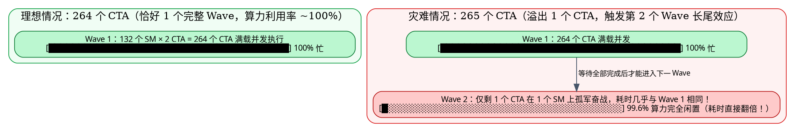
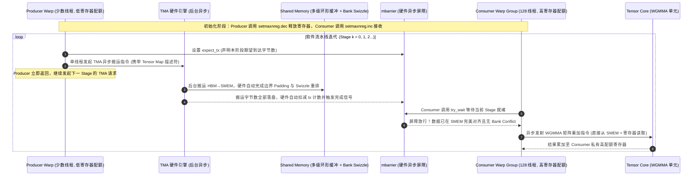
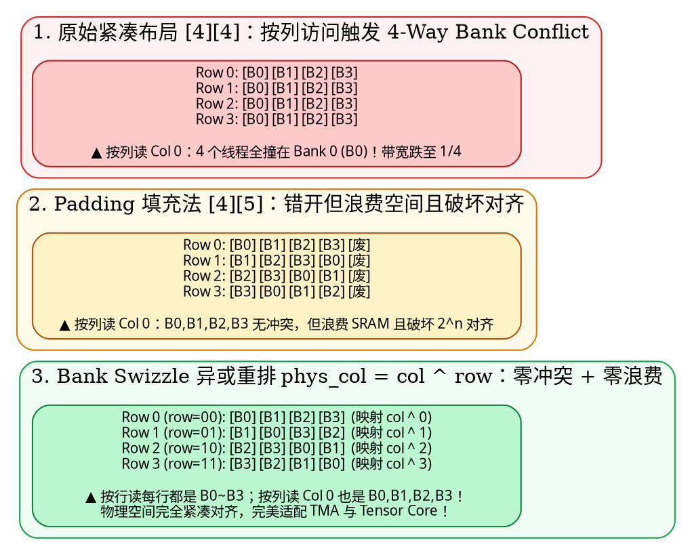
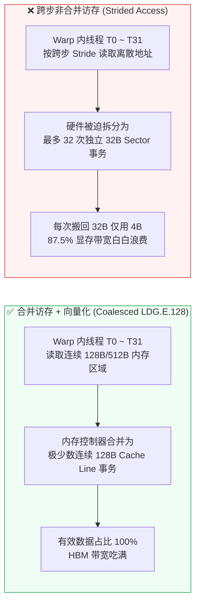
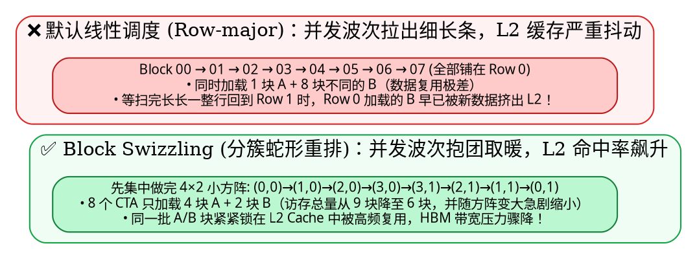
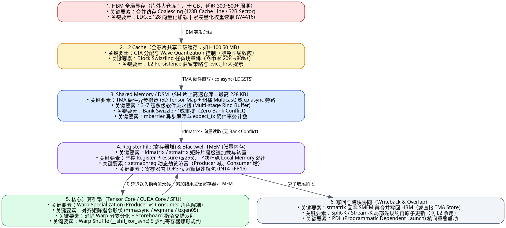

> **导读**：当你开始接触 FlashAttention、CUTLASS、Triton 或手写高性能 **CUDA Kernel（核函数，运行在 GPU 上的并行计算程序）** 时，老手们口中常常冒出一连串令人摸不着头脑的术语——甚至在语音交流或笔记里经常因为音近而写成 **“CTA、wrap、tna、shift、barry、bank swap”**。
>
> 其实，这六个词正是打通 GPU 算子开发“任督二脉”的**六把金钥匙**：它们共同构成了现代 GPU 上**“全局任务分配 $\rightarrow$ 硬件异步搬运 $\rightarrow$ 片上无冲突存储 $\rightarrow$ 线程束协作与细粒度同步”**的完整闭环。而要想真正把算子压榨到芯片物理极限，我们还需要继续打通**合并访存、寄存器压力、L2 重排、软件流水线、异步拷贝、跨块通信、量化位运算解包**等八大核心工程要素。
>
> 为了照顾**零基础初学者**的阅读体验，本教程坚持两条原则：
> 1. **名词首现即破冰**：任何缩写或底层黑话在第一次出现时，都会附上英文全称与生活化的白话解释，绝不跳步；
> 2. **图表可视化优先**：在关键硬件拓扑、同步时序、Bank 冲突原理与内存流向处，全部配备 **Graphviz** 与 **Mermaid** 可视化图解，把看不见的硅片内部动作“画出来”。

---

## 零、术语对齐与初学者破冰速查表

在正式进入底层原理之前，我们先做一次**“术语纠偏与破冰”**。很多人刚开始学习 GPU 算子时，通过语音听课或笔记记下了一些音近词，下面先帮你把它们精确对齐到 NVIDIA GPU 的标准英文术语：

| 常见口语 / 音近误写 | 标准英文术语 | 中文全称 | 一句话通俗解释（第一次见也能懂） |
| :--- | :--- | :--- | :--- |
| **CTA** | **CTA (Cooperative Thread Array)** | 协作线程阵列（即 CUDA 中的 **Thread Block / 线程块**） | GPU 分配任务的“基本施工队”，一旦被派往某个计算车间（SM），在完工前不会搬家；队员之间可以共享片上仓库。 |
| **wrap** | **Warp** | 线程束 | NVIDIA GPU 硬件调度的**最小执行小队**，固定由 **32 个连续线程** 组成，像仪仗队一样齐步走、同时执行同一条指令。 |
| **tna** | **TMA (Tensor Memory Accelerator)** | 张量内存加速器 | Hopper（H100）及更新架构新增的**专用硬件搬运工**，只需 1 个线程发号施令，就能自动把多维矩阵块从显存搬进片上仓库。 |
| **shift** | **Warp Shuffle / Bitwise Shift & Swizzle** | 线程束洗牌指令 / 地址移位重排 | 两层含义：① **Warp Shuffle**：同一 Warp 内 32 个线程不经仓库，直接“隔空交换”彼此寄存器里的数据；② **Bitwise Shift**：通过二进制移位/异或重新计算存储地址，防止拥堵。 |
| **barry** | **Barrier** | 同步屏障 | 工程队里的“集合哨”：防止干活快的线程提前跑路，或消费者线程在数据还没搬到时就盲目读取，分为全块屏障与细粒度异步屏障。 |
| **bank swap** | **Bank Conflict / Bank Swizzle** | 存储体冲突与交叉重排 | 片上共享内存被分成 32 条并行车道（Bank），大家同时挤同一条道就会堵车（Bank Conflict）；**Bank Swizzle** 就是通过巧妙的数学地址交叉映射（俗称错位换道），彻底消除堵车。 |

同时，在阅读后文时，你还会频繁遇到以下几个 GPU 硬件基本概念，先在这里混个脸熟：

- **SM（Streaming Multiprocessor，流多处理器）**：GPU 芯片内部真正的“独立计算车间”。一块顶级 GPU（如 H100）里包含一百多个 SM，每个 SM 里既有算加减乘除的 **CUDA Core**，也有专门算矩阵乘法的 **Tensor Core（张量核心）**。
- **HBM（High Bandwidth Memory，高带宽显存 / Global Memory 全局内存）**：安装在芯片外部的大容量主仓库（例如 80 GB）。容量极大，但路途遥远，读取一次需要等待 **数百个时钟周期**。
- **Shared Memory（共享内存，常简写为 SMEM）**：建在每个 SM 内部的超高速片上 **SRAM（静态随机存储器，一种不需要刷新、速度极快但成本高、容量小的片上内存）** 小仓库。容量只有几十 KB 到两百多 KB，但延迟仅约二十几个周期，是同一 CTA 内线程协作交换数据的黄金舞台。
- **Register（寄存器）**：紧贴在计算单元手边、速度最快（几乎零延迟）的私人“工作台”。每个线程都有自己私有的一小撮寄存器，别人默认看不见。
- **Tiling（分块 / 切块）**：因为 HBM 里的超大矩阵（比如 $4096 \times 4096$）根本塞不进几百 KB 的 Shared Memory，所以必须像切豆腐一样把大矩阵切成一块块小 **Tile（数据块）**，分批搬进 SMEM 和寄存器算完再拼起来。

下面这张全景学习路线图，展示了本文涵盖的 **6 大核心要素闭环** 与 **8 大全栈进阶要素**：

```mermaid
flowchart TD
    Root["GPU 算子开发 14 大核心要素全景"] --> Core6["第一部分：核心六要素闭环<br/>（调度 → 搬运 → 存储 → 协作 → 同步）"]
    Root --> Adv8["第二部分：全栈性能工程八大进阶要素<br/>（榨干硬件每一分带宽与算力）"]

    Core6 --> C1["1. CTA (Thread Block)<br/>SM 驻留率 / Occupancy / Wave 量化 / Cluster"]
    Core6 --> C2["2. Warp (线程束)<br/>Warp 特化 / 消除分支分化 / 指令形状对齐"]
    Core6 --> C3["3. TMA (张量内存加速器)<br/>释放寄存器 / 自动硬件 Swizzle / 组播 Multicast"]
    Core6 --> C4["4. Warp Shuffle (洗牌)<br/>寄存器直连 / 5 步蝶形规约 / 标量广播"]
    Core6 --> C5["5. Barrier (同步屏障)<br/>__syncthreads 开销 / mbarrier 字节计数 / __syncwarp"]
    Core6 --> C6["6. Bank Conflict & Swizzle<br/>32-Bank 原理 / Padding 缺陷 / 异或无冲突重排"]

    Adv8 --> A1["7. 合并访存与向量化加载<br/>128B 缓存行与 LDG.E.128"]
    Adv8 --> A2["8. ldmatrix / stmatrix 与 TMEM<br/>Tensor Core 数据喂给与 Blackwell 新片上存储"]
    Adv8 --> A3["9. 寄存器压力与溢出<br/>255 上限 / Local Memory 悬崖 / setmaxnreg"]
    Adv8 --> A4["10. L2 持久化与 Block Swizzling<br/>打破线性调度抖动 / 缓存命中率飙升"]
    Adv8 --> A5["11. 多级软件流水线<br/>3~7 级环形缓冲隐藏 HBM 延迟"]
    Adv8 --> A6["12. cp.async 与 Scoreboard<br/>旁路寄存器直达 SMEM / 记分牌依赖交错"]
    Adv8 --> A7["13. 原子操作与跨 CTA 通信<br/>Split-K 锁争用 / Hopper PDL 核间重叠"]
    Adv8 --> A8["14. 量化解包与位运算<br/>寄存器内 INT4→FP16 构造与 LOP3"]

    style Root fill:#eff6ff,stroke:#2563eb,stroke-width:2px
    style Core6 fill:#ecfdf5,stroke:#16a34a,stroke-width:2px
    style Adv8 fill:#fff7ed,stroke:#ea580c,stroke-width:2px
```

---

## 第一部分：GPU 算子核心六要素深度拆解

编写像 **FlashAttention（大模型注意力机制的高效分块实现）** 或 **GEMM（General Matrix Multiply，通用矩阵乘法）** 这样的顶级算子时，CTA、Warp、TMA、Warp Shuffle、Barrier 和 Bank Swizzle 并不是孤立的知识点，而是从软件逻辑逐层映射到物理硅片的六个齿轮。

我们先用一张架构映射图建立整体空间感：

```dot
digraph SoftwareToHardware {
    rankdir=LR;
    node [shape=box, style="rounded,filled", fontname="sans-serif", fontsize=11];
    edge [color="#475569", fontname="sans-serif", fontsize=10];

    subgraph cluster_sw {
        label="CUDA 编程逻辑模型（开发者视角）";
        style="rounded";
        color="#2563eb";
        bgcolor="#eff6ff";

        grid [label="Grid / Cluster\n（整个算子的全部任务网格）", fillcolor="#dbeafe", color="#1d4ed8"];
        cta [label="CTA / Thread Block\n（协作线程阵列：共享 SMEM）", fillcolor="#dbeafe", color="#1d4ed8"];
        warp [label="Warp / Warp Group\n（32 线程小队 / 128 线程组）", fillcolor="#dbeafe", color="#1d4ed8"];
        thread [label="Thread (Lane 0..31)\n（单个逻辑执行流与私有寄存器）", fillcolor="#dbeafe", color="#1d4ed8"];

        grid -> cta -> warp -> thread;
    }

    subgraph cluster_hw {
        label="GPU 物理芯片硬件（硅片真实单元）";
        style="rounded";
        color="#16a34a";
        bgcolor="#f0fdf4";

        gpu [label="整颗 GPU 芯片\n（含上百个 SM + 共享 L2 Cache）", fillcolor="#dcfce7", color="#15803d"];
        sm [label="单个 SM（流多处理器）\n• 固定配额的 Registers 与 SMEM\n• 含 TMA 异步引擎与 mbarrier 硬件", fillcolor="#dcfce7", color="#15803d"];
        subp [label="SM 子分区调度器 (Warp Scheduler)\n• 按 Warp 发射指令\n• 驱动 Tensor Core / CUDA Core", fillcolor="#dcfce7", color="#15803d"];
        lane [label="单条算术流水线与 32-Bank SMEM\n• Shuffle 直连通道\n• Bank Swizzle 无冲突路由", fillcolor="#dcfce7", color="#15803d"];

        gpu -> sm -> subp -> lane;
    }

    grid -> gpu [style=dashed, label=" 全局分发"];
    cta -> sm [style=bold, color="#dc2626", label=" 一旦绑定不迁移"];
    warp -> subp [style=bold, color="#dc2626", label=" 硬件最小调度粒度"];
    thread -> lane [style=dashed, label=" 标量通道与寄存器"];
}
```

---

### 1. CTA（Cooperative Thread Array / Thread Block）的考量

**CTA** 是软件逻辑与硬件物理核心（SM）对接的桥梁。在 CUDA 编程里我们叫它 **Thread Block（线程块）**，而在 NVIDIA 底层虚拟汇编 **PTX（Parallel Thread Execution，跨代通用中间指令集）** 文档里，它的官方名字就是 **CTA**。

理解 CTA 的第一条铁律是：**一个 CTA 一旦被硬件调度器分派到某个 SM 上，在它全部执行结束之前，绝对不会半路迁移到另一个 SM 上**。基于这条物理特性，算子设计时有三大核心考量：

#### （1）资源占用与驻留率（Occupancy）

- **什么是 Occupancy（驻留率 / 占用率）？**
  简单来说，就是**“一个 SM 里同时住了多少个活跃 Warp（占硬件最大容量上限的百分比）”**。为什么需要多个 CTA 或多个 Warp 同时驻留在同一个 SM 上？因为当 A 线程束去 HBM 取数据、被迫干等几百个周期时，SM 的调度器可以**在 1 个周期内零开销切换到 B 线程束继续干活**，这就是 GPU 最拿手的**延迟隐藏（Latency Hiding）**。
- **物理资源的双人跷跷板**：
  每个 SM 的硬件资源总量是焊死不变的——例如 Hopper H100 的单个 SM 拥有 **65,536 个（64K）32-bit 寄存器**，以及最大 **228 KB 的 Shared Memory**。
  - **如果单个 CTA 太“贪心”**：比如一个 CTA 申请了 128 KB 的 Shared Memory（超过总量一半），或者用光了 40K 个寄存器，那么这个 SM 上就**只能同时驻留 1 个 CTA**！一旦它等内存，整个 SM 只能陪着一起发呆。
  - **如果单个 CTA 太“瘦小”**：比如一个 CTA 只开 32 个线程，虽然能塞进很多个 CTA，但片上 **数据复用率（Data Reuse）** 会暴跌——本来 128 个线程协作只需要从 HBM 搬一次权重块大家分着用，切太小后每个小 CTA 都得重复搬一次，瞬间把显存带宽挤爆，同时算力单元也吃不饱。
- **权衡之道**：算子调优往往要在“单 CTA 足够大以提升数据复用”与“SM 至少能驻留 2 个以上 CTA 或足够多 Warp 以隐藏延迟”之间寻找甜点。

#### （2）Wave Quantization（波次量化效应）与 Tail Effect（长尾效应）

这是初学者写算子最容易踩中、却最难从代码表面看出来的性能黑洞。

假设一颗 GPU 共有 **132 个 SM**（如 H100 SXM），经过你的资源配额计算，每个 SM 上同时最多能跑 **2 个 CTA**。这意味着这颗 GPU 在同一波次（**Wave**）内，最多可以并发执行 $132 \times 2 = 264$ 个 CTA。

- 如果你的矩阵切分完恰好是 **264 个 CTA**：1 个 Wave 完美吃满 100% 算力，同时开工同时收工。
- 如果你的切分策略多出 1 块，变成了 **265 个 CTA**：前 264 个 CTA 在第 1 个 Wave 跑完后，最后多出来的 **1 个孤单 CTA** 必须独占整个第 2 个 Wave！在第 2 个 Wave 的执行时间内，其余 **131.5 个 SM 全部处于闲置状态，99.6% 的芯片算力白白浪费**——这就是著名的 **Tail Effect（长尾效应 / 尾巴效应）**。

> **工程建议**：在设计矩阵 Tiling（分块）尺寸、或者决定 **Persistent Kernel（持久化核函数，即固定启动等于 SM 数量或整数倍的 CTA，在内部用循环自己去抢剩余任务）** 的调度策略时，务必尽量让总 CTA 数量贴近“并发总容量（Wave Size）”的整数倍。

#### （3）Thread Block Cluster（线程块簇，Hopper+ 新特性）

在传统 CUDA 模型（Volta/Ampere）里，不同 CTA 之间是完全“老死不相往来”的，想要共享数据必须绕道极慢的 HBM 或 L2 Cache。

从 **Hopper（H100）** 架构开始，NVIDIA 引入了更高一级的组织单位——**Thread Block Cluster（线程块簇）**。多个相邻的 CTA（通常 2、4、8 个，最多 16 个）可以组成一个 Cluster，硬件保证了这一簇 CTA 会被调度到**物理上相邻、通过高速片上互连线直接相连的一组 SM（GPC 内）**上。

这样一来，SM 之间就打通了 **DSM / DSMEM（Distributed Shared Memory，分布式共享内存）**：SM 0 上的 CTA 可以直接读写 SM 1 上另一个 CTA 的 Shared Memory，无需经过 HBM！对于大模型中多个输出块需要共用同一份权重矩阵或 KV Cache 分块的场景，直接成倍砍掉了重复的 HBM 流量。

---

### 2. Warp（线程束）的考量

如果说 CTA 是分配给车间的“施工队”，那么 **Warp（线程束，常被口误念成 wrap）** 才是 SM 内部调度器真正发号施令的最小单位。在所有现代 NVIDIA GPU 上，**1 个 Warp 固定包含 32 个连续线程**（编号叫 Lane 0 到 Lane 31）。

#### （1）Warp Specialization（线程束特化：现代高性能算子的核心范式）

在传统 CUDA 教学代码里，往往是“大锅饭”模式：一个 CTA 里的所有 Warp 干一模一样的活——先全员一起去全局内存搬一块数据，然后同步一下，全员一起算矩阵乘法，再同步一下……这种模式最大的缺陷在于**搬运指令和计算指令耦合在一起，且所有线程都得保留海量计算所需的寄存器**。

现代最顶尖的高性能算子（如 **FlashAttention-3**、**CUTLASS 3.x**）普遍采用 **Warp Specialization（线程束特化）** 架构——把 CTA 内部的 Warp 拆分成明确分工的两波人马：

- **Producer Warps（生产者线程束）**：专职负责向硬件引擎（TMA）发送异步数据搬运请求，把源源不断的矩阵块从 HBM 搬进 Shared Memory 的环形缓冲区。它们**几乎不做数学计算，因此根本不需要多少寄存器**。
- **Consumer Warps（消费者线程束）**：通常以 4 个连续 Warp 组成一个 **Warp Group（128 线程）**，专职从 Shared Memory 拿取已经就位的数据，疯狂喂给 **Tensor Core** 做矩阵乘加，同时把计算结果保存在自己的累加器寄存器里。

> **杀手锏配合（`setmaxnreg`）**：Hopper 架构专门提供了 PTX 指令 `setmaxnreg`（动态调整每个线程的最大寄存器配额）。Producer Warp 在初始化完任务后，可以主动调用指令**“退还”自己多余的寄存器**（比如降到只留 24~40 个），把省出来的海量寄存器配额**精准转移给极度缺寄存器的 Consumer Warp**（让它们暴涨到每人 200+ 个寄存器）！这种“劫贫济富”的精细化调度，使得 Consumer 可以吃下更大的矩阵 Tile 而不发生溢出。

#### （2）消除 Warp Divergence（线程束分化）

NVIDIA GPU 采用 **SIMT（Single Instruction, Multiple Threads，单指令多线程）** 执行模型：同一个 Warp 里的 32 个线程在同一个时钟周期，共用同一个指令译码器，执行**同一条指令**。

如果在代码里写了 `if (threadIdx.x % 2 == 0) { 分支A } else { 分支B }`，导致同 Warp 内部分线程走分支 A、另一部分走分支 B，就会触发 **Warp Divergence（线程束分化）**：硬件别无选择，只能**先把走分支 B 的线程“蒙上眼睛（屏蔽掩码 Execution Mask）”让它们空转等待，单独执行完分支 A；然后再反过来屏蔽分支 A 的线程，串行执行分支 B**！原本 1 份时间能干完的活，直接翻倍耗时。

- **算子开发应对策略**：
  1. 尽可能让 `if-else` 的判断条件在**以 32 为倍数的 Warp 边界上对齐**（同一个 Warp 要么全走 `if`，要么全走 `else`）；
  2. 对于极短小的分支（比如边界截断或 ReLU 激活 `x > 0 ? x : 0`），尽量利用三目运算符或编译器生成 **Predication（谓词指令，两条路径不跳转、只通过条件标志决定是否写入结果）** 或位运算掩码替代跳转分支。

#### （3）Warp 级矩阵指令对齐

调用 **Tensor Core** 绝不是“一个线程自己算自己的小矩阵”，而是硬件强迫整个小队集体协同：
- 在 Ampere（A100）上，调用 `mma.sync` 指令需要 **1 个完整的 Warp（32 个线程）** 严丝合缝地配合，每人拿一块小碎片（Fragment）拼成一次矩阵乘；
- 在 Hopper（H100）上，新一代异步指令 **`wgmma`（Warp Group Matrix Multiply-Accumulate）** 更是要求 **1 个 Warp Group（4 个连续 Warp = 128 个线程）** 联合行动。
- 因此，算子中的 **Tiling 子块尺寸** 必须严格对齐硬件支持的指令形状（例如 `M=64, N=64, K=16` 或 `64×256×16`），否则编译器会拆出大量零碎低效指令甚至根本无法下发到 Tensor Core。

---

### 3. TMA（Tensor Memory Accelerator）的考量

**TMA（张量内存加速器，常被口误听成 tna）** 是 NVIDIA 在 Hopper（H100）及 Blackwell（B200）架构上引入的革命性硬件部件。

在没有 TMA 之前（如 Volta/Ampere 架构），要把一个二维或三维张量块从 HBM 搬到 Shared Memory，你必须动员几百个线程同时上阵：每个线程都得亲自计算“我现在负责第几行第几列？有没有越界（Out-of-Bounds）？物理显存地址偏移量是多少？”。这不仅消耗了大量宝贵的 **CUDA Core 整数算术指令周期**，还霸占了大量寄存器来暂存地址和索引。

TMA 彻底改变了游戏规则，算子开发者在设计数据通路时有三大核心考量：

1. **彻底解放计算核心与寄存器：**
   使用 TMA 时，开发者预先在 CPU（Host 端）通过驱动 API 创建好一张 **Tensor Map 描述符（Descriptor）**——把全局张量的基地址、维度（最高支持 5D）、步长（Stride）、每次搬运的 Box 大小以及越界填充模式全部填进这张“物流面单”里。
   到了 GPU 运行时，**只需要 Warp 里的 1 个代表线程**（俗称 Single-thread launch）把“面单”递给 TMA 硬件引擎即可！剩下的所有工作——多维地址计算、越界自动补零（OOB Zero-Padding）、异步从 HBM 搬到 Shared Memory——全部由专用的硅片硬件在后台默默搞定，**不占用任何 CUDA Core 算力，也省下了大量地址寄存器**。
2. **硬件自动 Swizzle 写入（免费消除后续冲突）：**
   你只需要在 Tensor Map 描述符里配置好 Swizzle 模式（例如 32B / 64B / 128B Swizzle），TMA 在将数据落盘写入 Shared Memory 时，就会**在硬件电路层自动把地址按最优交叉规则重排好**！软件代码里再也不需要手写复杂的移位异或运算去折腾写地址，直接为后续 Tensor Core 读取铺平道路。
3. **TMA Multicast（硬件组播，带宽省流神器）：**
   搭配前面讲到的 **CTA Cluster**，如果多个 SM 上的 CTA 刚好需要同一份矩阵块（比如矩阵乘 $C = A \times B$ 中，同一行的 4 个 CTA 都需要同一块 $A$ 矩阵分块），TMA 只需要从极其昂贵的 HBM 里**读 1 次**，就能通过芯片内部高速片上网络同时 **Multicast（组播）广播写入这 4 个 SM 的 Shared Memory**，直接把 $A$ 矩阵的 HBM 带宽消耗砍到 $1/4$！

---

### 4. Warp Shuffle（线程束洗牌指令）的考量

在中文口语交流中，“**shift**”经常指代 GPU 编程中极具特色的 **Warp Shuffle（线程束洗牌指令）**，有时也指地址重排中的 **Bitwise Shift（二进制位左移/右移）**。我们先重点讲极其高频的 **Warp Shuffle**（移位运算将在第 6 节结合 Bank Swizzle 展开）。

在常规认知里，两个线程想交换彼此变量的值，必须约定一个共同的 Shared Memory 区域：“线程 A 写进 SMEM $\rightarrow$ 大家同步等一下 $\rightarrow$ 线程 B 从 SMEM 读出来”。但对于**同一个 Warp 内部**的 32 个线程，NVIDIA 在硬件层面修建了一条**寄存器之间的直连立交桥**——这就是 Warp Shuffle 指令族（如 `__shfl_sync`、`__shfl_xor_sync`、`__shfl_down_sync`、`__shfl_up_sync`）。

#### 为什么算子开发极度偏爱 Warp Shuffle？

- **极低延迟且零 SMEM 开销**：数据直接在寄存器与寄存器之间飞驰，延迟比访问 Shared Memory 低得多，而且**完全不消耗半字节寸土寸金的 Shared Memory 容量**，也永远不用担心 Bank Conflict。
- **两大黄金应用场景**：
  1. **高速蝶形规约（Butterfly Reduction）**：
     在计算 **Softmax（注意力分数归一化，需要求整行的最大值 `max` 和指数和 `sum`）**、**LayerNorm / RMSNorm（大模型归一化算子，需要求整行的均值和方差）** 时，如果把数据全塞进 SMEM 做归约简直是暴殄天物。
     利用 `__shfl_xor_sync(0xffffffff, val, offset)` 让距离为 `16 -> 8 -> 4 -> 2 -> 1` 的线程两两配对交换数据并相加/取最大值，**仅需 5 步（$\log_2 32 = 5$）** 就能在纯寄存器内把 32 个线程的局部结果归约完毕！最后只需每个 Warp 的 `Lane 0` 把唯一的结果写进 Shared Memory 做跨 Warp 汇总即可。
  2. **极速标量广播（Broadcast）**：
     比如在低精度量化算子中，某个线程从显存加载了一个整行共用的缩放因子（Scale），只需一条 `__shfl_sync(0xffffffff, scale, 0)`，就能瞬间把 `Lane 0` 寄存器里的 `scale` 广播分发给同 Warp 的其余 31 个线程。

下面这张图以 8 个线程（实际硬件为 32 个线程、5 步）为例，展示 `__shfl_xor_sync` 的**蝶形树状规约（Butterfly Reduction）**是如何一步步在寄存器内完成全员汇总的：

```dot
digraph ButterflyShuffle {
    rankdir=TB;
    node [shape=box, style="rounded,filled", fontname="sans-serif", fontsize=10];
    edge [color="#475569", fontname="sans-serif", fontsize=9];

    subgraph cluster_s0 {
        label="初始状态：每个线程寄存器中持有各自局部值 x0 ~ x7";
        style="rounded"; color="#94a3b8"; bgcolor="#f8fafc";
        t0_0 [label="T0: x0", fillcolor="#e2e8f0"];
        t1_0 [label="T1: x1", fillcolor="#e2e8f0"];
        t2_0 [label="T2: x2", fillcolor="#e2e8f0"];
        t3_0 [label="T3: x3", fillcolor="#e2e8f0"];
        t4_0 [label="T4: x4", fillcolor="#e2e8f0"];
        t5_0 [label="T5: x5", fillcolor="#e2e8f0"];
        t6_0 [label="T6: x6", fillcolor="#e2e8f0"];
        t7_0 [label="T7: x7", fillcolor="#e2e8f0"];
    }

    subgraph cluster_s1 {
        label="Step 1: __shfl_xor_sync(mask, val, 4) — 跨度 offset=4 互换累加";
        style="rounded"; color="#2563eb"; bgcolor="#eff6ff";
        t0_1 [label="T0: sum(0,4)", fillcolor="#dbeafe"];
        t1_1 [label="T1: sum(1,5)", fillcolor="#dbeafe"];
        t2_1 [label="T2: sum(2,6)", fillcolor="#dbeafe"];
        t3_1 [label="T3: sum(3,7)", fillcolor="#dbeafe"];
        t4_1 [label="T4: sum(0,4)", fillcolor="#dbeafe"];
        t5_1 [label="T5: sum(1,5)", fillcolor="#dbeafe"];
        t6_1 [label="T6: sum(2,6)", fillcolor="#dbeafe"];
        t7_1 [label="T7: sum(3,7)", fillcolor="#dbeafe"];
    }

    subgraph cluster_s2 {
        label="Step 2: __shfl_xor_sync(mask, val, 2) — 跨度 offset=2 互换累加";
        style="rounded"; color="#7c3aed"; bgcolor="#f5f3ff";
        t0_2 [label="T0: sum(0,2,4,6)", fillcolor="#ede9fe"];
        t1_2 [label="T1: sum(1,3,5,7)", fillcolor="#ede9fe"];
        t2_2 [label="T2: sum(0,2,4,6)", fillcolor="#ede9fe"];
        t3_2 [label="T3: sum(1,3,5,7)", fillcolor="#ede9fe"];
        t4_2 [label="T4: sum(0,2,4,6)", fillcolor="#ede9fe"];
        t5_2 [label="T5: sum(1,3,5,7)", fillcolor="#ede9fe"];
        t6_2 [label="T6: sum(0,2,4,6)", fillcolor="#ede9fe"];
        t7_2 [label="T7: sum(1,3,5,7)", fillcolor="#ede9fe"];
    }

    subgraph cluster_s3 {
        label="Step 3: __shfl_xor_sync(mask, val, 1) — 跨度 offset=1 互换累加，全员拿到总和";
        style="rounded"; color="#16a34a"; bgcolor="#f0fdf4";
        t0_3 [label="T0: AllSum", fillcolor="#bbf7d0"];
        t1_3 [label="T1: AllSum", fillcolor="#bbf7d0"];
        t2_3 [label="T2: AllSum", fillcolor="#bbf7d0"];
        t3_3 [label="T3: AllSum", fillcolor="#bbf7d0"];
        t4_3 [label="T4: AllSum", fillcolor="#bbf7d0"];
        t5_3 [label="T5: AllSum", fillcolor="#bbf7d0"];
        t6_3 [label="T6: AllSum", fillcolor="#bbf7d0"];
        t7_3 [label="T7: AllSum", fillcolor="#bbf7d0"];
    }

    t0_0 -> t0_1; t4_0 -> t0_1 [color="#2563eb"];
    t1_0 -> t1_1; t5_0 -> t1_1 [color="#2563eb"];
    t2_0 -> t2_1; t6_0 -> t2_1 [color="#2563eb"];
    t3_0 -> t3_1; t7_0 -> t3_1 [color="#2563eb"];
    t0_0 -> t4_1 [color="#2563eb"]; t4_0 -> t4_1;
    t1_0 -> t5_1 [color="#2563eb"]; t5_0 -> t5_1;
    t2_0 -> t6_1 [color="#2563eb"]; t6_0 -> t6_1;
    t3_0 -> t7_1 [color="#2563eb"]; t7_0 -> t7_1;

    t0_1 -> t0_2; t2_1 -> t0_2 [color="#7c3aed"];
    t1_1 -> t1_2; t3_1 -> t1_2 [color="#7c3aed"];
    t0_1 -> t2_2 [color="#7c3aed"]; t2_1 -> t2_2;
    t1_1 -> t3_2 [color="#7c3aed"]; t3_1 -> t3_2;
    t4_1 -> t4_2; t6_1 -> t4_2 [color="#7c3aed"];
    t5_1 -> t5_2; t7_1 -> t5_2 [color="#7c3aed"];
    t4_1 -> t6_2 [color="#7c3aed"]; t6_1 -> t6_2;
    t5_1 -> t7_2 [color="#7c3aed"]; t7_1 -> t7_2;

    t0_2 -> t0_3; t1_2 -> t0_3 [color="#16a34a"];
    t0_2 -> t1_3 [color="#16a34a"]; t1_2 -> t1_3;
    t2_2 -> t2_3; t3_2 -> t2_3 [color="#16a34a"];
    t2_2 -> t3_3 [color="#16a34a"]; t3_2 -> t3_3;
    t4_2 -> t4_3; t5_2 -> t4_3 [color="#16a34a"];
    t4_2 -> t5_3 [color="#16a34a"]; t5_2 -> t5_3;
    t6_2 -> t6_3; t7_2 -> t6_3 [color="#16a34a"];
    t6_2 -> t7_3 [color="#16a34a"]; t7_2 -> t7_3;
}
```

> **注意**：所有带 `_sync` 后缀的 Shuffle 指令（Volta 架构起强制要求）都必须传入一个 32-bit 的**活跃线程掩码（Active Mask，全部 32 线程参与时为 `0xffffffff`）**。因为 Volta 引入了**独立线程调度（Independent Thread Scheduling）**，同一个 Warp 内的线程不再被保证步调永远死锁一致，必须用掩码告诉硬件：哪些线程必须先汇合到这条 Shuffle 指令处，防止读到别人还没更新的旧寄存器值！

---

### 5. Barrier（同步屏障）的考量

既然有几十上百个线程同时分工搬运和计算，就必须有严丝合缝的时序协调机制——**Barrier（同步屏障，口语常听成 barry）**。同步颗粒度越粗，无谓等待造成的算力浪费就越严重：

#### （1）传统全块同步 `__syncthreads()` 的代价

初学者最熟悉的同步原语是 `__syncthreads()`（对应底层 PTX 的 `bar.sync`）。它的逻辑简单粗暴：**整个 CTA 里的所有 Warp 必须全部停下来，站在原地互相等到齐，才允许一起往下走**。

- **副作用**：在包含“边搬运边计算”的流水线中，哪怕只有 1 个 Warp 的任务慢了一点，或者某两个不相干的 Warp 根本不需要等同一块数据，调用 `__syncthreads()` 都会强迫全部算力单元停摆，在指令流水线上砸出一个巨大的**空泡（Pipeline Bubble / Stall）**。

#### （2）现代异步屏障（`mbarrier` / Arrive-Wait 机制）

从 Ampere 引入、并在 Hopper 配合 TMA 走向巅峰的 **`mbarrier`（Memory Barrier，位于 Shared Memory 中的硬件异步屏障对象）**，彻底把“一刀切的全员立正”变成了“精准点名交接”：

- **Split Arrive / Wait（到达与等待分离）**：线程可以先发出 `arrive`（通知别人“我干完活了”）然后继续去干其他不依赖该结果的指令，直到真正需要数据的那一刻再执行 `wait` 或非阻塞试探 `try_wait`。
- **细粒度局部同步**：无需让无关的 Warp 停车。比如只让负责第 2 块缓冲区的 Producer Warp 与 Consumer Warp 绑定同一个 `mbarrier`，其余流水线级上的 Warp 照跑不误。
- **Transaction Count（字节事务计数机制）**：配合 **TMA** 使用时，这是最精妙的硬件设计——Producer 线程向 `mbarrier` 写入 **`expect_tx`（期望到达的字节数，例如 8192 Bytes）** 并发起 TMA；之后 Producer 就可以拍拍屁股去发下一轮搬运了。当 TMA 硬件在后台把这 8192 Bytes 全部安全写入 Shared Memory 后，**硬件自动扣减 `mbarrier` 的字节计数器直到归零，并翻转屏障相位（Phase）放行正在 `try_wait` 的 Consumer Warp**。全程不需要任何 CPU 或 CUDA Core 轮询！

#### （3）Warp 级局部同步 `__syncwarp()`

当你只在一个 Warp 的 32 个线程内部做寄存器通信（如 Warp Shuffle）或读写同一小块共享数据时，绝对不要用杀鸡用牛刀的 `__syncthreads()`，而应该使用轻量级的 **`__syncwarp(mask)`**，仅令掩码指定的同 Warp 线程重新收敛对齐，同时阻止编译器在优化时擅自把指令乱序重排到通信之前。

---

### 6. Bank Conflict 与 Bank Swizzle（存储体冲突与交叉重排）的考量

这是 GPU 算子性能优化中**最经典、也最考验位运算功底**的一关（常被口语简称为 **bank swap**）。

#### （1）为什么 Shared Memory 会发生“堵车”？（Bank Conflict 原理）

为了提供高达几十 TB/s 的恐怖片上带宽，NVIDIA 将每个 SM 的 Shared Memory 在物理硅片上切分成了 **32 个完全独立、可同时响应访问的存储体（Bank）**，好比高速公路收费站并排的 **32 条 ETC 车道**。

- **地址映射规则**：每 **4 个字节（32-bit，恰好是一个 `float` 或 `int32` 的大小）** 算作一个标准宽度。内存中连续的 4 Bytes 数据，依次轮流落入 Bank 0、Bank 1、……、Bank 31，然后第 32 个 4 Bytes 又回到 Bank 0，周而复始：
  $$\text{Bank ID} = \left( \frac{\text{Byte Address}}{4} \right) \bmod 32$$
- **什么时候最完美（Zero Conflict）？**
  当一个 Warp 的 32 个线程同时访问 Shared Memory 时，如果这 32 个地址恰好分散落在 **32 个不同的 Bank**（1 人走 1 条车道），硬件在 **1 个访存周期** 内就能并行把所有数据交出来！
- **什么时候会广播（Broadcast，同样无冲突）？**
  如果多个线程同时读取**同一个 Bank 里的完全相同的地址**（比如大家都读 `smem[0][0]`），硬件很聪明，只读一次然后**广播（Broadcast）**复制给所有请求的线程，同样不产生冲突。
- **什么时候发生灾难（Bank Conflict）？**
  当同一个 Warp 内的多个线程，在同一条指令中访问**同一个 Bank 里的不同地址**（例如 Thread 0 访问第 0 行的第 0 列 `Bank 0`，Thread 1 访问第 1 行的第 0 列——如果每行恰好 32 个 `float`，第 1 行第 0 列也落在 `Bank 0`！）。
  此时这几个请求只能挤进同一条车道排队，硬件被迫将一条指令拆成多次串行事务依次执行。**最坏情况下 32 个线程全部撞在同一个 Bank 上（32-Way Bank Conflict），Shared Memory 的有效带宽瞬间暴跌为原来的 $1/32$！**

#### （2）算子开发中的两大消除手段

在矩阵乘法中，我们经常要**“按行写入 Shared Memory，然后按列（或按小方阵）读出来喂给 Tensor Core”**。假设 Shared Memory 是一个 `float smem[32][32]`：
- 按行读取 `smem[0][0..31]`：落在 Bank 0~31，**无冲突**；
- 按列读取 `smem[0..31][0]`：全部落在 Bank 0，触发 **32 路严重冲突**！

如何破局？业界经历了从“土法炼钢”到“现代优雅艺术”的演进：

1. **方法一：Padding（填充法，早期常用）**
   - **做法**：声明数组时故意多加一列废空间，把 `float smem[32][32]` 改成 `float smem[32][33]`。这样一来，第 0 行第 0 列在 Bank 0，第 1 行第 0 列就向后错开 1 格落在了 Bank 1，第 2 行落在 Bank 2……按列访问完美错开！
   - **致命缺点**：① 白白浪费了宝贵的片上 SRAM 容量（且可能让原本 32 对齐的块变成奇葩维度，无法使用 128-bit 宽指令对齐）；② **彻底破坏了 2 的幂次对齐，无法配合 Hopper TMA 的硬件搬运与自动 Swizzle 模式**。

2. **方法二：Bank Swizzle（异或交叉重排，现代主流）**
   - **做法**：物理数组依然保持紧凑完美的 `32 × 32`（不浪费 1 个字节），但在计算逻辑坐标 `(row, col)` 映射到物理存储位置时，引入**二进制移位（Shift）与异或（XOR `^`）运算**！
   - **经典公式示例**（以 8 个 Bank 组或 16B 宽块为单位）：
     $$\text{phys\_col} = \text{col} \oplus (\text{row} \ \& \ \text{0x7})$$
   - **为什么异或如此神奇？**
     异或运算具有**双射（Bijection，一一对应绝不覆盖撞车）**性质：
     - 当固定 `row` 变化 `col`（按行读/写）时，`(row & 0x7)` 是个常数，`col ^ const` 依然遍历 0~31 的全部不同 Bank，**按行无冲突**！
     - 当固定 `col` 变化 `row`（按列读/写）时，`(row & 0x7)` 随行号变化，把本来全堵在 Bank `col` 的访问均匀打散到 8 个或 32 个不同的 Bank 中，**按列也无冲突**！
   - 更妙的是，在 Hopper 架构上配合 **TMA Descriptor**，你甚至不需要自己在写 SMEM 时算异或，硬件直接按你选的 Swizzle 模式写入，读取端只需用对称的 Swizzle 地址（例如配合 CUTLASS CuTe Layout Algebra 自动推导），就能实现全链路 **Zero Bank Conflict**。

下面这张 Graphviz 图直观对比了 `32×32` 场景下（简化为 4×4 矩阵配 4 个 Bank 展示原理）**原始布局的列冲突**、**Padding 的空间浪费** 与 **Bank Swizzle 的零浪费错位**：

### 六者协同的典型全景（以 Hopper 高性能 GEMM / FlashAttention 为例）

现在把这六个概念串成一根完整的线：
1. 根据 GPU 的 SM 数量与 Wave 整数倍切分出最优数量的 **CTA**（并组成 Cluster 开启硬件组播）；
2. CTA 内部切分为低寄存器配额的 Producer **Warp** 和高寄存器配额的 Consumer **Warp Group**；
3. Producer Warp 单线程发起 **TMA** 异步搬运，硬件自动按 **Bank Swizzle** 布局把矩阵块写入 Shared Memory，同时更新 **Barrier（`mbarrier`）** 的字节计数器；
4. Consumer Warp 通过 `try_wait` 等待 `mbarrier` 放行后，无 **Bank Conflict** 地将数据喂给 Tensor Core 计算，中间行级归约（如 Online Softmax 的最大值与指数和）留在寄存器中通过 **Warp Shuffle** 极速完成，最终写回显存。

---

## 第二部分：不止于此——全栈性能工程必须统筹的八大进阶要素

打通了前面六个核心机制，你已经跨过了 GPU 算子开发最陡峭的门槛。但在真实工业级算子库（如 CUTLASS、FlashAttention、Triton、DeepGEMM 等）里，要想把带宽和算力利用率从 60% 推向 95%+，还必须统筹以下 **8 个核心底层要素**。

---

### 7. Memory Coalescing（全局内存合并访存）与 Vectorized Load（向量化加载）

#### 初学者破冰：什么是 Cache Line 和 Sector？
GPU 访问 HBM 显存并不是像拿镊子夹绿豆一样“你要 4 个字节就只给你传 4 个字节”，而是像用大卡车运货：
- 现代 NVIDIA GPU 的全局内存 L1/L2 **Cache Line（缓存行）** 大小为 **128 Bytes**，物理上进一步细分为 **4 个 32 Bytes 的 Sector（扇区）**。
- 哪怕你只向显存请求了 4 Bytes 数据，硬件至少也得搬回一整块 **32 Bytes 的 Sector**（如果命中非对齐或跨行，甚至可能触发多次 32B/128B 事务）。

#### 算子设计考量
- **合并访存（Memory Coalescing）**：当同一 Warp 内的 32 个相邻线程（`threadIdx.x = 0, 1, ..., 31`）在同一条访存指令中，访问一段**地址连续且首地址对齐**的内存时（比如每人读相邻的 4 Bytes，合起来正好 128 Bytes），硬件会将这 32 个线程的请求**合并（Coalesce）成 1 次 128B 内存事务**，带宽利用率 100%！
- **非合并访存（Strided / Uncoalesced）**：反之，如果每个线程按列跨步去读一个行主序（Row-Major）的大矩阵，32 个线程的读取地址隔得十万八千里，硬件被迫发出 32 次独立内存事务，每次搬回 32B 却只用其中 4B，**有效带宽瞬间暴跌至 $4 / 32 = 12.5\%$**！
- **向量化加载（Vectorized Load）**：在不使用 TMA 的架构（如 Ampere/Turing）或写回输出阶段，显式使用 `float4` 或 `int4`（一次读 16 Bytes = 128-bit，编译为 **`LDG.E.128`** 指令），可以让单个线程一次扛走 4 个 `float`（或 8 个 `half`），不仅提升内存控制器吞吐率，还能将访存指令数量直接砍掉 $3/4$，极大缓解指令发射队列压力。

---

### 8. Tensor Core 数据喂给指令（`ldmatrix` / `stmatrix`）与 TMEM（Tensor Memory）

很多初学者会好奇：“数据已经无冲突地放进 Shared Memory 了，为什么不能直接用普通指针读给 Tensor Core 算呢？”

- **核心障碍——Fragment Layout（片段私有排布）**：Tensor Core 硬件电路在计算 `D = A × B + C` 时，对每个线程寄存器里该放矩阵里的哪几个特定元素有着极其严苛、交叉错落的私有排布映射。如果用普通的标量指令加载，不仅代码写起来像解谜，而且地址跨度会触发严重的 Bank Conflict。
- **Ampere / Hopper 的咽喉指令：`ldmatrix` 与 `stmatrix`**：
  - **`ldmatrix`（Load Matrix）** 是专门连接 Shared Memory 与 Tensor Core 寄存器的“专用传送带”。它允许 **1 个 Warp（32 个线程）** 协同发一条指令，一次性从 Shared Memory 抓取 1~4 个 `8×8`（16-bit）矩阵块，**并支持硬件顺便做转置（`.trans`）**，精准打散分发到这 32 个线程各自需要的寄存器槽位里！
  - **`stmatrix`（Store Matrix，Hopper 新增）** 则是逆向操作，在算完准备把结果从 Warp 寄存器写回 Shared Memory 时，同样用一条集体指令无痛对齐写回。
- **Blackwell（B200）架构的最新革命——TMEM（Tensor Memory）**：
  在 Hopper 之前，Tensor Core 算完产生的巨大累加器矩阵（比如 $128 \times 256$ 个 FP32 浮点数）必须死死霸占各个线程的通用 **寄存器堆（Register File）**，导致寄存器极易耗尽。到了最新的 **Blackwell（B200）** 架构，NVIDIA 干脆在 SM 内部单独开辟了一块**既不是寄存器、也不是 Shared Memory 的全新专用片上存储——TMEM（Tensor Memory）**，配合新一代 **`tcgen05`** 异步矩阵乘指令，直接让矩阵累加器驻留在 TMEM 中，把通用寄存器彻底解放出来！

---

### 9. Register Pressure（寄存器压力）与 Register Spilling（寄存器溢出）

**寄存器（Register）** 是 GPU 上速度最快（0~1 周期延迟）但也最金贵的资源。在硬件规格上，NVIDIA GPU 单个线程最多只能拥有 **255 个 32-bit 寄存器**（受指令编码位宽和硬件分配槽位限制）。

- **什么是 Register Spilling（寄存器溢出）？**
  当你在算子里把分块 Tile 设得太大、或者写了过深的 `#pragma unroll`（循环展开），导致编译器需要用到超过 255 个（或超过你设定的上限，如 128 个）寄存器时，编译器不会报错崩溃，而是会悄悄把多出来的变量**“溢出（Spill）”**到 **Local Memory（局部内存）**。
- **警惕“Local Memory”的文字陷阱！**
  名字叫“局部内存”，听起来好像很快？**大错特错！Local Memory 在物理硬件上就住在芯片外部慢如蜗牛的 HBM 全局显存里**（只是走 L1/L2 缓存而已）！一旦发生严重的 Register Spilling，本来在寄存器里 1 拍就能读到的累加器变量，突然变成了每次读写都要访问缓存甚至穿透到 HBM，**算子性能会瞬间发生断崖式暴跌（下降数倍甚至十倍）**！
- **工程防线**：
  1. 编译期必加参数 `nvcc --ptxas-options=-v`，紧盯编译器吐出的 `Used X registers, Y bytes spill stores, Z bytes spill loads`——高性能算子通常要求 **Spill 严格为 0**；
  2. 使用 CUDA 的 `__launch_bounds__(maxThreadsPerBlock, minBlocksPerMultiprocessor)` 提示编译器控制寄存器上限以换取足够的 Occupancy；
  3. 在 Hopper 上结合前面讲的 Warp Specialization，用 `setmaxnreg` 精细调拨寄存器。

---

### 10. L2 Cache 持久化（L2 Persistence）与 Block Swizzling（任务块重排）

**L2 Cache（二级缓存）** 是全芯片所有 SM 共享的最后一道高速防线（例如 H100 拥有高达 **50 MB** 的 L2 Cache，带宽远超片外 HBM）。

- **默认线性调度的缓存噩梦**：
  假设你在算一个大矩阵乘 $C = A \times B$，按照最直观的思路，把输出矩阵 $C$ 切成很多小块，按行从左到右线性排号给 `blockIdx.x` 去领任务。
  当芯片上的 132 个 SM 同时开工时，如果矩阵很宽，第 1 批 SM 领完第 0 行的前 132 个块，把左边的 $A$ 矩阵和顶上的 132 块 $B$ 矩阵拉进 L2 Cache；还没等算第 1 行用到刚才的 $B$ 矩阵，后面紧接着的块又把更多新的 $B$ 矩阵拉进来，**直接把前面刚缓存好的数据挤出 L2 Cache（Cache Thrashing，缓存抖动）**！结果 L2 命中率低至 20% 左右。
- **破局武器一：Block Swizzling（任务块重排 / CTA 光栅化 Rasterization）**：
  虽然我们不能直接改硬件发号顺序，但我们**可以在 Kernel 入口处自己重写 `blockIdx` 到输出矩阵坐标 `(m, n)` 的映射函数**！
  采用 **Group 分组扫描 / Z-order 曲线 / 蛇形（Serpentine）扫描**——强迫同一时刻并发工作的 132 个 SM 聚拢在一个正方形区域（比如 $8 \times 16$ 的小方阵）里干活，大家只共用那 8 块 $A$ 和 16 块 $B$。结果就是这批数据在 L2 Cache 里被十几倍地反复命中复用，**L2 命中率能从 20% 一举飙升到 80% 以上**，直接成倍节省 HBM 带宽！

- **破局武器二：L2 缓存驻留策略（L2 Persistence / Cache Policy）**：
  对于小尺寸但极高频复用的权重、或注意力机制里的索引表，可以通过 CUDA API `cudaAccessPolicyWindow` 把 L2 划出一块“VIP 钉子户专区”锁定驻留；而对于“只读一次就再也不用的流式数据”，则通过底层 PTX 缓存提示（如 `L2::evict_first`）告诉硬件“用完立刻踢出 L2”，防止脏数据污染宝贵的缓存空间。

---

### 11. Software Pipelining（多级软件流水线 / Multi-stage Buffering）

从 HBM 读数据进片上，物理延迟动辄 **300~500 个时钟周期**。早期教科书喜欢讲 **Double Buffering（双缓冲，2-stage）**——在 Shared Memory 里开两块地方，算第 0 块的时候顺便搬第 1 块。

但在 H100 / B200 这样算力狂飙突进的现代芯片上，算完一块矩阵的速度实在太快了！如果只超前 1 步去搬数据，计算单元算完第 0 块时，第 1 块往往才刚走到半路上，依然得停下来等。

- **现代标准解法：多级环形缓冲区（3~7 Stage Ring Buffer）**：
  只要 Shared Memory 容量兜得住，现代算子（如 CUTLASS 3.x、FlashAttention）普遍在 SMEM 中开辟 **3 到 7 级环形缓冲区**。
  在 Tensor Core 全速执行第 $k$ 轮矩阵乘的同时，异步引擎早已把第 $k+1, k+2, k+3$ 轮的数据请求全部打进了显存控制器队列里（**Prefetch 预取**）。只有建立足够深度的流水线，才能彻底抹平长达数百周期的 HBM 延迟，让算力单元几乎 0 空泡满载运转。

```mermaid
gantt
    title 软件流水线深度对比：无流水线 vs 双缓冲 vs 4-Stage 多级流水线
    dateFormat X
    axisFormat %s

    section ❌ 无流水线 (串行等待)
    搬运 Tile 0 (HBM延迟) :a1, 0, 3
    计算 Tile 0            :a2, 3, 4
    搬运 Tile 1 (空等!)    :a3, 4, 7
    计算 Tile 1            :a4, 7, 8

    section ⚠️ 2-Stage 双缓冲 (延迟仍无法完全掩盖)
    搬运 Tile 0            :b1, 0, 3
    搬运 Tile 1 (后台)     :b2, 0, 3
    计算 Tile 0            :b3, 3, 4
    搬运 Tile 2 (后台)     :b4, 3, 6
    计算 Tile 1 (等Tile1到齐) :b5, 4, 5
    空闲等待 Stall!        :crit, b6, 5, 6
    计算 Tile 2            :b7, 6, 7

    section ✅ 4-Stage 多级流水线 (满载零空泡)
    预取 Tile 0/1/2 (Prologue) :c1, 0, 3
    计算 Tile 0 | 搬运 Tile 3  :c2, 3, 4
    计算 Tile 1 | 搬运 Tile 4  :c3, 4, 5
    计算 Tile 2 | 搬运 Tile 5  :c4, 5, 6
    计算 Tile 3 | 搬运 Tile 6  :c5, 6, 7
```

---

### 12. Async Copy（`cp.async`）与细粒度指令依赖控制（Scoreboard / Yield）

#### （1）Ampere 时代的功臣：`cp.async`（`LDGSTS` 指令）
在没有 TMA 的 Ampere（A100 / RTX 30 系列）芯片上，以前的传统数据拷贝路线是：`HBM 全局内存 -> 通用寄存器 -> Shared Memory`。数据必须先挤进宝贵的寄存器里中转一圈，不仅白白消耗寄存器名额，还得浪费两套指令。

从 Ampere 开始引入的 **`cp.async`（对应底层 SASS 指令 `LDGSTS`）**，直接在硅片上铺设了一条旁路：**允许数据直接从 HBM（经过 L1/L2）绕过寄存器，直达 Shared Memory**！

配合 **`cp.async.commit_group`**（给当前这一批异步拷贝打包封口）和 **`cp.async.wait_group N`**（表示“只要后台未完成的包裹数量不超过 $N$ 个，我就不用傻等，直接放行往下计算！”），开发者就能以纯异步的方式优雅实现前面讲的多级流水线。

#### （2）底层 SASS 级调优：Scoreboard（记分牌）与指令交错
当你把 CUDA 编译成 GPU 原生机器码 **SASS（Streaming Assembly）** 后，硬件靠 **Scoreboard（记分牌）** 来追踪每一条长延迟指令（比如读内存、算 `sin/exp`）什么时候把结果写回寄存器：
- 如果第 1 条指令发起读寄存器 `R4`，第 2 条指令立刻就要用 `R4` 做乘法，Scoreboard 就会无情锁死流水线等待；
- 高质量编译器（`ptxas`）或极致手写优化会特意将**彼此不依赖的独立指令穿插发射**（比如在等待内存返回或等待 `wgmma` 矩阵乘的间隙，提前把下一轮循环的地址偏移、索引累加或 Softmax 预处理指令塞进去执行），把硬件每一拍发射槽都塞满。

---

### 13. Atomic Operations（原子操作）与跨 CTA 通信（PDL / Tile-level Overlap）

传统的 CUDA 哲学是“各个 CTA 互相独立、互不干涉，想全局汇总就老老实实等整个 Kernel 跑完，再启动第二个 Kernel”。但在大模型的 **Split-K（K 维度切分并行）**、**Stream-K（动态负载均衡切分）** 以及 **计算-通信融合（Compute-Communication Overlap）** 算子中，多个 CTA 必须接力把同一块输出矩阵的部分和加在一起。

- **原子操作（Atomic Operations）与争用陷阱**：
  在多个 CTA 协作归约时，常借助全局内存中的原子加法（`atomicAdd`）或信号量锁（Semaphore）协调写入顺序。但必须极其小心 **Atomic Contention（原子争用）**：如果成百上千个线程同时对全局内存的同一个地址猛砸 `atomicAdd`，请求会在 L2 Cache 原子单元排起长龙，瞬间拖垮整个系统。常规优化思路是**先在 Warp 内用 Shuffle 归约 $\rightarrow$ 再在 CTA 内用 SMEM 归约 $\rightarrow$ 最后仅由 1 个线程代表整个 CTA 发起 1 次全局原子更新或写入独立临时槽位再做二阶段合并**。
- **PDL（Programmatic Dependent Launch，程序化依赖启动，Hopper+）**：
  以前在 GPU 上依次跑 Kernel A（例如 RMSNorm）和 Kernel B（例如 Linear 矩阵乘），必须等 Kernel A 的**最后一个 CTA** 完全退出后，GPU 才会花几微秒的空闲间隙去启动 Kernel B。
  Hopper 的 **PDL** 允许 Kernel A 在主体数据写完、即将收尾的瞬间提前发出信号，硬件立即在后台把 Kernel B 提前预热拉起执行初始化与前序搬运（直到真正要读 A 的输出时才精准同步等待），几乎彻底消灭了 Kernel 之间的启动空窗期！

---

### 14. 数值精度转换与量化解包（Dequantization）开销

在大模型推理部署中，**W4A16（权重压缩为 4-bit 整数 INT4，激活值保持 16-bit 浮点数 FP16/BF16）** 或 **FP8 / FP4** 混合精度极其普遍——目的就是减少从 HBM 搬运庞大权重模型的显存带宽瓶颈。

但坑在于：**绝大多数 Tensor Core 硬件电路并不支持直接拿 `INT4 × FP16` 相乘**，它只认识对齐的 `FP16 × FP16`、`BF16 × BF16` 或原生 `FP8`/`FP4`！

- **初学者常犯的致命错误**：先写一个单独的 Dequant Kernel，把 INT4 权重解压成体积暴涨 4 倍的 FP16 写回 HBM，然后再调用矩阵乘——这相当于把省下来的显存带宽又亲手糟蹋了一遍！
- **高性能算子的正确姿势——寄存器内极速位运算解包（In-Register Dequantization）**：
  1. 算子从 HBM 只搬运紧凑压缩的 `uint32`（1 个 32-bit 整数里塞了整整 **8 个 INT4 权重**）一路经过 Shared Memory 进入线程寄存器；
  2. **绝对不写回 Shared Memory**，而是直接在寄存器里利用精妙的**位掩码（Mask）、二进制移位（Shift）、以及直接构造 IEEE-754 浮点数指数位的黑魔法（配合 NVIDIA 三元逻辑门指令 `LOP3`）**，在极少数几个时钟周期内原地把 `INT4` 变成两两打包的 `half2`（FP16），立刻直接喂给旁边的 Tensor Core 算矩阵乘！
  - 这套“边搬小包边拆包”的手法，是 Marlin、AWQ、CUTLASS 等知名大模型量化推理算子跑出数倍加速的核心机密之一。

---

## 三、全栈物理数据链路全景图

把上面讲到的全部 **14 大要素** 放回真实 NVIDIA GPU 的硅片硬件通路里，你可以清晰看到每一项技术究竟守卫在哪个物理关口上：

---

## 四、给初学者的工程落地 Checklist（写完算子查这 6 条）

当你下次自己动手写一个 CUDA / Triton / CUTLASS 算子时，不妨按下面这张排查清单逐一自检，几乎所有的性能瓶颈都能对号入座：

1. **看调度规模（CTA & L2）**：总 CTA 数量是否恰好接近 `SM数量 × 每SM驻留CTA数` 的整数倍，有没有引发 **Wave 长尾效应**？大矩阵算子是否做了 **Block Swizzling** 来保住 L2 命中率？
2. **看内存通路（Coalescing & Bank）**：HBM 读写是否满足 **合并访存** 并尽量使用 `128-bit` 向量化加载？Shared Memory 读写是否触发了 **Bank Conflict**（在 Hopper+ 是否开启了 **TMA Swizzle**）？
3. **看流水线掩盖（Pipeline & Sync）**：是否使用了 `cp.async` 或 **TMA** 绕过寄存器做异步搬运？是否搭建了 **3~5 级环形缓冲区**？是否用细粒度的 **`mbarrier`** 替代了粗暴卡全场的 `__syncthreads()`？
4. **看小队协同（Warp & Shuffle）**：长分支是否按 32 线程边界对齐以消除 **Warp 分化**？Softmax / LayerNorm 的归约是否全部用 **`__shfl_xor_sync`** 在寄存器里 5 步搞定，而不是去踩 Shared Memory？
5. **看寄存器体检（Compiler Check）**：编译时是否加上 `--ptxas-options=-v` 检查了 `spill stores / spill loads` 是否为 **0**？在复杂的融合算子中是否考虑用 **Warp Specialization + `setmaxnreg`** 给 Consumer Warp 腾出足够的累加器寄存器？
6. **看量化与核间衔接（Dequant & Overlap）**：低精度推理是否在寄存器里直接位运算解包（不落盘、不写 SMEM）？前后依赖的两个 Kernel 在 Hopper+ 平台是否可以开启 **PDL** 消除启动间隙？

> **延伸阅读推荐**：如果你想进一步了解 GPU 内部 CUDA Core、Tensor Core、RT Core 的微架构差异以及 `NVCC → PTX → SASS` 编译链路，可以结合阅读本站姊妹篇：[NVIDIA GPU 核心类型全景指南：从 CUDA Core、Tensor Core、RT Core 到 CUDA 编程映射与架构本质](/posts/gpu-heterogeneous-cores-programming-and-tensor-core-architecture-guide/) 与 [AI 芯片算子开发完全入门指南](/posts/ai-chip-operator-development-complete-tutorial/)。
