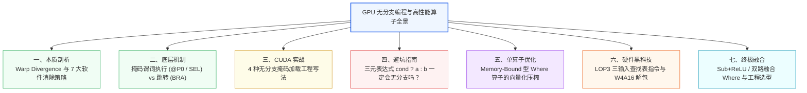
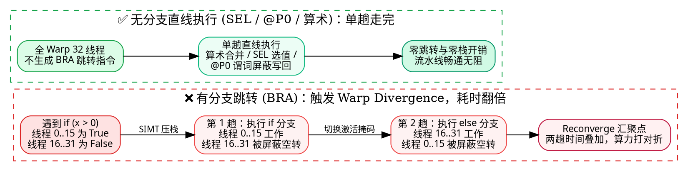
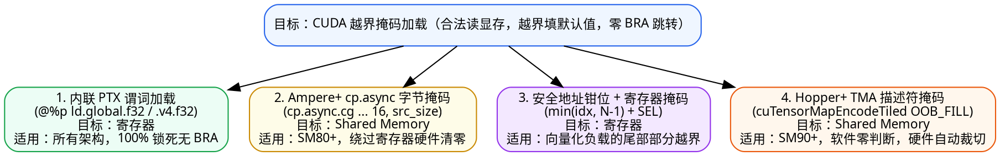
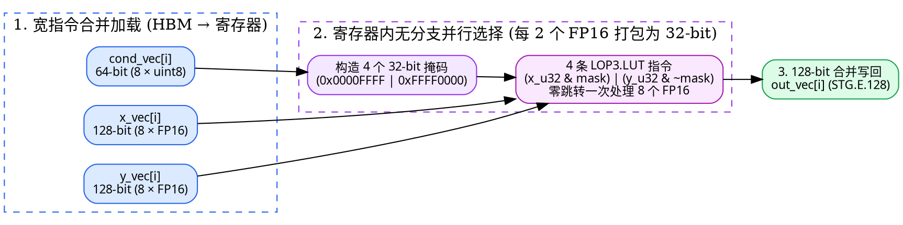
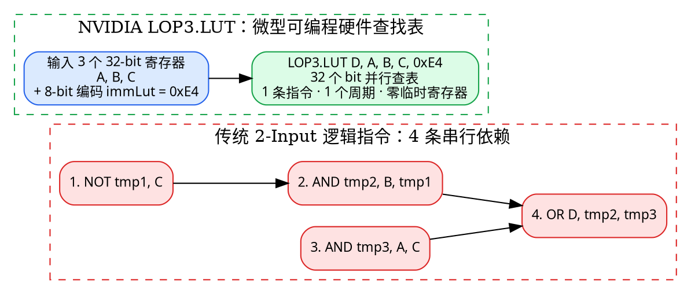
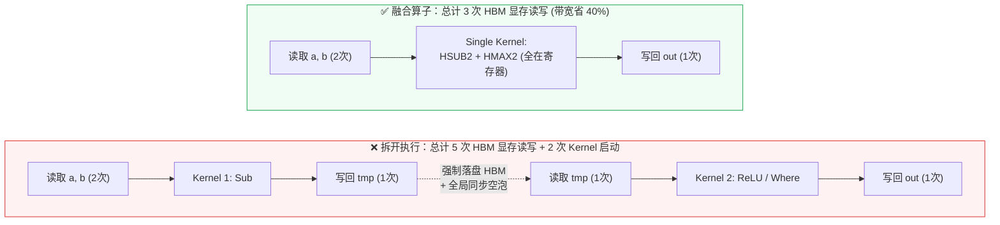
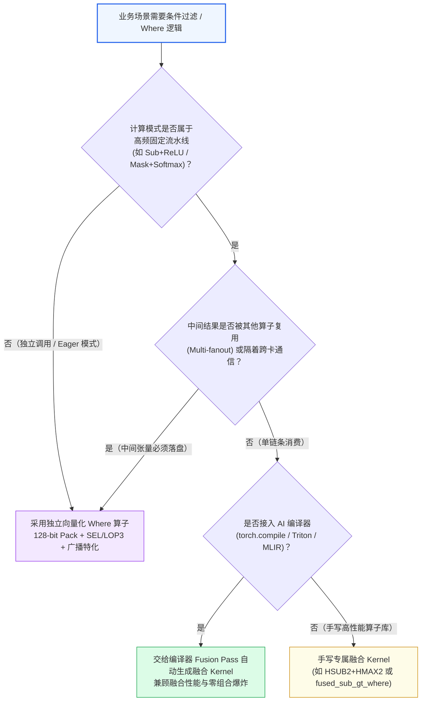

> **导读**：在编写高性能 **GPU 算子（Kernel，运行在 GPU 上的并行计算程序）** 时，初学者最常踩的一个隐形大坑就是：**代码在 CPU 上跑得飞快的 `if-else` 条件判断，放到 GPU 上却可能让性能直接腰斩甚至暴跌数倍。**
>
> 为什么 GPU 这么“讨厌”分支？当出现 `if-else`、数组越界保护 `if (idx < N)` 或者条件选择算子 `Where(cond, x, y)` 时，资深算子工程师为什么不直接写条件跳转，而是千方百计地用**掩码（Mask）**、**谓词寄存器（Predicate Register）**、**`LOP3` 位魔法**甚至**算子融合（Kernel Fusion）**来改写代码？
>
> 为了让**零基础初学者**也能顺畅读懂底层原理，本教程坚持两条原则：
>
> 1. **名词首次出现即破冰**：任何硬件缩写（如 `SIMT`、`PTX`、`SASS`、`BRA`、`SEL`、`LOP3`、`TMA`、`HBM`）在第一次登场时，都会附上英文全称与生活化的白话解释；
> 2. **图表可视化优先**：通过 **8 张 Graphviz 与 Mermaid 图解**，把编译器决策过程、硬件流水线、位掩码真值表与显存读写对比直观“画出来”。

---

## 零、初学者核心名词破冰速查表

在进入正文之前，我们先为后文首次出现的专业术语准备一张“破冰地图”。正文初次提到它们时，也会结合具体代码再次展开。

| 术语 / 缩写           | 英文全称                                        | 一句话通俗解释                                                                                                                                                   |
| :-------------------- | :---------------------------------------------- | :--------------------------------------------------------------------------------------------------------------------------------------------------------------- |
| **Warp（线程束）**    | Warp                                            | NVIDIA GPU 硬件调度的**最小执行小队**，固定由 **32 个连续线程** 组成。它们像仪仗队一样齐步走，同一时刻执行同一条指令。                                           |
| **SIMT**              | Single Instruction, Multiple Threads            | **单指令多线程**执行模型：一条指令发射出去，让同一个 Warp 里的 32 个线程用各自的私有数据同时干活。                                                               |
| **Warp Divergence**   | Warp Divergence（线程束分化 / 分支分化）        | 同一个 Warp 里的 32 个线程遇到 `if-else` 时“意见不合”——一部分要走 `if`，另一部分要走 `else`，硬件被迫分成两趟串行执行，导致算力浪费。                            |
| **PTX / SASS**        | Parallel Thread Execution / Streaming Assembler | **PTX** 是 NVIDIA 的跨代虚拟汇编（类似中间语言）；**SASS** 是真正烧录/运行在具体 GPU 芯片上的底层机器汇编指令。                                                  |
| **`BRA` 指令**        | Branch（条件/无条件跳转指令）                   | 控制流真正发生“拐弯跳走”的汇编指令。一旦触发不同线程朝不同方向 `BRA` 跳转，就会引发分支分化。                                                                    |
| **谓词执行（`@P0`）** | Predication / Guarded Execution                 | **无跳转掩码执行**：每个线程都有 1-bit 的小开关（**谓词寄存器 `P0`~`P6`**）。所有人照常排成一排往前走指令流，但开关关闭（`False`）的线程在写回结果时被硬件屏蔽。 |
| **`SEL` / `selp`**    | Select with Predicate                           | **条件选择指令**：先把 `if` 和 `else` 两边结果都算出来，最后用一个谓词开关在寄存器里“二选一”，全程不跳转。                                                       |
| **If-Conversion**     | If-Conversion（条件转换）                       | 编译器把“跳转分支 `if-else`”自动改写为“直线执行的谓词指令 `@P0` / `SEL`”的优化技术。                                                                             |
| **HBM**               | High Bandwidth Memory                           | GPU 板载的大容量主显存（即 **Global Memory 全局内存**）。容量大（几十 GB），但路途遥远，读写一次延迟高达数百个时钟周期。                                         |
| **Memory-Bound**      | Memory-Bound（访存受限 / 内存墙）               | 算子的性能瓶颈不在算力（ALU），而在“从显存把数据搬过来、写回去”的**显存带宽**速度上（例如 `Where`、`ReLU`、`Add`）。                                             |
| **`LOP3` 指令**       | Three-Input Logic Operation                     | NVIDIA GPU 专属的**三输入按位逻辑查找表指令**。仅用 1 条指令、1 个周期，就能对 3 个 32-bit 寄存器做任意复杂的布尔组合。                                          |
| **算子融合**          | Kernel Fusion                                   | 把原本分开的多个计算步骤（如先算 `Sub` 存回显存，再读出来算 `ReLU`）合并到同一个 Kernel 中，中间结果留在寄存器里直接消化，省掉显存往返。                         |

下面这张全景路线图展示了本文的知识脉络：



---

## 一、本质剖析：什么是 Warp Divergence？消除它的 7 种软件策略

### 1.1 为什么 GPU 上 `if-else` 会导致性能暴跌？

在 CPU 上，每个核心都有极其复杂的分支预测器（Branch Predictor），不同的 CPU 核心可以各自运行完全不同的代码路径。但在 GPU 中，为了把有限的硅片面积尽可能多地留给计算单元（ALU / Tensor Core），GPU 采用了 **SIMT（Single Instruction, Multiple Threads，单指令多线程）** 架构：

- 硬件将每 **32 个连续线程** 捆绑成一个 **Warp（线程束）**；
- 在每个时钟周期，Warp 调度器只发射**同一条指令**，让这 32 个线程像仪仗队一样齐步执行。

当 Warp 遇到条件分支（如 `if-else`、`switch`、`while`）时，如果 32 个线程中**一部分条件为真（True），另一部分条件为假（False）**，就会发生 **Warp Divergence（线程束分化）**：

- 硬件虽然具备 **SIMT 栈（SIMT Stack）** 与较新架构上的 **独立线程调度（ITS, Independent Thread Scheduling）** 来保证执行结果的正确性，但在物理执行上依然**无法在同一个时钟周期让一半线程算 `if`、另一半算 `else`**；
- 硬件必须**串行化（Serialize）**执行两条路径：先激活走 `if` 分支的线程（同时屏蔽走 `else` 的线程让它们原地干等）；等 `if` 分支结束后，再压栈/切换掩码，激活走 `else` 的线程（屏蔽刚才的 `if` 线程）；直到汇聚点（Reconvergence Point）才重新合体。



### 1.2 软件层消除与缓解 Warp Divergence 的 7 种核心手段

除了依赖硬件自身的兜底调度外，在软件编写层（CUDA C++ / PTX / Triton 算子开发阶段），主要有以下 **7 种核心消除与缓解手段**：

#### 1. 算术与位运算替代控制流（Branchless Programming / 无分支编程）

最彻底的软件实现是**根本不写 `if-else` 控制流**，将条件判断转化为纯数学运算或位掩码操作，让所有 32 个线程执行完全相同的指令流。

- **适用场景**：**ReLU**（`max(x, 0)`，深度学习最常用的线性整流激活函数）、**Clamp**（数值截断，将超出上下界的值限制在 `[min, max]` 区间内）、条件赋值与掩码置零。
- **代码对比**：

```cpp
// ❌ 存在分支：当同一 Warp 内 x 既有正数又有负数时触发分化
if (x > 0.0f) {
    y = x;
} else {
    y = alpha * x;
}

// ✅ 软件无分支实现：
// 方式 A：三元表达式（简单数值选择时，编译器通常会生成 PTX 的 selp 指令，不产生跳转）
y = (x > 0.0f) ? x : (alpha * x);

// 方式 B：纯算术实现（将布尔值转为 1.0f 或 0.0f，彻底杜绝跳转）
float is_pos = static_cast<float>(x > 0.0f);
y = is_pos * x + (1.0f - is_pos) * (alpha * x);
```

#### 2. 数据排布与任务映射对齐 Warp 边界（32 的整数倍对齐）

分化的常见来源是**边界越界检查（Boundary Check）**，比如 `if (idx < N)`。如果数据总长度 `N` 不是 32 的倍数，最后一个 Warp 就会出现一部分线程合法、另一部分线程越界的分化现象。

- **软件实现策略**：
  1. **按 Warp 粒度分配循环（Warp-strided Loop）**：在主体循环内部完全去掉 `if (idx < N)` 检查，让所有 Warp 满载无分支狂飙，只把边界检查孤立到最后不足 32 个元素的唯一一个尾部（Tail）。
  2. **张量维度补齐（Padding）**：在申请显存或硬件异步搬运阶段，把内层维度补齐到 32（或 128 Bytes）的整数倍并填零。计算阶段全量无分支运行，最后写回时再截断或依靠补零不影响累加结果（常见于 **GEMM 通用矩阵乘法**）。

#### 3. 数据重排与分桶排序（Data Reordering / Binning / Stream Compaction）

当计算逻辑本身高度不规则或稀疏时（例如 **MoE 混合专家模型**路由中，不同输入 Token 要交给不同的专家网络处理；或变长序列注意力计算），如果直接按原始顺序派发线程，同一个 Warp 内的 32 个线程必然走向不同的分支。

- **软件实现策略**：
  - **前置排序/分桶（Sorting / Bucketing）**：在重计算 Kernel 之前，先用极轻量的并行**前缀和（Prefix Sum / Scan）**或**基数排序（Radix Sort）**，把走相同路径的数据索引聚集到连续内存区间。
  - **典型案例（MoE `Permute` 重排算子）**：路由器选出每个 Token 对应的 `TopK` 专家后，先运行 `Permute` 算子把分给 Expert 0 的 Token 排在一起，Expert 1 的排在一起。后续矩阵乘 Kernel 启动时，同一个 Warp 里的 32 个线程处理的必然是同一个专家，**彻底消除专家路由分化**。

#### 4. 模板元编程与编译期常量特化（Compile-time Specialization）

许多判断条件（如是否加偏置 `has_bias`、是否开启因果掩码 `is_causal`、激活函数类型）在单次 Kernel 运行期间对所有线程取值都相同，或者仅依赖线程块索引 `blockIdx`。

- **软件实现策略**：
  - **C++ 模板特化（Template Specialization）**：把运行时变量提升为编译期常量（如 `template <bool IS_CAUSAL, bool HAS_BIAS>`）。编译器在编译阶段就会通过**死代码消除（Dead Code Elimination）**直接剪掉不需要的分支，运行时零分支。
  - **块级（CTA-level，线程块级）早退**：如果条件只取决于 `blockIdx`——例如在 **Causal Attention（因果注意力）**中，严格位于对角线右上方的整个二维数据块（Tile）全是被屏蔽的无效区——直接在 Kernel 入口让整个 **CTA（Cooperative Thread Array，协作线程阵列，即 Thread Block）** `return`，连主循环都不进；只有处于对角线交界处的少数线程块才走带 Mask 的版本。

#### 5. Warp 级投票与聚合指令（Warp Vote Intrinsics）

当某些分支实在躲不掉（例如迭代求解提前收敛退出，或判断某个数据块是否全为零）时，可以利用硬件自带的 **Warp 投票指令**让 32 个线程先“举手表决”再统一行动：

- **`__all_sync(mask, predicate)`**：只有当 Warp 内**所有**激活线程都满足条件时才执行特定路径（防止部分线程提前退出破坏后续同步）。
- **`__any_sync(mask, predicate)`**：只要 Warp 内**至少有 1 个**线程满足条件，全 Warp 一起进入该分支；如果 32 个线程全为假（例如稀疏矩阵遇到全零块），**整个 Warp 直接整束跳过高开销计算**。
- **`__ballot_sync(mask, predicate)`**：把 32 个线程的布尔结果瞬间压成一个 **32-bit 整数位图（Bitmap）**，配合硬件计数指令 **`__popc`**（Population Count，统计二进制里有多少个 `1`）和 **`__ffs`**（Find First Set，找第一个 `1` 的位置），直接在寄存器里完成索引压缩。

```cpp
// ✅ 典型稀疏跳过优化：若当前 Warp 处理的 32 个元素全为 0，直接整束跳过昂贵的非线性计算
unsigned int active_mask = __activemask();
if (__any_sync(active_mask, val != 0.0f)) {
    // 只要还有 1 个非零元素，全 Warp 才进入；否则整束零开销绕过
    res = expensive_math_func(val);
}
```

#### 6. Warp Specialization（线程束角色特化）

这是现代顶级算子库（如 FlashAttention-3、CUTLASS 3.x）处理**异构流水线任务**（既要搬运数据，又要喂给张量核心做计算，还要做后处理）的标准范式。

- **传统误区**：按单个线程号写 `if (threadIdx.x < 32) { 搬运 } else { 计算 }`，导致控制流缠绕、容易引发同步死锁。
- **软件实现策略**：以 **Warp（32 的整数倍）** 作为角色切分的硬边界：

```cpp
int warp_idx = threadIdx.x / 32;
if (warp_idx == 0) {
    // Producer Warp（生产者线程束，32 线程齐步走，内部 0% 分化）：专职发起 TMA 异步加载
    producer_loop(...);
} else {
    // Consumer Warps（消费者线程束，其余线程束齐步走，内部 0% 分化）：专职矩阵计算
    consumer_loop(...);
}
```

由于 `warp_idx == 0` 在同一个 Warp 的 32 个线程里取值完全一模一样，**每个 Warp 内部 100% 无分支分化**，不同角色各自跑自己的高效流水线。

#### 7. 软件预测执行（Predication / `selp` 内联汇编引导）

当分支内部只有 1~~3 条极简指令时，编译器会使用 **谓词寄存器（Predicate Register，`P0`~~`P6`）** 来屏蔽写回，而不是生成真正的跳转指令 `BRA`。

- **工程技巧**：刻意保持 `if / else` 分支体极度短小（避免函数调用、循环或复杂访存），或直接用三元表达式 / 内联 PTX `selp` 引导编译器走无跳转路线。

#### 选型速查表

| 分化场景                        | 推荐软件实现手段                                         |
| :------------------------------ | :------------------------------------------------------- |
| 简单数值判断 / 激活函数 / 截断  | 无分支算术表达式、三元运算符（编译为 `SEL`）             |
| 张量边界越界检查（`idx < N`）   | 维度 Padding 补齐、Warp 级主循环 + 单一尾部处理          |
| 稀疏数据 / 局部全零块跳过       | `__any_sync` / `__ballot_sync` 整束投票跳过              |
| 不规则动态路由（MoE、稀疏矩阵） | 前置 `Permute` / 基数排序重排，同类任务聚簇到同一 Warp   |
| 全局配置开关（如 `has_bias`）   | C++ 模板编译期特化（`template <bool>`）、块级早退        |
| CTA 内多角色异构流水线          | 按 `threadIdx.x / 32` 划分 Producer / Consumer Warp 特化 |

---

## 二、掩码与谓词执行：为什么它能干掉 `BRA` 跳转指令？

很多同学会问：**底层汇编里经常见到 `br` / `BRA` 指令，用“掩码”替代它到底在硬件上发生了什么？**

- **`BRA` 指令（Branch）**：在 NVIDIA 的 PTX 虚拟汇编中写作 `bra` / `@p bra`，在最终的 SASS 机器码中写作 **`BRA`**。它代表**控制流真正发生了程序计数器（PC）跳转**。只要一个 Warp 里有人跳、有人不跳，就会产生分支分化惩罚。
- **掩码与谓词执行（Mask / Predication）**：**不生成任何 `BRA` 跳转指令**，让所有 32 个线程保持同一条直线指令流往前推进，仅在写入寄存器或修改内存的最后一刻，通过一个 1-bit 开关或位掩码屏蔽掉无效线程的生效结果。

### 2.1 底层硬件的两种无分支机制

在 NVIDIA GPU 汇编层，每个线程都自带一组 1-bit **谓词寄存器（Predicate Register，PTX 中叫 `%p0`~~`%p7`，SASS 中叫 `P0`~~`P6`，另有恒真寄存器 `PT`）**。硬件掩码主要靠下面两条指令体系实现：

1. **谓词前缀执行（`@p` Guarded Execution）**
   编译器把短小的 `if` 翻译成“先做比较设置开关 `%p1`，再给后面的指令戴上一顶 `@%p1` 的帽子”：

```ptx
// PTX 汇编示例：实现 if (x > 0.0f) y = a + b;
setp.gt.f32  %p1, %f_x, 0.0;      // 1. 比较结果存入 1-bit 谓词寄存器 %p1
@%p1 add.f32 %f_y, %f_a, %f_b;    // 2. 所有 32 线程都发射这条指令，但 %p1 为 False 的线程被禁止写回！
```

在 SASS 机器码中，这对应 `FSETP` 设置 `P0`，紧接着 `@P0 FADD R2, R0, R1`。全程**没有 `BRA` 跳转，没有 SIMT 压栈出栈开销**。但前提是 `if` 块必须很短——如果里面有循环或十几条重指令，编译器会认为全员空跑成本过高，自动放弃 `@P0`，回退到 `@!P0 BRA` 真实跳转。

2. **条件选择指令（`selp` / `SEL`）**
   当 `if-else` 两路都有赋值时，编译器先让硬件把两路值都算好放进寄存器，再用一条单周期选择指令二选一：

```ptx
// PTX 汇编示例：实现 y = (x > 0.0f) ? a : b;
setp.gt.f32  %p1, %f_x, 0.0;
selp.f32     %f_y, %f_a, %f_b, %p1; // 对应 SASS 的 SEL 指令，单周期无分支选值
```

### 2.2 软件代码层的 4 种经典掩码用法

在写 **Triton**（OpenAI 推出的 Python 风格 GPU 算子编程 DSL）或 CUDA C++ 时，常见掩码用法有 4 类：

1. **内存加载/存储掩码（Predicated Load / Store）**
   在 Triton 中，最直观的写法就是把 `mask` 直接传给访存原语，编译器会自动将其编译成硬件谓词访存：

```python
# Triton 写法：越界位置硬件自动跳过 HBM 读取并填充 other=0.0，完全无 BRA 分支
x = tl.load(x_ptr + offsets, mask=offsets < N, other=0.0)
tl.store(out_ptr + offsets, y, mask=offsets < N)
```

2. **整数位掩码（Bitmask）与 `LOP3` 合并**
   把布尔条件直接扩成全 `1`（`0xFFFFFFFF`）或全 `0`（`0x00000000`）的 32-bit 掩码，通过按位与/按位或选出数据：

```cpp
// 编译器会自动将下面两行合并为单条硬件 LOP3 指令：(a & mask) | (b & ~mask)
uint32_t mask = cond ? 0xFFFFFFFFu : 0x00000000u;
uint32_t res  = (a & mask) | (b & ~mask);
```

3. **Warp 级 32-bit 投票位图掩码（`__ballot_sync` + `__popc`）**
   比如要做**流压缩（Stream Compaction）**——把数组里所有大于阈值的元素紧致地挑出来存进输出数组。传统写法每个线程都要分支判断再做原子加，竞争激烈；用位图掩码则只需 1 个周期汇总：

```cpp
// 1. 全 Warp 瞬间聚合成 1 个 32-bit 位图（第 i 位为 1 表示第 i 号线程满足条件）
unsigned int lane_mask = __ballot_sync(0xffffffff, val > threshold);

// 2. 利用硬件位计数指令计算当前线程的局部输出偏移（无分支、无需共享内存）
unsigned int prefix_mask = (1u << lane_id) - 1;      // 只保留编号小于自己的低位
int local_offset = __popc(lane_mask & prefix_mask);  // 统计前面有几个有效元素
int total_valid  = __popc(lane_mask);                // 整个 Warp 总计有效元素个数

// 3. 满足条件的线程直接写入紧致位置
if (val > threshold) {
    out[base_offset + local_offset] = val;
}
```

4. **TMA 硬件多维越界自动掩码（Hopper H100+）**
   在 Hopper 架构上，**TMA（Tensor Memory Accelerator，张量内存加速器）** 允许直接由硬件控制器完成矩阵块搬运并自动越界补零，下一节我们将结合 CUDA 代码详解。

---

## 三、CUDA 层级实战：4 种无分支掩码加载工程写法

回到日常 CUDA C++ 开发：当我们要从全局显存（HBM）读入数据，**“合法位置正常读取，越界位置默认填 `0.0f`（或 `-INFINITY`）”**时，怎样在 CUDA 层级彻底消除 `if-else` 带来的 `BRA` 开销？

下面这张图先汇总了 CUDA 生态中从寄存器到专用 DMA 引擎的 **4 种工程路径**：



### 3.1 方案一：内联 PTX 谓词加载（`@%p ld.global`）——最精准的寄存器级控制

当你在 C++ 里写 `float val = (idx < N) ? ptr[idx] : 0.0f;` 时，编译器*有时*会优化成谓词加载，但在复杂循环或寄存器紧张时可能退化为 `BRA` 跳转。通过 **内联 PTX（Inline PTX Assembly）** 直接写 `@p ld.global`，可以 **100% 强制硬件发射无跳转谓词访存指令**：

```cpp
// 单元素（32-bit）谓词加载：越界时寄存器保持 default_val（如 0.0f 或 -INFINITY）
__device__ __forceinline__ float predicated_load_f32(
    const float* ptr, bool pred, float default_val = 0.0f) {
    float val = default_val;
    asm volatile(
        "{\n\t"
        "  .reg .pred p;\n\t"
        "  setp.ne.u32 p, %1, 0;\n\t"       // 将 bool 转为 1-bit 谓词寄存器 p
        "  @p ld.global.f32 %0, [%2];\n\t"  // 仅 p 为真时执行全局显存读取，零 BRA 跳转
        "}\n\t"
        : "+f"(val)
        : "r"(static_cast<int>(pred)), "l"(ptr)
    );
    return val;
}

// 128-bit 向量化谓词加载：一次安全加载 4 个 float（16 Bytes）
__device__ __forceinline__ float4 predicated_load_f32x4(
    const float4* ptr, bool pred) {
    float4 val = make_float4(0.0f, 0.0f, 0.0f, 0.0f);
    asm volatile(
        "{\n\t"
        "  .reg .pred p;\n\t"
        "  setp.ne.u32 p, %4, 0;\n\t"
        "  @p ld.global.v4.f32 {%0, %1, %2, %3}, [%5];\n\t"
        "}\n\t"
        : "+f"(val.x), "+f"(val.y), "+f"(val.z), "+f"(val.w)
        : "r"(static_cast<int>(pred)), "l"(ptr)
    );
    return val;
}
```

> [!TIP] 为什么越界不会崩溃（Segfault）？
> `val` 事先在寄存器里被初始化为 `default_val`。当谓词 `p` 为 `false` 时，GPU 的访存单元（LD/ST Unit）直接取消地址解析和总线下发请求，既不会去碰非法地址导致段错误，又能把默认值安全留在寄存器里；整个过程在 SASS 中只有 `ISETP` + `@P0 LDG`，没有任何 `BRA` 指令。

### 3.2 方案二：Ampere+ 异步拷贝字节掩码（`cp.async` `src-size`）——直达共享内存

如果你的目的不是把数据读进寄存器，而是像 GEMM / FlashAttention 那样把矩阵块从 HBM 搬进 **Shared Memory（片上共享内存，常简写为 SMEM，一种速度极快但容量较小的片上 SRAM 小仓库）**，那么从 Ampere（SM80，如 A100 / RTX 30 系）架构开始，可以直接使用 **`cp.async`** 指令的第四个参数 **`src-size`** 作为硬件字节掩码：

```cpp
// 将 16 Bytes 数据从全局内存 gmem_ptr 异步搬运到共享内存 smem_ptr
// 若 valid == false，传入有效字节数 0，硬件自动往 smem_ptr 填 0 且不发起 HBM 读请求
__device__ __forceinline__ void cp_async_predicated_16B(
    void* smem_ptr, const void* gmem_ptr, bool valid) {
    // 将通用指针转换为 Shared Memory 专用 32-bit 片上地址空间偏移
    uint32_t smem_addr = static_cast<uint32_t>(__cvta_generic_to_shared(smem_ptr));
    int src_bytes = valid ? 16 : 0; // 编译为单条 SEL 指令，无跳转

    asm volatile(
        "cp.async.cg.shared.global [%0], [%1], 16, %2;\n\t"
        :
        : "r"(smem_addr), "l"(gmem_ptr), "r"(src_bytes)
    );
}
```

- **核心优势**：不仅**绕过了寄存器中转**（省下大量寄存器），而且只要 `src_bytes == 0`，哪怕 `gmem_ptr` 地址越界，硬件 DMA 引擎也不会读取 HBM，而是直接在片上 Shared Memory 里自动补零（Zero-fill）。

### 3.3 方案三：安全地址钳位 + 寄存器掩码（解决尾部“半截越界”）

假设你用 `float4` 一次加载 4 个元素，但数组总共只有 10 个元素：第 3 个向量包包含下标 `8, 9, 10, 11`——前 2 个合法、后 2 个越界。此时整条 `predicated_load_f32x4` 的总开关用不了（否则会丢掉 `8, 9`）。工程上的经典解法是**安全地址钳位 + 寄存器清零掩码**：

```cpp
// 前提：N >= 1；一次处理 4 个元素 [base_idx, base_idx + 3]
if (N <= 0) return;
int base_idx = (blockIdx.x * blockDim.x + threadIdx.x) * 4;

// 1. 地址钳位：越界下标被折叠回最后一个合法元素 ptr[N - 1]，绝对不会触发内存越界异常
int safe_idx0 = min(base_idx + 0, N - 1);
int safe_idx1 = min(base_idx + 1, N - 1);
int safe_idx2 = min(base_idx + 2, N - 1);
int safe_idx3 = min(base_idx + 3, N - 1);

float4 data;
data.x = ptr[safe_idx0];
data.y = ptr[safe_idx1];
data.z = ptr[safe_idx2];
data.w = ptr[safe_idx3];

// 2. 用三元表达式（生成 SEL 指令）把本来越界的槽位覆盖回 0.0f，零分支跳转
data.x = (base_idx + 0 < N) ? data.x : 0.0f;
data.y = (base_idx + 1 < N) ? data.y : 0.0f;
data.z = (base_idx + 2 < N) ? data.z : 0.0f;
data.w = (base_idx + 3 < N) ? data.w : 0.0f;
```

### 3.4 方案四：Hopper+ TMA 硬件描述符掩码（`OOB_FILL_ZERO`）

在 Hopper（H100）及更新架构上，如果使用硬件单元 **TMA（Tensor Memory Accelerator）** 搬运二维/多维矩阵块，连 `pred` 布尔变量都不用在 Kernel 里算了：

1. **主机端（CPU）配置 Tensor Map**：调用 CUDA Driver API `cuTensorMapEncodeTiled` 创建张量描述符时，配置越界填充模式（默认 `CU_TENSOR_MAP_FLOAT_OOB_FILL_NONE` 即自动补零，也可配置 NaN 填充）。
2. **设备端（GPU）无条件发射**：Kernel 内部完全不写任何 `if (row < M && col < N)`，统一调用 `cp.async.bulk.tensor.2d.shared::cluster.global`。
3. **硬件自动裁切**：TMA 硬件引擎自动比对坐标与全局边界 `(M, N)`，越界部分硬件屏蔽总线读取并直接在 SMEM 中填入 `0`，实现**软件零掩码、硬件零分支**。

---

## 四、常见误区解惑：三元表达式 `cond ? a : b` 到底会不会产生分支？

很多初学者学了无分支编程后，会下意识以为：“只要我把 `if-else` 改写成三元表达式 `cond ? a : b`，是不是就绝对没有分支开销了？”

**答案是否定的：`cond ? a : b` 在 C++ 语义上与 `if-else` 完全等价。它底层会不会产生 `BRA` 分支跳转，完全取决于 `nvcc` 编译器的 `If-Conversion`（条件转换）代价模型！**

下面这张决策图清晰地展示了编译器在面对 `cond ? a : b` 时的三种真实命运：


### 4.1 三种编译结果逐一拆解

1. **纯值选择：`SEL` 指令（零跳转，但双路求值）**

   ```cpp
   float y = (x > 0.0f) ? (x * 2.0f) : (x + 1.0f);
   ```

   生成的 SASS 伪指令：

   ```text
   FSETP.GT.AND P0, PT, R_x, 0.0, PT;  // 计算条件存入 P0
   FMUL         R_a, R_x, 2.0;         // 分支 A 计算
   FADD         R_b, R_x, 1.0;         // 分支 B 也计算
   SEL          R_y, R_a, R_b, P0;     // 单周期根据 P0 二选一（无 BRA！）
   ```

   因为没有跳转，所以没有分支分化和压栈惩罚；代价是同一 Warp 内所有线程都会把 `a` 和 `b` 都算一遍。只要分支体只有 1~3 条廉价算术指令，这比跳转快得多。

2. **带全局内存读取：`@P0 LDG` 谓词加载（零跳转）**

   ```cpp
   float val = (idx < N) ? ptr[idx] : 0.0f;
   ```

   编译器通常生成 `MOV R_val, 0.0` $\rightarrow$ `ISETP` $\rightarrow$ `@P0 LDG.E R_val, [R_ptr]`。但注意：**如果嵌套在深层循环或涉及复杂多级指针，编译器的自动谓词化可能失效**。核心路径最好用上一章的内联 PTX `@p ld.global` 锁死。

3. **复杂表达式或副作用：退化为 `@!P0 BRA`（真实分支分化！）**
   只要 `a` 或 `b` 触碰下面任意一条红线，三元表达式**一定会生成真实的 `BRA` 跳转**：
   - **高延迟 SFU 指令**：**SFU（Special Function Unit，特殊函数单元）**专门算 `expf()`、`sinf()`、`logf()`、`rsqrtf()` 等超越函数。编译器认为全员空算一遍 `expf` 太亏，一定会生成跳转绕过。
   - **指令条数过多**：单路展开后超过约 4~6 条指令。
   - **包含写入副作用**：如 `(cond) ? (out[i] = a) : (out[i] = b)`、原子操作或外部函数调用。
   - **双路独立全局访存**：如 `cond ? ptrA[i] : ptrB[i]`，编译器为了避免让所有线程同时发起两倍的 HBM 请求，通常会生成 `BRA` 跳转。

```cpp
// ❌ 表面写成了三元表达式，实际编译后必定生成 BRA 真实分支跳转！
float y = (x > 0.0f) ? expf(x) : logf(-x);
```

---

## 五、以小见大：如何从零打造工业级高性能 `Where` 算子？

搞懂了无分支与掩码的底层原理后，我们来看看它们在 AI 框架基础算子——**`Where` 算子**（语义：`out[i] = cond[i] ? x[i] : y[i]`）中是如何落地的。`Where` 在 Attention Mask 填充、损失函数截断、TopK 过滤中极其常见。

### 5.1 性能画像：`Where` 是典型的 Memory-Bound 算子

每个输出元素只需要 1 次条件判断和 1 次数据选择，计算量微乎其微，却需要读写多个大张量（读 `cond, x, y`，写 `out`）。因此，**`Where` 算子的性能上限几乎 100% 取决于能否把 HBM 显存带宽打满（接近硬件理论带宽的 85%~95%）**。

### 5.2 高性能 `Where` 算子的 5 大核心优化策略

1. **极致的 128-bit 向量化合并访存（第一核心，通常带来 2x~4x 加速）**
   GPU 每次向 HBM 发起访存事务时，单线程最宽支持 **128-bit（16 Bytes）** 向量化指令（如 `LDG.E.128` / `STG.E.128`）。逐元素读取会发射大量零碎窄指令。
   - **对齐打包技巧**：
     - 当 `x, y` 为 **`FP16 / BF16`（每个 2 Bytes）** 时：单个线程用 `float4` 一次读入 **16 Bytes = 8 个半精度元素**；此时对应的 `cond`（通常 `bool` / `uint8`，每个 1 Byte）刚好读取 **8 Bytes（`uint64_t` / `Bool8` = 8 个布尔值）**，数量严格一一对应！
     - 当 `x, y` 为 **`FP32`（每个 4 Bytes）** 时：一次读入 **16 Bytes = 4 个 `float`**，对应 `cond` 读取 **4 Bytes（`uint32_t` = 4 个布尔值）**。
   - **三段式非对齐处理**：当指针首地址未按 16 Bytes 对齐或总长度 `N` 不是 Pack 大小的整数倍时，拆成 **头部标量对齐（Prologue） $\rightarrow$ 主体 128-bit 满速循环（Main Loop） $\rightarrow$ 尾部标量收尾（Epilogue）**。

2. **无分支寄存器级选择（`SEL` / `LOP3` 位掩码）**
   向量包读进寄存器后，绝不能写 `for` + `if (cond[k])`。
   - 对 `FP32`：直接写 `cond_pack[k] ? x_pack[k] : y_pack[k]`，生成 4 条并行 `SEL`。
   - 对 `FP16 / BF16`：把相邻 2 个 `half` 打包成一个 32-bit 整数（`uint32_t`），构造低 16 位与高 16 位掩码，编译器会自动将其合并为**单条 `LOP3` 指令同时选出 2 个元素**，吞吐翻倍！



3. **处理广播（Broadcasting）的编译期特化**
   实际模型中 `cond, x, y` 很少形状完全一致（例如 `torch.where(mask, x, -inf)`）。宿主端应在启动前检测形状，通过模板路由分发到 3 条专用路径：
   - **连续无广播路径**：16 Bytes 满速向量化（最快）；
   - **标量广播路径**：当 `x` 或 `y` 是单个常量（如 `0.0` 或 `-inf`）时，作为内核标量参数直接放进寄存器，**瞬间砍掉一整路 HBM 全局读带宽（省 25% 总访存量）**；
   - **通用多维广播路径**：对于非连续多维广播（如 `[1, S]` 广播到 `[B, H, S, S]`），采用 **Fast Divmod（快速整数除模）**——用编译器预计算的乘法与位移替代昂贵的整数除法 `/` 和取模 `%` 来还原广播坐标。

4. **Grid-Stride Loop（网格跨步循环）与 ILP（指令级并行）**
   不盲目启动海量线程块，而是按 GPU SM 数量启动固定倍数的 CTA（如 `num_sms * 32`），每个线程以 `gridDim.x * blockDim.x` 为步长循环处理。配合 `#pragma unroll 2` 让单线程连续发射多条互不依赖的 `LDG.E.128`，用 **ILP（Instruction-Level Parallelism，指令级并行）** 充分掩盖 HBM 访存延迟。

5. **终极杀招：算子融合（Kernel Fusion）**
   独立 `Where` 至少读写 4 次张量，详见第七章。

### 5.3 工业级 `FP16x8` 向量化 `Where` 核心 CUDA 实现

```cpp
#include <cuda_fp16.h>
#include <stdint.h>

// 128-bit 向量包：一次承载 8 个 FP16 (16 Bytes)
struct alignas(16) Half8 {
    uint32_t u[4]; // 每个 32-bit 单元打包存放 2 个 half
};

// 64-bit 条件包：一次承载 8 个 bool/uint8 (8 Bytes)
struct alignas(8) Bool8 {
    uint8_t b[8];
};

__global__ void where_fp16_vec8_kernel(
    const uint8_t* __restrict__ cond,
    const half* __restrict__ x,
    const half* __restrict__ y,
    half* __restrict__ out,
    int64_t total_packs) {

    const Bool8* cond_vec = reinterpret_cast<const Bool8*>(cond);
    const Half8* x_vec    = reinterpret_cast<const Half8*>(x);
    const Half8* y_vec    = reinterpret_cast<const Half8*>(y);
    Half8* out_vec        = reinterpret_cast<Half8*>(out);

    int64_t idx    = static_cast<int64_t>(blockIdx.x) * blockDim.x + threadIdx.x;
    int64_t stride = static_cast<int64_t>(gridDim.x) * blockDim.x;

    // Grid-Stride Loop + 循环展开提高指令级并行 (ILP)
    #pragma unroll 2
    for (int64_t i = idx; i < total_packs; i += stride) {
        // 1. 宽指令合并访存：1 条 64-bit 加载 + 2 条 128-bit 加载
        Bool8 c_pack = cond_vec[i];
        Half8 x_pack = x_vec[i];
        Half8 y_pack = y_vec[i];
        Half8 res_pack;

        // 2. 寄存器内位掩码无分支并行选择（编译器自动合并为 4 条 LOP3 指令）
        #pragma unroll
        for (int k = 0; k < 4; ++k) {
            uint32_t m0   = c_pack.b[2 * k]     ? 0x0000FFFFu : 0x00000000u;
            uint32_t m1   = c_pack.b[2 * k + 1] ? 0xFFFF0000u : 0x00000000u;
            uint32_t mask = m0 | m1;
            res_pack.u[k] = (x_pack.u[k] & mask) | (y_pack.u[k] & ~mask);
        }

        // 3. 128-bit 向量化合并写回
        out_vec[i] = res_pack;
    }
}
```

---

## 六、硬件黑科技：`LOP3` 指令到底是什么？

在上一章中我们多次提到了 **`LOP3`**：它为什么能把 `(x & mask) | (y & ~mask)` 压成单条指令？

**`LOP3`（Three-Input Logic Operation，三输入逻辑指令）** 是 NVIDIA GPU（自 Maxwell SM50 架构引入并沿用至今）在 PTX（`lop3.b32`）和 SASS（`LOP3.LUT`）层级的专属整数位运算指令。它允许 GPU 在 **单个时钟周期、单条指令内**，对 **3 个 32-bit 寄存器操作数（`A`、`B`、`C`）** 执行 **任意自定义的按位布尔逻辑组合**。

### 6.1 为什么硬件工程师要发明 `LOP3`？

在传统的双输入（2-input）ALU 架构上，逻辑指令（`AND`、`OR`、`XOR`、`NOT`）每次最多吃 2 个操作数。如果算子中要算 `D = (A & C) | (B & ~C)`：

- **传统架构**：必须拆成 **4 条串行依赖指令**（`NOT` $\rightarrow$ `AND` $\rightarrow$ `AND` $\rightarrow$ `OR`），耗费多个周期和临时寄存器；
- **NVIDIA `LOP3`**：在 ALU 内部直接做了一个**三输入真值查找表（Lookup Table, LUT）**，**1 条指令、1 个周期直接出结果**，不占用任何额外的临时寄存器！



### 6.2 底层秘密：8-bit 真值表编码 `immLut` 怎么算？

`LOP3` 的第 4 个参数是一个 **8-bit 立即数（`immLut`，范围 `0x00` ~ `0xFF`）**。
道理非常简单：3 个输入比特 `(a, b, c)` 一共有 $2^3 = 8$ 种组合（`000` 到 `111`），任何三输入布尔函数都可以写成一张 **8 行的真值表**；把这 8 个输出比特排成一排，恰好就是一个 **8-bit 字节**！

以 `Where` 选择函数 `f(a, b, c) = (a & c) | (b & ~c)`（即 `c = 1` 选 `a`，`c = 0` 选 `b`）为例：

| 行号 | `a` (bit) | `b` (bit) | `c` (bit) | 输出 `(a & c) \| (b & ~c)` | 权重  |
| :--: | :-------: | :-------: | :-------: | :------------------------: | :---: |
|  0   |     0     |     0     |     0     |             0              | $2^0$ |
|  1   |     0     |     0     |     1     |             0              | $2^1$ |
|  2   |     0     |     1     |     0     |             1              | $2^2$ |
|  3   |     0     |     1     |     1     |             0              | $2^3$ |
|  4   |     1     |     0     |     0     |             0              | $2^4$ |
|  5   |     1     |     0     |     1     |             1              | $2^5$ |
|  6   |     1     |     1     |     0     |             1              | $2^6$ |
|  7   |     1     |     1     |     1     |             1              | $2^7$ |

把输出列从下往上（行 7 到行 0）拼成二进制：`1110_0100`，转成十六进制就是 **`0xE4`**！

#### NVIDIA 官方速算公式（不用每次手画真值表）

直接记忆三个基常量（分别代表真值表中的 `a`、`b`、`c` 列）：

- `TA = 0xF0`（二进制 `1111_0000`）
- `TB = 0xCC`（二进制 `1100_1100`）
- `TC = 0xAA`（二进制 `1010_1010`）

将任意逻辑式套入这三个常量计算即可：

$$
\text{immLut} = (\text{0xF0} \ \& \ \text{0xAA}) \mid (\text{0xCC} \ \& \ \sim\text{0xAA}) = \text{0xA0} \mid \text{0x44} = \mathbf{0xE4}
$$

### 6.3 `LOP3` 在 CUDA 算子中的三大实战神技

1. **W4A16 大模型量化算子的极速寄存器解包（最经典应用）**
   在 LLM 推理（如 Marlin、CUTLASS、TensorRT-LLM）中，权重以 **INT4** 紧凑打包存储在显存中（1 个 `uint32_t` 寄存器里塞了 8 个 INT4 权重），计算前必须在寄存器里解包成 **FP16** 喂给 **Tensor Core（张量核心，GPU 上专算矩阵乘法的硬件引擎）**。
   如果用常规移位加类型强转 `(half)val`，会触发大量吞吐率极低的整数转浮点指令（`I2F`）。高手在寄存器里利用 IEEE-754 浮点数二进制编码规律（`0x64006400` 刚好表示两个 FP16 数值 `1024.0`），先用 **1 条 `LOP3` 同时完成 bit 掩码提取和指数位拼接**，随后再做一次 `half2` 减法减去 `1024.0` 就完成了无损反量化，速度提升数倍！

```cpp
// 内联 PTX 封装 lop3.b32
__device__ __forceinline__ uint32_t lop3_b32(
    uint32_t a, uint32_t b, uint32_t c, uint32_t immLut) {
    uint32_t d;
    asm volatile("lop3.b32 %0, %1, %2, %3, %4;"
                 : "=r"(d) : "r"(a), "r"(b), "r"(c), "n"(immLut));
    return d;
}

// 1 条 LOP3 指令同时完成：(a & b) | c
// 速算 immLut = (0xF0 & 0xCC) | 0xAA = 0xC0 | 0xAA = 0xEA
// 把 packed_int4 里的低 4-bit 权重取出并直接拼上 FP16 魔数指数位 0x64006400
uint32_t fp16_pair = lop3_b32(packed_int4, 0x000F000F, 0x64006400, 0xEA);
```

2. **无分支条件选择与掩码融合（`Where` / `Mask`）**
   C++ 写 `(a & mask) | (b & ~mask)` 时，`nvcc` 后端会自动识别并直接编成 `LOP3.LUT R_res, R_a, R_b, R_mask, 0xe4, !PT`。
3. **哈希计算、密码学与位图压缩（Bit-packing）**
   在基数排序（Radix Sort）、布隆过滤器、稀疏索引位图处理中，`LOP3` 可将多级布尔门电路压扁为极短的指令流，大幅缓解整数 ALU 发射队列压力。

---

## 七、`Sub + ReLU` 算子融合与双路 `Where` 方案深度对比

学到这里，一个非常自然的问题浮出水面：**如果计算图里正好是“先做减法 `Sub`，再根据是否大于 0 做截断/选择”，比如 `Sub + ReLU`，我们是应该先优化独立 `Where` 算子，还是直接把它们融合成一个 Kernel？**

**答案是：只要满足融合条件，`Sub + ReLU` 融合算子在性能上全面碾压拆开执行的独立 `Where` 方案。**

### 7.1 数学等价映射：`Sub + ReLU` 本质上就是特化版 `Where`

- **`Sub`**：$d = a - b$
- **`ReLU`**：$y = \max(d, 0) = \text{Where}(d > 0,\ d,\ 0)$
- **融合后**：$y = \text{Where}(a - b > 0,\ a - b,\ 0)$

相比通用 `Where(cond, x, y)` 需要读取 3 路张量（`cond`、`x`、`y`），融合后的 `Sub + ReLU` 只需读取 **2 路输入**（`a` 和 `b`），完全省去了生成、存储和再读取中间布尔张量 `cond` 与中间结果 `d` 的开销。



### 7.2 硬件 SIMD 级零分支实现：`Sub + ReLU`（`HSUB2` + `HMAX2`）

NVIDIA GPU 具备 **SIMD-within-a-register（寄存器内单指令多数据）** 能力，一个 32-bit 寄存器可以同时装下 2 个 `half`（`half2`）。利用硬件内建函数，**`Sub` 和 `ReLU(Where)` 分别只需 1 条硬件指令就能同时处理 2 个元素**：

- **`FP16`**：`__hsub2` $\rightarrow$ **`HSUB2`**，`__hmax2` $\rightarrow$ **`HMAX2`**（内部符号位硬件直接选通，零 `BRA` 分支）；
- **`FP32`**：`fmaxf(a - b, 0.0f)` $\rightarrow$ `FSUB` + **`FMNMX`**（配合硬件零寄存器 `RZ`，单周期零分支完成）。

```cpp
#include <cuda_fp16.h>
#include <stdint.h>

// 单个线程一次向量化读取 128-bit（8 个 half = 4 个 half2）
__global__ void fused_sub_relu_fp16x8_kernel(
    const half* __restrict__ a,
    const half* __restrict__ b,
    half* __restrict__ out,
    int64_t num_packs) {

    const float4* a_vec = reinterpret_cast<const float4*>(a);
    const float4* b_vec = reinterpret_cast<const float4*>(b);
    float4* out_vec     = reinterpret_cast<float4*>(out);

    int64_t idx    = static_cast<int64_t>(blockIdx.x) * blockDim.x + threadIdx.x;
    int64_t stride = static_cast<int64_t>(gridDim.x) * blockDim.x;

    // 预构造全 0 的 half2 常量寄存器
    const half2 zero2 = __float2half2_rn(0.0f);

    #pragma unroll 2
    for (int64_t i = idx; i < num_packs; i += stride) {
        // 1. 宽指令合并加载：各 1 条 LDG.E.128 读入 8 个 half
        float4 a_pack = a_vec[i];
        float4 b_pack = b_vec[i];
        float4 res_pack;

        const half2* a_h2 = reinterpret_cast<const half2*>(&a_pack);
        const half2* b_h2 = reinterpret_cast<const half2*>(&b_pack);
        half2* res_h2     = reinterpret_cast<half2*>(&res_pack);

        // 2. 寄存器内双路 SIMD 并行计算（零分支、4 组独立指令提高 ILP）
        #pragma unroll
        for (int k = 0; k < 4; ++k) {
            half2 diff = __hsub2(a_h2[k], b_h2[k]); // 编译为 HSUB2（1 条指令算 2 个减法）
            res_h2[k]  = __hmax2(diff, zero2);      // 编译为 HMAX2（1 条指令算 2 个 Where/ReLU）
        }

        // 3. 宽指令合并写回：1 条 STG.E.128 写出 8 个 half
        out_vec[i] = res_pack;
    }
}
```

### 7.3 进阶完整代码：融合双路张量选择 `out = (a - b > 0) ? x : y`

如果业务需求不是输出 `0`（纯 ReLU），而是**根据 `a - b > 0` 的比较结果，从另外两个独立张量 `x` 和 `y` 中二选一**，依然能用 **128-bit 向量化 + 无分支 `FSETP` / `SEL` / `LOP3`** 在单 Kernel 中高并行完成（避免生成中间布尔张量 `cond` 写回显存）。

> [!NOTE] 关于符号位右移与 IEEE-754 严格语义的小提醒
> 有些教程会直接用 `(float_as_int(diff) >> 31)` 取符号位做掩码，但请务必小心：**IEEE-754 中 `+0.0f` 的符号位是 `0`，如果直接用符号位右移，会把 `diff == 0.0f` 误判成真（`>= 0` 而非严格 `> 0`），还会误判 `NaN`！**
>
> 在工程上，直接写出 `(a_arr[k] - b_arr[k] > 0.0f) ? 0xFFFFFFFFu : 0x00000000u` 配合 `lop3_b32`（或直接 `SEL`），不仅编译后同样**零 `BRA` 分支**（编译为 `FSUB` + `FSETP.GT` + `SEL` + `LOP3`），而且完全严格遵守 `+0.0f`、`-0.0f` 和 `NaN` 的 IEEE-754 语义！

```cpp
#include <cuda_runtime.h>
#include <stdint.h>

__device__ __forceinline__ uint32_t lop3_select_u32(
    uint32_t x_bits, uint32_t y_bits, uint32_t mask) {
    uint32_t res;
    // immLut = 0xE4 对应 (x_bits & mask) | (y_bits & ~mask)
    asm volatile("lop3.b32 %0, %1, %2, %3, 0xE4;"
                 : "=r"(res)
                 : "r"(x_bits), "r"(y_bits), "r"(mask));
    return res;
}

// 融合了“减法比较 + 双路张量选择”的向量化 CUDA 实现：
// 语义：out[i] = (a[i] - b[i] > 0.0f) ? x[i] : y[i]
// 要求：指针 16-Byte 对齐，n 为元素总数（含尾部标量兜底）
__global__ void fused_sub_gt_where_fp32_kernel(
    const float* __restrict__ a,
    const float* __restrict__ b,
    const float* __restrict__ x,
    const float* __restrict__ y,
    float* __restrict__ out,
    int64_t n) {

    const int64_t num_vec4 = n / 4;
    const float4* a_vec    = reinterpret_cast<const float4*>(a);
    const float4* b_vec    = reinterpret_cast<const float4*>(b);
    const float4* x_vec    = reinterpret_cast<const float4*>(x);
    const float4* y_vec    = reinterpret_cast<const float4*>(y);
    float4* out_vec        = reinterpret_cast<float4*>(out);

    int64_t idx    = static_cast<int64_t>(blockIdx.x) * blockDim.x + threadIdx.x;
    int64_t stride = static_cast<int64_t>(gridDim.x) * blockDim.x;

    // 1. 主体 128-bit 向量化满速循环（4 个 float 为一组）
    #pragma unroll 2
    for (int64_t i = idx; i < num_vec4; i += stride) {
        float4 va = a_vec[i];
        float4 vb = b_vec[i];
        float4 vx = x_vec[i];
        float4 vy = y_vec[i];
        float4 vout;

        const float* pa = reinterpret_cast<const float*>(&va);
        const float* pb = reinterpret_cast<const float*>(&vb);
        const uint32_t* px = reinterpret_cast<const uint32_t*>(&vx);
        const uint32_t* py = reinterpret_cast<const uint32_t*>(&vy);
        uint32_t* po       = reinterpret_cast<uint32_t*>(&vout);

        #pragma unroll
        for (int k = 0; k < 4; ++k) {
            float diff    = pa[k] - pb[k];
            uint32_t mask = (diff > 0.0f) ? 0xFFFFFFFFu : 0x00000000u;
            po[k]         = lop3_select_u32(px[k], py[k], mask);
        }

        out_vec[i] = vout;
    }

    // 2. 尾部非 4 对齐元素收尾（Epilogue，仅最后几个元素走此路径）
    int64_t tail_start = num_vec4 * 4;
    for (int64_t i = tail_start + idx; i < n; i += stride) {
        float diff = a[i] - b[i];
        uint32_t mask = (diff > 0.0f) ? 0xFFFFFFFFu : 0x00000000u;
        uint32_t res_bits = lop3_select_u32(
            __float_as_uint(x[i]), __float_as_uint(y[i]), mask);
        out[i] = __uint_as_float(res_bits);
    }
}
```

### 7.4 正面 PK：前面的独立 `Where` 方案好，还是融合算子方案好？

在真实 GPU 算子库与 AI 编译器（如 MLIR / PyTorch Inductor / Triton）中，两者并非“谁淘汰谁”，而是**“专属快车道”与“通用兜底基石”**的关系：

| 对比维度               | 独立优化 `Where` 方案（第五章）                                     | `Sub + ReLU` 融合方案（第七章）                          | 胜出方与底层原因                                               |
| :--------------------- | :------------------------------------------------------------------ | :------------------------------------------------------- | :------------------------------------------------------------- |
| **HBM 显存访存次数**   | **5 次**（`Sub` 读 2 写 1 + `Where` 读掩码与输入再写回，至少 5 趟） | **3 次**（读 `a`, 读 `b`, 写 `out`，中间张量全留寄存器） | **融合方案完胜**：Memory-Bound 算子直接节省 40% 显存带宽。     |
| **Kernel 启动开销**    | 2 次 Launch + 1 次全局栅栏同步                                      | 1 次 Launch，零全局同步                                  | **融合方案完胜**：消除数微秒调度空泡，小张量场景收益巨大。     |
| **单元素指令吞吐**     | 1 条 `FSETP` + 1 条 `SEL` / `LOP3`                                  | 1 条 `HSUB2` + 1 条 `HMAX2`（或 `FMNMX`）                | **融合方案略胜**：省去生成与传递布尔掩码的指令。               |
| **通用性与泛化能力**   | **极强**：支持任意条件、任意 `x, y` 与多维广播                      | **极窄**：只适配特定算子组合模式                         | **独立 `Where` 完胜**：遇到独立 `Where(cond, x, y)` 必须靠它。 |
| **维护与编译体积代价** | **低**：一套向量化模板服务全模型                                    | **极高**：每种组合都手写会导致“算子组合爆炸”             | **独立 `Where` 胜出**：手写融合受限，通常需靠编译器自动生成。  |

下面这张决策树可以帮助你在实际工程中做出架构选择：



---

## 八、全篇实战验证：如何确认自己真的消除了分支？

写完无分支 CUDA 代码后，千万不要凭感觉猜测编译器是否听话。养成用 `cuobjdump` 检查真实 **SASS 机器汇编**的习惯：

```bash
# 1. 编译生成带有源码行号信息的 cubin 或可执行文件
nvcc -O3 -arch=sm_80 -lineinfo kernel.cu -o kernel_test

# 2. 反汇编查看核心指令：筛选跳转 (BRA) 与谓词/选择/逻辑查找表指令
cuobjdump -sass kernel_test | grep -E "BRA|SEL|LOP3|HMAX2|FMNMX|@P"
```

### 一眼辨别优化成败（SASS 红黑榜）

- **✅ 优化成功（无分支直线执行）**：
  - 看到 **`ISETP` / `FSETP` + `SEL`**（无分支条件选值）；
  - 看到 **`@P0 LDG` / `@P0 LDGSTS`**（带谓词守卫的寄存器加载或异步拷贝）；
  - 看到 **`LOP3.LUT`**（单周期三输入位掩码融合）；
  - 看到 **`HSUB2` + `HMAX2`** 或 **`FMNMX`**（单周期硬件极值直选）；
  - 看到 **`LDG.E.128` / `STG.E.128`**（128-bit 满带宽向量化合并访存）。
- **❌ 优化失败（仍存在分支分化风险）**：
  - 在核心计算循环内部看到 **`@!P0 BRA 0x...`**，说明分支体过大或存在复杂副作用，编译器放弃了谓词化并退回到了真实控制流跳转，此时应拆小分支体、改用 `LOP3` 位掩码或直接采用内联 PTX `@p` 锁定指令生成！
