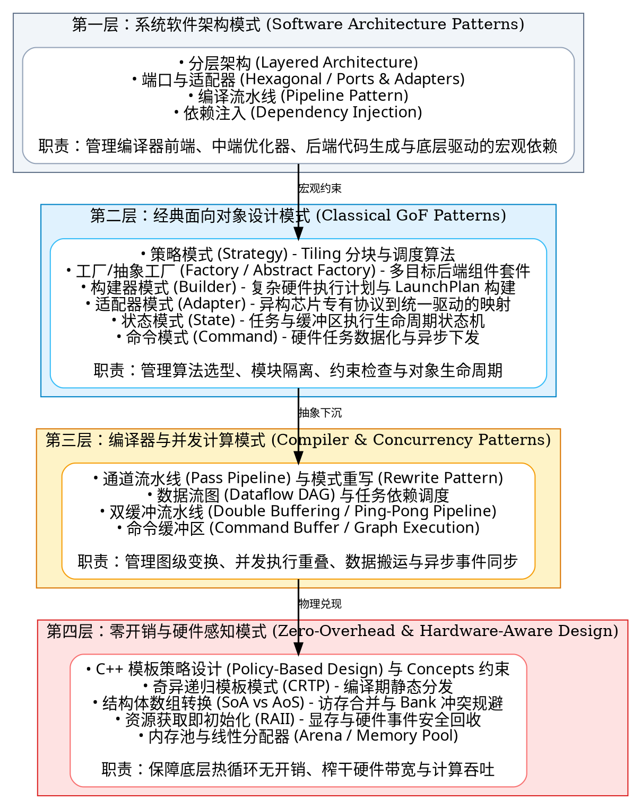
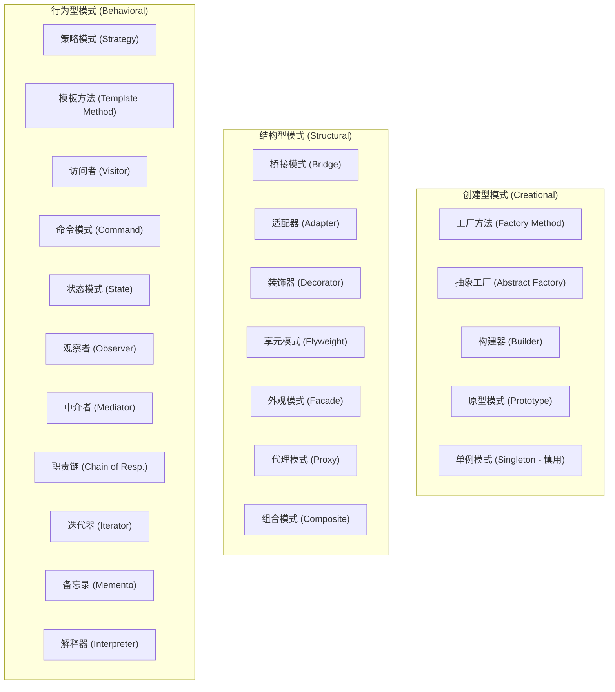
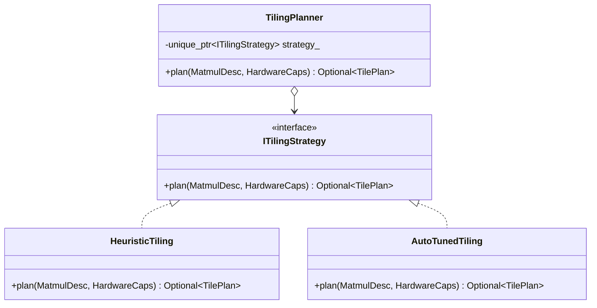
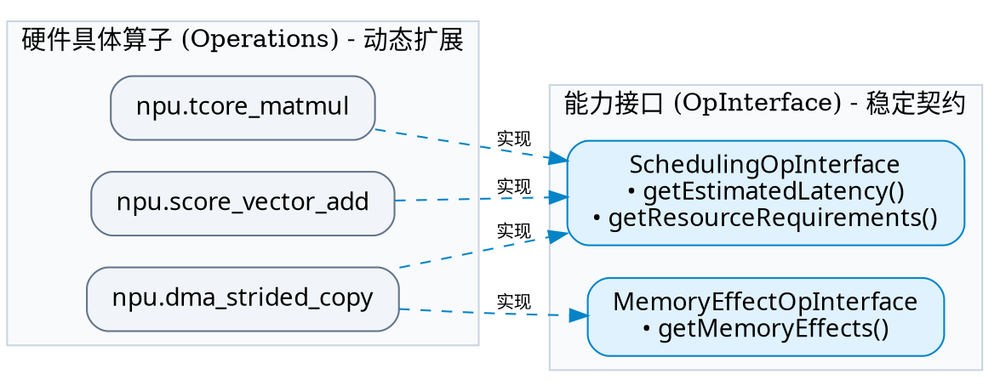
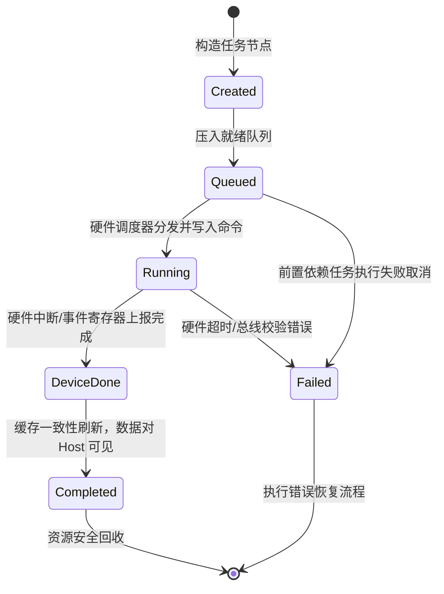
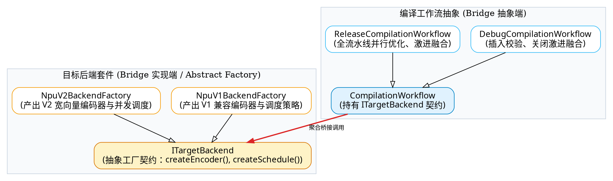
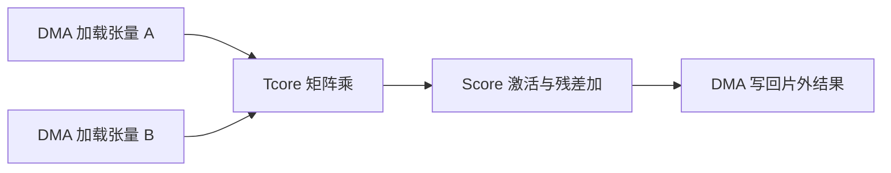

在传统企业级软件与桌面应用开发中，GoF（Gang of Four）23 种经典设计模式早已是软件工程的基石。正如侯捷老师在经典设计模式课程中所强调的：**设计模式的核心目标不是为了套用华丽的结构，而是通过“封装变化点”来管理软件演进中的复杂性，使系统能够在需求剧烈变更时将改动范围控制在最小。**

然而，当我们的研发阵地转移到**异构计算（Heterogeneous Computing）**——涵盖通用图形处理器（GPU）、神经网络处理器（NPU）、专用张量加速器（TPU-like Accelerator）以及各类数据流 AI 芯片时，许多习惯了传统面向对象设计的工程师却陷入了两个极端的泥潭：

1. **“过度抽象派”**：生搬硬套面向对象多态，在极其宝贵的硬件计算核内部或者热路径（Hot Path）中使用虚函数查找（vtable）、大量动态堆内存分配（`malloc`/`new`）与层层对象封装，直接导致硬件流水线停顿、缓存缺失（Cache Miss）、指令发散与寄存器溢出，使得算力利用率暴跌；
2. **“放弃设计派”**：认为“高性能就是裸写平铺代码”，把算子数学推导、循环分块策略、硬件寄存器绝对物理地址、DMA 数据搬运与底层总线驱动全部塞进一个数千行的巨型函数或单个编译器 Pass 中。结果一旦芯片架构迭代（如寄存器位宽微调、新增批量配置指令或引入新一代计算核心），整个软件栈全盘崩溃，甚至连基本的单元测试与仿真验证都寸步难行。

> **核心法则**：
> 异构系统与 AI 编译器的设计，并不是摒弃设计模式，而是**重塑设计模式的物理边界**。
> **控制平面（Control Plane）追求高内聚与极高可扩展性；数据平面（Data Plane）恪守零开销与硬件贴合。**

本文将结合经典设计模式笔记与现代异构计算工程经验，深入系统软件、AI 编译器（以现代 MLIR 基础设施为例）与硬件驱动体系，从第一性原理自底向上推导一套兼顾**软件工程可维护性**与**极致硬件性能**的高性能计算设计模式全景架构。

---

## 零、初学者核心概念全景透视箱

在正式切入设计模式之前，为扫除跨领域初学者的阅读障碍，我们先将异构系统与编译器领域的关键术语进行通俗化、具象化的界定。

```dot
digraph heterogeneous_concept_map {
    rankdir=LR;
    node [shape=box, style="filled,rounded", fontname="sans-serif", margin="0.2,0.1"];
    edge [fontname="sans-serif", fontsize=10];

    subgraph cluster_host {
        label="主机端 (Host Side) - 控制平面";
        style="filled";
        fillcolor="#f8fafc";
        color="#94a3b8";

        CPU [label="CPU 标量核心\n(控制与任务调度)", fillcolor="#e2e8f0", color="#64748b"];
        Compiler [label="AI 编译器 / Pass 流水线\n(将高级计算图降低为硬件指令)", fillcolor="#e0f2fe", color="#0284c7"];
        Runtime [label="异构运行时 Runtime\n(管理任务图、事件与内存生命周期)", fillcolor="#f0fdf4", color="#16a34a"];
    }

    subgraph cluster_device {
        label="设备端 (Device Side) - 数据平面";
        style="filled";
        fillcolor="#f8fafc";
        color="#94a3b8";

        DMA [label="DMA 控制器\n(片外 DDR ⇄ 片上 SMEM 极速搬运)", fillcolor="#fef3c7", color="#d97706"];
        AG [label="硬件地址生成器 (AG)\n(自动计算多维张量跨步步长)", fillcolor="#fef3c7", color="#d97706"];
        Tcore [label="张量矩阵核 (Tcore)\n(高密度二维脉动阵列乘法)", fillcolor="#fee2e2", color="#dc2626"];
        Score [label="流式向量核 (Score/RVV)\n(单指令多数据流一维激活/累加)", fillcolor="#fee2e2", color="#dc2626"];
    }

    CPU -> Compiler [label="输入计算模型"];
    Compiler -> Runtime [label="输出执行指令包/ELF"];
    Runtime -> DMA [label="下发配置与传输命令", color="#0284c7"];
    DMA -> AG [label="同步地址与步长"];
    AG -> Tcore [label="流式喂入张量数据", color="#dc2626"];
    AG -> Score [label="流式喂入向量数据", color="#dc2626"];
}
```



> [!NOTE]
> **异构计算基础名词释疑**：
> 1. **异构计算 (Heterogeneous Computing)**：由不同指令集架构、不同并行特征的计算单元（如通用 CPU + 并行 GPU/NPU）协同完成任务的计算范式。CPU 负责业务逻辑调度，加速芯片负责吞吐海量数值计算。
> 2. **控制平面 (Control Plane) vs 数据平面 (Data Plane)**：
>    - **控制平面**：负责任务编排、资源分配、合法性校验、编译器代码生成。此部分处于 CPU 主机端，对扩展性要求极高，运行频率较低（毫秒至秒级），**适合使用经典面向对象与动态多态模式**。
>    - **数据平面**：处于硬件加速芯片内部，每秒处理千亿次浮点运算的纯算力通路。此部分以纳秒计，**绝对禁止引入虚函数与动态内存分配，必须采用静态多态与零开销抽象**。
> 3. **Tcore（张量乘法核心） vs Score（流式向量核心）**：
>    - **Tcore（Tensor Core）**：专职执行高吞吐二维矩阵乘（GEMM）或卷积的大规模脉动阵列。
>    - **Score（Streaming Core） / RVV（RISC-V 向量扩展）**：专职执行一维连续向量运算（如 ReLU、Softmax、LayerNorm）的向量处理器，遵循 SIMD（单指令多数据流）执行范式。
> 4. **片上存储（SMEM / Scratchpad Memory） vs 片外内存（DDR）**：
>    - **DDR**：容量巨大（数十 GB）但延迟高、带宽有限的外部存储器。
>    - **SMEM**：集成在芯片晶圆内部的高速暂存 SRAM，容量宝贵（数十 KB 至数 MB），访问延迟极低但必须由软件显式管理地址与生命周期。
> 5. **DMA（Direct Memory Access）与 AG（Address Generator）**：
>    - **DMA**：硬件搬运工，能够在无需 CPU 介入的情况下，在 DDR 与片上 SMEM 之间批量搬运张量切片。
>    - **AG**：硬件地址计算引擎，根据硬件配置寄存器中的基地址、跳步跨度（Stride）和循环计数，硬件自动吐出下一个内存访问地址，完全解放通用 ALU。
> 6. **MMIO（Memory-Mapped I/O）**：
>    - 处理器将外设硬件寄存器直接映射到自身的内存地址空间中，读写指定物理地址等同于向加速硬件发送控制信号。
> 7. **MLIR（Multi-Level Intermediate Representation）**：
>    - 现代开源编译器基础设施，通过分层的“方言（Dialect）”与“操作（Operation）”，逐步将上层高抽象数学语义（如矩阵乘）逐步“降阶（Lowering）”为硬件专有指令与寄存器配置。

---

## 一、高性能异构计算中的四层设计模式体系

在异构软件系统中，单一维度的模式无法覆盖从上层用户 API 到晶体管寄存器的全链路。我们必须构建一个清晰的四层模式架构。



任何异构系统的工程质量，核心不在于套用了多少个模式名称，而在于**变化发生时的代码扰动度**：
> 当芯片引入新一代指令集、新增一种计算算子、调整了寄存器字段布局或更替了硬件调度协议时，需要修改的代码是否高度集中、完全可测试，且绝不牵连任何正交无关的业务模块？

---

## 二、八大设计原则在 AI 编译器与 Runtime 中的具象化

侯捷老师在面向对象课程中强调：**原则是推导模式的源头，违背原则的模式应用一定是灾难。** 让我们将这八大经典原则映射到异构编译器的工程现实中：

| 原则 | 经典定义 | 异构计算 / 编译器中的正确工程实践 | 典型反模式（Bad Design） |
|---|---|---|---|
| **单一职责 (SRP)** | 一个类应仅有一个引起它变化的原因 | 将形状推断、Tiling 分块规划、SMEM 分配、DMA 调度、寄存器编码完全拆分为独立模块 | 一个 Pass 同时负责矩阵拆分、片上分配、地址生成以及调用 MMIO 写寄存器 |
| **开闭原则 (OCP)** | 对扩展开放，对修改关闭 | 引入新芯片（如 NPU-V2）只需挂载新的 Target Backend，核心通用 IR 优化 Pass 一行不改 | 每新增一款加速芯片，就在所有通用优化 Pass 里写满 `if (chip == CHIP_V2)` |
| **依赖倒置 (DIP)** | 高层与底层均应依赖抽象契约 | 调度器依赖纯粹的硬件能力契约（`HardwareCaps`），不直接调用硬件读写函数 | 在通用计算图调度算法内部硬编码调用芯片私有的硬件控制字配置接口 |
| **接口隔离 (ISP)** | 客户端不应被迫依赖未使用的接口 | 计算接口、DMA 传输接口、事件同步接口分离定义，按需组合 | 定义一个包含数百个虚函数的巨型 `IDevice` 接口，强迫简单设备实现纯断言接口 |
| **里氏替换 (LSP)** | 子类必须能透明替换基类契约 | 所有 Target 后端必须遵守相同的数值语义、错误处理与生命周期契约 | 某款不支持动态 Shape 的芯片后端继承了接口，运行时却突然抛出不可捕获的 Panic |
| **组合优于继承 (CRP)** | 优先使用对象组合而非类继承 | 采用 `ComputePolicy + LayoutPolicy + MemoryPolicy` 动态装配后端 | 制造 `NPU_FP16_Tiling_DoubleBuffer_Backend` 这样继承层级深重达数十层的庞大类树 |
| **封装变化点** | 将易变因素与稳定因素物理隔离 | 芯片寄存器位图（Bitfield）变动隔离在 Encoder；通信总线协议隔离在 Transport Adapter | 将寄存器位移与掩码（Bitmask）操作硬编码散布在算子规划逻辑中 |
| **最少知识原则 (LoD)** | 模块只与直接朋友通信 | 调度器只接收封装好的 `Command` 对象，不知道也不关心底层是通过 MMIO 还是 DMA 提交 | 调度器直接穿透访问具体加速核心内部未公开的控制状态寄存器（CSR） |

---

## 三、经典 GoF 23 种设计模式全景对照与异构计算定位

为了方便工程师在日常系统架构中快速检索与对照，我们将经典 23 种模式在异构计算及编译器中的工程定位系统总结如下：



### 1. 创建型模式：对象与执行方案的安全构建

- **工厂方法 (Factory Method)**：将底层对象创建延迟到具体的硬件后端。例如：通用驱动通过基类工厂提取特定加速芯片的 `CodeEmitter`，编译器根据选项派生具体的 `Pass` 实例。
- **抽象工厂 (Abstract Factory)**：**核心价值在于成套组件的一致性约束**。在芯片多代际演进中，一次性创建互相配套兼容的 `ScoreEncoder`、`TcoreEncoder`、`DmaEncoder` 与 `AbiLowering`。防止将 V1 的寄存器编码器与 V2 的总线协议错配。
- **构建器 (Builder)**：在高性能领域，Builder 的价值不是链式调用的语法糖，而是**复杂不变性（Invariants）的分阶段构建与物理校验**。例如：构建一个包含多维张量跨度、地址对齐约束、SMEM 边界校验的 `DmaDescriptor` 或 `HardwareExecutionPlan`。
- **原型模式 (Prototype)**：基于现有对象克隆出独立副本。在 AI 编译器的自动调优（Autotuning）和推测优化中极其关键——克隆多份候选编译计划（`TilePlan`）进行并行成本估算，而无需反复解析重建。
- **单例模式 (Singleton)**：**异构编译器中的头号高危模式！** 强力建议避免全局可变单例。多线程并发编译不同模型或为不同芯片生成代码时，全局单例极易导致配置交叉污染。应使用带生命周期的显式**编译会话（CompilationSession）**进行依赖注入。

### 2. 结构型模式：模块依赖与存储效率管理

- **桥接模式 (Bridge)**：将两个独立变化的维度完全解耦。例如将**编译工作流维度**（Debug 调试流程、Release 极限优化流程）与**硬件后端目标维度**（NPU-V1、NPU-V2、通用 GPU）解耦，避免产生 $M \times N$ 的派生子类爆炸。
- **适配器模式 (Adapter)**：抹平底层硬件差异的利器。将专有芯片的底层硬件驱动 API 适配包装为系统统一的 `IDevice` 接口或 `IConfigTransport` 传输契约。
- **装饰器模式 (Decorator)**：无侵入式增强核心对象。在不修改基础编码器（`ScoreEncoder`）逻辑的前提下，通过外挂 `TracingEncoder` 或 `ProfilingEncoder`，在流水线各阶段动态拦截输出寄存器日志、耗时统计与硬件断言。
- **享元模式 (Flyweight)**：编译器内存控制的核心骨架。MLIR 的 `Type` 与 `Attribute` 即采用享元思想——在 `MLIRContext` 内部将相同的张量类型（如 `tensor<64x128xf32>`）做唯一化驻留（Uniquing），数百万个操作节点共享同一份不可变内存指针，大幅降低内存消耗并加速指针级判等。
- **外观模式 (Facade)**：架构层面的守门人。将包含前端解析、数十个 Pass 流水线、目标代码生成与链接的复杂编译器子系统封装为简洁的 `Compiler::compile(model)` 统一入口。
- **代理模式 (Proxy)**：控制对物理硬件或外部服务的访问。例如在缺乏实体芯片时，通过 `EdaSimulationProxy` 代理远程 EDA 硬件仿真服务器；或使用 `LazyDeviceProxy` 延迟加载大体积芯片固件。
- **组合模式 (Composite)**：部分与整体的一致性表达。适用于编译器的抽象语法树（AST）、复合 Pass 流水线以及嵌套硬件任务依赖图的递归解析与执行。

### 3. 行为型模式：算法解耦、调度编排与执行生命周期

- **策略模式 (Strategy)**：AI 编译器的命脉。将经常波动的优化算法从主干流程抽离。例如 Tiling 分块决策、张量内存重排（Layout Transformation）、指令调度顺序等，均作为可热插拔的策略实现。
- **模板方法 (Template Method)**：由框架固定通用的执行骨架，子类实现特定钩子。例如定义算子 Lowering 的标准步骤：`validate() -> analyzeHardware() -> rewriteIR() -> verify()`。
- **访问者模式 (Visitor)**：传统 AST 遍历的标准模式。但在现代多方言编译器中，由于算子数量频繁扩张，经典的封闭双重分发 Visitor 会造成维护灾难，正被现代 MLIR 的 **操作接口（OpInterface）与模式重写（Rewrite Pattern）** 所超越与替代。
- **命令模式 (Command)**：**将硬件操作转变为结构化数据**。将“立即调用驱动写寄存器”转变为“构造不可变的硬件命令（DMA、计算启动、事件等待）”，从而支持编译期静态依赖图排序、多命令融合优化与硬件故障回放。
- **状态模式 (State)**：管理异构任务生命周期（`Created -> Queued -> Running -> DeviceDone -> Completed`）。彻底杜绝传统依靠单个 `bool is_done` 造成的悬挂指针、双重释放与内存未可见性竞态。
- **观察者模式 (Observer)**：解耦状态变化与外部消费。硬件完成事件（Completion Event）产生后，调度器（Scheduler）、性能分析器（Profiler）与日志模块独立订阅响应，杜绝耦合。
- **中介者模式 (Mediator)**：多硬件协同调度核心。当片上包含 DMA 搬运、Score 向量核、Tcore 矩阵核与 SMEM 时，组件间禁止网状互相调用，统一由 `ExecutionScheduler` 作为中介者协调资源与依赖。
- **职责链模式 (Chain of Responsibility)**：算子硬件选型与优雅降级（Fallback）。例如一个浮点加法算子，按“高吞吐专用向量核 Score $\to$ 通用 RVV 向量扩展 $\to$ 标量核心模拟”链条依次尝试匹配最适实现。

---

## 四、核心模式深度实战推导（结合 C++20 与 MLIR）

理论必须经受工程代码的洗礼。接下来，我们选取最具实战价值的七大场景展开深度重构推导。

### 实践一：策略模式（Strategy）—— 动静态结合的 Tiling 分块规划系统

#### 1. 业务痛点与第一性原理
在矩阵乘法 $C = A \times B$ 中，由于片上高速缓存（SMEM）容量极其有限，编译器必须将大矩阵切分成三维分块 $(T_M, T_N, T_K)$ 循环搬运至片上计算。

若采用硬编码判断：
```cpp
// 糟糕的反模式：多设备与策略深度耦合
TilePlan chooseTile(const MatmulDesc& op, DeviceType dev) {
    if (dev == DeviceType::GPU) { /* GPU 专用公式 */ }
    else if (dev == DeviceType::NPU) { /* NPU 专用启发式 */ }
    else { /* CPU 默认分块 */ }
}
```
该写法直接违反开闭原则（OCP）与单一职责（SRP）：一旦增加一种自动调优策略或新型芯片，必须修改该核心函数，且无法进行独立的单元测试。

#### 2. 动静态策略的正交解耦实现
编译期宏观层面需要灵活切换策略（固定分块、启发式分析、搜索调优）；而在高性能内核内部，策略必须在编译期静态特化以消除虚函数调用开销。

```cpp
#include <cstdint>
#include <memory>
#include <optional>
#include <stdexcept>
#include <iostream>

// 1. 纯粹的数据契约（完全不含虚函数，零成本传递）
struct MatmulDesc {
    int64_t M, N, K;
};

struct HardwareCaps {
    int64_t maxTileM, maxTileN, maxTileK;
    uint64_t localMemoryBytes;
    uint32_t alignment;
};

struct TilePlan {
    int64_t tileM, tileN, tileK;
};

// 2. 策略抽象接口（用于控制平面的动态替换）
class ITilingStrategy {
public:
    virtual ~ITilingStrategy() = default;
    [[nodiscard]] virtual std::optional<TilePlan> plan(
        const MatmulDesc& op, const HardwareCaps& caps) const = 0;
};

// 3. 具体策略实现 A：启发式固定规则
class HeuristicTiling final : public ITilingStrategy {
public:
    std::optional<TilePlan> plan(
        const MatmulDesc& op, const HardwareCaps& caps) const override {
        // 启发式：优先保证 M 轴与 N 轴对齐硬件向量宽度
        TilePlan p{64, 64, 32};
        if (p.tileM > caps.maxTileM || p.tileN > caps.maxTileN || p.tileK > caps.maxTileK) {
            return std::nullopt; // 资源超出硬件上限
        }
        return p;
    }
};

// 4. 具体策略实现 B：基于 Cost Model 搜索最佳策略
class AutoTunedTiling final : public ITilingStrategy {
public:
    std::optional<TilePlan> plan(
        const MatmulDesc& op, const HardwareCaps& caps) const override {
        // 模拟调优：根据矩阵实际尺寸动态计算最优分块
        int64_t tm = std::min(op.M, caps.maxTileM);
        int64_t tn = std::min(op.N, caps.maxTileN);
        int64_t tk = std::min(op.K, caps.maxTileK);
        return TilePlan{tm, tn, tk};
    }
};

// 5. 编译期静态 Policy（用于数据平面的极致内联）
template <typename Policy>
class StaticKernelPlanner {
    Policy policy_;
public:
    explicit StaticKernelPlanner(Policy policy) : policy_(std::move(policy)) {}

    TilePlan execute(const MatmulDesc& op, const HardwareCaps& caps) const {
        return policy_.planStatic(op, caps); // 纯静态内联，汇编级零抽象惩罚
    }
};
```



---

### 实践二：MLIR 体系下的架构演进 —— 为什么必须告别经典 AST Visitor？

在经典编译原理中，AST 遍历几乎是 Visitor 模式的代名词。然而在现代异构 AI 编译器中，强行使用经典 Visitor 往往会导致灾难。

#### 1. 经典 Visitor 的固有缺陷：开闭维度的倒置
经典 Visitor 模式建立在“节点类型稳定，操作经常新增”的假设之上。如果你的 IR 仅有简单的 `AddExpr`、`SubExpr`，增加代码生成、类型检查非常方便。
然而，异构芯片的 DSL 与 IR 正处于爆炸式增长期：今天增加 `ScoreAdd`，明天增加 `TcoreMatMul`，后天增加 `DmaAsyncCopy`。在经典 Visitor 中，每增加一个新节点类，**所有既有的 Visitor 接口全部必须修改**，造成极具破坏性的联动修改！

#### 2. MLIR 的现代化破局：OpInterface 与 Pattern Rewrite
现代编译器基础设施采用更优雅的机制落实 DIP（依赖倒置）与 ISP（接口隔离）：



通用分析器只需针对能力接口编程：
```cpp
// 通用分析 Pass：依赖接口，不依赖任何特定芯片 Op
void analyzeOperation(mlir::Operation* op) {
    if (auto schedOp = mlir::dyn_cast<SchedulingOpInterface>(op)) {
        int64_t latency = schedOp.getEstimatedLatency();
        auto res = schedOp.getResourceRequirements();
        // 调度器仅凭接口契约排布流水，绝无需穷举几百种 Op 的 switch-case
    }
}
```

> [!WARNING]
> **警惕架构反模式：巨型 Lowering Pass 陷阱**
> 许多团队常犯一个错误：前五个 Pass 仅仅在 IR 上打上 `{tile_size = [64, 64]}`、`{layout = "NCHW"}` 等属性（Attributes），然后写一个数万行的“最终 Lowering Pass”统一解析改写。
> 这会导致：
> 1. 上游属性合法性缺乏实时校验，容易在中间传递时被其他优化 Pass 静默破坏；
> 2. 最终 Pass 必须理解从高层数学到微码的所有决策，形成无法重构的超级巨石（God Pass）。
> **正确架构**：每个关键优化阶段（分块化 $\to$ 内存显式化 $\to$ 硬件降低）都应形成语法可验证的渐进 IR 阶段。

---

### 实践三：Adapter + Builder + Command —— 自定义加速芯片寄存器配置系统的四层解耦

在 NPU 驱动开发中最具破坏力的代码，莫过于“在算子降阶逻辑里直接写物理硬件寄存器”。

```dot
digraph decoupled_register_flow {
    rankdir=LR;
    node [shape=box, style="filled,rounded", fontname="sans-serif", margin="0.2,0.1"];
    edge [fontname="sans-serif", fontsize=10];

    IR [label="计算语义 IR\n(npu.score_add)", fillcolor="#f1f5f9", color="#64748b"];
    Planner [label="ScorePlanner\n(分块、步长与通路规划)", fillcolor="#e0f2fe", color="#0284c7"];
    Builder [label="ScorePlanBuilder\n(构建并物理校验执行计划)", fillcolor="#fef3c7", color="#d97706"];
    Encoder [label="ScoreEncoder\n(将语义字段转为二进制配置字)", fillcolor="#fee2e2", color="#dc2626"];
    Transport [label="IConfigTransport\n(统一传输协议契约)", fillcolor="#f0fdf4", color="#16a34a"];

    MockDev [label="MockDeviceTransport\n(纯内存断言，用于脱机单测)", fillcolor="#ffffff", color="#86efac"];
    PciDev [label="MmioPciTransport\n(实际芯片物理 MMIO 总线驱动)", fillcolor="#ffffff", color="#86efac"];

    IR -> Planner;
    Planner -> Builder [label="产生决策参数"];
    Builder -> Encoder [label="产出不可变合法计划"];
    Encoder -> Transport [label="生成 Command Batch"];
    Transport -> MockDev [style="dashed"];
    Transport -> PciDev [style="dashed"];
}
```



#### 完整解耦实现示例：
```cpp
#include <cstdint>
#include <vector>
#include <span>
#include <memory>
#include <stdexcept>
#include <cassert>

// 1. 命令数据化：寄存器写入命令（完全脱离硬件环境）
struct RegisterWrite {
    uint32_t offset;
    uint32_t value;
    bool operator==(const RegisterWrite&) const = default;
};

using RegisterBatch = std::vector<RegisterWrite>;

// 2. 硬件执行计划（不可变值对象）
struct ScoreProgram {
    uint32_t baseAddress;
    uint32_t strideBytes;
    uint32_t loopCount;
};

// 3. 构建器模式（Builder）：负责硬件合法性约束校验
class ScoreProgramBuilder {
    std::optional<uint32_t> baseAddress_;
    std::optional<uint32_t> strideBytes_;
    std::optional<uint32_t> loopCount_;
public:
    ScoreProgramBuilder& setBaseAddress(uint32_t addr) {
        baseAddress_ = addr;
        return *this;
    }
    ScoreProgramBuilder& setStride(uint32_t stride) {
        strideBytes_ = stride;
        return *this;
    }
    ScoreProgramBuilder& setLoopCount(uint32_t count) {
        loopCount_ = count;
        return *this;
    }

    [[nodiscard]] ScoreProgram build(uint32_t maxSmemLimit, uint32_t alignReq) const {
        if (!baseAddress_ || !strideBytes_ || !loopCount_) {
            throw std::logic_error("ScoreProgram 未配置完整！");
        }
        // 强制执行硬件物理约束检查
        if (*baseAddress_ % alignReq != 0) {
            throw std::invalid_argument("基地址未对齐到硬件要求边界！");
        }
        if (*baseAddress_ + (*strideBytes_ * *loopCount_) > maxSmemLimit) {
            throw std::out_of_range("张量总访问范围超出片上 SMEM 物理容量！");
        }
        return ScoreProgram{*baseAddress_, *strideBytes_, *loopCount_};
    }
};

// 4. 纯函数式编码器（Encoder）：仅进行数学位运算，绝不触碰真实 MMIO
class ScoreEncoder {
public:
    [[nodiscard]] RegisterBatch encode(const ScoreProgram& prog) const {
        RegisterBatch batch;
        // 编码地址控制寄存器 (假定偏移 0x100)
        batch.push_back({0x100, prog.baseAddress});
        // 编码步长控制寄存器 (假定偏移 0x104)
        batch.push_back({0x104, prog.strideBytes});
        // 编码循环计数与启动位 (假定偏移 0x108，高 1 位为启动标记)
        batch.push_back({0x108, (prog.loopCount & 0x7FFFFFFF) | 0x80000000});
        return batch;
    }
};

// 5. 传输抽象层（Adapter / DIP）：隔离驱动与通信协议
class IConfigTransport {
public:
    virtual ~IConfigTransport() = default;
    virtual void submit(std::span<const RegisterWrite> writes) = 0;
};

// 6. 测试替身（Mock）：使编译器单测完全脱离实体硬件与仿真器！
class MockConfigTransport final : public IConfigTransport {
public:
    std::vector<RegisterWrite> recorded;
    void submit(std::span<const RegisterWrite> writes) override {
        recorded.insert(recorded.end(), writes.begin(), writes.end());
    }
};
```
> [!TIP]
> **工程收益**：
> 通过将“规划”、“校验构建”、“编码”与“总线传输”四权分立，系统软件工程师可以在一台普通的开发本（x86/ARM）上对编译器生成的寄存器控制字运行数千个高覆盖率的单元测试，完全无需等待昂贵稀缺的 EDA 仿真器或硬件开发板！

---

### 实践四：Command + State + Observer —— 异步运行时（Runtime）的确定性状态机

在异构计算中，主机端（Host CPU）下发算子命令仅仅是“提交（Submit）”，硬件核心需要经历复杂的总线调度与数据搬运才能最终“完成（Complete）”。如果仅用一个简单的 `bool isDone` 来描述任务，极易发生悬挂访问、二次释放等恶性并发灾难。

#### 1. 任务生命周期的严格状态转移
任务必须由一个确定性的有限状态机（FSM）进行守护：



#### 2. 命令模式与观察者模式协作架构
```cpp
#include <cstdint>
#include <functional>
#include <vector>
#include <memory>
#include <iostream>

// 状态枚举：具备严格的单向递进语义
enum class TaskState {
    Created,
    Queued,
    Running,
    DeviceDone,
    Completed,
    Failed
};

// 观察者接口：用于解耦硬件完成通知
class ITaskObserver {
public:
    virtual ~ITaskObserver() = default;
    virtual void onStateChanged(uint64_t taskId, TaskState oldState, TaskState newState) = 0;
};

// 命令基类：操作被封装为可记录、可推迟执行的对象
class RuntimeTask {
    uint64_t id_;
    TaskState state_{TaskState::Created};
    std::vector<std::shared_ptr<ITaskObserver>> observers_;

public:
    explicit RuntimeTask(uint64_t id) : id_(id) {}

    void registerObserver(std::shared_ptr<ITaskObserver> observer) {
        observers_.push_back(std::move(observer));
    }

    void transitionTo(TaskState target) {
        // 严格的状态机合法性断言
        if (state_ == TaskState::Completed || state_ == TaskState::Failed) {
            throw std::logic_error("终态任务不可再进行状态转移！");
        }
        TaskState prev = state_;
        state_ = target;
        // 通知所有观察者（日志、Profiler、下游调度器）
        for (auto& obs : observers_) {
            obs->onStateChanged(id_, prev, target);
        }
    }

    [[nodiscard]] uint64_t id() const { return id_; }
    [[nodiscard]] TaskState state() const { return state_; }
};

// 具体观察者：负责在任务真正完成时唤醒下游就绪队列
class SchedulerObserver final : public ITaskObserver {
public:
    void onStateChanged(uint64_t taskId, TaskState oldState, TaskState newState) override {
        if (newState == TaskState::Completed) {
            std::cout << "[Scheduler] 任务 #" << taskId << " 真正就绪！开始解锁下游依赖算子。\n";
        } else if (newState == TaskState::Failed) {
            std::cerr << "[Scheduler] 任务 #" << taskId << " 故障，开始级联取消未执行任务。\n";
        }
    }
};
```

---

### 实践五：Bridge + Abstract Factory —— 多目标硬件后端的矩阵解耦

当编译器需要同时支持多种编译模式（Debug 模式、Release 激进优化模式、Profile 性能剖析模式）和多种硬件目标（NPU-V1、NPU-V2、通用 GPU）时，若使用类继承，将产生爆炸性的代码重复。



通过将“工作流”与“硬件套件”正交解耦，新增一种硬件只需扩展一个具体的 `BackendFactory`，新增一种优化工作流只需扩展一个 `Workflow`，系统的复杂度从 $M \times N$ 线性收敛至 $M + N$。

---

### 实践六：职责链模式（Chain of Responsibility）—— 算子硬件实现选型与优雅降级

在真实的加速处理器中，算子实现往往有多种路径：
- **专用流式核心（Score）**：速度极快，但对张量维度对齐（如 64 字节对齐）与数据类型有极其严苛的限制；
- **通用向量扩展（RVV）**：支持灵活的动态长度，能处理未对齐数据，但吞吐中等；
- **标量主机降级（Scalar Fallback）**：无任何限制，但速度最慢。

若写成冗长的 `if-else`，新增实现途径将破坏现有逻辑。职责链模式为此类候选选择提供了绝佳的落脚点：

```cpp
#include <iostream>
#include <memory>
#include <optional>

struct TensorShape {
    int64_t rows;
    int64_t cols;
    bool isAligned64;
};

// 候选处理结果
enum class SelectionStatus {
    NotApplicable, // 本核心无法承载，交由下一个候选尝试
    Accepted,       // 成功接管
    InternalError   // 规划器异常
};

struct SelectionResult {
    SelectionStatus status;
    std::string matchedPlan;
};

// 职责链节点基类
class IOperatorImplementation {
protected:
    std::shared_ptr<IOperatorImplementation> next_;
public:
    virtual ~IOperatorImplementation() = default;

    void setNext(std::shared_ptr<IOperatorImplementation> next) {
        next_ = std::move(next);
    }

    [[nodiscard]] virtual SelectionResult resolve(const TensorShape& shape) const = 0;
};

// 候选 A：极速专用流式核心
class ScoreSpecializedEngine final : public IOperatorImplementation {
public:
    SelectionResult resolve(const TensorShape& shape) const override {
        if (shape.isAligned64 && (shape.cols % 16 == 0)) {
            return {SelectionStatus::Accepted, "调度到专用硬件流式核心 (Score) 极速流水线"};
        }
        if (next_) return next_->resolve(shape);
        return {SelectionStatus::NotApplicable, "无合适核心匹配"};
    }
};

// 候选 B：通用向量扩展引擎 (RVV)
class RvvVectorEngine final : public IOperatorImplementation {
public:
    SelectionResult resolve(const TensorShape& shape) const override {
        // RVV 可支持非 64 字节对齐，只要列数大于 1
        if (shape.cols > 1) {
            return {SelectionStatus::Accepted, "调度到通用 RVV 向量扩展流水线 (动态跨步处理)"};
        }
        if (next_) return next_->resolve(shape);
        return {SelectionStatus::NotApplicable, "无合适核心匹配"};
    }
};

// 候选 C：标量保底降级
class ScalarFallbackEngine final : public IOperatorImplementation {
public:
    SelectionResult resolve(const TensorShape& shape) const override {
        return {SelectionStatus::Accepted, "调度到标量主控核 (Scalar Fallback) 慢速保底执行"};
    }
};
```

---

### 实践七：装饰器模式（Decorator）vs MLIR 原生 PassInstrumentation

在排查复杂编译器 Bug 时，开发者经常需要统计每个降阶阶段耗费的 CPU 周期、将中间 IR 转储为可读文本或打印生成的十六进制机器指令。

如果直接在每一个 Pass 的内部源码写打印代码，整个编译器将迅速被调试垃圾污染。

#### 1. 面向对象维度的装饰器方案
为编码器（Encoder）套上一层无侵入的装饰壳：
```cpp
class TracingEncoderDecorator final : public IEncoder {
    std::unique_ptr<IEncoder> inner_;
public:
    explicit TracingEncoderDecorator(std::unique_ptr<IEncoder> inner) 
        : inner_(std::move(inner)) {}

    RegisterBatch encode(const HardwareProgram& prog) override {
        std::cout << "[Trace] === 开始编码硬件控制字 ===\n";
        auto res = inner_->encode(prog);
        for (const auto& reg : res) {
            std::cout << "  物理寄存器 [0x" << std::hex << reg.offset << "] <= 0x" << reg.value << std::dec << "\n";
        }
        std::cout << "[Trace] === 编码完毕，共生成 " << res.size() << " 个控制指令 ===\n";
        return res;
    }
};
```

#### 2. MLIR 官方原生架构对应：PassInstrumentation
在现代 MLIR 系统中，官方直接在 `PassManager` 体系中内置了标准的拦截钩子。你无需手动为每一个 Pass 编写装饰类，直接挂载 `PassInstrumentation` 即可实现横切面拦截（AOP 思想）：

```cpp
// 官方标准机制：在 Pass 启动与结束时自动触发观察
class CompilerPassInstrumentation : public mlir::PassInstrumentation {
public:
    void runBeforePass(mlir::Pass* pass, mlir::Operation* op) override {
        // 自动输出 Pass 执行前的 IR 快照
    }
    void runAfterPass(mlir::Pass* pass, mlir::Operation* op) override {
        // 自动输出 Pass 执行后的 IR 变化差异与耗时
    }
};
```

---

## 五、超越 GoF：异构计算特有的硬件感知并发与存储模式

异构加速芯片具备独特的物理架构：多层离散存储（DDR/SMEM/寄存器）、多独立硬件通道（DMA/计算核并行）。因此，仅掌握经典面向对象模式远远不够，必须掌握以下硬件感知计算模式：

### 1. 双缓冲流水线模式（Double Buffering / Ping-Pong Pipeline）

```
时钟周期 (Time) ──────────►
            ┌─────────┬─────────┬─────────┬─────────┐
DMA 搬运    │ Load 0  │ Load 1  │ Load 2  │ Load 3  │
            └─────────┴─────────┴─────────┴─────────┘
                      ┌─────────┬─────────┬─────────┐
计算核计算            │ Calc 0  │ Calc 1  │ Calc 2  │
                      └─────────┴─────────┴─────────┘
                                ┌─────────┬─────────┐
DMA 写回                        │ Store 0 │ Store 1 │
                                └─────────┴─────────┘
```

> **核心逻辑**：
> 在片上开辟两块独立的缓存区（`Buffer[0]` 与 `Buffer[1]`）。
> 当计算核心正在榨干全部算力处理 `Buffer[0]` 中的切片数据时，DMA 硬件控制器正在后台并发地将下一个切片数据从片外全局内存预取到 `Buffer[1]` 中！
> 两者通过硬件同步事件或双缓冲屏障交替翻转，**彻底将数据搬运的巨幅延迟隐藏在计算时间背后**。

### 2. 数据流有向无环图（Dataflow DAG）模式
加速任务天然不是串行命令，而是具备依赖关系的有向无环图（DAG）：



运行时必须能够自动识别出 `DMA_A` 与 `DMA_B` 没有数据依赖，从而通过两条独立的物理总线通道并发发起数据搬运，并在汇聚节点通过事件屏障保障可见性。

### 3. 数据排布：SoA vs AoS 模式
- **AoS（Array of Structures，结构体数组）**：
  `struct Point { float x, y, z; } points[N];`
  对 CPU 缓存局部性友好，但对 SIMD/向量核心是灾难（加载所有 X 分量需要非连续跳步访问，触发严重的跨步延迟甚至片上 Bank 冲突）。
- **SoA（Structure of Arrays，数组结构体）**：
  `struct Points { float x[N]; float y[N]; float z[N]; };`
  所有同维度数据物理连续存放。向量计算核心的一条宽向量加载指令可一次性吞入数十个 X 分量，实现极致的**访存合并（Coalesced Memory Access）**。

---

## 六、端到端生产级微型架构综合实战（纯 C++20）

为了将上述设计思想融会贯通，我们给出一个完整的、自闭环的、采用现代 C++20 编写的微型异构编译与调度执行器代码。

代码清晰展示了：
- 策略驱动的分块规划（Strategy）
- 算子候选链式匹配（Chain of Responsibility）
- 结构化命令生成与依赖图（Command + DAG）
- 状态机与观察者守护（State + Observer）
- 统一门面 API 封装（Facade）

```cpp
#include <iostream>
#include <memory>
#include <vector>
#include <string>
#include <optional>
#include <variant>
#include <cassert>

// ==========================================
// 1. 数据契约层
// ==========================================
struct OperatorDesc {
    std::string name;
    int64_t M, N, K;
};

struct HardwareCaps {
    int64_t maxTileDim{64};
    bool hasSpecializedScore{true};
    bool hasRvvVector{true};
};

// 硬件命令定义 (Command 模式)
struct DmaCopyCommand {
    uint32_t srcAddr, dstAddr, bytes;
};
struct ComputeCommand {
    std::string engineName;
    int64_t tileM, tileN, tileK;
};
struct BarrierCommand {
    uint32_t eventId;
};

using HardwareCommand = std::variant<DmaCopyCommand, ComputeCommand, BarrierCommand>;

// ==========================================
// 2. 策略模式 (Strategy)：分块规划
// ==========================================
class ITilingStrategy {
public:
    virtual ~ITilingStrategy() = default;
    [[nodiscard]] virtual std::pair<int64_t, int64_t> chooseTiles(int64_t M, int64_t N, int64_t maxLimit) const = 0;
};

class ConservativeTiling final : public ITilingStrategy {
public:
    std::pair<int64_t, int64_t> chooseTiles(int64_t M, int64_t N, int64_t maxLimit) const override {
        return {std::min(M, maxLimit), std::min(N, maxLimit)};
    }
};

// ==========================================
// 3. 职责链模式 (Chain of Responsibility)：执行引擎选择
// ==========================================
class IEngineSelector {
protected:
    std::shared_ptr<IEngineSelector> next_;
public:
    virtual ~IEngineSelector() = default;
    void setNext(std::shared_ptr<IEngineSelector> next) { next_ = std::move(next); }
    [[nodiscard]] virtual std::string select(const OperatorDesc& op, const HardwareCaps& caps) const = 0;
};

class SpecializedScoreSelector final : public IEngineSelector {
public:
    std::string select(const OperatorDesc& op, const HardwareCaps& caps) const override {
        if (caps.hasSpecializedScore && op.M % 16 == 0) {
            return "Specialized-Score-Core";
        }
        if (next_) return next_->select(op, caps);
        return "Unknown";
    }
};

class RvvSelector final : public IEngineSelector {
public:
    std::string select(const OperatorDesc& op, const HardwareCaps& caps) const override {
        if (caps.hasRvvVector) {
            return "RVV-Vector-Core";
        }
        if (next_) return next_->select(op, caps);
        return "Scalar-Fallback";
    }
};

// ==========================================
// 4. 观察者与状态模式 (State + Observer)
// ==========================================
enum class ExecutionStatus { Ready, InProgress, Succeeded, Failed };

class IExecutionObserver {
public:
    virtual ~IExecutionObserver() = default;
    virtual void onStatusChanged(ExecutionStatus status) = 0;
};

class ConsoleAuditLogger final : public IExecutionObserver {
public:
    void onStatusChanged(ExecutionStatus status) override {
        switch (status) {
            case ExecutionStatus::Ready:      std::cout << "[Audit] 状态更新: 就绪 (Ready)\n"; break;
            case ExecutionStatus::InProgress: std::cout << "[Audit] 状态更新: 执行中 (InProgress)\n"; break;
            case ExecutionStatus::Succeeded:  std::cout << "[Audit] 状态更新: 成功完成 (Succeeded)\n"; break;
            case ExecutionStatus::Failed:     std::cout << "[Audit] 状态更新: 发生故障 (Failed)\n"; break;
        }
    }
};

// ==========================================
// 5. 外观模式 (Facade)：统一编译器与执行系统门面
// ==========================================
class HeterogeneousCompilerFacade {
    HardwareCaps caps_;
    std::unique_ptr<ITilingStrategy> tilingStrategy_;
    std::shared_ptr<IEngineSelector> engineChainHead_;

public:
    explicit HeterogeneousCompilerFacade(HardwareCaps caps) : caps_(caps) {
        tilingStrategy_ = std::make_unique<ConservativeTiling>();

        auto scoreNode = std::make_shared<SpecializedScoreSelector>();
        auto rvvNode = std::make_shared<RvvSelector>();
        scoreNode->setNext(rvvNode);
        engineChainHead_ = scoreNode;
    }

    void compileAndExecute(const OperatorDesc& op, IExecutionObserver& observer) {
        observer.onStatusChanged(ExecutionStatus::Ready);

        // 1. 策略规划
        auto [tm, tn] = tilingStrategy_->chooseTiles(op.M, op.N, caps_.maxTileDim);
        std::cout << "[Compiler] 分块规划完成: TileM=" << tm << ", TileN=" << tn << "\n";

        // 2. 职责链选择计算核心
        std::string targetEngine = engineChainHead_->select(op, caps_);
        std::cout << "[Compiler] 算子 [" << op.name << "] 匹配至计算核心: " << targetEngine << "\n";

        // 3. 构建命令缓冲区 (Command Pattern)
        std::vector<HardwareCommand> commandGraph;
        commandGraph.push_back(DmaCopyCommand{0x1000, 0x80000, 1024});
        commandGraph.push_back(ComputeCommand{targetEngine, tm, tn, op.K});
        commandGraph.push_back(BarrierCommand{1});
        commandGraph.push_back(DmaCopyCommand{0x80000, 0x2000, 1024});

        // 4. 执行调度 (模拟运行)
        observer.onStatusChanged(ExecutionStatus::InProgress);
        for (const auto& cmd : commandGraph) {
            std::visit([](auto&& arg) {
                using T = std::decay_t<decltype(arg)>;
                if constexpr (std::is_same_v<T, DmaCopyCommand>) {
                    std::cout << "  -> 触发 DMA 搬运: 0x" << std::hex << arg.srcAddr << " -> 0x" << arg.dstAddr << std::dec << "\n";
                } else if constexpr (std::is_same_v<T, ComputeCommand>) {
                    std::cout << "  -> 核心 [" << arg.engineName << "] 执行计算 Tile=" << arg.tileM << "x" << arg.tileN << "\n";
                } else if constexpr (std::is_same_v<T, BarrierCommand>) {
                    std::cout << "  -> 等待硬件完成屏障 Event#" << arg.eventId << "\n";
                }
            }, cmd);
        }

        observer.onStatusChanged(ExecutionStatus::Succeeded);
    }
};

// ==========================================
// 6. 入口主函数验证
// ==========================================
int main() {
    std::cout << "=== 异构计算设计模式架构演示系统 ===\n\n";

    HardwareCaps myNpuCaps{.maxTileDim = 64, .hasSpecializedScore = true, .hasRvvVector = true};
    HeterogeneousCompilerFacade compiler(myNpuCaps);
    ConsoleAuditLogger logger;

    OperatorDesc matmulOp{.name = "MatMul_64x128", .M = 64, .N = 128, .K = 256};
    compiler.compileAndExecute(matmulOp, logger);

    std::cout << "\n=== 全部流水线验证完毕 ===\n";
    return 0;
}
```

---

## 七、架构演进误区与自查清单

在系统落地过程中，请随时对照以下八项高频误区自我审视：

| 序号 | 常见误区 | 为什么致命 | 正确架构范式 |
|---|---|---|---|
| **1** | **在设备计算核内使用 `virtual`** | 产生 vtable 间接跳转，打断指令预取与寄存器分配，无法向量化 | 控制面用虚函数解耦，数据面使用 C++ Concepts、CRTP 与模板 Policy |
| **2** | **所有类型均定义对应抽象基类** | 制造过度设计，无意义的一对一包装徒增编译开销与心智负担 | 仅在系统**真实发生变化**的物理边界提取接口与契约 |
| **3** | **认为 `switch-case` 必然是坏代码** | 对封闭、不可变的操作集合强行套用多态，代码冗长难懂 | 封闭集合优先使用 `std::variant` + 模式匹配；开放可扩展集合使用多态 |
| **4** | **在多线程编译器中使用全局单例** | 导致多并发编译任务状态串扰、无法独立配置不同优化选项 | 使用带显式生命周期的 `CompilationSession`，自顶向下依赖注入 |
| **5** | **每个微小改动都新建一个 Pass** | 过度细碎的 Pass 会导致海量冗余 IR 遍历，急剧拖慢端到端编译时间 | 按照“可独立验证的语义阶段”聚合 Pass 流水线 |
| **6** | **Observer 兼任权威状态的管理者** | 事件广播具有非确定性，容易导致多模块对任务生命周期的理解产生分歧 | 权威状态由驱动核心状态机单独管理，观察者仅负责单向接收通知 |
| **7** | **未通过 Builder 直接构造底层配置** | 缺少前置约束断言，导致非对齐、越界的非法参数直接打崩硬件 | 在进入硬件编码前，通过带约束校验的 Builder 强制拦截一切非法参数 |
| **8** | **忽略提交与完成的时间异步性** | 将函数调用返回等同于硬件物理执行完毕，引发严重的数据读写冲突 | 显式构建事件依赖与完成证据链，严格遵循内存一致性模型 |

---

## 八、总结与架构心法

回顾本文对异构计算与 AI 编译器设计模式的系统解构，我们可以提炼出三条统领全局的架构心法：

1. **识别稳定契约，封装易变物理**：
   算子的数学几何语义（GEMM、Convolution）是高度稳定的；芯片的微架构特征（寄存器位宽、流水线延时、DMA 模式）是频繁演进的。设计模式的核心使命，就是在两者之间筑起一道坚不可摧的接口防火墙。
2. **两级分工，动静相宜**：
   在 CPU 主机端与控制平面，充分利用经典面向对象模式（Strategy、Abstract Factory、Builder、State、Command、Facade）的灵活性，实现对芯片代际更迭与多样化算子的高效支撑；在硬件设备端与数据平面，坚定践行现代 C++ 零开销抽象原则（CRTP、Policy-Based Design、SoA、RAII），彻底压榨每一点晶体管算力与物理内存带宽。
3. **测试驱动，数据脱机**：
   优秀的架构必然是可脱机测试的。将“决策规划”、“结构化表示”、“指令编码”与“驱动传输”彻底解耦，使编译器在脱离物理芯片硬件的前提下，依然能够通过高覆盖率的单元测试与黄金结果对比（Golden Test）建立起强悍的工程质量防线。

这不仅是设计模式在异构计算前沿领域的蜕变与重生，更是每一位高性能系统软件与编译器架构师追求“代码优雅与极致性能兼得”的必经之路。
