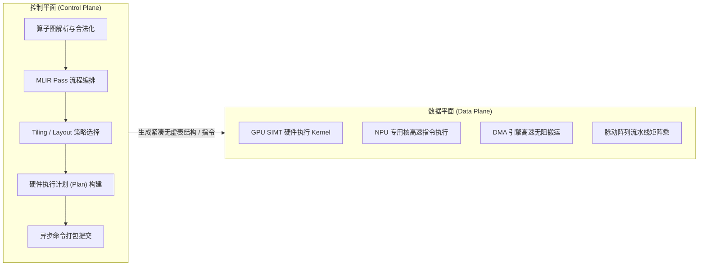
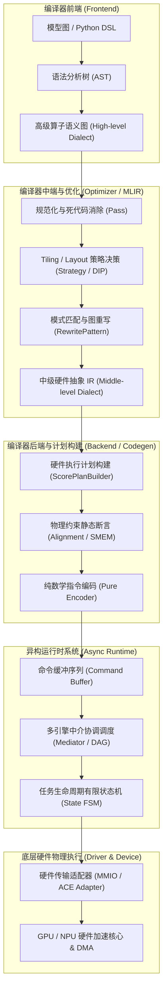
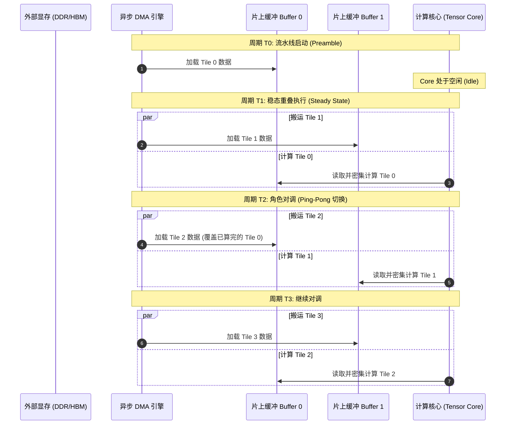
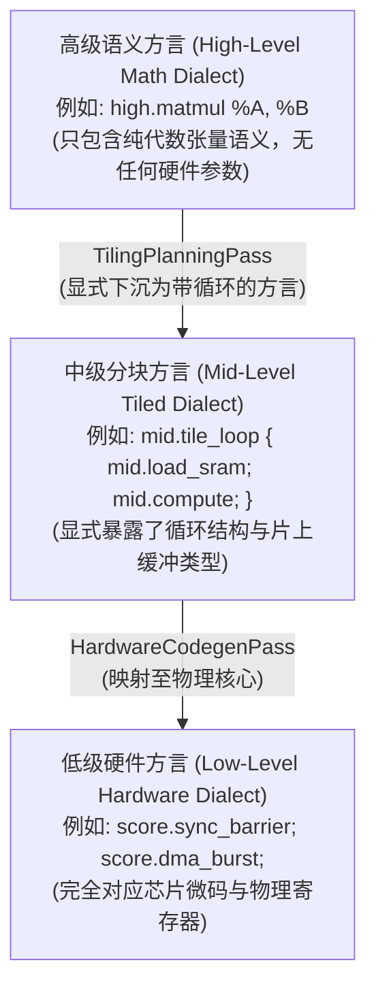
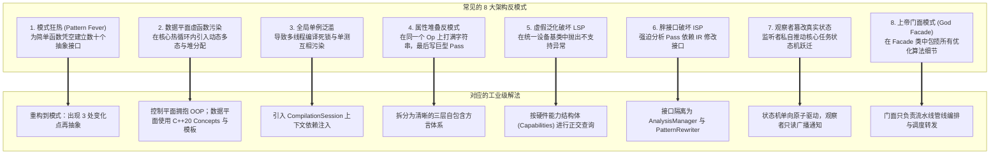

# 异构计算与 AI 编译器设计模式全景实践指南

> **“面向对象设计解决的是抵御变化，而不是消除变化。”** —— 侯捷《设计模式》

在传统软件工程中，设计模式（Design Patterns）用于提升软件的可维护性、可扩展性与可复用性。然而，当我们的战场迁移到异构计算平台（包含通用 GPU、专用数据流 NPU、TPU 类脉动阵列加速器）以及 AI 编译器（如基于现代 MLIR / LLVM 体系）时，传统面向对象的设计理念遭遇了前所未有的工程挑战：

**在异构计算系统中，我们不仅要管理业务逻辑的演化与硬件形态的碎片化，更要承受极度苛刻的时延与吞吐约束——虚函数查找可能破坏指令内联、不当的对象封装会导致严重的缓存未命中（Cache Miss）、动态堆内存分配在微秒级硬件执行流水线中是绝对的性能灾难。**

本文立足于侯捷经典设计模式哲学，结合现代 C++20、MLIR 编译器架构、异构运行时与底层芯片驱动的工程实践，全景拆解 **8 大面向对象设计原则**、**GoF 23 种经典设计模式** 以及 **10 大硬件感知高并发模式**。本文致力于建立一套贯穿“语义表达 $	o$ 优化决策 $	o$ 硬件表示 $	o$ 指令执行”的完整工业级系统架构方法论。

---

## 零、初学者核心概念速查表

为了让初涉异构计算与编译器领域的同学能够无障碍阅读，下表对全文首次出现的核心专业术语进行了统一解释与类比说明：

| 领域术语 | 英文全称 / 简称 | 概念通俗解释与物理类比 |
| :--- | :--- | :--- |
| **异构计算** | Heterogeneous Computing | 包含两种及以上不同架构计算单元（如 CPU + GPU + NPU）的系统。CPU 充当“项目总指挥”负责复杂调度逻辑，专用加速芯片充当“施工大队”负责大规模并行数学计算。 |
| **编译器前端/后端** | Frontend / Backend | 前端将算法模型或 DSL 解析为中间数据结构；后端将优化后的中间结构转化为具体芯片的物理执行指令或寄存器配置。 |
| **中间表示** | IR (Intermediate Representation) | 编译器用于分析、改写和优化程序的核心数据结构，屏蔽前端语法与后端硬件差异的通用“图纸”。 |
| **多层中间表示** | MLIR (Multi-Level IR) | 现代编译器基础设施，支持在一个统一的上下文中使用不同的“方言（Dialect）”在不同抽象层级上逐步转化代码。 |
| **降低 / 下沉** | Lowering | 将高级、抽象的数学语义（如矩阵乘 $C = A 	imes B$），一步步翻译为接近物理硬件行为（如循环、内存分配、硬件专用指令）的降维转化过程。 |
| **方言** | Dialect | MLIR 中自包含的领域专用命名空间，定义了一组特定的算子（Op）、数据类型（Type）和属性（Attr）。 |
| **静态单赋值** | SSA (Static Single Assignment) | IR 设计规范，规定每个变量必须且只能被赋值一次。就像生产线上每个零件都有唯一流水号，使数据依赖关系一目了然。 |
| **循环分块 / 瓦片化** | Tiling / Blocking | 算法矩阵太大无法全部塞进芯片高速缓存，因而将其切分成小块（Tile），确保小块数据在片上缓存被充分复用，减少低速内存访问。 |
| **单指令多数据 / 多线程**| SIMD / SIMT | SIMD 是一条指令控制向量寄存器同时计算多个数据；SIMT 则是硬件管理海量物理线程锁步执行同一段程序，各自处理不同的数据槽位。 |
| **线程束** | Warp / Wavefront | GPU/NPU 硬件调度的最小单元，通常由 32 或 64 个物理线程组成，同一周期共享同一个程序计数器（PC）。 |
| **存储体冲突** | Bank Conflict | 片上高速共享内存被切分为多个独立的存储通道（Bank）。若同一个 Warp 内的多个线程在同一时钟周期访问同一个 Bank 的不同地址，硬件只能串行排队执行，引发严重的性能卡顿。 |
| **占用率** | Occupancy | 硬件加速核心上实际活跃的线程束数量与硬件理论上限的比值，衡量计算单元资源是否被充分打满。 |
| **内存映射 I/O** | MMIO (Memory-Mapped I/O) | CPU 将外设寄存器映射为物理内存地址，CPU 通过普通内存读写指令即可对芯片寄存器进行配置控制。 |
| **直接内存访问** | DMA (Direct Memory Access) | 专用的高速内存搬运硬件引擎，无需 CPU 核心持续干预，自主在不同存储层级（如片外 DDR 与片上 SRAM）间高速传输数据。 |
| **总线互连协议** | ACE / AXI Protocol | 芯片内部或芯片间的高性能互连总线标准，支持高并发突发传输（Burst Transfer）与多核缓存一致性维护。 |
| **奇异递归模板模式** | CRTP | C++ 静态多态技术，派生类将自身作为基类的模板参数，基类在编译期直接静态绑定派生类方法，实现**零虚表开销**的静态多态。 |
| **结构体阵列 / 阵列结构体**| SoA vs AoS | 内存排布方式。AoS（对象数组）在连续读取某一字段时引发跨步跳跃访存；SoA（字段独立数组）使向量指令能够连续合并加载，吞吐量提升数倍。 |
| **双缓冲 / 乒乓缓冲** | Double Buffering | 片上划分两个独立区域。计算核心在处理 A 区数据时，DMA 引擎同时在后台将下一批数据载入 B 区；计算完毕后角色对调，实现数据搬运与计算完全掩盖。 |
| **命令缓冲区** | Command Buffer | 预先在内存中打包录制好的一系列硬件执行指令流，运行时只需一次调用批量提交给硬件，极大降低 CPU 与硬件的交互通信开销。 |
| **区域分配器** | Arena / Bump Allocator | 预先分配大块连续内存，分配对象时仅移动游标指针，销毁时整体清空，彻底消除频繁调用 `malloc`/`free` 的锁争用与内存碎片。 |
| **黄金对齐测试** | Golden Reference Test | 将编译器生成的机器执行结果与纯数学理论实现（如高精度 CPU 参考实现）进行逐像素/逐元素对齐验证，确保优化绝对正确。 |

---

## 一、导论：异构计算时代的“变化之海”与设计模式本质

### 1.1 从传统面向对象到异构计算的思维跨越

侯捷老师在深入剖析设计模式时反复强调：**软件设计的根本目标是管理复杂度，而复杂度的根源在于“变化”。**

在传统面向对象软件中，变化往往源自业务需求、数据库驱动、外部服务或 UI 交互逻辑的演进。我们使用多态、依赖注入和组合来抵御这些变化。但在异构计算与 AI 编译器工程中，我们面临着截然不同的双重变化力量：

1. **上游数学表达与算法的剧烈演化**：从早期的标量卷积，到如今由 FlashAttention、MoE（Mixture of Experts）、量化稀疏计算主导的混合计算拓扑。
2. **下游底层物理硬件特性的爆炸式分化**：通用 GPU、数据流架构 NPU、张量脉动阵列 TPU 在计算范式、存储层次、控制协议上存在巨大鸿沟。

面对这一挑战，设计模式的本质判断标准依然成立：

> **“新增一种加速芯片、新增一种融合算子、新增一种 Tiling 策略，或者底层硬件寄存器协议升级时，需要修改哪些代码？这些修改是否内聚、可独立验证，且绝对不污染核心编译与执行流程？”**

### 1.2 异构计算硬件全景对比矩阵

要设计高内聚、低耦合的编译器与运行时系统，必须首先洞察不同加速计算硬件的本质差异：

| 架构特性维度 | 通用 GPU 架构 (GPU) | 专用数据流 NPU 架构 (Dataflow NPU) | 脉动阵列加速器 (TPU-like) |
| :--- | :--- | :--- | :--- |
| **核心计算单元** | 大规模 SIMT 流式多处理器、微型 Tensor Core | 控制核（如 RISC-V）+ 专用数据流核心（Score/Tcore）+ 向量单元（RVV） | 二维收缩脉动阵列（Systolic Array）、专用向量激活单元 |
| **线程与并行组织** | 网格（Grid）$	o$ 线程块（Block）$	o$ 线程束（Warp） | 显式数据流触发、控制核多线程事件驱动、硬件管线级并行 | 固定 Tile 矩阵分块、硬件外循环驱动、批量数据流转 |
| **存储体系设计** | 显存（DDR/HBM）$	o$ L2 缓存 $	o$ 共享内存（Shared Memory/SRAM）$	o$ 寄存器文件 | 系统大内存 $	o$ 片上全局 SRAM $	o$ 专用核内 Scratchpad（SMEM） $	o$ 专用寄存器 | 外部显存 $	o$ 统一大容量缓冲器（Unified Buffer） $	o$ 脉动阵列内部寄存单元 |
| **计算与内存调度** | 硬件 Warp 调度器动态分发，依赖隐藏通过超线程上下文切换完成 | 显式软件流水线调度：由编译器/指令显式调度 DMA、指令队列与同步事件 | 静态编译期指令调度，计算与数据流动强绑定，循环展开高度依赖离线规划 |
| **代码生成目标** | 设备中间字节码、汇编 ISA（如 GPU SASS/PTX 类指令） | RISC-V 扩展指令、自定义协处理器 ISA、MMIO/ACE 硬件寄存器写入流 | 专有张量处理指令、静态内存基地址分配流、微码序列 |
| **首要性能瓶颈** | 寄存器与共享内存占用率（Occupancy）、全局访存合并（Coalescing）、Bank 冲突 | DMA 片上片外搬运带宽、核内流水线气泡（Bubbles）、片上内存容量与对齐溢出 | 脉动阵列边缘填充率（Edge Padding）、数据重用局部性（Reuse）、访存喂饱率 |

### 1.3 核心矛盾：控制平面（Control Plane）vs 数据平面（Data Plane）的二元分离

异构计算系统的架构设计中，最核心的一条铁律是：**严禁将控制平面与数据平面混为一谈。**



- **控制平面（Control Plane）**：运行在 Host 端 CPU。负责计算图的解析、IR 优化、Pass 编排、Tiling 策略决策、硬件执行计划构建以及向底层提交指令。**控制平面强调模块解耦、灵活性与可扩展性，完全应当拥抱面向对象设计原则与 GoF 经典设计模式。**
- **数据平面（Data Plane）**：运行在 Device 端硬件加速芯片核心（或在极高频的热循环内）。每一纳秒都直接对应算力吞吐。**数据平面严禁使用虚函数、严禁运行时动态分配内存、严禁指针追踪，必须完全采用 C++ 模板、CRTP、C++20 Concepts、平坦连续内存布局（SoA）以及硬件指令内联。**

### 1.4 异构计算系统四层设计模式金字塔

结合上述二元性，我们将异构计算软件系统的设计模式归纳为四层金字塔体系：

```
                    ▲
                   /                   /   \  第一层：系统软件架构模式 (Ports & Adapters, Pipelines, DI)
                 /-----\  -> 管理 Compiler、Runtime、Driver 的边界与生命周期
                /                      /         \  第二层：GoF 经典面向对象设计模式 (Strategy, Factory, Builder...)
              /-----------\  -> 管理控制平面的算子选择、IR 遍历、组件创建与硬件抽象
             /                         /               \  第三层：编译器专用与并发模式 (Pass Pipeline, Rewrite, DAG, Double Buffer)
           /-----------------\  -> 管理 IR 改写、数据流分析、异步流水线与硬件任务图调度
          /                            /                     \  第四层：零开销与硬件感知模式 (CRTP, Concepts, SoA, Arena, Cache-aware)
        /-----------------------\  -> 管理数据平面开销、微架构亲和性、指令级吞吐与无锁性能
```

### 1.5 C++ 多态与抽象范式决策矩阵

在现代 C++（C++20）编译器与高性能开发中，“如何实现多态”并非只有传统的 `virtual` 虚函数一种途径。选择合适的多态范式至关重要：

| 方案 | 多态发生期 | 运行时内存开销 | 调用开销 | 是否支持异构容器 | 典型适用场景 |
| :--- | :--- | :--- | :--- | :--- | :--- |
| **虚函数 (`virtual`)** | 运行期 | 8 字节虚指针 (vptr) + 虚表 (vtable) | 间接寻址指针调用，阻碍编译器内联 | 是（指针/引用容器） | 编译控制流顶层、硬件驱动后端适配器、插件加载机制 |
| **`std::function`** | 运行期 | 32~48 字节 + 可能的堆内存分配 | 函数指针调用 + 类型擦除间接层 | 是 | 适合异步回调、生命周期短暂的通知钩子 |
| **`std::variant` + `std::visit`** | 运行期（闭合集） | 包含最大类型大小 + 索引字段 (Tag) | 基于 Jump Table 或 Switch 分发，内联友好 | 是（直接值容器，无堆分配） | 硬件命令表示（Command Variant）、IR 操作数类型 |
| **函数模板特化** | 编译期 | 0 | 0（完全支持常数折叠与强制内联） | 否 | 硬件感知的数据流数学算子、底层向量运算核 |
| **C++20 Concepts** | 编译期 | 0 | 0（直接静态内联，编译报错极度清晰） | 否 | 编译期策略约束（Policy）、Tiling 静态规划器接口 |
| **CRTP (奇异递归模板)** | 编译期 | 0 | 0（基类直接静态强制转换调用派生类） | 否 | 编译期可扩展的基础设施、无虚表开销的 Visitor 基类 |
| **Plain Struct + 全局函数**| 运行期/编译期| 0（纯 POD 结构） | 0 | 否（需手动传递指针） | 芯片底层物理寄存器映射、硬件 DMA 描述符定义 |

### 1.6 工业级异构编译与运行总体架构图

以下通过 Mermaid 与 Graphviz 展示一个典型的全自研 NPU/GPU 异构计算系统在编译期与运行期的端到端架构视图：



通过 Graphviz `dot` 语言，我们可以清晰地描绘出各核心子系统之间的接口隔离与契约依赖：

```dot
digraph ArchitectureLayers {
    rankdir=LR;
    node [shape=box, style="filled,rounded", fontname="sans-serif", fontsize=10];
    edge [fontname="sans-serif", fontsize=8];

    subgraph cluster_frontend {
        label = "前端表达层";
        style = dashed;
        color = "#475569";
        FrontendGraph [label="DSL / 计算图表达
(Pure Math Semantics)", fillcolor="#F1F5F9"];
    }

    subgraph cluster_middle {
        label = "编译规划层 (MLIR Optimizer)";
        style = dashed;
        color = "#0284C7";
        PassMgr [label="PassManager 编排
(Template Method)", fillcolor="#E0F2FE"];
        TilingPolicy [label="Tiling/Layout 决策
(Strategy + DIP)", fillcolor="#E0F2FE"];
        RewriteEngine [label="Pattern 改写引擎
(RewritePattern)", fillcolor="#E0F2FE"];
    }

    subgraph cluster_backend {
        label = "目标代码生成层 (Backend)";
        style = dashed;
        color = "#0D9488";
        PlanBuilder [label="硬件执行计划构建器
(Builder Pattern)", fillcolor="#CCFBF1"];
        Encoder [label="纯数学寄存器/指令编码
(Pure Functions)", fillcolor="#CCFBF1"];
    }

    subgraph cluster_runtime {
        label = "硬件运行时 (Async Runtime)";
        style = dashed;
        color = "#7C3AED";
        CmdQueue [label="命令队列 / DAG
(Command Buffer)", fillcolor="#EDE9FE"];
        TaskFSM [label="任务生命周期状态机
(State Pattern)", fillcolor="#EDE9FE"];
        DeviceDriver [label="传输总线适配器
(Adapter: MMIO / ACE)", fillcolor="#EDE9FE"];
    }

    FrontendGraph -> PassMgr [label="生成高阶 IR"];
    PassMgr -> TilingPolicy [label="查询最优策略"];
    TilingPolicy -> RewriteEngine [label="执行分块改写"];
    RewriteEngine -> PlanBuilder [label="发射中间指令"];
    PlanBuilder -> Encoder [label="校验硬件约束并构建 Plan"];
    Encoder -> CmdQueue [label="生成紧凑字节码/命令"];
    CmdQueue -> TaskFSM [label="入队调度"];
    TaskFSM -> DeviceDriver [label="下发执行"];
}
```



---

## 二、编译器视角下的面向对象八大原则（8 Principles）

侯捷老师在深入剖析设计模式时指出，面向对象设计原则是所有设计模式的基石与灵魂。如果在写代码时没有深刻理解这八大原则，盲目套用 23 种模式只会带来过度设计与“虚假的灵活性”。

在异构计算与 AI 编译器系统中，这八大原则如何指导我们的系统架构？以下每个原则均配有**可直接复制编译运行的完整 C++20 代码**。

---

### 2.1 单一职责原则（SRP: Single Responsibility Principle）

> **原则定义**：一个类（或模块）应该且仅有一个引起它变化的原因。

#### 异构编译器的典型反模式：超级 Pass（God Pass）
在工业界许多初创 NPU 编译器项目中，初学者最容易写出动辄数千行的“巨型 Lowering Pass”。在这个 Pass 内部，同时做常数折叠、死代码消除、Tiling 尺寸切分、SRAM 地址规划，最后甚至直接把物理寄存器十六进制指令写出来。任何一个维度的变化（算法微调、寄存器偏移修改、SRAM 边界变动）都会导致这几千行代码被重构，风险极大。

#### 架构实践：严格拆分职责管线（可编译运行）
高内聚的编译器应将上述职责严格分解为流水线中独立的原子阶段：

```cpp
#include <iostream>
#include <string>
#include <vector>
#include <memory>

// 1. 语义 IR 节点
struct TensorOp {
    std::string name;
    size_t sizeBytes;
    uint32_t tileM{0};
    uint32_t sramAddress{0};
};

// 职责 A：规范化化简 Pass (只负责纯数学等价化简与死代码消除)
class CanonicalizePass {
public:
    void run(TensorOp& op) {
        std::cout << "[Pass 1: Canonicalize] 化简算子语义与死代码: " << op.name << "\n";
    }
};

// 职责 B：Tiling 规划 Pass (只负责数学切分决策)
class TilingPlanPass {
public:
    void run(TensorOp& op) {
        op.tileM = 64; // 决策 Tile 大小为 64
        std::cout << "[Pass 2: TilingPlan] 决策分块尺寸 TileM = " << op.tileM << "\n";
    }
};

// 职责 C：内存布局规划 Pass (只负责片上 SRAM 分配)
class MemoryPlanPass {
public:
    void run(TensorOp& op) {
        op.sramAddress = 0x1000; // 分配片上 SRAM 基地址
        std::cout << "[Pass 3: MemoryPlan] 分配片上 SRAM 偏移: 0x" << std::hex << op.sramAddress << std::dec << "\n";
    }
};

// 职责 D：指令发射器 (只负责生成底层硬件机器码)
class InstructionEmitter {
public:
    void emit(const TensorOp& op) {
        std::cout << "[Pass 4: Codegen] 发射底层硬件执行微码: " << op.name 
                  << " [Tile=" << op.tileM << ", SRAM=0x" << std::hex << op.sramAddress << std::dec << "]\n";
    }
};

int main() {
    std::cout << "=== SRP 原则：编译器单向职责流水线演示 ===\n";
    TensorOp gemmOp{"MatMul_Float32", 1024 * 1024};

    CanonicalizePass pass1;
    TilingPlanPass pass2;
    MemoryPlanPass pass3;
    InstructionEmitter emitter;

    pass1.run(gemmOp);
    pass2.run(gemmOp);
    pass3.run(gemmOp);
    emitter.emit(gemmOp);

    std::cout << "=== 流水线执行完毕，每个阶段仅有一个引起修改的原因 ===\n";
    return 0;
}
```

---

### 2.2 开放封闭原则（OCP: Open-Closed Principle）

> **原则定义**：软件实体（类、模块、函数）应该对扩展开放，对修改关闭。

#### 架构实践：动态注册机制与 Pattern 扩展（可编译运行）
避免使用嵌套 `switch-case` 匹配算子类型。现代编译器采用基于改写模式库（RewritePattern）的注册体系，新增算子下沉逻辑只需新增独立类并注册：

```cpp
#include <iostream>
#include <string>
#include <memory>
#include <unordered_map>

// 抽象模式基类
class OpRewritePattern {
public:
    virtual ~OpRewritePattern() = default;
    virtual std::string_view getOpName() const noexcept = 0;
    virtual void rewrite() const = 0;
};

// 核心改写引擎（对修改关闭）
class PatternDriver {
public:
    void registerPattern(std::unique_ptr<OpRewritePattern> pattern) {
        patterns_[std::string(pattern->getOpName())] = std::move(pattern);
    }

    void processOp(const std::string& opName) const {
        auto it = patterns_.find(opName);
        if (it != patterns_.end()) {
            it->second->rewrite();
        } else {
            std::cout << "[PatternDriver] 未知算子: " << opName << "，保持原样。\n";
        }
    }

private:
    std::unordered_map<std::string, std::unique_ptr<OpRewritePattern>> patterns_;
};

// 扩展 A：MatMul 算子改写（对扩展开放）
class MatMulPattern : public OpRewritePattern {
public:
    std::string_view getOpName() const noexcept override { return "matmul"; }
    void rewrite() const override {
        std::cout << "[MatMulPattern] 匹配 MatMul 算子，展开为专用矩阵乘指令！\n";
    }
};

// 扩展 B：LayerNorm 算子改写（对扩展开放）
class LayerNormPattern : public OpRewritePattern {
public:
    std::string_view getOpName() const noexcept override { return "layernorm"; }
    void rewrite() const override {
        std::cout << "[LayerNormPattern] 匹配 LayerNorm 算子，融合为向量规约指令！\n";
    }
};

int main() {
    std::cout << "=== OCP 原则：可扩展 Pattern 改写机制演示 ===\n";
    PatternDriver driver;
    // 注册已有算子改写规则
    driver.registerPattern(std::make_unique<MatMulPattern>());
    driver.registerPattern(std::make_unique<LayerNormPattern>());

    // 运行改写，无需修改 PatternDriver 核心代码
    driver.processOp("matmul");
    driver.processOp("layernorm");
    driver.processOp("unknown_op");
    return 0;
}
```

---

### 2.3 里氏替换原则（LSP: Liskov Substitution Principle）

> **原则定义**：所有引用基类的地方必须能透明地使用其子类的对象，而不会导致程序的逻辑错误或异常。

#### 架构实践：能力契约（Capability-based）查询（可编译运行）
基类不应该强行假设所有硬件都具有相同的高级特性（如任意非对齐异步 DMA 拷贝）。应当通过能力查询结构体解耦：

```cpp
#include <iostream>
#include <memory>
#include <cstdint>

// 硬件能力契约
struct DmaCapabilities {
    size_t alignmentRequired{1};
    bool supportsAsync{true};
};

class IDeviceEngine {
public:
    virtual ~IDeviceEngine() = default;
    virtual const DmaCapabilities& getCapabilities() const noexcept = 0;
    virtual void transfer(void* dst, void* src, size_t bytes) = 0;
};

// 通用 GPU 引擎（支持任意非对齐）
class GeneralGpuEngine : public IDeviceEngine {
public:
    const DmaCapabilities& getCapabilities() const noexcept override {
        static DmaCapabilities caps{1, true};
        return caps;
    }
    void transfer(void*, void*, size_t bytes) override {
        std::cout << "[GPU 引擎] 执行异步流 DMA 传输: " << bytes << " 字节\n";
    }
};

// 专用张量阵列加速引擎（要求严格 64 字节对齐）
class SystolicArrayEngine : public IDeviceEngine {
public:
    const DmaCapabilities& getCapabilities() const noexcept override {
        static DmaCapabilities caps{64, false};
        return caps;
    }
    void transfer(void* dst, void* src, size_t bytes) override {
        // 在满足自身前置条件下，透明替换基类行为
        std::cout << "[脉动阵列引擎] 执行同步对齐 DMA 传输: " << bytes << " 字节\n";
    }
};

// 上层调度器（遵循 LSP，透明消费子类）
void scheduleDma(IDeviceEngine& engine, void* dst, void* src, size_t bytes) {
    const auto& caps = engine.getCapabilities();
    if ((uintptr_t)dst % caps.alignmentRequired != 0 || bytes % caps.alignmentRequired != 0) {
        std::cout << "[调度器注意] 目标硬件要求 " << caps.alignmentRequired << " 字节对齐，插入 Padding 缓冲。\n";
    }
    engine.transfer(dst, src, bytes);
}

int main() {
    std::cout << "=== LSP 原则：能力契约解耦与安全替换演示 ===\n";
    GeneralGpuEngine gpu;
    SystolicArrayEngine systolic;

    uint8_t buffer[128];
    void* ptr = buffer;

    scheduleDma(gpu, ptr, ptr, 100);
    scheduleDma(systolic, ptr, ptr, 100);
    return 0;
}
```

---

### 2.4 接口隔离原则（ISP: Interface Segregation Principle）

> **原则定义**：客户端不应该被迫依赖它不使用的方法；一个类对另一个类的依赖应该建立在最小的接口上。

#### 架构实践：分离只读分析与破坏性修改接口（可编译运行）

```cpp
#include <iostream>
#include <memory>
#include <string>

// 最小接口 A：只读分析接口
class IAnalysisReader {
public:
    virtual ~IAnalysisReader() = default;
    virtual size_t getTensorSize(std::string_view name) const = 0;
};

// 最小接口 B：IR 改写接口
class IIrMutator {
public:
    virtual ~IIrMutator() = default;
    virtual void replaceOp(std::string_view oldOp, std::string_view newOp) = 0;
};

// 编译器上下文实现两个接口
class CompilerContext : public IAnalysisReader, public IIrMutator {
public:
    size_t getTensorSize(std::string_view) const override { return 4096; }
    void replaceOp(std::string_view oldOp, std::string_view newOp) override {
        std::cout << "[Context] 将 " << oldOp << " 替换为 " << newOp << "\n";
    }
};

// 分析 Pass 只依赖只读接口，从类型系统层面杜绝误篡改 IR
class MemoryFootprintAnalysis {
public:
    void analyze(const IAnalysisReader& reader) {
        size_t sz = reader.getTensorSize("InputTensor");
        std::cout << "[Analysis] 分析内存占用: " << sz << " 字节 (只读安全)\n";
    }
};

int main() {
    std::cout << "=== ISP 原则：接口隔离保障只读安全性演示 ===\n";
    CompilerContext ctx;
    MemoryFootprintAnalysis analysis;
    analysis.analyze(ctx);
    return 0;
}
```

---

### 2.5 依赖倒置原则（DIP: Dependency Inversion Principle）

> **原则定义**：高层模块不应该依赖低层模块，二者都应该依赖其抽象；抽象不应该依赖细节，细节应该依赖抽象。

#### 架构实践：基于能力契约 `HardwareCaps` 解耦物理芯片（可编译运行）

```cpp
#include <iostream>
#include <memory>
#include <string>

// 抽象数据契约：纯粹的数学与物理容量参数
struct HardwareCaps {
    std::string chipFamily;
    size_t sramBytes;
    size_t vectorWidth;
};

// 高层模块：Tiling 优化规划器（完全不依赖具体芯片类）
class TilingPlanner {
public:
    uint32_t computeOptimalTile(const HardwareCaps& caps, size_t totalElements) {
        std::cout << "[Planner] 针对硬件架构 [" << caps.chipFamily 
                  << "] 计算分块，SRAM 预算: " << caps.sramBytes / 1024 << " KB\n";
        // 依据通用公式计算 Tile 大小
        return static_cast<uint32_t>(caps.vectorWidth * 4);
    }
};

// 底层模块：具体芯片适配器提供抽象契约
class ChipV2Adapter {
public:
    static HardwareCaps getCapabilities() {
        return HardwareCaps{"DataflowNPU-V2", 256 * 1024, 64};
    }
};

int main() {
    std::cout << "=== DIP 原则：依赖倒置解除芯片强依赖演示 ===\n";
    TilingPlanner planner;
    auto caps = ChipV2Adapter::getCapabilities();
    uint32_t tile = planner.computeOptimalTile(caps, 1024 * 1024);
    std::cout << "计算获得的最优 Tile 尺寸: " << tile << "\n";
    return 0;
}
```

---

### 2.6 组合优于继承（Favor Composition Over Inheritance）

> **原则定义**：通过包含现有对象并委派其功能（对象组合），往往比通过类继承扩展现有行为更加灵活且脆弱性更低。

#### 架构实践：`PassPipeline` 动态装配（可编译运行）

```cpp
#include <iostream>
#include <vector>
#include <memory>
#include <string>

class IPass {
public:
    virtual ~IPass() = default;
    virtual void run() = 0;
};

class DeadCodeEliminationPass : public IPass {
public:
    void run() override { std::cout << "  -> 消除死代码 (DCE)\n"; }
};

class ConstantFoldingPass : public IPass {
public:
    void run() override { std::cout << "  -> 常量折叠 (Constant Folding)\n"; }
};

class LoopFusionPass : public IPass {
public:
    void run() override { std::cout << "  -> 跨核循环融合 (Loop Fusion)\n"; }
};

// 组合流水线：动态装配原子 Pass，而非多继承
class PassPipeline {
public:
    void addPass(std::unique_ptr<IPass> pass) {
        pipeline_.push_back(std::move(pass));
    }

    void execute() {
        std::cout << ">>> 启动组合优化管线 <<<\n";
        for (const auto& pass : pipeline_) {
            pass->run();
        }
        std::cout << ">>> 管线执行完毕 <<<\n";
    }

private:
    std::vector<std::unique_ptr<IPass>> pipeline_;
};

int main() {
    std::cout << "=== 组合优于继承：Pass 管道动态组合演示 ===\n";
    PassPipeline pipeline;
    pipeline.addPass(std::make_unique<ConstantFoldingPass>());
    pipeline.addPass(std::make_unique<DeadCodeEliminationPass>());
    pipeline.addPass(std::make_unique<LoopFusionPass>());

    pipeline.execute();
    return 0;
}
```

---

### 2.7 迪米特法则（Law of Demeter, 最少知识原则）

> **原则定义**：只与你直接的朋友交谈，不要跟“陌生人的朋友”发生直接依赖（不要穿透调用）。

#### 架构实践：避免脆弱的跨层链式穿透（可编译运行）

```cpp
#include <iostream>
#include <string>

// 糟糕的做法：链式穿透 a->getB()->getC()->getD()->getValue()
// 优雅的做法：直接向直接朋友索取计算结果

class TensorMetadata {
public:
    explicit TensorMetadata(size_t sz) : sizeBytes_(sz) {}
    size_t getSizeBytes() const noexcept { return sizeBytes_; }
private:
    size_t sizeBytes_;
};

class OperationNode {
public:
    explicit OperationNode(TensorMetadata meta) : meta_(meta) {}
    // 封装直接查询方法，外界无需了解 TensorMetadata 的内部结构
    size_t getOutputBufferBytes() const noexcept {
        return meta_.getSizeBytes();
    }
private:
    TensorMetadata meta_;
};

int main() {
    std::cout << "=== 迪米特法则：封装内聚防穿透演示 ===\n";
    OperationNode op(TensorMetadata(65536));
    // 直接与直接朋友交谈，接口清晰稳固
    std::cout << "算子所需缓冲区大小: " << op.getOutputBufferBytes() << " 字节\n";
    return 0;
}
```

---

## 三、GoF 23 种设计模式完整整理与深度实践

侯捷老师指出，设计模式根据其目的主要划分为三大阵营：
1. **创建型模式（Creational Patterns）**：封装对象创建逻辑，管理系统构建的复杂度与版本依赖；
2. **结构型模式（Structural Patterns）**：管理类与对象之间的组合关系，搭建高内聚低耦合的架构骨架；
3. **行为型模式（Behavioral Patterns）**：管理系统运行时的职责分派、控制算法与事件通信。

下面，我们将 23 种模式逐一置于现代 C++20、AI 编译器与异构底层系统的显微镜下，深入解剖其工程实践与选型边界。**每一个模式均配有完整的、可独立编译运行的 C++20 代码**。

---

### 3.1 创建型模式：管理对象与执行计划的构建

#### 3.1.1 工厂方法模式（Factory Method）

- **传统 GoF 意图**：定义一个用于创建对象的接口，让子类决定实例化哪一个类。工厂方法使一个类的实例化延迟到其子类。
- **编译器映射**：Pass 动态注册体系、目标后端代码生成器（Emitter）创建机制。

##### C++20 工程实现：类型安全的动态工厂注册表（可编译运行）

```cpp
#include <iostream>
#include <memory>
#include <string>
#include <unordered_map>
#include <functional>

class ICompilerPass {
public:
    virtual ~ICompilerPass() = default;
    virtual std::string_view getName() const noexcept = 0;
    virtual void runOnModule() = 0;
};

// Pass 工厂函数类型
using PassFactoryFn = std::function<std::unique_ptr<ICompilerPass>()>;

class PassRegistry {
public:
    static PassRegistry& instance() {
        static PassRegistry reg;
        return reg;
    }

    void registerPass(std::string_view name, PassFactoryFn factory) {
        factories_[std::string(name)] = std::move(factory);
    }

    std::unique_ptr<ICompilerPass> createPass(const std::string& name) const {
        auto it = factories_.find(name);
        if (it != factories_.end()) {
            return it->second();
        }
        return nullptr;
    }

private:
    std::unordered_map<std::string, PassFactoryFn> factories_;
};

// 自动注册辅助模板（静态变量在程序加载时自动触发注册）
template <typename TPass>
struct RegisterPassHelper {
    explicit RegisterPassHelper(std::string_view name) {
        PassRegistry::instance().registerPass(name, []() {
            return std::make_unique<TPass>();
        });
    }
};

// 具体实现 A：NPU 专用 Tiling Pass
class NpuTilingPass : public ICompilerPass {
public:
    std::string_view getName() const noexcept override { return "npu-tiling"; }
    void runOnModule() override {
        std::cout << "  [Pass: npu-tiling] 执行 NPU 专用循环切分优化...\n";
    }
};

// 具体实现 B：常数折叠 Pass
class ConstantFoldPass : public ICompilerPass {
public:
    std::string_view getName() const noexcept override { return "const-fold"; }
    void runOnModule() override {
        std::cout << "  [Pass: const-fold] 执行编译期常量表达式静态折叠...\n";
    }
};

// 静态注册触发点（无需修改 PassManager 核心文件）
static RegisterPassHelper<NpuTilingPass> regNpuTiling("npu-tiling");
static RegisterPassHelper<ConstantFoldPass> regConstFold("const-fold");

int main() {
    std::cout << "=== 工厂方法模式：Pass 动态注册与创建演示 ===\n";
    auto pass1 = PassRegistry::instance().createPass("npu-tiling");
    auto pass2 = PassRegistry::instance().createPass("const-fold");

    if (pass1) pass1->runOnModule();
    if (pass2) pass2->runOnModule();

    auto unknown = PassRegistry::instance().createPass("not-exist");
    if (!unknown) {
        std::cout << "  [Registry] 成功捕获未知 Pass 查询，返回空指针。\n";
    }
    return 0;
}
```

> [!TIP]
> **与 MLIR 工业实践的对应**：MLIR 中的 `mlir::registerPass([]() { return std::make_unique<MyPass>(); });` 正是工厂方法模式的标准落地，彻底消除了编译总控引擎对各 Dialect 具体下沉 Pass 的直接编译依赖。

---

#### 3.1.2 抽象工厂模式（Abstract Factory）

- **传统 GoF 意图**：提供一个创建一系列相关或相互依赖对象的接口，而无需指定它们具体的类。
- **编译器映射**：多芯片代际后端组件套件（Score/Tcore/DMA/ABI）的一致性绑定。

##### 架构痛点：组件版本错配引发的硬件灾难
在真实的 NPU 项目中，芯片往往迭代迅速（如一代 NPU-V1 与 二代 NPU-V2）。如果使用单个独立的工厂方法分散创建各个部件，开发人员极易写出 V1 发射器配合 V2 DMA 搬运器的低级错误，导致硬件信号错乱与死锁。

##### C++20 工程实现：后端全套组件一致性保障工厂（可编译运行）

```cpp
#include <memory>
#include <iostream>
#include <string>

struct IScoreEmitter { virtual ~IScoreEmitter() = default; virtual void emitScoreOp() = 0; };
struct IDmaPlanner   { virtual ~IDmaPlanner() = default; virtual void planDmaTransfer() = 0; };
struct IAbiConfig    { virtual ~IAbiConfig() = default; virtual size_t getStackAlignment() = 0; };

// 抽象工厂接口：生产一整套绝对兼容的硬件后端组件
class ITargetBackendFactory {
public:
    virtual ~ITargetBackendFactory() = default;
    virtual std::unique_ptr<IScoreEmitter> createScoreEmitter() const = 0;
    virtual std::unique_ptr<IDmaPlanner>   createDmaPlanner() const = 0;
    virtual std::unique_ptr<IAbiConfig>    createAbiConfig() const = 0;
};

// V1 硬件套件实现
class NpuV1BackendFactory : public ITargetBackendFactory {
public:
    std::unique_ptr<IScoreEmitter> createScoreEmitter() const override {
        struct ScoreEmitterV1 : IScoreEmitter {
            void emitScoreOp() override { std::cout << "  [V1-Score] 发射单发射标量协处理指令\n"; }
        };
        return std::make_unique<ScoreEmitterV1>();
    }
    std::unique_ptr<IDmaPlanner> createDmaPlanner() const override {
        struct DmaPlannerV1 : IDmaPlanner {
            void planDmaTransfer() override { std::cout << "  [V1-DMA] 规划单拍阻塞式内存搬运\n"; }
        };
        return std::make_unique<DmaPlannerV1>();
    }
    std::unique_ptr<IAbiConfig> createAbiConfig() const override {
        struct AbiV1 : IAbiConfig {
            size_t getStackAlignment() override { return 32; }
        };
        return std::make_unique<AbiV1>();
    }
};

// V2 硬件套件实现 (支持突发并发)
class NpuV2BackendFactory : public ITargetBackendFactory {
public:
    std::unique_ptr<IScoreEmitter> createScoreEmitter() const override {
        struct ScoreEmitterV2 : IScoreEmitter {
            void emitScoreOp() override { std::cout << "  [V2-Score] 发射多发射原子批处理协处理指令\n"; }
        };
        return std::make_unique<ScoreEmitterV2>();
    }
    std::unique_ptr<IDmaPlanner> createDmaPlanner() const override {
        struct DmaPlannerV2 : IDmaPlanner {
            void planDmaTransfer() override { std::cout << "  [V2-DMA] 规划多通道双缓冲异步突发传输\n"; }
        };
        return std::make_unique<DmaPlannerV2>();
    }
    std::unique_ptr<IAbiConfig> createAbiConfig() const override {
        struct AbiV2 : IAbiConfig {
            size_t getStackAlignment() override { return 64; }
        };
        return std::make_unique<AbiV2>();
    }
};

void runCompilationWithBackend(const ITargetBackendFactory& factory) {
    auto score = factory.createScoreEmitter();
    auto dma   = factory.createDmaPlanner();
    auto abi   = factory.createAbiConfig();

    score->emitScoreOp();
    dma->planDmaTransfer();
    std::cout << "  [ABI] 栈空间对齐字节数: " << abi->getStackAlignment() << "\n";
}

int main() {
    std::cout << "=== 抽象工厂模式：多代 NPU 统一套件创建演示 ===\n";
    std::cout << ">>> 针对 NPU-V1 架构编译 <<<\n";
    NpuV1BackendFactory v1Factory;
    runCompilationWithBackend(v1Factory);

    std::cout << "\n>>> 针对 NPU-V2 架构编译 <<<\n";
    NpuV2BackendFactory v2Factory;
    runCompilationWithBackend(v2Factory);
    return 0;
}
```

---

#### 3.1.3 构建器模式（Builder）

- **传统 GoF 意图**：将一个复杂对象的构建与其表示分离，使得同样的构建过程可以创建不同的表示。
- **编译器映射**：硬件执行计划构建器（ExecutionPlanBuilder）、微码指令包组装器。

##### C++20 工程实现：带有硬件强约束校验的 PlanBuilder（可编译运行）

```cpp
#include <cstdint>
#include <vector>
#include <stdexcept>
#include <iostream>

struct HardwareInstruction {
    uint32_t opcode;
    uint32_t srcAddress;
    uint32_t dstAddress;
    uint32_t loopCount;
};

struct ExecutionPlan {
    std::vector<HardwareInstruction> instructions;
    size_t totalSramAllocated{0};
    uint32_t eventSyncSlot{0};
};

class ScorePlanBuilder {
public:
    ScorePlanBuilder& setEventSyncSlot(uint32_t slot) {
        if (slot > 15) { // 硬件总共只有 16 个同步事件槽位
            throw std::invalid_argument("硬件约束异常：同步事件槽位必须在 0~15 之间！");
        }
        plan_.eventSyncSlot = slot;
        return *this;
    }

    ScorePlanBuilder& allocateSramBuffer(size_t bytes, size_t alignment = 64) {
        // 硬件物理约束校验：必须严格对齐
        if (bytes % alignment != 0) {
            bytes = (bytes + alignment - 1) & ~(alignment - 1);
        }
        if (plan_.totalSramAllocated + bytes > 256 * 1024) { // 片上 SRAM 上限 256KB
            throw std::runtime_error("硬件约束异常：片上 SRAM 容量溢出！");
        }
        plan_.totalSramAllocated += bytes;
        return *this;
    }

    ScorePlanBuilder& addComputeLoop(uint32_t iterations, uint32_t src, uint32_t dst) {
        if (iterations == 0 || iterations > 65535) {
            throw std::invalid_argument("硬件约束异常：硬件计算循环计数超限 (1~65535)！");
        }
        plan_.instructions.push_back({0x01, src, dst, iterations});
        return *this;
    }

    ExecutionPlan build() {
        if (plan_.instructions.empty()) {
            throw std::logic_error("非法构建：执行计划中未包含任何有效计算指令！");
        }
        return std::move(plan_);
    }

private:
    ExecutionPlan plan_;
};

int main() {
    std::cout << "=== 构建器模式：带硬件物理约束断言的 Plan 构建演示 ===\n";
    try {
        ScorePlanBuilder builder;
        auto plan = builder.setEventSyncSlot(3)
                           .allocateSramBuffer(65536) // 申请 64KB SRAM
                           .addComputeLoop(100, 0x1000, 0x2000)
                           .build();

        std::cout << "  [PlanBuilder] 合法计划构建成功！\n"
                  << "  -> 已分配 SRAM: " << plan.totalSramAllocated / 1024 << " KB\n"
                  << "  -> 指令数量: " << plan.instructions.size() << "\n"
                  << "  -> 事件槽位: " << plan.eventSyncSlot << "\n";
    } catch (const std::exception& e) {
        std::cerr << "构建失败: " << e.what() << "\n";
    }

    // 测试越界保护
    try {
        std::cout << "  [测试非法构建] 尝试设置超出范围的事件槽位 20...\n";
        ScorePlanBuilder badBuilder;
        badBuilder.setEventSyncSlot(20);
    } catch (const std::exception& e) {
        std::cout << "  -> 成功拦截硬件物理违规: " << e.what() << "\n";
    }
    return 0;
}
```

---

#### 3.1.4 原型模式（Prototype）

- **传统 GoF 意图**：用原型实例指定创建对象的种类，并且通过拷贝这些原型创建新的对象。
- **编译器映射**：探索式编译优化、自动调优（Autotuning）中的 IR 克隆分支与 SSA 映射。

##### C++20 工程实现：支持 SSA 重映射的 IR 原型克隆（可编译运行）

```cpp
#include <memory>
#include <unordered_map>
#include <vector>
#include <string>
#include <iostream>

struct Value {
    std::string name;
};

class IRMapping {
public:
    void map(const Value* oldVal, std::shared_ptr<Value> newVal) {
        map_[oldVal] = newVal;
    }
    std::shared_ptr<Value> lookup(const Value* oldVal) const {
        auto it = map_.find(oldVal);
        return (it != map_.end()) ? it->second : nullptr;
    }
private:
    std::unordered_map<const Value*, std::shared_ptr<Value>> map_;
};

class Operation {
public:
    virtual ~Operation() = default;
    virtual std::unique_ptr<Operation> clone(IRMapping& mapping) const = 0;
    virtual void dump() const = 0;
};

class AddOp : public Operation {
public:
    AddOp(std::shared_ptr<Value> lhs, std::shared_ptr<Value> rhs, std::shared_ptr<Value> res)
        : lhs_(lhs), rhs_(rhs), res_(res) {}

    std::unique_ptr<Operation> clone(IRMapping& mapping) const override {
        auto newLhs = mapping.lookup(lhs_.get());
        auto newRhs = mapping.lookup(rhs_.get());
        auto newRes = std::make_shared<Value>(res_->name + "_cloned");
        
        mapping.map(res_.get(), newRes);
        return std::make_unique<AddOp>(
            newLhs ? newLhs : lhs_,
            newRhs ? newRhs : rhs_,
            newRes
        );
    }

    void dump() const override {
        std::cout << "  " << res_->name << " = add " << lhs_->name << ", " << rhs_->name << "\n";
    }

private:
    std::shared_ptr<Value> lhs_, rhs_, res_;
};

int main() {
    std::cout << "=== 原型模式：IR 节点克隆与 SSA 映射演示 ===\n";
    auto vA = std::make_shared<Value>("%arg0");
    auto vB = std::make_shared<Value>("%arg1");
    auto vRes = std::make_shared<Value>("%res");

    AddOp originalOp(vA, vB, vRes);
    std::cout << "原始 IR 操作:\n";
    originalOp.dump();

    IRMapping mapping;
    auto clonedOp = originalOp.clone(mapping);
    std::cout << "克隆后的沙盒 IR 操作:\n";
    clonedOp->dump();
    return 0;
}
```

---

#### 3.1.5 单例替代方案：会话依赖注入（CompilationSession）

- **传统 GoF 意图**：保证一个类仅有一个实例，并提供一个全局访问点。
- **编译器映射**：为什么现代工业级编译器必须**全面排斥全局单例**？

##### C++20 工程实现：CompilationSession 作用域注入模式（可编译运行）

```cpp
#include <iostream>
#include <memory>
#include <string>

// 纯粹的会话上下文，生命周期受调用者严格控制
class CompilationSession {
public:
    CompilationSession(std::string targetChip, int optLevel)
        : targetChip_(std::move(targetChip)), optLevel_(optLevel) {}

    std::string_view getTargetChip() const noexcept { return targetChip_; }
    int getOptLevel() const noexcept { return optLevel_; }

private:
    std::string targetChip_;
    int optLevel_;
};

// 编译器各 Pass 通过依赖注入接收上下文，绝不访问全局变量
class OptimizationPass {
public:
    void execute(const CompilationSession& session) {
        std::cout << "  [OptimizationPass] 为目标芯片 [" << session.getTargetChip() 
                  << "] 运行优化级别 O" << session.getOptLevel() << " Pass\n";
    }
};

int main() {
    std::cout << "=== 单例替代：编译会话上下文依赖注入演示 ===\n";
    // 允许在多线程中并发创建两个完全独立的编译会话
    CompilationSession sessionGpu("GPU-Cluster", 3);
    CompilationSession sessionNpu("NPU-Edge", 2);

    OptimizationPass pass;
    pass.execute(sessionGpu);
    pass.execute(sessionNpu);
    return 0;
}
```

---

### 3.2 结构型模式：管理模块之间的关系

#### 3.2.1 桥接模式（Bridge）

- **传统 GoF 意图**：将抽象部分与它的实现部分分离，使它们都可以独立地变化。
- **编译器映射**：解耦“编译流程/工作流（Workflow）”与“目标硬件执行引擎（Target Backend）”，消除多轴类爆炸。

##### C++20 工程实现：桥接双向演化维度（可编译运行）

```cpp
#include <iostream>
#include <memory>
#include <string>

// 实现层抽象：硬件后端指令发射器
struct ITargetBackend {
    virtual ~ITargetBackend() = default;
    virtual void emitKernelHeader() = 0;
    virtual void emitComputeOp(std::string_view opName) = 0;
    virtual void emitSyncBarrier() = 0;
};

// 具体实现 A：通用 GPU 后端
class GpuBackend : public ITargetBackend {
public:
    void emitKernelHeader() override { std::cout << "  [GPU] 发射 SIMT 线程网格启动头\n"; }
    void emitComputeOp(std::string_view op) override { std::cout << "  [GPU] 发射张量核心加速指令: " << op << "\n"; }
    void emitSyncBarrier() override { std::cout << "  [GPU] 发射 __syncthreads() 线程束栅栏\n"; }
};

// 具体实现 B：NPU 专用数据流后端
class NpuV2Backend : public ITargetBackend {
public:
    void emitKernelHeader() override { std::cout << "  [NPU-V2] 配置 ACE 批处理总线控制头\n"; }
    void emitComputeOp(std::string_view op) override { std::cout << "  [NPU-V2] 发射 Score 协处理数据流微码: " << op << "\n"; }
    void emitSyncBarrier() override { std::cout << "  [NPU-V2] 触发硬件事件同步槽位 (Event Slot)\n"; }
};

// 抽象层：编译工作流
class CompilationWorkflow {
public:
    explicit CompilationWorkflow(std::shared_ptr<ITargetBackend> backend)
        : backend_(std::move(backend)) {}
    virtual ~CompilationWorkflow() = default;
    virtual void runWorkflow() = 0;

protected:
    std::shared_ptr<ITargetBackend> backend_;
};

// 扩充抽象 A：发布模式（激进优化）
class ReleaseWorkflow : public CompilationWorkflow {
public:
    using CompilationWorkflow::CompilationWorkflow;
    void runWorkflow() override {
        std::cout << ">>> 启动 Release 编译管线 (跨核循环融合与内联) <<<\n";
        backend_->emitKernelHeader();
        backend_->emitComputeOp("Fused_MatMul_Add_GELU");
        backend_->emitSyncBarrier();
    }
};

// 扩充抽象 B：调试模式（安全断言与边界检查）
class DebugWorkflow : public CompilationWorkflow {
public:
    using CompilationWorkflow::CompilationWorkflow;
    void runWorkflow() override {
        std::cout << ">>> 启动 Debug 编译管线 (插入地址边界断言) <<<\n";
        backend_->emitKernelHeader();
        std::cout << "  [Debug] 插入 SRAM 边界检查护卫指令...\n";
        backend_->emitComputeOp("MatMul_StrictChecked");
        backend_->emitSyncBarrier();
    }
};

int main() {
    std::cout << "=== 桥接模式：工作流与后端正交组合演示 ===\n";
    auto gpu = std::make_shared<GpuBackend>();
    auto npu = std::make_shared<NpuV2Backend>();

    ReleaseWorkflow relGpu(gpu);
    DebugWorkflow dbgNpu(npu);

    relGpu.runWorkflow();
    std::cout << "\n";
    dbgNpu.runWorkflow();
    return 0;
}
```

---

#### 3.2.2 适配器模式（Adapter）

- **传统 GoF 意图**：将一个类的接口转换成客户希望的另外一个接口。Adapter 模式使得原本由于接口不兼容而不能一起工作的那些类可以一起工作。
- **编译器映射**：异构芯片新旧硬件寄存器接口、驱动传输总线协议平滑演进。

##### C++20 工程实现：新旧 NPU 驱动协议适配器（可编译运行）

```cpp
#include <cstdint>
#include <vector>
#include <iostream>

// 现代编译器统一的逻辑寄存器配置请求
struct RegisterUpdate {
    uint32_t regId;
    uint32_t value;
};

// 目标抽象：编译器后端所依赖的通用硬件下发接口
class IRegisterTransport {
public:
    virtual ~IRegisterTransport() = default;
    virtual void submitBatch(const std::vector<RegisterUpdate>& updates) = 0;
};

// 老旧的底层驱动接口：仅支持逐字单条 MMIO 写
class LegacyMmioDriver {
public:
    void mmioWrite32(uint32_t addr, uint32_t val) {
        std::cout << "  [MMIO-Driver] 写入物理地址 0x" << std::hex << addr 
                  << " <= 数据 0x" << val << std::dec << "\n";
    }
};

// 对象适配器：将老旧的单字 MMIO 适配为现代编译器的批量提交接口
class LegacyMmioAdapter : public IRegisterTransport {
public:
    explicit LegacyMmioAdapter(LegacyMmioDriver& driver, uint32_t baseAddr)
        : driver_(driver), baseAddr_(baseAddr) {}

    void submitBatch(const std::vector<RegisterUpdate>& updates) override {
        std::cout << "[Adapter] 拦截批量写请求，自动转换为逐条单字 MMIO 发射:\n";
        for (const auto& u : updates) {
            uint32_t physicalAddr = baseAddr_ + (u.regId * 4);
            driver_.mmioWrite32(physicalAddr, u.value);
        }
    }

private:
    LegacyMmioDriver& driver_;
    uint32_t baseAddr_;
};

int main() {
    std::cout << "=== 适配器模式：新旧硬件驱动协议适配演示 ===\n";
    LegacyMmioDriver legacyDriver;
    LegacyMmioAdapter adapter(legacyDriver, 0x40000000);

    std::vector<RegisterUpdate> updates = {
        {0, 0x80000001},
        {1, 64},
        {2, 0x1000}
    };

    adapter.submitBatch(updates);
    return 0;
}
```

---

#### 3.2.3 装饰器模式（Decorator）

- **传统 GoF 意图**：动态地给一个对象添加一些额外的职责。就增加功能来说，Decorator 模式相比生成子类更为灵活。
- **编译器映射**：非侵入式 Trace 跟踪、硬件耗时微秒级打点（Profiling）、硬件约束边界断言。

##### C++20 工程实现：可无限包裹的装饰器调用链（可编译运行）

```cpp
#include <iostream>
#include <memory>
#include <chrono>

struct IInstructionEncoder {
    virtual ~IInstructionEncoder() = default;
    virtual void encodeAndEmit(uint32_t opcode, uint32_t regA, uint32_t regB) = 0;
};

// 核心组件：纯粹的底层指令编码器（绝对无污染）
class RawHardwareEncoder : public IInstructionEncoder {
public:
    void encodeAndEmit(uint32_t opcode, uint32_t regA, uint32_t regB) override {
        std::cout << "  [RawEncoder] 写入物理二进制: Op=" 
                  << std::hex << opcode << " R1=" << regA << " R2=" << regB << std::dec << "\n";
    }
};

// 装饰器基类
class EncoderDecorator : public IInstructionEncoder {
public:
    explicit EncoderDecorator(std::unique_ptr<IInstructionEncoder> inner)
        : inner_(std::move(inner)) {}

protected:
    std::unique_ptr<IInstructionEncoder> inner_;
};

// 增强功能 A：非侵入式 Trace 日志
class TracingEncoder : public EncoderDecorator {
public:
    using EncoderDecorator::EncoderDecorator;
    void encodeAndEmit(uint32_t opcode, uint32_t regA, uint32_t regB) override {
        std::cout << "[Trace] >>> 开始发射指令 Opcode=" << opcode << "\n";
        inner_->encodeAndEmit(opcode, regA, regB);
        std::cout << "[Trace] <<< 指令发射完毕。\n";
    }
};

// 增强功能 B：执行耗时统计 (Profiling)
class ProfilingEncoder : public EncoderDecorator {
public:
    using EncoderDecorator::EncoderDecorator;
    void encodeAndEmit(uint32_t opcode, uint32_t regA, uint32_t regB) override {
        auto start = std::chrono::high_resolution_clock::now();
        inner_->encodeAndEmit(opcode, regA, regB);
        auto elapsed = std::chrono::duration_cast<std::chrono::nanoseconds>(
            std::chrono::high_resolution_clock::now() - start).count();
        std::cout << "[Profiling] 耗时统计: " << elapsed << " ns\n";
    }
};

int main() {
    std::cout << "=== 装饰器模式：动态非侵入式增强演示 ===\n";
    // 动态装配两层装饰器：Trace(Profiling(Raw))
    auto pipeline = std::make_unique<TracingEncoder>(
        std::make_unique<ProfilingEncoder>(
            std::make_unique<RawHardwareEncoder>()
        )
    );

    pipeline->encodeAndEmit(0x1F, 2, 4);
    return 0;
}
```

---

#### 3.2.4 享元模式（Flyweight）

- **传统 GoF 意图**：运用共享技术有效地支持大量细粒度的对象。
- **编译器映射**：MLIR 体系基石——Type 与 Attribute 的全局唯一定义（Uniquing）。

##### C++20 工程实现：MLIR 风格的 Type 享元唯一定位池（可编译运行）

```cpp
#include <iostream>
#include <string>
#include <unordered_map>
#include <memory>
#include <vector>

// 内部状态（Intrinsic State）：纯粹的类型签名，不可变
struct TypeStorage {
    std::string typeSignature;
    size_t elementBytes;
};

// 享元对象：仅包装一个指向享元存储池的不可变指针
class MLIRType {
public:
    explicit MLIRType(const TypeStorage* storage) : storage_(storage) {}

    std::string_view getSignature() const noexcept { return storage_->typeSignature; }
    size_t getElementBytes() const noexcept { return storage_->elementBytes; }

    // 核心性能红利：类型相等性比较直接退化为单周期指针地址比对！
    bool operator==(const MLIRType& other) const noexcept {
        return storage_ == other.storage_;
    }

private:
    const TypeStorage* storage_;
};

// 享元工厂：MLIRContext 全局唯一定位池
class MLIRContext {
public:
    MLIRType getOrCreateType(std::string_view signature, size_t bytes) {
        std::string key(signature);
        auto it = typePool_.find(key);
        if (it != typePool_.end()) {
            return MLIRType(it->second.get());
        }
        auto storage = std::make_unique<TypeStorage>(TypeStorage{key, bytes});
        const TypeStorage* rawPtr = storage.get();
        typePool_[key] = std::move(storage);
        return MLIRType(rawPtr);
    }

    size_t getPoolSize() const noexcept { return typePool_.size(); }

private:
    std::unordered_map<std::string, std::unique_ptr<TypeStorage>> typePool_;
};

int main() {
    std::cout << "=== 享元模式：MLIR 类型系统唯一定位池演示 ===\n";
    MLIRContext ctx;

    // 创建 3 个张量类型
    auto t1 = ctx.getOrCreateType("tensor<128x256xf32>", 4);
    auto t2 = ctx.getOrCreateType("tensor<128x256xf32>", 4);
    auto t3 = ctx.getOrCreateType("tensor<64x64xf16>", 2);

    std::cout << "t1 签名: " << t1.getSignature() << "\n";
    std::cout << "t2 签名: " << t2.getSignature() << "\n";
    std::cout << "t1 与 t2 是否等价: " << (t1 == t2 ? "true (单指令指针比对)" : "false") << "\n";
    std::cout << "t1 与 t3 是否等价: " << (t1 == t3 ? "true" : "false") << "\n";
    std::cout << "享元池中实际常驻的唯一样本数量: " << ctx.getPoolSize() << " (原本 3 个引用仅占用 2 个对象)\n";
    return 0;
}
```

---

#### 3.2.5 外观模式（Facade）

- **传统 GoF 意图**：为子系统中的一组接口提供一个一致的界面，Facade 模式定义了一个高层接口，这个接口使得这一子系统更加容易使用。
- **编译器映射**：统一的编译器对外调用接口 `Compiler::compile(CompileRequest)`。

##### C++20 工程实现：防范“上帝编译器”的统一门面（可编译运行）

```cpp
#include <string>
#include <vector>
#include <memory>
#include <iostream>

struct CompileRequest {
    std::string sourceDsl;
    std::string targetDevice;
    int optLevel{2};
};

struct CompileResult {
    bool success{false};
    std::vector<uint8_t> binaryBytecode;
};

// Facade 外观：对外提供极其精炼的统一入口
class CompilerFacade {
public:
    CompileResult compile(const CompileRequest& req) {
        std::cout << "[Facade] 接收编译请求，启动内部流水线编排...\n";
        
        // 协调各个子系统（Facade 本身绝对不越俎代庖承揽具体优化逻辑）
        parseFrontend(req.sourceDsl);
        runOptimizationPasses(req.optLevel);
        buildHardwarePlan(req.targetDevice);
        return emitBinary();
    }

private:
    void parseFrontend(const std::string& dsl) {
        std::cout << "  1. [前端子系统] 解析 DSL 语义语法树: " << dsl << "\n";
    }
    void runOptimizationPasses(int opt) {
        std::cout << "  2. [中端优化器] 编排 PassManager 执行 O" << opt << " 级图优化\n";
    }
    void buildHardwarePlan(const std::string& dev) {
        std::cout << "  3. [后端生成器] 针对目标硬件 [" << dev << "] 生成执行计划\n";
    }
    CompileResult emitBinary() {
        std::cout << "  4. [汇编链接器] 交付底层 ELF 二进制机器码\n";
        return {true, {0x7F, 0x45, 0x4C, 0x46}};
    }
};

int main() {
    std::cout << "=== 外观模式：编译器统一门面调用演示 ===\n";
    CompilerFacade compiler;
    CompileRequest req{"graph { MatMul -> ReLU }", "NPU-Accelerator", 3};
    auto result = compiler.compile(req);
    std::cout << "编译完成，生成机器码字节数: " << result.binaryBytecode.size() << "\n";
    return 0;
}
```

---

#### 3.2.6 代理模式（Proxy）

- **传统 GoF 意图**：为其他对象提供一种代理以控制对这个对象的访问。
- **编译器映射**：远程 RPC 分布式编译代理、EDA 芯片前仿沙盒代理。

##### C++20 工程实现：透明的远程分布式编译代理（可编译运行）

```cpp
#include <iostream>
#include <memory>
#include <vector>
#include <string>
#include <unordered_map>

struct ICompilationService {
    virtual ~ICompilationService() = default;
    virtual std::vector<uint8_t> compileGraph(const std::string& graphJson) = 0;
};

// 真实的本地编译引擎
class LocalCompilationService : public ICompilationService {
public:
    std::vector<uint8_t> compileGraph(const std::string& graphJson) override {
        std::cout << "  [LocalService] 耗费本地 CPU 密集算力执行复杂寄存器分配: " << graphJson << "\n";
        return {0xAA, 0xBB, 0xCC};
    }
};

// 远程分布式编译代理（带本地缓存保护）
class RemoteRpcCompilationProxy : public ICompilationService {
public:
    explicit RemoteRpcCompilationProxy(std::string rpcEndpoint)
        : endpoint_(std::move(rpcEndpoint)) {}

    std::vector<uint8_t> compileGraph(const std::string& graphJson) override {
        // 代理额外控制：缓存命中检查
        auto it = localCache_.find(graphJson);
        if (it != localCache_.end()) {
            std::cout << "  [Proxy] 缓存命中！直接秒级返回历史产物，避免远程 RPC。\n";
            return it->second;
        }

        std::cout << "  [Proxy] 缓存未命中，序列化请求并向集群节点 [" << endpoint_ << "] 发起 RPC 编译...\n";
        // 模拟 RPC 远程生成
        std::vector<uint8_t> result = {0xAA, 0xBB, 0xCC};
        localCache_[graphJson] = result;
        return result;
    }

private:
    std::string endpoint_;
    std::unordered_map<std::string, std::vector<uint8_t>> localCache_;
};

int main() {
    std::cout << "=== 代理模式：远程分布式编译与缓存控制演示 ===\n";
    RemoteRpcCompilationProxy proxy("tcp://192.168.1.100:8080");

    std::string graph = "{ 'op': 'FlashAttention' }";
    std::cout << ">>> 第一次请求 <<<\n";
    proxy.compileGraph(graph);

    std::cout << "\n>>> 第二次请求相同图 <<<\n";
    proxy.compileGraph(graph);
    return 0;
}
```

---

#### 3.2.7 组合模式（Composite）

- **传统 GoF 意图**：将对象组合成树形结构以表示“部分-整体”的层次结构。Composite 使得用户对单个对象和组合对象的使用具有一致性。
- **编译器映射**：语法树（AST）、MLIR 方言容器层级（Module-Func-Block-Op）的遍历。

##### C++20 工程实现：编译器表达式树的组合求值（可编译运行）

```cpp
#include <iostream>
#include <memory>
#include <vector>
#include <string>

// 抽象组件
class IExprAST {
public:
    virtual ~IExprAST() = default;
    virtual double evaluate() const = 0;
    virtual void print(int indent = 0) const = 0;
};

// 叶子节点：字面量数值
class NumberExpr : public IExprAST {
public:
    explicit NumberExpr(double val) : val_(val) {}
    double evaluate() const override { return val_; }
    void print(int indent = 0) const override {
        std::cout << std::string(indent * 2, ' ') << "Number(" << val_ << ")\n";
    }
private:
    double val_;
};

// 组合节点：二元运算树
class BinaryExpr : public IExprAST {
public:
    BinaryExpr(char op, std::unique_ptr<IExprAST> lhs, std::unique_ptr<IExprAST> rhs)
        : op_(op), lhs_(std::move(lhs)), rhs_(std::move(rhs)) {}

    double evaluate() const override {
        double l = lhs_->evaluate();
        double r = rhs_->evaluate();
        if (op_ == '+') return l + r;
        if (op_ == '*') return l * r;
        return 0.0;
    }

    void print(int indent = 0) const override {
        std::cout << std::string(indent * 2, ' ') << "BinaryOp('" << op_ << "'):\n";
        lhs_->print(indent + 1);
        rhs_->print(indent + 1);
    }

private:
    char op_;
    std::unique_ptr<IExprAST> lhs_, rhs_;
};

int main() {
    std::cout << "=== 组合模式：语法树 AST 层次遍历求值演示 ===\n";
    // 构造表达式: (3 + 5) * 2
    auto tree = std::make_unique<BinaryExpr>(
        '*',
        std::make_unique<BinaryExpr>('+', std::make_unique<NumberExpr>(3), std::make_unique<NumberExpr>(5)),
        std::make_unique<NumberExpr>(2)
    );

    std::cout << "AST 结构视图:\n";
    tree->print();
    std::cout << "一致性递归求值结果: " << tree->evaluate() << " (预期 16)\n";
    return 0;
}
```

---

#### 3.2.8 关键辨析：结构型五大“包装模式”全景对照表

这五种模式都涉及将一个对象包裹或委托在另一个对象内部，初学者极易混淆：

| 模式名称 | 核心设计意图 (Intent) | 接口变化情况 | 是否引入新的业务逻辑 | 典型异构计算应用场景 |
| :--- | :--- | :--- | :--- | :--- |
| **适配器 (Adapter)** | 转换已有接口，使不匹配的系统能够无缝通信 | **改变原接口**（使旧接口符合新协议规范） | 否（仅做协议/参数形式转换） | 新旧 NPU 寄存器驱动协议平滑兼容 |
| **装饰器 (Decorator)** | 动态透明地为对象叠加非侵入式功能 | **完全保持原接口一致** | **是**（动态叠加 Trace、打点、断言） | 无感知的 Pass 性能监控与指令发射日志 |
| **代理 (Proxy)** | 控制对目标对象的访问（远程、权限、缓存） | **完全保持原接口一致** | 否（仅控制访问时机、缓存与位置转发） | 远程分布式编译集群调用、EDA 芯片仿真 |
| **外观 (Facade)** | 为庞大复杂的底层子系统提供简洁高阶入口 | **完全重构为全新精炼接口** | 否（仅负责顶层调度编排，不写算法细节） | `CompilerFacade::compile(Request)` |
| **桥接 (Bridge)** | 分离两个各自拥有丰富派生分支的独立正交维度 | **两端各自保持自身抽象接口** | 否（通过关联维度的接口组合协同工作） | 编译工作流维度 (Debug/Release) $\times$ 芯片后端维度 (GPU/NPU) |

---

### 3.3 行为型模式：管理计算、调度与系统行为

#### 3.3.1 模板方法模式（Template Method）

- **传统 GoF 意图**：定义一个操作中的算法的骨架，而将一些步骤延迟到子类中。Template Method 使得子类可以不改变一个算法的结构即可重定义该算法的某些特定步骤。
- **编译器映射**：标准编译下沉流程（Lowering Pipeline）、非虚接口模式（NVI: Non-Virtual Interface）。

##### C++20 工程实现：NVI 架构风格的 Lowering 引擎（可编译运行）

```cpp
#include <iostream>
#include <stdexcept>
#include <string>
#include <memory>

// 模板方法骨架基类
class BaseOperatorLowering {
public:
    virtual ~BaseOperatorLowering() = default;

    // 核心公共非虚接口（NVI）：牢牢锁定算法的主干流程与执行次序
    void executeLowering(std::string_view opName, size_t inputBytes) {
        std::cout << "\n>>> [Pipeline] 启动算子下沉: " << opName << " <<<\n";
        
        // 1. 固定的前置安全检查（通用基础流程）
        if (inputBytes == 0) {
            throw std::invalid_argument("错误：输入张量字节数为 0！");
        }
        std::cout << "[Step 1] 前置物理参数合法性断言通过。\n";

        // 2. 调用多态钩子函数（由具体硬件子类按需重写）
        emitHardwarePreamble();
        doHardwareCodegen(opName);
        emitHardwarePostamble();

        // 3. 固定的后置校验
        verifyGeneratedArtifacts();
        std::cout << "[Step 4] 生成产物签名校验通过，完成下沉。\n";
    }

protected:
    virtual void doHardwareCodegen(std::string_view opName) = 0;

    virtual void emitHardwarePreamble() {
        std::cout << "[Step 2 (默认)] 发射通用内存同步预备指令\n";
    }
    virtual void emitHardwarePostamble() {
        std::cout << "[Step 3 (默认)] 清空硬件缓存行 (Cache Flush)\n";
    }

private:
    void verifyGeneratedArtifacts() {
        // 全局通用的机器码合法性检验
    }
};

// 专用 NPU 派生实现
class NpuOperatorLowering : public BaseOperatorLowering {
protected:
    void emitHardwarePreamble() override {
        std::cout << "[Step 2 (NPU 覆盖)] 配置专用 ACE 硬件锁与寄存器基地址\n";
    }
    void doHardwareCodegen(std::string_view opName) override {
        std::cout << "  -> [NPU Codegen] 正在将 " << opName << " 展开为 Score 数据流流水线指令...\n";
    }
};

int main() {
    std::cout << "=== 模板方法模式：NVI 下沉骨架流程演示 ===\n";
    NpuOperatorLowering npuLowering;
    npuLowering.executeLowering("FlashAttention_V2", 1024 * 1024);
    return 0;
}
```

---

#### 3.3.2 策略模式（Strategy）

- **传统 GoF 意图**：定义一系列的算法，把它们一个个封装起来，并且使它们可相互替换。本模式使得算法可独立于使用它的客户而变化。
- **编译器映射**：可插拔循环分块（Tiling）、张量排布格式变换（Layout Transform）与调度策略。

##### C++20 工程实现：运行期策略与编译期 Policy 结合（可编译运行）

```cpp
#include <iostream>
#include <memory>
#include <concepts>
#include <cstdint>

struct TileConfig {
    uint32_t tileM{32};
    uint32_t tileN{32};
    uint32_t tileK{16};
};

// 1. 运行期 Strategy 接口（用于控制平面高层规划）
class ITilingStrategy {
public:
    virtual ~ITilingStrategy() = default;
    virtual TileConfig computeTile(uint32_t M, uint32_t N, uint32_t K) = 0;
};

class FixedTilingStrategy : public ITilingStrategy {
public:
    TileConfig computeTile(uint32_t, uint32_t, uint32_t) override {
        return {32, 32, 16};
    }
};

class HeuristicTilingStrategy : public ITilingStrategy {
public:
    TileConfig computeTile(uint32_t M, uint32_t N, uint32_t K) override {
        uint32_t tm = (M >= 128) ? 128 : 32;
        uint32_t tn = (N >= 128) ? 128 : 32;
        return {tm, tn, 32};
    }
};

// 2. 编译期 Policy（用于数据平面底层零开销编译，C++20 Concepts）
template <typename T>
concept TilingPolicyConcept = requires(T policy) {
    { policy.getTileM() } -> std::convertible_to<uint32_t>;
    { policy.getTileN() } -> std::convertible_to<uint32_t>;
};

struct StaticTilePolicy64x64 {
    static constexpr uint32_t getTileM() { return 64; }
    static constexpr uint32_t getTileN() { return 64; }
};

template <TilingPolicyConcept Policy>
class FastKernelGenerator {
public:
    void generate() {
        constexpr uint32_t TM = Policy::getTileM();
        constexpr uint32_t TN = Policy::getTileN();
        std::cout << "  [零开销静态策略] 编译期常数折叠 Tile: " << TM << "x" << TN << "\n";
    }
};

int main() {
    std::cout << "=== 策略模式：运行期 Strategy 与编译期 Policy 双轨演示 ===\n";
    // 运行期动态替换
    std::unique_ptr<ITilingStrategy> strat = std::make_unique<HeuristicTilingStrategy>();
    auto t = strat->computeTile(512, 512, 64);
    std::cout << "  [运行期策略] 启发式切分: " << t.tileM << "x" << t.tileN << "x" << t.tileK << "\n";

    // 编译期静态分发 (零虚表开销)
    FastKernelGenerator<StaticTilePolicy64x64> fastGen;
    fastGen.generate();
    return 0;
}
```

---

#### 3.3.3 职责链模式（Chain of Responsibility）

- **传统 GoF 意图**：使多个对象都有机会处理请求，从而避免请求的发送者和接收者之间的耦合关系。将这些对象连成一条链，并沿着这条链传递该请求，直到有一个对象处理它为止。
- **编译器映射**：异构多计算核心实现选择与兜底退化机制（Fallback Chain）。

##### C++20 工程实现：硬件能力匹配降级链（可编译运行）

```cpp
#include <iostream>
#include <memory>
#include <string>

struct TensorOpRequest {
    std::string opName;
    uint32_t M, N, K;
};

class IHardwareCandidate {
public:
    virtual ~IHardwareCandidate() = default;
    void setNext(std::shared_ptr<IHardwareCandidate> next) { next_ = next; }

    void resolve(const TensorOpRequest& req) {
        if (canHandle(req)) {
            execute(req);
        } else if (next_) {
            std::cout << "  [职责链] 核心能力不匹配，向下一级硬件退化传递...\n";
            next_->resolve(req);
        } else {
            std::cerr << "致命错误：无任何硬件候选者能够处理算子: " << req.opName << "\n";
        }
    }

protected:
    virtual bool canHandle(const TensorOpRequest& req) = 0;
    virtual void execute(const TensorOpRequest& req) = 0;

private:
    std::shared_ptr<IHardwareCandidate> next_;
};

// 专用张量核候选者（要求 M/N/K 必须严格 64 对齐）
class ScoreTensorCoreCandidate : public IHardwareCandidate {
protected:
    bool canHandle(const TensorOpRequest& req) override {
        return (req.M % 64 == 0) && (req.N % 64 == 0) && (req.K % 64 == 0);
    }
    void execute(const TensorOpRequest&) override {
        std::cout << "[候选命中] 采用【Score 专用张量协处理器】极速流水线执行！\n";
    }
};

// RVV 向量单元候选者（支持非 64 对齐，只需能被 4 整除）
class RvvVectorCandidate : public IHardwareCandidate {
protected:
    bool canHandle(const TensorOpRequest& req) override {
        return (req.K % 4 == 0);
    }
    void execute(const TensorOpRequest&) override {
        std::cout << "[候选命中] 采用【RVV 通用向量扩展单元】执行。\n";
    }
};

// 标量 CPU 兜底
class ScalarCpuFallbackCandidate : public IHardwareCandidate {
protected:
    bool canHandle(const TensorOpRequest&) override { return true; }
    void execute(const TensorOpRequest&) override {
        std::cout << "[候选兜底] 降级至【标量 CPU 循环】保证计算正确性。\n";
    }
};

int main() {
    std::cout << "=== 职责链模式：算子执行硬件降级链演示 ===\n";
    auto scoreCore = std::make_shared<ScoreTensorCoreCandidate>();
    auto rvvCore   = std::make_shared<RvvVectorCandidate>();
    auto cpuCore   = std::make_shared<ScalarCpuFallbackCandidate>();

    scoreCore->setNext(rvvCore);
    rvvCore->setNext(cpuCore);

    std::cout << ">>> 请求 1: 完美对齐大矩阵 (128x128x64) <<<\n";
    scoreCore->resolve({"GEMM_Aligned", 128, 128, 64});

    std::cout << "\n>>> 请求 2: 奇数维度矩阵 (128x128x20) <<<\n";
    scoreCore->resolve({"GEMM_NonAligned", 128, 128, 20});

    std::cout << "\n>>> 请求 3: 边界残差矩阵 (128x128x13) <<<\n";
    scoreCore->resolve({"GEMM_Odd", 128, 128, 13});
    return 0;
}
```

---

#### 3.3.4 访问者模式（Visitor）

- **传统 GoF 意图**：表示一个作用于某对象结构中的各元素的操作。它使你可以在不改变各元素的类的前提下定义作用于这些元素的新操作。
- **编译器映射**：经典 AST 语法树遍历与双分派机制。

##### C++20 工程实现：传统 AST 遍历访问者（可编译运行）

```cpp
#include <iostream>
#include <memory>
#include <vector>
#include <string>

// 前向声明
class MatMulOp;
class ReluOp;

// 访问者接口
class IASTVisitor {
public:
    virtual ~IASTVisitor() = default;
    virtual void visit(MatMulOp& op) = 0;
    virtual void visit(ReluOp& op) = 0;
};

// 抽象节点
class ASTNode {
public:
    virtual ~ASTNode() = default;
    virtual void accept(IASTVisitor& visitor) = 0;
};

class MatMulOp : public ASTNode {
public:
    void accept(IASTVisitor& visitor) override { visitor.visit(*this); }
    std::string_view getName() const noexcept { return "MatMul(128x128)"; }
};

class ReluOp : public ASTNode {
public:
    void accept(IASTVisitor& visitor) override { visitor.visit(*this); }
    std::string_view getName() const noexcept { return "ReLU()"; }
};

// 具体访问者 A：打印 AST 结构
class PrintVisitor : public IASTVisitor {
public:
    void visit(MatMulOp& op) override { std::cout << "  [Print] 遍历节点: " << op.getName() << "\n"; }
    void visit(ReluOp& op) override { std::cout << "  [Print] 遍历节点: " << op.getName() << "\n"; }
};

// 具体访问者 B：计算算力 FLOPs 统计
class FlopsVisitor : public IASTVisitor {
public:
    void visit(MatMulOp&) override { std::cout << "  [Flops] MatMul 预估算力: 4.19 MFLOPs\n"; }
    void visit(ReluOp&) override { std::cout << "  [Flops] ReLU 预估算力: 0.01 MFLOPs\n"; }
};

int main() {
    std::cout << "=== 访问者模式：双分派 AST 遍历演示 ===\n";
    std::vector<std::unique_ptr<ASTNode>> ast;
    ast.push_back(std::make_unique<MatMulOp>());
    ast.push_back(std::make_unique<ReluOp>());

    PrintVisitor printer;
    FlopsVisitor flopsCalc;

    std::cout << ">>> 运行打印访问者 <<<\n";
    for (auto& node : ast) node->accept(printer);

    std::cout << "\n>>> 运行算力评估访问者 <<<\n";
    for (auto& node : ast) node->accept(flopsCalc);
    return 0;
}
```

---

#### 3.3.5 命令模式（Command）

- **传统 GoF 意图**：将一个请求封装为一个对象，从而使你可用不同的请求对客户进行参数化；对请求排队或记录请求日志，以及支持可撤销的操作。
- **编译器映射**：异构硬件执行命令（Command）、命令图（Command Graph）与异步命令缓冲区（Command Buffer）。

##### C++20 工程实现：基于 `std::variant` 的高效命令缓冲区（可编译运行）

```cpp
#include <iostream>
#include <vector>
#include <variant>
#include <cstdint>

// 紧凑、零堆分配的命令结构体
struct DmaCopyCommand {
    uint64_t srcDdr;
    uint32_t dstSram;
    size_t bytes;
};

struct LaunchKernelCommand {
    uint32_t kernelId;
    uint32_t gridDimX;
};

struct WaitEventCommand {
    uint32_t eventSlotId;
};

using HardwareCommand = std::variant<DmaCopyCommand, LaunchKernelCommand, WaitEventCommand>;

class CommandBuffer {
public:
    void record(HardwareCommand cmd) {
        commands_.push_back(cmd);
    }

    void submitToDevice() {
        std::cout << ">>> 一次性批量提交 " << commands_.size() << " 条硬件命令至底层驱动 <<<\n";
        for (const auto& cmd : commands_) {
            std::visit([](auto&& arg) {
                using T = std::decay_t<decltype(arg)>;
                if constexpr (std::is_same_v<T, DmaCopyCommand>) {
                    std::cout << "  [HW-CMD] 启动 DMA 异步搬运: " << arg.bytes << " 字节\n";
                } else if constexpr (std::is_same_v<T, LaunchKernelCommand>) {
                    std::cout << "  [HW-CMD] 触发核心并行计算 KernelID=" << arg.kernelId << "\n";
                } else if constexpr (std::is_same_v<T, WaitEventCommand>) {
                    std::cout << "  [HW-CMD] 硬件阻塞等待事件槽: " << arg.eventSlotId << "\n";
                }
            }, cmd);
        }
    }

private:
    std::vector<HardwareCommand> commands_;
};

int main() {
    std::cout << "=== 命令模式：硬件命令缓冲区录制与批量提交演示 ===\n";
    CommandBuffer cmdBuf;
    cmdBuf.record(DmaCopyCommand{0x80000000, 0x1000, 65536});
    cmdBuf.record(LaunchKernelCommand{101, 16});
    cmdBuf.record(WaitEventCommand{0});

    cmdBuf.submitToDevice();
    return 0;
}
```

---

#### 3.3.6 状态模式（State）

- **传统 GoF 意图**：允许一个对象在其内部状态改变时改变它的行为。对象看起来似乎修改了它的类。
- **编译器映射**：异构执行任务（Invocation / Task）生命周期有限状态机（FSM）。

##### C++20 工程实现：任务生命周期状态机（可编译运行）

```cpp
#include <iostream>
#include <memory>
#include <string>

enum class TaskStatus { Created, Queued, Running, Completed, Failed };

class TaskStateContext;

class ITaskState {
public:
    virtual ~ITaskState() = default;
    virtual void submit(TaskStateContext& ctx) = 0;
    virtual void onHardwareDone(TaskStateContext& ctx) = 0;
    virtual std::string_view name() const noexcept = 0;
};

class TaskStateContext {
public:
    TaskStateContext();
    void setState(std::shared_ptr<ITaskState> s) { state_ = s; }
    void submit() { state_->submit(*this); }
    void onHardwareDone() { state_->onHardwareDone(*this); }
    std::string_view getStateName() const noexcept { return state_->name(); }

private:
    std::shared_ptr<ITaskState> state_;
};

class StateRunning;
class StateCompleted;

class StateCreated : public ITaskState {
public:
    void submit(TaskStateContext& ctx) override;
    void onHardwareDone(TaskStateContext&) override {
        std::cerr << "非法状态跃迁：Created 状态不可直接调用 onHardwareDone！\n";
    }
    std::string_view name() const noexcept override { return "Created"; }
};

class StateRunning : public ITaskState {
public:
    void submit(TaskStateContext&) override {
        std::cerr << "非法操作：任务已在运行中，严禁重复提交！\n";
    }
    void onHardwareDone(TaskStateContext& ctx) override;
    std::string_view name() const noexcept override { return "Running"; }
};

class StateCompleted : public ITaskState {
public:
    void submit(TaskStateContext&) override { std::cerr << "任务已终结。\n"; }
    void onHardwareDone(TaskStateContext&) override {}
    std::string_view name() const noexcept override { return "Completed"; }
};

TaskStateContext::TaskStateContext() : state_(std::make_shared<StateCreated>()) {}
void StateCreated::submit(TaskStateContext& ctx) {
    std::cout << "  [FSM 跃迁] Created -> Running (硬件开始执行)\n";
    ctx.setState(std::make_shared<StateRunning>());
}
void StateRunning::onHardwareDone(TaskStateContext& ctx) {
    std::cout << "  [FSM 跃迁] Running -> Completed (硬件完成中断通知)\n";
    ctx.setState(std::make_shared<StateCompleted>());
}

int main() {
    std::cout << "=== 状态模式：异构任务严格生命周期 FSM 演示 ===\n";
    TaskStateContext task;
    std::cout << "当前状态: " << task.getStateName() << "\n";

    task.submit();
    std::cout << "当前状态: " << task.getStateName() << "\n";

    // 测试非法状态拦截
    task.submit();

    task.onHardwareDone();
    std::cout << "当前状态: " << task.getStateName() << "\n";
    return 0;
}
```

---

#### 3.3.7 观察者模式（Observer）

- **传统 GoF 意图**：定义对象间的一种一对多的依赖关系，当一个对象的状态发生改变时，所有依赖于它的对象都得到通知并被自动更新。
- **编译器映射**：异构执行完成事件总线、Pass 运行监控追踪。

##### C++20 工程实现：无死锁事件通知总线（可编译运行）

```cpp
#include <iostream>
#include <vector>
#include <memory>
#include <string>

class IExecutionListener {
public:
    virtual ~IExecutionListener() = default;
    virtual void onKernelCompleted(uint32_t kernelId, double elapsedMs) = 0;
};

// 观察者 A：显存释放器
class MemoryDeallocator : public IExecutionListener {
public:
    void onKernelCompleted(uint32_t kernelId, double) override {
        std::cout << "  [内存回收器] 监听到 Kernel " << kernelId << " 执行结束，安全解封片上显存！\n";
    }
};

// 观察者 B：性能分析器
class ExecutionProfiler : public IExecutionListener {
public:
    void onKernelCompleted(uint32_t kernelId, double elapsedMs) override {
        std::cout << "  [性能统计器] 监听到 Kernel " << kernelId << " 耗时: " << elapsedMs << " ms\n";
    }
};

// 被观察者：硬件事件广播中心
class HardwareEventBus {
public:
    void subscribe(std::shared_ptr<IExecutionListener> listener) {
        listeners_.push_back(listener);
    }

    void notifyKernelDone(uint32_t kernelId, double elapsedMs) {
        std::cout << "[EventBus] 硬件中断触发，广播 Kernel 完成事件...\n";
        for (const auto& l : listeners_) {
            l->onKernelCompleted(kernelId, elapsedMs);
        }
    }

private:
    std::vector<std::shared_ptr<IExecutionListener>> listeners_;
};

int main() {
    std::cout << "=== 观察者模式：硬件完成事件多方广播演示 ===\n";
    HardwareEventBus bus;
    bus.subscribe(std::make_shared<MemoryDeallocator>());
    bus.subscribe(std::make_shared<ExecutionProfiler>());

    bus.notifyKernelDone(42, 1.25);
    return 0;
}
```

---

#### 3.3.8 中介者模式（Mediator）

- **传统 GoF 意图**：用一个中介对象来封装一系列的对象交互。中介者使各对象不需要显式地相互引用，从而使其耦合松散，而且可以独立地改变它们之间的交互。
- **编译器映射**：NPU 多硬件引擎协调调度器（ExecutionScheduler）。

##### C++20 工程实现：星形多引擎调度中介者（可编译运行）

```cpp
#include <iostream>
#include <string>
#include <memory>

class HardwareSchedulerMediator;

// 参与者基类
class HardwareSubsystem {
public:
    explicit HardwareSubsystem(HardwareSchedulerMediator* med) : mediator_(med) {}
    virtual ~HardwareSubsystem() = default;
protected:
    HardwareSchedulerMediator* mediator_;
};

class DmaController : public HardwareSubsystem {
public:
    using HardwareSubsystem::HardwareSubsystem;
    void startTransfer();
    void onDmaFinished();
};

class ScoreCore : public HardwareSubsystem {
public:
    using HardwareSubsystem::HardwareSubsystem;
    void startCompute();
    void onComputeFinished();
};

// 中介者协调器
class HardwareSchedulerMediator {
public:
    void setDma(DmaController* dma) { dma_ = dma; }
    void setScore(ScoreCore* score) { score_ = score; }

    void notify(std::string_view event) {
        if (event == "DmaDone") {
            std::cout << "[中介者] 接收到 DMA 搬运完毕通知，触发 Score 专用核启动计算！\n";
            if (score_) score_->startCompute();
        } else if (event == "ScoreDone") {
            std::cout << "[中介者] 接收到 Score 计算完毕通知，执行整流与管线收拢。\n";
        }
    }

private:
    DmaController* dma_{nullptr};
    ScoreCore* score_{nullptr};
};

void DmaController::startTransfer() {
    std::cout << "  [DMA] 启动 DDR -> SRAM 数据搬运...\n";
    onDmaFinished();
}
void DmaController::onDmaFinished() {
    std::cout << "  [DMA] 搬运完成，向中介者报告。\n";
    mediator_->notify("DmaDone");
}
void ScoreCore::startCompute() {
    std::cout << "  [Score] 启动张量乘法核心流水线...\n";
    onComputeFinished();
}
void ScoreCore::onComputeFinished() {
    std::cout << "  [Score] 计算完成，向中介者报告。\n";
    mediator_->notify("ScoreDone");
}

int main() {
    std::cout << "=== 中介者模式：星形调度解耦网状依赖演示 ===\n";
    HardwareSchedulerMediator scheduler;
    DmaController dma(&scheduler);
    ScoreCore score(&scheduler);

    scheduler.setDma(&dma);
    scheduler.setScore(&score);

    dma.startTransfer();
    return 0;
}
```

---

#### 3.3.9 备忘录模式（Memento）

- **传统 GoF 意图**：在不破坏封装性的前提下，捕获一个对象的内部状态，并在该对象之外保存这个状态。这样以后就可将该对象恢复到原先保存的状态。
- **编译器映射**：探索式编译优化、自动调优搜索中的 IR 状态快照与回滚机制。

##### C++20 工程实现：循环展开失败时的状态快照回滚（可编译运行）

```cpp
#include <iostream>
#include <string>
#include <memory>

// 备忘录：不可变的历史状态快照
class IRSnapshotMemento {
public:
    IRSnapshotMemento(uint32_t unrollFactor, uint32_t regPressure)
        : unrollFactor_(unrollFactor), regPressure_(regPressure) {}

    uint32_t getUnroll() const noexcept { return unrollFactor_; }
    uint32_t getRegPressure() const noexcept { return regPressure_; }

private:
    uint32_t unrollFactor_;
    uint32_t regPressure_;
};

// 发起人：可变 IR 循环体
class LoopOptimizationContext {
public:
    LoopOptimizationContext(uint32_t unroll, uint32_t reg)
        : unrollFactor_(unroll), regPressure_(reg) {}

    std::unique_ptr<IRSnapshotMemento> createSnapshot() const {
        return std::make_unique<IRSnapshotMemento>(unrollFactor_, regPressure_);
    }

    void restore(const IRSnapshotMemento& snapshot) {
        unrollFactor_ = snapshot.getUnroll();
        regPressure_ = snapshot.getRegPressure();
        std::cout << "  [Memento 回滚] 成功恢复至历史干净状态: 展开因子=" 
                  << unrollFactor_ << " 寄存器压力=" << regPressure_ << "\n";
    }

    void tryAggressiveUnroll(uint32_t factor) {
        unrollFactor_ *= factor;
        regPressure_ *= factor; // 展开导致寄存器压力飙升
        std::cout << "  [激进优化] 尝试展开 " << factor << " 倍 -> 当前压力: " << regPressure_ << "\n";
    }

    bool isRegisterSpilled() const noexcept { return regPressure_ > 128; }

private:
    uint32_t unrollFactor_;
    uint32_t regPressure_;
};

int main() {
    std::cout << "=== 备忘录模式：编译优化探索与快照秒级回滚演示 ===\n";
    LoopOptimizationContext loopCtx(1, 32);

    // 1. 尝试前建立快照 (Memento)
    std::cout << "创建优化前状态快照...\n";
    auto snapshot = loopCtx.createSnapshot();

    // 2. 尝试过于激进的展开
    loopCtx.tryAggressiveUnroll(8);

    // 3. 评估收益：检测是否发生硬件寄存器溢出 (Spilling)
    if (loopCtx.isRegisterSpilled()) {
        std::cout << "[成本模型评估失败] 寄存器严重超限溢出，触发即时回滚！\n";
        loopCtx.restore(*snapshot);
    }
    return 0;
}
```

---

#### 3.3.10 迭代器模式（Iterator）

- **传统 GoF 意图**：提供一种方法顺序访问一个聚合对象中各个元素，而又无须暴露该对象的内部表示。
- **编译器映射**：AST 遍历、MLIR Block 内 Operation 过滤迭代。

##### C++20 工程实现：过滤非计算型指令的自定义迭代器（可编译运行）

```cpp
#include <iostream>
#include <vector>
#include <string>

struct Instruction {
    std::string opcode;
    bool isComputeIntensive;
};

// 过滤迭代器：只遍历计算密集型算子
class ComputeInstructionIterator {
public:
    ComputeInstructionIterator(const std::vector<Instruction>& instrs, size_t idx)
        : instrs_(instrs), idx_(idx) {
        advanceToNextCompute();
    }

    bool operator!=(const ComputeInstructionIterator& other) const noexcept {
        return idx_ != other.idx_;
    }

    const Instruction& operator*() const { return instrs_[idx_]; }

    ComputeInstructionIterator& operator++() {
        if (idx_ < instrs_.size()) {
            idx_++;
            advanceToNextCompute();
        }
        return *this;
    }

private:
    void advanceToNextCompute() {
        while (idx_ < instrs_.size() && !instrs_[idx_].isComputeIntensive) {
            idx_++;
        }
    }

    const std::vector<Instruction>& instrs_;
    size_t idx_;
};

int main() {
    std::cout << "=== 迭代器模式：自定义指令过滤迭代视图演示 ===\n";
    std::vector<Instruction> block = {
        {"type_declaration", false},
        {"matmul_tile_64x64", true},
        {"comment_debug_loc", false},
        {"vector_add_f32", true},
        {"terminator_return", false}
    };

    ComputeInstructionIterator it(block, 0);
    ComputeInstructionIterator end(block, block.size());

    std::cout << "过滤出的纯密集计算指令序列:\n";
    for (; it != end; ++it) {
        std::cout << "  -> " << (*it).opcode << "\n";
    }
    return 0;
}
```

---

#### 3.3.11 解释器模式（Interpreter）

- **传统 GoF 意图**：给定一个语言，定义它的文法的一种表示，并定义一个解释器，这个解释器使用该表示来解释语言中的句子。
- **编译器映射**：算子 DSL 解释器；以及**编译器中极其关键的“黄金参考解释器（Reference Interpreter）”**。

##### C++20 工程实现：黄金参考解释器数值对齐（可编译运行）

```cpp
#include <iostream>
#include <vector>
#include <cmath>

// 纯数学参考解释器：计算 A + B
class GoldenReferenceInterpreter {
public:
    static std::vector<float> evaluateAdd(const std::vector<float>& A, const std::vector<float>& B) {
        std::vector<float> C(A.size());
        for (size_t i = 0; i < A.size(); ++i) {
            C[i] = A[i] + B[i];
        }
        return C;
    }

    // 黄金对齐检验函数：逐元素对比真机与参考模型数值误差
    static bool verifyAgainstHardware(const std::vector<float>& golden, 
                                      const std::vector<float>& actual, 
                                      float tolerance = 1e-5f) {
        for (size_t i = 0; i < golden.size(); ++i) {
            if (std::fabs(golden[i] - actual[i]) > tolerance) {
                std::cerr << "数值偏差在索引 [" << i << "]: 黄金值=" 
                          << golden[i] << " 实际值=" << actual[i] << "\n";
                return false;
            }
        }
        return true;
    }
};

int main() {
    std::cout << "=== 解释器模式：黄金参考解释器数值对齐演示 ===\n";
    std::vector<float> A = {1.0f, 2.0f, 3.0f, 4.0f};
    std::vector<float> B = {0.5f, 0.5f, 0.5f, 0.5f};

    // 1. 纯 CPU 解释器输出基准理论数值
    auto golden = GoldenReferenceInterpreter::evaluateAdd(A, B);

    // 2. 模拟真机硬件输出
    std::vector<float> deviceOutput = {1.5f, 2.5f, 3.5f, 4.5f};

    bool match = GoldenReferenceInterpreter::verifyAgainstHardware(golden, deviceOutput);
    std::cout << "真机输出与纯数学黄金解释器逐元素比对: " 
              << (match ? "100% 绝对精确对齐！" : "发生精度偏移") << "\n";
    return 0;
}
```

---

## 四、超越 GoF：异构计算与 AI 编译器的 10 大硬件感知高并发模式

GoF 模式诞生于传统面向对象桌面软件与商业系统的时代。在异构计算、微架构优化与高并发硬件加速领域，现代系统级软件提炼出了一套**超越传统 GoF 范畴的硬件感知高性能计算模式**。

---

### 4.1 双缓冲流水线模式（Double Buffering / Ping-Pong Buffer）

- **硬件挑战**：加速芯片片上高速存储（SRAM）容量极度珍贵（通常仅有数兆字节），无法放下整层大型特征图。每次从外部低速大内存（DDR/HBM）搬运数据到片上，计算核心都不得不挂起等待，导致计算硬件严重饥饿。
- **模式解法**：在片上 SRAM 中开辟两块等大的缓冲区（Buffer 0 和 Buffer 1）。利用 DMA 硬件引擎与计算核心的独立异步性，让数据搬运与数学计算在时钟周期上完全重叠展开。



> [!IMPORTANT]
> **延迟完全掩盖的充要条件**：若单块数据的搬运耗时 $t_{\text{dma}} \le$ 计算核心的单块计算耗时 $t_{\text{compute}}$，则外部内存的数据搬运延迟被 **100% 完全掩盖**！计算硬件的有效算力利用率（Utilization）可逼近理论峰值。

---

### 4.2 数据流驱动执行模式（Dataflow DAG Execution）

- **硬件挑战**：传统的 Host 端命令发射采用固定的线性顺序（Sequential Launch）。一旦某个算子因外部内存总线拥塞出现时钟停顿，后续哪怕与之完全没有数据依赖的算子也会被全部阻塞在 CPU 发射队列中。
- **模式解法**：废弃线性发射，将计算网络建模为有向无环图（DAG）。每个任务节点维护一个**未就绪前驱计数器（Dependency Counter）**。一个任务在硬件上执行完成后，自动广播触发后继节点的计数器递减；当某个节点的未就绪计数器归零时，该节点无缝自动进入硬件就绪队列，实现异构多核心的最大并发吞吐。

---

### 4.3 命令缓冲机制（Command Buffer）

- **硬件挑战**：CPU 向设备驱动提交单条硬件执行指令的系统调用开销（Context Switch）通常在微秒（$\mu s$）级，而芯片加速核心执行一个微型算子往往只需数百纳秒（$ns$）。CPU 交互延迟成为了系统的绝对吞吐瓶颈。
- **模式解法**：将构建期（Recording Phase）与执行期（Submission Phase）彻底解耦。
  1. **录制阶段**：CPU 在用户态的一段紧凑连续内存空间内，将成千上万条硬件配置、DMA 请求与核函数启动参数以纯二进制结构体形式线性排布；
  2. **提交阶段**：通过单次调用（一次 IOCTL 或硬件环形队列提交），直接将包含整张图的连续 Command Buffer 批量移交芯片硬件引擎自主读取执行。

---

### 4.4 内存排布模式：AoS 到 SoA 的向量化重构

- **硬件挑战**：加速器访存的物理定律——**内存总线以缓存行（Cache Line，通常 64 或 128 字节）为最小粒度突发传输**。若同一个 Warp/向量单元内的线程访问离散跨步地址，会导致严重的访存放大与性能暴跌。
- **模式解法**：
  - **AoS（Array of Structures，阵列结构体）**：如 `struct TensorPoint { float x, y, z, w; } points[N];`。当向量指令需要连续加载 128 个点的 `x` 坐标时，每次总线传输的 64 字节中只有 4 字节是有效数据，有效带宽利用率仅有 25%！
  - **SoA（Structure of Arrays，结构体阵列）**：重构为 `struct TensorPointCollection { float x[N]; float y[N]; float z[N]; float w[N]; };`。此时加载 `x` 坐标时，所有相邻数据在物理内存上严格连续紧密排列，硬件实现极致的**访存合并（Coalesced Memory Access）**，吞吐量提升数倍。

```
【AoS 内存排布 (非合并访存)】
[ x0 y0 z0 w0 ] [ x1 y1 z1 w1 ] [ x2 y2 z2 w2 ]  --> 读 x 产生大跨步，带宽浪费 75%

【SoA 内存排布 (合并访存)】
[ x0 x1 x2 x3 x4 x5 x6 x7 ... ]  --> 连续合并加载，内存带宽 100% 满速打满！
```

---

### 4.5 循环分块优化模式（Tiling / Loop Blocking）

- **硬件挑战**：多维张量乘法的数学复杂度为 $O(N^3)$，而数据量为 $O(N^2)$。若直接三层嵌套循环，缓存命中率趋近于零，算力完全受制于内存“内存墙（Memory Wall）”。
- **模式解法**：建立多层次的分块映射：
  1. **Grid Tile（网格分块）**：切分成粗粒度大块，分发给芯片的不同计算集群（SM / Core）；
  2. **Block / Warp Tile（核心分块）**：切分成适配片上高速 SRAM（如 64KB/128KB）的中粒度块，确保数据被反复复用数十次；
  3. **Thread / Register Tile（寄存器分块）**：切分成极细粒度块（如 $8 \times 8$），直接钉在硬件物理寄存器文件中进行密集乘加运算。

---

### 4.6 算子融合模式（Kernel Fusion）

- **硬件挑战**：在神经网络中，算子序列 `Conv2d -> BiasAdd -> ReLU -> ResidualAdd` 频繁出现。传统未融合实现中，每一个算子都必须将计算结果完整刷写回慢速外部显存（DDR），下一个算子再重新读回，引发高达 4 次的显存往返读写。
- **模式解法**：在编译器图优化阶段识别融合模式，将上述四个算子合并为一个单一的复合计算核心。`Conv2d` 在片上寄存器计算出的中间值，直接作为输入喂给 `BiasAdd` 与 `ReLU`，只在最后一步才将最终结果写回显存，显存往返带宽消耗削减 75% 以上！

---

### 4.7 流水线指令级展开模式（Pipeline Parallelism）

- **硬件挑战**：现代硬件的浮点乘累加单元（FMA）通常具备多级内部执行流水线（如 4~8 个周期延迟）。如果在循环中前一条指令的结果立即被下一条指令作为操作数使用，硬件将发生漫长的**数据冒险停顿（Data Hazard Stall）**。
- **模式解法**：编译器通过激进的循环展开（Loop Unrolling）与指令调度重排，交替发射多个不相关的独立累加寄存器（如累加器 Accumulator 0 到 Accumulator 7），使得后一条指令无需等待前一条指令写回，无缝塞满算术逻辑单元（ALU）的内部时钟流水线。

---

### 4.8 工作窃取调度模式（Work Stealing）

- **硬件挑战**：在复杂动态形状（Dynamic Shape）或稀疏张量计算中，不同线程块/计算核心的任务执行耗时差异巨大（发生严重的计算长尾）。静态分配任务会导致部分核心早已闲置，而另一部分核心仍在漫长运算。
- **模式解法**：每个异构计算队列拥有独立的双端队列（Deque）。本地工作线程以 LIFO（后进先出，缓存亲和性极高）从队头提取任务；当自身队列为空时，转变为“窃取者”，以 FIFO（先进先出，减少锁冲突）从其他繁忙线程队列的队尾原子窃取任务，达成极致的动态负载均衡。

---

### 4.9 内存池模式（Memory Pool）

- **硬件挑战**：在异构设备端，频繁通过底层驱动向操作系统申请/释放设备显存（如 `devMalloc` / `devFree`）是极其沉重的同步操作，会导致驱动全局互斥锁争用、设备虚实页表频繁置换，甚至引发微秒级的全局管道停顿。
- **模式解法**：在 Runtime 启动时预先向底层一次性申请大块物理显存，上层系统通过显存池（Memory Pool / Block Pool）在用户态自主管理。针对不同尺寸的临时张量，直接按 2 的幂次方划分到不同的空闲链表（Free List）中秒级借调，归还时只打上可用标记，实现零系统调用开销。

---

### 4.10 区域内存分配器（Arena / Bump Allocator）

- **硬件挑战**：在编译器运行一个复杂的优化 Pass（如 IR 遍历与重写）期间，系统会高频创建数以百万计的临时轻量级对象（如 Operation 节点、临时变量、操作数封装）。若频繁调用标准库的 `malloc` / `new`，堆内存碎片化与元数据开销将彻底拖垮编译速度。
- **模式解法**：预先开辟一块连续内存缓冲区（Arena）。分配对象时，仅仅将游标指针（Bump Pointer）向前移动对应的字节数并进行内存对齐，分配开销仅相当于一条单周期的汇编加法指令！当整个 Pass 执行结束时，直接将游标指针归零，整块内存瞬间完成批量重置，完全消除了百万个小对象逐一调用析构函数的开销。

---

## 五、四大工业级深度实践案例（Case Studies）

### 5.1 案例一：NPU 自定义硬件寄存器配置系统设计（Adapter + Builder + Command 协同）

#### 痛点回顾：初学者最容易写出的“反模式大杂烩”
在很多初创硬件团队中，控制寄存器配置代码常常写成如下惨状：把语义计算、硬件寄存器偏移硬编码、物理地址计算和底层驱动直接写操作全揉在一个函数中。一旦硬件使能位改变或需要进行本地单测，代码将完全不可用。

#### 架构解法：严格隔离四大职责（可编译运行）
通过模式组合，将流程严格划分为四个单向解耦的层次：
1. **语义定义（Semantic）**：纯数学意图表达；
2. **执行规划（Planner）**：结合代价模型决策 Tile 尺寸与内存偏移；
3. **程序构建（Builder）**：校验硬件物理约束（对齐、容量），组装逻辑硬件命令对象；
4. **编码与传输（Encoder & Transport）**：纯数学位运算编码，并通过适配器根据实际环境（MMIO / ACE 批处理 / Mock 单测桩）无感下发。

```cpp
#include <iostream>
#include <vector>
#include <memory>
#include <cstdint>
#include <stdexcept>
#include <iomanip>

// ==========================================
// 1. 领域模型：逻辑硬件寄存器与命令抽象
// ==========================================
struct RegisterWord {
    uint32_t offset;
    uint32_t value;
};

struct ScoreProgram {
    uint32_t loopIterations;
    uint32_t sramSrcOffset;
    uint32_t sramDstOffset;
    uint32_t modeFlags;
};

// ==========================================
// 2. 构建器模式：负责装配并强制硬件约束断言
// ==========================================
class ScoreProgramBuilder {
public:
    ScoreProgramBuilder& setLoopIterations(uint32_t iters) {
        if (iters == 0 || iters > 65535) {
            throw std::invalid_argument("硬件约束异常：循环展开次数必须在 1~65535 范围内！");
        }
        prog_.loopIterations = iters;
        return *this;
    }

    ScoreProgramBuilder& setSramBuffers(uint32_t src, uint32_t dst) {
        // 硬件物理约束：片上 SRAM 地址必须严格 64 字节对齐
        if ((src % 64 != 0) || (dst % 64 != 0)) {
            throw std::invalid_argument("硬件约束异常：SRAM 缓冲区地址必须严格 64 字节对齐！");
        }
        if (src >= 256 * 1024 || dst >= 256 * 1024) {
            throw std::out_of_range("硬件约束异常：SRAM 寻址超出 256KB 物理容量！");
        }
        prog_.sramSrcOffset = src;
        prog_.sramDstOffset = dst;
        return *this;
    }

    ScoreProgramBuilder& enableDoubleBuffering(bool enable) {
        if (enable) prog_.modeFlags |= (1U << 0);
        else        prog_.modeFlags &= ~(1U << 0);
        return *this;
    }

    ScoreProgram build() {
        if (prog_.loopIterations == 0) {
            throw std::logic_error("非法构建：未配置任何有效循环次数！");
        }
        return prog_;
    }

private:
    ScoreProgram prog_{0, 0, 0, 0};
};

// ==========================================
// 3. 纯计算编码器：绝对不调用任何系统 API 或硬件驱动
// ==========================================
class ScoreEncoder {
public:
    // 纯函数（Pure Function）：给定输入，产生绝对确定的物理寄存器序列
    static std::vector<RegisterWord> encode(const ScoreProgram& prog) {
        std::vector<RegisterWord> words;
        words.reserve(4);

        // 寄存器 0x00: 控制与模式使能
        words.push_back({0x00, prog.modeFlags | 0x80000000U /* 芯片使能位 */});
        // 寄存器 0x04: 循环迭代控制
        words.push_back({0x04, prog.loopIterations});
        // 寄存器 0x08: 源地址
        words.push_back({0x08, prog.sramSrcOffset});
        // 寄存器 0x0C: 目的地址
        words.push_back({0x0C, prog.sramDstOffset});

        return words;
    }
};

// ==========================================
// 4. 适配器模式：硬件传输驱动解耦
// ==========================================
class IRegisterTransport {
public:
    virtual ~IRegisterTransport() = default;
    virtual void transmit(const std::vector<RegisterWord>& words) = 0;
};

// 适配实现 A：用于单元测试的 Mock 传输桩（开发机无硬件即可一键跑单测）
class MockRegisterTransport : public IRegisterTransport {
public:
    void transmit(const std::vector<RegisterWord>& words) override {
        std::cout << "  [Mock 桩测试] 成功拦截到 " << words.size() << " 个寄存器写操作:\n";
        for (const auto& w : words) {
            std::cout << "    -> 偏移 0x" << std::hex << std::setw(2) << std::setfill('0') << w.offset 
                      << " <= 数据 0x" << std::setw(8) << w.value << std::dec << "\n";
        }
    }
};

// 适配实现 B：面向 ACE 突发传输协议的高并发驱动适配器
class AceBatchTransportAdapter : public IRegisterTransport {
public:
    void transmit(const std::vector<RegisterWord>& words) override {
        std::cout << "  [ACE 总线驱动] 组装原子突发包 (Atomic Burst Packet)，单词数量: " 
                  << words.size() << "，一次性直发物理总线。\n";
    }
};

int main() {
    std::cout << "=== 案例一：NPU 芯片寄存器配置完整工程架构演示 ===\n";
    // 1. 使用 Builder 构建合法硬件程序
    ScoreProgramBuilder builder;
    auto program = builder.setLoopIterations(128)
                          .setSramBuffers(0x1000, 0x4000)
                          .enableDoubleBuffering(true)
                          .build();

    // 2. 纯计算编码器输出二进制字
    auto regWords = ScoreEncoder::encode(program);

    // 3. 分别下发给 Mock 驱动与真实 ACE 总线驱动
    std::cout << ">>> 模式 A：本地单元测试环境 <<<\n";
    MockRegisterTransport mockTransport;
    mockTransport.transmit(regWords);

    std::cout << "\n>>> 模式 B：上板生产环境 <<<\n";
    AceBatchTransportAdapter aceTransport;
    aceTransport.transmit(regWords);
    return 0;
}
```

---

### 5.2 案例二：高可靠异构运行时（Async Runtime）设计（Command + State + Observer 协同）

#### 架构解法：严格解耦提交与完成，保障并发安全（可编译运行）

```cpp
#include <iostream>
#include <memory>
#include <vector>
#include <mutex>
#include <functional>
#include <string>

// ==========================================
// 1. 状态模式：定义任务生命周期的严格有限状态机
// ==========================================
enum class TaskState {
    Created,
    Queued,
    Running,
    DeviceDone,
    Completed,
    Failed
};

inline const char* to_string(TaskState s) {
    switch(s) {
        case TaskState::Created: return "Created";
        case TaskState::Queued: return "Queued";
        case TaskState::Running: return "Running";
        case TaskState::DeviceDone: return "DeviceDone";
        case TaskState::Completed: return "Completed";
        case TaskState::Failed: return "Failed";
    }
    return "Unknown";
}

// ==========================================
// 2. 观察者模式：监听任务生命周期事件
// ==========================================
class ITaskLifecycleObserver {
public:
    virtual ~ITaskLifecycleObserver() = default;
    virtual void onStateChanged(uint64_t taskId, TaskState oldState, TaskState newState) = 0;
};

// ==========================================
// 3. 核心实体：受保护的异步计算任务 (Command + State Machine)
// ==========================================
class AsyncTaskInvocation {
public:
    explicit AsyncTaskInvocation(uint64_t id, std::string taskName)
        : id_(id), name_(std::move(taskName)), state_(TaskState::Created) {}

    uint64_t getId() const noexcept { return id_; }
    TaskState getState() const noexcept {
        std::lock_guard<std::mutex> lock(mutex_);
        return state_;
    }

    void addObserver(std::shared_ptr<ITaskLifecycleObserver> obs) {
        std::lock_guard<std::mutex> lock(mutex_);
        observers_.push_back(obs);
    }

    void transitionTo(TaskState target) {
        std::vector<std::shared_ptr<ITaskLifecycleObserver>> observersCopy;
        TaskState oldState;
        {
            std::lock_guard<std::mutex> lock(mutex_);
            oldState = state_;
            
            if (!isValidTransition(oldState, target)) {
                std::cerr << "致命状态机错误：禁止从 " << to_string(oldState) 
                          << " 跃迁至 " << to_string(target) << "\n";
                return;
            }
            state_ = target;
            observersCopy = observers_;
        }

        // 释放锁后再通知观察者，彻底杜绝死锁！
        for (const auto& obs : observersCopy) {
            obs->onStateChanged(id_, oldState, target);
        }
    }

private:
    bool isValidTransition(TaskState from, TaskState to) const noexcept {
        if (from == TaskState::Created && to == TaskState::Queued) return true;
        if (from == TaskState::Queued && to == TaskState::Running) return true;
        if (from == TaskState::Running && to == TaskState::DeviceDone) return true;
        if (from == TaskState::DeviceDone && to == TaskState::Completed) return true;
        if (to == TaskState::Failed && from != TaskState::Completed) return true;
        return false;
    }

    uint64_t id_;
    std::string name_;
    TaskState state_;
    mutable std::mutex mutex_;
    std::vector<std::shared_ptr<ITaskLifecycleObserver>> observers_;
};

// 具体观察者：自动内存回收器
class AutoMemoryReclaimer : public ITaskLifecycleObserver {
public:
    void onStateChanged(uint64_t taskId, TaskState, TaskState newState) override {
        if (newState == TaskState::Completed || newState == TaskState::Failed) {
            std::cout << "  [内存回收器] 收到任务 " << taskId 
                      << " 终态通知，安全释放关联的片上 SRAM 与主机显存映射锁！\n";
        }
    }
};

int main() {
    std::cout << "=== 案例二：高可靠异步运行时 FSM 与观察者演示 ===\n";
    auto task = std::make_shared<AsyncTaskInvocation>(1001, "FlashAttention_Kernel");
    task->addObserver(std::make_shared<AutoMemoryReclaimer>());

    std::cout << "任务入队...\n";
    task->transitionTo(TaskState::Queued);

    std::cout << "硬件启动运行...\n";
    task->transitionTo(TaskState::Running);

    std::cout << "硬件完成中断到达...\n";
    task->transitionTo(TaskState::DeviceDone);

    std::cout << "Host 收拢确认终结...\n";
    task->transitionTo(TaskState::Completed);
    return 0;
}
```

---

### 5.3 案例三：基于 MLIR 的优雅方言 Lowering 体系设计

#### 架构正道：明确定义三层自包含方言（Dialect Hierarchy）
每一层都必须有自己清晰的抽象边界与合法的 Operation 语法：



---

### 5.4 案例四：端到端可运行的轻量级 C++20 行为型模式组合工程

以下展示一个完全合法的、可直接在任何支持 C++20 的主流编译器（GCC 11+ / Clang 13+）中独立编译运行的完整微型异构调度与编译流水线：

```cpp
#include <iostream>
#include <vector>
#include <memory>
#include <string>
#include <variant>

// 1. 硬件命令表示 (Command Variant)
struct DmaOp   { std::string tensor; size_t bytes; };
struct ScoreOp { std::string kernel; uint32_t tiles; };
struct SyncOp  { uint32_t barrierId; };
using PlanCmd  = std::variant<DmaOp, ScoreOp, SyncOp>;

// 2. 职责链模式：硬件候选执行器
class IExecutor {
public:
    virtual ~IExecutor() = default;
    void setNext(std::shared_ptr<IExecutor> n) { next_ = n; }
    void run(const PlanCmd& cmd) {
        if (!tryExecute(cmd) && next_) {
            next_->run(cmd);
        }
    }
protected:
    virtual bool tryExecute(const PlanCmd& cmd) = 0;
    std::shared_ptr<IExecutor> next_;
};

class DmaExecutor : public IExecutor {
protected:
    bool tryExecute(const PlanCmd& cmd) override {
        if (auto* dma = std::get_if<DmaOp>(&cmd)) {
            std::cout << "  [DMA 控制器] 执行张量 " << dma->tensor 
                      << " 搬运，容量: " << dma->bytes << " 字节\n";
            return true;
        }
        return false;
    }
};

class ScoreExecutor : public IExecutor {
protected:
    bool tryExecute(const PlanCmd& cmd) override {
        if (auto* score = std::get_if<ScoreOp>(&cmd)) {
            std::cout << "  [Score 核心] 执行专用核计算: " << score->kernel 
                      << " 分块数: " << score->tiles << "\n";
            return true;
        }
        return false;
    }
};

class SyncExecutor : public IExecutor {
protected:
    bool tryExecute(const PlanCmd& cmd) override {
        if (auto* sync = std::get_if<SyncOp>(&cmd)) {
            std::cout << "  [硬件同步器] 等待屏障 ID=" << sync->barrierId << " 释放\n";
            return true;
        }
        return false;
    }
};

// 3. 顶层驱动总控
int main() {
    std::cout << "====================================================\n";
    std::cout << "  现代 C++20 异构计算行为型模式协同演示引擎启动\n";
    std::cout << "====================================================\n\n";

    // 组装命令流 (Command Buffer)
    std::vector<PlanCmd> cmdPipeline;
    cmdPipeline.push_back(DmaOp{"WeightMatrix", 1024 * 1024});
    cmdPipeline.push_back(ScoreOp{"GEMM_Tile_64x64", 16});
    cmdPipeline.push_back(SyncOp{0});

    // 装配执行职责链 (Chain of Responsibility)
    auto dmaExec   = std::make_shared<DmaExecutor>();
    auto scoreExec = std::make_shared<ScoreExecutor>();
    auto syncExec  = std::make_shared<SyncExecutor>();

    dmaExec->setNext(scoreExec);
    scoreExec->setNext(syncExec);

    // 批量分发执行
    for (size_t i = 0; i < cmdPipeline.size(); ++i) {
        std::cout << ">>> 正在调度第 [" << i + 1 << "] 条硬件指令 <<<\n";
        dmaExec->run(cmdPipeline[i]);
    }

    std::cout << "\n流水线全链路执行成功，演示结束。\n";
    return 0;
}
```

---

## 六、工业级 NPU/GPU 编译器工程目录结构与分层契约

### 6.1 标准工程目录组织设计

一个经受过大规模团队协同与多款芯片迭代检验的异构编译与运行时系统，其代码仓库的目录树应当呈现清晰的单向依赖拓扑：

```
npu_compiler_system/
├── include/
│   ├── common/             # 通用基础工具（状态机、错误码、断言宏）
│   ├── frontend/           # 计算图解析与前端 DSL 抽象语法树定义
│   ├── dialect/            # 核心 MLIR 方言定义（High/Mid/Low 层级划分）
│   │   ├── HighLevelOps.td # 纯数学张量算子表声明
│   │   ├── MidTiledOps.td  # 显式暴露 Tile 循环与片上缓冲的方言
│   │   └── NpuHardwareOps.td # 对应底层物理指令的方言
│   ├── transforms/         # 编译器优化 Passes（Tiling, Fusion, MemoryPlanning）
│   ├── backend/            # 目标代码生成（PlanBuilder, InstructionEncoder）
│   ├── runtime/            # 异构异步运行时（CommandBuffer, TaskFSM, Scheduler）
│   └── driver/             # 硬件适配层（IRegisterTransport, MmioAdapter, AceAdapter）
├── src/
│   ├── dialect/
│   ├── transforms/
│   │   ├── TilingStrategy.cpp     # 策略模式具体算法实现
│   │   └── RewritePatterns.cpp    # 可插拔的模式改写集
│   ├── backend/
│   │   ├── ScorePlanBuilder.cpp   # 构建器与硬件合法性断言
│   │   └── ScoreEncoder.cpp       # 纯数学位运算编码器
│   ├── runtime/
│   │   ├── AsyncInvocation.cpp    # 状态机与任务生命周期
│   │   └── ExecutionScheduler.cpp # 中介者多引擎调度
│   └── driver/
│       ├── LegacyMmioAdapter.cpp  # 旧版 MMIO 胶水适配器
│       └── AceBatchAdapter.cpp    # 现代 ACE 突发传输适配器
└── tests/
    ├── unittests/          # 基于 Mock 的轻量级单测（无须物理加速芯片）
    │   ├── test_builder_assertions.cpp
    │   └── test_pure_encoder.cpp
    ├── golden_tests/       # 纯数学参考解释器对比测试（数值绝对对齐）
    └── system_tests/       # 硬件端到端集成测试（带真实板卡）
```

### 6.2 模块契约与单向依赖约束表

为避免循环依赖（Circular Dependency）与头文件爆炸，各模块必须遵守严格的单向契约：

| 模块名称 | 允许直接包含依赖的下层模块 | 绝对严禁包含的非法依赖 | 职责边界契约 |
| :--- | :--- | :--- | :--- |
| **`frontend`** | `common` | `backend`, `runtime`, `driver` | 仅负责将用户模型解析为通用 IR，对目标芯片一无所知 |
| **`transforms`** | `dialect`, `common` | `driver`, 具体芯片物理寄存器头文件 | 仅依赖抽象的能力契约结构体 `HardwareCaps` 进行图优化 |
| **`backend`** | `dialect`, `common` | `driver`, `runtime` | 负责将低级方言编码为纯二进制命令，不发起任何传输 |
| **`runtime`** | `backend` (仅命令结构), `common` | `transforms`, `frontend` | 负责硬件任务排队、状态机跃迁与多引擎中介协调 |
| **`driver`** | `common` | `transforms`, `dialect` | 纯底层的硬件通信与总线传输，对上层 IR 概念完全不可知 |

---

### 6.3 保证工程质量的七项核心工程实践

1. **黄金数值对齐测试（Golden Reference Tests）**：任何编译下沉改写，必须与纯数学 CPU 解释器逐元素比对数值输出，容差控制在 $10^{-5}$ 以内；
2. **构建器物理断言硬编码（Hard Invariant Assertions in Builder）**：对齐要求、SRAM 物理容量上限、事件槽位界限必须在 `Builder::build()` 中硬编码断言，坚决不允许非法配置流入硬件；
3. **分析与副作用严格隔离（Isolate Analysis from Side-Effects）**：分析 Pass 仅返回只读元数据，修改 IR 的逻辑完全委托给 `PatternRewriter`；
4. **编码器纯函数化（Pure Mathematical Encoders）**：生成机器码或寄存器序列的代码必须是无任何副作用的纯函数，给定相同输入，输出永远逐比特完全一致；
5. **极速 Mock 单测基础设施（Mock-driven Fast Tests）**：硬件传输驱动必须有 Mock 实现，使 95% 的单测可以在无加速卡的轻量级开发机和 CI/CD 流水线上秒级跑通；
6. **分层方言可独立验证（Independently Verifiable Dialects）**：每一层方言必须能通过文本形式 dump，配合 `FileCheck` 工具独立校验语法与结构；
7. **严格显式所有权契约（Explicit Memory Lifetime Contracts）**：通过 RAII 与引用计数管理片上与片外缓冲区生命周期，任务未达终态前严禁解封内存。

---

## 七、避坑指南、重构路线与终极思考

### 7.1 异构计算架构中常见 8 大反模式与化解方案



---

### 7.2 真实异构计算工程的 6 步重构指南（Refactoring to Patterns）

如果接手了一个已经存在严重技术债的老旧 NPU 编译器工程，不要试图一夜之间全盘重写！建议按照以下 6 步安全渐进重构：

1. **第一步：剥离纯数学编码器（Pure Encoder）**  
   将混在业务逻辑中的寄存器偏移计算与位运算提取为无任何系统调用的纯函数，为底层单测建立防线。
2. **第二步：抽象硬件传输适配器（IRegisterTransport）**  
   把写物理内存或调用底层 IOCTL 的代码封装进 Adapter，立即实现本地 Mock 单测，使后续重构具备 CI 保护。
3. **第三步：将松散参数重构为带断言的构建器（PlanBuilder）**  
   将漫长的函数入参封装进 Builder，集中建立对齐检查与 SRAM 溢出保护。
4. **第四步：消除级联 if-else，引入 Strategy / Pattern 改写集**  
   将分散在各大函数的算子处理逻辑逐一提取为独立的 RewritePattern，恢复核心流程的开放封闭性。
5. **第五步：取缔全局单例，引入 CompilationSession 上下文**  
   将全局状态收拢至局部会话对象中，为编译器的并发多线程优化扫清障碍。
6. **第六步：为异步 Runtime 建立严格的状态机（State FSM）与中介调度器（Mediator）**  
   彻底清除 `bool isDone` 类标志位，用规范的有限状态机治理硬件异步生命周期。

---

### 7.3 推荐的学习路径（按工程收益而非 GoF 目录）

很多同学学习设计模式，习惯从第 1 种 Factory 机械背诵到第 23 种 Interpreter，结果在真实项目中依然不知道何时出手。在异构计算与编译器领域，**推荐按照“工程收益”由高到低梯次攻克**：

```
梯次一：立竿见影 (解决 80% 的硬件变迁与扩展性痛点)
├── Strategy (可插拔 Tiling 与调度)
├── Adapter  (新老驱动与硬件接口兼容)
└── Builder  (硬件执行计划组装与物理约束强断言)

梯次二：架构筑基 (规范化编译中端管线与内存开销)
├── Template Method (规范化 NVI 下沉流程骨架)
├── Factory Method  (动态注册解耦)
└── Flyweight       (MLIR 级别类型与属性享元唯一定位)

梯次三：并发基石 (驾驭高性能异步运行时与微架构调度)
├── Command   (硬件指令解耦与批量缓冲)
├── State     (多引擎生命周期状态机)
├── Observer  (无死锁事件分发总线)
└── Mediator  (多协处理器星形中介协调)

梯次四：终极升华 (跨入零开销数据平面微架构优化)
├── C++20 Concepts & Policy-based Design
├── CRTP (零虚表编译期多态)
└── SoA / Double Buffering / Arena 内存布局
```

---

### 7.4 评价一个 AI 编译器/异构计算项目设计质量的 6 大终极维度

在经历严谨的模式演进与架构重构后，我们可以通过以下六大客观维度来评价工程的设计质量：

1. **新增算子的边际开发成本**：新增一个注意力算子或融合算子，是否只需新建一个 Pattern 文件并在注册表中添加一行，而**绝对无需改动主 Pass 管道**？
2. **新增硬件架构的适配周期**：支持一款全新硬件加速芯片，高层的图优化、Tiling 算法能否零修改复用？
3. **单元测试的轻量独立性**：能否在没有任何物理芯片的本地开发机甚至云端轻量容器中，秒级运行全量 Pass 逻辑与指令编码单测？
4. **编译期内存占用与吞吐**：数百万节点的计算图下，享元池（Flyweight）与区域分配器（Arena）是否将内存开销稳定压制在可控范围内？
5. **硬件算力打满率（Occupancy & Pipeline Bubbles）**：底层双缓冲流水线与数据流 DAG 调度是否真正掩盖了 DMA 搬运延迟，让硬件乘法器持续满载？
6. **概念清晰度与新人上手门槛**：新加入团队的工程师，是否能在 3 天内理清系统的“语义表达 $\to$ 决策规划 $\to$ 硬件表示 $\to$ 驱动传输”单向数据流？

---

## 结语：在极速硬件与抽象思维的边缘起舞

侯捷老师曾言：**“过犹不及，代码是写给人看的，顺便在机器上运行。”**

在追求极致性能的异构计算领域，这句话应当被赋予更深的理解：
**抽象不是性能的敌人。粗糙、盲目、未加思索的抽象才是性能的死敌；而精准、优雅、契合物理硬件特性的抽象，是我们在复杂多变的计算异构丛林中保持系统高可维护性、高生产力的唯一铠甲。**

愿每一位深耕在 GPU、NPU、TPU 与 AI 编译器系统领域的工程师，都能在严苛的硬件约束与宏大的系统架构之间，找到属于自己的最佳平衡点！
