# 异构计算与 AI 编译器设计模式全景实践指南

> **“面向对象设计解决的是抵御变化，而不是消除变化。”** —— 侯捷《设计模式》

在传统软件工程中，设计模式（Design Patterns）用于提升软件的可维护性、可扩展性与可复用性。然而，当我们的战场迁移到异构计算平台（包含通用 GPU、专用数据流 NPU、TPU 类脉动阵列加速器）以及 AI 编译器（如基于现代 MLIR / LLVM 体系）时，传统面向对象的设计理念遭遇了前所未有的工程挑战：

**在异构计算系统中，我们不仅要管理业务逻辑的演化与硬件形态的碎片化，更要承受极度苛刻的时延与吞吐约束——虚函数查找可能破坏指令内联、不当的对象封装会导致严重的缓存未命中（Cache Miss）、动态堆内存分配在微秒级硬件执行流水线中是绝对的性能灾难。**

本文立足于侯捷经典设计模式哲学，结合现代 C++20、MLIR 编译器架构、异构运行时与底层芯片驱动的工程实践，全景拆解 **8 大面向对象设计原则**、**GoF 23 种经典设计模式** 以及 **10 大硬件感知高并发模式**。本文致力于建立一套贯穿“语义表达 $	o$ 优化决策 $	o$ 硬件表示 $	o$ 指令执行”的完整工业级系统架构方法论。

---

## 零、初学者核心概念速查表

为了让初涉异构计算与编译器领域的同学能够无障碍阅读，下表对全文首次出现的核心专业术语进行了统一解释与类比说明：

| 领域术语 | 英文全称 / 简称 | 概念通俗解释与物理类比 |
| :--- | :--- | :--- |
| **异构计算** | Heterogeneous Computing | 包含两种及以上不同架构计算单元（如 CPU + GPU + NPU）的系统。CPU 充当“项目总指挥”负责复杂调度逻辑，专用加速芯片充当“施工大队”负责大规模并行数学计算。 |
| **编译器前端/后端** | Frontend / Backend | 前端将算法模型或 DSL 解析为中间数据结构；后端将优化后的中间结构转化为具体芯片的物理执行指令或寄存器配置。 |
| **中间表示** | IR (Intermediate Representation) | 编译器用于分析、改写和优化程序的核心数据结构，屏蔽前端语法与后端硬件差异的通用“图纸”。 |
| **多层中间表示** | MLIR (Multi-Level IR) | 现代编译器基础设施，支持在一个统一的上下文中使用不同的“方言（Dialect）”在不同抽象层级上逐步转化代码。 |
| **降低 / 下沉** | Lowering | 将高级、抽象的数学语义（如矩阵乘 $C = A 	imes B$），一步步翻译为接近物理硬件行为（如循环、内存分配、硬件专用指令）的降维转化过程。 |
| **方言** | Dialect | MLIR 中自包含的领域专用命名空间，定义了一组特定的算子（Op）、数据类型（Type）和属性（Attr）。 |
| **静态单赋值** | SSA (Static Single Assignment) | IR 设计规范，规定每个变量必须且只能被赋值一次。就像生产线上每个零件都有唯一流水号，使数据依赖关系一目了然。 |
| **循环分块 / 瓦片化** | Tiling / Blocking | 算法矩阵太大无法全部塞进芯片高速缓存，因而将其切分成小块（Tile），确保小块数据在片上缓存被充分复用，减少低速内存访问。 |
| **单指令多数据 / 多线程**| SIMD / SIMT | SIMD 是一条指令控制向量寄存器同时计算多个数据；SIMT 则是硬件管理海量物理线程锁步执行同一段程序，各自处理不同的数据槽位。 |
| **线程束** | Warp / Wavefront | GPU/NPU 硬件调度的最小单元，通常由 32 或 64 个物理线程组成，同一周期共享同一个程序计数器（PC）。 |
| **存储体冲突** | Bank Conflict | 片上高速共享内存被切分为多个独立的存储通道（Bank）。若同一个 Warp 内的多个线程在同一时钟周期访问同一个 Bank 的不同地址，硬件只能串行排队执行，引发严重的性能卡顿。 |
| **占用率** | Occupancy | 硬件加速核心上实际活跃的线程束数量与硬件理论上限的比值，衡量计算单元资源是否被充分打满。 |
| **内存映射 I/O** | MMIO (Memory-Mapped I/O) | CPU 将外设寄存器映射为物理内存地址，CPU 通过普通内存读写指令即可对芯片寄存器进行配置控制。 |
| **直接内存访问** | DMA (Direct Memory Access) | 专用的高速内存搬运硬件引擎，无需 CPU 核心持续干预，自主在不同存储层级（如片外 DDR 与片上 SRAM）间高速传输数据。 |
| **总线互连协议** | ACE / AXI Protocol | 芯片内部或芯片间的高性能互连总线标准，支持高并发突发传输（Burst Transfer）与多核缓存一致性维护。 |
| **奇异递归模板模式** | CRTP | C++ 静态多态技术，派生类将自身作为基类的模板参数，基类在编译期直接静态绑定派生类方法，实现**零虚表开销**的静态多态。 |
| **结构体阵列 / 阵列结构体**| SoA vs AoS | 内存排布方式。AoS（对象数组）在连续读取某一字段时引发跨步跳跃访存；SoA（字段独立数组）使向量指令能够连续合并加载，吞吐量提升数倍。 |
| **双缓冲 / 乒乓缓冲** | Double Buffering | 片上划分两个独立区域。计算核心在处理 A 区数据时，DMA 引擎同时在后台将下一批数据载入 B 区；计算完毕后角色对调，实现数据搬运与计算完全掩盖。 |
| **命令缓冲区** | Command Buffer | 预先在内存中打包录制好的一系列硬件执行指令流，运行时只需一次调用批量提交给硬件，极大降低 CPU 与硬件的交互通信开销。 |
| **区域分配器** | Arena / Bump Allocator | 预先分配大块连续内存，分配对象时仅移动游标指针，销毁时整体清空，彻底消除频繁调用 `malloc`/`free` 的锁争用与内存碎片。 |
| **黄金对齐测试** | Golden Reference Test | 将编译器生成的机器执行结果与纯数学理论实现（如高精度 CPU 参考实现）进行逐像素/逐元素对齐验证，确保优化绝对正确。 |

---

## 一、导论：异构计算时代的“变化之海”与设计模式本质

### 1.1 从传统面向对象到异构计算的思维跨越

侯捷老师在深入剖析设计模式时反复强调：**软件设计的根本目标是管理复杂度，而复杂度的根源在于“变化”。**

在传统面向对象软件中，变化往往源自业务需求、数据库驱动、外部服务或 UI 交互逻辑的演进。我们使用多态、依赖注入和组合来抵御这些变化。但在异构计算与 AI 编译器工程中，我们面临着截然不同的双重变化力量：

1. **上游数学表达与算法的剧烈演化**：从早期的标量卷积，到如今由 FlashAttention、MoE（Mixture of Experts）、量化稀疏计算主导的混合计算拓扑。
2. **下游底层物理硬件特性的爆炸式分化**：通用 GPU、数据流架构 NPU、张量脉动阵列 TPU 在计算范式、存储层次、控制协议上存在巨大鸿沟。

面对这一挑战，设计模式的本质判断标准依然成立：

> **“新增一种加速芯片、新增一种融合算子、新增一种 Tiling 策略，或者底层硬件寄存器协议升级时，需要修改哪些代码？这些修改是否内聚、可独立验证，且绝对不污染核心编译与执行流程？”**

### 1.2 异构计算硬件全景对比矩阵

要设计高内聚、低耦合的编译器与运行时系统，必须首先洞察不同加速计算硬件的本质差异：

| 架构特性维度 | 通用 GPU 架构 (GPU) | 专用数据流 NPU 架构 (Dataflow NPU) | 脉动阵列加速器 (TPU-like) |
| :--- | :--- | :--- | :--- |
| **核心计算单元** | 大规模 SIMT 流式多处理器、微型 Tensor Core | 控制核（如 RISC-V）+ 专用数据流核心（Score/Tcore）+ 向量单元（RVV） | 二维收缩脉动阵列（Systolic Array）、专用向量激活单元 |
| **线程与并行组织** | 网格（Grid）$	o$ 线程块（Block）$	o$ 线程束（Warp） | 显式数据流触发、控制核多线程事件驱动、硬件管线级并行 | 固定 Tile 矩阵分块、硬件外循环驱动、批量数据流转 |
| **存储体系设计** | 显存（DDR/HBM）$	o$ L2 缓存 $	o$ 共享内存（Shared Memory/SRAM）$	o$ 寄存器文件 | 系统大内存 $	o$ 片上全局 SRAM $	o$ 专用核内 Scratchpad（SMEM） $	o$ 专用寄存器 | 外部显存 $	o$ 统一大容量缓冲器（Unified Buffer） $	o$ 脉动阵列内部寄存单元 |
| **计算与内存调度** | 硬件 Warp 调度器动态分发，依赖隐藏通过超线程上下文切换完成 | 显式软件流水线调度：由编译器/指令显式调度 DMA、指令队列与同步事件 | 静态编译期指令调度，计算与数据流动强绑定，循环展开高度依赖离线规划 |
| **代码生成目标** | 设备中间字节码、汇编 ISA（如 通用 GPU 中间字节码与底层硬件汇编） | RISC-V 扩展指令、自定义协处理器 ISA、MMIO/ACE 硬件寄存器写入流 | 专有张量处理指令、静态内存基地址分配流、微码序列 |
| **首要性能瓶颈** | 寄存器与共享内存占用率（Occupancy）、全局访存合并（Coalescing）、Bank 冲突 | DMA 片上片外搬运带宽、核内流水线气泡（Bubbles）、片上内存容量与对齐溢出 | 脉动阵列边缘填充率（Edge Padding）、数据重用局部性（Reuse）、访存喂饱率 |

### 1.3 核心矛盾：控制平面（Control Plane）vs 数据平面（Data Plane）的二元分离

异构计算系统的架构设计中，最核心的一条铁律是：**严禁将控制平面与数据平面混为一谈。**

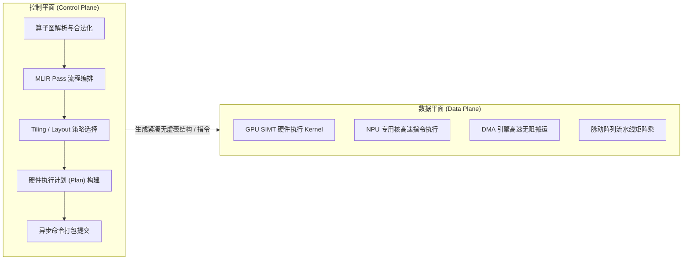

- **控制平面（Control Plane）**：运行在 Host 端 CPU。负责计算图的解析、IR 优化、Pass 编排、Tiling 策略决策、硬件执行计划构建以及向底层提交指令。**控制平面强调模块解耦、灵活性与可扩展性，完全应当拥抱面向对象设计原则与 GoF 经典设计模式。**
- **数据平面（Data Plane）**：运行在 Device 端硬件加速芯片核心（或在极高频的热循环内）。每一纳秒都直接对应算力吞吐。**数据平面严禁使用虚函数、严禁运行时动态分配内存、严禁指针追踪，必须完全采用 C++ 模板、CRTP、C++20 Concepts、平坦连续内存布局（SoA）以及硬件指令内联。**

### 1.4 异构计算系统四层设计模式金字塔

结合上述二元性，我们将异构计算软件系统的设计模式归纳为四层金字塔体系：

```
                    ▲
                   /                   /   \  第一层：系统软件架构模式 (Ports & Adapters, Pipelines, DI)
                 /-----\  -> 管理 Compiler、Runtime、Driver 的边界与生命周期
                /                      /         \  第二层：GoF 经典面向对象设计模式 (Strategy, Factory, Builder...)
              /-----------\  -> 管理控制平面的算子选择、IR 遍历、组件创建与硬件抽象
             /                         /               \  第三层：编译器专用与并发模式 (Pass Pipeline, Rewrite, DAG, Double Buffer)
           /-----------------\  -> 管理 IR 改写、数据流分析、异步流水线与硬件任务图调度
          /                            /                     \  第四层：零开销与硬件感知模式 (CRTP, Concepts, SoA, Arena, Cache-aware)
        /-----------------------\  -> 管理数据平面开销、微架构亲和性、指令级吞吐与无锁性能
```

### 1.5 C++ 多态与抽象范式决策矩阵

在现代 C++（C++20）编译器与高性能开发中，“如何实现多态”并非只有传统的 `virtual` 虚函数一种途径。选择合适的多态范式至关重要：

| 方案 | 多态发生期 | 运行时内存开销 | 调用开销 | 是否支持异构容器 | 典型适用场景 |
| :--- | :--- | :--- | :--- | :--- | :--- |
| **虚函数 (`virtual`)** | 运行期 | 8 字节虚指针 (vptr) + 虚表 (vtable) | 间接寻址指针调用，阻碍编译器内联 | 是（指针/引用容器） | 编译控制流顶层、硬件驱动后端适配器、插件加载机制 |
| **`std::function`** | 运行期 | 32~48 字节 + 可能的堆内存分配 | 函数指针调用 + 类型擦除间接层 | 是 | 适合异步回调、生命周期短暂的通知钩子 |
| **`std::variant` + `std::visit`** | 运行期（闭合集） | 包含最大类型大小 + 索引字段 (Tag) | 基于 Jump Table 或 Switch 分发，内联友好 | 是（直接值容器，无堆分配） | 硬件命令表示（Command Variant）、IR 操作数类型 |
| **函数模板特化** | 编译期 | 0 | 0（完全支持常数折叠与强制内联） | 否 | 硬件感知的数据流数学算子、底层向量运算核 |
| **C++20 Concepts** | 编译期 | 0 | 0（直接静态内联，编译报错极度清晰） | 否 | 编译期策略约束（Policy）、Tiling 静态规划器接口 |
| **CRTP (奇异递归模板)** | 编译期 | 0 | 0（基类直接静态强制转换调用派生类） | 否 | 编译期可扩展的基础设施、无虚表开销的 Visitor 基类 |
| **Plain Struct + 全局函数**| 运行期/编译期| 0（纯 POD 结构） | 0 | 否（需手动传递指针） | 芯片底层物理寄存器映射、硬件 DMA 描述符定义 |

### 1.6 工业级异构编译与运行总体架构图

以下通过 Mermaid 与 Graphviz 展示一个典型的全自研 NPU/GPU 异构计算系统在编译期与运行期的端到端架构视图：

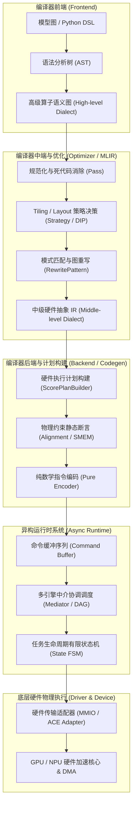

通过 Graphviz `dot` 语言，我们可以清晰地描绘出各核心子系统之间的接口隔离与契约依赖：

```dot
digraph ArchitectureLayers {
    rankdir=LR;
    node [shape=box, style="filled,rounded", fontname="sans-serif", fontsize=10];
    edge [fontname="sans-serif", fontsize=8];

    subgraph cluster_frontend {
        label = "前端表达层";
        style = dashed;
        color = "#475569";
        FrontendGraph [label="DSL / 计算图表达
(Pure Math Semantics)", fillcolor="#F1F5F9"];
    }

    subgraph cluster_middle {
        label = "编译规划层 (MLIR Optimizer)";
        style = dashed;
        color = "#0284C7";
        PassMgr [label="PassManager 编排
(Template Method)", fillcolor="#E0F2FE"];
        TilingPolicy [label="Tiling/Layout 决策
(Strategy + DIP)", fillcolor="#E0F2FE"];
        RewriteEngine [label="Pattern 改写引擎
(RewritePattern)", fillcolor="#E0F2FE"];
    }

    subgraph cluster_backend {
        label = "目标代码生成层 (Backend)";
        style = dashed;
        color = "#0D9488";
        PlanBuilder [label="硬件执行计划构建器
(Builder Pattern)", fillcolor="#CCFBF1"];
        Encoder [label="纯数学寄存器/指令编码
(Pure Functions)", fillcolor="#CCFBF1"];
    }

    subgraph cluster_runtime {
        label = "硬件运行时 (Async Runtime)";
        style = dashed;
        color = "#7C3AED";
        CmdQueue [label="命令队列 / DAG
(Command Buffer)", fillcolor="#EDE9FE"];
        TaskFSM [label="任务生命周期状态机
(State Pattern)", fillcolor="#EDE9FE"];
        DeviceDriver [label="传输总线适配器
(Adapter: MMIO / ACE)", fillcolor="#EDE9FE"];
    }

    FrontendGraph -> PassMgr [label="生成高阶 IR"];
    PassMgr -> TilingPolicy [label="查询最优策略"];
    TilingPolicy -> RewriteEngine [label="执行分块改写"];
    RewriteEngine -> PlanBuilder [label="发射中间指令"];
    PlanBuilder -> Encoder [label="校验硬件约束并构建 Plan"];
    Encoder -> CmdQueue [label="生成紧凑字节码/命令"];
    CmdQueue -> TaskFSM [label="入队调度"];
    TaskFSM -> DeviceDriver [label="下发执行"];
}
```

---

## 二、编译器视角下的面向对象八大原则（8 Principles）

侯捷老师在深入剖析设计模式时指出，面向对象设计原则是所有设计模式的基石与灵魂。如果在写代码时没有深刻理解这八大原则，盲目套用 23 种模式只会带来过度设计与“虚假的灵活性”。

在异构计算与 AI 编译器系统中，这八大原则如何指导我们的系统架构？

### 2.1 单一职责原则（SRP: Single Responsibility Principle）

> **原则定义**：一个类（或模块）应该且仅有一个引起它变化的原因。

#### 异构编译器的典型反模式：超级 Pass（God Pass）
在工业界许多初创 NPU 编译器项目中，初学者最容易写出动辄数千行的“巨型 Lowering Pass”。在这个 Pass 内部：
1. 遍历图节点；
2. 顺手做常数折叠与无用代码消除（DCE）；
3. 紧接着计算 Tiling 分块切分尺寸；
4. 随后为张量分配核内核外缓冲地址；
5. 最后直接硬编码把物理寄存器的十六进制数值发射出来！

这种设计的毁灭性后果在于：
- 如果算法团队需要尝试一种新的 Tiling 搜索启发式策略，不得不动这几千行代码；
- 如果硬件团队将芯片底层寄存器的偏移从 `0x10` 改为 `0x18`，还要动这几千行代码；
- 如果内存分配算法需要增加 Bank Conflict 规避逻辑，依然要动这几千行代码。
**该类存在四个甚至五个引起它变化的维度，彻底违反了 SRP。**

#### 架构实践：严格拆分职责管线
高内聚的编译器应将上述职责严格分解：
- `CanonicalizationPass`：专门负责数学等价化简与死代码消除；
- `TilingPlanningPass`：专门基于代价模型决策 Tile 尺寸；
- `BufferPlacementPass`：专门负责片上存储（SRAM）与外部内存地址规划；
- `InstructionEmitter`：专门负责将抽象执行计划转化为具体指令。


---

### 2.2 开放封闭原则（OCP: Open-Closed Principle）

> **原则定义**：软件实体（类、模块、函数）应该对扩展开放，对修改关闭。

#### 异构编译器的典型反模式：级联 `switch-case`
在为编译器添加新算子（如从 Conv2d 拓展到 LayerNorm、Rotary Embedding）或支持新硬件时，最差的做法是在主转换函数里写满对类型的判断：

```cpp
// 严重违反 OCP 的坏代码
void lowerOperation(Operation* op, DeviceType dev) {
    if (op->getName() == "matmul") {
        if (dev == DeviceType::GPU) lowerMatMulToGPU(op);
        else if (dev == DeviceType::NPU) lowerMatMulToNPU(op);
    } else if (op->getName() == "layernorm") {
        if (dev == DeviceType::GPU) lowerLayerNormToGPU(op);
        else if (dev == DeviceType::NPU) lowerLayerNormToNPU(op);
    } // 每新增一个算子或一个硬件，都要修改这个核心文件！
}
```

#### 架构实践：动态注册机制与 Pattern 扩展
现代编译器采用可插拔的改写模式库（RewritePatternSet）。主流程只负责运行管线，任何算子的下沉规则都是一个独立的结构体，通过注册器在初始化时注入：

```cpp
// 遵循 OCP 的设计：新增算子只需要新增一个文件并注册即可
class MatMulLoweringPattern : public OpRewritePattern<MatMulOp> {
public:
    LogicalResult matchAndRewrite(MatMulOp op, PatternRewriter& rewriter) const override {
        // 独立的下沉与改写逻辑，绝对不侵入其他算子
        return success();
    }
};

void populateNpuLoweringPatterns(RewritePatternSet& patterns) {
    patterns.add<MatMulLoweringPattern>();
    patterns.add<LayerNormLoweringPattern>(); // 扩展时无需修改执行引擎的核心驱动代码
}
```

---

### 2.3 里氏替换原则（LSP: Liskov Substitution Principle）

> **原则定义**：所有引用基类的地方必须能透明地使用其子类的对象，而不会导致程序的逻辑错误或异常。

#### 异构计算中的虚假泛化陷阱
在设计硬件加速卡设备驱动抽象时，开发者常定义如下接口：

```cpp
class IDeviceEngine {
public:
    virtual ~IDeviceEngine() = default;
    virtual void asyncMemCopy(void* dst, void* src, size_t bytes) = 0;
    virtual void executeKernel(const void* binary, size_t size) = 0;
};
```

后来团队引入了一款专用张量阵列加速芯片（TPU-like），该芯片的硬件 DMA 控制器存在极为苛刻的物理约束：**传输的源地址、目的地址与字节数必须严格 64 字节对齐，且硬件内部完全不支持异步重叠传输，只能阻塞式运行。**

若开发者在派生类中写出如下实现：

```cpp
class TensorArrayEngine : public IDeviceEngine {
public:
    void asyncMemCopy(void* dst, void* src, size_t bytes) override {
        if ((uintptr_t)dst % 64 != 0 || bytes % 64 != 0) {
            throw std::runtime_error("LSP 破裂！硬件不支持非 64 字节对齐的拷贝！");
        }
        // 实际上是同步阻塞，基类的异步假定失效
        syncCopyBlocking(dst, src, bytes); 
    }
};
```

上层调度器假设 `IDeviceEngine` 具有通用的非对齐异步传输能力，结果在替换为 `TensorArrayEngine` 时崩溃或引发时序饥饿死锁。

#### 架构实践：能力契约（Capability-based）拆分
不要使用包含过多隐式假定的虚假父类。应当通过清晰的能力特性（Capabilities）进行能力查询，或者将非对齐处理作为装饰器适配层在底层隔离：

```cpp
struct DmaCapabilities {
    size_t alignmentRequired{1};
    bool supportsAsync{true};
    size_t maxBurstSize{4096};
};

class IDeviceEngine {
public:
    virtual ~IDeviceEngine() = default;
    virtual const DmaCapabilities& getCapabilities() const noexcept = 0;
};
```

---

### 2.4 接口隔离原则（ISP: Interface Segregation Principle）

> **原则定义**：客户端不应该被迫依赖它不使用的方法；一个类对另一个类的依赖应该建立在最小的接口上。

#### 编译管线中的权限隔离
在编译器框架中，Pass 通常分为两类：
1. **分析型 Pass（Analysis Pass）**：只负责遍历 IR，收集数据依赖关系、活跃变量区间或内存占用估算，**绝对不能对 IR 产生任何写修改**；
2. **转换型 Pass（Transformation Pass）**：根据分析结果对 IR 节点进行擦除、替换和分裂。

如果将两者的接口定义为一个庞大的胖接口：

```cpp
// 违反 ISP 的胖接口
class ICompilerPass {
public:
    virtual void analyzeDataflow() = 0;
    virtual void eraseDeadOps() = 0;
    virtual void replaceOpWith(Operation* oldOp, Operation* newOp) = 0;
};
```

分析 Pass 被迫依赖修改 IR 的接口，一旦分析代码无意中修改了 IR 结构，会导致编译管线的依赖关系完全错乱并引发段错误。现代框架（如 MLIR）通过将接口严格隔离为只读的 `AnalysisManager` 与专职写操作的 `PatternRewriter`，从类型系统层面彻底阻断了未授权的写操作。

---

### 2.5 依赖倒置原则（DIP: Dependency Inversion Principle）

> **原则定义**：高层模块不应该依赖低层模块，二者都应该依赖其抽象；抽象不应该依赖细节，细节应该依赖抽象。

#### 异构编译中的硬件解耦
高层优化 Pass（例如循环分块 Tiling 规划器）不应直接包含具体芯片的物理头文件（如 `#include <chip_v2_registers.h>`）。

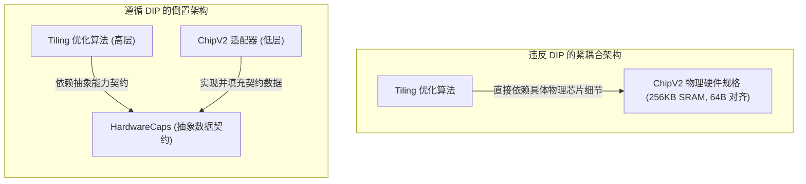

通过引入数据契约结构体 `HardwareCaps`，Tiling 算法只针对数学属性（片上容量、向量计算宽度、带宽比）进行分块计算，具体芯片只负责向契约填充具体参数值，从而使高层算法可以在任何未来的新硬件架构上无缝复用。

---

### 2.6 组合优于继承（Favor Composition Over Inheritance）

> **原则定义**：通过包含现有对象并委派其功能（对象组合），往往比通过类继承扩展现有行为更加灵活且脆弱性更低。

继承是**编译期静态绑定**的强耦合关系，子类会无条件继承基类的一切公有和保护状态，一旦基类修改，整个子类层级都会发生级联雪崩。
在编译器构建 PassPipeline 时，我们绝不使用派生类来组合功能（例如 `MatMulLoweringWithProfilingAndDcePass`），而是通过组合模式将原子 Pass 装配在 `PassManager` 管道中：

```cpp
// 优雅的组合哲学
PassManager pm;
pm.addPass(createCanonicalizerPass());
pm.addPass(createTilingPass(tilingStrategy));
pm.addPass(createDcePass());
pm.run(moduleOp);
```

---

### 2.7 封装变化点（Encapsulate Variation）

> **原则定义**：找出应用中可能需要变化之处，把它们独立出来，不要和那些不需要变化的代码混在一起。

在异构计算编译系统中，**绝对稳定**的内容是：
- 张量算子的数学定义（如 GEMM 的数学定义永不改变）；
- 计算图的拓扑偏序关系。

而**极度剧烈变化**的三大核心变化点是：
1. **Tiling 分块与内存排布（Layout）策略**；
2. **目标加速芯片专有寄存器位段定义与编码协议**；
3. **驱动交互传输总线（从单字 MMIO 到批处理原子 ACE）**。

将这三大变化点分别使用独立的策略类（Strategy）、构建器（Builder）和适配器（Adapter）封装，核心编译主流程即可固若金汤。

---

### 2.8 迪米特法则（Law of Demeter, 最少知识原则）

> **原则定义**：只与你直接的朋友交谈，不要跟“陌生人的朋友”发生直接依赖（不要穿透调用）。

在编译器代码中，极易出现如下脆弱链式调用：

```cpp
// 严重违反迪米特法则：脆弱的链式穿透
auto bufferSize = op->getParentOp()->getParentOp()->getRegion(0).front().getTerminator()->getOperand(0).getType().cast<MemRefType>().getSize();
```

只要上层编译流程在中间多套了一层 `scf.for` 循环或者增加了一个辅助作用域（Scope），上述代码将在运行时发生空指针段错误。遵循迪米特法则的代码应当通过显式的上下文接口或查询工具类获取属性，严禁跨越两层以上的层级直接寻址。

---

## 三、GoF 23 种设计模式完整整理与深度实践

侯捷老师指出，设计模式根据其目的主要划分为三大阵营：
1. **创建型模式（Creational Patterns）**：封装对象创建逻辑，管理系统构建的复杂度与版本依赖；
2. **结构型模式（Structural Patterns）**：管理类与对象之间的组合关系，搭建高内聚低耦合的架构骨架；
3. **行为型模式（Behavioral Patterns）**：管理系统运行时的职责分派、控制算法与事件通信。

下面，我们将 23 种模式逐一置于现代 C++20、AI 编译器与异构底层系统的显微镜下，深入解剖其工程实践与选型边界。

---

### 3.1 创建型模式：管理对象与执行计划的构建

#### 3.1.1 工厂方法模式（Factory Method）

- **传统 GoF 意图**：定义一个用于创建对象的接口，让子类决定实例化哪一个类。工厂方法使一个类的实例化延迟到其子类。
- **编译器映射**：Pass 动态注册体系、目标后端代码生成器（Emitter）创建机制。

##### 架构痛点：主流程强依赖具体实现
如果编译器的主流程直接使用 `new` 实例化具体 Pass，那么每当新增一个芯片特化的 Pass，编译器主流程代码就必须被重新编译，违反 DIP 原则。

##### C++20 工程实现：类型安全的动态工厂注册表
通过结合 C++ 局部静态变量与模板注册器，实现零侵入式的 Pass 自动工厂注册：

```cpp
#include <iostream>
#include <memory>
#include <string>
#include <unordered_map>
#include <functional>

class ICompilerPass {
public:
    virtual ~ICompilerPass() = default;
    virtual std::string_view getName() const noexcept = 0;
    virtual void runOnModule() = 0;
};

// Pass 工厂类型定义
using PassFactoryFn = std::function<std::unique_ptr<ICompilerPass>()>;

class PassRegistry {
public:
    static PassRegistry& instance() {
        static PassRegistry reg;
        return reg;
    }

    void registerPass(std::string_view name, PassFactoryFn factory) {
        factories_[std::string(name)] = std::move(factory);
    }

    std::unique_ptr<ICompilerPass> createPass(const std::string& name) const {
        auto it = factories_.find(name);
        if (it != factories_.end()) {
            return it->second();
        }
        return nullptr;
    }

private:
    std::unordered_map<std::string, PassFactoryFn> factories_;
};

// 自动注册辅助模板（静态变量在程序启动或加载时自动触发注册）
template <typename TPass>
struct RegisterPassHelper {
    explicit RegisterPassHelper(std::string_view name) {
        PassRegistry::instance().registerPass(name, []() {
            return std::make_unique<TPass>();
        });
    }
};

// 具体实现：NPU Tiling Pass
class NpuTilingPass : public ICompilerPass {
public:
    std::string_view getName() const noexcept override { return "npu-tiling"; }
    void runOnModule() override {
        std::cout << "[Pass] 执行 NPU 专用循环切分优化...\n";
    }
};

// 静态注册触发点（无需修改 PassManager 核心文件）
static RegisterPassHelper<NpuTilingPass> regNpuTiling("npu-tiling");
```

> [!TIP]
> **与 MLIR 工业实践的对应**：MLIR 中的 `mlir::registerPass([]() { return std::make_unique<MyPass>(); });` 正是工厂方法模式的标准落地，彻底消除了编译总控引擎对各 Dialect 具体下沉 Pass 的直接编译依赖。

---

#### 3.1.2 抽象工厂模式（Abstract Factory）

- **传统 GoF 意图**：提供一个创建一系列相关或相互依赖对象的接口，而无需指定它们具体的类。
- **编译器映射**：多芯片代际后端组件套件（Score/Tcore/DMA/ABI）的一致性绑定。

##### 架构痛点：组件版本错配引发的硬件灾难
在真实的 NPU 项目中，芯片往往迭代迅速（如一代 NPU-V1 与 二代 NPU-V2）。
- V1 硬件：包含 V1_Score 控制发射器、V1_DMA 搬运器、V1_ABI 调用约定；
- V2 硬件：包含 V2_Score、具有突发传输能力的 V2_DMA、支持 64 位寻址的 V2_ABI。

如果使用单个独立的工厂方法分散创建各个部件，开发人员极易在配置管线时写出类似下面的致命错误：

```cpp
// 致命的混配错误！V1 发射器配合了 V2 的 DMA，导致硬件信号协议错乱
auto scoreEmitter = createScoreEmitter(TargetVersion::V1);
auto dmaPlanner = createDmaPlanner(TargetVersion::V2); // 致命！协议不匹配引发硬件死锁
```

##### C++20 工程实现：后端全套组件一致性保障工厂
抽象工厂强行将“成套组件”的生命周期与版本绑定，从类型系统层面杜绝混用：

```cpp
#include <memory>
#include <iostream>

struct IScoreEmitter { virtual ~IScoreEmitter() = default; virtual void emitScoreOp() = 0; };
struct IDmaPlanner   { virtual ~IDmaPlanner() = default; virtual void planDmaTransfer() = 0; };
struct IAbiConfig    { virtual ~IAbiConfig() = default; virtual size_t getStackAlignment() = 0; };

// 抽象工厂接口：生产一整套绝对兼容的硬件后端组件
class ITargetBackendFactory {
public:
    virtual ~ITargetBackendFactory() = default;
    virtual std::unique_ptr<IScoreEmitter> createScoreEmitter() const = 0;
    virtual std::unique_ptr<IDmaPlanner>   createDmaPlanner() const = 0;
    virtual std::unique_ptr<IAbiConfig>    createAbiConfig() const = 0;
};

// V1 硬件套件实现
class NpuV1BackendFactory : public ITargetBackendFactory {
public:
    std::unique_ptr<IScoreEmitter> createScoreEmitter() const override {
        struct ScoreEmitterV1 : IScoreEmitter {
            void emitScoreOp() override { std::cout << "Emitting V1 Score Op\n"; }
        };
        return std::make_unique<ScoreEmitterV1>();
    }
    std::unique_ptr<IDmaPlanner> createDmaPlanner() const override {
        struct DmaPlannerV1 : IDmaPlanner {
            void planDmaTransfer() override { std::cout << "Planning V1 Single-beat DMA\n"; }
        };
        return std::make_unique<DmaPlannerV1>();
    }
    std::unique_ptr<IAbiConfig> createAbiConfig() const override {
        struct AbiV1 : IAbiConfig {
            size_t getStackAlignment() override { return 32; }
        };
        return std::make_unique<AbiV1>();
    }
};

// 关键选择：何时不要滥用抽象工厂？
// 如果 V1 和 V2 仅仅是“寄存器偏移地址不同”、“SRAM 大小从 256K 变为 512K”，
// 那么使用【数据驱动的硬件参数配置表 (HardwareConfig Map)】远比抽象工厂轻量优雅！
// 只有当控制逻辑、指令微码语义发生根本性代际裂变时，抽象工厂才是不可替代的。
```

---

#### 3.1.3 构建器模式（Builder）

- **传统 GoF 意图**：将一个复杂对象的构建与其表示分离，使得同样的构建过程可以创建不同的表示。
- **编译器映射**：硬件执行计划构建器（ExecutionPlanBuilder）、微码指令包组装器。

##### 架构痛点：复杂的硬件执行约束
硬件加速器（如 NPU/TPU）的执行程序不是单一简单的函数调用，而是一组交织了**内存布局分配、DMA 双缓冲通道配置、片上 Scratchpad 地址偏移计算、多核事件同步槽位绑定**的复杂数据结构。直接通过构造函数传递几十个参数是灾难性的。

更重要的是：**硬件执行计划在生成的每一个阶段，都必须强行进行物理硬件合法性校验（Invariant Assertions）！**

##### C++20 工程实现：带有硬件强约束校验的 PlanBuilder

```cpp
#include <cstdint>
#include <vector>
#include <stdexcept>
#include <iostream>

struct HardwareInstruction {
    uint32_t opcode;
    uint32_t srcAddress;
    uint32_t dstAddress;
    uint32_t loopCount;
};

struct ExecutionPlan {
    std::vector<HardwareInstruction> instructions;
    size_t totalSramAllocated{0};
    uint32_t eventSyncSlot{0};
};

class ScorePlanBuilder {
public:
    ScorePlanBuilder& setEventSyncSlot(uint32_t slot) {
        if (slot > 15) { // 硬件总共只有 16 个同步事件槽位
            throw std::invalid_argument("硬件错误：同步事件槽位必须在 0~15 之间！");
        }
        plan_.eventSyncSlot = slot;
        return *this;
    }

    ScorePlanBuilder& allocateSramBuffer(size_t bytes, size_t alignment = 64) {
        // 硬件物理约束校验：必须严格对齐
        if (bytes % alignment != 0) {
            bytes = (bytes + alignment - 1) & ~(alignment - 1);
        }
        if (plan_.totalSramAllocated + bytes > 256 * 1024) { // 片上 SRAM 上限 256KB
            throw std::runtime_error("硬件错误：片上 SRAM 容量溢出！");
        }
        plan_.totalSramAllocated += bytes;
        return *this;
    }

    ScorePlanBuilder& addComputeLoop(uint32_t iterations, uint32_t src, uint32_t dst) {
        if (iterations == 0 || iterations > 65535) {
            throw std::invalid_argument("硬件错误：硬件计算循环计数超限 (1~65535)！");
        }
        plan_.instructions.push_back({0x01, src, dst, iterations});
        return *this;
    }

    // 最终交付经过严密校验的合法产品
    ExecutionPlan build() {
        if (plan_.instructions.empty()) {
            throw std::logic_error("非法构建：执行计划中未包含任何有效计算指令！");
        }
        return std::move(plan_);
    }

private:
    ExecutionPlan plan_;
};

// 【核心架构辨析】Builder vs Planner 有什么本质区别？
// Planner (规划器) 是“思考者”：运行复杂的搜索算法、代价模型，决策出 Tile 应该切多大；
// Builder (构建器) 是“施工组装员”：接收 Planner 的决策，按部就班组装指令，并在每一步执行底线物理断言！
```

---

#### 3.1.4 原型模式（Prototype）

- **传统 GoF 意图**：用原型实例指定创建对象的种类，并且通过拷贝这些原型创建新的对象。
- **编译器映射**：探索式编译优化、自动调优（Autotuning）中的 IR 克隆分支与 SSA 映射。

##### 架构痛点：优化尝试具有破坏性
编译器在进行激进优化（如循环融合 Loop Fusion、向量化 Vectorization、内存复用优化）时，往往无法预先保证改写一定能在底层获得性能收益。如果直接在原始 IR 上修改，一旦优化失败或导致寄存器压力过大，将无法回滚到干净状态。

##### 原型克隆的核心难点：SSA 值的重新映射（IRMapping）
Operation 的克隆不是简单的 C++ 内存拷贝！因为被克隆的 Operation 内部引用了旧的 SSA 变量（Value），在新生成的克隆分支中，必须通过一个映射表（`IRMapping`）将所有旧的操作数替换为新克隆出来的对应 SSA 值：

```cpp
#include <memory>
#include <unordered_map>
#include <vector>
#include <string>
#include <iostream>

struct Value {
    std::string name;
};

class IRMapping {
public:
    void map(const Value* oldVal, std::shared_ptr<Value> newVal) {
        map_[oldVal] = newVal;
    }
    std::shared_ptr<Value> lookup(const Value* oldVal) const {
        auto it = map_.find(oldVal);
        return (it != map_.end()) ? it->second : nullptr;
    }
private:
    std::unordered_map<const Value*, std::shared_ptr<Value>> map_;
};

class Operation {
public:
    virtual ~Operation() = default;
    // 原型模式的核心克隆接口
    virtual std::unique_ptr<Operation> clone(IRMapping& mapping) const = 0;
};

class AddOp : public Operation {
public:
    AddOp(std::shared_ptr<Value> lhs, std::shared_ptr<Value> rhs, std::shared_ptr<Value> res)
        : lhs_(lhs), rhs_(rhs), res_(res) {}

    std::unique_ptr<Operation> clone(IRMapping& mapping) const override {
        // 重映射输入操作数，并为输出生成全新的 SSA 结果值
        auto newLhs = mapping.lookup(lhs_.get());
        auto newRhs = mapping.lookup(rhs_.get());
        auto newRes = std::make_shared<Value>(res_->name + "_cloned");
        
        mapping.map(res_.get(), newRes);
        return std::make_unique<AddOp>(
            newLhs ? newLhs : lhs_,
            newRhs ? newRhs : rhs_,
            newRes
        );
    }

private:
    std::shared_ptr<Value> lhs_, rhs_, res_;
};
```

> [!NOTE]
> MLIR 中的 `Operation::clone(IRMapping &mapper)` 是原型模式在大规模工业编译器中的典范实现，为所有投机性编译搜索提供了不可或缺的沙盒克隆能力。

---

#### 3.1.5 单例模式（Singleton）

- **传统 GoF 意图**：保证一个类仅有一个实例，并提供一个访问它的全局访问点。
- **编译器映射**：为什么现代工业级编译器必须**全面排斥全局单例**？

##### 架构灾难：全局单例破坏多线程并发编译
在过去的老旧编译器中，常有人将符号表（SymbolTable）、诊断引擎（DiagnosticEngine）甚至类型上下文定义为全局单例（如 `GlobalTypeContext::getInstance()`）。
这种设计在多核时代引发了巨大灾难：
1. **多线程并发 Pass 运行发生死锁或严重锁争用**：现代编译器往往并发编译多个独立的模块或函数；
2. **测试隔离破裂**：单测用例 A 修改了全局单例中的配置状态，导致随后的单测用例 B 偶发性随机失败；
3. **不可预测的初始化与析构顺序（Static Initialization Order Fiasco）**。

##### 架构替代：CompilationSession / MLIRContext 作用域注入模式
取缔全局单例，代之以显式传递的“编译会话上下文对象”：

```cpp
#include <iostream>
#include <memory>
#include <string>

// 纯粹的会话上下文，生命周期受调用者严格控制
class CompilationSession {
public:
    CompilationSession(std::string targetChip, int optLevel)
        : targetChip_(std::move(targetChip)), optLevel_(optLevel) {}

    std::string_view getTargetChip() const noexcept { return targetChip_; }
    int getOptLevel() const noexcept { return optLevel_; }

private:
    std::string targetChip_;
    int optLevel_;
};

// 编译器各 Pass 通过依赖注入（Dependency Injection）接收上下文，绝不访问全局变量
class OptimizationPass {
public:
    void execute(CompilationSession& session) {
        std::cout << "正在为目标芯片 [" << session.getTargetChip() 
                  << "] 运行优化级别 O" << session.getOptLevel() << " Pass\n";
    }
};

// 【例外】：什么在编译器中允许是进程级唯一的？
// 只有严格只读、无任何可变状态的元信息（如指令集静态元数据表、只读常量字符串池）
// 才可以被实现为 Meyers 线程安全静态单例。
```

---

### 3.2 结构型模式：管理模块之间的关系

#### 3.2.1 桥接模式（Bridge）

- **传统 GoF 意图**：将抽象部分与它的实现部分分离，使它们都可以独立地变化。
- **编译器映射**：解耦“编译流程/工作流（Workflow）”与“目标硬件执行引擎（Target Backend）”，消除多轴类爆炸。

##### 架构痛点：$M \times N$ 类爆炸
在工业编译器中，存在两个同等量级且互相独立的剧烈变化维度：
1. **编译工作流（Workflow）**：
   - `DebugWorkflow`：包含全量语义校验、断言插入、生成符号调试表；
   - `ReleaseWorkflow`：执行激进跨算子融合、常量折叠与内联优化；
   - `ProfileWorkflow`：插入硬件性能计数器打点微码。
2. **目标加速硬件（Backend）**：
   - `GpuBackend`：生成并行 SIMT 机器码；
   - `NpuV1Backend`：生成 V1 协处理器指令流；
   - `NpuV2Backend`：生成基于 ACE 总线的高并发批处理指令包。

如果采用传统的继承方式，我们需要实现 `DebugGpuWorkflow`, `ReleaseGpuWorkflow`, `ProfileGpuWorkflow`, `DebugNpuV1Workflow`... 最终导致 $3 \times 3 = 9$ 个派生类。若后续增加一个芯片后端，就要同步增加 3 个类！

##### C++20 工程实现：桥接双向演化维度
通过持有目标后端的纯虚指针，使编译工作流与目标硬件自由正交组合：

```cpp
#include <iostream>
#include <memory>
#include <string>

// 实现层抽象：硬件后端指令发射器
struct ITargetBackend {
    virtual ~ITargetBackend() = default;
    virtual void emitKernelHeader() = 0;
    virtual void emitComputeOp(std::string_view opName) = 0;
    virtual void emitSyncBarrier() = 0;
};

// 具体实现 A：通用 GPU 后端
class GpuBackend : public ITargetBackend {
public:
    void emitKernelHeader() override { std::cout << "[GPU] 发射 SIMT 线程网格启动头\n"; }
    void emitComputeOp(std::string_view op) override { std::cout << "[GPU] 发射张量核心加速指令: " << op << "\n"; }
    void emitSyncBarrier() override { std::cout << "[GPU] 发射 __syncthreads() 线程束栅栏\n"; }
};

// 具体实现 B：NPU 专用数据流后端
class NpuV2Backend : public ITargetBackend {
public:
    void emitKernelHeader() override { std::cout << "[NPU-V2] 配置 ACE 批处理总线控制头\n"; }
    void emitComputeOp(std::string_view op) override { std::cout << "[NPU-V2] 发射 Score 协处理数据流微码: " << op << "\n"; }
    void emitSyncBarrier() override { std::cout << "[NPU-V2] 触发硬件事件同步槽位 (Event Slot)\n"; }
};

// 抽象层：编译工作流
class CompilationWorkflow {
public:
    explicit CompilationWorkflow(std::shared_ptr<ITargetBackend> backend)
        : backend_(std::move(backend)) {}
    virtual ~CompilationWorkflow() = default;
    virtual void runWorkflow() = 0;

protected:
    std::shared_ptr<ITargetBackend> backend_;
};

// 扩充抽象 A：发布模式（激进优化）
class ReleaseWorkflow : public CompilationWorkflow {
public:
    using CompilationWorkflow::CompilationWorkflow;
    void runWorkflow() override {
        std::cout << ">>> 启动 Release 编译管线 (激进优化与循环融合) <<<\n";
        backend_->emitKernelHeader();
        backend_->emitComputeOp("Fused_MatMul_Add_GELU");
        backend_->emitSyncBarrier();
    }
};

// 扩充抽象 B：调试模式（安全断言与边界检查）
class DebugWorkflow : public CompilationWorkflow {
public:
    using CompilationWorkflow::CompilationWorkflow;
    void runWorkflow() override {
        std::cout << ">>> 启动 Debug 编译管线 (插入地址边界断言) <<<\n";
        backend_->emitKernelHeader();
        std::cout << "[Debug] 插入 SRAM 边界检查护卫代码...\n";
        backend_->emitComputeOp("MatMul_StrictChecked");
        backend_->emitSyncBarrier();
    }
};

// 【核心辨析】Bridge 与 Strategy 的区别：
// Strategy (策略模式) 改变的是类内部的“某一算法零件”；
// Bridge (桥接模式) 分离的是两个各自拥有丰富派生体系、同等地位的“主体抽象层次”！
```

---

#### 3.2.2 适配器模式（Adapter）

- **传统 GoF 意图**：将一个类的接口转换成客户希望的另外一个接口。Adapter 模式使得原本由于接口不兼容而不能一起工作的那些类可以一起工作。
- **编译器映射**：异构芯片新旧硬件寄存器接口、驱动传输总线协议平滑演进。

##### 架构痛点：同一计算语义遇到断代协议差异
在硬件演进中，一代芯片通常采用传统的 MMIO（单寄存器单地址写），而二代芯片为了提升 CPU-NPU 交互吞吐，升级为 ACE 批处理总线（一次原子提交 16 个寄存器键值对并带有掩码）：

```cpp
#include <cstdint>
#include <vector>
#include <iostream>

// 现代编译器统一的逻辑寄存器配置请求
struct RegisterUpdate {
    uint32_t regId;
    uint32_t value;
};

// 目标抽象：编译器后端所依赖的通用硬件下发接口
class IRegisterTransport {
public:
    virtual ~IRegisterTransport() = default;
    virtual void submitBatch(const std::vector<RegisterUpdate>& updates) = 0;
};

// 老旧的底层驱动接口：仅支持逐字单条 MMIO 写
class LegacyMmioDriver {
public:
    void mmioWrite32(uint32_t addr, uint32_t val) {
        std::cout << "[MMIO-Driver] 物理地址 0x" << std::hex << addr << " 写入 0x" << val << std::dec << "\n";
    }
};

// 对象适配器：将老旧的单字 MMIO 适配为现代编译器的批量提交接口
class LegacyMmioAdapter : public IRegisterTransport {
public:
    explicit LegacyMmioAdapter(LegacyMmioDriver& driver, uint32_t baseAddr)
        : driver_(driver), baseAddr_(baseAddr) {}

    void submitBatch(const std::vector<RegisterUpdate>& updates) override {
        for (const auto& u : updates) {
            uint32_t physicalAddr = baseAddr_ + (u.regId * 4);
            driver_.mmioWrite32(physicalAddr, u.value);
        }
    }

private:
    LegacyMmioDriver& driver_;
    uint32_t baseAddr_;
};

// 【架构红线】：Adapter 与 Backend Lowering 的本质区别
// Lowering (降低) 是将【高级语义】翻译为【低级语义】（如矩阵乘 -> 嵌套 for 循环 -> 汇编）；
// Adapter 解决的是【同一抽象层级】上，接口形态、参数形式不兼容时的胶水转换！
```

---

#### 3.2.3 装饰器模式（Decorator）

- **传统 GoF 意图**：动态地给一个对象添加一些额外的职责。就增加功能来说，Decorator 模式相比生成子类更为灵活。
- **编译器映射**：非侵入式 Trace 跟踪、硬件耗时微秒级打点（Profiling）、硬件约束边界断言。

##### 架构痛点：核心编码逻辑与观测代码紧密耦合
如果直接在芯片指令编码器内部混入 `std::chrono` 计时或日志打印，代码将迅速变得不可维护，且会在性能测试中引入无法消除的常态开销。

##### C++20 工程实现：可无限包裹的装饰器调用链

```cpp
#include <iostream>
#include <memory>
#include <chrono>

struct IInstructionEncoder {
    virtual ~IInstructionEncoder() = default;
    virtual void encodeAndEmit(uint32_t opcode, uint32_t regA, uint32_t regB) = 0;
};

// 核心组件：纯粹的底层指令编码器（绝对无污染）
class RawHardwareEncoder : public IInstructionEncoder {
public:
    void encodeAndEmit(uint32_t opcode, uint32_t regA, uint32_t regB) override {
        std::cout << "  [Encoder] 写入物理二进制: " 
                  << std::hex << opcode << "-" << regA << "-" << regB << std::dec << "\n";
    }
};

// 装饰器基类
class EncoderDecorator : public IInstructionEncoder {
public:
    explicit EncoderDecorator(std::unique_ptr<IInstructionEncoder> inner)
        : inner_(std::move(inner)) {}

protected:
    std::unique_ptr<IInstructionEncoder> inner_;
};

// 增强功能 A：非侵入式 Trace 打印
class TracingEncoder : public EncoderDecorator {
public:
    using EncoderDecorator::EncoderDecorator;
    void encodeAndEmit(uint32_t opcode, uint32_t regA, uint32_t regB) override {
        std::cout << "[Trace 日志] 开始发射指令 Opcode=" << opcode << "\n";
        inner_->encodeAndEmit(opcode, regA, regB);
        std::cout << "[Trace 日志] 指令发射完毕。\n";
    }
};

// 增强功能 B：执行耗时统计 (Profiling)
class ProfilingEncoder : public EncoderDecorator {
public:
    using EncoderDecorator::EncoderDecorator;
    void encodeAndEmit(uint32_t opcode, uint32_t regA, uint32_t regB) override {
        auto start = std::chrono::high_resolution_clock::now();
        inner_->encodeAndEmit(opcode, regA, regB);
        auto elapsed = std::chrono::duration_cast<std::chrono::nanoseconds>(
            std::chrono::high_resolution_clock::now() - start).count();
        std::cout << "[Profiling 打点] 耗时: " << elapsed << " ns\n";
    }
};

// 工业级编译器观测级别矩阵 (Observability Matrix)
// Level 0: 纯 RawHardwareEncoder (完全零开销)
// Level 1: ProfilingEncoder(Raw)
// Level 2: TracingEncoder(ProfilingEncoder(Raw))
```

> [!TIP]
> MLIR 中的 `PassInstrumentation` 架构正是装饰器理念的极致体现：无需修改任何具体的 Pass 代码，通过在 `PassManager` 上挂载 Instrumentation，即可全局非侵入地拦截 Pass 运行前后并收集耗时、IR 差异转储（Dump IR）。

---

#### 3.2.4 享元模式（Flyweight）

- **传统 GoF 意图**：运用共享技术有效地支持大量细粒度的对象。
- **编译器映射**：MLIR 体系基石——Type 与 Attribute 的全局唯一定义（Uniquing）。

##### 架构痛点：数百万个 AST / IR 节点引发内存爆炸
在一个拥有数百万层张量算子或微码节点的复杂网络中，如果每个节点都拥有独立的 `Type` 对象（如 `f32`、`tensor<128x256xf32>`），内存消耗将轻易突破数十吉字节（GB），而且判断两个操作数的类型是否相等将演化为耗时的高昂深层比较。

##### 核心拆解：内部状态 vs 外部状态
- **内部状态（Intrinsic State）**：类型数学本质（元素类型、形状维度等），在整个编译上下文中不可变且全局共享，存储在享元池中；
- **外部状态（Extrinsic State）**：该类型属于哪个具体的 SSA 变量、定义在哪一行，由使用者持有。

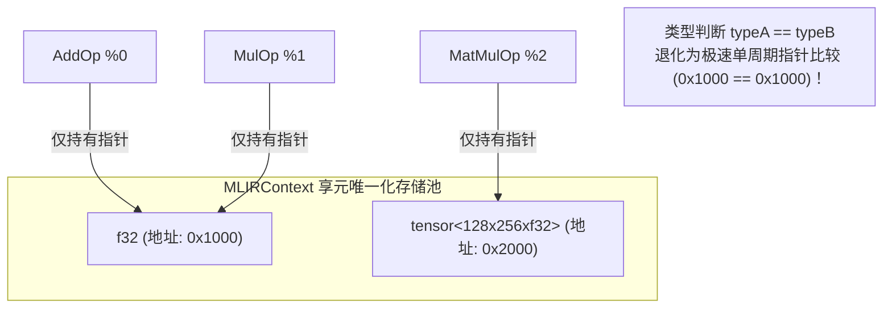

在 MLIR 中，所有 `Type` 和 `Attribute` 实例在被创建时都会在 `MLIRContext` 内部的哈希池中进行唯一定位（Uniquing）。所有使用该类型的 Operation 仅保存一个 `TypeStorage*` 指针，使得类型相等性判断从多字段深层遍历瞬间优化为单周期指针地址比较！

---

#### 3.2.5 外观模式（Facade）

- **传统 GoF 意图**：为子系统中的一组接口提供一个一致的界面，Facade 模式定义了一个高层接口，这个接口使得这一子系统更加容易使用。
- **编译器映射**：统一的编译器对外调用接口 `Compiler::compile(CompileRequest)`。

##### 架构痛点：复杂的子系统让外部用户望而生畏
完整的编译器子系统包含词法语法解析器、PassManager 优化管线、Tiling 规划引擎、寄存器分配器与目标二进制链接器。如果将这些细节直接暴露给 Runtime 或用户，外部代码与编译器底层内部实现的耦合将极其严重。

##### C++20 工程实现：防范“上帝编译器（God Object）”反模式

```cpp
#include <string>
#include <vector>
#include <memory>
#include <iostream>

struct CompileRequest {
    std::string sourceDsl;
    std::string targetDevice;
    int optLevel{2};
};

struct CompileResult {
    bool success{false};
    std::vector<uint8_t> binaryBytecode;
};

// Facade 外观：对外提供极其精炼的统一入口
class CompilerFacade {
public:
    CompileResult compile(const CompileRequest& req) {
        std::cout << "[Facade] 接收编译请求，启动内部流水线编排...\n";
        
        // 协调各个子系统（但 Facade 类本身绝对不承揽具体优化逻辑）
        parseFrontend(req.sourceDsl);
        runOptimizationPasses(req.optLevel);
        auto plan = buildHardwarePlan(req.targetDevice);
        return emitBinary(plan);
    }

private:
    void parseFrontend(const std::string& dsl) { /* 委托给前端子系统 */ }
    void runOptimizationPasses(int opt) { /* 委托给 PassManager */ }
    int buildHardwarePlan(const std::string& dev) { return 42; /* 委托给 Backend */ }
    CompileResult emitBinary(int plan) { return {true, {0x7F, 0x45, 0x4C, 0x46}}; }
};

// 【警惕反模式】上帝编译器 (God Compiler)
// 很多程序员在重构中，把具体优化 pass 的执行逻辑、甚至 Tiling 算法直接写进 CompilerFacade 类里！
// Facade 的职责仅仅是“调度与转发总管”，它绝对不能越俎代庖实现业务细节。
```

---

#### 3.2.6 代理模式（Proxy）

- **传统 GoF 意图**：为其他对象提供一种代理以控制对这个对象的访问。
- **编译器映射**：远程 RPC 分布式编译代理、EDA 芯片前仿沙盒代理。

##### 架构痛点：物理芯片尚未流片或本地计算资源匮乏
1. **EDA 仿真沙盒**：芯片研发早期，物理硬件并未就绪，硬件团队提供了一个周期精确（Cycle-accurate）的 SystemC / EDA 软件仿真器，速度极慢；
2. **远程分布式编译**：本地嵌入式端资源受限，需要将复杂的编译与寄存器求解代理到云端高性能计算集群。

##### C++20 工程实现：透明的远程编译代理

```cpp
#include <iostream>
#include <memory>
#include <vector>

struct ICompilationService {
    virtual ~ICompilationService() = default;
    virtual std::vector<uint8_t> compileGraph(const std::string& graphJson) = 0;
};

// 真实的本地编译引擎
class LocalCompilationService : public ICompilationService {
public:
    std::vector<uint8_t> compileGraph(const std::string& graphJson) override {
        std::cout << "[Local] 耗费大量本地 CPU 执行图切分与下沉...\n";
        return {0x01, 0x02, 0x03};
    }
};

// 远程分布式编译代理
class RemoteRpcCompilationProxy : public ICompilationService {
public:
    explicit RemoteRpcCompilationProxy(std::string rpcEndpoint)
        : endpoint_(std::move(rpcEndpoint)) {}

    std::vector<uint8_t> compileGraph(const std::string& graphJson) override {
        std::cout << "[Proxy] 打包图序列化数据，发起 RPC 调用至集群节点: " << endpoint_ << "\n";
        // 可以在代理中追加安全鉴权、缓存命中检查 (Cache Proxy)、错误重试等附加控制
        return {0x01, 0x02, 0x03};
    }

private:
    std::string endpoint_;
};

// 【核心辨析】Proxy 与 Adapter 的区别：
// Proxy 与它所代理的对象实现完全相同的接口，目的是控制访问（远程、延迟加载、缓存、权限）；
// Adapter 改变对象的原有接口，目的是让原本由于接口不匹配的对象能够协同工作！
```

---

#### 3.2.7 组合模式（Composite）

- **传统 GoF 意图**：将对象组合成树形结构以表示“部分-整体”的层次结构。Composite 使得用户对单个对象和组合对象的使用具有一致性。
- **编译器映射**：语法树（AST）、MLIR 方言容器层级（Module-Func-Block-Op）的遍历。

##### 架构思考：树（Tree）与有向无环图（DAG）的本质断裂
在传统编译器中，语法分析树是经典的 Composite 模式：
`BinaryExpr` 是由 `LeftExpr` 和 `RightExpr` 构成的组合对象，对根节点的 `evaluate()` 会递归触发所有子节点的 `evaluate()`。

但在现代 AI 编译器与 MLIR 中，情况发生了重大改变：
1. **容器层级是树状组合结构**：`ModuleOp` $\to$ 包含 `FuncOp` $\to$ 包含 `Block` $\to$ 包含一系列 `Operation`；
2. **数据流依赖是有向无环图（DAG）**：由于 SSA 值的引用关系，一个 Operation 的结果可能被多个不同的后续 Operation 使用（多扇出 Use-Def 链）。

> [!CAUTION]
> **绝对不要在 MLIR 之上强行再造一套 GoF Composite 树！**  
> 必须清晰区分：**结构层级遍历**使用 MLIR 原生提供的 Walk 机制（自顶向下递归或自底向上遍历）；而**计算依赖图求值**必须使用基于入度数组的拓扑排序（Topological Sort），切勿将 DAG 当作树进行简单递归求值，否则会导致严重的指数级重复遍历与死循环！

---

#### 3.2.8 关键辨析：结构型五大“包装模式”全景对照表

这五种模式都涉及将一个对象包裹或委托在另一个对象内部，初学者极易混淆：

| 模式名称 | 核心设计意图 (Intent) | 接口变化情况 | 是否引入新的业务逻辑 | 典型异构计算应用场景 |
| :--- | :--- | :--- | :--- | :--- |
| **适配器 (Adapter)** | 转换已有接口，使不匹配的系统能够无缝通信 | **改变原接口**（使旧接口符合新协议规范） | 否（仅做协议/参数形式转换） | 新旧 NPU 寄存器驱动协议平滑兼容 |
| **装饰器 (Decorator)** | 动态透明地为对象叠加非侵入式功能 | **完全保持原接口一致** | **是**（动态叠加 Trace、打点、断言） | 无感知的 Pass 性能监控与指令发射日志 |
| **代理 (Proxy)** | 控制对目标对象的访问（远程、权限、缓存） | **完全保持原接口一致** | 否（仅控制访问时机、缓存与位置转发） | 远程分布式编译集群调用、EDA 芯片仿真 |
| **外观 (Facade)** | 为庞大复杂的底层子系统提供简洁高阶入口 | **完全重构为全新精炼接口** | 否（仅负责顶层调度编排，不写算法细节） | `CompilerFacade::compile(Request)` |
| **桥接 (Bridge)** | 分离两个各自拥有丰富派生分支的独立正交维度 | **两端各自保持自身抽象接口** | 否（通过关联维度的接口组合协同工作） | 编译工作流维度 (Debug/Release) $\times$ 芯片后端维度 (GPU/NPU) |

---

### 3.3 行为型模式：管理计算、调度与系统行为

#### 3.3.1 模板方法模式（Template Method）

- **传统 GoF 意图**：定义一个操作中的算法的骨架，而将一些步骤延迟到子类中。Template Method 使得子类可以不改变一个算法的结构即可重定义该算法的某些特定步骤。
- **编译器映射**：标准编译下沉流程（Lowering Pipeline）、非虚接口模式（NVI: Non-Virtual Interface）。

##### 架构思想：控制反转（Inversion of Control）
侯捷老师在讲解模板方法时形象地将其总结为好莱坞原则：**“Don't call us, we'll call you.”（别找我们，我们会找你）。**
在编译器流水线中，下沉一个算子的主流程骨架是极为固定的：
1. **输入合法性前置断言（Pre-condition Assertion）**；
2. **算子参数规整与对齐（Canonicalization）**；
3. **针对特定硬件发射具体指令（Hardware Codegen）**；
4. **输出结果完整性后置校验（Post-condition Verification）**。

如果不使用模板方法，每个算子的实现者都必须手动重复编写前置断言与后置校验逻辑，极易漏写或遗忘。

##### C++20 工程实现：NVI 架构风格的 Lowering 引擎

```cpp
#include <iostream>
#include <stdexcept>
#include <string>

// 模板方法骨架基类
class BaseOperatorLowering {
public:
    virtual ~BaseOperatorLowering() = default;

    // 核心公共非虚接口（NVI）：牢牢锁定算法的主干流程与执行次序
    void executeLowering(std::string_view opName, size_t inputBytes) {
        std::cout << "\n>>> [Pipeline] 启动算子下沉: " << opName << " <<<\n";
        
        // 1. 固定的前置安全检查（通用基础流程）
        if (inputBytes == 0) {
            throw std::invalid_argument("错误：输入张量字节数为 0！");
        }
        std::cout << "[Step 1] 前置物理参数合法性断言通过。\n";

        // 2. 调用多态钩子函数（由具体硬件子类按需重写）
        emitHardwarePreamble();
        doHardwareCodegen(opName);
        emitHardwarePostamble();

        // 3. 固定的后置校验
        verifyGeneratedArtifacts();
        std::cout << "[Step 4] 生成产物签名校验通过，完成下沉。\n";
    }

protected:
    // 强制子类实现的纯虚步骤：具体硬件指令生成
    virtual void doHardwareCodegen(std::string_view opName) = 0;

    // 可选钩子函数（默认空实现）
    virtual void emitHardwarePreamble() {
        std::cout << "[Step 2 (默认)] 发射通用内存同步预备指令\n";
    }
    virtual void emitHardwarePostamble() {
        std::cout << "[Step 3 (默认)] 清空硬件缓存行 (Cache Flush)\n";
    }

private:
    void verifyGeneratedArtifacts() {
        // 全局通用的机器码合法性检验
    }
};

// 专用 NPU 派生实现
class NpuOperatorLowering : public BaseOperatorLowering {
protected:
    void emitHardwarePreamble() override {
        std::cout << "[Step 2 (NPU 覆盖)] 配置专用 ACE 硬件锁与寄存器基地址\n";
    }
    void doHardwareCodegen(std::string_view opName) override {
        std::cout << "  -> [NPU Codegen] 正在将 " << opName << " 展开为 Score 数据流流水线指令...\n";
    }
};
```

---

#### 3.3.2 策略模式（Strategy）

- **传统 GoF 意图**：定义一系列的算法，把它们一个个封装起来，并且使它们可相互替换。本模式使得算法可独立于使用它的客户而变化。
- **编译器映射**：可插拔循环分块（Tiling）、张量排布格式变换（Layout Transform）与调度策略。

##### 架构痛点：分块算法策略的动态探索
同一个矩阵乘法算子，面对不同的张量维度和芯片状态，其分块策略截然不同：
- 对于规则小矩阵：采用简单的**固定步长切分策略（Fixed Tiling）**；
- 对于大模型超宽注意力矩阵：采用基于计算访存比的**硬件启发式切分（Heuristic Tiling）**；
- 对于极致性能追求的场景：采用运行在真实硬件上的**自动调优搜索策略（AutoTuned Tiling）**。

##### 运行期策略与编译期 Policy 的双剑合璧
如果分块策略在 Host 编译期由用户配置动态决定，采用经典的面向对象虚函数 Strategy；若分块优化内嵌在 Device 端高性能算子模板中，则采用基于 C++20 Concepts 的 **Policy-based Design**，实现零开销内联：

```cpp
#include <iostream>
#include <memory>
#include <concepts>

struct TileConfig {
    uint32_t tileM{32};
    uint32_t tileN{32};
    uint32_t tileK{16};
};

// 1. 运行期 Strategy 接口（用于控制平面高层规划）
class ITilingStrategy {
public:
    virtual ~ITilingStrategy() = default;
    virtual TileConfig computeTile(uint32_t M, uint32_t N, uint32_t K) = 0;
};

class FixedTilingStrategy : public ITilingStrategy {
public:
    TileConfig computeTile(uint32_t, uint32_t, uint32_t) override {
        return {32, 32, 16};
    }
};

class HeuristicTilingStrategy : public ITilingStrategy {
public:
    TileConfig computeTile(uint32_t M, uint32_t N, uint32_t K) override {
        // 根据 M, N, K 动态计算最大化 SMEM 占用的 Tile
        uint32_t tm = (M >= 128) ? 128 : 32;
        uint32_t tn = (N >= 128) ? 128 : 32;
        return {tm, tn, 32};
    }
};

// 2. 编译期 Policy（用于数据平面底层零开销编译，C++20 Concepts）
template <typename T>
concept TilingPolicyConcept = requires(T policy, uint32_t m, uint32_t n, uint32_t k) {
    { policy.getTileM() } -> std::convertible_to<uint32_t>;
    { policy.getTileN() } -> std::convertible_to<uint32_t>;
};

struct StaticTilePolicy64x64 {
    static constexpr uint32_t getTileM() { return 64; }
    static constexpr uint32_t getTileN() { return 64; }
};

template <TilingPolicyConcept Policy>
class FastKernelGenerator {
public:
    void generate() {
        constexpr uint32_t TM = Policy::getTileM();
        constexpr uint32_t TN = Policy::getTileN();
        std::cout << "[零开销生成] 完全编译期常数折叠 Tile: " << TM << "x" << TN << "\n";
    }
};
```

---

#### 3.3.3 职责链模式（Chain of Responsibility）

- **传统 GoF 意图**：使多个对象都有机会处理请求，从而避免请求的发送者和接收者之间的耦合关系。将这些对象连成一条链，并沿着这条链传递该请求，直到有一个对象处理它为止。
- **编译器映射**：异构多计算核心实现选择与兜底退化机制（Fallback Chain）。

##### 架构痛点：多级异构算力单元的优先级退化
现代 NPU 芯片往往集成了异构的异构核心：
1. **第一优先级（Score 专用张量加速器）**：吞吐极高，但对矩阵维度有苛刻限制（如 M/N/K 必须是 64 的整数倍）；
2. **第二优先级（RVV 通用向量计算单元）**：支持任意非对齐向量运算，但吞吐为专用核的 1/4；
3. **第三优先级（主控标量 CPU 核心）**：兜底机制，无论任何奇葩边界维度都能正确运算，但性能较低。

如果写死一堆嵌套 `if-else`，后续增加新的专用硬件单元将极其痛苦。

##### C++20 工程实现：硬件能力匹配降级链

```cpp
#include <iostream>
#include <memory>
#include <string>

struct TensorOpRequest {
    std::string opName;
    uint32_t M, N, K;
};

class IHardwareCandidate {
public:
    virtual ~IHardwareCandidate() = default;
    void setNext(std::shared_ptr<IHardwareCandidate> next) { next_ = next; }

    void resolve(const TensorOpRequest& req) {
        if (canHandle(req)) {
            execute(req);
        } else if (next_) {
            std::cout << "  [职责链] 核心能力不匹配，向下一级硬件退化传递...\n";
            next_->resolve(req);
        } else {
            std::cerr << "致命错误：无任何硬件候选者能够处理算子: " << req.opName << "\n";
        }
    }

protected:
    virtual bool canHandle(const TensorOpRequest& req) = 0;
    virtual void execute(const TensorOpRequest& req) = 0;

private:
    std::shared_ptr<IHardwareCandidate> next_;
};

// 专用张量核候选者
class ScoreTensorCoreCandidate : public IHardwareCandidate {
protected:
    bool canHandle(const TensorOpRequest& req) override {
        // 要求严格的 64 字节对齐
        return (req.M % 64 == 0) && (req.N % 64 == 0) && (req.K % 64 == 0);
    }
    void execute(const TensorOpRequest& req) override {
        std::cout << "[候选命中] 采用【Score 专用张量协处理器】极速流水线执行！\n";
    }
};

// RVV 向量单元候选者
class RvvVectorCandidate : public IHardwareCandidate {
protected:
    bool canHandle(const TensorOpRequest& req) override {
        // 只要能被 4 整除即可
        return (req.K % 4 == 0);
    }
    void execute(const TensorOpRequest& req) override {
        std::cout << "[候选命中] 采用【RVV 通用向量扩展单元】执行。\n";
    }
};

// 标量 CPU 兜底
class ScalarCpuFallbackCandidate : public IHardwareCandidate {
protected:
    bool canHandle(const TensorOpRequest&) override { return true; } // 兜底全能
    void execute(const TensorOpRequest&) override {
        std::cout << "[候选兜底] 降级至【标量 CPU 循环】保证计算正确性。\n";
    }
};

// 【架构深思】职责链 vs 显式代价模型 (Cost Model)
// 职责链：适用于基于【离散硬约束规则】的快速降级决策（规则 A 不满足则退化到规则 B）；
// Cost Model：适用于所有硬件都能跑，但需要基于理论公式评估访存与时钟周期的连续多目标优化。
```

---

#### 3.3.4 访问者模式（Visitor）

- **传统 GoF 意图**：表示一个作用于某对象结构中的各元素的操作。它使你可以在不改变各元素的类的前提下定义作用于这些元素的新操作。
- **编译器映射**：经典 AST 语法树分析；以及**现代编译器为何必须告别传统 Visitor 转向 OpInterface 与 Pattern Rewrite？**

##### 传统 AST Visitor 的双分派机制及其死穴
传统经典编译器使用 Visitor：`Node->accept(Visitor*)`，通过两次虚函数查找动态定位到对应的处理逻辑。
然而，GoF Visitor 存在著名的**双向扩展性困境**：
- 新增一个操作（如 `PrintVisitor`、`LivenessAnalysisVisitor`）极其方便；
- **但一旦 AST 新增一个节点类型（如新增 `FusedMoeOp`），整个编译工程中所有的 Visitor 基类及其派生子类必须全部修改并重新编译！**

在飞速发展的 AI 编译器中，算法团队每周都会提出数个新型融合算子。如果使用传统 Visitor，整个团队的代码将天天陷入级联重编译与代码冲突的地狱。

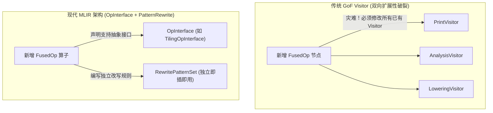

##### 现代 MLIR 的解法：OpInterface + RewritePattern
现代框架放弃了庞大扁平的 Visitor 模式：
1. **OpInterface**：将特定能力（如“是否可分块”、“是否可内存折叠”）抽象为细粒度接口，任何算子只需在外围声明实现该接口，无需修改任何已有分析流程；
2. **RewritePattern**：基于 DAG 拓扑匹配局部算子子图，匹配成功后直接通过 `PatternRewriter` 替换为新指令，算子之间完全隔离解耦。

---

#### 3.3.5 命令模式（Command）

- **传统 GoF 意图**：将一个请求封装为一个对象，从而使你可用不同的请求对客户进行参数化；对请求排队或记录请求日志，以及支持可撤销的操作。
- **编译器映射**：异构硬件执行命令（Command）、命令图（Command Graph）与异步命令缓冲区（Command Buffer）。

##### 架构痛点：CPU 与加速器之间的高昂通信代价
如果 CPU 在完成一次矩阵乘后，立刻同步发信号等待芯片完成，再发下一条 DMA 搬运指令，CPU-Device 之间的 PCI-e/AXI 总线往返通信延迟将彻底吃光硬件性能。

必须将所有的硬件动作（数据搬运、核函数启动、事件等待）抽象为离散的 **Command 对象**，打包放入内存中的连续缓冲区中：

```cpp
#include <iostream>
#include <vector>
#include <variant>
#include <cstdint>

// 现代 C++：使用 std::variant 表达高效紧凑、零堆分配的命令集
struct DmaCopyCommand {
    uint64_t srcDdr;
    uint32_t dstSram;
    size_t bytes;
};

struct LaunchKernelCommand {
    uint32_t kernelId;
    uint32_t gridDimX;
    uint32_t sramBase;
};

struct WaitEventCommand {
    uint32_t eventSlotId;
};

// 聚合类型：异构硬件命令
using HardwareCommand = std::variant<DmaCopyCommand, LaunchKernelCommand, WaitEventCommand>;

// 命令缓冲区：将构建期与执行期彻底解耦
class CommandBuffer {
public:
    void record(HardwareCommand cmd) {
        commands_.push_back(cmd);
    }

    void submitToDevice() {
        std::cout << ">>> 一次性批量提交 " << commands_.size() << " 条硬件命令至底层驱动 <<<\n";
        for (const auto& cmd : commands_) {
            // 使用 std::visit 进行极致优化的模式匹配
            std::visit([](auto&& arg) {
                using T = std::decay_t<decltype(arg)>;
                if constexpr (std::is_same_v<T, DmaCopyCommand>) {
                    std::cout << "  [HW-CMD] 启动 DMA 异步搬运: " << arg.bytes << " 字节\n";
                } else if constexpr (std::is_same_v<T, LaunchKernelCommand>) {
                    std::cout << "  [HW-CMD] 触发核心并行计算 KernelID=" << arg.kernelId << "\n";
                } else if constexpr (std::is_same_v<T, WaitEventCommand>) {
                    std::cout << "  [HW-CMD] 硬件阻塞等待事件槽: " << arg.eventSlotId << "\n";
                }
            }, cmd);
        }
    }

private:
    std::vector<HardwareCommand> commands_;
};
```

---

#### 3.3.6 状态模式（State）

- **传统 GoF 意图**：允许一个对象在其内部状态改变时改变它的行为。对象看起来似乎修改了它的类。
- **编译器映射**：异构执行任务（Invocation / Task）生命周期有限状态机（FSM）。

##### 架构灾难：布尔标志位爆炸（Boolean Flag Hell）
在初级驱动与运行时代码中，常能看到类似下面的灾难定义：

```cpp
// 糟糕的状态维护方式
struct BadTask {
    bool isSubmitted;
    bool isDmaFinished;
    bool isKernelRunning;
    bool isCompleted;
    bool hasError;
    // 状态之间存在隐含的依赖约束，并发环境下维护极易产生死锁或竞态条件！
};
```

##### 状态机的合法转换闭环
一个高可靠的异构任务生命周期状态转换必须是严格单向闭环的：

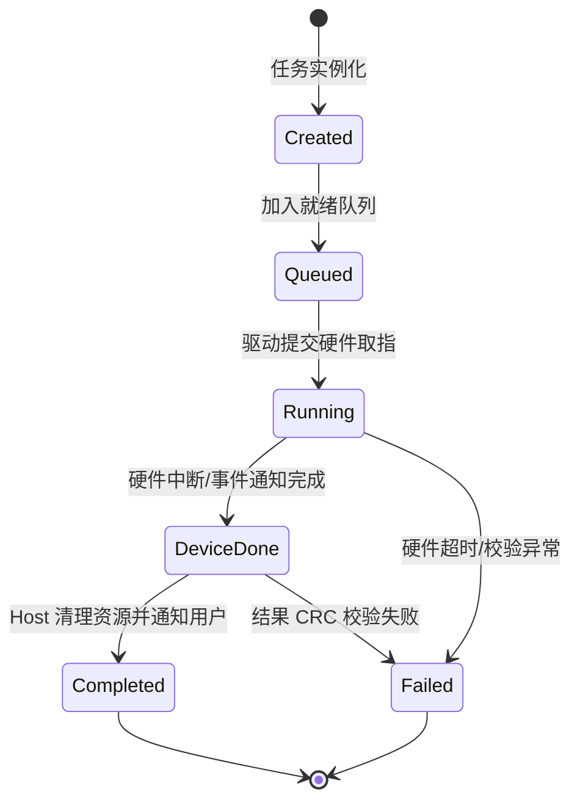

通过状态机模式，对象只允许沿预设的合法边缘发生跃迁，在 `Created` 状态下调用 `handleInterrupt()` 会被类型断言直接拦截，彻底消灭非法状态组合。

---

#### 3.3.7 观察者模式（Observer）

- **传统 GoF 意图**：定义对象间的一种一对多的依赖关系，当一个对象的状态发生改变时，所有依赖于它的对象都得到通知并被自动更新。
- **编译器映射**：异构执行完成事件总线、Pass 运行监控追踪。

##### 架构铁律：观察者绝对不能拥有“状态真相”
在异步 Runtime 中，硬件加速器通常通过中断控制器触发完成通知。
Runtime 的 `EventBroadcaster` 会将这一事件分发给多个观察者：
1. **内存释放器（MemoryReclaimer）**：解除对输入张量片上显存的锁定；
2. **性能剖析器（Profiler）**：记录微秒完成时间戳；
3. **上层 Future 对象**：唤醒用户态等待线程。

> [!WARNING]
> **观察者的常见架构陷阱**：
> 1. **状态污染**：某些观察者在接收到通知后，擅自修改任务的状态机，引发多观察者执行次序依赖！**状态转移必须由核心状态机主导，观察者只读消费。**
> 2. **回调死锁**：在持有全局分发器互斥锁的同时同步调用观察者的回调函数，而观察者内部又试图去获取另一把锁，瞬间导致跨线程死锁。**通知应当尽可能无锁化或将事件投递至异步无锁队列。**

---

#### 3.3.8 中介者模式（Mediator）

- **传统 GoF 意图**：用一个中介对象来封装一系列的对象交互。中介者使各对象不需要显式地相互引用，从而使其耦合松散，而且可以独立地改变它们之间的交互。
- **编译器映射**：NPU 多硬件引擎协调调度器（ExecutionScheduler）。

##### 架构痛点：多引擎网状强耦合
在复杂 NPU 内部，通常并存着：**DMA 控制器、Score 矩阵计算核心、RVV 向量计算核心、片上 Scratchpad 内存管理器**。
如果它们之间直接相互调用：
- DMA 传输完直接去触发 Score；
- Score 算完直接通知 RVV 向量核做激活函数；
- RVV 算完直接去通知 DMA 写回 DDR...
系统将沦为一张错综复杂的网状依赖图，一旦增加一个新硬件核心，所有其他核心代码全部要修改！

##### C++20 工程实现：星形拓扑调度中介者

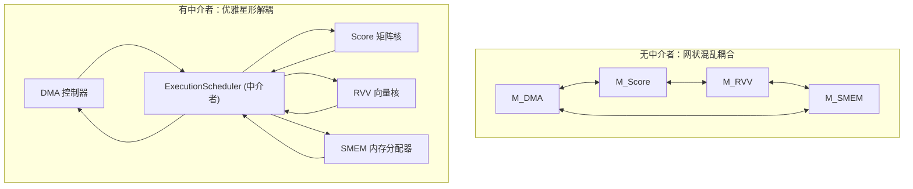

通过引入中介者 `ExecutionScheduler`，各个硬件引擎只需要在完成工作时向调度器报告 `onEngineIdle(EngineType)`，由调度器根据任务 DAG 的拓扑状态统一协调下一条指令下发与片上内存的释放，使系统退化为优雅的星形拓扑。

---

#### 3.3.9 备忘录模式（Memento）

- **传统 GoF 意图**：在不破坏封装性的前提下，捕获一个对象的内部状态，并在该对象之外保存这个状态。这样以后就可将该对象恢复到原先保存的状态。
- **编译器映射**：探索式编译优化、自动调优搜索中的 IR 状态快照与回滚机制。

在编译器的激进优化搜索中，Pass 尝试对循环进行大步长展开（Unroll）。展开后进行寄存器压力分析，如果发现寄存器发生严重的溢出（Spilling，不得不将寄存器写回低速显存），则该优化的收益为负数。
通过 `IRSnapshotMemento`，编译器可以在尝试优化前捕获一份轻量级的 IR 状态树；一旦评估失败，瞬间执行原位状态回滚，无需重新从源 DSL 开始解析。

---

#### 3.3.10 迭代器模式（Iterator）

- **传统 GoF 意图**：提供一种方法顺序访问一个聚合对象中各个元素，而又无须暴露该对象的内部表示。
- **编译器映射**：AST 遍历、MLIR Block 内 Operation 链表迭代、调度 DAG 拓扑排序迭代。

在编译管线中，我们不仅需要对平坦的指令序列进行线性迭代，更需要提供跨层级的特殊迭代视图：
- **过滤迭代器（Filter Iterator）**：在遍历 Block 时，自动跳过所有无副作用的类型定义指令，只产出计算密集型算子；
- **逆序拓扑迭代器（Reverse Topological Iterator）**：专门为活跃变量区间分析（Liveness Analysis）提供逆向数据流遍历。

---

#### 3.3.11 解释器模式（Interpreter）

- **传统 GoF 意图**：给定一个语言，定义它的文法的一种表示，并定义一个解释器，这个解释器使用该表示来解释语言中的句子。
- **编译器映射**：算子 DSL 解释器；以及**编译器中极其关键的“黄金参考解释器（Reference Interpreter）”**。

##### 为什么 AI 编译器工程必须拥有 Reference Interpreter？
在异构硬件芯片开发中，当一个大型神经网络的推理结果出现数值偏差（如第 47 层 Transformer 输出 NaN 或精度下降 5%）时，硬件工程师和编译器工程师往往互相扯皮：
- 编译器工程师认为是芯片硬件乘法器精度丢失或指令偶发错乱；
- 硬件工程师认为是编译器 Tiling 切分逻辑越界或内存对齐错误。

彻底终结扯皮的终极武器，就是在编译器内部集成一个**黄金参考解释器**：
输入完全相同的中间 IR，使用经过严密单测的 CPU 高精度数学库执行纯算术解释，输出一份标准的“黄金张量（Golden Tensor）”。一旦与真机执行结果比对发生偏差，能以纳秒级精度定位出到底在第几个指令周期发生了计算偏移！

---

## 四、超越 GoF：异构计算与 AI 编译器的 10 大硬件感知高并发模式

GoF 模式诞生于传统面向对象桌面软件与商业系统的时代。在异构计算、微架构优化与高并发硬件加速领域，现代系统级软件提炼出了一套**超越传统 GoF 范畴的硬件感知高性能计算模式**。

---

### 4.1 双缓冲流水线模式（Double Buffering / Ping-Pong Buffer）

- **硬件挑战**：加速芯片片上高速存储（SRAM）容量极度珍贵（通常仅有数兆字节），无法放下整层大型特征图。每次从外部低速大内存（DDR/HBM）搬运数据到片上，计算核心都不得不挂起等待，导致计算硬件严重饥饿。
- **模式解法**：在片上 SRAM 中开辟两块等大的缓冲区（Buffer 0 和 Buffer 1）。利用 DMA 硬件引擎与计算核心的独立异步性，让数据搬运与数学计算在时钟周期上完全重叠展开。

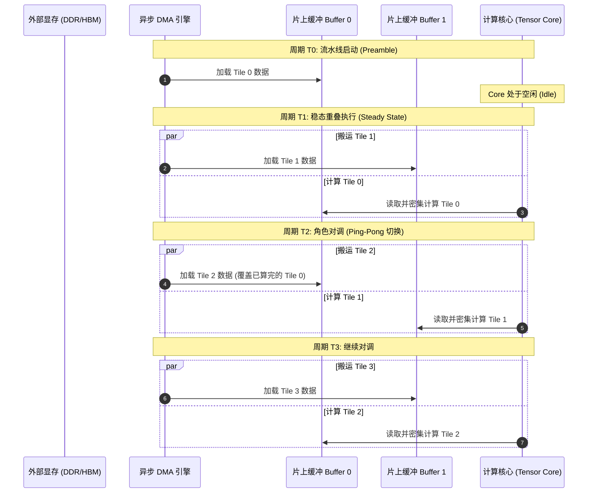

> [!IMPORTANT]
> **延迟完全掩盖的充要条件**：若单块数据的搬运耗时 $t_{\text{dma}} \le$ 计算核心的单块计算耗时 $t_{\text{compute}}$，则外部内存的数据搬运延迟被 **100% 完全掩盖**！计算硬件的有效算力利用率（Utilization）可逼近理论峰值。

---

### 4.2 数据流驱动执行模式（Dataflow DAG Execution）

- **硬件挑战**：传统的 Host 端命令发射采用固定的线性顺序（Sequential Launch）。一旦某个算子因外部内存总线拥塞出现时钟停顿，后续哪怕与之完全没有数据依赖的算子也会被全部阻塞在 CPU 发射队列中。
- **模式解法**：废弃线性发射，将计算网络建模为有向无环图（DAG）。每个任务节点维护一个**未就绪前驱计数器（Dependency Counter）**。一个任务在硬件上执行完成后，自动广播触发后继节点的计数器递减；当某个节点的未就绪计数器归零时，该节点无缝自动进入硬件就绪队列，实现异构多核心的最大并发吞吐。

---

### 4.3 命令缓冲机制（Command Buffer）

- **硬件挑战**：CPU 向设备驱动提交单条硬件执行指令的系统调用开销（Context Switch）通常在微秒（$\mu s$）级，而芯片加速核心执行一个微型算子往往只需数百纳秒（$ns$）。CPU 交互延迟成为了系统的绝对吞吐瓶颈。
- **模式解法**：将构建期（Recording Phase）与执行期（Submission Phase）彻底解耦。
  1. **录制阶段**：CPU 在用户态的一段紧凑连续内存空间内，将成千上万条硬件配置、DMA 请求与核函数启动参数以纯二进制结构体形式线性排布；
  2. **提交阶段**：通过单次调用（一次 IOCTL 或硬件环形队列提交），直接将包含整张图的连续 Command Buffer 批量移交芯片硬件引擎自主读取执行。

---

### 4.4 内存排布模式：AoS 到 SoA 的向量化重构

- **硬件挑战**：加速器访存的物理定律——**内存总线以缓存行（Cache Line，通常 64 或 128 字节）为最小粒度突发传输**。若同一个 Warp/向量单元内的线程访问离散跨步地址，会导致严重的访存放大与性能暴跌。
- **模式解法**：
  - **AoS（Array of Structures，阵列结构体）**：如 `struct TensorPoint { float x, y, z, w; } points[N];`。当向量指令需要连续加载 128 个点的 `x` 坐标时，每次总线传输的 64 字节中只有 4 字节是有效数据，有效带宽利用率仅有 25%！
  - **SoA（Structure of Arrays，结构体阵列）**：重构为 `struct TensorPointCollection { float x[N]; float y[N]; float z[N]; float w[N]; };`。此时加载 `x` 坐标时，所有相邻数据在物理内存上严格连续紧密排列，硬件实现极致的**访存合并（Coalesced Memory Access）**，吞吐量提升数倍。

```
【AoS 内存排布 (非合并访存)】
[ x0 y0 z0 w0 ] [ x1 y1 z1 w1 ] [ x2 y2 z2 w2 ]  --> 读 x 产生大跨步，带宽浪费 75%

【SoA 内存排布 (合并访存)】
[ x0 x1 x2 x3 x4 x5 x6 x7 ... ]  --> 连续合并加载，内存带宽 100% 满速打满！
```

---

### 4.5 循环分块优化模式（Tiling / Loop Blocking）

- **硬件挑战**：多维张量乘法的数学复杂度为 $O(N^3)$，而数据量为 $O(N^2)$。若直接三层嵌套循环，缓存命中率趋近于零，算力完全受制于内存“内存墙（Memory Wall）”。
- **模式解法**：建立多层次的分块映射：
  1. **Grid Tile（网格分块）**：切分成粗粒度大块，分发给芯片的不同计算集群（SM / Core）；
  2. **Block / Warp Tile（核心分块）**：切分成适配片上高速 SRAM（如 64KB/128KB）的中粒度块，确保数据被反复复用数十次；
  3. **Thread / Register Tile（寄存器分块）**：切分成极细粒度块（如 $8 \times 8$），直接钉在硬件物理寄存器文件中进行密集乘加运算。

---

### 4.6 算子融合模式（Kernel Fusion）

- **硬件挑战**：在神经网络中，算子序列 `Conv2d -> BiasAdd -> ReLU -> ResidualAdd` 频繁出现。传统未融合实现中，每一个算子都必须将计算结果完整刷写回慢速外部显存（DDR），下一个算子再重新读回，引发高达 4 次的显存往返读写。
- **模式解法**：在编译器图优化阶段识别融合模式，将上述四个算子合并为一个单一的复合计算核心。`Conv2d` 在片上寄存器计算出的中间值，直接作为输入喂给 `BiasAdd` 与 `ReLU`，只在最后一步才将最终结果写回显存，显存往返带宽消耗削减 75% 以上！

---

### 4.7 流水线指令级展开模式（Pipeline Parallelism）

- **硬件挑战**：现代硬件的浮点乘累加单元（FMA）通常具备多级内部执行流水线（如 4~8 个周期延迟）。如果在循环中前一条指令的结果立即被下一条指令作为操作数使用，硬件将发生漫长的**数据冒险停顿（Data Hazard Stall）**。
- **模式解法**：编译器通过激进的循环展开（Loop Unrolling）与指令调度重排，交替发射多个不相关的独立累加寄存器（如累加器 Accumulator 0 到 Accumulator 7），使得后一条指令无需等待前一条指令写回，无缝塞满算术逻辑单元（ALU）的内部时钟流水线。

---

### 4.8 工作窃取调度模式（Work Stealing）

- **硬件挑战**：在复杂动态形状（Dynamic Shape）或稀疏张量计算中，不同线程块/计算核心的任务执行耗时差异巨大（发生严重的计算长尾）。静态分配任务会导致部分核心早已闲置，而另一部分核心仍在漫长运算。
- **模式解法**：每个异构计算队列拥有独立的双端队列（Deque）。本地工作线程以 LIFO（后进先出，缓存亲和性极高）从队头提取任务；当自身队列为空时，转变为“窃取者”，以 FIFO（先进先出，减少锁冲突）从其他繁忙线程队列的队尾原子窃取任务，达成极致的动态负载均衡。

---

### 4.9 内存池模式（Memory Pool）

- **硬件挑战**：在异构设备端，频繁通过底层驱动向操作系统申请/释放设备显存（如 `devMalloc` / `devFree`）是极其沉重的同步操作，会导致驱动全局互斥锁争用、设备虚实页表频繁置换，甚至引发微秒级的全局管道停顿。
- **模式解法**：在 Runtime 启动时预先向底层一次性申请大块物理显存，上层系统通过显存池（Memory Pool / Block Pool）在用户态自主管理。针对不同尺寸的临时张量，直接按 2 的幂次方划分到不同的空闲链表（Free List）中秒级借调，归还时只打上可用标记，实现零系统调用开销。

---

### 4.10 区域内存分配器（Arena / Bump Allocator）

- **硬件挑战**：在编译器运行一个复杂的优化 Pass（如 IR 遍历与重写）期间，系统会高频创建数以百万计的临时轻量级对象（如 Operation 节点、临时变量、操作数封装）。若频繁调用标准库的 `malloc` / `new`，堆内存碎片化与元数据开销将彻底拖垮编译速度。
- **模式解法**：预先开辟一块连续内存缓冲区（Arena）。分配对象时，仅仅将游标指针（Bump Pointer）向前移动对应的字节数并进行内存对齐，分配开销仅相当于一条单周期的汇编加法指令！当整个 Pass 执行结束时，直接将游标指针归零，整块内存瞬间完成批量重置，完全消除了百万个小对象逐一调用析构函数的开销。

---

## 五、四大工业级深度实践案例（Case Studies）

### 5.1 案例一：NPU 自定义硬件寄存器配置系统设计（Adapter + Builder + Command 协同）

#### 痛点回顾：初学者最容易写出的“反模式大杂烩”
在很多初创硬件团队中，控制寄存器配置代码常常写成如下惨状：

```cpp
// 典型的严重耦合反模式：语义、规划、物理地址与驱动完全混杂
void configureAndRunHardware(float* A, float* B, float* C, int M, int N, int K) {
    // 1. 语义与规划硬编码
    int tile = 64;
    // 2. 硬件寄存器偏移与位运算硬编码
    uint32_t reg0 = (M / tile) << 16 | (N / tile);
    uint32_t reg1 = 0x80000000 | (64); // 假设最高位是使能位
    // 3. 物理地址计算硬编码
    uint32_t sramBase = 0x1000;
    // 4. 底层 MMIO 驱动直接写调用
    *(volatile uint32_t*)(0x40000000 + 0x00) = reg0;
    *(volatile uint32_t*)(0x40000000 + 0x04) = reg1;
    *(volatile uint32_t*)(0x40000000 + 0x08) = sramBase;
}
```

上述代码只要硬件微架构稍有调整（比如使能位从最高位改到第 0 位、寄存器基地址变更、或者单测需要在无硬件的开发机上运行），整个系统立即瘫痪。

#### 架构解法：严格隔离四大职责
通过模式组合，将流程严格划分为四个单向解耦的层次：
1. **语义定义（Semantic）**：纯数学意图表达；
2. **执行规划（Planner）**：结合代价模型决策 Tile 尺寸与内存偏移；
3. **程序构建（Builder）**：校验硬件物理约束（对齐、容量），组装逻辑硬件命令对象；
4. **编码与传输（Encoder & Transport）**：纯数学位运算编码，并通过适配器根据实际环境（MMIO / ACE 批处理 / Mock 单测桩）无感下发。

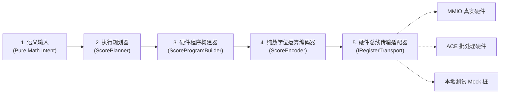

#### 完整 C++20 工程实现代码

```cpp
#include <iostream>
#include <vector>
#include <memory>
#include <cstdint>
#include <stdexcept>
#include <iomanip>

// ==========================================
// 1. 领域模型：逻辑硬件寄存器与命令抽象
// ==========================================
struct RegisterWord {
    uint32_t offset;
    uint32_t value;
};

struct ScoreProgram {
    uint32_t loopIterations;
    uint32_t sramSrcOffset;
    uint32_t sramDstOffset;
    uint32_t modeFlags;
};

// ==========================================
// 2. 构建器模式：负责装配并强制硬件约束断言
// ==========================================
class ScoreProgramBuilder {
public:
    ScoreProgramBuilder& setLoopIterations(uint32_t iters) {
        if (iters == 0 || iters > 65535) {
            throw std::invalid_argument("硬件约束异常：循环展开次数必须在 1~65535 范围内！");
        }
        prog_.loopIterations = iters;
        return *this;
    }

    ScoreProgramBuilder& setSramBuffers(uint32_t src, uint32_t dst) {
        // 硬件物理约束：片上 SRAM 地址必须严格 64 字节对齐
        if ((src % 64 != 0) || (dst % 64 != 0)) {
            throw std::invalid_argument("硬件约束异常：SRAM 缓冲区地址必须严格 64 字节对齐！");
        }
        if (src >= 256 * 1024 || dst >= 256 * 1024) {
            throw std::out_of_range("硬件约束异常：SRAM 寻址超出 256KB 物理容量！");
        }
        prog_.sramSrcOffset = src;
        prog_.sramDstOffset = dst;
        return *this;
    }

    ScoreProgramBuilder& enableDoubleBuffering(bool enable) {
        if (enable) prog_.modeFlags |= (1U << 0);
        else        prog_.modeFlags &= ~(1U << 0);
        return *this;
    }

    ScoreProgram build() {
        if (prog_.loopIterations == 0) {
            throw std::logic_error("非法构建：未配置任何有效循环次数！");
        }
        return prog_;
    }

private:
    ScoreProgram prog_{0, 0, 0, 0};
};

// ==========================================
// 3. 纯计算编码器：绝对不调用任何系统 API 或硬件驱动
// ==========================================
class ScoreEncoder {
public:
    // 纯函数（Pure Function）：给定输入，产生绝对确定的物理寄存器序列
    static std::vector<RegisterWord> encode(const ScoreProgram& prog) {
        std::vector<RegisterWord> words;
        words.reserve(4);

        // 寄存器 0x00: 控制与模式使能
        words.push_back({0x00, prog.modeFlags | 0x80000000U /* 芯片使能位 */});
        // 寄存器 0x04: 循环迭代控制
        words.push_back({0x04, prog.loopIterations});
        // 寄存器 0x08: 源地址
        words.push_back({0x08, prog.sramSrcOffset});
        // 寄存器 0x0C: 目的地址
        words.push_back({0x0C, prog.sramDstOffset});

        return words;
    }
};

// ==========================================
// 4. 适配器模式：硬件传输驱动解耦
// ==========================================
class IRegisterTransport {
public:
    virtual ~IRegisterTransport() = default;
    virtual void transmit(const std::vector<RegisterWord>& words) = 0;
};

// 适配实现 A：用于单元测试的 Mock 传输桩（开发机无硬件即可一键跑单测）
class MockRegisterTransport : public IRegisterTransport {
public:
    void transmit(const std::vector<RegisterWord>& words) override {
        std::cout << "[Mock 桩测试] 成功拦截到 " << words.size() << " 个寄存器写操作:\n";
        for (const auto& w : words) {
            std::cout << "  -> 偏移 0x" << std::hex << std::setw(2) << std::setfill('0') << w.offset 
                      << " <= 数据 0x" << std::setw(8) << w.value << std::dec << "\n";
        }
    }
};

// 适配实现 B：面向 ACE 突发传输协议的高并发驱动适配器
class AceBatchTransportAdapter : public IRegisterTransport {
public:
    void transmit(const std::vector<RegisterWord>& words) override {
        std::cout << "[ACE 总线驱动] 组装原子突发包 (Atomic Burst Packet)，单词数量: " 
                  << words.size() << "，一次性直发物理总线。\n";
    }
};
```

---

### 5.2 案例二：高可靠异构运行时（Async Runtime）设计（Command + State + Observer 协同）

#### 痛点回顾：异步并发执行中的状态竞争与假死
异构系统中的任务执行是全异步的：Host 端 CPU 下发任务后，Device 端 GPU/NPU 通过硬件调度队列运行。
初学者常犯的错误是将任务提交直接等同于执行完成，或者使用无锁的简单标志位维护状态，导致：
1. **Host 提前释放了仍在被底层 NPU 硬件读取的片外内存，造成数据错乱甚至操作系统内核 Panic**；
2. **硬件超时未响应时，状态无法优雅降级与资源解绑，系统彻底死锁**。

#### 完整 C++20 工程实现代码

```cpp
#include <iostream>
#include <memory>
#include <vector>
#include <mutex>
#include <functional>
#include <string>

// ==========================================
// 1. 状态模式：定义任务生命周期的严格有限状态机
// ==========================================
enum class TaskState {
    Created,
    Queued,
    Running,
    DeviceDone,
    Completed,
    Failed
};

// 状态转字符串工具（方便调试日志）
inline const char* to_string(TaskState s) {
    switch(s) {
        case TaskState::Created: return "Created";
        case TaskState::Queued: return "Queued";
        case TaskState::Running: return "Running";
        case TaskState::DeviceDone: return "DeviceDone";
        case TaskState::Completed: return "Completed";
        case TaskState::Failed: return "Failed";
    }
    return "Unknown";
}

// ==========================================
// 2. 观察者模式：监听任务生命周期事件
// ==========================================
class ITaskLifecycleObserver {
public:
    virtual ~ITaskLifecycleObserver() = default;
    virtual void onStateChanged(uint64_t taskId, TaskState oldState, TaskState newState) = 0;
};

// ==========================================
// 3. 核心实体：受保护的异步计算任务 (Command + State Machine)
// ==========================================
class AsyncTaskInvocation {
public:
    explicit AsyncTaskInvocation(uint64_t id, std::string taskName)
        : id_(id), name_(std::move(taskName)), state_(TaskState::Created) {}

    uint64_t getId() const noexcept { return id_; }
    TaskState getState() const noexcept {
        std::lock_guard<std::mutex> lock(mutex_);
        return state_;
    }

    void addObserver(std::shared_ptr<ITaskLifecycleObserver> obs) {
        std::lock_guard<std::mutex> lock(mutex_);
        observers_.push_back(obs);
    }

    // 原子状态跃迁驱动（强制合法转换校验）
    void transitionTo(TaskState target) {
        std::vector<std::shared_ptr<ITaskLifecycleObserver>> observersCopy;
        TaskState oldState;
        {
            std::lock_guard<std::mutex> lock(mutex_);
            oldState = state_;
            
            // 状态合法性断言
            if (!isValidTransition(oldState, target)) {
                std::cerr << "致命状态机错误：禁止从 " << to_string(oldState) 
                          << " 跃迁至 " << to_string(target) << "\n";
                return;
            }
            state_ = target;
            observersCopy = observers_; // 拷贝观察者列表，释放锁后再通知，坚决避免死锁！
        }

        // 通知观察者（在锁外通知，避免死锁）
        for (const auto& obs : observersCopy) {
            obs->onStateChanged(id_, oldState, target);
        }
    }

private:
    bool isValidTransition(TaskState from, TaskState to) const noexcept {
        if (from == TaskState::Created && to == TaskState::Queued) return true;
        if (from == TaskState::Queued && to == TaskState::Running) return true;
        if (from == TaskState::Running && to == TaskState::DeviceDone) return true;
        if (from == TaskState::DeviceDone && to == TaskState::Completed) return true;
        // 任何非终态都可以转向 Failed 异常态
        if (to == TaskState::Failed && from != TaskState::Completed) return true;
        return false;
    }

    uint64_t id_;
    std::string name_;
    TaskState state_;
    mutable std::mutex mutex_;
    std::vector<std::shared_ptr<ITaskLifecycleObserver>> observers_;
};

// 具体观察者：自动内存回收器
class AutoMemoryReclaimer : public ITaskLifecycleObserver {
public:
    void onStateChanged(uint64_t taskId, TaskState, TaskState newState) override {
        if (newState == TaskState::Completed || newState == TaskState::Failed) {
            std::cout << "  [内存回收器] 收到任务 " << taskId 
                      << " 终态通知，安全释放关联的片上 SRAM 与主机显存映射锁！\n";
        }
    }
};
```

---

### 5.3 案例三：基于 MLIR 的优雅方言 Lowering 体系设计

#### 警惕工业界大坑：“属性堆叠反模式”（Attributes Everywhere Trap）
许多团队在刚刚接触 MLIR 时，没有理解 MLIR 的分层方言哲学，写出了如下严重恶化的架构代码：
- **Pass 1 (Tiling Pass)**：不改变任何 IR 结构，只在原生的 `linalg.matmul` 上打上字符串属性 `op->setAttr("tile_m", 64)`；
- **Pass 2 (Memory Pass)**：继续在同一个算子上打属性 `op->setAttr("sram_offset", 0x1000)`；
- **Pass 3 (Register Pass)**：继续打属性 `op->setAttr("reg_binding", 5)`；
- **Pass 4 (Final Pass)**：写一个拥有两千行代码的超级 Pass，读取上述所有属性，并在最后一步“神奇地直接下沉为底层机器码”。

> [!CAUTION]
> **为什么“属性堆叠”是灾难性的？**
> 1. **隐式契约不可见**：后续的优化 Pass 根本不知道前面的 Pass 打了哪些字符串属性，类型系统无法做任何静态检查；
> 2. **优化失效与属性丢失**：一旦中间的标准 Pass（如死代码消除、循环重排）克隆或替换了节点，这些非标准属性瞬间全部丢失；
> 3. **破坏单测工具链**：无法使用标准的 `mlir-opt` 工具对中间任何一个阶段进行独立的 FileCheck 单测断言。

#### 架构正道：明确定义三层自包含方言（Dialect Hierarchy）
每一层都必须有自己清晰的抽象边界与合法的 Operation 语法：

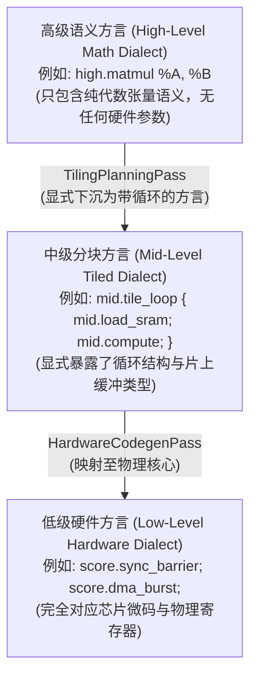

在每一层，开发者都可以独立将 IR dump 到磁盘，并通过文本比对验证当前层的优化逻辑是否正确，这才是现代编译器高内聚、易测试的架构真谛。

---

### 5.4 案例四：端到端可运行的轻量级 C++20 行为型模式组合工程

以下展示一个完全合法的、可直接在任何支持 C++20 的主流编译器（GCC 11+ / Clang 13+）中独立编译运行的完整微型异构调度与编译流水线：

```cpp
#include <iostream>
#include <vector>
#include <memory>
#include <string>
#include <variant>

// 1. 硬件命令表示 (Command Variant)
struct DmaOp   { std::string tensor; size_t bytes; };
struct ScoreOp { std::string kernel; uint32_t tiles; };
struct SyncOp  { uint32_t barrierId; };
using PlanCmd  = std::variant<DmaOp, ScoreOp, SyncOp>;

// 2. 职责链模式：硬件候选执行器
class IExecutor {
public:
    virtual ~IExecutor() = default;
    void setNext(std::shared_ptr<IExecutor> n) { next_ = n; }
    void run(const PlanCmd& cmd) {
        if (!tryExecute(cmd) && next_) {
            next_->run(cmd);
        }
    }
protected:
    virtual bool tryExecute(const PlanCmd& cmd) = 0;
    std::shared_ptr<IExecutor> next_;
};

class DmaExecutor : public IExecutor {
protected:
    bool tryExecute(const PlanCmd& cmd) override {
        if (auto* dma = std::get_if<DmaOp>(&cmd)) {
            std::cout << "  [DMA 控制器] 执行张量 " << dma->tensor 
                      << " 搬运，容量: " << dma->bytes << " 字节\n";
            return true;
        }
        return false;
    }
};

class ScoreExecutor : public IExecutor {
protected:
    bool tryExecute(const PlanCmd& cmd) override {
        if (auto* score = std::get_if<ScoreOp>(&cmd)) {
            std::cout << "  [Score 核心] 执行专用核计算: " << score->kernel 
                      << " 分块数: " << score->tiles << "\n";
            return true;
        }
        return false;
    }
};

class SyncExecutor : public IExecutor {
protected:
    bool tryExecute(const PlanCmd& cmd) override {
        if (auto* sync = std::get_if<SyncOp>(&cmd)) {
            std::cout << "  [硬件同步器] 等待屏障 ID=" << sync->barrierId << " 释放\n";
            return true;
        }
        return false;
    }
};

// 3. 顶层驱动总控
int main() {
    std::cout << "====================================================\n";
    std::cout << "  现代 C++20 异构计算行为型模式协同演示引擎启动\n";
    std::cout << "====================================================\n\n";

    // 组装命令流 (Command Buffer)
    std::vector<PlanCmd> cmdPipeline;
    cmdPipeline.push_back(DmaOp{"WeightMatrix", 1024 * 1024});
    cmdPipeline.push_back(ScoreOp{"GEMM_Tile_64x64", 16});
    cmdPipeline.push_back(SyncOp{0});

    // 装配执行职责链 (Chain of Responsibility)
    auto dmaExec   = std::make_shared<DmaExecutor>();
    auto scoreExec = std::make_shared<ScoreExecutor>();
    auto syncExec  = std::make_shared<SyncExecutor>();

    dmaExec->setNext(scoreExec);
    scoreExec->setNext(syncExec);

    // 批量分发执行
    for (size_t i = 0; i < cmdPipeline.size(); ++i) {
        std::cout << ">>> 正在调度第 [" << i + 1 << "] 条硬件指令 <<<\n";
        dmaExec->run(cmdPipeline[i]);
    }

    std::cout << "\n流水线全链路执行成功，演示结束。\n";
    return 0;
}
```

---

## 六、工业级 NPU/GPU 编译器工程目录结构与分层契约

### 6.1 标准工程目录组织设计

一个经受过大规模团队协同与多款芯片迭代检验的异构编译与运行时系统，其代码仓库的目录树应当呈现清晰的单向依赖拓扑：

```
npu_compiler_system/
├── include/
│   ├── common/             # 通用基础工具（状态机、错误码、断言宏）
│   ├── frontend/           # 计算图解析与前端 DSL 抽象语法树定义
│   ├── dialect/            # 核心 MLIR 方言定义（High/Mid/Low 层级划分）
│   │   ├── HighLevelOps.td # 纯数学张量算子表声明
│   │   ├── MidTiledOps.td  # 显式暴露 Tile 循环与片上缓冲的方言
│   │   └── NpuHardwareOps.td # 对应底层物理指令的方言
│   ├── transforms/         # 编译器优化 Passes（Tiling, Fusion, MemoryPlanning）
│   ├── backend/            # 目标代码生成（PlanBuilder, InstructionEncoder）
│   ├── runtime/            # 异构异步运行时（CommandBuffer, TaskFSM, Scheduler）
│   └── driver/             # 硬件适配层（IRegisterTransport, MmioAdapter, AceAdapter）
├── src/
│   ├── dialect/
│   ├── transforms/
│   │   ├── TilingStrategy.cpp     # 策略模式具体算法实现
│   │   └── RewritePatterns.cpp    # 可插拔的模式改写集
│   ├── backend/
│   │   ├── ScorePlanBuilder.cpp   # 构建器与硬件合法性断言
│   │   └── ScoreEncoder.cpp       # 纯数学位运算编码器
│   ├── runtime/
│   │   ├── AsyncInvocation.cpp    # 状态机与任务生命周期
│   │   └── ExecutionScheduler.cpp # 中介者多引擎调度
│   └── driver/
│       ├── LegacyMmioAdapter.cpp  # 旧版 MMIO 胶水适配器
│       └── AceBatchAdapter.cpp    # 现代 ACE 突发传输适配器
└── tests/
    ├── unittests/          # 基于 Mock 的轻量级单测（无须物理加速芯片）
    │   ├── test_builder_assertions.cpp
    │   └── test_pure_encoder.cpp
    ├── golden_tests/       # 纯数学参考解释器对比测试（数值绝对对齐）
    └── system_tests/       # 硬件端到端集成测试（带真实板卡）
```

### 6.2 模块契约与单向依赖约束表

为避免循环依赖（Circular Dependency）与头文件爆炸，各模块必须遵守严格的单向契约：

| 模块名称 | 允许直接包含依赖的下层模块 | 绝对严禁包含的非法依赖 | 职责边界契约 |
| :--- | :--- | :--- | :--- |
| **`frontend`** | `common` | `backend`, `runtime`, `driver` | 仅负责将用户模型解析为通用 IR，对目标芯片一无所知 |
| **`transforms`** | `dialect`, `common` | `driver`, 具体芯片物理寄存器头文件 | 仅依赖抽象的能力契约结构体 `HardwareCaps` 进行图优化 |
| **`backend`** | `dialect`, `common` | `driver`, `runtime` | 负责将低级方言编码为纯二进制命令，不发起任何传输 |
| **`runtime`** | `backend` (仅命令结构), `common` | `transforms`, `frontend` | 负责硬件任务排队、状态机跃迁与多引擎中介协调 |
| **`driver`** | `common` | `transforms`, `dialect` | 纯底层的硬件通信与总线传输，对上层 IR 概念完全不可知 |

---

### 6.3 保证工程质量的七项核心工程实践

1. **黄金数值对齐测试（Golden Reference Tests）**：任何编译下沉改写，必须与纯数学 CPU 解释器逐元素比对数值输出，容差控制在 $10^{-5}$ 以内；
2. **构建器物理断言硬编码（Hard Invariant Assertions in Builder）**：对齐要求、SRAM 物理容量上限、事件槽位界限必须在 `Builder::build()` 中硬编码断言，坚决不允许非法配置流入硬件；
3. **分析与副作用严格隔离（Isolate Analysis from Side-Effects）**：分析 Pass 仅返回只读元数据，修改 IR 的逻辑完全委托给 `PatternRewriter`；
4. **编码器纯函数化（Pure Mathematical Encoders）**：生成机器码或寄存器序列的代码必须是无任何副作用的纯函数，给定相同输入，输出永远逐比特完全一致；
5. **极速 Mock 单测基础设施（Mock-driven Fast Tests）**：硬件传输驱动必须有 Mock 实现，使 95% 的单测可以在无加速卡的轻量级开发机和 CI/CD 流水线上秒级跑通；
6. **分层方言可独立验证（Independently Verifiable Dialects）**：每一层方言必须能通过文本形式 dump，配合 `FileCheck` 工具独立校验语法与结构；
7. **严格显式所有权契约（Explicit Memory Lifetime Contracts）**：通过 RAII 与引用计数管理片上与片外缓冲区生命周期，任务未达终态前严禁解封内存。

---

## 七、避坑指南、重构路线与终极思考

### 7.1 异构计算架构中常见 8 大反模式与化解方案

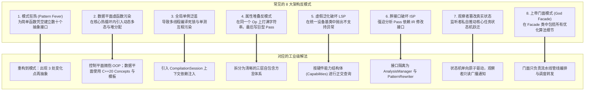

---

### 7.2 真实异构计算工程的 6 步重构指南（Refactoring to Patterns）

如果接手了一个已经存在严重技术债的老旧 NPU 编译器工程，不要试图一夜之间全盘重写！建议按照以下 6 步安全渐进重构：

1. **第一步：剥离纯数学编码器（Pure Encoder）**  
   将混在业务逻辑中的寄存器偏移计算与位运算提取为无任何系统调用的纯函数，为底层单测建立防线。
2. **第二步：抽象硬件传输适配器（IRegisterTransport）**  
   把写物理内存或调用底层 IOCTL 的代码封装进 Adapter，立即实现本地 Mock 单测，使后续重构具备 CI 保护。
3. **第三步：将松散参数重构为带断言的构建器（PlanBuilder）**  
   将漫长的函数入参封装进 Builder，集中建立对齐检查与 SRAM 溢出保护。
4. **第四步：消除级联 if-else，引入 Strategy / Pattern 改写集**  
   将分散在各大函数的算子处理逻辑逐一提取为独立的 RewritePattern，恢复核心流程的开放封闭性。
5. **第五步：取缔全局单例，引入 CompilationSession 上下文**  
   将全局状态收拢至局部会话对象中，为编译器的并发多线程优化扫清障碍。
6. **第六步：为异步 Runtime 建立严格的状态机（State FSM）与中介调度器（Mediator）**  
   彻底清除 `bool isDone` 类标志位，用规范的有限状态机治理硬件异步生命周期。

---

### 7.3 推荐的学习路径（按工程收益而非 GoF 目录）

很多同学学习设计模式，习惯从第 1 种 Factory 机械背诵到第 23 种 Interpreter，结果在真实项目中依然不知道何时出手。在异构计算与编译器领域，**推荐按照“工程收益”由高到低梯次攻克**：

```
梯次一：立竿见影 (解决 80% 的硬件变迁与扩展性痛点)
├── Strategy (可插拔 Tiling 与调度)
├── Adapter  (新老驱动与硬件接口兼容)
└── Builder  (硬件执行计划组装与物理约束强断言)

梯次二：架构筑基 (规范化编译中端管线与内存开销)
├── Template Method (规范化 NVI 下沉流程骨架)
├── Factory Method  (动态注册解耦)
└── Flyweight       (MLIR 级别类型与属性享元唯一定位)

梯次三：并发基石 (驾驭高性能异步运行时与微架构调度)
├── Command   (硬件指令解耦与批量缓冲)
├── State     (多引擎生命周期状态机)
├── Observer  (无死锁事件分发总线)
└── Mediator  (多协处理器星形中介协调)

梯次四：终极升华 (跨入零开销数据平面微架构优化)
├── C++20 Concepts & Policy-based Design
├── CRTP (零虚表编译期多态)
└── SoA / Double Buffering / Arena 内存布局
```

---

### 7.4 评价一个 AI 编译器/异构计算项目设计质量的 6 大终极维度

在经历严谨的模式演进与架构重构后，我们可以通过以下六大客观维度来评价工程的设计质量：

1. **新增算子的边际开发成本**：新增一个注意力算子或融合算子，是否只需新建一个 Pattern 文件并在注册表中添加一行，而**绝对无需改动主 Pass 管道**？
2. **新增硬件架构的适配周期**：支持一款全新硬件加速芯片，高层的图优化、Tiling 算法能否零修改复用？
3. **单元测试的轻量独立性**：能否在没有任何物理芯片的本地开发机甚至云端轻量容器中，秒级运行全量 Pass 逻辑与指令编码单测？
4. **编译期内存占用与吞吐**：数百万节点的计算图下，享元池（Flyweight）与区域分配器（Arena）是否将内存开销稳定压制在可控范围内？
5. **硬件算力打满率（Occupancy & Pipeline Bubbles）**：底层双缓冲流水线与数据流 DAG 调度是否真正掩盖了 DMA 搬运延迟，让硬件乘法器持续满载？
6. **概念清晰度与新人上手门槛**：新加入团队的工程师，是否能在 3 天内理清系统的“语义表达 $\to$ 决策规划 $\to$ 硬件表示 $\to$ 驱动传输”单向数据流？

---

## 结语：在极速硬件与抽象思维的边缘起舞

侯捷老师曾言：**“过犹不及，代码是写给人看的，顺便在机器上运行。”**

在追求极致性能的异构计算领域，这句话应当被赋予更深的理解：
**抽象不是性能的敌人。粗糙、盲目、未加思索的抽象才是性能的死敌；而精准、优雅、契合物理硬件特性的抽象，是我们在复杂多变的计算异构丛林中保持系统高可维护性、高生产力的唯一铠甲。**

愿每一位深耕在 GPU、NPU、TPU 与 AI 编译器系统领域的工程师，都能在严苛的硬件约束与宏大的系统架构之间，找到属于自己的最佳平衡点！
