在开发专用加速处理器或多核嵌入式系统时，从事固件、驱动或系统 Runtime 开发的工程师往往会遇到这样一条来自硬件或架构团队的工程提问：

> **“在当前 EDA 仿真环境中，CTRL 核与 RVV 核的通讯邮箱（如 DDR `0x667000`、`0x668000`）是否已配置为无缓存映射（Uncached）？或者系统是否已通过硬件机制保证了两核间的缓存一致性，且总线支持自然对齐的 32 位原子读写？这决定了我们能否启用真实的消息通信；当前 Runtime 代码必须以此为物理前提。”**

随后，当大家就此展开讨论时，资深硬件工程师或上游负责人可能会给出一条极其简短的指导建议：

> **“全部都用 MMIO 操作，不要使用普通 MEM 操作就可以了。”**

对于初入异构计算与底层系统开发的工程师而言，这一连串术语往往会引发巨大的疑惑：
- 什么是 **CTRL 核** 和 **RVV 核**？它们不都在同一个芯片里吗，为什么往内存写一个数据，另一个核还会“看不见”？
- **EDA 仿真环境** 是什么？为什么同一份代码在仿真器里能跑，做成物理芯片后系统就死锁？
- **无缓存映射（Uncached）** 与 **缓存一致性（Cache Coherence）** 到底在防范什么风险？
- 为什么要强调 **自然对齐的 32 位原子读写**？难道 32 位的数字写入还会缺斤少两？
- 既然 MMIO 的全称叫“内存映射 I/O”，为什么又说它“不是普通内存（MEM）操作”？它们在汇编指令和芯片总线上究竟有何本质区别？

本文将抛开晦涩的纯理论说教，以两核跨内存通信为抓手，自底向上为你彻底揭开**多核内存可见性、微架构缓存机制、弱内存顺序模型以及总线 MMIO 路由**的底层秘密，并最终构建一套工业级可落地的跨核通信协议与驱动架构。

---

## 目录导览

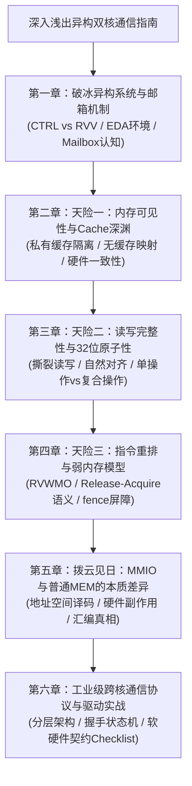

---

## 第一章：破冰异构双核系统与邮箱机制

在正式探讨深奥的微架构机制之前，我们需要先在脑海中建立起芯片硬件宏观拓扑的清晰图像。

### 1.1 核心角色初见：CTRL 核 vs RVV 核

在现代高性能计算芯片与专用 AI 加速器（NPU）架构中，为了兼顾“复杂的流程控制逻辑”与“极高吞吐的数值计算”，芯片往往采用**异构多核架构（Heterogeneous Multi-Core System）**：

> [!NOTE]
> **异构多核（Heterogeneous Multi-Core）**：指单个芯片系统中集成了不同架构类型、不同功能定位的处理器核心。与个人电脑常见的同构核心（所有核结构相同）不同，异构多核通过“专业的人做专业的事”，在能效比和计算密度上实现极致平衡。

在典型的异构加速系统中，通常包含以下两类角色：


- **CTRL 核（Control Core，主控核心）**：通常是通用的标量处理器（如标准的 32 位或 64 位整数处理器）。它就像车间里的**总调度与指挥官**，负责运行操作系统内核、管理外设、解析任务队列、准备算子参数，并负责把重型计算任务派发出去。
- **RVV 核（RISC-V Vector Core，向量计算核心）**：基于开放指令集 **RISC-V** 及其官方 **向量扩展（Vector Extension，简称 RVV）** 构建的专用数据并行处理核心。它拥有宽达数百甚至数千位的向量寄存器（Vector Registers）与多通道并行执行单元（ALU），如同车间里的**重火力精密加工机床**，专职执行卷积、GEMM（矩阵乘法）等大规模数据密集型计算。

### 1.2 什么是 EDA 仿真环境？

在芯片代码中，我们经常看到关于 `EDA` 的注释。为什么在讨论通信前要特别询问 EDA 仿真器？

> [!NOTE]
> **EDA（Electronic Design Automation，电子设计自动化）**：指的是设计、仿真、验证集成电路（IC）全流程的专业软件工具链。在物理芯片真正交付晶圆厂制造流片（Tape-out）之前，系统软件与驱动工程师必须先在 EDA 硬件仿真平台（例如基于 Verilog/SystemVerilog 编写的 RTL 级仿真器，或基于 SystemC/C++ 构建的虚拟原型平台）上运行和调试软件。

必须牢记一个残酷的工程现实：**EDA 仿真器里的行为，并不完全等同于真实硅片芯片！**

许多初级或功能级 EDA 仿真器为了追求仿真运行速度，可能采用了**极其简化的存储模型**：
- 仿真器内部可能只是分配了一块平坦的 C++ 数组来代表内存。
- 两个核心可能直接操作同一个内存指针，**压根没有模拟 CPU 内部的高速缓存（Cache）、总线竞争延迟和弱内存乱序**。
- 这会导致一个致命假象：在 EDA 仿真器中能够完美运行的通信代码，一旦烧录进真实的物理芯片，立刻会因为 Cache 缓存未同步、总线时序错乱而产生死锁或数据混乱。

因此，在编写多核通信代码前，向芯片团队确认“EDA 仿真器目前到底模拟了哪些真实的微架构特性”，是构筑系统软件第一道防线的标准动作。

### 1.3 什么是“邮箱”（Mailbox / Inbox）？

在操作系统中，两个独立进程可以通过共享内存通信；在芯片内部，CTRL 核与 RVV 核两个独立的物理核心，同样依赖共享内存进行信息交互。

> [!NOTE]
> **邮箱机制（Mailbox / Inbox / Outbox）**：这并不是某种特殊的硬件黑盒子，而是一种经典的**通信软件设计模式**。工程师在双方都能访问的共享存储介质（如板载片外 DDR 内存，或片上 SRAM）中，划出一块固定物理地址的缓冲区（例如 `0x667000`）。发送方将指令封包写入其中，接收方从中拾取指令执行，如同在实体邮筒中投递信件。

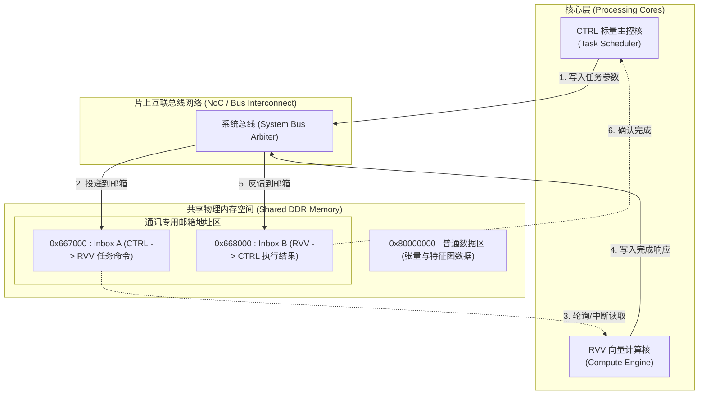

在软件定义中，一个最简单的邮箱数据包结构体如下：

```cpp
// 典型的共享内存邮箱通信协议结构体
struct MailboxMessage {
    uint32_t state;     // 状态标志：0 = 空闲(IDLE), 1 = 就绪(READY), 2 = 处理中(BUSY), 3 = 完成(DONE)
    uint32_t command;   // 算子命令码：例如 0x01 = 向量加法, 0x02 = 矩阵乘法
    uint32_t src_addr;  // 输入张量在物理内存中的起始指针
    uint32_t dst_addr;  // 输出结果在物理内存中的存放指针
    uint32_t length;    // 向量计算元素的总长度
};
```

看起来直截了当对不对？CTRL 核把命令写进 `0x667000`，然后把 `state` 改成 `1`；RVV 核在循环里检测 `state`，一旦发现变成 `1` 就开始算，算完把 `state` 改成 `3`。

如果你认为这就完成了多核通信，那么真实硬件的微架构陷阱很快就会给你上残酷的一课。

---

## 第二章：天险一：内存可见性与 Cache 的深渊

让我们复盘所有底层新手都会经历的“灵异现象”：代码在逻辑上天衣无缝，但 RVV 核无论如何都读不到 CTRL 核发出的新指令，系统仿佛陷入了永远无法跳出的死循环。

### 2.1 你以为的访存 vs 硬件真实的访存

初学者最容易产生的一个思维定势是：**内存就是一个巨大的全局变量板，我写一个数字，它就老老实实呆在那里；你来读这个地址，拿到的就一定是我刚才写的那个数字。**

在带缓存（Cache）的现代处理器上，这个假设完全不成立。

> [!NOTE]
> **Cache（高速缓冲存储器）与 Cache Line（缓存行）**：
> 现代 CPU 核心的运算频率高达数 GHz，执行一条运算只需零点几纳秒；而访问外部 DDR 内存通常需要数十甚至数百个时钟周期（典型的“存储墙”问题）。为了防止 CPU 把 99% 的时间浪费在等内存回应上，芯片设计师在 CPU 核心内部集成了极小但极快的高速 SRAM，称为 Cache。
> 处理器访存并不是单字节操作，而是以 **Cache Line（通常是 32 字节或 64 字节）** 为基本单位将数据成块搬进自己的私有 Cache 中。

### 2.2 致命陷阱：私有 Cache 如何吞噬通信消息？

当两个核心各自拥有独立的私有数据缓存（L1 Data Cache），且系统缺乏同步机制时，灾难发生了：

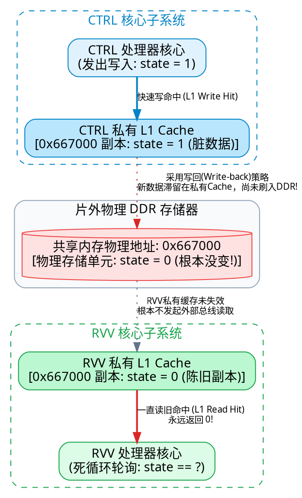

1. **写未穿透**：CTRL 核执行 `*reinterpret_cast<uint32_t*>(0x667000) = 1`。在常见的**写回（Write-Back）**策略下，CPU 发现这行内存在自己的 L1 Cache 里，于是直接修改了私有 Cache 里的数据并标记为“脏（Dirty）”，根本没有第一时间刷写到片外物理 DDR 中！
2. **读未更新**：RVV 核此前也读取过 `0x667000`，这个地址的一份旧副本（`state = 0`）早就静静躺在 RVV 的私有 Cache 中。
3. **死锁诞生**：RVV 执行 `while(*ptr == 0)`，由于其私有 Cache 命中（Hit），RVV 核每次都光速从自己的 Cache 中拿到 `0`，压根不会去总线或 DDR 探出头看一眼。
4. **结果**：CTRL 以为自己早已发出了命令，RVV 却在原地陷入死循环，跨核通信彻底瘫痪！

这就是所谓的**内存可见性（Memory Visibility）**问题：一个核心做出的修改，在物理时间上并没有让其他核心“看得见”。

### 2.3 破局之道：无缓存映射 vs 硬件缓存一致性

要解决这个问题，硬件与系统架构必须提供明确的机制保障。业界存在两种主流解法：

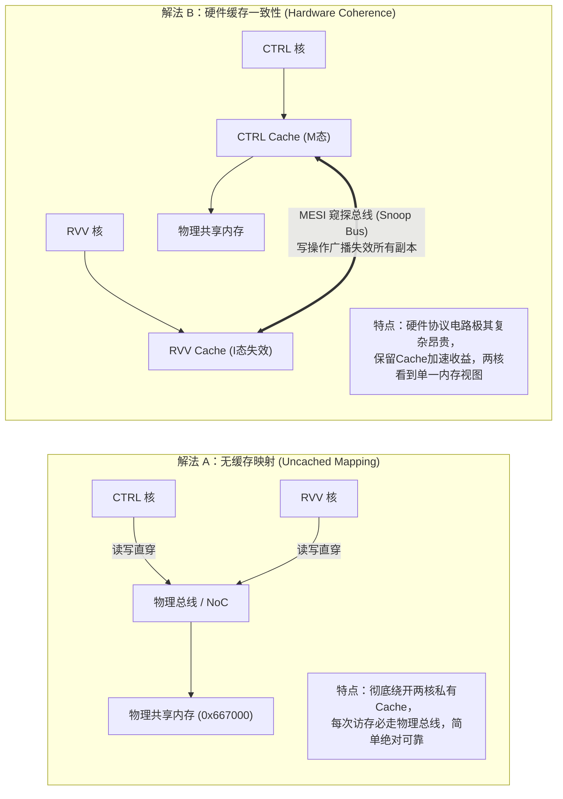

#### 解法 A：无缓存映射（Uncached / Non-cacheable Mapping）
在芯片的内存管理单元（MMU）或物理内存属性单元（PMA / PMP）中，将 `0x667000` 所在的整段物理页配置为 **Non-cacheable（不可缓存）** 属性。
- 两个核心访问这块区域时，CPU 硬件执行逻辑被强制禁止经过私有 Cache。
- 任何读操作都必须跨越总线直接取自底层物理存储器；任何写操作都必须直接驱动总线信号落入物理单元。
- **优点**：逻辑极简、绝对可靠、无需复杂的硬件同步电路。
- **缺点**：每次访问都有物理总线延迟（通常几十个周期），适合低频次的控制指令交互，不适合高吞吐的大数据密集计算。

#### 解法 B：硬件缓存一致性（Hardware Cache Coherence）
如果硬件总线与核心实现了经典的 **MESI / MOESI 缓存一致性协议**：
- 当 CTRL 核准备写入 `0x667000` 时，一致性硬件控制器会向片上互联总线广播一条“失效请求（Invalidate Broadcast）”。
- RVV 核内部的 Cache 窥探逻辑（Snoop Logic）捕捉到该广播，会立刻将其自身 Cache 中对应的 Cache Line 标记为无效状态（`I` 态）。
- 下次 RVV 读取时，发现 Cache Line 无效，被迫重新发起总线事务从总线或由 CTRL 核心拉取最新数据。
- **优点**：对软件透明，代码读写普通内存即可自动同步。
- **缺点**：需要巨大的芯片硬件面积和能耗开销，在许多专用加速芯片（NPU/DSP）中，为了最大化算力能效比，往往并不对所有核心提供完全对称的一致性硬件互联。

> [!WARNING]
> **软件维护缓存的底线手段**：
> 如果硬件既没有一致性协议，又没有配置无缓存页表，软件必须手动调用底层微架构特权指令：
> - CTRL 写入完毕后执行 **Cache Clean / Flush（刷写脏行到物理内存）**。
> - RVV 读取前必须执行 **Cache Invalidate（作废本地缓存行，强制走外部总线拉取）**。

---

## 第三章：天险二：读写完整性与 32 位原子性

解决了“看得见”的问题，接下来我们要面对第二个致命深坑：**读到的内容会不会是“拼凑出来”的残卷？**

### 3.1 什么是原子性（Atomicity）？

> [!NOTE]
> **原子性（Atomicity）**：在微观硬件层面，指一个操作要么完整无缺地彻底执行完毕，要么完全没有发生，**绝对不会让外部观察者看到执行到一半的中间过渡状态**。这就像化学上的原子概念——不可再分割。

### 3.2 恐怖的“撕裂读写（Torn Read / Torn Write）”

假设通信协议规定，`command` 字段是一个 32 位的整型指令编码：
- 初始旧值：`0x00000000`（无任务）
- 新下发命令：`0x12345678`（执行 2D 卷积任务）

如果硬件总线结构或内存控制机制**不能保证单次 32 位传输的原子性**，一次 32 位的写操作在底层物理电路中可能会被拆解为两次独立的 16 位传输：

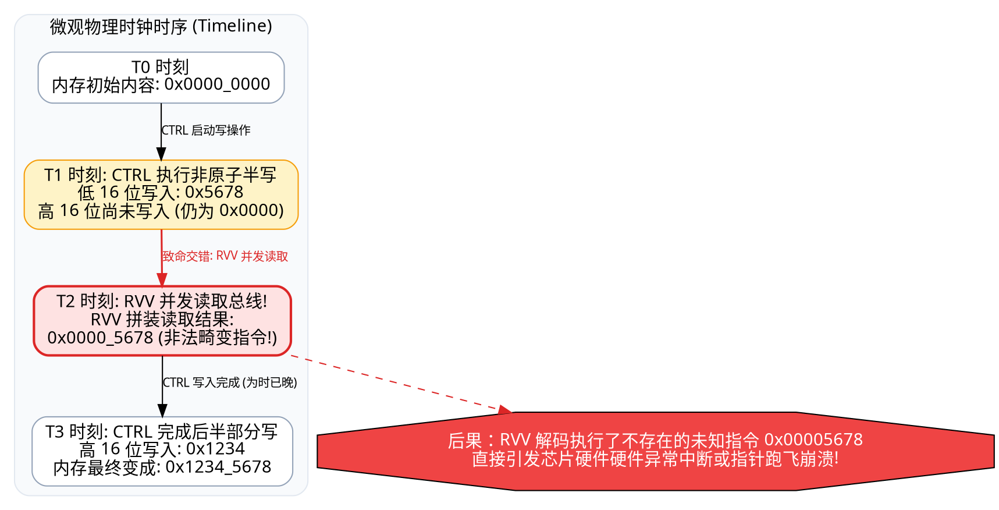

在 $T_2$ 时刻，RVV 读取到了一个**半成品数值 `0x00005678`**！
- 这个数值既不是合法的旧值 `0`，也不是合法的新命令 `0x12345678`。
- RVV 核拿到这个无厘头的命令码后，驱动硬件执行算子，必然导致**系统奔溃、地址非法越界或致命硬件异常（Hard Fault）**。

这种在并发访问下，由于操作非原子而读取到部分更新数据的灾难现象，被称为 **撕裂读（Torn Read）**。

### 3.3 什么是自然对齐（Natural Alignment）？

为什么原话中要特别指定“**对齐** 32 位原子读写”？

> [!NOTE]
> **自然对齐（Natural Alignment）**：指数据的物理起始内存地址必须是其自身字节长度的整数倍。
> - 1 字节数据（8-bit）：可以存放在任意地址。
> - 2 字节数据（16-bit）：起始地址必须能被 2 整除（末尾 1 位为 0）。
> - 4 字节数据（32-bit）：起始地址必须能被 4 整除（末尾 2 位必须是 `0b00`，如十六进制以 `0`、`4`、`8`、`C` 结尾）。

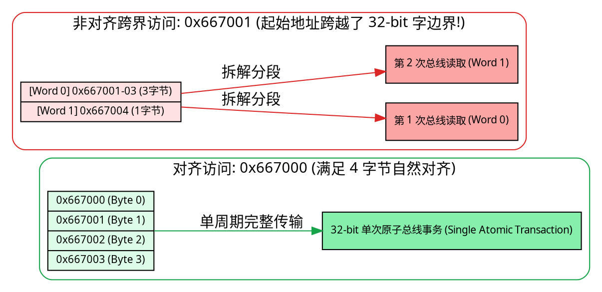

在绝大多数主流处理器架构（包括 RISC-V）中：
- 当一个 32 位变量放置在自然对齐的地址（如 `0x667000`）时，CPU 派发的单条 `lw`（Load Word）或 `sw`（Store Word）指令会被总线直接翻译成一个完整的、不可分割的 32 位物理总线事务。
- 但是，如果你把 32 位变量放在了 `0x667001` 或 `0x667002` 这种跨越字边界的非对齐地址上，硬件总线就必须发起**两次物理传输**并在片内做拼接移位。在跨核并发环境下，**硬件根本无法保证跨边界两次访问的整体原子性**，必然面临撕裂风险！

因此，原话中提到的“支持对齐 32 位原子读写”，是向芯片架构确认：**总线协议与内存控制器必须保证，当双方对齐访问 32 位数据时，单次读写是物理原子不可分割的。**

> [!IMPORTANT]
> **必须澄清的陷阱：单次原子读写 ≠ 复合操作原子**
> 单次 32 位读写具有原子性，仅仅意味着写进去的值不会变成畸形残卷。
> 它**并不代表**类似 `mailbox->state++` 或 `if (state == 0) state = 1;` 这种复合操作也是原子的！此类复合操作包含“读出-修改-写回”多个连续步骤，在多核互斥竞争场景下，仍然必须引入 RISC-V 的 **AMO 原语（Atomic Memory Operations，如 `amoadd.w`）** 或自旋锁机制。

---

## 第四章：天险三：指令重排与弱内存顺序（Memory Ordering）

现在，假设硬件既拥有无缓存通道，又支持 32 位自然对齐原子读写。我们是不是终于可以写出如下代码开始通信了？

```cpp
// CTRL 端下发任务
mailbox->command  = 0x12345678; // 1. 写入复杂的算子参数和内容
mailbox->arg_ptr  = 0x80001000; // 2. 写入物理输入地址
mailbox->state    = 1;          // 3. 发布通知：告诉 RVV 消息准备好了！
```

这段逻辑在人类直觉看来毫无破绽：**先装好信封里的内容，最后贴上封条并插上信号旗。**

然而在真实的现代多核处理器上，接收端 RVV 依然可能拿到完全错误的垃圾参数！

### 4.1 弱内存模型（Weak Memory Ordering / RVWMO）

为什么先写的代码，不一定先被其他核心看到？

> [!NOTE]
> **弱内存模型（Weak Memory Ordering）**：
> 编译器（如 GCC/Clang）和现代高性能 CPU 执行管道为了压榨极限性能，都会采用优化手段：
> 1. **编译器优化**：如果编译器认为两条不相关的内存写指令不存在局部依赖，可能会调整指令生成的先后顺序。
> 2. **硬件流水线乱序执行（Out-of-Order Execution）与写缓冲队列（Store Buffer）**：CPU 核心将写操作提交到 Store Buffer 后就继续执行后续指令，Store Buffer 可能会根据总线拥塞情况先将某些写入刷出，导致物理总线上的写入生效顺序与代码编写顺序完全颠倒！

RISC-V 架构默认采用的是 **RVWMO（RISC-V Weak Memory Ordering）** 内存模型。在该模型下，不同地址之间的 Load 与 Store 操作默认是允许乱序的！

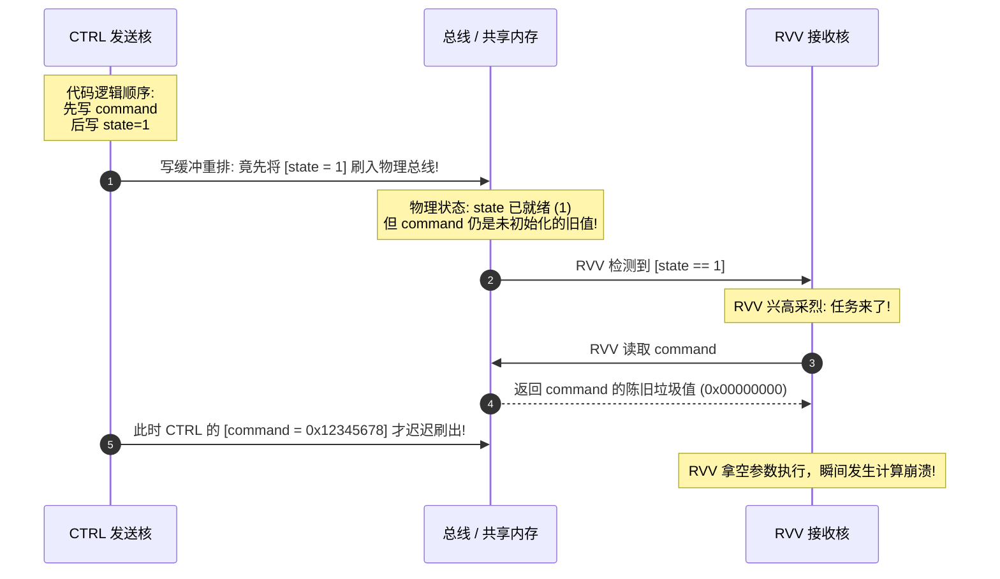

看到了吗？因为 `command` 和 `state` 是两个不同的内存地址，硬件为了总线效率，**先让 `state = 1` 成了可见事实**，而此时真正的数据 `command` 还在写缓冲队列里排队！RVV 提前起跑，捕获到了未初始化的垃圾数据。

### 4.2 终极同步契约：Release / Acquire 语义

为了拯救顺序错乱，现代计算机体系结构确立了经典的 **Release（释放）- Acquire（获取）** 同步模型：

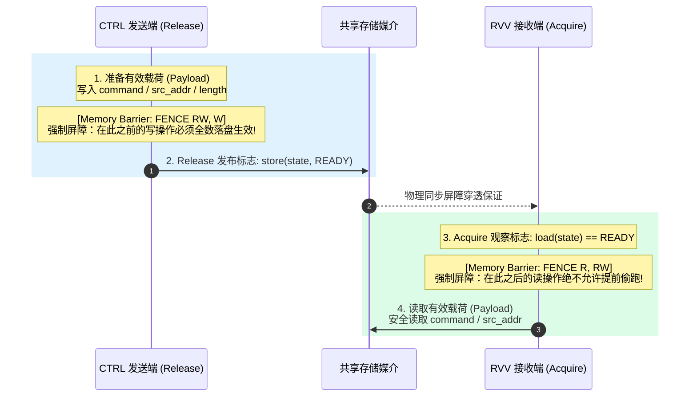

这两条语义构建起了一道坚不可摧的软硬件同步契约：
- **Release（释放语义，写屏障）**：规定在该操作之前发生的所有内存读写，必须在 Release 操作生效前全部完成并对全系统可见。换言之：**“绝不允许把准备数据的写操作，推迟到发布标志之后！”**
- **Acquire（获取语义，读屏障）**：规定在该操作之后发生的所有内存读写，必须在 Acquire 操作观察成功后才允许执行。换言之：**“在还没有看到标志置位之前，绝不允许把读参数的指令提前偷跑！”**

### 4.3 C++ 原子操作与底层的 RISC-V `fence`

在符合现代 C++ 规范的环境中，可以通过内置原子函数建立这种屏障语义：

```cpp
// === CTRL 发送端 ===
void send_task(Mailbox* mb, uint32_t cmd) {
    mb->command = cmd; // 1. 写入实际有效载荷数据

    // 2. 以 Release 语义写入状态，强行插入内存屏障
    __atomic_store_n(&mb->state, 1, __ATOMIC_RELEASE);
}

// === RVV 接收端 ===
uint32_t receive_task(Mailbox* mb) {
    // 1. 以 Acquire 语义不断轮询状态，建立同步锚点
    while (__atomic_load_n(&mb->state, __ATOMIC_ACQUIRE) != 1) {
        // 等待命令就绪
    }

    // 2. 此处读取 command 绝对保证已处于最新可见状态!
    return mb->command;
}
```

在 RISC-V 汇编层面，编译器会在背后插入专用的硬件屏障指令——`fence`：
```asm
# CTRL 发送端编译出的典型指令序列
sw      a1, 4(a0)       # mb->command = cmd
fence   rw, w           # 【硬件屏障】强制前面的读写先于后面的写完成!
sw      t0, 0(a0)       # mb->state = 1

# RVV 接收端编译出的典型指令序列
.L_poll:
lw      t0, 0(a0)       # 读取 mb->state
bne     t0, t1, .L_poll # 未就绪则循环
fence   r, rw           # 【硬件屏障】强制后面的读操作绝不提前到读取 state 之前!
lw      a0, 4(a0)       # 安全加载 mb->command
```

> [!CAUTION]
> **三大常见认知误区敲黑板：**
> 1. **`volatile` 绝不是线程安全与多核同步的银弹！** `volatile` 仅仅阻止编译器自身将变量优化到寄存器中，**它在硬件层面没有任何内存屏障效果**，完全无法阻止现代 CPU 硬件流水线的乱序执行！
> 2. **`fence` 不能凭空把无一致性的 Cache 变一致！** 内存屏障只管“先后执行顺序”，如果数据根本被扣留在私有 Cache 没流向物理总线，屏障也救不了不可见的死局。
> 3. **工具链原子操作必须与底层硬件匹配！** 如果底层内存区域根本不支持原子总线事务，调用 `__atomic` 可能会在底层由于硬件缺乏总线响应而陷入不可恢复的硬件异常。

---

## 第五章：拨云见日：深入剖析 MMIO 操作与普通 MEM 访问

在理解了可见性、原子性和顺序性这三座大山之后，我们终于能够深刻领会文章开头上游负责人的那句关键定调：

> **“全部都用 MMIO 操作，不要使用 mem 操作就可以了。”**

很多工程师困惑：MMIO 全称不是叫 **Memory-Mapped I/O（内存映射输入输出）** 吗？名字里带着“Memory”，为什么说它不是普通 MEM？

### 5.1 本质揭秘：芯片总线上的“地址译码与分流”

在冯·诺依曼架构与统一编址体系中，CPU 看到的是一个平坦连续的 32 位或 64 位物理地址空间（Physical Address Space）。

当你发出一个访问地址的指令时，真正决定这次访问走向的，是芯片内部的**片上总线互联矩阵（Bus Interconnect / NoC）**与**地址译码器（Address Decoder）**：

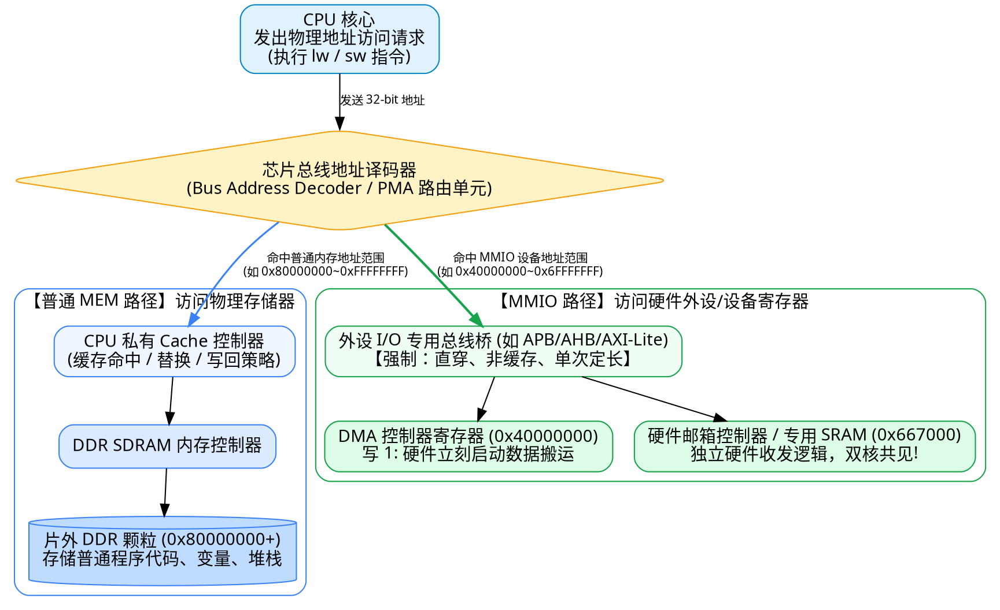

### 5.2 什么是“硬件副作用（Hardware Side Effect）”？

普通内存访问与 MMIO 访问最本质的思想差异，在于**是否有硬件副作用**：

| 对比维度 | 普通内存访问（MEM） | 内存映射 I/O（MMIO） |
| :--- | :--- | :--- |
| **主要目标** | 纯粹的数据存储与检索 | 与外部硬件逻辑电路进行指令与状态交互 |
| **读操作特性** | **幂等且无害**：连续读 10 次同一个内存地址，返回的值相同，硬件状态不发生变化。 | **可能伴随硬件状态翻转**：例如读取中断状态寄存器会自动清除中断标志位；读取 FIFO 寄存器会自动弹出队头元素。 |
| **写操作特性** | 覆盖更新物理单元中存放的二进制数据。 | **可能直接触发硬件动作**：例如向 `0x40000000` 写入 `1` 会立刻启动 DMA 搬运；向复位寄存器写 `1` 会使模块重启。 |
| **缓存允许度** | **高度依赖 Cache**：允许缓存、允许写合并（Write Combining）、允许乱序以最大化带宽。 | **绝对禁止经过普通数据缓存**：每次操作必须如实以物理电信号发送到硬件引脚或总线。 |

### 5.3 汇编层面的惊人真相：指令竟然是一模一样的！

许多初学者常常误以为 CPU 存在类似 `in`、`out` 或特殊的 `mmio_write` 专用机器指令。

**在 RISC-V 等主流精简指令集架构中，完全不存在专用的 MMIO 汇编指令！**

请观察以下两行 C 语言代码编译后的汇编输出：

```c
// 访问普通内存
*(volatile uint32_t*)0x80001000 = 100;

// 访问 MMIO 寄存器
*(volatile uint32_t*)0x667000 = 100;
```

其生成的 RISC-V 汇编指令几乎一模一样：
```asm
li      a0, 100

# 写入普通内存
lui     a1, 0x80001
sw      a0, 0(a1)       # sw 是 Store Word 指令

# 写入 MMIO 寄存器
lui     a2, 0x667
sw      a0, 0(a2)       # 同样是 Store Word 指令!
```

既然 CPU 指令一模一样，那凭什么说“全部改用 MMIO 操作”就解决了问题？

**答案在于：项目底层的 MMIO 访问函数（如 `mmio_write32` / `mmio_read32`）并不是简单的原生指针解引用，而是平台封装的驱动级专用宏或内联函数！**

在规范的嵌入式或操作系统底层，MMIO 函数通常具有如下特征定义：

```cpp
// 典型的驱动层 MMIO 读写安全实现
static inline void mmio_write32(uintptr_t addr, uint32_t value) {
    // 1. 在写之前插入强屏障，防止前面的数据更新被推迟到 MMIO 触发之后
    asm volatile("fence w, o" ::: "memory"); // RISC-V: Write 到 Device Output 屏障

    // 2. 使用 volatile 阻止编译器任何形式的优化与合并
    *(volatile uint32_t*)addr = value;

    // 3. 驱动写操作在物理总线上提交
    asm volatile("" ::: "memory"); // 阻止编译器重排屏障
}

static inline uint32_t mmio_read32(uintptr_t addr) {
    // 1. 强制读操作穿透到总线
    uint32_t value = *(volatile const uint32_t*)addr;

    // 2. 读之后插入强屏障，防止后续的依赖操作偷跑
    asm volatile("fence i, r" ::: "memory"); // Device Input 到 Read 屏障

    return value;
}
```

### 5.4 “只用 MMIO 操作”真的能解决所有问题吗？

上游领导所说的“全部用 MMIO 操作”，其核心含义是：
- **指导方向完全正确**：通过让通信地址走芯片的 MMIO 空间或 MMIO 封装接口，避开了让人头疼的 L1 Data Cache 不一致性死渊，确保每一次状态修改都能直接在物理总线上以电平形式展现！
- **但仍需软件协议兜底**：改用 MMIO 操作只解决了**物理数据可见性**，并不代表软件就可以随意乱写。跨核通信仍然必须依靠软件协议处理好**握手时序、数据包完整性校验、超时处理以及防覆盖机制**。

---

## 第六章：工业级跨核通信协议与驱动实战

理论融会贯通后，我们来将这些原则转化为一段经得起工业级严苛考验的双核 Mailbox 通信系统实现。

### 6.1 软件分层架构设计（Layered Architecture）

永远不要在业务算法代码中直接裸写物理地址指针！优秀的系统架构必须是清晰分层的：

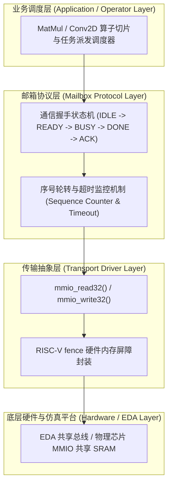

### 6.2 双核握手通信状态机全生命周期

为了保证消息既不丢失、也不被意外覆盖，我们设计一套闭环的应答状态机：

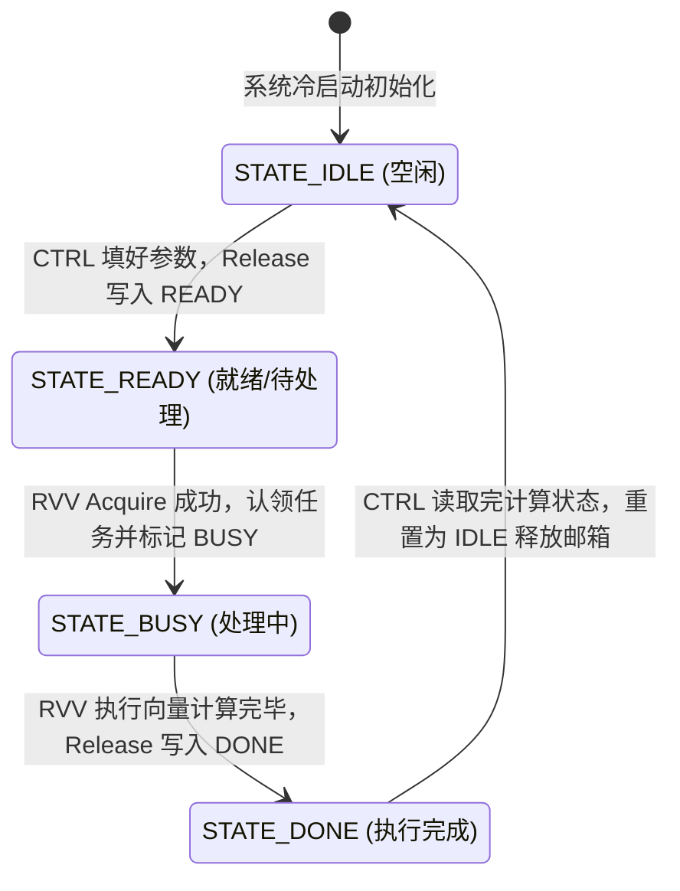

### 6.3 生产级跨核通信参考源码

以下为遵循上述规范的 C++ 跨核通信核心实现范式：

```cpp
#include <stdint.h>
#include <stdbool.h>

// ==========================================
// 1. 底层硬件 MMIO 与屏障接口封装
// ==========================================
#define INBOX_CTRL_TO_RVV  0x00667000U
#define INBOX_RVV_TO_CTRL  0x00668000U

static inline void hw_memory_barrier(void) {
    // 强制执行 RISC-V 内存屏障，确保总线写顺序
    __asm__ __volatile__("fence rw, rw" ::: "memory");
}

static inline void mmio_write32(uintptr_t addr, uint32_t value) {
    // 保证对齐访问：地址末尾两位必须为 0
    *(volatile uint32_t*)addr = value;
}

static inline uint32_t mmio_read32(uintptr_t addr) {
    return *(volatile const uint32_t*)addr;
}

// ==========================================
// 2. 协议状态码与消息结构定义
// ==========================================
enum MailboxState : uint32_t {
    MBOX_IDLE  = 0x00000000U,
    MBOX_READY = 0x5AA50001U, // 采用非全0/全F的幻数，防止读到未初始化内存
    MBOX_BUSY  = 0x5AA50002U,
    MBOX_DONE  = 0x5AA50003U,
};

// 内存字段布局严格按 4 字节自然对齐
struct MailboxLayout {
    uint32_t state;     // 偏移 0x00: 状态字段
    uint32_t seq_id;    // 偏移 0x04: 递增防重序号
    uint32_t command;   // 偏移 0x08: 算子命令码
    uint32_t param_addr;// 偏移 0x0C: 复杂参数包物理首地址
};

// ==========================================
// 3. CTRL 发送端（发布者）实战函数
// ==========================================
bool ctrl_send_command(uint32_t seq, uint32_t cmd, uint32_t param_phys_addr, uint32_t timeout_cycles) {
    uintptr_t base = INBOX_CTRL_TO_RVV;

    // 步骤一：确认当前邮箱已处于 IDLE 空闲状态
    if (mmio_read32(base + 0x00) != MBOX_IDLE) {
        return false; // 邮箱正在被占用，避免冲突覆盖
    }

    // 步骤二：按部就班填充有效载荷数据 (Payload)
    mmio_write32(base + 0x04, seq);
    mmio_write32(base + 0x08, cmd);
    mmio_write32(base + 0x0C, param_phys_addr);

    // 步骤三：【关键写屏障】确保上述所有有效载荷已先在总线生效
    hw_memory_barrier();

    // 步骤四：以 Release 语义正式发布 READY 标志
    mmio_write32(base + 0x00, MBOX_READY);
    hw_memory_barrier();

    return true;
}

// ==========================================
// 4. RVV 接收端（执行者）实战函数
// ==========================================
bool rvv_poll_and_execute(void) {
    uintptr_t base = INBOX_CTRL_TO_RVV;

    // 步骤一：检测是否有任务就绪
    uint32_t state = mmio_read32(base + 0x00);
    if (state != MBOX_READY) {
        return false; // 无新任务到来
    }

    // 步骤二：【关键读屏障】观察到就绪后，强制禁止后续读操作偷跑
    hw_memory_barrier();

    // 步骤三：立即标记为 BUSY，认领该任务
    mmio_write32(base + 0x00, MBOX_BUSY);
    hw_memory_barrier();

    // 步骤四：安全读取完整参数
    uint32_t seq   = mmio_read32(base + 0x04);
    uint32_t cmd   = mmio_read32(base + 0x08);
    uint32_t param = mmio_read32(base + 0x0C);

    // 步骤五：RVV 核心执行真正的高性能向量算子计算
    // rvv_kernel_dispatch(cmd, param);

    // 步骤六：执行完成，回写完成状态
    hw_memory_barrier();
    mmio_write32(base + 0x00, MBOX_DONE);
    hw_memory_barrier();

    return true;
}
```

### 6.4 软硬件接口契约检查清单（Checklist）

在将新构建的通信驱动集成到系统前，请对照此清单向芯片团队或自身代码逐条核对：

| 校验维度 | 检查项目 | 必须满足的物理要求 |
| :--- | :--- | :--- |
| **地址与映射** | 物理地址排他性 | `0x667000` 与 `0x668000` 是否已被系统保留（Reserved），绝未被静态堆栈或动态 malloc 瓜分覆盖。 |
| **缓存属性** | 访问途径属性 | 两核访问该区间时，页表/PMA 必须配置为 **Non-cacheable（不可缓存）**，或通过专用 MMIO 总线直通。 |
| **对齐与位宽** | 32 位单次原子性 | 结构体中所有成员必须严格满足 4 字节自然对齐；硬件总线仲裁器保证 32 位事务单次原子下发。 |
| **内存屏障** | 硬件指令支持 | EDA 模型或实际 CPU 核心必须正确实现 RISC-V `fence` 语义，杜绝写缓冲滞后导致的假置位。 |
| **协议闭环** | 状态握手完整性 | 绝不采用单向“盲发”机制；必须建立具备 IDLE 复用、超时重试与异常告警的双向闭环通道。 |

---

## 结语：从“写出能跑的代码”到“理解硅片背后的物理现实”

在单核时代，软件工程师可以安心享受现代操作系统和高级语言所营造的“平坦内存与顺序执行”的美好幻觉。

但当你踏入异构多核计算、自研加速芯片与操作系统内核的深水区时，这些抽象层被全部剥开。你所面对的不再是纯粹的逻辑分支，而是**晶体管的翻转、缓存行的驱逐、写缓冲队列的滞后，以及总线仲裁器的物理脉冲**。

回顾全文，EDA 提问中的每一个词汇，都不是无病呻吟的教条，而是跨核通信得以成立的生死线：
- **无缓存映射 / 缓存一致性**：解决了跨越物理核心私有缓存的**可见性**问题；
- **对齐 32 位原子读写**：解决了总线微观时序拆分交错下的**完整性**问题；
- **Release / Acquire 与内存屏障**：解决了弱内存模型执行流水线下的**顺序性**问题；
- **统一使用 MMIO 操作**：从架构设计层面确立了绕开缓存、直连硬件外设控制平面的**规范路径**。

透彻理解这套软硬件接口契约，你便拥有了跨越“软件编写”与“芯片硬件运行”之间鸿沟的透视眼。无论未来面对怎样的芯片架构与仿真平台，你都能精准设计出稳如磐石的底层通信基石。
