# 软硬件协同、并发同步与事务本质深度教程：从 ABI、上下文切换、LL/SC 与 CAS 到事务内存、ACID 与异构 Runtime 状态管理

> **导读**：计算机系统的核心魅力在于**分层抽象与软硬件协同（Hardware-Software Co-design）**。在单核单线程的世界里，软件与硬件通过**指令集架构（ISA）**和**应用程序二进制接口（ABI）**达成契约，让函数调用、中断响应、进程隔离有条不紊地运转；而一旦迈入多核并发世界，多个执行主体同时读写共享状态时，硬件的原子指令（`LL/SC`、`CAS`）、操作系统的同步原语（锁）、CPU 与运行时的**事务内存（Transactional Memory）**，乃至数据库的 **ACID 事务**，实际上都在不同层次上解决同一个根本问题。

很多初学者在学习体系结构和并发系统时，常常把 ABI、上下文切换、自旋锁、`LL/SC`、`CAS`、事务内存和数据库事务当成彼此孤立的知识点。本文将用**第一性原理**把它们彻底打通，并配合大量 **Graphviz 与 Mermaid 可视化图表**，带你建立一张完整的系统认知地图：

- **上篇（软硬件协同界面）**：剖析 **ABI** 如何让不同编译器、函数库与操作系统协作，以及 **六种上下文切换场景** 如何在软硬件分工中实现高效状态保存与恢复。
- **中篇（并发冲突与原子基石）**：从单线程原子性滑坡到多核竞态，深入剖析互斥锁、非阻塞同步，以及 **`LL/SC`（`LR/SC`）与 `CAS` 的微架构硬件真相**。
- **下篇（从事务思想到异构系统实战）**：理解为什么 `LL/SC` 被称为“最基础的事务内存”，横纵打通 **STM / HTM、数据库 ACID 与异构加速器 Runtime 状态管理**，提炼出体系结构中最本质的**“执行与提交分离”**原则。

---

## 零、初学者核心名词破冰速查表

在正式进入正文前，先对全篇高频出现的基础术语做一次“破冰对齐”。后文在每一个新概念首次出现时，也会结合上下文给出通俗解释。

| 术语 / 缩写 | 英文全称 | 一句话通俗解释 |
| :--- | :--- | :--- |
| **ISA** | Instruction Set Architecture（指令集架构） | 处理器硬件暴露给软件的“说明书”，规定了有哪些指令、寄存器以及异常行为。 |
| **ABI** | Application Binary Interface（应用程序二进制接口） | 二进制程序模块之间互相交互的“交通规则”，规定参数怎么传、寄存器谁保存、栈怎么对齐等。 |
| **PC** | Program Counter（程序计数器） | 记录 CPU 下一条要执行的指令地址的专用寄存器。 |
| **SP / FP** | Stack Pointer / Frame Pointer（栈指针 / 帧指针） | 分别指向当前函数运行时栈的栈顶和当前栈帧的基准位置。 |
| **TLS** | Thread Local Storage（线程局部存储） | 每个线程私有一份的“全局变量区”，虽然代码里变量名相同，但不同线程访问的是不同的物理内存。 |
| **PLV / 特权级** | Privilege Level | CPU 当前所处的权限等级（如用户态低权限 vs 内核态高权限），决定哪些指令和地址允许访问。 |
| **MMU / TLB** | Memory Management Unit / Translation Lookaside Buffer | 负责把程序用的“虚拟地址”翻译成真实内存“物理地址”的硬件单元（MMU）及其高速缓存（TLB）。 |
| **Cache Line** | 缓存行 | CPU 缓存（Cache）与主存之间传输和监控一致性的最小数据块单位（通常为 64 字节）。 |
| **Cache Coherence** | 缓存一致性 | 多核 CPU 中，确保多个核各自私有 Cache 里保存的同一份内存副本不会互相矛盾的硬件协议。 |
| **RMW** | Read-Modify-Write（读-改-写） | 先读出旧值、修改计算、再写回新值的复合动作（如 `counter++`）；多核并发时必须保证整体原子性。 |
| **LL/SC (LR/SC)** | Load-Linked / Store-Conditional（关联加载 / 条件存储） | 一对配合使用的硬件指令：`LL` 读数据时打上“监控标记”，`SC` 仅在期间无人修改该地址时才写入成功。 |
| **CAS** | Compare-And-Swap（比较并交换） | 一种常见单指令原子操作：检查内存当前值是否等于“期望值”，相等才替换成新值。 |
| **TM (STM/HTM)** | Transactional Memory（软件/硬件事务内存） | 允许一段内存读写像“事务”一样整体尝试执行，若检测到冲突则撤销重试，无冲突则整体生效。 |
| **MMIO** | Memory-Mapped I/O（内存映射 I/O） | 将外部硬件设备（如 DMA 控制器）的控制寄存器映射到内存地址空间中，CPU 用普通访存指令操控设备。 |
| **Memory Ordering** | 内存顺序 | 约束一条内存读写操作何时、以什么顺序对其他处理器核变得“可见”的规则。 |

---

## 一、全局知识地图：从软硬件界面到事务统一原理

在陷入指令助记符和细节表格之前，我们先通过一张全景图看清全篇知识是如何一层层生长出来的：

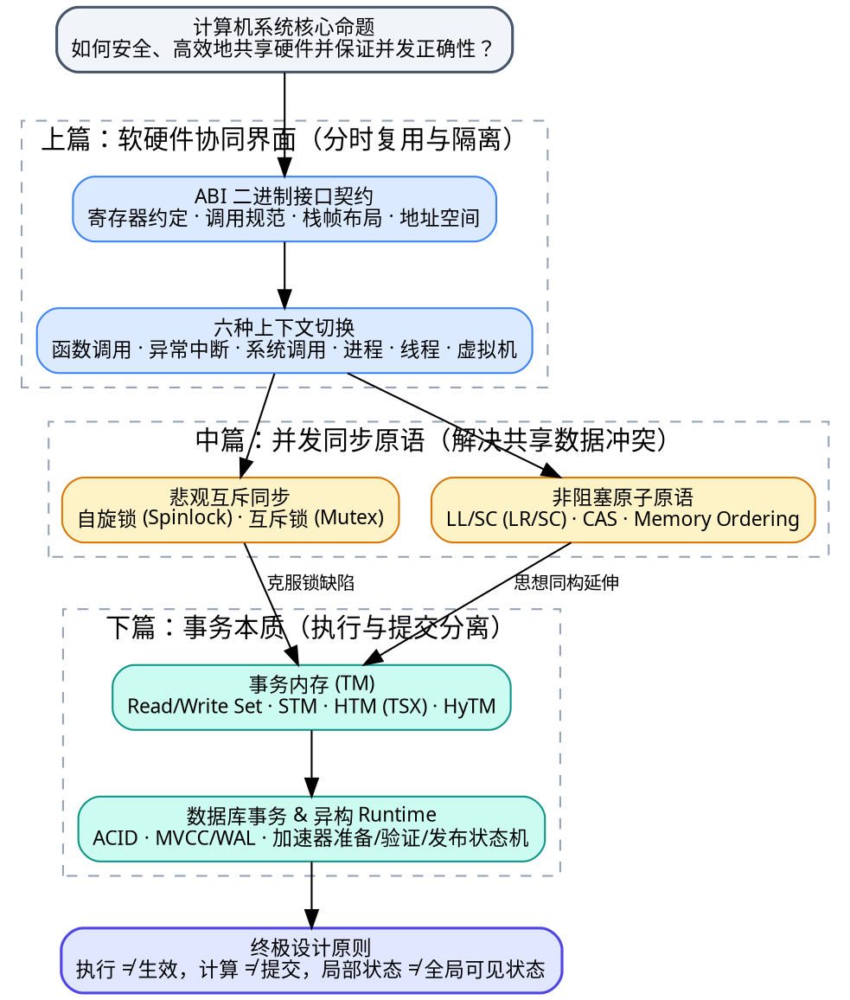

---

# 上篇：软硬件协同界面——ABI 与六种上下文切换

作为软件与硬件的界面，**指令系统结构（ISA）** 不仅定义了处理器有哪些指令和硬件资源，还包含软件如何协同使用这些资源的约定。计算机完成同一项任务时，往往既可以用**纯硬件实现**（速度快但硬件成本高、不够灵活），也可以用**纯软件实现**（灵活性高但开销大），现代处理器架构设计的核心艺术就在于**在软硬件之间合理划分界面**。

本篇以 **LoongArch（龙架构）** 为主要教学示例（并穿插对比 **MIPS**、**RISC-V**、**x86** 与 **SPARC**），拆解软硬件协同中最核心的两大基石：**ABI** 与 **上下文切换**。

---

## 二、应用程序二进制接口（ABI）：软硬件之间的“交通规则”

### 2.1 什么是 ABI？它和 ISA 有什么区别？

- **ISA（指令集架构）** 规定了硬件能执行什么指令（例如 `add`、`ld.w`）、共有多少个物理寄存器；
- **ABI（Application Binary Interface，应用程序二进制接口）** 则规定了**已经编译好的二进制代码模块之间如何对接合作**。

举个直观的例子：如果文件 A 编译成了 `.o` 目标文件，它要调用动态链接库 B 里的函数 `foo(x, y)`。硬件本身并不强制要求参数必须放进哪个寄存器、返回值放哪里、函数栈往哪个方向长。但如果没有一套统一规则，模块 A 把参数放进 4 号寄存器，模块 B 却去栈里取参数，程序立刻崩溃。

> [!NOTE] 初学者常见疑问：软件一定要遵守 ABI 吗？
> 硬件电路本身不检查 ABI。如果是完全自成体系、不依赖任何外部库的裸机程序，理论上可以自己发明一套约定。但只要程序需要运行在操作系统之上，或者调用 C 标准库（如 `glibc`）、第三方动态库，甚至进行跨语言（如 C++ 调用汇编或 Rust）模块交互，就**必须严格遵守同一套 ABI**。

ABI 通常涵盖以下核心约定：
1. **基础数据类型**：`int`、`long`、指针等的大小、内存布局与**字节对齐（Alignment）**要求（例如 64 位整数要求地址是 8 的倍数）；
2. **寄存器使用约定**：通用寄存器各自的分工、别名以及由谁负责保存恢复；
3. **函数调用约定**：参数如何传递、返回值如何返回、函数栈帧如何组织；
4. **二进制文件格式**：目标文件与可执行文件格式（如 Linux 常用的 **ELF** 格式）；
5. **装载与动态链接**：程序启动加载、符号重定位与动态库解析规则；
6. **系统调用与运行环境**：用户态程序如何向操作系统请求服务。

**为什么同一个指令集上会存在多种不同的 ABI？** 主要原因有三点：
- **操作系统差异**：同一颗 x86 CPU，Linux/UNIX 类系统普遍遵循 **System V ABI**，而 Windows 则采用自己独立的 Windows ABI；
- **应用领域差异**：针对嵌入式场景对代码体积和中断响应的特殊需求，ARM、PowerPC 和 MIPS 都曾定义过专门的 **EABI（Embedded ABI）**；
- **软硬件演进需求**：从 32 位升级到 64 位，或发现早年传参寄存器太少影响性能时，就会诞生新 ABI。例如：
  - MIPS 从早期的 **O32**（4 个传参寄存器）演进到 **N32 / N64**（8 个传参寄存器）；
  - x86-64 上存在三种 System V ABI 变体：**i386**（兼容 32 位）、**X32**（使用 64 位指令和寄存器优势，但指针保持 32 位以省内存）、**x86-64**（指针与数据全 64 位）；
  - LoongArch 定义了三种 ABI：**LP64**（指针和数据均 64 位）、**LPX32**（指针 32 位、数据 64 位）、**LP32**（指针和数据均 32 位）。

---

### 2.2 寄存器约定：32 个“长得一样”的寄存器如何分工？

MIPS 和 LoongArch 都有 32 个整数通用寄存器（General-Purpose Registers, GPR）。在硬件电路上，除了 0 号寄存器恒定输出 `0` 之外，其余 31 个寄存器物理上没有任何区别。但 ABI 人为赋予了它们不同的“角色”和**助记符（Mnemonic）**（在汇编代码中通常带有 `$` 前缀，如 `$sp`；内核源码中有时会用 `#define` 宏去掉 `$`）。

下面我们对比 **MIPS（O32 与 N32/N64）** 和 **LoongArch** 的整数寄存器约定：

#### 1) MIPS 整数通用寄存器约定（O32 vs N32/N64）

| 寄存器编号 | O32 助记符 | N32 / N64 助记符 | 角色与用途说明 | 调用者/被调用者保存 |
| :--- | :--- | :--- | :--- | :--- |
| `$0` | `$zero` | `$zero` | 恒为常数 `0`（硬件连线接地） | — |
| `$1` | `$at` | `$at` | **汇编暂存器**（Assembler Temporary），供汇编宏指令合成周转 | 调用者保存 |
| `$2 ~ $3` | `$v0 ~ $v1` | `$v0 ~ $v1` | 存放函数返回值 | 调用者保存 |
| `$4 ~ $7` | `$a0 ~ $a3` | `$a0 ~ $a3` | 前 4 个函数参数寄存器 | 调用者保存 |
| `$8 ~ $11` | `$t0 ~ $t3` | **`$a4 ~ $a7`** | **关键演进**：O32 中作临时寄存器；N32/N64 改为第 5~8 个参数寄存器 | 调用者保存 |
| `$12 ~ $15` | `$t4 ~ $t7` | `$t0 ~ $t3` | 临时寄存器（Temporaries），子函数可随意覆盖 | 调用者保存 |
| `$16 ~ $23` | `$s0 ~ $s7` | `$s0 ~ $s7` | **保留寄存器（Saved）**，子函数若使用必须先存后恢复 | **被调用者保存** |
| `$24 ~ $25` | `$t8 ~ $t9` | `$t8 ~ $t9` | 临时寄存器（`$t9` 常用于 PIC 动态链接跳板地址） | 调用者保存 |
| `$26 ~ $27` | `$k0 ~ $k1` | `$k0 ~ $k1` | **内核专用预留寄存器**，供快速异常处理使用，用户态禁止依赖 | 内核保留 |
| `$28` | `$gp` | `$gp` | 全局指针（Global Pointer），指向全局偏移表 GOT | 视具体约定 |
| `$29` | `$sp` | `$sp` | **栈指针（Stack Pointer）**，指向当前栈顶 | **被调用者保存** |
| `$30` | `$fp / $s8` | `$fp / $s8` | **帧指针（Frame Pointer）**，也可作为第 9 个保留寄存器 | **被调用者保存** |
| `$31` | `$ra` | `$ra` | **返回地址（Return Address）**，由跳转链接指令写入 | 调用者/特殊 |

> [!TIP] 初学者理解：什么是“调用者保存（Caller-saved）”与“被调用者保存（Callee-saved）”？
> 假设函数 `main()` 要调用 `foo()`：
> - **调用者保存（如 `$t0-$t8`、`$a0-$a7`）**：“临时的草稿纸”。`foo()` 可以直接覆盖它们而不用管原值。如果 `main()` 自己还指望调用完 `foo()` 后继续用 `$t0` 里的旧数，那么 `main()` 在调用前自己先存到栈上。
> - **被调用者保存（如 `$s0-$s8`）**：“长久保存的数据格”。`main()` 可以放心把重要局部变量放进 `$s0`；如果 `foo()` 也想用 `$s0`，**`foo()` 必须在自己入口处先把 `$s0` 原值压栈保护，返回前再恢复原样**。

#### 2) LoongArch 整数通用寄存器约定（LP32 / LPX32 / LP64 统一）

LoongArch 的三个 ABI 共用同一套更规整的寄存器分工：

| 寄存器编号 | 助记符 | 角色与用途说明 | 保存责任 |
| :--- | :--- | :--- | :--- |
| `$r0` | `$zero` | 恒为 `0` | — |
| `$r1` | `$ra` | **返回地址（Return Address）** | 调用者保存（若非叶函数需压栈） |
| `$r2` | `$tp` | **线程指针（Thread Pointer）**，永远指向当前线程的 TLS 区域 | 线程固定维护 |
| `$r3` | `$sp` | **栈指针（Stack Pointer）**，要求保持 16 字节对齐 | **被调用者保存** |
| `$r4 ~ $r11` | `$a0 ~ $a7` | 8 个参数寄存器（其中 **`$a0 ~ $a1` 同时复用为返回值寄存器**） | 调用者保存 |
| `$r12 ~ $r20` | `$t0 ~ $t8` | 9 个临时寄存器（Temporaries） | 调用者保存 |
| `$r21` | `$r21` | 架构保留寄存器（一般编译器不作普通分配） | — |
| `$r22` | `$fp` / `$s9` | **帧指针（Frame Pointer）**（不使用帧指针时也可作保留寄存器） | **被调用者保存** |
| `$r23 ~ $r31` | `$s0 ~ $s8` | 9 个保留寄存器（Saved Registers） | **被调用者保存** |

#### 3) 为什么 LoongArch 比 MIPS 性能更好？从 ABI 设计看优化细节

相比于 MIPS，LoongArch 对寄存器约定做了 5 项极具针对性的现代优化：
1. **取消 `$at` 汇编暂存器**：LoongArch 宏指令不再隐式占用专用周转寄存器，直接释放给编译器做寄存器分配；
2. **取消内核预留的 `$k0/$k1`**：MIPS 牺牲两个珍贵通用寄存器让异常入口（如 TLB 重填）免于访存保存上下文；LoongArch 改用独立的控制状态“便签寄存器（Scratch Registers, `CSR.SAVE0~3`）”暂存数据，把两个通用寄存器还给应用程序；
3. **取消 `$gp` 全局指针**：MIPS 需要 `$gp` 指向 **GOT（Global Offset Table，全局偏移表，用于动态链接时查找外部函数和全局变量真实地址）**；LoongArch 支持直接基于 PC 的相对寻址运算，不再消耗通用寄存器；
4. **复用参数寄存器与返回值寄存器（`$a0/$a1`）**：现代 RISC（如 RISC-V、ARM64、LoongArch）的普遍做法，省出 2 个寄存器作临时寄存器；
5. **新增 `$tp` 线程指针**：专门指向当前线程的 **TLS（线程局部存储）**，访问线程私有变量只需一条“`$tp + 偏移`”指令，无需陷入操作系统内核查询。

在完全相同的微架构与外部配置下，LoongArch 运行 SPEC CPU 2006 基准测试的平均性能比 MIPS 高出约 15%，其中就有一部分红利直接来自这 5 点 ABI 革新。

---

### 2.3 函数调用约定（Calling Convention）：参数如何跨函数传递？

为了把一个高级语言函数（整型、浮点、结构体、位域、可变参数）无歧义地映射到底层寄存器和栈内存中，ABI 制定了严密的**函数调用规范**。下面梳理 LoongArch ABI 的核心规则（设 `XLEN` 为整型通用寄存器位宽，`LP32` 为 32 位，`LPX32/LP64` 为 64 位；`FLEN` 为浮点寄存器位宽）：

#### 核心规则速览
1. **基本整型传参**：使用 `$a0 ~ $a7` 共 8 个寄存器，返回值放 `$a0 ~ $a1`。
   - 宽度 $\le \text{XLEN}$ 的**标量（Scalar，如 `int`/`long`/指针）**：占 1 个寄存器，不够则放栈上；小于 `XLEN` 位的有符号/无符号整数按其类型符号扩展到 32 位后再扩展至 `XLEN` 位。
   - 宽度在 $(\text{XLEN}, 2\times \text{XLEN}]$ 之间的标量（如 64 位系统上的 `__int128`）：占**一对寄存器**（低位放小编号寄存器，高位放大编号寄存器）；若只剩 1 个空闲寄存器，低半部放寄存器、高半部放栈上；若无空闲寄存器则全放栈上。
   - 宽度 $> 2\times \text{XLEN}$ 的大标量或大结构体：**通过引用（传地址指针）传递**，由调用方在内存准备好副本并把指针放入参数槽位。
2. **聚合体（结构体 `struct` / 数组）与位域（Bitfield）**：
   - 大小 $\le \text{XLEN}$ 或 $\le 2\times\text{XLEN}$ 的小型结构体可以直接塞进 1 个或 2 个寄存器中传递，其中未使用的**填充位（Padding，编译器为满足字段对齐而空出的字节）**的值是未定义的；
   - **位域（Bitfield）** 按小端序排列；若下一个位域跨越了其基础整型的对齐边界，则跳到下一个对齐边界开始排列。
   - **空结构体差异**：C 编译器把空结构体作非标准扩展忽略，而 C++ 规定空结构体必须占用至少 1 字节大小（Sized Type）。
3. **硬件浮点传参（`$fa0 ~ $fa7`）**：
   - 有独立的 8 个浮点参数寄存器 `$fa0 ~ $fa7`（`$fa0 ~ $fa1` 兼作浮点返回值），**与整型寄存器是否用完互不干扰**；
   - **仅含 1 个浮点实数、2 个浮点实数或 1 个浮点复数**的纯浮点结构体，也优先放进 `$fa` 寄存器；
   - **混合结构体（1 个浮点 + 1 个整型，无论顺序）**：只要两边都还有至少 1 个对应寄存器可用，就分别放进 1 个浮点寄存器和 1 个整型寄存器！
   - **“降级规则”**：如果 8 个浮点寄存器全用完了，第 9 个及以后的**命名浮点参数**并不会立刻掉到栈上，而是**转而使用空闲的整型寄存器 `$a0 ~ $a7` 来传递**！
4. **可变参数（Variadic Arguments，如 `printf(fmt, ...)`）**：
   - 固定命名参数按正常规则传，但**所有可变参数（`...` 部分）一律按整型调用规范传递**（即使传入的是 `double`，也走 `$a0~$a7` 而不走 `$fa0~$fa7`）；
   - 如果可变参数是 $2\times\text{XLEN}$ 宽度且 $2\times\text{XLEN}$ 对齐，需要从**偶数编号的参数寄存器**开始成对对齐传递；一旦某参数因寄存器不够走到了栈上，之后所有参数都在栈上传递（避免前面跳过的对齐空位被后面参数乱序填充）。
5. **栈对齐与保存责任**：
   - 栈向**低地址增长**，进入函数入口时 `$sp` 必须保持 **16 字节对齐**；
   - 栈上传参的第一个参数位于入口 `$sp + 0` 处，后续参数向更高地址排列；
   - 被调用函数负责保证整型 `$s0-$s8` 与浮点 `$fs0-$fs11` 在返回时与入口处一致。

#### 实战对比 1：12 个浮点参数在 LoongArch 与 MIPS 上的不同命运

假设我们有下面一段 C 代码 `fun.c`，一个函数接收 12 个 `double` 参数并把第 9 和第 11 个相加：

```c
// fun.c：测试超过 8 个浮点参数时的传参差异
double sum_tail(
    double a1, double a2, double a3, double a4,
    double a5, double a6, double a7, double a8,
    double a9, double a10, double a11, double a12) {
    return a9 + a11;
}
```

- **在 LoongArch LP64 下**：
  - 前 8 个参数 `a1 ~ a8` 装满 `$fa0 ~ $fa7`；
  - 浮点寄存器已满，根据规则，第 9~12 个参数 `a9 ~ a12` **借用整型参数寄存器 `$a0 ~ $a3`** 传递！
  - 函数体内不需要访问内存栈，只需用 `movgr2fr.d` 把 `$a0` 和 `$a2` 搬进浮点寄存器相加即可：

```asm
# LoongArch LP64 下 sum_tail 的概念性汇编映射（零内存栈访问）
sum_tail:
    movgr2fr.d  $ft0, $a0     # 从整型寄存器 $a0 取出 a9 的 IEEE-754 位模式
    movgr2fr.d  $ft1, $a2     # 从整型寄存器 $a2 取出 a11 的 IEEE-754 位模式
    fadd.d      $fa0, $ft0, $ft1  # 相加并将结果写入浮点返回值寄存器 $fa0
    jr          $ra
```

- **而在 MIPS N64 ABI 下**：
  - MIPS 的 8 个通用传参位（整型+浮点一共最多 8 个槽位）已经被 `a1 ~ a8` 全部占满；
  - 因此 `a9 ~ a12` **必须溢写（Spill）到调用者的内存栈上**，函数体内必须执行 `ldc1`（从栈加载双精度浮点）访问内存，访存开销显著增加！

```asm
# MIPS N64 下 sum_tail 的概念性汇编映射（需从栈内存加载）
sum_tail:
    ldc1        $f0, 0($sp)   # 从栈顶偏移 0 读取 a9
    ldc1        $f2, 16($sp)  # 从栈偏移 16 读取 a11
    add.d       $f0, $f0, $f2 # 相加并放回返回值寄存器 $f0
    jr          $ra
```

#### 实战对比 2：可变参数函数的寄存器映射（`varg.c`）

再看一个包含可变参数的函数 `varg_test(double fixed_a, ...)`：

```c
// varg.c：第 1 个为命名浮点参数，后续均为可变参数
void varg_test(double fixed_a, ...);

void caller() {
    varg_test(1.0, 2.0, 3, 4.0);
}
```

在 LoongArch LP64 下，各参数落入的寄存器如下表：

| 参数序号 | 参数类型 | 是否可变参数 | LoongArch 实际传递位置 | 原因说明 |
| :--- | :--- | :--- | :--- | :--- |
| `1.0` | `double` | 否（命名参数） | **`$fa0`** | 命名浮点实数，优先使用浮点参数寄存器 |
| `2.0` | `double` | **是**（`...`） | **`$a0`** | 规则 2：可变参数一律按整型规范传递，占第一个整型参数槽 |
| `3` | `int` | **是**（`...`） | **`$a1`** | 占用下一个整型参数寄存器 |
| `4.0` | `double` | **是**（`...`） | **`$a2`** | 继续按整型规范占用 `$a2`（这样被调函数的 `va_start` 只需统一把 `$a0~$a7` 连续压栈即可用指针遍历） |

---

### 2.4 进程虚拟地址空间：C 程序在内存中住在哪里？

> [!NOTE] 初学者概念解释：什么是虚拟地址空间（Virtual Address Space）？
> 操作系统和 **MMU（内存管理单元）** 为每个运行中的程序（进程）都构建了一套从 `0x0000...` 开始的“私有地址沙箱”。程序以为自己独占了一整块连续的内存，实际上是由硬件实时把这些**虚拟地址（VA）**翻译并映射到物理内存条（DDR）上零散的**物理地址（PA）**。这样既安全（A 进程看不到 B 进程的内存），又方便编程（每个程序都能用固定地址）。

在典型 64 位 Linux 系统下，一个 C 程序运行时的用户态虚拟内存布局如下图所示（注意：进程内存布局主要由操作系统和链接器决定，通常不属于硬性 ABI 规范，可以通过链接脚本调整）：


**为什么“栈”这么快，“堆”却比较慢？**
- **堆（Heap）**：通过 `malloc`/`free` 在任意时刻申请和释放任意大小的内存块，需要复杂的多级链表/Chunk 空闲块管理算法（甚至涉及向内核申请扩大内存和加锁），分配与释放开销较大；
- **栈（Stack）**：严格遵守**先进后出（LIFO）**原则，分配和释放 100 字节空间往往只需要**一条指令加减 `$sp` 寄存器**（`addi.d $sp, $sp, -100`），几乎零开销，但生命周期仅限于当前函数返回之前。

---

### 2.5 栈帧布局（Stack Frame）：`$sp` 与 `$fp` 如何协同？

函数调用时，每个活跃函数都在栈上占用一段属于自己的连续空间，称为**栈帧（Stack Frame）**。
- 编译器会在函数入口插入**函数头（Prologue）**：向下移动 `$sp` 开辟栈帧，保存返回地址 `$ra` 和需要保护的寄存器；
- 在函数返回前插入**函数尾（Epilogue）**：恢复保存的寄存器，向上加回 `$sp` 释放栈帧，然后执行 `jr $ra` 返回调用者。

下面用一张图看清同时使用 `$sp`（栈顶指针）与 `$fp`（栈帧基址指针）时的完整布局（LoongArch LP64 要求栈指针入口 16 字节对齐）：

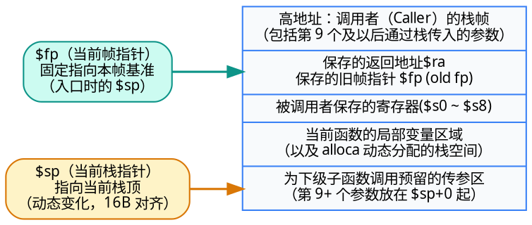

#### 三种典型编译情景下的栈帧演化

1. **情景 A：极简叶函数（无栈帧优化 vs `-fno-omit-frame-pointer`）**
   ```c
   int simple(int a, int b) {
       return a + b;
   }
   ```
   - 开启优化 `gcc -O2 -S` 时，因为 `simple` 既不调用别的函数（称为**叶函数 Leaf Function**），局部变量也全放在寄存器里，编译器**彻底不分配栈帧**，直接计算返回：
     ```asm
     simple:
         add.w   $a0, $a0, $a1
         jr      $ra
     ```
   - 若强制加上 `-fno-omit-frame-pointer` 保留帧指针，编译器会生成标准的 16 字节栈帧头尾：
     ```asm
     simple:
         addi.d  $sp, $sp, -16     # 函数头：开辟 16 字节对齐栈帧
         st.d    $fp, $sp, 8       # 保存调用者的旧 $fp
         addi.d  $fp, $sp, 16      # 将当前 $fp 设为进入函数时的原始 $sp
         add.w   $a0, $a0, $a1
         ld.d    $fp, $sp, 8       # 函数尾：恢复旧 $fp
         addi.d  $sp, $sp, 16      # 释放栈帧
         jr      $ra
     ```

2. **情景 B：编译期栈大小已知的普通函数（只需 `$sp` 即可，省掉 `$fp`）**
   ```c
   extern long callee9(long a1, long a2, long a3, long a4, long a5,
                       long a6, long a7, long a8, long a9);

   long normal(void) {
       return callee9(1, 2, 3, 4, 5, 6, 7, 8, 9);
   }
   ```
   因为 `normal` 调用了 9 参数的子函数，前 8 个进 `$a0~$a7`，第 9 个参数 `9` 必须放栈上，且自身 `$ra` 也会被 `bl callee9` 覆盖，因此需要开辟 32 字节栈帧（16 字节对齐）。但栈大小编译时完全确定，所以**直接用 `$sp + 常量偏移` 即可访问一切，不需要占用 `$fp`**：
   ```asm
   normal:
       addi.d  $sp, $sp, -32     # 开辟 32 字节栈帧
       st.d    $ra, $sp, 24      # 保护返回地址 $ra
       li.d    $t0, 9
       st.d    $t0, $sp, 0       # 第 9 个参数存放在 $sp+0（传参规范要求）
       # ... 装载 $a0~$a7 为 1~8 ...
       bl      callee9           # 调用子函数
       ld.d    $ra, $sp, 24      # 恢复 $ra
       addi.d  $sp, $sp, 32      # 释放栈帧
       jr      $ra
   ```

3. **情景 C：运行期动态栈分配 `alloca`（必须出动 `$fp` 镇场）**
   ```c
   #include <alloca.h>
   extern void use_buf(void *p);

   void dynamic(int n) {
       char *buf = alloca(64); // 或运行期才知道大小的 VLA / alloca(n)
       use_buf(buf);
   }
   ```
   一旦函数内部使用 `alloca` 在运行期动态向下压低 `$sp`，栈顶 `$sp` 的位置就不再固定了！此时如果还用 `$sp + 偏移` 去找局部变量或保护的 `$ra`，偏移量会随时变化。因此编译器**被迫启用 `$fp` 作为固定锚点**，保存入口 `$sp` 的位置，所有局部数据统一通过相对于 `$fp` 的固定负偏移访问，而 `$sp` 则先减去固定框架大小（如 32 字节）再减去动态分配的 64 字节（且仍维持 16 字节对齐）。

---

## 三、六种常见的上下文切换场景：软硬件如何接力？

CPU 在运行过程中，不会永远顺着同一段代码一直往下跑，而是经常要在不同的**执行上下文（Execution Context，即程序继续运行所必需的寄存器、栈、特权级、页表等全套现场状态）**之间来回切换。

下面我们从最轻量级到最重量级，依次拆解六种核心上下文切换场景。

### 3.1 场景一：函数调用（用户主动的轻量切换）

- **谁发起**：应用程序代码主动发起（`bl` / `jirl` / `call`）。
- **变了什么**：修改 `PC` 跳转执行流，调整栈帧 `$sp`；仅通过 ABI 约定维持 `$s0-$s8` 不变，其余临时寄存器无需硬件保存。
- **硬件设计权衡（为什么 SPARC 的“寄存器窗口”最终被历史淘汰？）**：
  - **RISC 典型做法（LoongArch / RISC-V / ARM）**：硬件极简，只提供一条跳转并把下一条地址写入 `$ra` 的指令（`bl`），压栈弹栈全交给软件根据需要按需生成（叶函数零开销）。
  - **x86 CISC 做法**：`call` 指令由硬件自动把返回地址压入内存栈，甚至带权限检查。
  - **SPARC 寄存器窗口（Register Windows）的反面教材**：SPARC 试图在硬件上彻底消灭函数调用时的参数拷贝和寄存器压栈开销——它做了一圈几十个物理寄存器窗口，每次调用函数执行 `save` 指令，窗口滑动一格，调用者的“输出寄存器”自动变成被调用者的“输入寄存器”，返回时执行 `restore` 滑回。虽然想法很巧妙，但在现代**乱序执行（Out-of-Order Execution）和寄存器重命名（Register Renaming）**微架构下，滑动窗口让物理寄存器映射电路变得极度复杂、深层递归溢出窗口时硬件陷入异常代价高昂，最终反而拖慢了主频和流水线效率，成为体系结构教材中著名的**“过度硬件优化”**反面案例。

### 3.2 场景二：异常与中断（透明接管 CPU 控制权）

- **谁发起**：同步异常（如除零、缺页、非法指令）或异步中断（如时钟滴答、键盘/USB 外设请求）。
- **核心要求**：**对被中断的用户程序完全透明**。内核处理完返回后，用户程序看到的 CPU 寄存器和状态必须和被打断前丝毫不差。
- **保存什么**：由于 Linux 内核通常不使用浮点部件，普通中断入口只需保存全部**整数通用寄存器**、触发异常的现场信息（异常返回地址 `ERA`、处理器状态 `CRMD` 等），并**将 `$sp` 切换到独立的内核中断栈**（防止用户传入恶意或耗尽的栈指针炸毁内核）。

**高频 vs 低频异常的工程权衡**：
- **低频外设中断（如键盘输入）**：入口汇编保存所有通用寄存器只需几十条指令，而后续真实的 Linux 内核处理路径动辄数百上千条指令还要读写慢速 I/O（例如一次 USB 键盘中断要经过 `except_vec_vi` → `do_IRQ` → 中断控制器框架 → `usb_hcd_irq` 读取键码 → `input_event` 推送给输入子系统），因此统一保存全套寄存器的开销比例微不足道；
- **极高频异常（如 TLB 重填，每当快表没命中虚拟地址映射时触发）**：如果每次都保存 32 个通用寄存器再去查页表，性能会暴跌！各架构对此拿出了截然不同的软硬件协同方案：
  - **x86**：完全用硬件状态机（Hardware Page Table Walker）自动查页表并填回 TLB，**根本不触发软件异常**；
  - **MIPS**：硬性从 32 个通用寄存器中割出 `$k0/$k1` 专供内核异常使用，免去压栈，代价是所有应用永远少 2 个可用寄存器；
  - **LoongArch**：采用**专有入口 + 便签寄存器（`CSR.SAVE`）+ 专用页表遍历加速指令（`lddir` / `ldpte`）**，既不牺牲通用寄存器，又能以极少指令极速完成重填。

### 3.3 场景三：系统调用（带权限跃迁的受控服务）

**系统调用（System Call）** 是用户态程序向操作系统内核申请服务（如读写文件 `read`/`write`、分配内存、获取高精度时间）的唯一合法通道。

它与函数调用很像，但**多了一次特权等级切换（用户态 `PLV3` → 核心态 `PLV0`）**，因此在硬件上通常被当作一种**由软件主动触发的特殊同步异常**来处理：

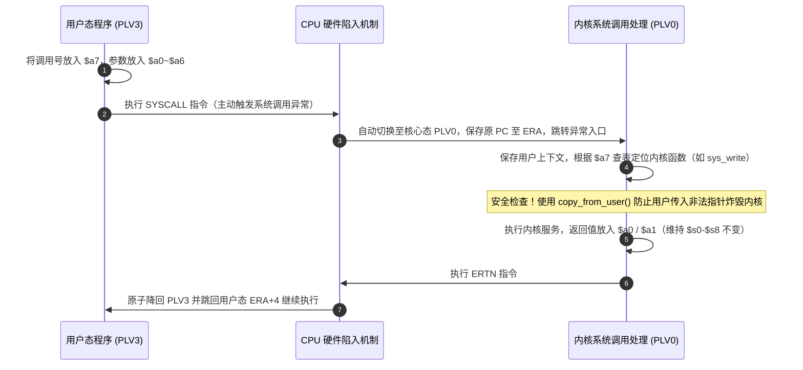

**为什么内核绝对不能直接解引用用户传来的指针？**
由于恶意或有 Bug 的用户程序可能传一个 `NULL` 或指向内核秘密数据的假指针给 `write(fd, buf, len)`，如果内核直接读取 `buf` 就会当场引发内核态缺页崩溃（Kernel Panic）。因此 Linux 内核必须使用专用安全函数 **`copy_from_user()`** 与 **`copy_to_user()`** 来跨越边界复制数据——它们自带专门的异常修复表（Exception Table），哪怕用户传入非法地址，内核也能优雅捕获错误并向用户返回 `-EFAULT`，自身安然无恙。

下面是一个直接用 LoongArch 汇编调用 `write` 系统调用（在 64 位通用 Linux 接口下 `sys_write` 调用号为 64）输出 `"Hello World!\n"` 的极简示例（日常编程中这层已被 `glibc` 的 `write()` 和 `printf()` 封装）：

```asm
# LoongArch Linux 直接发起 write(1, msg, 13) 系统调用示例
.data
msg:    .ascii "Hello World!\n"

.text
.globl _start
_start:
    li.d    $a0, 1          # 第 1 个参数：文件描述符 fd = 1 (标准输出 stdout)
    la.local $a1, msg       # 第 2 个参数：字符串缓冲区地址
    li.d    $a2, 13         # 第 3 个参数：字节长度
    li.d    $a7, 64         # 系统调用号 __NR_write = 64 放入 $a7
    syscall 0               # 陷入内核执行 write

    li.d    $a0, 0          # exit 状态码 0
    li.d    $a7, 93         # 系统调用号 __NR_exit = 93
    syscall 0               # 陷入内核退出进程
```

### 3.4 场景四：进程切换（CPU 与虚拟内存的分时复用）

**进程（Process）** 是操作系统资源分配的基本单位，由程序、数据集合和**进程控制块（PCB，记录了进程打开的文件、虚拟页表、信号、调度状态等全部档案）**组成。

- **切换时机**：① **主动让出**（等待磁盘 I/O、等待锁而阻塞）；② **被动抢占**（时间片耗尽或更高优先级进程就绪）。
- **核心动作**：操作系统先把当前进程的通用寄存器、程序计数器 `PC`、处理器状态、浮点/向量寄存器以及**页表基址寄存器**（x86 的 `CR3`、LoongArch 的 `PGDL/PGDH`）保存到内存 PCB 中，再加载下一个进程的对应状态，**彻底切换虚拟地址空间**。

**硬件协同的三大效率演进**：
1. **TLB 与 ASID（地址空间标识符）**：早年 x86 的 TLB 表项里没有进程 ID 标记，每次切换进程必须**清空整个 TLB**，导致新进程刚恢复运行时疯狂触发 TLB Miss；而现代架构（如 LoongArch 的 **ASID**、x86 的 PCID）给每个 TLB 表项贴上了进程“身份证标签”，切换进程时无需刷新 TLB，大幅保留了地址转换缓存热数据；
2. **懒加载（Lazy Save/Restore）向量与浮点寄存器**：现代 CPU 动辄带有 32 个 256 位甚至 512 位的宽向量寄存器（如 AVX-512），如果一个纯文字处理进程切换时也要全量保存几 KB 的向量寄存器就太浪费了。LoongArch/MIPS 允许内核通过控制寄存器直接**关闭浮点/向量部件**；若新进程真的用到了向量指令，会立刻触发“部件不可用异常”，内核趁机只为需要它的进程按需恢复向量现场；
3. **硬件任务切换（x86 TSS）为何被冷落？** x86 历史上曾设计了专门的任务状态段（TSS），支持一条硬件指令自动完成整套进程上下文切换。但实际操作系统需要更灵活的软件调度策略与局部状态裁剪，硬件打包切换反而僵化且没有明显性能优势，最终包括 Linux 和 Windows 在内的主流系统均放弃了它，只用软件完成调度切换。

### 3.5 场景五：线程切换（同一屋檐下的多条执行流）

**线程（Thread）** 是同一个进程内部的多个独立执行路径。同一进程的多个线程**共享同一份虚拟地址空间和打开的文件**，但各自拥有**独立的通用寄存器状态、独立的运行栈**以及各自的 **TLS（线程局部存储，如 GCC 中的 `__thread int counter;`）**。

- **内核级线程（1:1 模型，如 Linux NPTL `pthread`）**：每个用户线程对应一个内核调度实体。由于必须通过操作系统调度器切换，**哪怕不用切换页表，线程切换依然要经历“用户态 → 核心态 → 调度 → 核心态 → 用户态”的完整陷入过程**，因此简单基准测试下 Linux 进程与线程的直接切换耗时相差并不大（真正拉开差距的是进程切换带来的 TLB/Cache 冷启动间接惩罚）；
- **用户级协程/轻量级线程（如 Go 语言的 Goroutines）**：在用户态栈上通过一小段寄存器保存汇编直接切换，**完全不进内核**，其切换开销可比 Linux 线程库小一半以上；
- **硬件对 TLS 的加速对比**：在 LoongArch ABI 中，专用寄存器 **`$tp`（`$r2`）** 直接指向当前线程的 TLS 起始地址，访问线程局部变量只需要一条普通内存指令；而早期没有预留 `$tp` 的 Linux/MIPS 系统，用户态读取线程指针居然需要执行特殊指令 `rdhwr` **主动触发异常陷入内核**去读取内核数据结构，效率高下立判！

### 3.6 场景六：虚拟机切换（VM Exit / VM Entry，把整台机器虚拟出来）

进程虚拟化了“CPU + 内存”，而**虚拟机（Virtual Machine, VM）** 则把一颗物理 CPU、物理内存和外设整体虚拟成多台彼此彻底隔离的“虚拟计算机”（云计算的基石）。

- **纯软件模拟 vs 硬件辅助虚拟化**：
  - 跨指令集模拟（如用 QEMU 在 LoongArch 电脑上跑 x86 Windows）必须依赖**动态二进制翻译（Binary Translation）**把客户机指令翻译成宿主机指令，速度通常**不到宿主机的 10%**；
  - 同指令集下，现代处理器提供全套**硬件辅助虚拟化扩展**，使虚拟机性能逼近物理机（接近原生速度）：

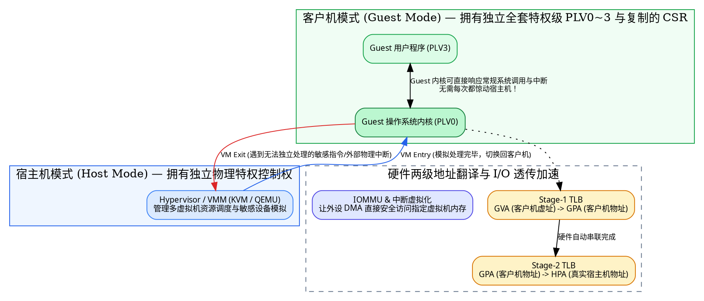

LoongArch 等现代架构在虚拟化硬件协同上的四大支柱：
1. **运行模式正交扩展**：引入与特权级 `PLV0~3` 正交的**客户机模式（Guest Mode）**和**主机模式（Host Mode）**，客户机内部也能完整拥有自己的用户态与内核态；
2. **特权资源硬件复制**：给客户机和宿主机各配一套独立的特权态控制寄存器（CSR），客户机读写自己的 CSR 不用每次陷入宿主机；
3. **两级地址翻译（2-Stage MMU/TLB）**：硬件直接把 **GVA（客户机虚拟地址）→ GPA（客户机物理地址）→ HPA（宿主机真实物理地址）** 两层页表查表与 TLB 串联在一起，免去软件影子页表的巨额维护开销；
4. **IOMMU 与中断虚拟化**：普通 MMU 给 CPU 翻译内存地址，而 **IOMMU（输入输出内存管理单元）** 为外部设备（如网卡、NVMe 盘、GPU）提供地址翻译与隔离保护，让外设 DMA 能够安全地“直通（Passthrough）”进虚拟机内存。

### 3.7 六种上下文切换场景终极对比表

| 切换场景 | 触发方式 | 切换执行者 | 特权级是否变化 | 虚拟地址空间是否切换 | 需要保存与恢复的核心内容 | 典型硬件协同加速机制 |
| :--- | :--- | :--- | :--- | :--- | :--- | :--- |
| **1. 函数调用** | 主动调用指令 | 用户程序（按 ABI 约定） | 否 | 否 | 返回地址 `$ra`、被调用者保存寄存器 `$s0-$s8`（按需） | 跳转链接指令 `bl`/`jirl` |
| **2. 异常与中断** | 同步错误 / 异步外设信号 | 硬件陷入 + 内核处理程序 | 通常变（用户→内核） | 否（借用当前进程内核映射） | 几乎全部 GPR、PC(`ERA`)、状态(`CRMD`)、内核栈切换 | 向量中断入口、便签寄存器 `SAVE`、专用重填指令 |
| **3. 系统调用** | 主动执行 `SYSCALL` | 用户约定 + 内核陷入 | 是（用户↔内核） | 否 | ABI 约定保 `$s0-$s8`，返回靠 `ERA` | `SYSCALL`/`ERTN` 指令、寄存器传参 |
| **4. 进程切换** | 阻塞让出 / 时间片抢占 | 操作系统内核调度器 | 内核中枢调度 | **是（更换页表基址）** | 全套进程上下文（GPR、PC、CR3/PGD、状态、按需浮点向量） | **TLB ASID 标签**、部件使能开关（懒加载） |
| **5. 线程切换** | 内核调度 或 用户协程让出 | 内核（1:1）或用户库（M:N） | 1:1 需进内核；协程不需要 | **否（同进程共享）** | 通用/浮点寄存器、栈指针 `$sp`、线程指针 `$tp` | 专用 TLS 寄存器 **`$tp`** |
| **6. 虚拟机切换** | 敏感指令/物理外设中断 | 硬件模式切换 + Hypervisor | 正交模式切换（Guest↔Host） | 切换至另一套两级地址空间 | 全套虚拟 CPU（含特权态 CSR、中断/定时器状态） | **Guest/Host 模式、复制 CSR、两级 TLB、IOMMU** |

---

# 中篇：并发世界的冲突根源与原子基石（`LL/SC` 与 `CAS`）

上面讨论的上下文切换，解决的是“**多个程序或线程如何轮流或隔离地使用 CPU**”。然而，当它们真正**并发访问同一份共享内存数据**时（无论来自另一个物理 CPU 核、被打断的中断上下文，还是内核抢占调度过来的另一线程），新的噩梦开始了。

---

## 四、同步机制分类：锁与非阻塞的权衡

### 4.1 为什么普通的 `Load / Store` 会丢失数据？（Lost Update）

假设共享内存里有一个计数器 `counter = 10`，两个 CPU 核同时想执行看似极其简单的 C 代码：

```cpp
counter++;
```

在底层硬件上，普通 CPU 无法一条普通指令直接把内存里的数字加 1，而是必须拆解为**“读（Load）→ 改（Add）→ 写（Store）”**三步。当两个核心同时运行这三步时，指令交错执行就会酿成**丢失更新（Lost Update）**：

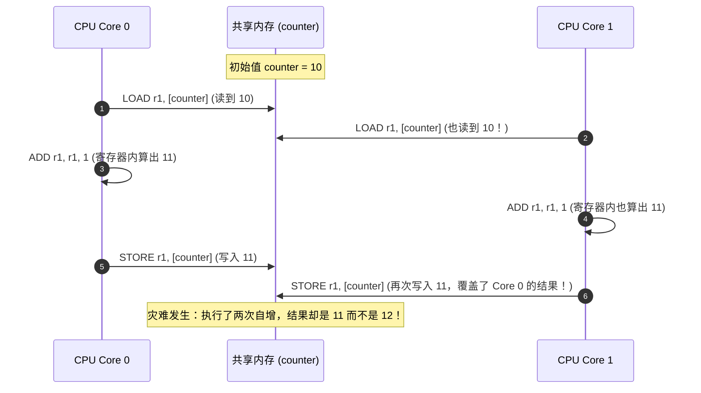

**根本原因**：不是 CPU 不会做加法，也不是缓存一致性协议坏了，而是**“读旧值 → 算新值 → 写回新值”这三个步骤没有作为一个不可分割的原子整体（Atomicity）执行**。

### 4.2 基于互斥的同步机制：自旋锁与互斥锁

为了保护包含多条指令的**临界区（Critical Section，同一时刻只允许一个线程进入并修改共享数据的代码段）**，传统操作系统采用**基于互斥（Mutual Exclusion）的锁机制**——把“并发”强制排成“串行”：

1. **自旋锁（Spinlock）**：
   - 线程发现锁被别人拿着时，**不放弃 CPU**，而是在原地死循环反复检查锁状态直到对方释放；
   - **适用场景**：确定持锁者在**另一个物理 CPU 核**上，且临界区极短（几十纳秒），避免操作系统线程切换（微秒级）的高昂代价；
   - **致命死锁陷阱**：如果在**单核不可抢占内核**上，当前线程已经打断了持锁者却试图拿同一把自旋锁，由于持锁者永远等不到 CPU 来释放锁，系统会当场永久卡死！（因此 Linux 单核编译时自旋锁的锁操作会退化为空操作或伴随关中断/关抢占）。
2. **互斥锁（Mutex）**：
   - 拿不到锁时，调用操作系统调度器把自己**挂起休眠（阻塞）**，让出 CPU 给其他线程；等持锁者释放锁时再将其唤醒。

### 4.3 锁的四大痛点与非阻塞同步的崛起

锁虽然直观，但这种**“先假设必定冲突、提前堵死其他线程”的悲观策略**存在四大固疾：
1. **死锁与永久等待**：持锁线程一旦崩溃、死循环或异常阻塞，所有等待该锁的线程将陪葬；
2. **无冲突也有过路费**：即使 99.9% 的时间根本没人和你抢数据，每次进出临界区仍要付出加锁、解锁与总线同步开销；
3. **极难复现的时序 Bug**：锁竞争引发的死锁或优先级反转依赖微秒级调度时机，调试极具噩梦属性；
4. **被调度器拖垮（Convoy Effect 护航效应）**：持锁线程如果恰好时间片用完或发生缺页中断被切走，所有其他核上的等待线程全都要干瞪眼。

于是，**非阻塞同步（Non-Blocking Synchronization）**应运而生：不再把门锁死，而是依靠硬件原子指令或事务机制，让线程**放胆先尝试执行，提交瞬间再去检验冲突**。

---

## 五、原子基石 `LL/SC` 与 `CAS` 的硬件真相

在深入高级事务内存之前，我们必须先看透构成所有锁与无锁算法的最底层砖块：**`LL/SC`（LoongArch/MIPS/ARM 称 `LL/SC`，RISC-V 称 `LR/SC`）** 与 **`CAS`**。

### 5.1 `LL/SC` 到底是如何工作的？

`LL/SC` 是一对相互配合、专门用来实现**原子读-修改-写（RMW）**的硬件指令：
- **LL（Load-Linked，关联加载；RISC-V 称 LR，Load-Reserved，保留加载）**：从内存地址 `X` 读出数据，**同时在硬件监视器中针对该地址（通常按 Cache Line 粒度）打下一个“保留标记”（Reservation / LL bit = 1）**；
- **SC（Store-Conditional，条件存储）**：仅当“之前建立的保留标记仍然有效（`LL bit == 1`）”时，才由硬件原子地将新值写入内存并向软件返回“成功”；只要在 `LL` 和 `SC` 之间有**其他 CPU 核修改了该地址（或发生异常/缓存行被逐出等硬件事件）**，监听逻辑就会把 `LL bit` 清零，`SC` **拒绝写入内存**并向软件返回“失败”。

> [!IMPORTANT] 破除初学者最大误解：`LL` 锁住内存了吗？
> **完全没有！** `LL` 既不会锁死总线，也不会阻止任何其他 CPU 核去读写这块内存。它只是在自己核的局部硬件里悄悄立了一根“监控雷达（Reservation Monitor）”；如果别人改动了数据，雷达响了（清零 `LL bit`），等自己最后想交卷（执行 `SC`）时自动作废重来。

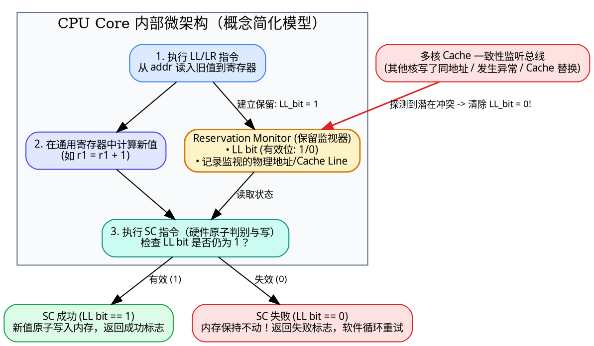

### 5.2 完整推演：双核用 `LL/SC` 解决 `counter++` 的 9 步全过程

把前面“丢失更新”的事故现场搬到 `LL/SC` 机制下，看看双核是如何无锁安全地把 `counter = 10` 正确加到 `12` 的（以典型缓存行保留失效行为为例）：

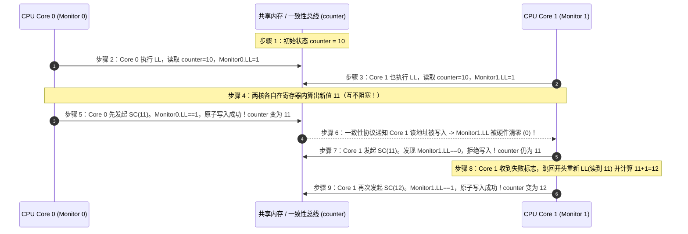

整个过程中，**没有任何一个核用锁堵住另一个核**。谁先抵达提交终点谁就胜出，落后者只是在局部检测到失效，重新读新值再试一次即可。

### 5.3 LoongArch vs RISC-V 汇编实现与自旋锁构造

虽然思想相同，不同指令集对 `SC` 成功/失败的**返回值约定恰恰相反**，写跨平台汇编或编译器后端时务必当心！

| 指令集架构 | 加载指令 | 条件存储指令 | `SC` **成功**返回值 | `SC` **失败**返回值 |
| :--- | :--- | :--- | :--- | :--- |
| **LoongArch** | `ll.w` / `ll.d` | `sc.w` / `sc.d` | **`1`**（写回原值寄存器） | **`0`**（写回原值寄存器） |
| **RISC-V (Zalrsc)** | `lr.w` / `lr.d` | `sc.w` / `sc.d` | **`0`**（写入独立状态寄存器） | **非 `0`**（通常为 `1`） |

#### 1) LoongArch 实现 `atomic_inc`、`test_and_set` 与自旋锁
注意看 LoongArch 中 `sc.w $t0, $a0, 0` 的一个精妙细节：**它会把成功(`1`)或失败(`0`)状态直接覆盖写回源操作数寄存器 `$t0`**，因此执行完 `sc.w` 后 `$t0` 里不再是刚算出的新值：

```asm
# 1. LoongArch 原子自增 atomic_inc (对应内核 atomic_inc)
atomic_inc:
    ll.w    $t0, $a0, 0      # 读取旧值并设置 LL bit = 1
    addi.w  $t0, $t0, 1      # 在寄存器里加 1
    sc.w    $t0, $a0, 0      # 尝试条件写入；成功后 $t0=1，失败则 $t0=0
    beqz    $t0, atomic_inc  # 若 $t0==0 (失败) 则跳回重试
    add.w   $a0, $t0, $zero
    jr      $ra

# 2. LoongArch "测试并设置" (Test-and-Set) 原语
    la.local $a0, lock
test_and_set:
    ll.w    $v0, $a0, 0      # 读出锁旧值
    li.w    $t0, 1
    sc.w    $t0, $a0, 0      # 尝试抢占写 1
    beqz    $t0, test_and_set

# 3. LoongArch 自旋锁 (Spinlock) 完整加解锁
    la.local $a0, lock
selfspin:
    ll.w    $t0, $a0, 0      # 读锁状态并挂保留
    bnez    $t0, selfspin    # 锁已被别人占着 (!=0)，先原地空转等待
    li.w    $t1, 1
    sc.w    $t1, $a0, 0      # 锁为 0，尝试用 SC 抢锁写入 1
    beqz    $t1, selfspin    # 没抢过别人，重新回去自旋
    # --- <Critical Section: 安全进入临界区操作共享数据> ---
    st.w    $zero, $a0, 0    # 释放锁（实际工程前需加内存屏障确保临界区写入先可见）
```

> [!TIP] 为什么 `LL` 和 `SC` 之间不能塞太多代码？
> 在单处理器下，任何异常/中断都会破坏 `LL bit`；在多核下，长时间间隔更容易遭遇他人修改或缓存行置换，导致 `SC` 几乎次次失败（活锁）。因此**不能直接用一套 `LL/SC` 包裹复杂的长临界区**，而是用极短的 `LL/SC` 抢一把“锁变量”，再用这把锁去保护长临界区！

#### 2) RISC-V 实现 `LR/SC` 原子自增
在 RISC-V（`Zalrsc` 原子扩展）下，`sc.w` 把状态写入第三个独立寄存器 `t2`，且判断跳转用 `bnez`（非零即失败）：

```asm
# a0 = counter 的内存地址
retry:
    lr.w    t0, (a0)         # t0 = *a0，建立保留
    addi    t1, t0, 1        # t1 = t0 + 1（不破坏 t0）
    sc.w    t2, t1, (a0)     # 尝试写入 t1；成功 t2=0，失败 t2!=0
    bnez    t2, retry        # 非 0 则跳回重试
```

*(注：RISC-V 官方规范对 LR/SC 的保留粒度——如整个 Cache Line——以及保证前向进度的最大循环指令数均有严格约束。)*

### 5.4 从 C++ `std::atomic` 到硬件指令与内存顺序（Memory Ordering）

当你写下现代 C++ 原子代码时，编译器后端会怎样把它降低（Lowering）成底层指令？

```cpp
std::atomic<int> counter{10};
counter.fetch_add(1, std::memory_order_relaxed);
```

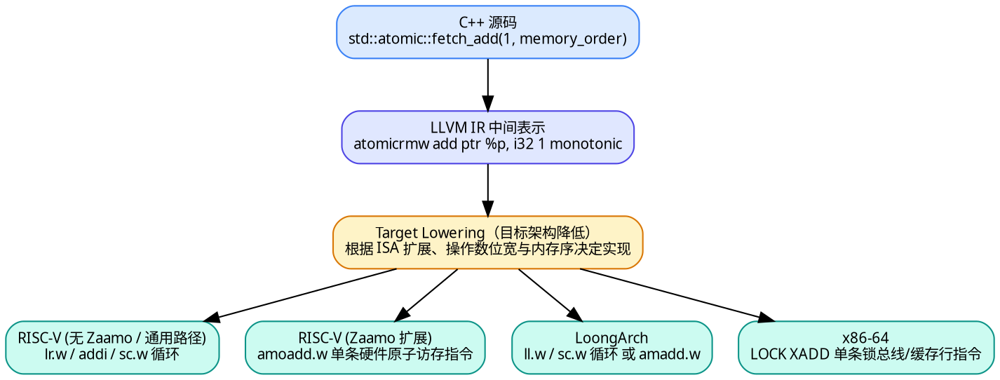

> [!WARNING] 编译器开发核心考点：原子性 ≠ 内存顺序（Memory Ordering）！
> 很多人以为用了 `LL/SC` 或 `amoadd` 就万事大吉了。其实不然！**原子性**只保证 `counter++` 自己这一个操作不会被拆成两半；它**并不保证**周围普通内存读写（比如 `ready = 1` 之前写入的 `data = 42`）一定按照代码顺序对其他 CPU 核可见！
> 在弱内存模型架构（如 RISC-V RVWMO、ARM64、LoongArch）下，CPU 可能重排访存指令。因此 RISC-V 专门在 `lr`/`sc` 和 `amo` 指令上提供了 `.aq`（Acquire，获取屏障）与 `.rl`（Release，释放屏障）修饰位，编译器必须根据 C++ 传入的 `memory_order_acquire / release / seq_cst` 精准生成对应屏障指令。

### 5.5 `LL/SC` vs `CAS`：除了指令形态，本质差异在哪里？

在 C++ 无锁编程中，大家更熟悉的往往是 **CAS（Compare-And-Swap，比较并交换）**：

```cpp
// 概念逻辑：如果 *addr == expected，则改成 desired 返回 true；否则把当前真实值更新进 expected 返回 false
counter.compare_exchange_weak(expected, desired);
```

| 对比维度 | CAS（比较并交换） | LL/SC（关联加载 / 条件存储） |
| :--- | :--- | :--- |
| **判定依据** | **看“值”**：当前内存里的值是不是等于我期待的 `expected`？ | **看“行踪”**：在我 `LL` 之后到 `SC` 之前，有没有任何核动过这块内存？ |
| **指令形式** | 通常为单条复合原子指令（如 x86 `LOCK CMPXCHG`） | 由 `LL` 和 `SC` **两条相互配合**的指令组成 |
| **ABA 问题** | **先天免疫不了**：若内存从 `A → B → A`，CAS 以为没变过，照样成功！ | **硬件可感知**：只要中间有过写操作 `B`，保留标记就会被清除，`SC` 直接失败！ |
| **常见模拟关系** | 在没有硬件 CAS 的 RISC 芯片上，用一段极短的 `LL/SC` 循环来模拟实现 CAS | — |

#### 经典并发陷阱：ABA 问题时序图

为什么在无锁链表（Lock-Free Stack/Queue）中，ABA 问题会导致指针释放后重用（Use-After-Free）灾难？

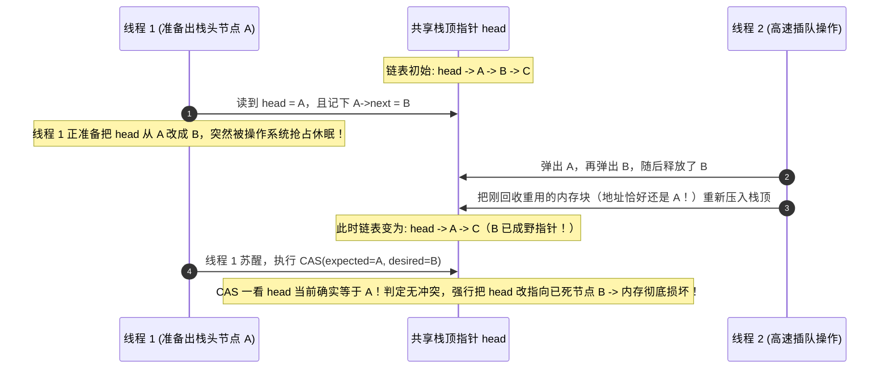

如果底层采用真正的硬件 **`LL/SC`**，线程 2 中途修改 `head` 时硬件已清除线程 1 的保留标记，线程 1 苏醒后执行 `SC` 会失败。（*注：如果语言级只提供了 `compare_exchange` 接口且底层只是在循环里重新 `LL` 验证当前值，ABA 仍可能在上层发生；此外无锁结构仍需依赖 Hazard Pointers 或 Epoch 回收解决内存生命周期安全。*）

---

# 下篇：从第一性原理打通事务（TM、ACID 与异构 Runtime）

现在，我们终于可以回过头来深度解读本文开篇提到的核心洞察：

> **“事务内存的核心思想是先尝试性地执行操作，在执行过程中动态检测冲突，最后决定是提交还是取消；事实上，LL/SC 可以被视为事务内存的一种最基础的实现。”**

数据库事务、事务内存、LL/SC、乐观锁，它们到底在解决什么共同问题？

---

## 六、什么是事务（Transaction）？从银行转账说起

### 6.1 逻辑不可分 vs 物理分步执行

假设银行系统里有账户 A（1000 元）和账户 B（500 元），现在从 A 转账 200 元给 B：

```cpp
A.balance -= 200;  // 步骤 1：A 变成 800
// <--- 危险空隙：此时总余额是 1300，平白无故少了 200 元！
B.balance += 200;  // 步骤 2：B 变成 700
```

这就暴露出计算机系统中一个最普遍的矛盾：**业务逻辑上不可分割的一个动作，在物理硬件上必须拆分成多条步骤执行。** 如果在“危险空隙”发生程序崩溃，或者另一个查询总余额的线程恰好路过，就会看到荒谬的中间残缺状态。

### 6.2 事务的本质：建立“草稿区”与“一次性结算”

**事务（Transaction）** 就是为了消弭这种矛盾而发明的抽象机制：它把一组操作打包成一个**逻辑执行单元**，对外表现出**“要么全生效，要么全没发生过”**的整体效果——注意，这**不是要求多个操作在同一个物理时钟周期完成，而是通过控制对外可见性，让外界只能看到最终合法结果**。

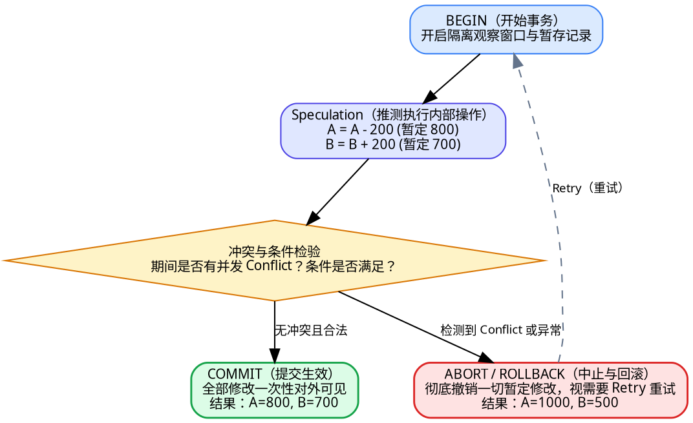

先对齐这组贯穿全文的事务通用术语：
- **Begin / Commit / Abort**：事务的开始、正式提交生效、主动或被动中止；
- **Rollback（回滚）**：把事务执行过程中留下的半成品痕迹擦除干净，恢复原状；
- **Conflict（冲突）**：两个并发事务对同一数据发生了不兼容的读写访问；
- **Speculation（推测执行）**：先大胆跑一遍看看结果，事后再决定认不认账；
- **Retry（重试）**：冲突回滚后重新再来一次。

---

## 七、事务内存（Transactional Memory）：乐观并发控制

传统的互斥锁操作的是临界区，而**事务内存（TM）**操作的是程序运行时的**共享内存变量**。

### 7.1 悲观的锁 vs 乐观的事务内存

假设线程 1 转账 `A -> B`，线程 2 操作完全不相干的 `C -> D`：
- **如果共用同一把粗粒度锁（悲观同步）**：假设冲突必定发生，线程 2 哪怕碰不到 A 和 B，也必须站在门外干等线程 1 释放锁；
- **使用事务内存（乐观同步）**：不提前获取锁，让线程 1 和线程 2 **大胆并发同时往前跑**；运行时默默记下各自碰了哪些地址，提交前核对账本——发现两人压根没撞车，双双丝滑并行提交！只有真的同时改了同一块数据时，才让其中一个回滚重试。

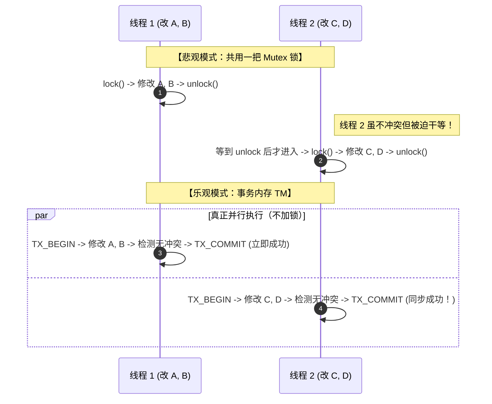

### 7.2 事务内存如何精准抓出冲突？Read Set 与 Write Set

为了判断两个并发事务有没有“撞车”，事务内存系统会为每个活跃事务维护两个关键账本：
- **Read Set（读集合）**：事务执行期间**读取过**的所有共享内存地址；
- **Write Set（写集合）**：事务执行期间**修改过**的所有共享内存地址。

例如执行以下代码：
```cpp
transaction_begin();
int temp = a + b;   // Read Set 加入 {a, b}
c = temp * 2;       // Write Set 加入 {c}
transaction_commit();
```

当事务 A 与事务 B 并发运行时，冲突判断规则极其清晰（至少一方为写，且访问交集非空即冲突）：

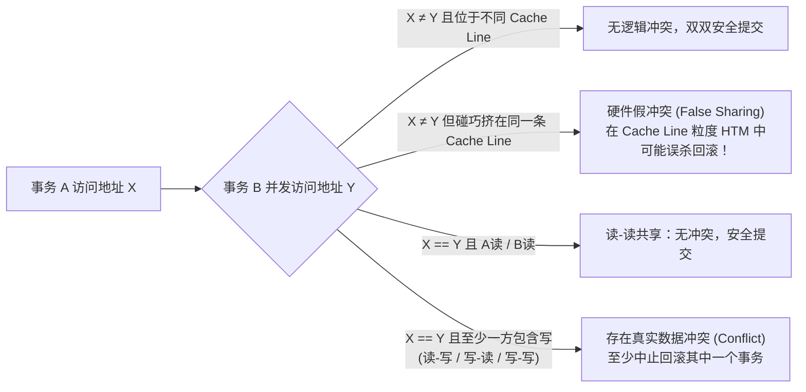

> [!NOTE] 什么是伪共享（False Sharing）假冲突？
> 尽管变量 `x` 和 `y` 在 C++ 代码里八竿子打不着，但 CPU 硬件缓存不是按 4 字节而是按 **64 字节的 Cache Line（缓存行）**管理一致性的。如果 `x` 和 `y` 刚好紧挨着住在同一个 64 字节房间里，基于 Cache Line 监控冲突的硬件事务内存就分不清你俩谁改了谁，只要一个核改了 `x`，另一个核访问 `y` 的事务也会被当作“同房间冲突”直接中止！

### 7.3 事务内存的三种实现流派：STM、HTM 与 HyTM

| 类型 | 全称 | 实现层级 | 核心原理 | 优点与代价 |
| :--- | :--- | :--- | :--- | :--- |
| **STM** | Software Transactional Memory | 软件运行时库 / 编译器插桩 | 拦截读写请求：读时记日志/查版本，写时先存入**私有写缓冲区（延迟更新 Deferred Update）**或直接写+写 **Undo Log（撤销日志）**，提交时用锁/原子操作验证并正式发布 | **无容量上限**、纯软件通用；但每次普通访存都要插桩查账，时间和空间开销极大 |
| **HTM** | Hardware Transactional Memory | 处理器硬件微架构 | 直接复用 CPU 现有的 **L1 Cache、Cache Coherence（缓存一致性协议）与推测执行硬件**跟踪读写集 | **接近原生硬件速度**、零插桩开销；但容量受 L1 Cache 大小限制，且容易因中断、容量溢出中止 |
| **HyTM** | Hybrid Transactional Memory | 软硬件混合 | 优先尝试跑快速 HTM 路径；一旦超容或频繁失败，自动无缝降级到 STM 或全局锁兜底 | 兼顾常规高性能与极端情况下的正确性 |

#### 深入硬件事务内存（HTM）：以 Intel TSX (RTM) 与历史演进为例

商业处理器中，IBM（Blue Gene/Q、Power8）与 Intel（Haswell 起引入 **TSX** 扩展，早期 Sun Rock 曾尝试研发但在发布前取消）都曾提供过硬件事务内存。以 Intel TSX 的受限事务内存（RTM）为例，ISA 新增了四条指令：
- `XBEGIN fallback_addr`：开启硬件事务，并指定一旦失败回滚后自动跳转的兜底路径地址；
- `XEND`：尝试原子提交整个事务；
- `XABORT`：软件主动中止当前事务并回滚；
- `XTEST`：查询当前是否正处于硬件事务之中。

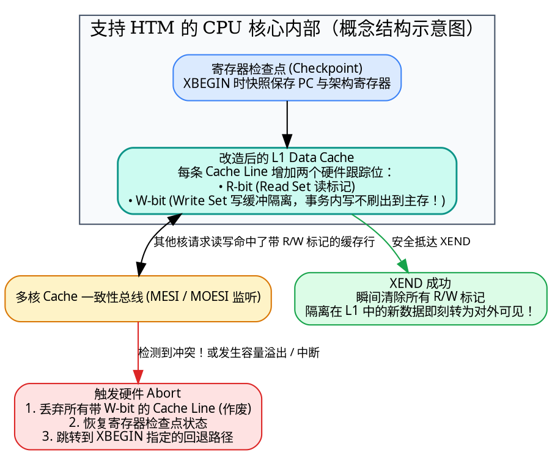

**HTM 与“精确异常（Precise Exception）”的深层共鸣**：
- **精确异常**：CPU 乱序推测执行时，若某条指令出错，硬件依靠重排序缓冲区（ROB）和 Store Queue 拦截尚未提交的写操作，保证对外呈现为严格的顺序执行语义；
- **硬件事务**：相当于把这种“允许先算但先别真正刷进公开内存”的能力，从**单条指令**扩张到了 **`XBEGIN ~ XEND` 之间的整段指令流**！（当然，两者同样不会恢复所有纯粹的微架构痕迹——例如事务中被触发填充进 Cache 的读缓存行或替换状态可能依然留在微架构中。）

### 7.4 为什么 HTM 永远不能完全替代锁？

虽然 HTM 很快，但它存在两个无法克服的天花板，因此商业 HTM 属于 **尽力而为（Best-Effort）** 机制，**工程上必须配合锁作为失败兜底路径（Fallback Path）**：

1. **硬件资源有限且极易“无辜流产”**：L1 Cache 容量只有几十 KB，事务里读写数据太多、Cache 路冲突被踢出、发生时钟中断甚至系统调用，**哪怕没有任何线程跟你争抢数据，硬件事务也会强制中止**！因此事务内存**不等于**满足严格数学意义上的无锁进度保证（Lock-Freedom）。
2. **存在“不可撤销的物理副作用”**：设想在事务里夹杂了外部 I/O：
   ```cpp
   transaction_begin();
   a = 800;
   start_dma();           // 已经命令 DMA 引擎开始搬运内存！
   send_network_packet(); // 已经把以太网数据包发射到网线上了！
   transaction_commit();
   ```
   如果最后一刻发生冲突需要回滚，CPU 总不能伸手去网线里把已经发到地球另一端的数据包抓回来，也无法撤回已经触发的外设中断！因此，**软件/硬件事务内存严禁直接包裹不可撤销的 I/O 与 MMIO 操作**。

---

## 八、为什么说 `LL/SC` 是“最基础的事务内存”？

现在回到最初的那个经典问题，把 **`LL/SC`（`LR/SC`）** 与 **事务内存（TM）** 并排放在一起对比：

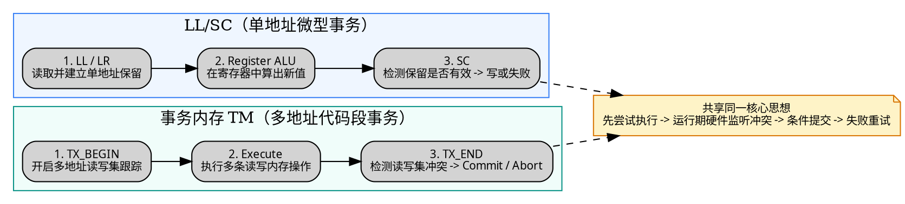

两者在灵魂上**完全同构**！但切记：**这是“设计思想上的类比”，绝不意味着 `LL/SC` 具备完整的事务内存能力**。看下面这个反例就懂了：

```cpp
// 错误示范！企图用两次 LL/SC 完成银行转账事务：
LL(a);
a_new = a - 200;
b_new = b + 200;
SC(a, a_new);  // 假设这里成功了，a 已经被扣了 200！
SC(b, b_new);  // 致命错误：既没有针对 b 的有效保留，哪怕有，b 若失败也没法自动把 a 还原回原值！
```

`LL/SC` 的三大边界局限在于：
1. **通常只支持单个目标地址（或单个字/双字）的条件存储**，无法把两个分散地址打包在一起原子提交；
2. **硬件只跟踪是否写入，不自动维护多地址“写前日志/撤销缓冲”**，中间执行过的普通 `Store` 指令一旦写出去就收不回来了；
3. **失败时不会自动恢复通用寄存器**，全靠软件写循环跳回重算。

---

## 九、大统一视角：数据库事务（ACID）与全栈分层模型

### 9.1 数据库事务与 ACID 特性

跳出 CPU 指令层来到软件顶层，**数据库事务**（如 SQL 的 `BEGIN TRANSACTION; ... COMMIT; / ROLLBACK;`）解决的是业务数据的全局一致性。经典的数据库事务承诺 **ACID 四大黄金特性**：

| 字母 | 英文全称 | 通俗含义（以银行转账为例） |
| :--- | :--- | :--- |
| **A** | **Atomicity（原子性）** | 要么全成功，要么全失败。绝不能只扣了 A 的钱却没给 B 加上。 |
| **C** | **Consistency（一致性）** | 合法状态变迁到另一个合法状态（满足主键/外键约束，业务守恒规则需应用逻辑与数据库共同保障）。 |
| **I** | **Isolation（隔离性）** | 并发事务彼此受控隔离（依据隔离级别，避免一个事务看到另一个事务尚未提交的“脏读”中间数据）。 |
| **D** | **Durability（持久性）** | 一旦 `COMMIT` 成功，就算下一秒机房断电、服务器炸机重启，这笔转账也必须永久落盘或能恢复出来！ |

数据库并不是靠某一条 CPU 指令实现 ACID 的，而是依靠一整套复杂的**软件组合拳**：
- **锁（Lock）** 与 **OCC（乐观并发控制）**：调度读写权限、检测并发冲突；
- **MVCC（多版本并发控制）**：为数据保留多个历史版本快照，实现“读不阻塞写、写不阻塞读”；
- **Undo Log（撤销日志）**：记下“修改前长什么样”，既支持 `ROLLBACK` 时恢复原貌，也常用来为 MVCC 构造旧版本；
- **Redo Log（重做日志）** 与 **WAL（Write-Ahead Logging，预写日志原则）**：规定**任何数据页真正刷盘前，必须先把修改动作的日志写进磁盘持久化**，保证断电重启后能把已经提交却还留在内存里的数据重放恢复出来！

### 9.2 终极横评：`LL/SC` vs 事务内存 vs 数据库事务

| 对比维度 | `LL/SC` | 事务内存（TM） | 数据库事务 |
| :--- | :--- | :--- | :--- |
| **操作对象** | 单个条件存储内存地址 | 多个共享内存地址 | 数据库表、行记录与索引 |
| **所处层次** | ISA / 硬件指令层 | 硬件微架构（HTM）或语言运行时（STM） | 数据库管理系统（DBMS）软件层 |
| **原子性范围** | 单次条件读-改-写 | 事务块内的全部内存修改 | 整个业务事务内所有 SQL 操作 |
| **冲突检测手段** | 硬件保留位（Reservation / LL bit） | 读集合 / 写集合（Cache Line 或软件账本） | 锁、MVCC 多版本、OCC 验证 |
| **失败后自动撤销多个写** | **不支持** | **支持**（自动丢弃事务内未提交修改） | **支持**（借助 Undo Log 自动回滚） |
| **D：断电持久性** | 不提供 | 通常不提供（断电内存全丢） | **核心职责**（依靠 WAL / Redo Log 持久化） |

从 ACID 角度看，**事务内存（TM）最核心关注的是 A（原子性）与 I（隔离性）**，不负责断电持久化；而数据库系统则把完整的 ACID 扛在了更高层的软件肩上。

### 9.3 它们之间存在上下级依赖吗？——计算机系统并发全栈图

数据库并不会直接要求 CPU 一定要具备 HTM 硬件事务内存，但数据库内部的锁、无锁队列与内存页管理，底层却大量依赖于 `LL/SC` 和 `CAS` 这些硬件原子原语：

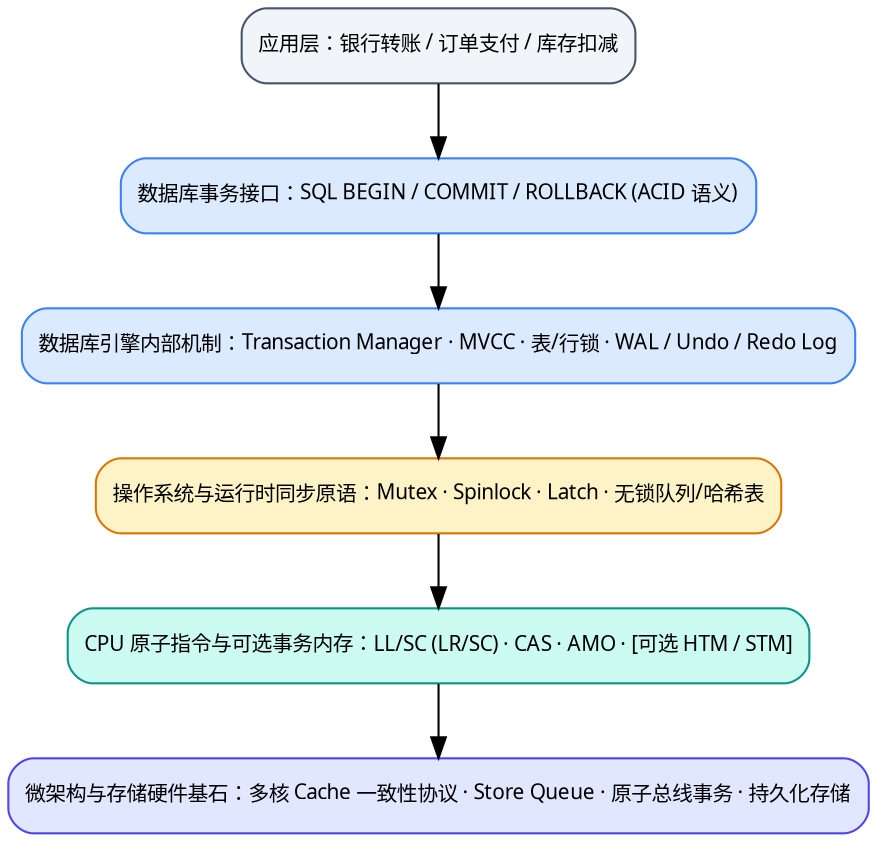

---

## 十、工程实战迁移：事务思想如何指导异构加速器（NPU）编译器与 Runtime 开发？

理解上述体系结构与事务机制的最终价值，是把它迁移到真实的系统工程中。在现代**可重构数据流加速器或 AI 处理器（NPU）**的**编译器后端与 Runtime（运行时调度软件）**开发中，虽然硬件不一定自带“事务内存”，但**事务的设计哲学极其管用**。

### 10.1 问题场景：把“多步物理寄存器配置”封装为“逻辑原子任务”

假设主控核上的 Runtime 要向 NPU 下发一次张量计算任务，需要通过 **MMIO（内存映射 I/O）** 连续写入多组配置寄存器：

```cpp
// 物理上是 5 次独立的寄存器写操作，但业务上是一个不可分割的计算任务！
cfg_scratchpad(...);    // 1. 配置片上共享存储（Scratchpad / SRAM）分块
cfg_addr_gen(...);      // 2. 配置地址生成单元（AGU）的步长与跨度
cfg_compute_engine(...);// 3. 配置计算阵列（Compute Engine）算子模式与数据类型
cfg_output_dma(...);    // 4. 配置输出数据搬运目标地址
launch_compute();       // 5. 触发硬件启动执行！
```

如果第 2 步写完后发现第 3 步参数越界出错，或者此时另一个并发线程也往同一组硬件寄存器里塞配置，硬件就会在半残配置下直接跑飞甚至死锁！

### 10.2 借鉴事务思想的 6 阶段稳健 Runtime 提交流水线

我们可以将“执行、验证、生效”彻底拆开，构建类似事务的 6 阶段控制流：

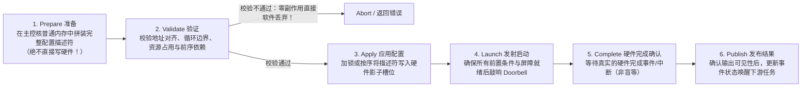

### 10.3 谨记硬件物理边界：软件假装不了硬件事务

1. **不可撤销的物理动作依然不能软件回滚**：一旦通过 MMIO 触发了 DMA 搬运或发射了计算指令，片上数据可能已经被覆写。**软件不能靠 `if (err) rollback()` 让已经跑起来的物理 DMA 时光倒流**——因此 `Validate` 必须在 `Launch` 之前 100% 完成！
2. **想要真正的配置级事务，需要硬件原生配合**：
   - **影子寄存器（Shadow Registers）与配置提交（Configuration Commit）**：允许软件在后台慢慢往影子寄存器填下一帧配置，直到最后写一个 `COMMIT` 控制位才在单个时钟周期把整套配置无缝切入生效（Double Buffering）；
   - **命令缓冲区（Command Buffer / Ring Buffer）与门铃（Doorbell）**：主控核在普通可缓存 DDR 内存里把整批指令打包写好，执行写内存屏障（`fence`）确保数据落入可见边界后，最后只写一次极轻量的 MMIO Doorbell 寄存器通知硬件去取；
   - **真实完成事件（Completion Event）与故障恢复（Fault Recovery）**：严格区分“命令已发射（Launch）”与“硬件真正落盘完成（Completion + Visibility）”。
3. **跨核通信别盲目假设 MMIO 支持 `LR/SC`**：在多核异构系统（如主控核与向量计算核协同）中，**绝对不能因为主控 CPU 支持 `LR/SC` 就默认它能对任意 MMIO 外设地址执行 `LR/SC` 原子操作**！许多片上总线互连（Interconnect）和外设从机根本不支持对非缓存（Uncached）MMIO 区间维护 Reservation 监控，盲目使用可能直接触发总线错误（Bus Error）或原子性悄然失效——同步标志务必放在支持一致性或明确定义支持总线原子事务的内存区域中。

---

## 十一、知识体系总结与自我检验清单

### 11.1 一句话记忆十个核心概念

| 核心概念 | 最值得印在脑海里的一句话 |
| :--- | :--- |
| **ABI** | 多个二进制模块之间在寄存器、调用约定、栈帧布局上互相听得懂的“交通规则”。 |
| **上下文切换** | 通过软硬件按需保存与恢复状态，让单份物理硬件分时复用成多个虚拟执行体。 |
| **原子性（Atomicity）** | 多个物理执行步骤对外表现为一个不可分割的整体操作。 |
| **锁（Lock）** | 悲观协调机制：通过提前抢占“门票”来避免共享访问撞车。 |
| **CAS** | 检查当前值符合期望才允许替换，但可能受困于中间改回原值的 ABA 问题。 |
| **LL/SC (LR/SC)** | 用硬件监视“期间没人动过”的保留标记，实现条件写入，是微型无锁基石。 |
| **事务内存（TM）** | 乐观机制：先大胆执行一组内存修改并跟踪读写集，无冲突则整组提交，否则回滚。 |
| **数据库事务（ACID）** | 依靠锁、MVCC 与 WAL 日志，在软件最高层兑现原子、一致、隔离与**断电持久性**。 |
| **Cache Coherence** | 多核之间协调私有缓存副本一致性的幕后协议，也是 `LL/SC` 和 HTM 监听冲突的物理依靠。 |
| **Memory Ordering** | 约束内存读写何时对其他处理器可见的秩序契约；原子性并不自动等于全局可见顺序。 |

### 11.2 贯穿体系结构的终极法则

回望从 ABI 函数尾返回、CPU 乱序精确异常、`LL/SC`、`HTM`、数据库 `WAL`，直到异构 NPU Runtime 的任务提交，它们共同演绎着计算机体系结构最深刻的统一设计哲学：

> **执行不等于生效，计算不等于提交，局部状态不等于全局可见状态。**

正是通过把**“尝试执行（Execute）”、“冲突验证（Validate）”与“正式提交可见（Commit）”**清晰地剥离，现代软硬件系统才能在严格守住正确性底线的前提下，榨干每一分并行与优化的红利。

---

### 11.3 课后思考与实战练习（附参考解析）

尝试独立思考以下经典软硬件协同练习题，再展开核对解析：

<details>
<summary><strong>练习 1：按 Linux/LoongArch64 ABI，下列函数调用的 9 个参数分别如何传递？</strong></summary>

```c
struct small { char c; int d; } sm;                  // 大小 8 字节 (含 3B padding)
struct big { long a1, a2, a3, a4; } bg;              // 大小 32 字节
extern long nested(char a, short b, int c, long d,
                   float e, double f,
                   struct small g, struct big h, long i);

long test(void) {
    return nested((char)0x61, (short)0xffff, 1, 2, 3.0f, 4.0, sm, bg, 9);
}
```

**参考解析**（`LP64` 中 `XLEN = 64`）：
1. `a` (`char`) → 整型参数 **`$a0`**（低 8 位符号扩展至 64 位）；
2. `b` (`short`) → 整型参数 **`$a1`**（`0xffff` 作为有符号 `short` `-1` 符号扩展至 64 位）；
3. `c` (`int`) → 整型参数 **`$a2`**；
4. `d` (`long`) → 整型参数 **`$a3`**；
5. `e` (`float`) → 独立浮点寄存器 **`$fa0`**（扩展至 `FLEN` 位宽）；
6. `f` (`double`) → 独立浮点寄存器 **`$fa1`**；
7. `g` (`struct small`) → 大小 8 字节 $\le \text{XLEN}$，直接在整型寄存器 **`$a4`** 中按内存布局传递（其中 3 字节填充位未定义）；
8. `h` (`struct big`) → 大小 32 字节 $> 2\times \text{XLEN}(16\text{B})$，**按引用传递**：调用者在自己栈上准备好 `bg` 的副本，把该副本的 64 位地址指针放进 **`$a5`**；
9. `i` (`long 9`) → 整型寄存器 **`$a6`**（`$a0~$a7` 还有空位，因此无需上栈！）。

</details>

<details>
<summary><strong>练习 2：为什么编译器在编译包含 alloca() 的函数时，即使开启 -O2 也往往不能省略帧指针 $fp？</strong></summary>

**参考解析**：普通函数在编译时就能确定所有局部变量的栈字节总数，所以函数入口处将 `$sp` 一次性向下减去固定大小后，后续所有局部变量和保护的 `$ra` 都能通过 `$sp + 固定编译期常量` 找到。而 `alloca()` 在运行期动态移动 `$sp`，导致 `$sp` 相对于函数入口基准位置的偏移量在编译期无法预测。因此编译器必须保留 `$fp` 锚定函数刚进入时的栈基址，用 `$fp - 固定偏移` 定位原有变量，用 `$sp` 跟踪动态变化的栈顶。

</details>

<details>
<summary><strong>练习 3：写出一段结构体的 C 代码，验证为什么调整字段顺序会大幅改变 sizeof(struct)？</strong></summary>

**参考解析**：ABI 规定结构体中每个基础成员的起始偏移量必须是其**自然对齐值（通常等于自身类型大小，如 `long/double` 为 8、`int/float` 为 4、`short` 为 2、`char` 为 1）的整数倍**，且整个结构体的总大小必须是所有成员中最大对齐值的整数倍：
- 糟糕排序：`struct Bad { char a; long b; char c; int d; };` → `a`(1B) + 7B填充 + `b`(8B) + `c`(1B) + 3B填充 + `d`(4B) = **24 字节**（浪费 10 字节！）；
- 紧凑排序（按对齐大小降序排列）：`struct Good { long b; int d; char a; char c; };` → `b`(8B) + `d`(4B) + `a`(1B) + `c`(1B) + 2B尾填充 = **16 字节**，空间立省 33%。

</details>

<details>
<summary><strong>练习 4：如果有人说“既然用 LL/SC 实现了原子计数，那我用两对连续的 LL/SC 也能保证转账 A-=200 和 B+=200 的事务原子性”，对吗？</strong></summary>

**参考解析**：**完全错误。** 一方面，两次独立的 `LL/SC` 之间没有整体提交边界，第一次 `SC(A)` 成功后外部线程立刻就能看到 `A` 少了 200 的残缺状态；另一方面，如果第二次 `SC(B)` 失败，硬件既无法自动回滚第一次已经写进内存的 `A`，也无法保证在同一时刻同时持有对两个任意不相邻物理地址的独占条件提交。多地址联合原子提交必须依赖锁、软件事务内存（STM）或硬件事务内存（HTM）。

</details>
