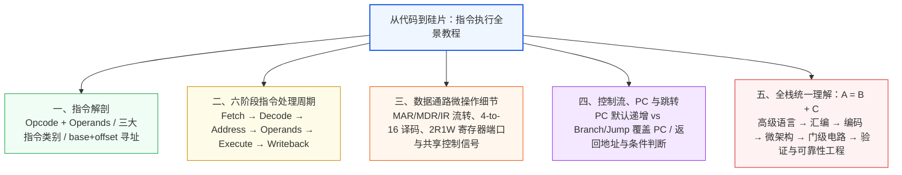
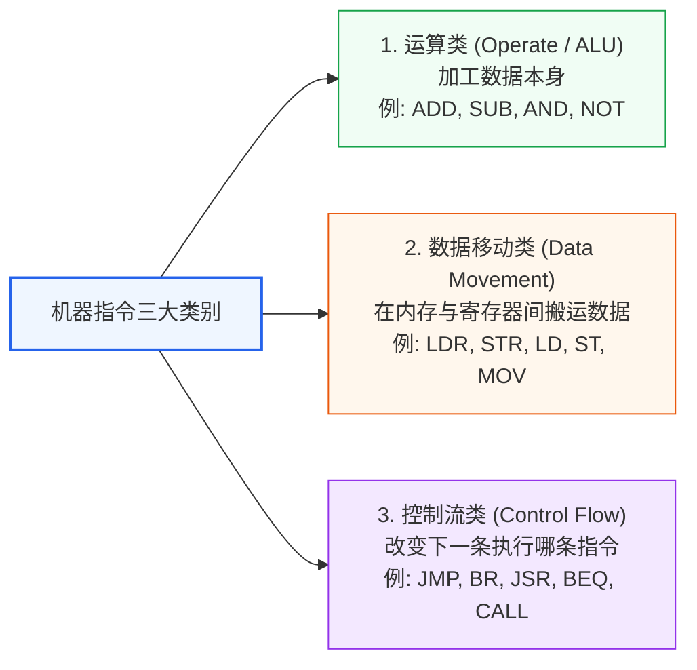
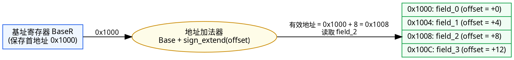
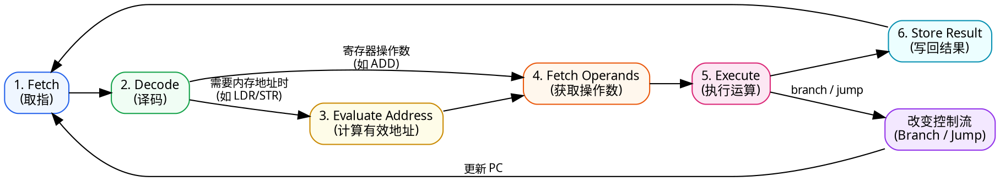
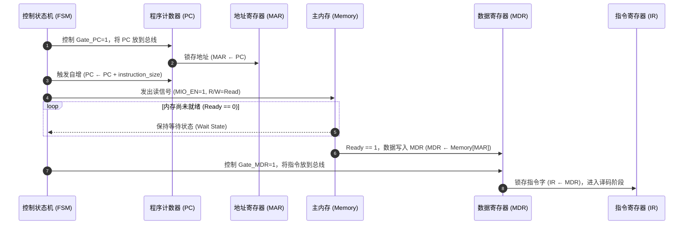
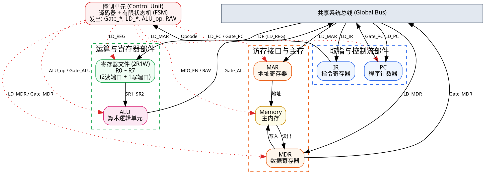
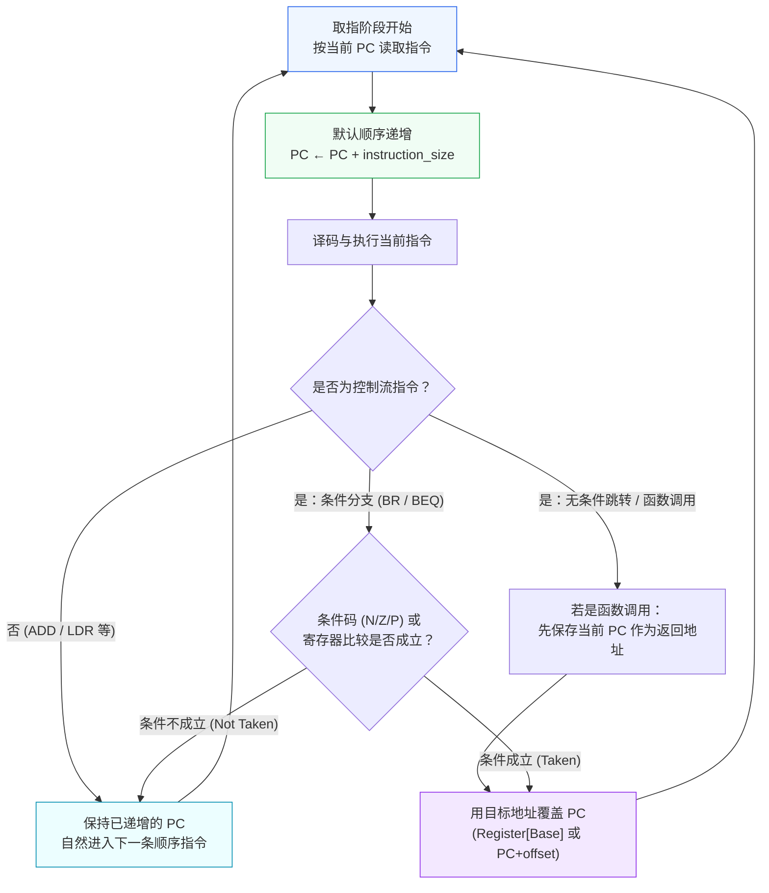
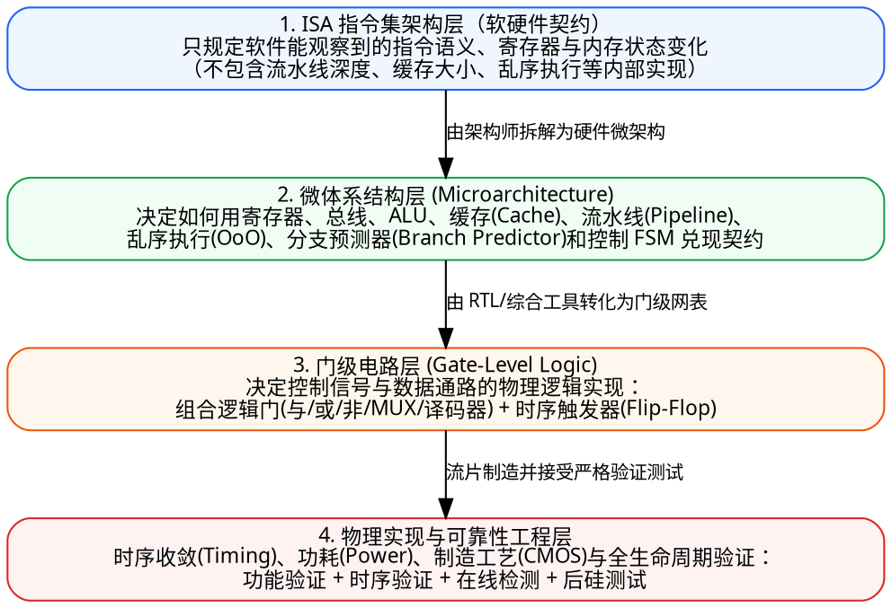

> **导读**：很多初学者在刚接触《计算机组成原理》或《计算机体系结构》时，脑海里都会漂浮着一连串“知其然而不知其所以然”的疑问：
>
> 1. 我们在屏幕上写下一句简单的 `A = B + C`，CPU 内部到底经历了几步才把结果算出来？**“一条指令执行完”**和**“一个时钟周期”**是一回事吗？
> 2. 教科书总说指令周期有“取指、译码、计算地址、取操作数、执行、写回”六个阶段，但加法指令 `ADD` 根本不访问内存，它也要走完这六步吗？
> 3. 程序里的 `if` 分支、`for` 循环和函数调用，在硬件眼里没有花括号也没有 `if` 关键字——CPU 究竟靠什么打破“一行一行往下执行”的宿命？
> 4. **ISA（指令集架构）**、**微体系结构（流水线/乱序/缓存）**、**门级电路**和**芯片验证测试**之间到底是什么关系？为什么说“把代码跑通”只是芯片工程里最微小的一步？
>
> 为了让**零基础初学者**也能顺畅读懂并建立直观的硬件心智模型，本教程坚持三条原则：
>
> - **名词首次出现即破冰**：任何英文缩写、寄存器代号或硬件概念在第一次登场时，都会立刻给出全称与生活化白话解释；
> - **图解驱动认知**：全文穿插 **Graphviz** 与 **Mermaid** 可视化图表，把看不见的微操作、数据通路、控制流覆盖和全栈分层直接画出来；
> - **从抽象到物理逐层打通**：不仅讲清教学机（如 LC-3）的清晰原理，也对齐现代工业处理器（MIPS/RISC-V/x86）与芯片可靠工程实践。

---

## 零、初学者核心名词破冰速查表

在正式进入正文前，先浏览一遍这张“术语破冰地图”。下文首次用到它们时，我们还会结合具体动作再讲透。

| 术语 / 缩写                       | 英文全称                                    | 一句话通俗解释                                                                                                                                       |
| :-------------------------------- | :------------------------------------------ | :--------------------------------------------------------------------------------------------------------------------------------------------------- |
| **时钟周期（Clock Cycle）**       | Clock Cycle                                 | CPU 内部“节拍器”滴答一次的时间间隔（如 1 GHz 主频下，1 个时钟周期约 1 纳秒）。                                                                       |
| **指令处理周期**                  | Instruction Processing Cycle                | CPU **完整处理完一条指令**所需的全过程；它通常由多个阶段组成，**往往跨越多个时钟周期**，而不是单个时钟节拍。                                         |
| **Opcode（操作码）**              | Operation Code                              | 一条机器指令里的“动词部分”，告诉硬件**“要干什么活”**（如加法 `ADD`、读取内存 `LDR`、跳转 `JMP`）。                                                   |
| **Operand（操作数）**             | Operand                                     | 一条机器指令里的“宾语部分”，告诉硬件**“拿谁来算、结果放哪”**（如寄存器编号、常数、内存偏移量）。                                                     |
| **PC（程序计数器）**              | Program Counter                             | CPU 里的“书签寄存器”，永远记录着**下一条要取出的指令在内存中的地址**。                                                                               |
| **IR（指令寄存器）**              | Instruction Register                        | 用来临时存放**刚刚从内存取出来的当前正在执行的这条指令**的小盒子。                                                                                   |
| **MAR / MDR**                     | Memory Address / Data Register              | CPU 与内存打交道的“地址门牌号暂存器”（MAR，告诉内存去哪个地址找）和“货物中转箱”（MDR，存放从内存读回或准备写入内存的数据）。                         |
| **寄存器文件（Register File）**   | Register File                               | CPU 核心内部紧挨着计算器的高速小抽屉组（如 R0~R7），容量极小但读写极快；通常同时配有**多个读端口和一个写端口**。                                     |
| **ALU（算术逻辑单元）**           | Arithmetic Logic Unit                       | 真正执行加减、与/或/非、移位和比较等计算的“核心计算器电路”。                                                                                         |
| **总线（Bus）与三态门**           | System Bus & Tri-state Buffer               | 芯片内部多部件共用的“单车道电子公路”（总线），以及控制某一时刻只允许谁上路发声的“交通闸门”（三态门，如 `Gate_ALU`）。                                |
| **组合逻辑 vs 有限状态机（FSM）** | Combinational Logic vs Finite State Machine | **组合逻辑**像没有记忆的算盘，输入变输出立刻变（如译码器）；**FSM** 是带时钟记忆的“流程总管”，按步就班协调取指→译码→执行→写回的状态流转。            |
| **符号扩展（Sign Extension）**    | Sign Extension                              | 把一个位数较短的有符号二进制数（如 6 位偏移量）扩充成完整位宽（如 16 位或 32 位）时，**用最高位的符号位去填充多出来的高位**，保证正负数值不变。      |
| **ISA vs 微体系结构**             | Instruction Set Architecture vs Microarch   | **ISA** 是软件与硬件之间的“行为契约”（规定有哪些指令和寄存器）；**微体系结构**是兑现契约的“内部具体电路实现”（如流水线、乱序执行、分支预测、缓存）。 |

下面是本教程的知识脉络全景图：



---

## 一、指令的基本解剖：Opcode、Operands 与三大指令家族

在计算机底层，处理器并不认识 C 语言、Python 或 `if/else`。编译器最终会把所有代码翻译成一串串二进制数字，每一串代表一条**机器指令（Machine Instruction）**。

### 1.1 指令的双拼结构：Opcode + Operands

无论哪种处理器（教学用的 **LC-3**、经典的 **MIPS**、开源的 **RISC-V** 还是桌面端复杂的 **x86**），一条指令在结构上通常都可以拆成两部分：

1. **Opcode（操作码，Operation Code）**：位于指令的固定比特位（通常是最高几位），相当于一句话里的**“动词”**，规定这条指令要执行什么操作（比如“做加法”、“从内存加载”、“跳转”）。
2. **Operands（操作数）**：相当于一句话里的**“宾语”**，指明操作的对象是谁、结果存到哪里。操作数可以是：
   - **寄存器编号**（比如 `R0`、`R1`、`R2`）；
   - **立即数（Immediate）**（直接嵌在指令二进制编码里的常数，比如 `+5`）；
   - **地址偏移量（Offset）**（用于算内存地址或跳转目标）。

以教学经典的 16 位 **LC-3（Little Computer 3，麻省理工与得克萨斯大学广泛使用的教学架构）** 为例，一条 `ADD R0, R1, R2` 指令的 16 个二进制比特切分如下：

```text
位序号：  [15 14 13 12] [11 10 9] [8 7 6] [ 5 ] [4 3] [2 1 0]
二进制：   0  0  0  1     0  0 0   0 0 1    0    0 0   0 1 0
含义：     Opcode=ADD    DR = R0   SR1=R1  模式  保留  SR2=R2
          (表示加法)     (目的)    (源1)   (0=寄存器模式) (源2)
```

> [!NOTE] 缩写解释：DR 与 SR
>
> - **DR（Destination Register）**：目的寄存器，用来接收计算结果（这里 `000` 代表 `R0`）。
> - **SR1 / SR2（Source Register 1 / 2）**：第一、第二个源操作数寄存器，提供参与运算的原始数值（`001` 是 `R1`，`010` 是 `R2`）。

### 1.2 指令的三大基本分类

尽管现代 CPU 手册动辄有几百上千条指令，但按照它们在程序里扮演的角色，几乎全部可以归入**三大类**：



1. **运算类指令**：只关心计算本身（算术加减乘除、逻辑与或非、移位），数据通常已经在高速寄存器里准备好了，算完直接放回寄存器。
2. **数据移动类指令**：因为寄存器数量极少（比如 LC-3 只有 8 个通用寄存器 `R0~R7`，MIPS/RISC-V 也只有 32 个），大批量数据只能住在容量大的**主内存（Memory）**里。这类指令负责“**Load（加载：内存 → 寄存器）**”和“**Store（存储：寄存器 → 内存）**”。
3. **控制流类指令**：负责实现条件分支（`if/else`）、循环（`for/while`）和函数调用/返回，核心手段就是改写 **PC（程序计数器）** 的值。

### 1.3 为什么 `base + offset` 是数组与结构体访问的“天选寻址方式”？

在数据移动类指令中，初学者最常遇到的寻址方式（Addressing Mode，即“如何算出目标内存地址的规则”）叫做 **`base + offset`（基址加偏移寻址）**，典型指令就是 **`LDR DR, BaseR, offset`**（Load Register）。

为什么硬件工程师如此偏爱 `base + offset`？因为高级语言里最核心的两种复合数据结构——**数组（Array）**和**结构体（Struct）**——天然就是按“起点 + 固定距离”布局在内存里的！

- **访问结构体字段**：假设我们有一个指针 `p` 指向某个学生结构体 `Student` 的首地址（放入基址寄存器 `BaseR`）。结构体里 `id` 在偏移 `0` 字节，`age` 在偏移 `4` 字节，`score` 在偏移 `8` 字节。编译器不需要每次都重新算一遍绝对地址，只需要保持 `BaseR = p` 不变，分别用 `offset = 0 / 4 / 8` 即可一键直达任意字段！
- **访问数组元素**：假设数组 `arr` 首地址放在 `BaseR` 中，在循环遍历或访问已知常量下标 `arr[3]` 时，只需要用 `base + 3 * element_size` 就能一步定位。

下面这张 Graphviz 内存布局图直观展示了 `base + offset` 是如何“指哪打哪”的：



---

## 二、六阶段指令处理周期：一条指令是如何走完一生的？

### 2.1 先破除一个常见误区：指令处理周期 ≠ 单个时钟周期

初学者最容易混淆的两个词是**时钟周期（Clock Cycle）**和**指令处理周期（Instruction Processing Cycle）**。

- **时钟周期**好比工厂流水线上的“秒表滴答”，每滴答一声，硬件里的寄存器才能同步锁存一次新状态。
- **指令处理周期**则是**从“拿出一条指令”到“彻底办完它”所需的完整流程**。在经典多周期（Multi-Cycle）教学架构中，完成一条指令可能需要 4 到 10 个甚至更多时钟周期（比如内存慢的时候还要原地等好几个周期）。

业界与教材通常把一条指令的指令处理周期拆解为**经典的六个阶段**：

1. **Fetch（取指）**：根据 **PC（程序计数器）** 指向的内存地址，把指令的二进制编码取出来，放进 **IR（指令寄存器）**。
2. **Decode（译码）**：拆解 IR 里的 `opcode` 和操作数字段，识别指令类型与控制需求，生成后续动作所需的**控制信号（Control Signals）**。
3. **Evaluate Address（计算地址）**：如果是访问内存的指令（Load / Store）或涉及地址计算的跳转指令，算出真正的目标内存位置——**有效地址（Effective Address）**。
4. **Fetch Operands（取操作数）**：把参与运算的原材料（源操作数）拿出来——要么从高速的**寄存器文件**里直接读，要么根据上一步算出的有效地址去**内存**里取。
5. **Execute（执行）**：把准备好的操作数送进 **ALU（算术逻辑单元）** 或专用功能单元（如乘法器、浮点单元），完成真正的计算或比较。
6. **Store Result（写回结果 / Writeback）**：把 ALU 算出的结果、或者刚从内存读回来的数据（存放在 MDR 中），写回**目的寄存器（DR）**或写入**内存**。

### 2.2 不是每条指令都要走完全部六个阶段！

这六个阶段是通用模板，具体到不同指令，走过的路径各不相同：

| 指令示例             | 所属类别        | 实际经历的阶段                                                                             | 跳过了什么 / 有何特殊之处                                                              |
| :------------------- | :-------------- | :----------------------------------------------------------------------------------------- | :------------------------------------------------------------------------------------- |
| **`ADD R0, R1, R2`** | 运算类          | **取指 → 译码 → 取操作数（读寄存器） → 执行（ALU 加法） → 写回寄存器**                     | **不需要“计算地址”和“内存取数”**，因为操作数全在寄存器里。                             |
| **`LDR R0, R1, #5`** | 数据移动类      | **取指 → 译码 → 计算地址（`R1 + 5`） → 取操作数（读内存） → 写回寄存器**                   | **不需要额外的 ALU 算术语义**（唯一加法用于地址计算阶段，数据从内存搬回即可）。        |
| **`JMP R1`**         | 控制流类        | **取指 → 译码 →（读取基址寄存器）→ 修改 PC 写入目标地址**                                  | 不做算术结果写回，重点在于用目标地址**覆盖 PC**。                                      |
| **复杂 `x86` 指令**  | CISC 复杂指令集 | 例如 `ADD [eax+4], ebx`：**取指 → 译码 → 算地址 → 读内存操作数 → ALU 相加 → 写回同一内存** | 作为复杂指令集（CISC），单条指令在逻辑上会**反复横跨内存读取、计算与内存写回**多阶段。 |

下面这张 **Graphviz 状态流转图** 清晰地描绘了六阶段周期的常规路径与分支旁路（包括“需要内存地址”、“直接寄存器操作数”以及“改变控制流跳转”）：



---

## 三、深入数据通路微操作：一步步拆解每个阶段的硬件动作

光知道六个阶段的名字还不够，硬件工程师眼里的指令执行，是由一个个精确到时钟节拍的**微操作（Micro-operations）**和**数据通路（Datapath）**驱动的。接下来我们结合教学经典 **LC-3 数据通路**，把每个阶段的底层动作剥开来看。

### 3.1 取指（Fetch）的微操作：为什么还要“等内存”？

在取指阶段，CPU 要干两件事：**把当前指令拿回来**，同时**把书签 `PC` 往后翻一页**。一种抽象的微操作序列如下：

```text
MAR <- PC
PC  <- PC + instruction_size
等待内存响应
MDR <- Memory[MAR]
IR  <- MDR
```

初学者这里经常有三个疑问，我们逐一破冰：

1. **为什么不能直接把 `PC` 连到内存上，非要经过 `MAR` 和 `MDR`？**
   - **MAR（Memory Address Register，内存地址寄存器）**相当于你寄快递时填在“收件地址栏”的便签：CPU 把要查的地址锁存在 MAR 里稳住，防止总线等会儿干别的时地址丢了；
   - **MDR（Memory Data Register，内存数据寄存器）**相当于快递柜的“暂存格”：内存速度比 CPU 慢得多，内存把数据找出来后先放进 MDR 锁好，CPU 再安稳地从 MDR 取走放进 **IR（指令寄存器）**。
2. **`instruction_size` 是多少？**
   - 在 **LC-3** 里，每个内存单元存 16 位（1 个字），每条指令也是 16 位，所以按字寻址时 `PC <- PC + 1`；
   - 在 **MIPS / RISC-V（32位定长）** 里，内存按字节（Byte，8 位）编址，一条指令占 4 字节，所以顺序递增是 `PC <- PC + 4`。
3. **为什么要“等待内存响应”？**
   - 在 LC-3 数据通路中，取指动作跨越多个时钟周期：第一个周期，PC 通过公共总线装入 MAR，同时 PC 自增；随后控制单元发出读内存请求。由于内存（或存在未命中的缓存）响应速度远慢于 CPU 时钟，如果内存的“就绪信号（Ready Bit, `R`）”还没有变 `1`，**控制有限状态机（FSM）就会原地保持在等待状态（Wait State）**，直到内存把指令放进 MDR，下一个节拍才把 MDR 装入 IR。

下面这张 **Mermaid 时序图** 还原了取指微操作在时钟节拍下的配合过程：



### 3.2 译码（Decode）：组合逻辑与有限状态机的分工协作

指令安稳躺进 `IR` 后，立刻进入 **Decode（译码）** 阶段。

译码器（Decoder）就像一个高速分拣员，它会直接盯住 `IR` 里的 **Opcode** 字段：

- 在 LC-3 中，主操作码占 4 个比特（`IR[15:12]`），共有 $2^4 = 16$ 种可能，因此硬件只需放一个 **4-to-16 译码器（4 线-16 线译码器）**，就能瞬间把 16 种主指令（如 `ADD`、`AND`、`LDR`、`STR`、`JMP`、`BR` 等）区分出来；
- 与此同时，指令里剩下的比特位会被并行分发给数据通路的各个角落：指定哪个寄存器做 `SR1`、`SR2`、`DR`，是否把低位当成立即数做符号扩展，以及决定本指令是否需要读写内存。

> [!IMPORTANT] 关键硬件直觉：译码器（组合逻辑） vs 状态机（时序逻辑）
>
> - **译码本身可以由纯组合逻辑（Combinational Logic）完成**：没有时钟节拍延迟，只要 `IR` 里的比特稳定了，译码器输出端哪根线亮（高电平）就立刻确定了；
> - **整个指令执行过程则通常由有限状态机（FSM，时序逻辑 Sequential Logic）协调**：因为一条指令的不同阶段需要分先后顺序（比如必须先等内存读完写进 `MDR`，下个拍子才能把 `MDR` 写进 `DR`），FSM 会根据时钟节拍和当前的指令类型，一拍一拍地跳转状态并发出对应的控制开关信号。

### 3.3 计算地址（Evaluate Address）与取操作数（Fetch Operands）

译码完成后，数据移动指令和纯运算指令正式分道扬镳。

#### 路线 A：内存加载指令 `LDR` 的地址计算与取数

对于 `LDR DR, BaseR, offset`，硬件必须先算出要去内存的哪个门牌号拿数据：

```text
effective_address = Register[Base] + sign_extend(offset)
MAR <- effective_address
MDR <- Memory[MAR]
```

这里面有一个初学者必懂的小机关——**`sign_extend(offset)`（符号扩展）**。
为什么一定要做符号扩展？因为一条指令的总长度是有限的（比如 LC-3 只有 16 位，除去 Opcode 4 位、DR 3 位、BaseR 3 位，留给 `offset` 的空间只剩 **6 位**）。
假设 `offset` 是一个 6 位的二进制补码有符号数 `-2`（写作 `111110`），而基址寄存器 `BaseR` 是 16 位宽。要让 6 位数和 16 位数正确相加，不能直接在前面补 `0`（补 `0` 就变成正数 `+62` 了！），而必须**把最高位的符号位 `1` 复制填满前面多出的 10 位**，变成 16 位的 `1111 1111 1111 1110`（依然代表 `-2`）。这样无论是向前偏移（负数）还是向后偏移（正数），地址计算都能分毫不差！

#### 路线 B：三寄存器运算 `ADD` 的取操作数与 `2R1W` 寄存器文件

对于 `ADD R0, R1, R2`，它不需要跑去遥远的主内存，只需要从 CPU 内部的**寄存器文件（Register File）**里拿两个操作数送进 ALU 即可。

为了能让一条常见的三寄存器运算指令（`DR <- SR1 op SR2`）高效地同时拿到两个输入并在随后写回结果，**寄存器文件在硬件上通常至少需要配备“两个读端口（2 Read Ports）和一个写端口（1 Write Port）”**（简称 **`2R1W`**）：

- **读端口 1**：根据 `SR1` 编号，同时输出 `Register[SR1]` 的值送往 ALU 左输入端；
- **读端口 2**：根据 `SR2` 编号，同时输出 `Register[SR2]` 的值送往 ALU 右输入端；
- **写端口 1**：在写回阶段，根据 `DR` 编号和写使能信号 `LD_REG`，把结果写入目标寄存器。

### 3.4 执行与写回（Execute & Writeback）：共享硬件与控制信号指挥棒

拿到操作数后，不同指令的执行与写回动作非常简洁：

- **`ADD` 的执行与写回**：
  ```text
  alu_result <- Register[SR1] + Register[SR2]
  Register[DR] <- alu_result
  ```
- **`LDR` 的写回**：
  ```text
  Register[DR] <- MDR
  ```

你会发现一个极其优雅的工程设计：**CPU 并没有为 `ADD` 建一套独立电路、又为 `LDR` 建另一套独立电路。恰恰相反，所有指令都在“共享”同一套物理部件**——同一个寄存器文件、同一个 ALU、同一根系统总线、同一个内存接口（MAR/MDR）。

既然大家共用同一条“单车道总线”，怎么保证不会撞车、不会写错寄存器？全靠**控制单元发出的控制信号（Control Signals）**在每个时钟周期当指挥官：

1. **谁能驱动总线（Tri-state Gates，三态门开关）**：比如某周期 `Gate_ALU = 1` 而其余 `Gate_* = 0`，就只有 ALU 的计算结果能送上总线，其他部件一律“闭嘴”（高阻态）；下一周期换成 `Gate_MDR = 1`，MDR 里的数据才能上总线。
2. **谁负责锁存接收（Load Enable，写使能信号）**：比如 `LD_REG = 1` 允许寄存器文件在时钟沿把总线上的值存进 `DR`；`LD_IR = 1` 允许更新指令寄存器。
3. **ALU 做什么运算（`ALU_op`）**：告诉 ALU 这回做加法、按位与还是按位取反。
4. **内存是否读写（`MIO_EN`、`R/W`）**：决定本周期要不要惊动内存以及是读还是写。

下面这张 **Graphviz 数据通路全景图** 展示了这些硬件模块如何通过公共总线与控制信号协同工作：



---

## 四、控制流、PC 与跳转：CPU 如何打破“从上往下”的顺序宿命？

在默认情况下，CPU 就像一个极其死板的读书人：读完第 100 行指令，就老老实实翻到第 101 行（顺序执行）。这个“翻页动作”依靠的就是 **PC 默认顺序递增**（例如 `PC <- PC + 1` 或 `PC <- PC + 4`）。

但真实程序不可能永远一条线走到黑——我们需要 `if` 分支、`while` 循环和函数调用。控制流指令改变执行顺序的本质，一句话就能说透：**用新的目标地址去“覆盖”顺序递增后的 PC！**

### 4.1 “先自增、后覆盖”的时间差机制

以 **LC-3 的无条件间接跳转指令 `JMP BaseR`** 为例，它的抽象语义非常简单：

```text
PC <- Register[Base]       ; 间接跳转的抽象语义
```

但如果你结合上一章的取指阶段去跟踪 `PC` 的真实变化，会发现一个非常精妙的时间差：

1. **取指阶段（Fetch）**：当时 CPU 还不知道自己拿回来的是一条跳转指令，因此它**先按默认规则执行了 `PC <- PC + 1`**，做好了读下一条相邻指令的准备。
2. **译码与执行阶段（Decode & Execute）**：译码器一看 `IR` 里的 opcode 是 `JMP`，于是控制状态机在执行阶段直接把基址寄存器 `Register[Base]` 的内容送上总线，并打开 `LD_PC = 1`——**用目标地址直接覆盖刚才已经加 1 的 PC**！
3. **下一个取指阶段**：当下一条指令开始 Fetch 时，PC 已经指向全新的跳转目标了，程序流程就这样被瞬间切换到了另一段代码。

### 4.2 无条件跳转、条件分支与函数调用的差异

在 **MIPS、RISC-V、LC-3** 等各类真实指令集中，控制流指令通常分成三种常见形态，它们各自解决不同场景的问题：

| 控制流指令类型                                | 典型代表                             | 是否必然跳转？             | 目标地址从哪来？                                               | 额外动作与机制                                                                                                 |
| :-------------------------------------------- | :----------------------------------- | :------------------------- | :------------------------------------------------------------- | :------------------------------------------------------------------------------------------------------------- |
| **无条件跳转（Unconditional Jump）**          | LC-3 `JMP` / MIPS `J` / RISC-V `J`   | **必定跳转**               | 寄存器间接（如 `JMP BaseR`）或指令内编码的直接目标/PC 相对偏移 | 直接覆盖 PC，常用于 `switch` 跳转表、循环末尾回跳或函数返回（`RET` 本质就是跳回保存好的返回地址）。            |
| **条件分支（Conditional Branch）**            | LC-3 `BR` / MIPS `BEQ`、`BNE`        | **看条件决定**（跳或不跳） | 通常是 **PC 相对寻址**（`PC + sign_extend(offset)`）           | **两种判断方式**：LC-3/x86/ARM 看上一步留下的**条件码/标志位（N/Z/P）**；MIPS/RISC-V 直接**比较两个寄存器**。  |
| **函数调用（Function Call / Jump-and-Link）** | LC-3 `JSR` / MIPS `JAL` / x86 `CALL` | **必定跳转**               | 偏移量或寄存器目标                                             | 跳走之前**必须保存返回地址**（当前已经递增好的 `PC`），通常存进专门的链接寄存器（如 `R7` / `$ra`）或内存栈里！ |

> [!TIP] 为什么函数调用一定要保存“返回地址”？
> 如果主函数在 `0x1000` 处调用 `foo()`，执行完 `foo()` 后必须精确回到 `0x1004`（下一条指令）继续执行。所以 `JAL`（Jump and Link）指令在覆盖 `PC` 之前，会顺手把已经算好的 `PC`（即 `0x1004`）备份到返回地址寄存器中；等 `foo()` 结束执行 `RET` 时，其实就是执行一条 `PC <- 返回地址寄存器` 的跳转！

下面这张 **Mermaid 流程图** 总结了 PC 在顺序执行与控制流跳转之间的切换逻辑：



---

## 五、统一理解：从程序 `A = B + C` 到硅片物理现实

学完前面的积木后，我们终于可以用一条极简的语句 **`A = B + C`**，把从软件代码到硬件硅片的整条链路彻底贯通！

### 5.1 一行代码的 8 步硬件奇幻漂流

假设变量 `A`、`B`、`C` 当前已经被编译器分配到了寄存器 `R0`、`R1`、`R2` 中，那么 `A = B + C` 从高级语言一路下沉到物理电路的全过程如下：

```text
1. 高级语言：     A = B + C
2. 汇编语言：     ADD R0, R1, R2
3. 指令编码：     0001 000 001 000 010
                  (opcode=ADD | DR=R0 | SR1=R1 | mode=0 | 00 | SR2=R2)
4. 取指 (Fetch)： IR <- Memory[PC]          （经 MAR/MDR 完成读取，PC 先递增）
5. 译码 (Decode)：4-to-16 译码器识别出 opcode=ADD，提取 DR=R0, SR1=R1, SR2=R2
6. 数据通路：     Register[R1], Register[R2] 通过 2R1W 读端口送入 ALU
7. 控制信号：     ALU_op=ADD, Gate_ALU=1, LD_REG=1
8. 状态更新：     Register[R0] <- ALU_result;  PC <- PC + 1
```

### 5.2 透过这条链看懂计算机系统的四个核心层级

这短短 8 行追踪，恰恰揭示了现代计算机工程最核心的四层分工——**每一层只对上一层负责，并把底层复杂度彻底封装起来**：



请特别记住一条在架构面试与实际研发中最容易踩坑的黄金原则：

> [!IMPORTANT] 严格区分“ISA 契约”与“微体系结构实现”
>
> - **ISA 只规定架构可见行为（Architectural State）**：比如 `ADD R0, R1, R2` 执行完后，`R0` 必须等于 `R1 + R2`，且程序在逻辑上按 `PC` 顺序推进。
> - **流水线（Pipeline）、乱序执行（Out-of-Order Execution）、分支预测器（Branch Predictor）和高速缓存（Cache）全部属于微体系结构（Microarchitecture）实现！**
>
> 换句话说，哪怕两颗 CPU 遵循完全相同的 x86 或 RISC-V ISA（运行一模一样的软件二进制），一颗可以是简单的单周期/多周期教学核，另一颗可以是拥有 16 级流水线、超标量乱序执行和三级缓存的旗舰处理器——**微体系结构可以在不破坏 ISA 顺序契约的前提下，把内部并行和预测做到极致**。

### 5.3 为什么芯片设计不能止步于“逻辑跑通”？芯片的四大验证与可靠性防线

很多初学者以为，只要把上面的门级电路画出来、仿真器里算出 `A = B + C` 就算造出了一颗好芯片。但在真实的工业界，**“功能算得对”仅仅是起跑线**。为了让系统真正达到**可靠（Reliable）、可用（Available）、安全（Safe）**的标准（例如车规级自动驾驶芯片、数据中心服务器、航天控制器），芯片还必须闯过四道生死关：

1. **功能验证（Functional Verification）**：
   - **解决什么问题**：“设计出来的逻辑，在各种奇葩输入组合和并发边界下，都严格符合 ISA 契约吗？”
   - **通俗理解**：就像上线前的全覆盖软件单元测试+模糊测试，只不过芯片一旦流片就几乎无法像软件那样打热补丁，因此需要在流片前通过海量仿真、形式化验证（Formal Verification）和 FPGA 原型去抓出死锁、乱序冒险、缓存一致性 Bug。
2. **时序验证（Timing Verification / Static Timing Analysis, STA）**：
   - **解决什么问题**：“电路逻辑虽然对，但在目标主频（比如 3.5 GHz）下，电信号能在一个时钟周期内跑完最长路径吗？”
   - **通俗理解**：如果加法器太长、信号还没传到目的寄存器门口，下一个时钟滴答就到了，锁存进来的就是半截错乱的电信号（建立时间违例 Setup Violation），芯片就会直接算出乱码或死机。
3. **在线检测（Online Detection / Fault Tolerance）**：
   - **解决什么问题**：“芯片卖出去正常运行时，万一遇到宇宙射线粒子轰击（软错误 Bit Flip）、电压波动或元器件老化怎么办？”
   - **通俗理解**：在芯片内部植入“随行健康监测仪”——例如内存/缓存加 **ECC（纠错码）** 或奇偶校验（Parity）、关键计算单元采用双核锁步（Lockstep）实时比对、系统卡死时触发**看门狗（Watchdog）**自动复位，确保系统在故障发生瞬间就能察觉并隔离恢复，绝不带着错误结果继续狂奔。
4. **后硅测试（Post-Silicon Testing & Validation）**：
   - **解决什么问题**：“图纸（RTL）虽然完美，但晶圆厂物理制造出来的每一颗真硅片，在高温、低温、高低电压下，真的没有物理瑕疵或微小制造缺陷吗？”
   - **通俗理解**：芯片流片回厂后，必须上昂贵的自动化测试机台（ATE），通过芯片内部预留的**可测性设计（DFT / Scan Chain 扫描链）**扫描成千上万个触发器状态，筛选剔除有断线、短路或暗病的坏片，并在真实主板、真实操作系统负载下做长时间烤机验证。

这四项工作与核心功能设计**同等重要**——缺少任何一环，都造不出一颗真正可靠、可用、安全的工业级芯片。

---

## 六、核心知识全景复盘与初学者自测 6 问

### 核心结论速览

1. **指令结构与分类**：指令通常由 **Opcode（操作码）** 和 **Operands（操作数）** 组成，可分为**运算类、数据移动类、控制流类**三大家族。
2. **`base + offset` 寻址**：基址加偏移是高级语言中**数组（Array）和结构体（Struct）**访问最常见、最自然的寻址方式，常需配合**符号扩展（Sign Extension）**处理正负偏移。
3. **六阶段指令处理周期**：一条指令的处理周期不是单个时钟周期，可拆分为 **Fetch（取指）、Decode（译码）、Evaluate Address（计算地址）、Fetch Operands（取操作数）、Execute（执行）、Store Result（写回结果）**；不同指令按需经过其中部分或全部阶段。
4. **控制流与 PC**：**PC** 默认顺序递增，而 **Branch / Jump** 等控制流指令会在执行阶段用新目标地址覆盖或修改 PC（函数调用还需提前保存返回地址）。
5. **契约与实现的边界**：**ISA** 只规定软件可见的架构行为与状态；**流水线、乱序执行、分支预测器和缓存**都属于底层的**微体系结构**实现。
6. **全栈与工程闭环**：从 `A = B + C` 到硅片落地横跨 ISA、微架构、门级电路与物理工艺；**功能验证、时序验证、在线检测和后硅测试**对于构建可靠、可用、安全的系统缺一不可。

### 初学者自测 6 问（检验你是否真正读懂）

1. **为什么说“一条指令的处理周期”和“一个时钟周期”不是同一个概念？**
   - _提示_：回忆取指（Fetch）微操作——单单取一条指令就需要先送地址进 `MAR`、等待内存就绪、再读回 `MDR` 写进 `IR`，往往跨越多个时钟滴答；六个阶段合起来才构成一条指令完整的处理周期。
2. **在 `ADD R0, R1, R2` 和 `LDR R0, R1, #5` 这两条指令中，各自省去了六阶段里的哪些工作？**
   - _提示_：`ADD` 省去了有效地址计算和内存取数；`LDR` 在计算阶段只计算 `Base + sign_extend(offset)` 地址，无需对取回的数据再做额外 ALU 算术加工。
3. **为什么寄存器文件（Register File）通常至少需要“2 个读端口 + 1 个写端口（2R1W）”？**
   - _提示_：为了支撑像 `ADD R0, R1, R2` 这样最常见的三寄存器运算指令，让硬件在同一阶段能同时读出 `SR1` 和 `SR2` 送入 ALU 的两个输入端，并在写回阶段写入 `DR`。
4. **既然取指阶段已经把 `PC` 加 1（或加 4）了，为什么 `JMP` 或 `BEQ` 还能准确跳到别处？**
   - _提示_：遵循“先自增、后覆盖”机制——取指时先乐观假设顺序执行把 `PC` 递增，到了执行阶段一旦确认需要跳转，控制单元就直接把目标地址写入 `PC` 覆盖原值。
5. **如果把 CPU 的 L1 缓存增大一倍、流水线从 5 级改成 12 级，这改变了这颗 CPU 的 ISA 吗？**
   - _提示_：没有！缓存、流水线、乱序执行和分支预测器全部属于**微体系结构（Microarchitecture）**实现细节，只要对外呈现的指令编码和顺序语义不变，ISA 契约就完全一致。
6. **在真实芯片项目中，“在线检测（Online Detection）”和“功能验证（Functional Verification）”分别保护了什么阶段的风险？**
   - _提示_：功能验证负责在**流片前**揪出设计图纸里的逻辑 Bug；在线检测（如 ECC、Lockstep、Watchdog）负责在**芯片卖出去运行过程中**实时发现物理软错误或硬件老化故障，保障系统的可靠、可用与安全。
