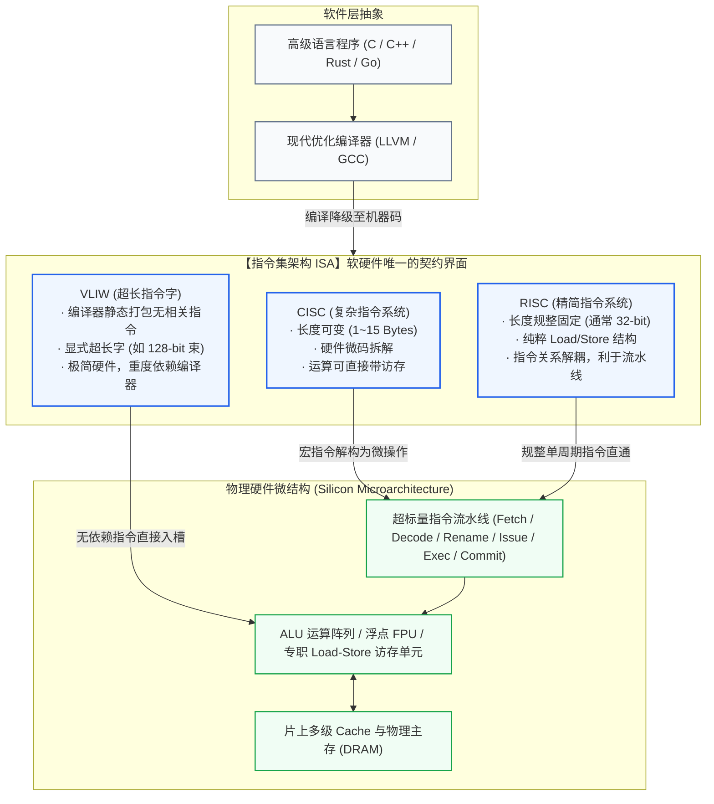
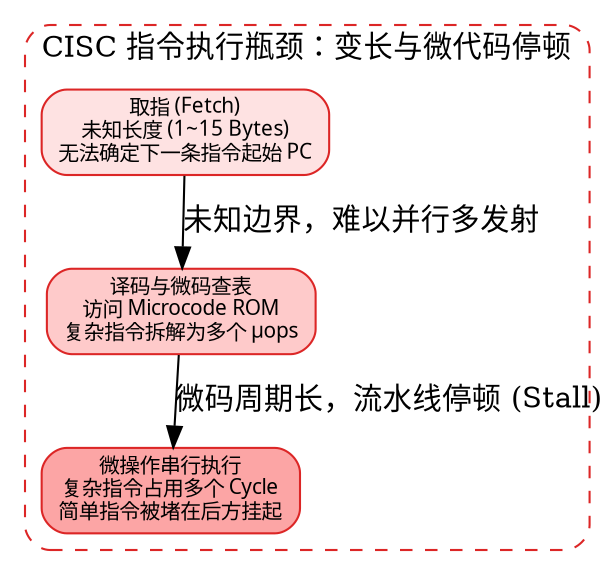
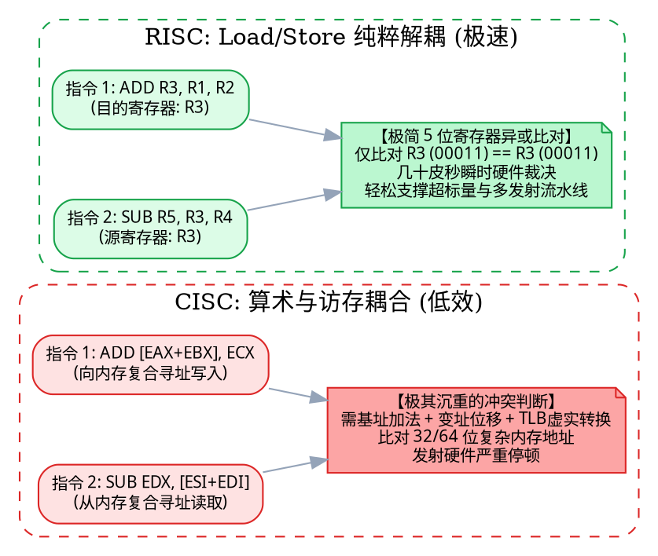
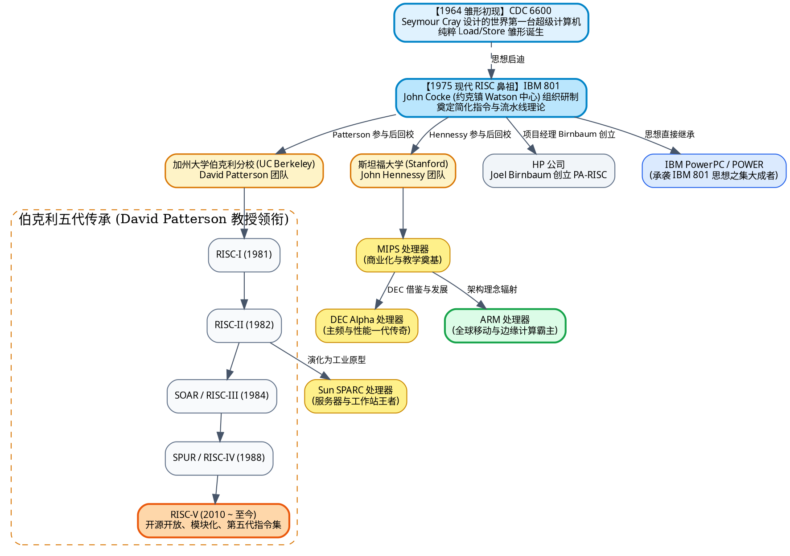
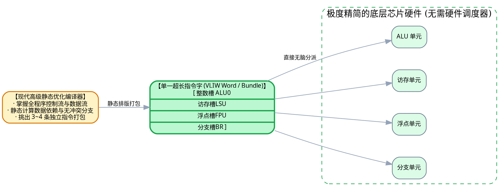
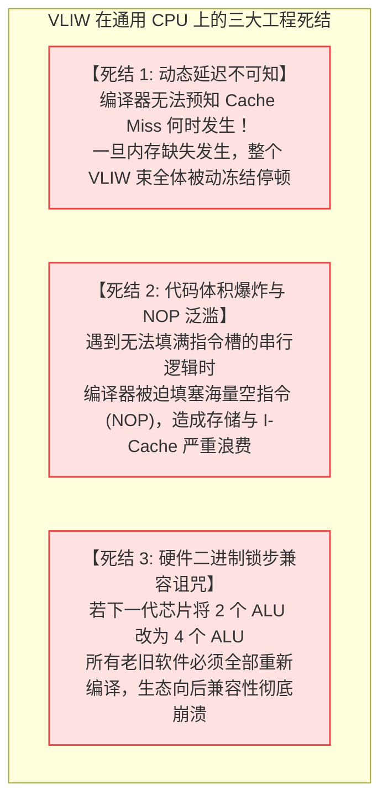
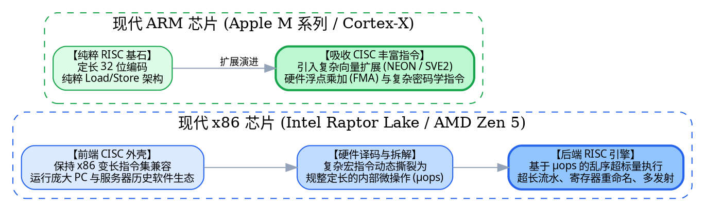
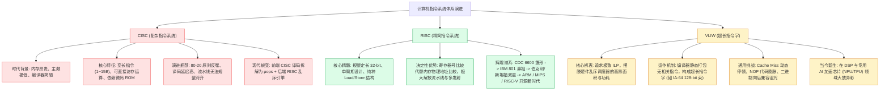

# 计算机指令系统三足鼎立：CISC、RISC 与 VLIW 的本质特征、历史演进与工程哲学

> **“在计算机体系结构的演进长河中，指令集架构（ISA）是软件与硬件之间最为神圣的契约。它不仅决定了处理器如何理解人类代码的意图，更深刻塑造了半个世纪以来微处理器微结构与编译技术的博弈版图。”**

当我们用 C++、Rust 或 Python 写下一行简单的算术运算或循环时，底层的硅晶芯片并不能直接领会这些高级抽象。在硅片内部，唯有由高低电平驱动的门电路、寄存器与总线在跳动。连接这两座宏伟世界的桥梁，正是**指令系统（Instruction Set Architecture，简称 ISA / 指令集架构）**。

依据指令长度与并行执行控制机制的不同，计算机指令系统在漫长的演进历程中分化出三大核心流派：
1. **复杂指令系统（Complex Instruction Set Computer，CISC）**：指令长度可变，单条指令功能极其强大；
2. **精简指令系统（Reduced Instruction Set Computer，RISC）**：指令长度规整固定，单条指令执行周期短，坚决贯彻 Load/Store 纯粹性；
3. **超长指令字（Very Long Instruction Word，VLIW）**：本质上是将多条可同时执行的无相关指令强行打包组合，把并行调度的重任彻底交由编译器判定。

本文将从第一性原理出发，面向初学者与体系结构爱好者，系统梳理 CISC、RISC 与 VLIW 的设计哲学、历史脉络、硬件微结构权衡以及经典的指令编码格式。

---

## 零、初学者核心概念速查表

为了消除初学者在阅读体系结构专业文献时的生疏感，下表针对本文首次出现的关键硬件术语与微结构概念，提供了严谨的工程定义与通俗的生活直觉类比：

| 专业术语 | 英文缩写 / 全称 | 本质定义 | 通俗直觉与生活比喻 |
| :--- | :--- | :--- | :--- |
| **指令系统 / 指令集** | ISA (Instruction Set Architecture) | 计算机硬件与软件之间的界面规范与功能契约，规定了支持的机器指令、寄存器集合、数据类型及寻址模式。 | 汽车的通用驾驶手册（方向盘、刹车、档位标准），无论底层是燃油机还是电机，对外操作界面一致。 |
| **微体系结构 / 微结构** | Microarchitecture | 在特定芯片工艺下实现指令集规范的具体硬件组织逻辑（如流水级数、乱序缓冲大小、执行单元等）。 | 汽车内部具体的发动机构造与传动齿轮组，负责将驾驶手册中的“踩油门”转化为真实动力输出。 |
| **CISC** | Complex Instruction Set Computer | 硬件集成海量功能、指令长度可变、单条指令可完成复合任务（如算术结合直接访存）的指令系统。 | **瑞士军刀**：一个工具集成剪刀、开瓶器、锯条，功能包罗万象，但内部机械铰链极其复杂。 |
| **RISC** | Reduced Instruction Set Computer | 指令功能精简、长度固定、单周期完成、坚持运算指令与访存指令彻底解耦的指令系统。 | **专业厨师刀具**：剔骨刀、刺身刀各司其职，每把刀极致纯粹，出刀速度极快且刀法清晰。 |
| **VLIW** | Very Long Instruction Word | 将多条互不干扰的独立指令由编译器在静态编译期打包成一条超长指令，硬件无脑多通道并行执行的架构。 | **多声部交响乐谱**：排练时指挥预先编好每个乐手在各拍子同时演奏的音符，演出时乐手无需眼神交流即可同步。 |
| **访存 (Load / Store)** | Memory Access | 处理器核心与内存（RAM/Cache）之间的数据读写行为（Load 从内存读取到寄存器，Store 将寄存器写回内存）。 | 从远端档案库调取纸质文件到手头办公桌（Load），或者将批复完的文件送回档案库归档（Store）。 |
| **寄存器** | Register | 位于 CPU 核心内部速度最快（0-1 个时钟周期）、物理容量极小的存储单元。 | 办公桌上触手可及的即时便签纸与笔筒，空间极有限但抬手即用。 |
| **Load/Store 结构** | Load/Store Architecture | RISC 的灵魂特征：所有算术逻辑运算必须在寄存器之间进行，唯有专用 Load/Store 指令能访问物理内存。 | 工匠（ALU）只在办公桌上加工零件，库管员（Load/Store 部件）专职往返于仓库取送零件，分工绝对明确。 |
| **微代码 / 微码** | Microcode | 位于 CPU 片上 ROM 中的微程序固件，用于在运行时将复杂的 CISC 宏指令拆解为一系列底层微操作（$\mu$ops）。 | 司令官下达宏观口令“包围敌军”，副官查阅行动手册，将其逐条分解为“先吹号、再放炮、最后步兵推进”。 |
| **指令流水线** | Instruction Pipeline | 将指令处理过程拆解为若干独立工序（如取指、译码、执行、访存、写回），使多条指令在空间上重叠推进的技术。 | 现代化汽车总装流水线：底盘装配、发动机安装、外壳喷漆各工位同时在加工不同的汽车。 |
| **多发射 / 超标量** | Multi-issue / Superscalar | 处理器在一个时钟节拍内能够同时抓取、译码并派发多条机器指令至多个执行单元并行计算。 | 银行营业厅同时开放 4 个柜台窗口，一个业务周期内可同时为 4 位顾客办理业务。 |
| **乱序执行** | Out-of-Order Execution (OoO) | 硬件根据数据就绪情况，允许没有前后依赖关系的后方指令越过因等待访存而挂起的前方指令提前执行。 | 餐厅后厨允许后桌点的拍黄瓜先凉拌上桌，而不必傻等前桌需要文火慢炖 40 分钟的瓦罐煨汤。 |
| **数据相关性** | Data Dependency | 指令间因读写相同寄存器或内存地址而产生的先后约束关系（包括真相关 RAW、反相关 WAR、输出相关 WAW）。 | 面包师傅必须等面团发酵烤熟（写），学徒才能往面包上抹奶油（读），工序不可逆转。 |
| **控制相关性** | Control Dependency | 条件分支跳转指令的执行结果决定了后续哪些指令应当被执行、哪些不应被执行所构成的制约。 | 十字路口的红绿灯判定：红灯亮则直行指令废弃，转入等待或转向流程。 |
| **指令级并行** | ILP (Instruction Level Parallelism) | 单线程机器指令序列中，多条彼此独立的指令能够在硬件时间轴上重叠并行推进的潜在程度。 | 一道复杂的菜谱中，煮饭与切菜两件事没有原料依赖，可以在同一段时间里由双手同时推进。 |
| **80-20 原则 / 帕累托法则** | Pareto Principle in ISAs | 在真实运行的典型程序中，约 80% 的指令执行时间被指令集中最简单的 20% 指令所占据。 | 人类日常口语交流中，80% 的日常对话只使用了字典里 20% 的高频常用词汇汇编。 |



---

## 一、三大指令系统全景分类与本质权衡

指令系统并非凭空产生的数学抽象，而是特定时代硬件制造水平、存储介质成本与软件工程需求相互博弈的妥协产物。划分 CISC、RISC 与 VLIW 的核心维度，主要聚焦于三大根本特征：
1. **指令长度是变长还是定长？** 指令长度的规整性直接决定了取指（Instruction Fetch）与译码（Instruction Decode）硬件的复杂度；
2. **运算与访存是否解耦？** 运算指令能否直接把内存地址当做操作数，直接决定了指令之间相关性判断的成本；
3. **指令级并行（ILP）由谁负责发掘？** 究竟是靠 CPU 芯片内部庞大的晶体管动态裁决，还是由软件编译器在编译期静态排布。

### 1.1 三大阵营全景对比矩阵

下表对三大架构进行了全维度的横向透视：

| 核心维度 | CISC (复杂指令系统) | RISC (精简指令系统) | VLIW (超长指令字) |
| :--- | :--- | :--- | :--- |
| **指令长度** | **变长**（例如 x86 从 1 字节到 15 字节不等） | **固定**（例如 MIPS、经典 ARM、RISC-V 均为 32 位） | **超长定长组合**（例如 IA-64 将 3 条 41 位指令合并为 128 位束） |
| **访存模式** | 任意运算指令均可直接携带内存寻址操作数（如 `add [rax], rbx`） | **纯粹 Load/Store 结构**，运算指令只能针对寄存器操作 | **专用 Load/Store 槽位**，槽位间指令无冲突 |
| **硬件复杂度** | **极高**（需微代码 ROM、复杂译码网络、复杂寻址解析） | **适中至精简**（译码极其规整，硬件高效实现流水线） | **极其精简**（无乱序重排序缓冲与硬件动态依赖调度器） |
| **编译器复杂度** | 较低（硬件提供了贴合高级语言语意的复杂宏指令） | 适中（需负责寄存器分配与简单流水调度优化） | **极高**（编译器必须全知全能，精准计算每条指令延迟与无依赖包） |
| **微代码依赖** | **重度依赖**（复杂指令依靠片上微码 ROM 解释为微操作） | **无或极少**（指令几乎全部硬件硬连线单周期直通执行） | 无微码（硬件直接将指令槽派发给对应运算功能单元） |
| **并行调度主体** | **硬件动态调度**（现代 x86 靠后端庞大的乱序超标量引擎） | **硬件动态/静态结合**（支持多发射、流水线与乱序执行） | **编译器完全静态调度**（硬件完全听从编译器指令槽布局） |
| **典型代表架构** | IBM System/360, Intel 8086/x86, Motorola 68000 | CDC 6600, IBM 801, MIPS, SPARC, Alpha, ARM, RISC-V | Multiflow TRACE, TI C6000 DSP, Intel/HP IA-64 (Itanium) |

---

## 二、CISC：以硬件之繁，赋软件之简的早期哲学

### 2.1 诞生背景：磁芯与打孔纸带时代的必然选择

回溯到 20 世纪 60 年代至 70 年代初，计算机硬件世界面临着与今天截然相反的严峻现实：
1. **内存极其昂贵且容量贫瘠**：当时主流计算机使用的是磁芯存储器（Magnetic-core memory）或极其昂贵的早期双极型半导体 SRAM，系统内存通常以“千字节（KB）”计量；
2. **处理器主频极低**：处理器的时钟频率仅有可怜的数百 kHz 到几 MHz，从慢速内存中读取一条指令是极其昂贵的时间开销；
3. **编译器技术尚处于蒙昧期**：高级语言（如 Fortran、COBOL）的优化编译器远未成熟，大部分高性能软件与操作系统核心均由工程师手工编写汇编语言。

在这样的历史约束下，体系结构设计者得出了一个无比自然的推论：
> **“为了节省宝贵的内存容量并减少取指次数，每条指令表达的功能越强大越好！甚至最好一条机器指令就能直接对应高级语言里的一行代码语句。”**

因此，IBM 在 1964 年划时代的 System/360 架构、Intel 在 1978 年推出的 8086 架构以及 Motorola 的 68000 系列，全面贯彻了 **CISC（复杂指令系统）** 的设计哲学。


在 CISC 架构中，一条指令可以包揽：
* 从内存地址 $A$ 加载数据；
* 与寄存器中的数值做复杂算术运算；
* 将运算结果直接写回内存地址 $B$；
* 甚至自动递增索引寄存器并判断是否跳转（一条指令实现一个完整的 `for` 循环迭代）。

### 2.2 CISC 的黄金面纱与三大致命困境

随着半导体工艺的飞速跨越，超大规模集成电路（VLSI）时代的到来让硅晶体管数量呈指数级暴增，内存价格也经历断崖式下跌。此时，CISC 曾经引以为傲的设计哲学迅速陷入了阻碍性能跃迁的“三大泥潭”：

#### 困境一：“80-20 原则”的反噬（帕累托法则）
在 20 世纪 70 年代末，IBM 与加州大学伯克利分校的研究人员通过对大量实际运行的软件程序进行指令级跟踪采样，得出了一个震惊体系结构界的结论：
> **“在典型程序的执行轨迹中，约 80% 的指令执行频次，仅仅由指令集中最简单的 20% 的指令构成（主要是简单的寄存器加减法、简单 Load/Store 和条件分支跳转）；而剩下 80% 耗费了硬件工程师巨大心血设计的复杂指令，其调用频次还不到 20%！”**

为了支持那 80% 极少用到的复杂指令（例如浮点多项式求值、字符串查找替换等），芯片设计者被迫塞入数以万计的逻辑门和巨大的片上微代码只读存储器（Microcode ROM）。这些硬件平时处于闲置状态，却无端侵占了芯片宝贵的硅片面积与功耗预算。

#### 困境二：微代码（Microcode）翻译拖慢简单指令
由于 CISC 指令极其复杂，单条指令内部包含长达数个乃至数十个时钟周期的操作。CPU 硬件无法直接用硬连线组合逻辑执行，必须在内部设置一个“小 CPU”——通过微代码控制器，将一条复杂的机器指令在内部翻译成一串按部就班的微操作（$\mu$ops）。
这种深层的微码翻译层不仅拉长了指令执行的潜伏期（Latency），更让原本可以在 1 个时钟周期内干脆利落完成的简单指令（如两个寄存器相加），也被迫背负微码译码机制的额外开销，极大拖累了处理器的核心工作频率（主频）。

#### 困境三：变长指令导致流水线设计的“噩梦”
在现代高性能处理器中，**指令流水线（Pipeline）** 是成倍提升吞吐率的根基。而流水线高效运转的前提是：**工序规整且可预测**。
CISC 指令长度变化极大（例如 x86 指令长度从 1 个字节到 15 个字节不等）。处理器在完成第一级“取指（Instruction Fetch）”时，硬件根本无法提前获知当前指令究竟占用了多少字节！
由于不知道当前指令在哪里结束，硬件就无法准确推算下一条指令在内存中的起始 PC 地址，导致多条指令的并行抓取与并行译码变成了工程上极难攻破的乱序排队噩梦。



---

## 三、RISC：以极简之道，成极速之躯的硬件革命

面对 CISC 结构的沉疴积弊，以加州大学伯克利分校、斯坦福大学以及 IBM 的计算机科学家为先锋，掀起了一场席卷全球体系结构的**精简指令系统（RISC）革命**。

### 3.1 核心思想：简化的艺术

RISC 绝不仅仅是“删减指令数量”，其核心精神是在软硬件功能划界上进行彻底的重新再平衡：
1. **指令功能精简**：只保留最基本、最常用的指令，剔除所有冗余的复杂指令；单条指令高度规整，目标是绝大多数指令都能在 **1 个时钟周期** 内干脆利落地完成；
2. **指令编码精简**：所有指令采用严格统一的定长格式（通常为 32 位），字段划分高度一致；硬件取指部件无需提前窥探，只要将 PC 指针每次固定增加 4 字节，就能精准对齐下一条指令；
3. **访存类型精简**：运算指令一律不得直接访问内存，从根本上确立了 **Load/Store 架构**。


### 3.2 灵魂本质：Load/Store 结构如何解耦指令间关系？

许多初学者常问一个关键问题：
> **“为什么 RISC 强制要求所有运算都必须在寄存器之间进行，且访存只能由 Load/Store 指令完成？这究竟带来了什么巨大的底层性能优势？”**

答案是：**它将指令之间数据相关性判断的硬件复杂度，降低了数个数量级！**

#### 硬件如何判断指令之间的冲突？
在现代流水线与多发射超标量处理器中，如果后一条指令需要用到前一条指令的计算结果（即数据真相关 RAW），后一条指令就必须等待前一条指令写回，否则就会读到错误的旧数据。
因此，处理器在把指令发射到执行单元前，**必须分秒必争地快速比对指令之间是否存在数据依赖**。

#### CISC 的相关性判断噩梦：物理内存地址比对
如果允许算术指令直接携带内存地址运算（如 CISC 中常见的两行操作）：
```asm
ADD  [EAX + EBX * 4 + 0x1000], ECX   ; 指令 1：写内存
SUB  EDX, [ESI + EDI * 2 + 0x2000]   ; 指令 2：读内存
```
CPU 为了判断指令 2 是否依赖指令 1 的结果，硬件必须做极其繁重的工作：
1. 先计算指令 1 的内存物理有效地址；
2. 再计算指令 2 的内存物理有效地址；
3. 将两个可能长达 32 位或 64 位的地址逐位比对，甚至还需要经过虚拟内存 MMU 与 TLB 的虚实地址转换判断是否存在页内重叠。
在地址没有完全算出来之前，硬件根本不敢发射后续指令！这导致发射队列彻底堵死，超标量多发射完全无从谈起。

#### RISC 的降维打击：仅需比对寄存器编号
而在 RISC 的 Load/Store 体系下，所有运算指令的操作数**全部且只能是寄存器号**（例如 MIPS 或 RISC-V 中通常有 32 个通用寄存器，寄存器编号只需 5 个二进制位：$2^5 = 32$）：
```asm
ADD  R3, R1, R2   ; R3 = R1 + R2 (全部为寄存器)
SUB  R5, R3, R4   ; R5 = R3 - R4 (全部为寄存器)
```
CPU 硬件在译码阶段，只需要拿指令 2 的源寄存器编号（`R3`，即二进制 `00011`）与指令 1 的目的寄存器编号（`R3`，即二进制 `00011`）做一次极其微小的 5 位二进制异或门比较！
这种比对在硬件组合逻辑中仅需耗费**几十皮秒（ps）**，硬件在指令刚取出来的瞬间便一目了然：**指令 2 依赖指令 1**。

至于真正访问物理内存的复杂地址比对，被完全隔离收敛到极少数专职的 Load/Store 部件（Load/Store Queue，访存队列）中独立排队处理，算术执行流水线完全获得了解放！



正因如此，**RISC 不仅是一种指令系统类型，更是一种推动现代 CPU 实现高频流水线、多发射（Superscalar）与乱序执行（Out-of-Order Execution）的核心使能技术。**

### 3.3 RISC 的壮丽历史画卷：从超级计算机到开源时代

RISC 的思想火种与演进轨迹，是一部由顶级科学家与工程大师谱写的群星闪耀史：



1. **雏形显现（1964 年 CDC 6600）**：
   计算机巨擘西蒙·克雷（Seymour Cray）在研制世界上第一台超级计算机 CDC 6600 时，为了追求极致运算吞吐，率先引入了“访存只能通过 load/store，运算一律在 8 个操作寄存器间进行”的先驱设计。然而，由于当时小型机和微处理器设计者沉浸在硬件复杂化的热潮中，这一绝妙思想在当时并未引起足够的普遍重视。
2. **现代 RISC 的奠基鼻祖（1975 年 IBM 801）**：
   图灵奖得主约翰·科克（John Cocke）在 IBM 约克镇 Thomas J. Watson 研究中心组织团队深入研究指令系统的合理性，并研制成功了公认的现代 RISC 计算机鼻祖——**IBM 801**。今天活跃于高性能计算领域的 IBM PowerPC / POWER 系列的核心架构思想便脱胎于此。
3. **学术双星耀世（伯克利与斯坦福）**：
   参与 IBM 801 项目的两大学术巨子——大卫·帕特森（David Patterson）与约翰·轩尼诗（John Hennessy），分别回到加州大学伯克利分校与斯坦福大学，开启了辉煌的 RISC 探索：
   * **Hennessy** 带领斯坦福团队启动 MIPS 项目，创立了 MIPS 体系，后来 DEC 公司在此启发下推出了性能傲视群雄的 Alpha 处理器；
   * **Patterson** 在伯克利开创了 RISC-I 与 RISC-II，直接成为 Sun Microsystems 商业化 SPARC 处理器的前身。
   * 同时，IBM 801 的项目经理 Joel Birnbaum 加盟惠普（HP）后创立了著名的 PA-RISC 架构；而在英国，Acorn 团队借鉴 RISC 理念孵化出了今天统治全球移动生态的 ARM 架构。
4. **RISC-V：伯克利第五代传奇的开源涅槃**：
   David Patterson 教授在伯克利主导的 RISC 研究历经了清晰的五代传承：
   * 1981 年推出 **RISC-I**；
   * 1982 年推出 **RISC-II**；
   * 1984 年推出 **SOAR**（Smalltalk on a RISC，亦称 **RISC-III**）；
   * 1988 年推出 **SPUR**（Symbolic Processing Using RISCs，亦称 **RISC-IV**）；
   * 2010 年，Patterson 团队正式推出了继上述四代之后的第五代开源指令系统——**RISC-V**。RISC-V 凭借其开源免费、简洁规整、高度模块化可扩展的特性，正在全世界掀起新的芯片创新浪潮。

---

## 四、VLIW：将并行裁决托付给编译器的极致豪赌

### 4.1 最初思想：最大限度利用指令级并行（ILP）

在 20 世纪 80 年代，处理器设计者面临着进一步提升单核算力的巨大瓶颈：
为了实现超标量（例如每个周期发射 4 条或 8 条指令），传统的 CPU 必须在芯片内部堆积极其庞大、发热极高的硬件调度电路——包括复杂的**发射队列（Issue Queue）**、**重排序缓冲（ROB）**、**寄存器重命名表格（RAT）**与**唤醒选择逻辑（Wakeup/Select Logic）**。这些硬件逻辑消耗了芯片超过 40% 的硅片面积与动态功耗，只为了在毫秒之间“算命式”地动态挖掘指令级并行（ILP）。

此时，以耶鲁大学学者为代表的研究者提出了一个惊世骇俗的设想：
> **“为什么要在运行时的芯片硬件里耗费如此高昂的代价去动态判断指令是否可以并行？在代码编译阶段，编译器拥有充足的时间和全局程序代码视角！为什么不让编译器把那些毫无冲突、可以同时并发执行的多个操作，直接横向拼接成一个超长指令字（Very Long Instruction Word，VLIW）？”**



在 VLIW 架构中，一条超长指令由多个并排的“指令槽（Slots）”组成：
* 其“同时执行”的特性**完全由编译器在编译时显式指定，硬件在运行时无须做任何依赖冲突判断**！
* 硬件微结构被极大地精简：没有了复杂的乱序调度器，硬件只要机械地从指令字中拆出各个槽位，分别递交给对应的算术单元、访存单元和浮点单元即可。

### 4.2 历史足迹：从 Multiflow 到安腾（Itanium）的悲壮尝试

1. **思想破晓与 Multiflow 公司**：
   20 世纪 80 年代初，乔希·费希尔（Josh Fisher）在耶鲁大学首次体系化提出了 VLIW 思想。随后，Fisher 离开象牙塔创办了著名的 **Multiflow** 公司，研制出了开创性的 **TRACE 系列** VLIW 处理器。
2. **HP 与 Intel 的旷世联姻**：
   Fisher 与同样经历了创业波折的体系结构先驱鲍勃·劳（Bob Rau）先后加盟惠普（HP）公司，主导了惠普在 20 世纪 90 年代的计算机体系结构研究。
   与此同时，Intel 公司在 1989 年推出的 **i860** 处理器中也积极尝试了双指令 VLIW 模式。共同的技术追求奠定了 Intel 与 HP 在高端服务器处理器上的世纪深度合作——联合研发代号为 Merced 的下一代 64 位处理器，这便是举世闻名的 **Itanium（安腾 / IA-64）**。
   Itanium 采用的 **EPIC 架构（Explicitly Parallel Instruction Computing，显式并行指令计算）**，其本质精神正是 VLIW 思想在工业界最极致的具现。

### 4.3 为什么 VLIW 在通用 CPU 战场上遭遇滑铁卢？

尽管 VLIW 理念在理论上精妙绝伦，但在面向复杂、不可预测的通用计算时，却迎头撞上了三堵物理与工程上的“南墙”：



1. **动态运行延迟的“薛定谔陷阱”**：
   编译器是在静态环境里生成代码的，但实际运行时的世界是瞬息万变的。最典型的就是**高速缓存缺失（Cache Miss）**：如果一条 Load 指令命中 L1 Cache，它可能仅耗时 3 个周期；如果发生 L3 Cache 甚至 DRAM 内存缺失，延迟可能陡增至数百个周期！
   由于 VLIW 硬件没有动态乱序调度能力，一个槽位的停顿就会强行让与之打包在一起的所有原本可以继续计算的槽位全体“陪绑”挂起。
2. **代码体积膨胀与 NOP 灾难**：
   在通用程序中，纯粹并行的代码片段其实并不充裕。当编译器翻遍代码也找不到足够的无依赖操作填满超长指令字时，只能无奈地向空闲槽位填充大量“空指令（NOP）”。这导致编译出来的二进制文件急剧膨胀，白白挤占了极其宝贵的指令缓存（I-Cache）带宽。
3. **二进制向后兼容性的死穴（Lock-step 硬件绑定）**：
   对于 Intel x86 或 ARM 而言，你在 20 年前编译的二进制文件，在今天最新的 16 核或 32 核 CPU 上依然可以无缝加速运行，因为硬件乱序多发射引擎会自动适配更宽的执行宽度。
   然而 VLIW 的指令槽是硬编码到二进制里的：如果芯片迭代将 4 发射改为 6 发射，旧的 4 发射二进制程序就完全无法发挥新硬件的性能，甚至根本无法执行，必须将全世界所有软件全部拉出来重新编译一遍！这一生态硬伤成为了安腾处理器在通用服务器市场失利的关键因素。

> **[!NOTE] 涅槃重生**
> 尽管在通用 CPU 领域折戟沉沙，但 VLIW 并未消亡！在**数字信号处理器（DSP，如 TI C6000 系列）**、**图像信号处理器（ISP）**以及当今的**专用 AI 神经网络加速器（如 Google TPU Tensor Core、各种 NPU 向量执行单元）**中，由于算法以规整的矩阵卷积、循环为主，访存完全可预测，VLIW 凭借极低功耗、高密度的算力能效比，迎来了极其辉煌的重生！

---

## 五、RISC、CISC 与 VLIW 指令编码特点深度解构（图 2.2 全景复刻）

指令编码格式是观察指令系统设计哲学最直观的“显微镜”。下图直观对比了 **RISC（以经典 MIPS 为例）**、**CISC（以工业界 x86 为例）** 与 **VLIW（以 IA-64 EPIC 为例）** 的指令物理比特布局：

### 5.1 图 2.2: RISC、CISC、VLIW 指令编码特点

```graphviz
digraph InstructionEncoding {
    bgcolor="transparent";
    rankdir=TB;
    nodesep=0.4;
    ranksep=0.4;
    node [fontname="Google Sans,sans-serif", fontsize=10, shape=box, style="rounded,filled", fillcolor="#f8fafc", color="#64748b"];

    subgraph cluster_mips {
        label="1. RISC 架构指令编码 (以 MIPS 为例：规整固定 32 位 / 4 字节)";
        style="rounded,dashed";
        color="#0284c7";
        fillcolor="#f0f9ff";

        mips_r [label="{ R型 (寄存器运算) | opcode (6b) | rs (5b) | rt (5b) | rd (5b) | shamt (5b) | funct (6b) }", shape=record, fillcolor="#bae6fd", color="#0284c7"];
        mips_i [label="{ I型 (立即数/访存) | opcode (6b) | rs (5b) | rt (5b) | immediate (16b 立即数/偏移量) }", shape=record, fillcolor="#bae6fd", color="#0284c7"];
        mips_j [label="{ J型 (无条件跳转)   | opcode (6b) | target address (26b 跳转绝对目标地址) }", shape=record, fillcolor="#bae6fd", color="#0284c7"];
    }

    subgraph cluster_x86 {
        label="2. CISC 架构指令编码 (以 x86 为例：高度变长 1 ~ 15 字节)";
        style="rounded,dashed";
        color="#dc2626";
        fillcolor="#fef2f2";

        x86_layout [label="{ x86 变长通用布局 (1 ~ 15 Bytes) | 指令前缀 Prefixes (0~4 字节) | 主操作码 Opcode (1~3 字节) | 寻址模式 ModR/M (0~1 字节) | 比例变址 SIB (0~1 字节) | 地址位移 Displacement (0/1/2/4 字节) | 立即数 Immediate (0/1/2/4 字节) }", shape=record, fillcolor="#fecaca", color="#dc2626"];
    }

    subgraph cluster_ia64 {
        label="3. VLIW 架构指令编码 (以 IA-64 EPIC 为例：128 位超长指令字束 Bundle)";
        style="rounded,dashed";
        color="#16a34a";
        fillcolor="#f0fdf4";

        ia64_bundle [label="{ IA-64 128-bit 复合指令束 (Bundle) | 模板位 Template (5 位) | 指令槽 0 Slot 0 (41 位) | 指令槽 1 Slot 1 (41 位) | 指令槽 2 Slot 2 (41 位) }", shape=record, fillcolor="#bbf7d0", color="#16a34a"];
    }
}
```



### 5.2 三类编码机制的底层工程剖析

对照上述图 2.2，我们可以深入透视三种截然不同的二进制排布逻辑：

#### 1. RISC 编码（以 MIPS 为代表）
* **总长度绝对固定**：无论哪种指令，总长度恒定为 **32 位（4 字节）**。
* **位域对齐高度规范**：
  * **R 型（Register）**：用于两个寄存器间的算术逻辑运算。高 6 位是操作码 `opcode`，紧接着分别是源寄存器 1 `rs`（5 位）、源寄存器 2 `rt`（5 位）、目的寄存器 `rd`（5 位）、移位量 `shamt`（5 位）和功能扩展码 `funct`（6 位）；
  * **I 型（Immediate）**：用于立即数算术、分支跳转或 Load/Store 访存（`rs` 为基址，`immediate` 为 16 位有符号偏移量）；
  * **J 型（Jump）**：用于长距离无条件直接跳转，高 6 位为操作码，低 26 位直接给出跳转目标地址。
* **硬件硬件译码优势**：请注意，所有指令的 `rs` 和 `rt` 寄存器编号，**其在指令比特串中的物理位置永远是第 21-25 位和第 16-20 位**！硬件译码器甚至根本不需要先看懂操作码是什么，在取指出来的瞬间，就可以并行把操作数寄存器里的数据直接从通用寄存器堆中读取出来！

#### 2. CISC 编码（以 x86 为代表）
* **指令长度极度变长**：一条合法的 x86 指令最短只有 **1 个字节**（如单字节的 `NOP` 或 `RET`），最长可达 **15 个字节**！
* **字段结构呈现积木式嵌套**：
  * **Prefixes（前缀，0~4 字节）**：用于修饰指令行为（如重复前缀 `REP`、总线锁定 `LOCK`、操作数大小切换前缀等）；
  * **Opcode（操作码，1~3 字节）**：指定具体指令操作；
  * **ModR/M 与 SIB（寻址方式，0~2 字节）**：指出操作数是在寄存器中还是在内存中；如果是内存，是否采用“基址 + 比例因子 $\times$ 变址 + 偏移”这一极其复杂的复合寻址模式；
  * **Displacement 与 Immediate（偏移量与立即数，0~8 字节）**：可变宽度的常数数据。
* **硬件译码挑战**：硬件不能一上来就断定哪个比特是操作数。译码器必须像剥洋葱一样，先逐字节嗅探前缀，再判断操作码长度，再根据操作码查表判断是否存在 ModR/M 字段，整个译码硬件逻辑网络延迟长、占面积巨大。

#### 3. VLIW 编码（以 IA-64 EPIC 为代表）
* **以“束（Bundle）”为基本物理单元**：IA-64 抛弃了孤立指令的概念，将 **3 条 41 位的定长指令**与一个 **5 位的模板字段（Template）**捆绑在一起，共同组成一条 **128 位（16 字节）** 的“超长指令束（Bundle）”：
  $$\text{Bundle 总位宽} = 5\text{ 位 (Template)} + 3 \times 41\text{ 位 (Slots)} = 128\text{ 位}$$
* **模板位（Template）的精妙构想**：
  * 5 个比特不仅指定了这 3 个指令槽的单元类型（例如 M-F-I：槽 0 为访存 Memory，槽 1 为浮点 Floating-point，槽 2 为整数 Integer）；
  * 更核心的是，模板位显式指示了**停止位（Stop bit）**的位置。停止位用于向底层硬件宣告：“此处的两条指令之间是否存在依赖关系？是否允许后续指令与前序指令无等待同时执行？”
* **执行收益**：硬件取指单元一次抓取 128 位，只需根据 5 位模板的指引，就能瞬间将 3 条 41 位的微指令同时派发给芯片上的三个异构执行单元，硬件译码与发射机制极其干净利落。

---

## 六、殊途同归：现代处理器的融合哲学

历史的发展往往充满辩证的智慧。在经历了长达数十年的路线激辩与市场洗礼之后，计算机体系结构并没有走向 CISC、RISC 或 VLIW 的非此即彼，而是迎来了令人赞叹的**“殊途同归（Convergence）”**：



### 1. 现代 x86：穿上 CISC 战袍的纯正 RISC 战士
今天你电脑中使用的 Intel Core（酷睿）或 AMD Ryzen（锐龙）处理器，表面上看依然在完美运行 40 多年前制定的 x86 复杂指令集，但其芯片内部的物理微结构早已完成蜕变：
* **前端**：保留了一套功耗极高的高速硬件译码器（Decoders）与微操作缓存（$\mu$op Cache），在硬件流水线的第一时间将变长的 x86 CISC 宏指令拆解为一条条**规整、定长的类 RISC 内部微操作（$\mu$ops）**；
* **后端**：完全是一个彻头彻尾的现代 RISC 乱序执行引擎！对拆解后的 $\mu$ops 运用超深流水线、动态分支预测、庞大的物理寄存器重命名表格与多发射执行阵列进行全速推进。
* **一句话总结**：**“以 CISC 之表保持软件生态的无价兼容，以 RISC 之里压榨现代物理工艺的极致性能。”**

### 2. 现代 RISC：重塑丰富度以迎战高算力时代
与此同时，以 ARM（ARMv8/v9）和 RISC-V 为代表的现代 RISC 阵营，也并没有故步自封在“简陋”的桎梏中：
* 为了应对人工智能、多媒体与大数据处理的爆发式增长，现代 ARM 引入了强大的 **NEON** 与可伸缩矢量扩展（**SVE/SVE2**），单条指令即可驱动数百位宽的向量寄存器运算；
* RISC-V 社区也推出了包括 Vector（向量扩展）、Bitmanip（位操作扩展）在内的模块化扩展集。
现代 RISC 处理器在牢牢坚守“Load/Store 纯粹性”与“规整编码”这两大核心底线的前提下，积极吸收了复杂指令在提升特定领域代码密度与算力能效方面的长处。

---

## 七、全篇知识总结与思维导图

为了帮助大家构建系统化的知识图谱，下图将本文讨论的核心脉络进行了精炼总结：



---

## 结语：体系结构的工程辩证之美

回顾 CISC、RISC 与 VLIW 半个多世纪的演进传奇，我们不仅能够领略到一代代体系结构大师在追求极致性能时迸发的绝伦智慧，更能够深刻体会到计算机系统工程的核心真谛：

> **“在计算机体系结构的世界里，从来不存在某种孤立、绝对优越的‘银弹’架构。任何一种指令系统的兴起与重塑，本质上都是特定历史物理制约下，在‘芯片硅片面积、功耗天花板、编译器智能程度与软件生态遗产’四维空间中所达成的动态平衡与工程妥协。”**

理解了 CISC 的兼容韧性、RISC 的至简极速与 VLIW 的静态巧思，你便真正拿到了通往现代高性能处理器微结构殿堂的金钥匙。
