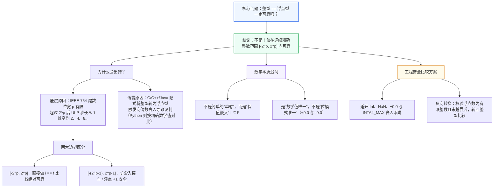
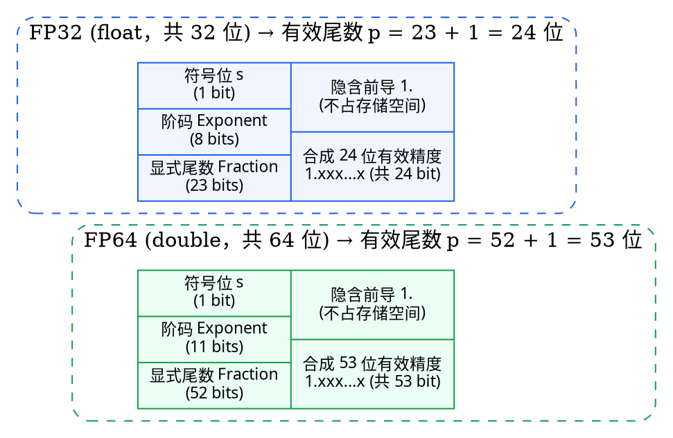
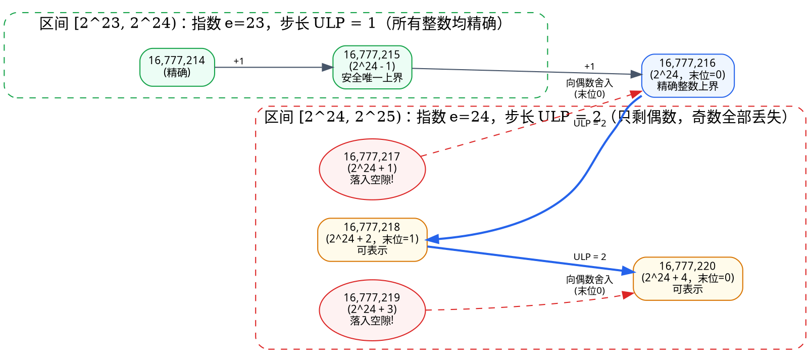
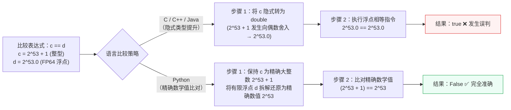
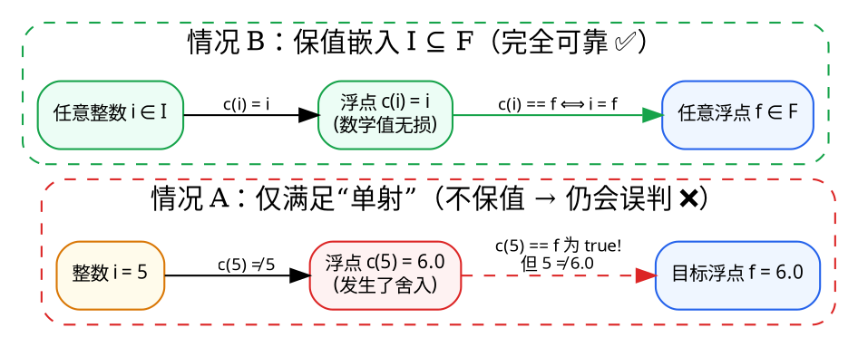
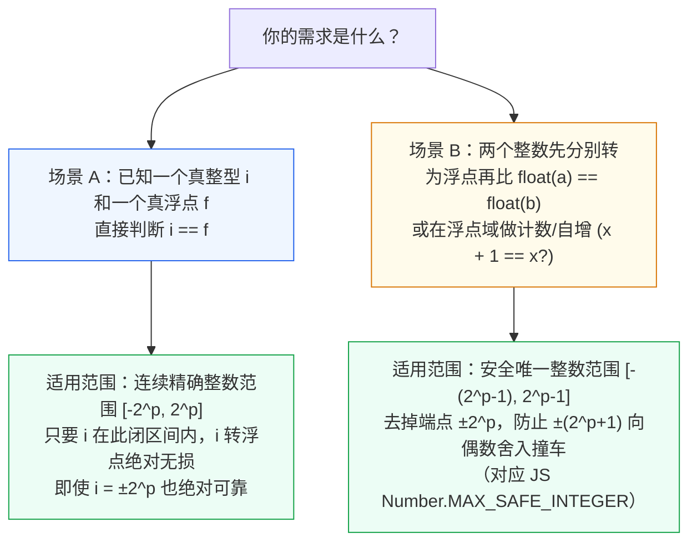
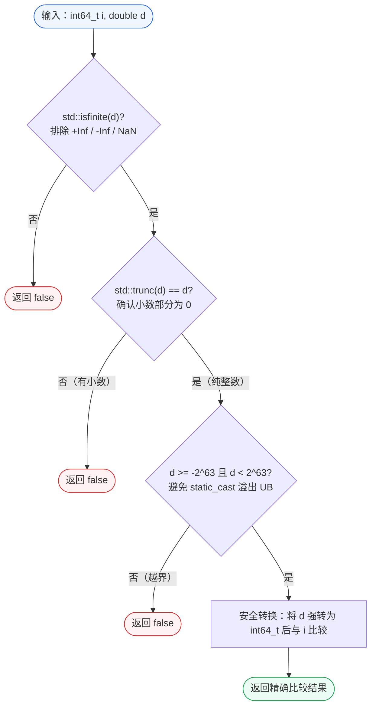

> **导读**：在写 C/C++、Java 或 JavaScript 代码时，你是否想过一个看似理所当然的问题：**把一个整数和一个浮点数用 `==` 比较相等，结果一定靠谱吗？**
>
> 试想下面这行普通的 C++ 代码：
>
> ```cpp
> int32_t a = 16777217;      // 2^24 + 1
> float   b = 16777216.0f;   // 2^24
> bool eq   = (a == b);      // 猜猜结果是 true 还是 false？
> ```
>
> 数学上，$16,777,217$ 明明比 $16,777,216$ 大 $1$，但在 C++ 中，**`eq` 的结果竟然是 `true`！** 两个明明不相等的数，被计算机直接判成了“相等”。
>
> 为什么会出现这种反直觉的 Bug？到底在多大的整数范围内，整型与浮点型的相等比较才绝对可靠？在数学上，“比较永远可靠”又等价于什么条件？
>
> 本文将完全照顾**初学者的阅读体验**：**每一个专业术语在第一次出现时都会给出通俗解释**，并配合多张 **Graphviz 结构/数轴图** 与 **Mermaid 流程图**，带你从底层二进制编码一路走到严谨的工程防御代码。

---

## 零、初学者核心名词破冰速查表

在进入正文前，你可以把下表当作“随身词典”。正文第一次遇到这些概念时，我们也会结合具体例子展开说明。

| 术语 / 缩写 | 英文全称 | 一句话通俗解释 |
| :--- | :--- | :--- |
| **IEEE 754** | IEEE Standard for Floating-Point Arithmetic | **浮点数国际标准**：规定计算机如何用二进制 `0` 和 `1` 来存储小数、极大数据以及无穷大、`NaN` 等特殊值。 |
| **尾数 (有效数字)** | Mantissa / Significand | 类似十进制科学计数法 $1.23 \times 10^5$ 里的 **`1.23`**，决定了一个浮点数能保留多少位“精确细节”。 |
| **隐含前导位** | Implicit Leading Bit | 规格化二进制浮点数的整数部分永远是 `1`（如 `1.0110...`），硬件为了省空间干脆不存这个 `1`，免费多出 1 位精度。 |
| **阶码 (指数)** | Exponent | 类似科学计数法里的 **次方数**，决定了小数点可以往左或往右浮动多远（即数值的数量级大小）。 |
| **ULP** | Unit in the Last Place | **最小精度单位（相邻步长）**：在当前数量级下，相邻两个能被浮点数精确表示的数字之间的间隔。 |
| **舍入** | Rounding | 当一个真实数值落在了两个可表示浮点数的“空隙”里时，硬件必须把它近似归到某一个附近的浮点数上。 |
| **向偶数舍入** | Round-to-Nearest-Even | IEEE 754 的默认舍入规则（又称银行家舍入）：离谁近选谁；**刚好卡在正中间时，选二进制尾数最低位为 `0`（偶数）的那一侧**。 |
| **隐式类型提升** | Usual Arithmetic Conversions | C/C++/Java 等语言在混合比较整型和浮点型时，编译器悄悄把**整型先转换成浮点型**再比较的规则。 |
| **`Inf` / `NaN`** | Infinity / Not a Number | 浮点数的两个特殊状态：`Inf` 表示数值太大装不下（无穷大）；`NaN` 表示非法运算结果（如 `0.0 / 0.0`）。 |
| **单射** | Injection (One-to-One) | 数学映射概念：不同的输入一定映射到不同的输出，但**不要求输出值等于输入值本身**。 |
| **保值嵌入** | Value-Preserving Embedding | 比单射更严格：每个输入不仅映射结果互异，而且映射后的**真实数学值完全不变**（即集合包含关系 $I \subseteq F$）。 |
| **安全唯一整数** | Safe Integer | 不仅自己能被浮点数精确表示，而且附近相邻整数舍入时**不会撞到自己头上**的整数（如 JS 的 `Number.MAX_SAFE_INTEGER`）。 |

下面这张全景导图展示了整篇教程的知识脉络：



---

## 一、直击结论：所有整型与浮点数比较相等都是可靠的吗？

**答案是否定的：不是。**

只有当参与比较的整数数值落在该浮点类型的**连续精确整数表示范围**内时，直接用 `==` 比较相等才完全可靠。一旦整数的大小超出了浮点数“尾数”能够承载的有效位数，整型在转换为浮点数时就会发生**舍入（Rounding）**——精度被悄悄抹去，导致两个原本不相等的数被误判为相等。

### 1.1 一条核心公式与常见组合速查

对于遵循 **IEEE 754 标准** 的二进制浮点数，假设它的**有效尾数位数为 $p$**（注意：包含隐含的最高位 `1`，下一节会详细解释它从哪来），那么它能够**一个不落地连续精确表示所有整数**的最大闭区间是：

$$
[-2^p,\ 2^p]
$$

基于这条公式，我们可以立刻判断日常编程中最常见的整型与浮点型混合比较是否安全（其中 `intN_t` 表示带符号 $N$ 位整数，`uintN_t` 表示无符号 $N$ 位整数）：

| 浮点类型 | 有效尾数位数 ($p$) | 连续精确整数范围 $[-2^p,\ 2^p]$ | 可安全直接 `==` 比较的常见整型 | 会出现误判的常见组合 |
| :--- | :--- | :--- | :--- | :--- |
| **`bf16` (bfloat16)** | $8$ 位（$7$ 显式 $+ 1$ 隐含） | $[-256,\ 256]$ | `int8_t` ($[-128, 127]$)、`uint8_t` ($[0, 255]$) | `int16_t`、`int32_t` |
| **`fp16` (half)** | $11$ 位（$10$ 显式 $+ 1$ 隐含） | $[-2,048,\ 2,048]$ | `int8_t`、`uint8_t` | `int16_t`、`uint16_t`、`int32_t` |
| **`float` (fp32)** | $24$ 位（$23$ 显式 $+ 1$ 隐含） | $[-16,777,216,\ 16,777,216]$ | `int16_t` ($[-32768, 32767]$)、`uint16_t` ($[0, 65535]$) | **`int32_t`、`uint32_t`** |
| **`double` (fp64)** | $53$ 位（$52$ 显式 $+ 1$ 隐含） | $[-9.007 \times 10^{15},\ 9.007 \times 10^{15}]$ | `int32_t` ($[-2^{31}, 2^{31}-1]$)、`uint32_t` ($[0, 2^{32}-1]$) | **`int64_t`、`uint64_t`** |

从上表可以直接得出工程中最常遇到的两个结论：
- **完全可靠的情况**：例如 `int32_t` / `uint32_t` 与 `double` 比较。因为 32 位整型的最大绝对值只有约 $4.29 \times 10^9$（$2^{32}-1$），远远小于 `double` 的精确整数上限 $2^{53} \approx 9.007 \times 10^{15}$，所以 32 位整型的**所有可能取值**都能被 `double` 毫无损失地装下。
- **不可靠的高危情况**：`int32_t` 与 `float` 比较（`float` 只能保住 24 位精度，装不下 32 位整数），以及 `int64_t` 与 `double` 比较（`double` 只能保住 53 位精度，装不下 64 位整数），都会触发误判！

> [!WARNING] 不要混淆 `fp16` 与 `int16_t`
> 很多初学者看到 `fp16` 和 `int16_t` 名字里都有 `16`，就误以为它们能无损互转。实际上 `fp16` 虽然占 16 比特，但其中 1 比特给了符号、5 比特给了指数，留给有效尾数的只有 $10 + 1 = 11$ 比特，连续精确整数上限仅仅是 **$2048$**！而 `int16_t` 最大到 $32767$，`uint16_t` 最大到 $65535$（甚至超过了 `fp16` 能表示的最大有限值 $65504$，直接溢出变成无穷大）。

### 1.2 眼见为实：C++ 误判现场

在 C/C++ 中，只要整数跨过了 $2^p$ 的门槛，下面的代码就会立刻翻车：

```cpp
#include <cstdint>
#include <iostream>

int main() {
  // 1. int32_t vs float：2^24 + 1 舍入为 2^24
  int32_t a = 16777217;        // 2^24 + 1
  float   b = 16777216.0f;     // 2^24
  bool eq1  = (a == b);        // true（误判！）

  // 2. int64_t vs double：2^53 + 1 舍入为 2^53
  int64_t c = (1LL << 53) + 1; // 9007199254740993
  double  d = static_cast<double>(1LL << 53); // 9007199254740992.0
  bool eq2  = (c == d);        // true（误判！）

  std::cout << std::boolalpha << "eq1 = " << eq1 << ", eq2 = " << eq2 << "\n";
  return 0;
}
```

---

## 二、底层原理：为什么境界一过 $\pm 2^p$ 就开始丢精度？

要彻底看懂原因，我们只需要花两分钟弄明白两件事：**浮点数怎么存数字**，以及**它数轴上的刻度为什么会突然变稀疏**。

### 2.1 IEEE 754 二进制结构与“白嫖”的隐含前导位

十进制的科学计数法会把数字写成 $1.234 \times 10^5$ 的形式；计算机使用二进制，因此 IEEE 754 把任何一个普通的**规格化浮点数（Normalized Number，即非零且不过分极小的常规数）**写成二进制科学计数法：

$$
(-1)^s \times 1.\underbrace{xxx\dots x}_{p-1\text{ 位}} \times 2^e
$$

其中包含三个部分：
1. **符号位（Sign，$s$）**：占 `1` 比特。`0` 表示正数，`1` 表示负数。
2. **阶码 / 指数位（Exponent，$e$）**：决定 $2$ 的几次方，也就是小数点要移动多少位。
3. **显式尾数位（Fraction / Mantissa）**：存储小数点后面的 $p - 1$ 个二进制位。

**关键技巧来了**：在十进制里，小数点前的第一位可以是 `1` 到 `9`；但在**二进制**里，除了 `0` 以外，非零数字的最高位**永远只能是 `1`**！既然它永远是 `1`，那就根本没必要在内存里花 1 比特去存它，硬件在计算时默认在小数点前自动补上这个 **`1.`**。

这就是为什么我们常说 `float` 有 `23 + 1 = 24` 位有效尾数、`double` 有 `52 + 1 = 53` 位有效尾数：



### 2.2 ULP 步长跳变：为什么边界恰好卡在 $\pm 2^p$？

对于二进制规格化数 $(-1)^s \times 1.\underbrace{xxx\dots x}_{p-1\text{ 位}} \times 2^e$，它的最低一位（小数点后第 $p-1$ 位）翻动 `1` 时，真实数值会变化多少呢？这个变化量就是 **ULP（Unit in the Last Place，最小精度单位 / 相邻步长）**：

$$
\text{ULP} = 2^{-(p - 1)} \times 2^e = 2^{e - (p - 1)}
$$

我们把 $e$ 的取值按数值区间拆开看（以正数为例，负数由于对称性完全一样），就能看到一个极其优雅的阶梯变化：

1. **区间 $[2^{p-1},\ 2^p)$**：此时指数 $e = p - 1$。代入公式得到步长：
   $$\text{ULP} = 2^{(p-1) - (p-1)} = 2^0 = 1$$
   这意味着在这个区间内，**每两个相邻浮点数之间的距离刚好是 `1`**，所有整数一个不落、严丝合缝地排列在数轴上！
   *(注：比 $2^{p-1}$ 更小的区间 $[2^{p-2}, 2^{p-1})$ 步长是 `0.5`，再小是 `0.25`……步长小于等于 `1` 时，自然也能包含每一个整数。)*
2. **临界点 $2^p$**：当数值正好达到 $2^p$ 时，它可以完美写成 $1.000\dots 0_2 \times 2^p$，不需要任何额外的尾数 bit，因此 **$2^p$ 本身可以精确表示**。
3. **跨过 $2^p$ 进入 $[2^p,\ 2^{p+1})$**：此时指数被迫升级为 $e = p$。步长瞬间翻倍：
   $$\text{ULP} = 2^{p - (p - 1)} = 2^1 = 2$$
   **灾难发生了！** 从 $2^p$ 开始，相邻两个浮点数之间的距离变成了 **`2`**！数轴上只剩下偶数（$2^p, 2^p+2, 2^p+4\dots$）能够被表示，**所有的奇数（$2^p+1, 2^p+3\dots$）全部掉进了“空隙”里！** 于是 **$2^p + 1$ 成了第一个无法被精确表示的正整数**。

### 2.3 “向偶数舍入”如何把 `2^p + 1` 变成 `2^p`？

当整数 `2^p + 1` 试图转成浮点数时，它恰好站在左侧的 `2^p`（尾数最低位为 `0`）和右侧的 `2^p + 2`（尾数最低位为 `1`）的正中间，距离两边都是 `1`。

按照 IEEE 754 默认的 **向偶数舍入（Round-to-Nearest-Even）** 规则：处于正中间时，必须向**尾数最低位为 `0`（偶数）**的一侧靠拢。
- `2^p + 1`（比如 `float` 下的 `16777217`）：左邻 `16777216` 末位是 `0`，右邻 `16777218` 末位是 `1` → **向左侧偶数 `16777216` 舍入！**
- `2^p + 3`（比如 `float` 下的 `16777219`）：左邻 `16777218` 末位是 `1`，右邻 `16777220` 末位是 `0` → **向右侧偶数 `16777220` 舍入！**

下面这张以 `float`（$p=24, 2^{24} = 16,777,216$）为原型的 Graphviz 数轴图，直观画出了 ULP 跳变与“奇数掉入空隙”的物理真相：



> [!NOTE] 再往更大走会发生什么？
> 当数值跨过 $2^{p+1}$ 进入 $[2^{p+1}, 2^{p+2})$ 时，ULP 会进一步翻倍变成 **`4`**（只能表示 4 的倍数）；跨过 $2^{p+2}$ 变成 **`8`**……数值越大，数轴上的“空洞”就越宽。

---

## 三、语言机制的真相：隐式类型提升 vs 精确数学比较

看到这里，细心的读者可能会问：**“就算 `float` 装不下 `16777217`，可 `int32_t a = 16777217` 本身是精确存着的呀！为什么计算机不能用 `int32_t` 的视角去比，非要把 `a` 弄坏再比呢？”**

这正是**不同编程语言底层比较规则**的本质差异！

### 3.1 C/C++/Java 的做法：常规算术转换（整型迁就浮点型）

在 C、C++、Java 等静态类型语言中，当整型和浮点型用 `==` 进行二元运算或比较时，语言标准规定了**常规算术转换（Usual Arithmetic Conversions）**规则：
- 编译器**不会**把浮点数转成整数（因为浮点数可能有小数部分，比如 `3.5`，转成整数会直接截断丢失小数，导致 `3 == 3.5` 荒谬地成立）；
- 相反，编译器会生成转换指令，**先把整型隐式转换为浮点型**，然后调用硬件的浮点比较指令来比较两个浮点数。

正因如此，在 `a == b` 真正执行比较的那一瞬间，`a` 已经被转换成了舍入后的 `16777216.0f`，原本的信息早已丢失。

### 3.2 Python 的做法：按精确数学值对比

Python 的行为则完全不同：
- Python 的 `int` 是**任意精度大整数**，而 `float` 底层对应 C 的 64 位 `double`；
- 当 Python 执行 `int == float` 时，解释器**绝对不会把大整数截断或舍入成 `float`**！相反，它会先排除 `Inf` 和 `NaN`（直接返回 `False`），接着检查 `float` 是否有小数部分，如果是有限整数，就把 `float` 内部的“尾数 $\times 2^{\text{指数}}$”拆解还原成精确的数学整数（或有理数），再和 `int` 做精确对比。

因此在 Python 中运行 `(1 << 53) + 1 == float(1 << 53)`，得到的是完全符合数学直觉的 **`False`**！



---

## 四、数学本质追问：比较可靠等价于“每个整数都有唯一确定的浮点数”吗？

这是一个非常深刻的追问。如果把命题准确表述一下：

> **命题**：在“先将整型隐式转为浮点型再比较”的语言前提下，“所有整型与浮点数比较相等都可靠”是否等价于“每个整数都有一个唯一确定的浮点数”？

答案是：**基本等价，但必须把口语里的“唯一确定”升级为更严谨的数学概念——“数学值精确无损表示（保值嵌入）”**。下面三个细节缺一不可：

### 4.1 关键细节一：必须是“保值嵌入”，而不仅仅是“一一对应（单射）”

设整型的值域集合为 $I$，浮点型的值域集合为 $F$，隐式转换函数为 $c: I \to F$。
“直接用 `==` 比较永远可靠”的严格数学定义是：对于集合 $I$ 中的任意整数 $i$ 和集合 $F$ 中的任意浮点数 $f$，程序比较的结果必须与真实实数意义下的相等完全一致：

$$
\forall i \in I,\ \forall f \in F:\quad (c(i) ==_F f) \iff (i =_{\mathbb{R}} f)
$$

（其中 $==_F$ 表示浮点相等运算，$=_ {\mathbb{R}}$ 表示真实数学值相等。）

为什么仅仅满足“一一对应（**单射**）”还不够呢？
假设我们有这样一个假设性的映射：每个整数都恰好映射到了一个互不相同的浮点数，但其中整数 $i = 5$ 被映射成了 $c(5) = 6.0$（发生了舍入偏移）。虽然不同整数没撞车（满足单射），但只要你拿整数 `5` 去和浮点数 `6.0` 做比较：
- 程序计算 `c(5) == 6.0` → 结果为 `true`；
- 真实数学值 $5 \neq 6.0$ → **依然误判！**

因此，真正的充要条件是 **$I$ 是 $F$ 的子集（$I \subseteq F$，即保值嵌入）**：

$$
\forall i \in I,\quad c(i) =_{\mathbb{R}} i
$$

只要整型值域中的**每一个整数都能被该浮点型精确无损地表示**，那么 `c(i)` 就是 `i` 自己，此时无论拿它和什么浮点数（整数、带小数点的数、超大数、`Inf`、`NaN`）做 `==` 比较，都不会有任何误判！



### 4.2 关键细节二：是“数值唯一”，不是“底层二进制位模式唯一”

如果有人从底层比特（Bit Pattern）的角度去理解“唯一确定的浮点数”，整数 **`0`** 是唯一的例外：
- IEEE 754 规定了两种零：**`+0.0`**（所有比特全为 `0`）和 **`-0.0`**（符号位为 `1`，其余比特全为 `0`）。
- 它们的二进制编码不同，但 IEEE 754 在数值比较语义上明确规定 `+0.0 == -0.0` 返回 **`true`**。
- 因此，整数 `0` 虽然对应了两个底层位模式，但对应的**数值语义是唯一的**，完全不影响相等比较的可靠性；而对于区间 $[-2^p, 2^p]$ 内除 `0` 以外的所有非零整数，连二进制编码也都是严格唯一的。

### 4.3 关键细节三：等价性依赖于“整型转浮点”的规则

这一充要等价关系只适用于**通过隐式类型提升把整型先转成浮点**的语言（C/C++/Java/Rust 若显式或隐式转换后比较等）。像 Python 这种直接拆解浮点数与大整数做精确数值比对的语言，即使 $I \not\subseteq F$，比较也依然永远可靠。

> [!IMPORTANT] 最严谨的等价总结
> **在隐式“整型转浮点”的比较规则下，整型与浮点型比较相等完全可靠，当且仅当该整型的值域是该浮点型可精确表示集合的子集（$I \subseteq F$）。**

---

## 五、两大精确边界全景对比：$[-2^p, 2^p]$ vs $[-(2^p-1), 2^p-1]$

在实际查资料或看语言标准时（比如 JavaScript 的 `Number.MAX_SAFE_INTEGER`），你可能会困惑：为什么有的地方写精确范围上限是 **$2^p$**（例如 `9007199254740992`），而有的地方写的却是 **$2^p - 1$**（例如 `9007199254740991`）？

这两个只差 `1` 的范围，对应着截然不同的工程语义！先看覆盖主流硬件与 AI 芯片常见浮点格式的全景对照表：

| 浮点格式 | 有效尾数位数 ($p$) | 连续精确整数范围 $[-2^p,\ 2^p]$ | 安全唯一整数范围 $[-(2^p-1),\ 2^p-1]$ | 第一个无法表示的正整数 ($2^p + 1$) |
| :--- | :--- | :--- | :--- | :--- |
| **FP8 (E5M2)** | $3$ ($2+1$) | $[-8,\ 8]$ | $[-7,\ 7]$ | $9$ |
| **FP8 (E4M3)** | $4$ ($3+1$) | $[-16,\ 16]$ | $[-15,\ 15]$ | $17$ |
| **BF16 (bfloat16)** | $8$ ($7+1$) | $[-256,\ 256]$ | $[-255,\ 255]$ | $257$ |
| **FP16 (binary16 / half)** | $11$ ($10+1$) | $[-2,048,\ 2,048]$ | $[-2,047,\ 2,047]$ | $2,049$ |
| **TF32** | $11$ ($10+1$) | $[-2,048,\ 2,048]$ | $[-2,047,\ 2,047]$ | $2,049$ |
| **FP32 (binary32 / float)** | $24$ ($23+1$) | $[-16,777,216,\ 16,777,216]$ | $[-16,777,215,\ 16,777,215]$ | $16,777,217$ |
| **FP64 (binary64 / double)** | $53$ ($52+1$) | $[-9,007,199,254,740,992,\ 9,007,199,254,740,992]$ | $[-9,007,199,254,740,991,\ 9,007,199,254,740,991]$ | $9,007,199,254,740,993$ |
| **FP128 (binary128)** | $113$ ($112+1$) | $[-2^{113},\ 2^{113}]$ | $[-(2^{113}-1),\ 2^{113}-1]$ | $2^{113} + 1$ |

### 5.1 为什么“安全唯一整数”要少 1？

我们来看边界点 $\pm 2^p$ 上发生了什么微妙的事情：
- **$2^p$ 本身确实能精确表示**，所以如果一个整数 `i` 的值就等于 $2^p$，把它转成浮点数完全不丢精度，直接和**已经存在的浮点数 `f`** 比较（`i == f`），结果 100% 准确。
- 但是，在 IEEE 754 向偶数舍入规则下，区间外面的 **$2^p + 1$ 会舍入并撞到 $2^p$ 头上**！这会导致在浮点域里出现极其危险的“撞车”现象：
  - JavaScript 中：`9007199254740992 === 9007199254740992 + 1` 结果是 `true`！
  - C++ 中：`static_cast<double>(1LL << 53) == static_cast<double>((1LL << 53) + 1)` 结果是 `true`！

因此，JavaScript 把 `Number.MAX_SAFE_INTEGER` 严格定在 **$2^{53} - 1$** 而不是 $2^{53}$。只有去掉左右两端点 $\pm 2^p$，落在 **$[-(2^p - 1),\ 2^p - 1]$** 内，才能保证**没有任何其他整数会通过舍入来“冒充”你**。



---

## 六、边界陷阱与 C++ 安全比较实战

理解了核心边界，我们还要避开三个工程中极易忽略的“暗礁”，并给出一条万无一失的 C++ 比较写法。

### 6.1 不可忽视的三大边界陷阱

1. **溢出变无穷大（`Inf`）**：
   低精度浮点数的最大值往往远远小于常见整型。例如 `fp16` 的最大有限值是 **`65504`**，而无符号 16 位整型 `uint16_t` 的最大值是 **`65535`**（32 位整型更是高达 $2 \times 10^9$）。如果把 `65535` 转成 `fp16`，结果会直接溢出成 `+Inf`。虽然 `65535 == +Inf` 在转为 `fp16` 后居然可能误判为 `true`（`+Inf == +Inf`），或和普通有限数比较失败，但这显然已经彻底失去了数值意义。
2. **`NaN`（Not a Number，非数）**：
   IEEE 754 规定 `NaN` 代表非法或未定义的值，它**不等于任何数，甚至不等于它自己**（`NaN == NaN` 为 `false`）。因此任何整型与 `NaN` 比较 `==`，结果恒为 `false`。
3. **正负零（`+0.0` vs `-0.0`）**：
   `-0.0 == 0` 的结果为 `true`，这在算术语义上通常符合预期；但如果你在代码里用了内存比特比对（如 `memcmp` 或哈希表把二进制比特直接当 Key），`+0.0` 与 `-0.0` 的比特模式并不一样。

### 6.2 工程正解：反向过滤 + 转为整型再比较

既然当 `int64_t` 与 `double`（或 `int32_t` 与 `float`）比较时，“整型转浮点”会丢精度，那我们的正确策略就是**反其道而行之**：

> **不要把大整型往小尾数浮点里塞；而是先确保这个浮点数本身“既有限、又是纯整数、且没有超出整型范围”，再把它安全地转成整型进行比较！**

在动手写代码前，有一个**极度隐蔽的 C++ 陷阱**必须提前踩刹车：
- `int64_t` 的取值范围是 $[-2^{63},\ 2^{63} - 1]$，其中最大值 `INT64_MAX` 是 $2^{63} - 1 = 9223372036854775807$。
- 因为 $2^{63} - 1$ 远远超出了 `double` 的 $2^{53}$ 精度上限，如果你写 `static_cast<double>(INT64_MAX)`，它会向上舍入变成 **$2^{63}$**（`9223372036854775808.0`）！
- 如果你错误地用 `d <= static_cast<double>(INT64_MAX)` 作为上界检查，那么当 `d` 恰好等于 $2^{63}$ 时就会通过校验；紧接着执行 `static_cast<int64_t>(d)` 就会因为溢出 `int64_t` 最大值而触发 **C++ 未定义行为（Undefined Behavior）**！
- **正确的上界判断**：因为 $2^{63}$ 是 2 的整数次幂，它本身可以被 `double` **精确表示**，所以我们只需严格要求 `d < 9223372036854775808.0`（即严格小于 $2^{63}$），就能保证所有通过检查的整数都不超过 $2^{63} - 1$！

下面这张流程图展示了完整、无漏洞的校验链路：



对应的高可靠 C++ 实现代码如下：

```cpp
#include <cmath>
#include <cstdint>

bool exact_equal(int64_t i, double d) {
  // 1. 排除 Inf 与 NaN（std::isfinite 仅对有限浮点数返回 true）
  // 2. 排除非整数（std::trunc 向零截断小数部分；若截断后不等于原值，说明存在小数）
  if (!std::isfinite(d) || std::trunc(d) != d) {
    return false;
  }

  // int64_t 范围是 [-2^63, 2^63 - 1]
  // -2^63 与 2^63 都是 2 的整次幂，均可被 double 100% 精确表示
  constexpr double min_i64 = -9223372036854775808.0;          // -2^63
  constexpr double max_i64_exclusive = 9223372036854775808.0; //  2^63 (必须严格小于)

  if (d < min_i64 || d >= max_i64_exclusive) {
    return false;
  }

  // 经过上述过滤，static_cast<int64_t>(d) 既不丢精度，也绝不触发溢出未定义行为
  return i == static_cast<int64_t>(d);
}
```

> [!TIP] `int32_t` 与 `float` 的同类安全写法
> 同理，如果需要精确比较 `int32_t` 与 `float`，不能直接写 `i == f`，而应按完全相同的逻辑过滤 `std::isfinite(f)` 和 `std::trunc(f) == f`，并检查 `-2147483648.0f <= f && f < 2147483648.0f`（即 $[-2^{31}, 2^{31})$），再执行 `i == static_cast<int32_t>(f)`。

---

## 七、总结：三句话带走全部核心知识

1. **为什么会错**：在 C/C++/Java 中，`整型 == 浮点型` 会先把整型隐式转为浮点型。当整型绝对值超过 $2^p$（`float` 为 $2^{24}$，`double` 为 $2^{53}$）后，浮点相邻步长 ULP 变为 $2, 4, 8\dots$，奇数掉进空隙并通过向偶数舍入碰撞到相邻偶数上，造成误判。
2. **两个关键边界**：如果只是拿整型 `i` 和已有浮点数 `f` 直接比 `==`，安全范围是连续精确整数闭区间 **$[-2^p, 2^p]$**；如果要保证任意整数转浮点都不会与其他整数撞车或在浮点域做 `+1` 运算不失真，安全范围必须收紧 1 到 **$[-(2^p - 1),\ 2^p - 1]$**。
3. **工程防御原则**：记住哪些组合天生安全（`int32_t` vs `double`、`int16_t` vs `float`、`int8_t` vs `fp16`/`bf16`）；遇到 `int64_t` vs `double` 或 `int32_t` vs `float` 时，千万别依赖隐式提升，应先校验浮点数是有限整数且落在目标整型半开区间 $[-2^{N-1}, 2^{N-1})$ 内，再转回整型比对。
