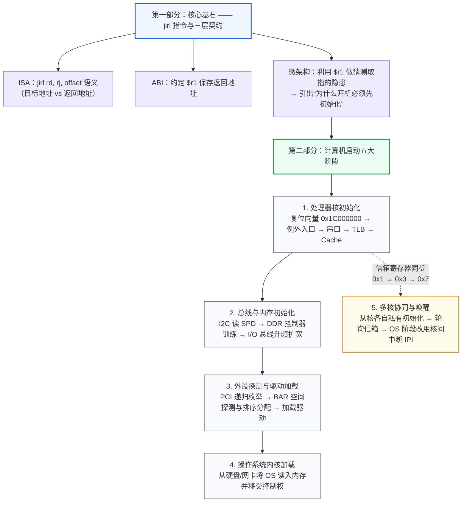
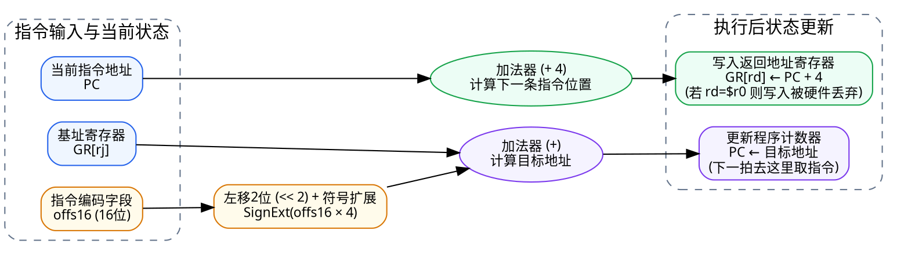
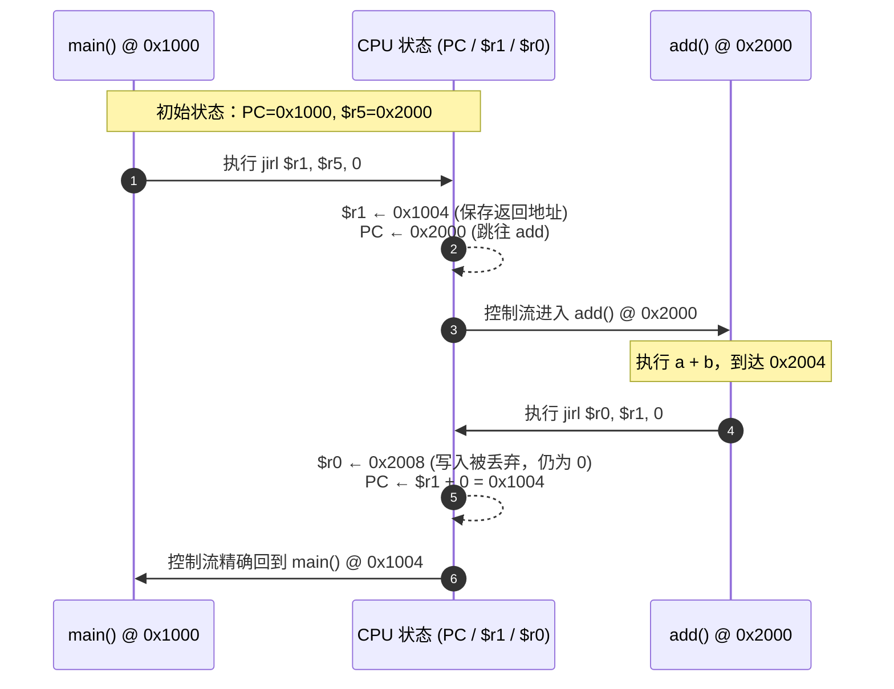
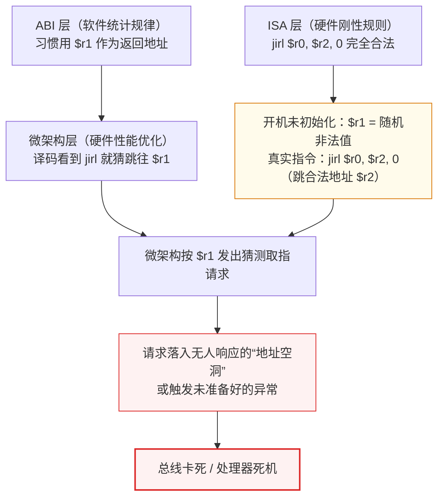
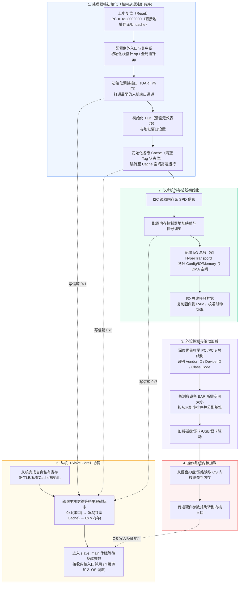
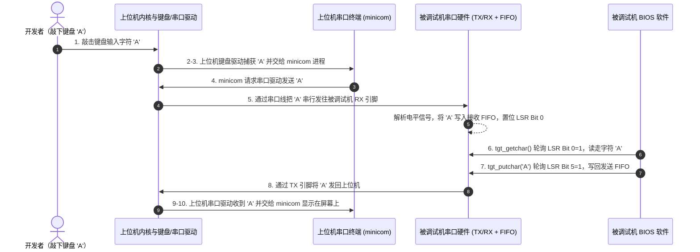
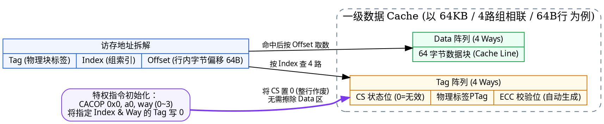
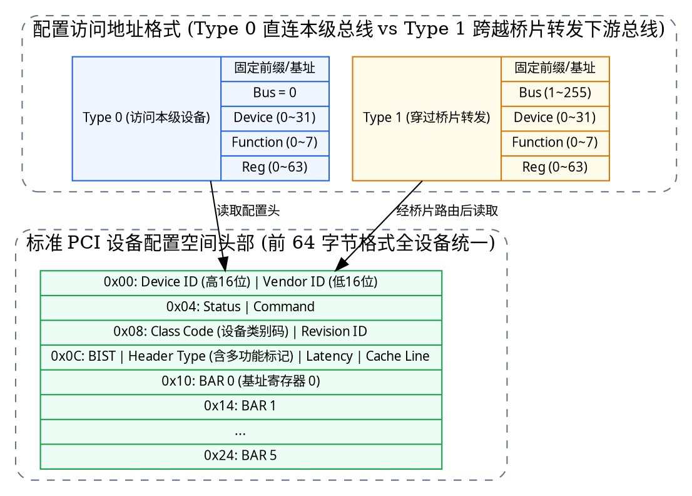
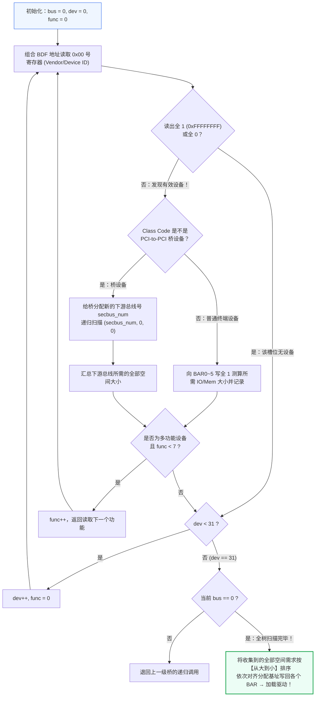
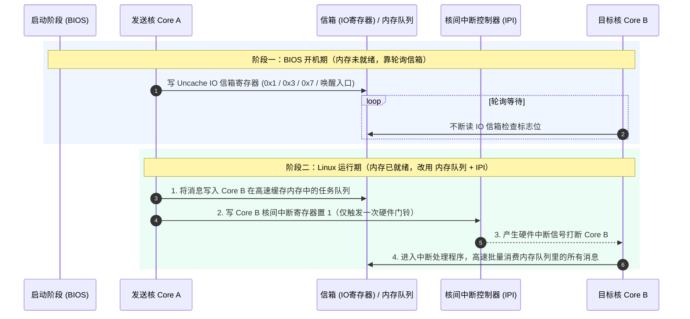

> **导读**：当你按下电脑或开发板的电源键时，屏幕不会瞬间出现桌面。在操作系统接管一切之前，CPU 必须先在一个“完全没有内存可用、没有屏幕驱动、连寄存器里都可能装满随机垃圾值”的荒野中，靠自己执行固件（BIOS）代码一步步建立秩序。
>
> 有趣的是，理解整个庞大开机流程的钥匙，往往就藏在一条看似简单的汇编指令里——例如 LoongArch（龙架构）中的 `jirl` 指令。它不仅承担着**函数调用与返回**的重任，还意外揭示了**软件约定（ABI）如何影响硬件微架构（猜测执行）**，并解释了为什么 CPU 刚上电时不能“上来就随便跑”，而必须严格按顺序初始化！
>
> 本文将完全照顾**体系结构初学者**的阅读体验：**每一个专业名词在第一次出现时都会给出通俗解释**，并用大量 **Graphviz 拓扑图** 与 **Mermaid 流程图/时序图**，带你走完从一条指令到整个多核系统点亮的全过程。

---

## 零、初学者名词破冰速查表

在正文开始前，你可以先把下面这张表当作“行军字典”。正文中第一次遇到这些概念时，我们也会结合具体画面再讲一遍。

| 术语 / 缩写           | 英文全称                             | 一句话通俗解释                                                                                                  |
| :-------------------- | :----------------------------------- | :-------------------------------------------------------------------------------------------------------------- |
| **PC**                | Program Counter                      | **程序计数器**：CPU 内部的“当前阅读书签”，永远指向下一条要取来执行的指令地址。                                  |
| **GR / `$r0`~`$r31`** | General-purpose Register             | **通用寄存器**：CPU 核心内部速度极快的 32 个“随身草稿格”。其中 `$r0` 永远固定为 `0`。                           |
| **ISA**               | Instruction Set Architecture         | **指令集架构**：硬件承诺给软件的“说明书”（有哪些指令、每条指令做什么、寄存器怎么算）。                          |
| **ABI**               | Application Binary Interface         | **应用程序二进制接口**：软件之间协作的“交通规则”（比如约定好哪个寄存器放参数、哪个放返回地址）。                |
| **微架构**            | Microarchitecture                    | **处理器微结构**：CPU 内部为了跑得更快而设计的电路技巧（如流水线、分支预测、猜测执行、Cache）。                 |
| **猜测执行**          | Speculative Execution                | CPU 不等前一条指令算完结果，先猜一个最可能的后续方向提前取指令和执行；猜对了赚速度，猜错了回滚。                |
| **复位（Reset）**     | Hardware Reset                       | 通电瞬间硬件拉动“重启总闸”，强制把 PC 归位到一个固定起点地址（LoongArch 为 `0x1C000000`）。                     |
| **BIOS / 固件**       | Basic Input Output System / Firmware | **基本输入输出系统**：焊死在主板 Flash（闪存）芯片里的“开机引导程序”，负责把硬件从零唤醒。                      |
| **TLB**               | Translation Lookaside Buffer         | **快表**：专门缓存“虚拟地址 → 物理地址”翻译结果的硬件小本子，避免每次访存都查内存页表。                         |
| **Cache / Uncache**   | Cacheable / Uncacheable              | **经缓存 / 不经缓存**：访问内存数据走高速缓存（Cache）加速；访问硬件设备寄存器必须绕开缓存直达设备（Uncache）。 |
| **MMIO / I/O 空间**   | Memory-Mapped I/O                    | **内存映射输入输出**：把外设（如串口、网卡）的控制寄存器也编成内存地址，直接用读写内存的指令去操控硬件。        |
| **BAR**               | Base Address Register                | **基址寄存器**：PCI 设备配置空间里的“申请单”，告诉 BIOS“我需要多大一块地址空间”，并接收分配好的起始地址。       |
| **主核 / 从核**       | Boot Core (BSP) / Slave Core (AP)    | 多核 CPU 开机时，先干活、负责初始化全局硬件的是**主核**；其他核心作为**从核**先原地休眠或辅助，等通知再干活。   |

---

## 一、全篇知识全景图

在深入技术细节之前，我们先用一张全景图看清整篇文章的两大主线：**底层指令与软硬件契约**如何支撑起**计算机从零启动的五大阶段**。



---

## 二、热身基石：彻底看懂 LoongArch 的 `jirl` 跳转指令

理解“开机时未初始化寄存器为什么会引发猜测执行死机”，关键在于先吃透 LoongArch 里最常用的跳转指令：**`jirl`**（Jump and Link Register，寄存器间接跳转并链接）。

### 2.1 先分清两个完全不同的地址

初学汇编时，很多人会把“往哪跳”和“回哪去”混为一谈。你必须先在脑子里把这两个地址彻底分开：

- **跳转目标地址（Target Address）**：当前这条指令执行完后，CPU **接下来要飞去哪里**继续执行（比如进入某个被调用的子函数）。
- **返回地址（Return Address）**：CPU 跳出去办完事以后，**将来应该回到哪里**接着往下走（也就是当前这条跳转指令的“下一条指令”位置）。

LoongArch 的 `jirl` 指令之所以强大，是因为它**同时具备这两种能力**：既能跳转到一个动态计算的新地址，又能顺手把“下一条指令的地址”存下来当作返回凭证。

### 2.2 `jirl` 指令到底做了什么？

`jirl` 的标准汇编格式如下：

```asm
jirl rd, rj, offset
```

其中三个操作数（指令后面跟着的输入输出参数）的含义分别是：

| 操作数       | 英文全称             | 角色定位                     | 作用通俗解释                                                       |
| :----------- | :------------------- | :--------------------------- | :----------------------------------------------------------------- |
| **`rd`**     | Destination Register | **保存返回地址的目标寄存器** | 用来记下“办完事后回到哪”（`PC + 4`）。如果不需要返回，就填 `$r0`。 |
| **`rj`**     | Source Register      | **提供跳转目标的基地址**     | 里面存着目标地址（或者目标区域的基准起始地址）。                   |
| **`offset`** | Immediate Offset     | **提供跳转目标的偏移量**     | 一个固定常数，加到基地址上，算出最终的跳转目标地址。               |

它在硬件电路层面严格执行以下两个赋值操作：

$$
GR[rd] \leftarrow PC + 4
$$

$$
PC \leftarrow GR[rj] + \operatorname{SignExt}(offset \ll 2)
$$

> [!NOTE] 公式里的生词逐一破冰
>
> - **`GR`**（General Register）：通用寄存器组。`GR[rd]` 表示编号为 `rd` 的那个通用寄存器里存放的数值。
> - **`PC`**（Program Counter）：当前正在执行的这条 `jirl` 指令所在的内存地址。因为 LoongArch 每条指令固定占 **4 个字节**，所以“下一条指令的地址”就是 `PC + 4`。
> - **`offset << 2`**：把机器指令里的立即数字段左移 2 位（等价于**乘以 4**）。原因同样是 LoongArch 指令按 **4 字节对齐**，指令地址的最低两位永远是 `00`，没必要浪费宝贵的指令编码位去存两个 0！
> - **`SignExt(...)`**（Sign Extension，符号扩展）：把 16 位或 18 位带正负号的偏移量高位补符号位（正数补 0，负数补 1），扩展成 64 位再与 `GR[rj]` 相加，这样既能往前跳也能往后跳。
> - **极易踩坑的要点**：返回地址（`PC + 4`）是根据**当前 PC** 算出来的，和 `rj` 没有任何关系！

下面这张 Graphviz 数据通路图直观展示了 `jirl` 在 CPU 内部是如何同时更新 `$rd` 和 `PC` 的：



### 2.3 一个完整的 C++ 函数调用与返回实战

假设我们有如下 C++ 代码：

```cpp
int add(int a, int b) {
    return a + b;
}

int main() {
    int c = add(1, 2);
    int d = c * 2;
}
```

假设编译链接后，`main` 函数调用点位于地址 `0x1000`，而 `add` 函数的入口位于地址 `0x2000`。来看看 CPU 是如何用同一条 `jirl` 指令完成“去”和“回”的：

1. **第一步：调用 `add` 函数（出发并留下返程车票）**
   假设调用前 CPU 状态为 `PC = 0x1000`，`$r5 = 0x2000`（`add` 的地址已提前放进 `$r5`）。执行：

   ```asm
   jirl $r1, $r5, 0
   ```

   硬件同时完成两个动作：
   - `$r1 ← 0x1000 + 4 = 0x1004`（把 `int d = c * 2;` 所在的返回地址记在 `$r1` 里）
   - `PC ← 0x2000 + 0 = 0x2000`（跳转进入 `add` 函数）

2. **第二步：从 `add` 函数返回（撕掉车票并原路返回）**
   `add` 函数在 `0x2004` 处算完了 `a + b`，准备回到 `main`。此时它执行：
   ```asm
   jirl $r0, $r1, 0
   ```
   硬件同样同时完成两个动作：
   - `$r0 ← 0x2004 + 4`：**注意！** 在 LoongArch 中，**`$r0`（Zero 寄存器）是硬件写死的恒零寄存器**，任何往 `$r0` 写入数据的操作都会被硬件默默丢弃，`$r0` 永远读出 `0x0`。这就巧妙地表示“我这次跳转不需要保存新的返回地址”！
   - `PC ← $r1 + 0 = 0x1004`：精准跳回 `main` 函数的下一行！



**发现规律了吗？** 函数调用（`Call`）和函数返回（`Return`）在底层硬件上使用的竟然是**完全同一条指令**，区别仅仅在于操作数填哪几个寄存器！

### 2.4 为什么寄存器已经有地址了，还需要 `offset`？

因为寄存器里未必存着“精确的目标地址”，很多时候它只存了一个**基准地址（Base Address）**——比如虚函数表首地址、跳转表基址，或者某个固定代码段的起点。通过搭配 `offset`，一条指令就能直接跳到基准地址之后的某个固定偏移处，省去一条额外的加法指令。

例如，当 `PC = 0x1000`、`$r5 = 0x2000` 时执行：

```asm
jirl $r1, $r5, 16
```

结果会是：`$r1 = 0x1004`，`PC = 0x2000 + 16 = 0x2010`。

> [!TIP] 新手最容易混淆的细节：汇编字节偏移 vs 机器码编码值
> 在编写 LoongArch **汇编代码**时，`jirl $r1, $r5, 16` 里的 `16` 写的是**实际字节偏移量（16 字节）**；而汇编器把它翻译成二进制**机器指令**时，内部 16 位立即数字段（`offs16`）存放的是**除以 4（右移 2 位）之后的数值 `4`**。硬件译码执行时，再将其左移 2 位还原回 `4 × 4 = 16` 字节。

### 2.5 三大典型场景状态对比推演

假设初始状态为：`PC = 0x1000`，`$r0 = 0x0`，`$r1 = 0x1004`，`$r2 = 0x3000`，`$r5 = 0x2000`。下表对比了三种最常见用法在指令执行前后的状态变化：

| 使用场景         | 汇编指令           | 目标地址计算       | 返回地址处理             | 执行后 `PC` | 执行后 `$r0` | 执行后 `$r1`     |
| :--------------- | :----------------- | :----------------- | :----------------------- | :---------- | :----------- | :--------------- |
| **函数调用**     | `jirl $r1, $r5, 0` | `$r5 + 0 = 0x2000` | `0x1000 + 4` 存入 `$r1`  | `0x2000`    | `0x0`        | `0x1004`         |
| **函数返回**     | `jirl $r0, $r1, 0` | `$r1 + 0 = 0x1004` | 写入 `$r0`（被硬件丢弃） | `0x1004`    | `0x0`        | `0x1004`（未变） |
| **普通间接跳转** | `jirl $r0, $r2, 0` | `$r2 + 0 = 0x3000` | 写入 `$r0`（被硬件丢弃） | `0x3000`    | `0x0`        | `0x1004`（未变） |

### 2.6 回到核心矛盾：为什么 ABI 会影响处理器的猜测执行？

理解了上面三行指令，我们就能立刻看懂计算机体系结构里一个非常深刻的跨层问题。

按照 **ISA（指令集架构，硬件说明书）** 的规定，下面三条指令在语法和语义上都是 100% 合法的：

```asm
jirl $r0, $r1, 0   # 跳转到 $r1 保存的地址
jirl $r0, $r2, 0   # 跳转到 $r2 保存的地址
jirl $r0, $r5, 0   # 跳转到 $r5 保存的地址
```

但是，**ABI（应用程序二进制接口，软件协作约定）** 规定：**所有函数调用默认使用 `$r1` 作为返回地址寄存器（`ra`）**。于是现实程序中 99% 的“函数返回”都长成 `jirl $r0, $r1, 0`。

一些激进的处理器微架构设计师为了压榨性能，在指令译码阶段只要一眼看到 `jirl`（尤其是 `rd = $r0` 时），就不等寄存器堆真正把 `rj` 读出来或者等地址算完，**直接按 ABI 规律猜测“目标地址一定在 `$r1` 里！”**，马上顺着 `$r1` 的值提前去内存里抓指令（Speculative Fetch，猜测取指）。

现在灾难场景出现了！假设开机刚通电时：

```text
$r1 = 0xFFFFFFFFFFFF0000  (刚复位，还没初始化，里面是随机垃圾值，指向非法地址空洞)
$r2 = 0x0000000000003000  (软件刚算好的合法跳转地址)
```

此时程序执行的是完全合法的：

```asm
jirl $r0, $r2, 0
```

结果硬件微架构“自作聪明”地按 `$r1` 里的垃圾值发出了一次猜测取指请求！如果处理器没有对猜测访问通路做好容错拦截，或者没有事先初始化 `$r1` 和地址空间，这次发往 `0xFFFFFFFFFFFF0000` 的请求就会掉进**地址空洞（Address Hole，物理总线上没有任何设备认领响应的地址区）**，导致总线永远收不到应答，最终整个系统**死机挂起**！



| 体系结构层次                    | 它负责定义什么？                           | 在 `jirl` 案例中的具体体现              | 能否依赖它保证正确性？                                 |
| :------------------------------ | :----------------------------------------- | :-------------------------------------- | :----------------------------------------------------- |
| **ISA（指令集架构）**           | 规定每条指令必须实现的**正确功能**         | `jirl` 如何计算目标地址与更新 `PC`/`rd` | **必须 100% 保证正确**                                 |
| **ABI（二进制接口）**           | 规定不同函数、编译器、模块之间**如何协作** | 约定使用 `$r1`（`ra`）保存函数返回地址  | 仅是软件约定，**硬件不能把它当成绝对真理**             |
| **微架构（Microarchitecture）** | 决定硬件内部电路**如何高效实现**指令       | 利用 `$r1` 规律做分支目标预测与猜测取指 | 可以用来**加速**，但猜错必须能安全回滚，绝不能引发死机 |

> [!IMPORTANT] 核心思想
> **ABI 是软件层面的约定，不是硬件层面的强制限制。硬件可以利用 ABI 规律进行性能优化，但必须能容忍任何合法 ISA 指令对 ABI 规律的偏离。** 同时这也引出了计算机开机启动的第一条铁律：**在放开性能之前，必须先把处理器里不确定的状态全部“初始化”为可控状态。**

---

## 三、计算机启动过程全景：从混沌到秩序

带着上面建立的直觉，我们现在正式进入以 LoongArch 架构（以经典桌面/服务器处理器龙芯 3 号系列为例）为蓝本的**计算机系统完整启动过程**。

如果把一颗刚通电的 CPU 比作一座**大房间**：

1. **刚复位时**：房间内部漆黑一片，大门（内存接口）和窗户（I/O 接口）都是紧闭的，只有一束微弱的灯光照亮了一扇通往小储藏室的门（BIOS 闪存接口）。
2. **核内初始化后**：房间里灯火通明（调试串口通了、TLB 与 Cache 就绪了），但大门和窗户依然关着。
3. **总线初始化后**：大门（内存）和窗户（I/O 总线）均已打开，但窗外还是一片未知的荒野。
4. **外设枚举与驱动加载后**：门外道路四通八达（PCI 设备全部就绪，硬盘/网卡/显卡能正常工作），可以安全迎接“大管家”——操作系统内核入驻！

### 3.1 系统从复位到启动操作系统的五阶段流程图

整个启动链路横跨硬件逻辑、BIOS 固件与操作系统内核，按职责可以清晰地划分为 5 条协作主线：



### 3.2 什么是“初始化”？

从本质上讲，**初始化就是把硬件内部各种寄存器的状态从“不确定/随机”强制变为“确定/有序”的过程**。简单来说，就是通过加载立即数、访存（`load`/`store`）或写控制寄存器指令，把关键单元设成软件期望的安全数值。

之所以必须做初始化，有两层原因：

1. **显式软件需求**：在 MIPS 和 LoongArch 架构中，硬件只强制规定 `$r0` 恒为 0，其他 31 个通用寄存器刚上电时可能是任意随机值。软件使用栈（`sp`）、全局数据指针（`gp`）或基址之前，必须先明确赋值。
2. **隐式微架构安全需求**：正如我们在上一章 `jirl` 例子中看到的，现代处理器为了快，内置了**猜测执行（Speculative Execution）**、**硬件预取（Prefetch）** 等微结构机制。如果寄存器、TLB 或 Cache 里残留着随机垃圾值，哪怕软件根本没打算用它，微架构也可能“猜”出一个非法地址发出去，从而酿成系统死机。因此，开机的首要任务就是**先堵住所有不确定的角落**。

---

## 四、处理器核初始化：在漆黑的房间里点亮第一盏灯

### 4.1 处理器复位（Reset）：第一条指令从哪来？

无论什么架构的 CPU，上电复位后的第一条指令地址都是硬件写死的：

- 在 LoongArch 中，硬件复位电路强制将 `PC` 初始化为 **`0x1C000000`**。
- 这个物理地址会通过芯片内部的片上互连网络，被精准路由到主板上的非易失性存储设备——早期是只读存储器（**ROM**），现在通常是闪存（**Flash**），里面烧录着我们的启动固件（**BIOS**）。

**刚复位时 CPU 的两条特殊工作模式：**

1. **直接地址翻译模式**：虚实地址直接对应（不走 TLB 页表映射，也不走地址窗口映射），保证在 TLB 还没初始化时 CPU 就能取到指令。
2. **默认 Uncache（不经缓存）模式**：所有取指和数据读写都绕开 Cache 直达设备，保证在 Cache 还是“一团乱麻”时不会读出错误缓存。

> [!NOTE] 为什么早期需要软件初始化，而现代 CPU 改成硬件自动初始化？
> 早期的处理器（如龙芯 3A1000、3B1500）为了简化硬件逻辑，把 TLB 和 Cache 清空工作交给了 BIOS 软件去循环执行。但软件循环本身运行在极慢的 Uncache 模式下，随着芯片内置 Cache 越做越大（几 MB 到几十 MB），开机软件清 Cache 耗费的时间越来越惊人。
>
> 因此从龙芯 3A2000 开始，芯片设计师在复位解除后、第一条指令取指前，加入了**专用的硬件清零复位电路**，由硬件瞬间并行清空 TLB 与各级 Cache，大幅缩短了 BIOS 启动时间。

#### 复位后的第一段代码与“孤独的指令”

以龙芯 3A5000 复位后从 `0x1C000000` 取回的前几条指令为例（左列为手写汇编源码，右列为汇编器/编译器展开后的真实机器指令序列）：

| 手工编写的启动汇编                                | 编译器展开后的真实指令                                                | 逐行原理解析                                                                                                                                              |
| :------------------------------------------------ | :-------------------------------------------------------------------- | :-------------------------------------------------------------------------------------------------------------------------------------------------------- |
| `dli t0, (0x7 << 16)`<br/>`csrxchg zero, t0, 0x4` | `lu12i.w $r12, 0x70`<br/>`csrxchg $r0, $r12, 0x4`                     | 将编号 `0x4` 的例外配置寄存器（ECFG）比特 `[18:16]` 清零，使所有普通例外和中断都走同一个入口，简化早期处理。                                              |
| `dli t0, 0x1c001000`<br/>`csrwr t0, 0xc`          | `lu12i.w $r12, 0x1c001`<br/>`csrwr $r12, 0xc`                         | 将编号 `0xC` 的例外入口地址寄存器（EENTRY）设为 `0x1C001000`。万一早期代码出错，CPU 知道往哪跳去救火。                                                    |
| `dli t0, 0x1c001000`<br/>`csrwr t0, 0x88`         | `lu12i.w $r12, 0x1c001`<br/>`csrwr $r12, 0x88`                        | 将编号 `0x88` 的 **TLB 重填例外入口（TLBRENTRY）** 也设为 `0x1C001000`。BIOS 早期不用 TLB，一旦触发它说明地址一定写错了！                                 |
| `dli t0, (1 << 2)`<br/>`csrxchg zero, t0, 0x0`    | `ori $r12, $r0, 0x4`<br/>`csrxchg $r0, $r12, 0x0`                     | 将 `0x0` 号控制寄存器（CRMD，当前模式信息）比特 `2`（全局中断使能 IE）清零，**关掉所有中断**，防止半路杀出中断打乱初始化。                                |
| `la sp, stack`                                    | `lu12i.w $r3, ...`<br/>`lu32i.d $r3, ...`<br/>`lu52i.d $r3, $r3, ...` | 设置栈指针 `sp`（`$r3`）。因为 64 位地址无法塞进一条 32 位指令，**伪指令 `la`** 被展开成多条分段拼装指令（分别填充 `[31:12]`、`[51:32]`、`[63:52]` 位）。 |
| `la gp, _gp`                                      | `lu12i.w $r2, ...` 等 4 条指令                                        | 设置全局指针 `gp`（`$r2`），为后续调用 C 函数做好准备。                                                                                                   |

> [!TIP] 新手必知：什么是“孤独的指令”？
> 刚复位时，Flash 通常通过 **SPI**（串行外设接口，每拍仅传 1 bit）或 **LPC**（低引脚数总线，每拍传 4 bit）以几十 MHz 的低频向 CPU 吐数据，而一条 LoongArch 指令有 32 bit。对于主频高达数 GHz 的高性能 CPU 而言，**等几千个时钟周期才拼出一条指令去执行**——就像空荡荡的超级大城市里只有一个人独自慢步，非常形象。

---

### 4.2 调试接口初始化：理解“内存”与“I/O”的天壤之别

既然刚刚点亮核内最小环境，接下来最急迫的事就是打开一个**能向外“说话”的调试窗口**（比如主板上蜂鸣器嘀一声、数码管亮数字，或者服务器/开发板最核心的 **UART 串口控制器**）。一旦串口通了，开发者就能在电脑屏幕上看到打印日志，排查后面所有硬件问题。

而在学习串口代码之前，必须先攻克体系结构里一个极容易让初学者迷糊的问题：**同样是用 `ld`/`st` 读写一个地址，访问“内存”和访问“外设 I/O”到底有什么本质区别？**

1. **编址方式**：x86 架构使用专门的 `IN`/`OUT` 指令把 I/O 地址空间和内存地址空间完全拆开；而 **LoongArch、MIPS、RISC-V 等架构采用统一编址（MMIO）**——内存和外设共用同一张物理地址大表，使用相同的访存指令，仅靠所在地址段以及是否开启 Cache 来区分。
2. **数据稳定性（核心差异）**：
   - **内存**：极其“老实”。只要你向地址 A 写入 `0x5a5a`，只要没有别的 CPU 核或 DMA 改写它，哪怕你过一万次再读，它依然是 `0x5a5a`。所以内存**可以放心地放进 Cache 缓存**并允许预取。
   - **I/O 寄存器**：直接连着硬件电路状态，**极度“善变”**。你往串口发数据寄存器写一个字符，但去读同一偏移可能读到接收缓冲区里别人发来的字符；你连读两次状态寄存器，第 1 次没收到数据是 `0`，第 2 次数据到了就变成 `1`。
   - **读副作用（Read Side-Effect）**：某些状态位（例如串口线路状态寄存器的第 7 位 `ERROR`）在**被读取一次后硬件会自动将其清零**！

> [!WARNING] 为什么 I/O 地址空间绝对不能开 Cache，也绝不能乱序预取？
>
> 1. 如果开了 Cache，CPU 下次查询串口状态时只会读到缓存里的“旧快照”，永远不知道外部设备状态已经更新了，导致死循环卡死！
> 2. 如果允许硬件猜测预取，CPU 可能会“提前偷看”一眼状态寄存器，结果把“读清除”的错误标志位（Bit 7）给清零了；万一那条猜测指令后来被流水线作废取消，真正的软件程序就永远失去了这次报错证据！因此，**I/O 访问必须走 Uncache（不经缓存）且严格保序**。

#### 串口寄存器实战：地址复用与状态查询

先看串口最核心的 **线路状态寄存器（LSR，偏移 `0x5`）**，软件正是靠轮询它的各个比特位来与硬件打交道：

| 位编号    | 名称 / 含义                | 行为特性与软件用法                                                                  |
| :-------- | :------------------------- | :---------------------------------------------------------------------------------- |
| **Bit 0** | 数据就绪（DR, Data Ready） | 硬件收到外部字符放入接收 FIFO 时自动置 `1`，软件循环查询此位为 `1` 后再去读数据。   |
| **Bit 5** | 发送保持寄存器空（THRE）   | 发送 FIFO 有空位时硬件置 `1`，软件必须等到此位为 `1` 才能往里塞下一个要发送的字符。 |
| **Bit 7** | 错误指示位（ERROR）        | 接收发生奇偶/帧错误时置 `1`，**具有“读后自动清零”副作用**。                         |

此外，为了节省宝贵的地址偏移槽位，经典串口控制器（16550 兼容）耍了一个小花招——**地址复用**：通过 **线路控制寄存器（偏移 `0x3`）的最高位（Bit 7，即 DLAB 位）** 来切换“同一批偏移地址”背后的两套完全不同的寄存器：

| 地址偏移  | 当偏移 `0x3` 最高位 `DLAB = 0`（正常工作模式）                         | 当偏移 `0x3` 最高位 `DLAB = 1`（波特率分频配置模式） |
| :-------- | :--------------------------------------------------------------------- | :--------------------------------------------------- |
| **`0x0`** | 读：接收缓冲寄存器（RBR） / 写：发送保持寄存器（THR）                  | 分频系数低 8 位（DLL）                               |
| **`0x1`** | 中断使能寄存器（IER）                                                  | 分频系数高 8 位（DLM）                               |
| **`0x2`** | 读：中断识别（IIR） / 写：FIFO 控制（FCR）                             | （同常规功能，未复用）                               |
| **`0x3`** | 线路控制寄存器（LCR）：设置字长（如 8 位）、停止位及 **DLAB 切换开关** | 线路控制寄存器（LCR）                                |

下面看串口初始化与字符收发汇编实现（_注：原教材部分早期示例保留了 MIPS 迁移时期的 `sb.b`/`jirl ra` 伪写法，下述代码统一展示标准 LoongArch 助记符并附完整注释_）：

```asm
# 1. 串口控制器初始化（设置 115200 波特率、8位数据、关闭中断、开启 FIFO）
LEAF(initserial)
    dli     $a0, GS3_UART_BASE       # 加载串口控制器的 MMIO 基地址
    li.w    $t1, 0x80                # 写入 0x80 (最高位=1)，切换到“分频寄存器模式”
    st.b    $t1, $a0, 3              # 写入偏移 0x3 (线路控制寄存器 LCR)

    # 波特率计算：当输入时钟为 33MHz，目标速率 115200 时：
    # 分频值 = 33,000,000 / 16 / 115200 ≈ 18 = 0x12
    # 实际速率 = 33,000,000 / 16 / 18 = 114,583 (误差 < 0.6%，串口起始位机制可完美容忍)
    li.w    $t1, 0x12
    st.b    $t1, $a0, 0              # 写入分频低字节 DLL (偏移 0x0)
    li.w    $t1, 0x0
    st.b    $t1, $a0, 1              # 写入分频高字节 DLM (偏移 0x1)

    li.w    $t1, 3                   # DLAB=0 (切回正常工作模式)，同时设置字符宽度为 8 bit
    st.b    $t1, $a0, 3
    li.w    $t1, 0
    st.b    $t1, $a0, 1              # IER=0，早期启动不开启串口中断（改用轮询）
    li.w    $t1, 71                  # 0x47: 启用并清空收发 FIFO
    st.b    $t1, $a0, 2
    jirl    $r0, $ra, 0              # 返回调用者
END(initserial)

# 2. 串口发送一个字符（字符存放在 $a0）
LEAF(tgt_putchar)
    dli     $a1, GS3_UART_BASE
1:
    ld.bu   $a2, $a1, 0x5            # 读线路状态寄存器 LSR (偏移 0x5)
    andi    $a2, $a2, 0x20           # 检查 Bit 5 (发送 FIFO 空标志)
    beqz    $a2, 1b                  # 如果发送 FIFO 满（Bit 5 为 0），原地死等轮询
    st.b    $a0, $a1, 0              # 发送 FIFO 空了，把字符写入偏移 0x0 发出
    jirl    $r0, $ra, 0
END(tgt_putchar)

# 3. 串口接收一个字符（返回值放入 $a0）
LEAF(tgt_getchar)
    dli     $a0, GS3_UART_BASE
1:
    ld.bu   $a1, $a0, 0x5            # 读线路状态寄存器 LSR (偏移 0x5)
    andi    $a1, $a1, 0x1            # 检查 Bit 0 (接收 FIFO 有效标志)
    beqz    $a1, 1b                  # 没收到数据就原地轮询等待
    ld.b    $a0, $a0, 0              # 收到数据，从偏移 0x0 读出字符存入 $a0 返回
    jirl    $r0, $ra, 0
END(tgt_getchar)
```

#### 为什么你在串口工具里敲字母 `A`，屏幕就能立刻看到 `A`？

很多初学者以为“我在 `minicom` 终端里敲了一个 `A`，`minicom` 自己把 `A` 画在屏幕上，顺便发给开发板”。其实恰恰相反——**你看到的那个 `A`，是开发板“回显”回来的一整套 10 步软硬件接力！** 如果开发板死机了，你敲键盘屏幕上是不会出现任何字符的：



---

### 4.3 TLB 初始化：分段窗口与分页快表

串口通了以后，接下来要处理负责地址翻译的 **TLB（Translation Lookaside Buffer，快表）**。

LoongArch 同时支持两种地址映射机制，它们在系统里分工明确：

- **分段机制（直接映射窗口）**：主要在 BIOS 阶段和内核核心区使用，把超大段的虚拟地址直接抹去高位映射到全部物理地址。BIOS 通常配置两个最经典的地址段：
  - `0x90000000_00000000` 起头：映射为 **Cache（经缓存）** 空间；
  - `0x80000000_00000000` 起头：映射为 **Uncache（不经缓存）** 空间。
- **分页机制（TLB）**：主要留给后续操作系统管理成百上千个用户进程，实现内存隔离和权限保护。

虽然 BIOS 自己不用 TLB 分页，但**在未配置硬件自动复位的处理器上，刚通电时 TLB 表项里可能残留着随机乱码**。万一某个操作或猜测访问意外撞进了这些乱码对应的虚拟地址范围，就会发生**错误命中（False Hit）**，把请求送到完全错误的物理地址去！

因此，软件初始化 TLB 的唯一目的就是**把所有 TLB 表项全部标记为“无效（Invalid）”**。早期可以通过 `tlbwr` 逐条写循环清空（如下代码），而在现代 LoongArch 中既可以一条 `invtlb 0, $r0, $r0` 全部清空，也可以由复位电路在硬件层自动清零：

```asm
LEAF(CPU_TLBClear)
    dli     $a3, 0                   # 循环计数器 i = 0
    # 构造无效表项参数：Bit 31=1 表示写入无效项(NE=1)，Bit[29:24]=12 表示页大小 2^12=4KB
    dli     $a0, (1 << 31) | (12 << 24)
    li.w    $a2, 64                  # 假设 TLB 共有 64 个表项
1:
    csrwr   $a0, 0x10                # 写入 0x10 号 CSR 寄存器 (TLBIDX，指定索引和无效标志)
    addi.d  $a0, $a0, 1              # 索引号加 1
    addi.d  $a3, $a3, 1              # 循环次数加 1
    tlbwr                            # 执行写 TLB 指令，将当前索引表项写入为无效
    bne     $a3, $a2, 1b             # 未满 64 项继续循环
    jirl    $r0, $ra, 0              # 注：现代 LoongArch 亦可直接用单条 invtlb 0, $r0, $r0 替代
END(CPU_TLBClear)
```

---

### 4.4 Cache 初始化：清空 Tag 之后，速度暴涨数十倍

CPU 算得飞快，内存却慢如蜗牛（这就是著名的**存储墙问题**）。**Cache（高速缓存）** 就是摆在 CPU 核心旁边的“高速随身小仓库”。不同级别处理器 Cache 层级不同，例如龙芯 3A1000 含私有 L1 指令/数据 Cache + 共享 L2；龙芯 3A5000 则升级为私有 L1 指令/数据 Cache + 私有 L2 + 共享 L3 三级体系。

刚上电时，Cache 同样装满了不确定的随机脏数据。好在我们**不需要把整个几 MB 的 Data（数据区）都刷成 0**——Cache 的每个缓存块（Cache Line）由 **Tag（标签区，存放状态位 `cs`、物理块地址、ECC 校验码）** 和 **Data（数据区）** 两部分组成：



只要把 **Tag 上的状态位（CS）写为 `0`（无效态）**，Data 区里哪怕全是乱码，硬件也绝不会命中它！

```asm
LEAF(godson2_cache_init)
    # 64KB 容量 / 4路组相联 = 16KB/路，对应地址偏移上限 1 << 14 = 16384 字节
    li.w    $a2, (1 << 14)
    li.w    $a0, 0x0                 # $a0 从 Index 0 开始遍历
1:
    # CACOP code, rj, si12：
    # code=0x0 表示 StoreTag (一级指令 Cache 清 Tag)，$a0 指定行索引，si12 指定 0~3 四路
    cacop   0x0, $a0, 0x0
    cacop   0x0, $a0, 0x1
    cacop   0x0, $a0, 0x2
    cacop   0x0, $a0, 0x3
    addi.d  $a0, $a0, 0x40           # 每个 Cache 行大小 64 字节 (0x40)
    bne     $a0, $a2, 1b
    jirl    $r0, $ra, 0
END(godson2_cache_init)
```

> [!CAUTION] 为什么不能一上电就先初始化 Cache 并跳进去加速，非要等最后才用它？
> 这又是一个涉及**微架构猜测执行**的经典思考题！
>
> - **效率对比**：跳进 Cache 空间之前，取指令一次只能取 **4 字节**（一条指令）；跳进 Cache 空间之后，硬件按 **64 字节整行（16 条指令）** 突发取回，速度立刻提升**数十倍**！
> - **致命风险**：一旦高速运行在 Cache 空间，处理器内部各种复杂的猜测执行引擎就会全速运转。假设一次猜测读数落到了需要 TLB 翻译的虚拟地址区，而此时 **TLB 还没初始化**、**异常处理和地址窗口也还没设好**，就会立刻触发不可控的异常并导致系统直接崩溃！
> - **正确铁律**：必须先把核内安全底座（例外向量、串口调试、地址窗口、TLB）全部打牢，才去初始化各级 Cache 并跳转进入 Cache 空间运行。

至此，CPU 这个“大房间”内部已经**灯火通明**，但大门（内存）和窗户（I/O 总线）依然紧闭。

---

## 五、打通对外通道：内存与 I/O 总线初始化

CPU 核内的 TLB、Cache 无论装配在哪款主板上，初始化套路几乎一模一样；但**内存条**和**外围 I/O 设备**却千变万化——主板可能插了 DDR3 或 DDR4，可能插单条 8GB 或四条 32GB，可能从普通非缓冲内存（UDIMM）换成了带寄存器的服务器内存（RDIMM），也可能多插了几块 PCIe 网卡或固态硬盘。因此，总线初始化必须**先侦察配置，再对症下药**。

### 5.1 内存初始化：从百兆 Flash 到百吉内存的飞跃

先看一组震撼的性能对比，理解为什么必须拼命把内存拉起来：

- **SPI Flash**：哪怕跑在 50 MHz 极限双线速率下，带宽最高也只有 $50\text{ MHz} \times 2\text{ bit} = \mathbf{100\text{ Mb/s}}$；
- **DDR3-1600 内存**：64 位位宽下，理论带宽高达 $1600\text{ MHz} \times 64\text{ bit} = \mathbf{102,400\text{ Mb/s}}$（**相差超过 1000 倍！**）。

BIOS 如何知道主板上今天到底插了什么型号的内存条？答案是通过慢速但稳健的 **I2C 总线**，去读取每根内存条上自带的一颗小芯片——**SPD（Serial Presence Detect，串行存在检测）**。SPD 里写死了内存条的容量、类型、行列地址位数和支持的频率时序。

拿到参数后，BIOS 通过循环把预配置表写入**内存控制器（Memory Controller）**的寄存器中：

```asm
ddr2_config:
    # $a2 + $s0 指向存放在 Flash 里的内存参数表基址
    add.d   $a2, $a2, $s0
    dli     $t1, DDR_PARAM_NUM       # 需要配置的参数寄存器总数
    addi.d  $v0, $t8, 0x0            # $t8 是内存控制器的寄存器基地址
1:
    ld.d    $a1, 0x0($a2)            # 从 Flash 取一个 64 位配置字
    st.d    $a1, 0x0($v0)            # 写入内存控制器寄存器
    addi.d  $t1, $t1, -1
    addi.d  $a2, $a2, 0x8
    addi.d  $v0, $v0, 0x8
    bnez    $t1, 1b
```

内存控制器的初始化实际包含两大核心步骤：

1. **地址映射配置**：告诉控制器物理地址如何拆分成 Rank、Bank、Row（行地址）与 Column（列地址）。
2. **信号训练（Training）**：DDR 高频传输时走线长度差几毫米就会引起时钟偏斜，需要控制器自动微调读写信号相位，保证数据完整不丢包。

> [!NOTE] 深度对比：为什么 Cache 初始化要清空有效位，而内存初始化完全不用管里面原本的数据？
>
> - **Cache** 是对软件透明的**硬件加速部件**，软件以为自己在访问内存，根本不知道 Cache 存了旧数据还是新数据，所以必须靠硬件的 `Tag CS` 有效位来保证不误命中。
> - **内存** 的使用权**完全由软件显式控制**，软件自己清楚哪块地址写了有效数据、哪块是自由堆区。内存初始化只负责打通控制器，完全不必擦除内存单元（如果是**休眠唤醒**，内存里还保留着关机前的系统现场，绝对不能擦！）。

### 5.2 I/O 总线初始化与固件“搬家”

内存打通后，BIOS 紧接着初始化连接外围桥片的高速 I/O 总线（在龙芯 3A5000 上主要是 **HyperTransport 总线**，现代芯片中也常见 PCIe 等），主要完成三件事：

1. **划界**：设定外设的 **Config（配置空间）**、**I/O 空间** 与 **Memory（内存映射空间）** 各自占据哪段物理地址范围。
2. **开放 DMA 通道**：规定外设通过 **DMA（直接内存访问，Direct Memory Access——允许网卡/硬盘绕开 CPU 直接读写内存的技术）** 可以访问哪些合法内存地址。
3. **链路提速**：将总线从复位时的保守慢速模式（如 HT 1.0 的 200 MHz、8 位宽）**升频扩宽**到全速工作模式（HT 3.0 的 2.0 GHz、16 位宽）。

做好这些铺垫后，芯片内部和主板通路全部贯通。由于操作系统动辄几十 MB 到几 GB，不可能装在小小的 Flash 里，BIOS 接下来需要从硬盘、U 盘或网卡加载内核，这会用到复杂的数据结构和算法。于是 BIOS **把自己从慢速 Flash 完整复制到高速内存中，跳转到内存空间全速执行**，并顺手校准 CPU 主频与高精度计时器，正式进入“外设枚举与驱动加载”阶段！

---

## 六、外设探测与驱动加载：PCI 框架的精妙设计

虽然上世纪 90 年代诞生的并行 **PCI 总线** 早已在物理层被高速串行的 **PCIe（PCI Express）** 或 HyperTransport 所替代，但它们在**软件配置框架**上却几乎保持了 100% 兼容——正是这套优雅的软件协议，实现了电脑“随便插上一块新显卡或网卡就能自动识别并分配资源”的即插即用能力。

### 6.1 PCI 三大空间与 Type 0 / Type 1 配置寻址

在 PCI 软件模型中，每个设备都可能拥有三类地址空间：

- **配置空间（Configuration Space）**：相当于设备的“身份证与需求申请表”，BIOS 靠扫描它来发现设备、读出 ID 并分配资源。
- **I/O 空间**：体积较小，历史上用于少量控制寄存器读写（统一编址架构如 LoongArch 中同样用 `ld`/`st` 访问，仅地址段不同、通常限制按字访问）。
- **Memory 空间**：可映射容量很大，用来映射显卡显存、网卡收发环形缓冲区等大块资源。

整个系统里可能有好几条总线通过“PCI 桥（Bridge）”级联成一棵树。为了遍历整棵树，PCI 定义了一个全局坐标：**`[总线号 Bus, 设备号 Device, 功能号 Function, 寄存器号 Register]`（常简称为 BDF）**。配置访问分为两种格式：



BIOS 如何认出设备并找到对应的驱动程序？靠两个关键字段：

1. **`Vendor ID`（厂商识别号） + `Device ID`（设备识别号）**：全球唯一身份证，例如 Intel 的厂商号是 `0x8086`，龙芯的厂商号是 `0x0014`。驱动匹配这两项即可精准绑定。
2. **`Class Code`（类别代码）**：如果设备遵循行业通用标准接口，BIOS 不需要认识具体型号也能加载**通用类驱动**！例如：
   - USB 控制器：**OHCI / EHCI**（USB 2.0）、**XHCI**（USB 3.0）；
   - SATA 硬盘控制器：**AHCI**。

### 6.2 BAR 空间探测黑魔法：写全 1，读回多少个 0！

配置空间头部里有 6 组 **BAR（Base Address Registers，基址寄存器，`0x10`~`0x24`）**。它们是软硬件协商地址分配的桥梁：设备在硬件电路里把低位接死成只读 `0`，高位做成可读写，用来存放 BIOS 分配给它的起始基地址。


举个极简例子：假设某设备的 Memory BAR 在硬件上把 Bit `[19:0]` 全接死为 `0`（Bit 0=0 表示 Memory）。BIOS 往里面写 `0xFFFFFFFF`，读回来却变成了 `0xFFF00000`——清零的低位一共覆盖了 20 位，于是 BIOS 立刻算出：**这个设备需要 $2^{20} = 1\text{ MB}$ 的 Memory 空间，且起始地址必须按 1 MB 对齐**！接着 BIOS 分配好基址（如 `0x40000000`）写回 BAR，硬件对齐高位就记住了自己的新家！

### 6.3 递归扫描全总线与空间排序分配

BIOS 对整个 PCI 设备树的探测是一个标准的**深度优先递归（DFS）**过程：



> [!TIP] 为什么收集完空间需求后，一定要按“从大到小”排序再分配？
> 因为每个 BAR 空间都要求**自然对齐**（申请 16 MB 就必须落在 16 MB 整数倍地址上，申请 64 KB 落在 64 KB 整数倍地址上）。先分配大块头、再把小块头填在后面，天然满足对齐要求，**零碎片、零浪费**！

来看一个具体实例：假设系统 Memory 空间起始地址为 `0x40000000`，扫描发现 USB 控制器、显示控制器和网络控制器，它们的需求如下：

| 设备名称                  | BAR 所需 Memory 空间大小                    |
| :------------------------ | :------------------------------------------ |
| USB 控制器                | `4 KB` (`0x1000`)                           |
| 显示控制器（显存 + 控制） | `16 MB` (`0x1000000`) + `64 KB` (`0x10000`) |
| 网络控制器                | `128 KB` (`0x20000`)                        |

按**从大到小排序**依次从 `0x40000000` 分配，最终每个设备获得的物理地址区间严丝合缝：

| 分配次序 | 所属设备            | 空间大小 | 分配得到的物理起始地址 ~ 结束地址 |
| :------- | :------------------ | :------- | :-------------------------------- |
| **1**    | 显示控制器（BAR 0） | `16 MB`  | `0x40000000` ~ `0x40FFFFFF`       |
| **2**    | 网络控制器          | `128 KB` | `0x41000000` ~ `0x4101FFFF`       |
| **3**    | 显示控制器（BAR 1） | `64 KB`  | `0x41020000` ~ `0x4102FFFF`       |
| **4**    | USB 控制器          | `4 KB`   | `0x41030000` ~ `0x41030FFF`       |

设备地址全部配齐、驱动加载完毕，BIOS 终于能从硬盘或网卡把操作系统内核读进内存。此时 CPU 这个“大房间”已是**灯火通明、门窗敞开、门外四通八达**！

---

## 七、多核启动协同与核间通信的演进

现代处理器普遍拥有多个核心（4 核、16 核甚至上百核）。如果每个核上电后都各自去初始化一次串口、内存和 PCI 总线，轻则结果互相覆盖，重则直接死机。因此，多核启动必须有严密的**分工与协同**。

### 7.1 主核 vs 从核：谁干什么活？

开机时系统会指定一个核作为 **主核（Boot Core / BSP）**，其余核作为 **从核（Slave Core / AP）**：

- **私有部件必须自己初始化**：通用寄存器、各自独立的 TLB、各自私有的 L1/L2 Cache，别的核手伸不过来，必须由每个核自己清理。
- **共享部件与全局外设由主核主导**：串口、内存、I/O 总线、PCI 枚举全部由主核完成（特殊情况如超大容量共享末级 Cache 清零耗时太长时，主核可切分几块让从核**并行帮忙**加速）。

### 7.2 内存尚未就绪时怎么传话？——核间通信信箱寄存器

在多核开机早期，**内存还没有初始化好**，不能在内存里建共享变量通信。为此，芯片硬件专门给每个核配备了一组位于 I/O 空间的**核间通信信箱寄存器（Mailbox）**和核间中断寄存器。

BIOS 约定把主核信箱寄存器的不同比特位当成“启动路标”：

- 写入 `0x1`：串口已初始化好，从核可以打印调试信息了；
- 写入 `0x3`：共享 Cache 已清空完毕，从核可以安全跳进 Cache 空间了；
- 写入 `0x7`：内存控制器已就绪，从核可以访问内存了。

初始化结束后，所有从核进入一段 `slave_main` 等待代码，通过轮询自己的信箱等待主核发来操作系统内核的入口地址与栈参数：

```asm
slave_main:
    # NODE0_CORE0_BUF0 为 0 号核信箱基址，按 BOOTCORE_ID (左移8位) 算出主核信箱地址
    dli     $t2, NODE0_CORE0_BUF0
    dli     $t3, BOOTCORE_ID
    sll.d   $t3, $t3, 8
    or      $t2, $t2, $t3

    # 1. 轮询等待主核宣布“系统级初始化完成 (SYSTEM_INIT_OK)”
wait_scache_allover:
    ld.w    $t4, $t2, FN_OFF
    dli     $t5, SYSTEM_INIT_OK
    bne     $t4, $t5, wait_scache_allover

    # 2. 清空各从核自己的信箱寄存器，准备接收唤醒信号
    bl      clear_mailbox            # (注：此处把 $t2 指向当前从核自身信箱)

waitforinit:
    li.w    $a0, 0x1000              # 短暂空转退避，避免总线被高频轮询挤爆
idle1000:
    addi.w  $a0, $a0, -1
    bnez    $a0, idle1000

    # 3. 轮询自身信箱低 32 位，非 0 说明主核(OS)已经写入了唤醒入口地址！
    ld.w    $t1, $t2, FN_OFF
    beqz    $t1, waitforinit

    # 4. 读取 OS 准备好的 64 位唤醒入口、栈指针 sp、全局指针 gp 和启动参数 a1
    ld.d    $t1, $t2, FN_OFF
    ld.d    $sp, $t2, SP_OFF
    ld.d    $gp, $t2, GP_OFF
    ld.d    $a1, $t2, A1_OFF

    # 5. 利用开篇讲过的 jirl 指令跳转进入操作系统从核启动入口！
    move    $ra, $t1
    jirl    $r0, $ra, 0x0
```

看，结尾的 `jirl $r0, $ra, 0x0` 完美呼应了我们文章开篇讲解的间接跳转指令！主核在操作系统准备好数据结构后，逐一往每个从核的信箱填入入口地址与参数，从核唤醒并汇报就绪，最终全部核心受操作系统统一调度。

### 7.3 为什么进入 Linux 后，核间通信改用“内存队列 + IPI”，而不再用信箱？

到了操作系统运行期，除了**休眠唤醒（Suspend/Resume）**等内存可能掉电/重配置的特殊时刻外，Linux 内核几乎彻底弃用了信箱寄存器，改用 **IPI（Inter-Processor Interrupt，核间中断） + 内存通信队列** 的组合拳：



为什么操作系统如此“嫌弃”用信箱传消息？核心原因有两个：

1. **并发阻塞问题**：每个核只有一组信箱寄存器。如果核 A 刚往里塞了一条消息、核 B 还没来得及读走，核 C、核 D 想同时发消息就会被迫阻塞或互相覆盖；而在**内存里维护多核队列**可以无阻塞地连续追加任意多条消息。
2. **Uncache I/O 延迟极高**：信箱属于 I/O 寄存器，必须以极低效、严格保序的 Uncache 方式读写，频繁访问会严重拉慢甚至卡停现代乱序执行 CPU 的流水线；而内存队列运行在高速 Cache 一致性域内，读写极快，IPI 仅仅充当“按一下门铃通知你来看信箱”的轻量触发器。

---

## 八、总结与初学者思考题导引

回顾全篇，我们把计算机系统最底层的软硬件协作连成了一条闭环：

1. **指令契约（`jirl`）**：同一条间接跳转指令完成函数调用与返回；**ISA 定义语义，ABI 约定习惯（`$r1`），微架构借规律加速**——三者边界不容混淆，未初始化的随机状态叠加微架构猜测执行会导致致命的“地址空洞死机”。
2. **房间亮灯（核内初始化）**：从固定向量 `0x1C000000` 出发，在直接地址翻译与 Uncache 慢速环境下，依次配好例外入口、关中断、拉起必须走 Uncache 保序的 UART 串口，再清空 TLB 与 Cache Tag，安全跃入 Cache 高速执行。
3. **开门开窗（总线与外设）**：借 I2C 读取 SPD 训练内存控制器、升频配置 I/O 总线并将固件搬进 RAM；随后通过 PCI 树形递归枚举、BAR 写全 1 测空间、从大到小排序对齐分配地址，加载驱动并请出操作系统。
4. **多核合唱（同步机制演进）**：无内存阶段靠主核写 Uncache 信箱寄存器同步里程碑与唤醒从核；进入操作系统后，转向“高速内存队列 + IPI 核间中断”实现低延迟高并发的核间协作。

### 思考题核心解题思路（自测自查）

1. **什么时候需要软件初始化 Cache？`CACOP Index Store Tag` 做了什么？**
   - _提示_：在芯片未配备硬件复位清 Cache 电路（如早期型号）或系统需要软件主动清空残留脏状态时执行；`Index Store Tag` 按组索引与路号直接将对应 Cache 行的 Tag（含有效位 CS）写为 0，从而以极小代价令整行数据作废。
2. **Cache 初始化和内存初始化的目的有何不同？系统如何识别更换了内存条？**
   - _提示_：Cache 对软件透明，需清 Tag 防误命中；内存由软件管理数据，初始化的是控制器的地址映射和时序训练（绝不能随便擦除，以支持休眠唤醒）。每次开机通过 I2C 总线重新读取内存条上的 SPD 芯片即可识别规格变化。
3. **依据 PCI 标准 BDF 位数，系统最多支持多少总线、设备和功能？**
   - _提示_：标准配置地址编码中 Bus 占 8 位（$2^8 = 256$ 条总线）、Device 占 5 位（$2^5 = 32$ 个设备）、Function 占 3 位（$2^3 = 8$ 个功能）。
4. **根据 PCI BAR 机制，给出地址空间命中判定公式。**
   - _提示_：设 BAR 写入全 1 后读回的掩码高有效位为 `Mask`（低位为 0 表示空间大小），软件分配的基址高位为 `Base`。当CPU 访存地址 `Addr` 满足 `(Addr & Mask) == (Base & Mask)`（且空间类型 Memory/IO 匹配并开启使能位）时，即命中该设备的这段 BAR 空间。
5. **在 Linux 上如何亲眼验证 PCI BDF 与 BAR？**
   - _提示_：在 Linux 终端执行 `lspci -v`（或 `lspci -vvv`），每行开头的 `00:1f.3` 即代表 `Bus 00 : Device 1f . Function 3`，下方的 `Memory at f0000000 (64-bit, non-prefetchable) [size=16K]` 正对应固件当年通过 BAR 写全 1 测算并分配写回的真实基址与空间大小！
