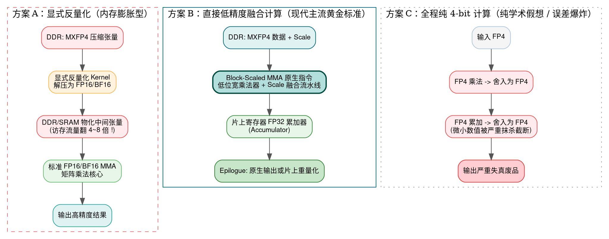
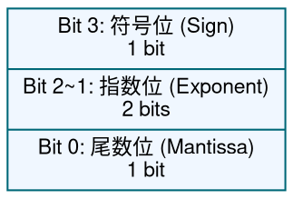
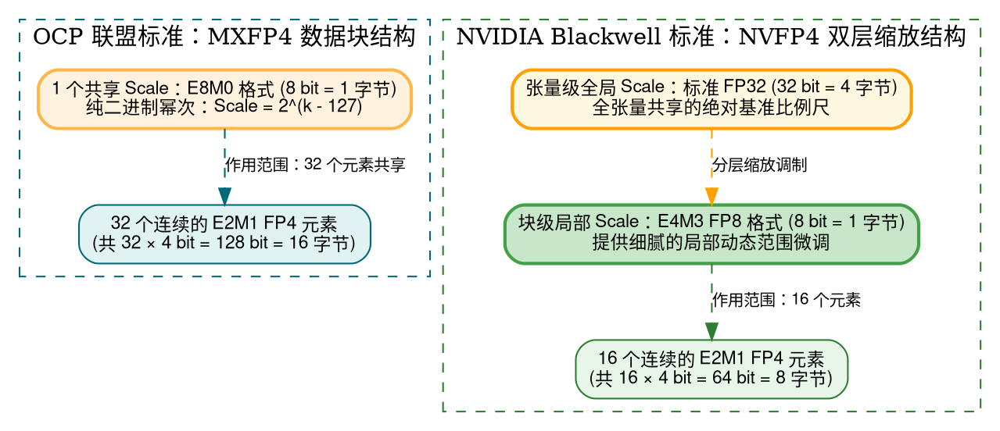
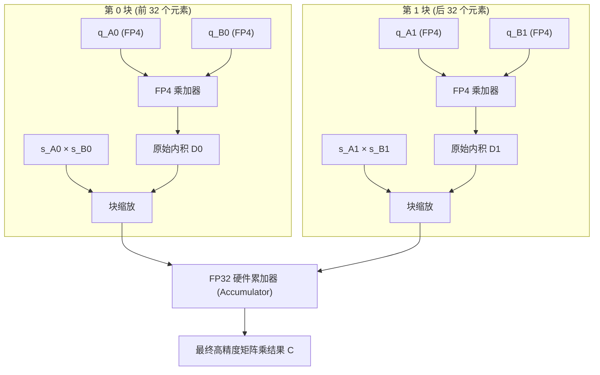
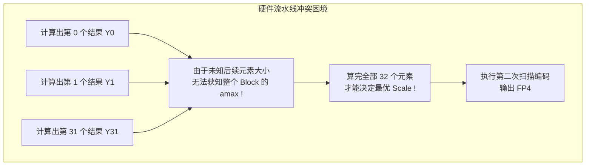
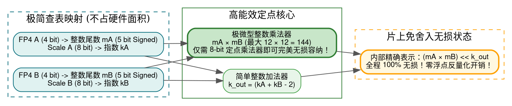
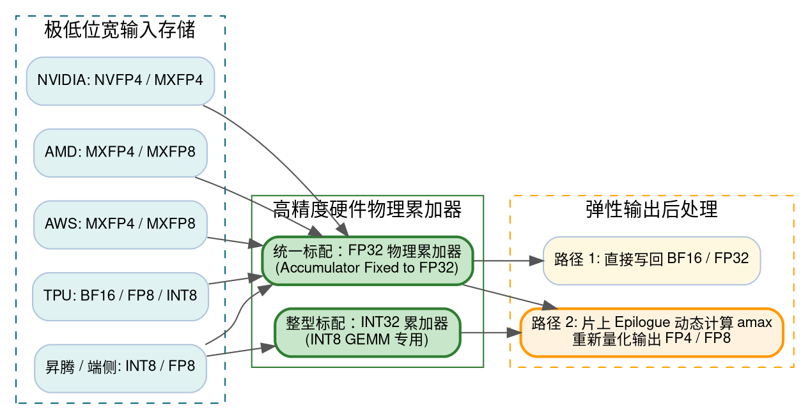
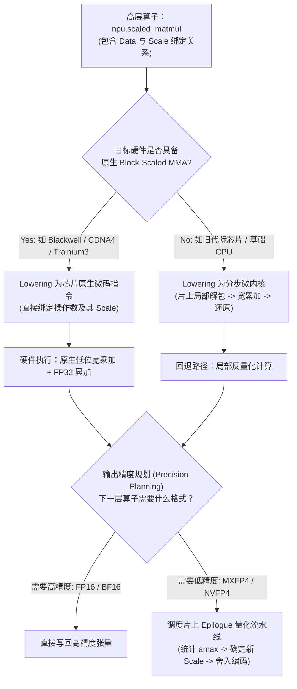
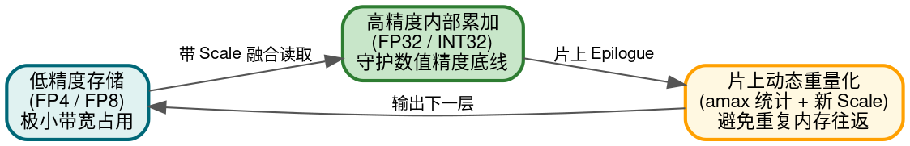

> **导读**：随着大语言模型（LLM）与生成式 AI 迈入万亿参数时代，计算设备遭遇了严峻的“内存墙（Memory Wall）”与“功耗墙（Power Wall）”。为了在有限的显存容量与总线带宽下容纳庞大模型，并成倍拉升芯片算力，以 **MXFP8、MXFP4（OCP 微缩放规范）** 与 **NVFP4（NVIDIA Blackwell 规范）** 为代表的 4-bit / 8-bit 低精度浮点计算标准迅速成为了工业界焦点。
>
> 然而，许多开发者、AI 编译器工程师以及 NPU 体系结构初学者常常面临一个关键疑问：
>
> - **“这些 4-bit 浮点数在硬件运算时，到底要不要先反量化（Dequantize）回 FP16 / BF16 / FP32 再算？”**
> - **“如果矩阵乘法能不用反量化，那加减乘除、Sin、Cos、Softmax、LayerNorm 也能直接用 FP4 算吗？”**
> - **“就算数学上把 Scale 提出来相乘，算出来的 Scale 难道符合计算结果的最值分布吗？精度不会崩溃吗？”**
> - **“主流 AI 芯片（NVIDIA Blackwell、AMD MI350、AWS Trainium3、Google TPU、国产 NPU）在底层硬件上究竟采用哪种方案？”**
>
> 本文将抛开模糊的直觉猜测，**从数学推导的第一性原理出发，自底向上穿透芯片微架构与编译器 IR 设计**，为你完整推导低精度计算的真实物理图景。

---

## 一、初学者必读：低精度计算核心概念通俗速查词典

在深入公式与电路之前，我们先为后续章节中反复出现的专业术语建立具象、通俗的心智模型：

> [!NOTE] 核心术语生活化解析字典
>
> - **量化（Quantization）**：
>   将高精度数值（如 32 位浮点数 FP32）压缩映射到极低位宽集合（如 4 位浮点数 FP4）的过程。好比用只有 16 种颜色的水彩笔临摹一幅数百万色的真实油画。
> - **反量化（Dequantization）**：
>   量化的逆过程，利用存储的缩放比例（Scale）将低比特数据恢复为高精度的浮点近似值（$\hat{x} = q \times s$）。请注意：**反量化只能恢复数值的物理尺度，无法找回量化时已经丢失的小数细节**。
> - **缩放因子（Scale Factor，简称 Scale）**：
>   数值的“比例尺放大镜”。低比特数据由于位数极少，能够表达的数值跨度有限。我们用 Scale 记录这组数据被整体缩小了多少倍，计算或还原时再放大回去。
> - **微缩放（Microscaling / MX）**：
>   传统量化让一整个几十万元素的张量（Tensor）共用一个 Scale，一旦出现一个极端大值（Outlier），所有人都会被“陪葬”。微缩放把数据切分成细小的向量块（如 32 个数为一个 Block），每个 Block 独立拥有一套轻量级 Scale。
> - **融合计算（Fused Computation）**：
>   硬件直接将低精度编码与 Scale 一同送入运算单元，在片上寄存器或算术逻辑内即时完成数值缩放与乘加，**不在内存（DDR/HBM/SRAM）中物化出完整的高精度张量**。
> - **累加器（Accumulator）与计算精度**：
>   “输入用低精度，累加用高精度”。两个 4-bit 数字相乘，结果需要更多位宽容纳；将成千上万个乘积加在一起时，必须使用宽位宽（如 32 位 FP32/INT32）累加器，否则微小的数值会被迅速淹没截断。
> - **特殊函数单元（SFU, Special Function Unit）**：
>   GPU/NPU 中专门负责处理复杂的非线性标量运算（如 Sin、Cos、Exp、Sqrt、Rsqrt）的高速硬件单元，通常采用多项式逼近（Chebyshev/Taylor）或查找表（LUT）实现。
> - **算子尾声（Epilogue）**：
>   矩阵乘法核心计算完成、累加器输出最终高精度结果之后，写回内存之前所执行的一系列后处理流水线，如偏置相加（Bias Add）、激活函数（ReLU/GELU）、动态统计与重新量化（Requantization）。
> - **相消误差（Catastrophic Cancellation）**：
>   两个非常接近的浮点数进行减法时，高位有效数字互相抵消，导致结果的有效精度急剧断崖式下跌。在低比特量化下该问题尤为致命。

---

## 二、直面核心灵魂质问：低精度计算是否必须反量化？

针对用户的疑问：**MXFP8、MXFP4、NVFP4 等低精度计算，必须要反量化回去再计算吗？**

结论非常明确：

$$\boxed{\text{不需要! } \quad \text{现代 GPU / NPU 硬件可以直接执行带 Scale 的低精度矩阵乘法。}}$$

但这里存在一个极其关键的认知鸿沟，初学者必须将其彻底拆解：

> [!IMPORTANT] 核心分水岭：数学语义 vs 硬件物化
> **数学上必须考虑 Scale，绝不等于硬件在计算前必须在内存中物化（Materialize）生成一个高精度的 FP16/BF16/FP32 张量！**

例如，我们要计算一个最基础的矩阵乘法：

$$C = A \times B$$

假设输入矩阵 $A$ 和 $B$ 均采用 MXFP4 存储，在计算机底层硬件上存在三种完全不同的执行范式：



### 三种方案深度辨析

1. **方案 A（显式反量化，Explicit Dequantization）**：
   - **执行过程**：先启动一个反量化 Kernel，把保存在显存里的 4-bit 压缩数据全部还原成 16-bit（FP16/BF16）的完整矩阵写回显存或片上缓存，然后再调用常规的 GEMM 算子进行计算。
   - **代价**：显存占用和总线带宽直接暴增 4 到 8 倍，瞬间撞上“内存墙”，彻底抹杀了低比特量化节省访存的核心初衷。
2. **方案 B（直接融合计算，Block-Scaled MMA）**：
   - **执行过程**：数据以 4-bit 形式搬运，硬件专用计算单元（如 NVIDIA Blackwell Tensor Core 或 AMD CDNA4 MFMA）**直接吃进低精度数据与 Scale**，在芯片内部的硬件流水线中同时完成位宽扩展、定点/浮点乘法与缩放累加。
   - **优点**：既享受了 4-bit 的极低访存带宽，又利用了原生的矩阵算力，中间过程完全不污染内存。**这是当前全行业 AI 加速器的核心演进方向。**
3. **方案 C（全流程纯 4-bit 闭环）**：
   - **执行过程**：每做一次乘法立即截断成 4-bit，每做一次加法也强行舍入成 4-bit。
   - **代价**：4-bit 只有区区 16 个离散点，连续做几次加法后，微小的梯度与激活值直接变成 0（下溢），误差呈指数级爆炸，模型推理直接乱码。工业界没有任何一款芯片采用这种自毁精度的做法。

---

## 三、微观视角：MXFP4 与 NVFP4 到底存储了什么？

要搞清楚硬件如何直接计算，必须先看懂它们的物理数据结构。

低精度格式并不是把一个连续的 FP32 数字暴力截断，而是拆解为：

$$x_{\text{real}} \approx q \times s$$

其中：
- $q$（Quantized Value）：低精度数据元素（如 4-bit 浮点数 E2M1）。
- $s$（Scale Factor）：局部共享的缩放因子。

### 1. 元素级编码：什么是 E2M1？

以 MXFP4 和 NVFP4 共同使用的 **E2M1** 为例，它由 4 个二进制位组成：



在 E2M1 中，指数偏置（Bias）通常设为 1。非负数的所有可表示离散值**仅仅只有 8 个**：

$$\mathcal{S}_{\text{E2M1}} = \{0,\ 0.5,\ 1.0,\ 1.5,\ 2.0,\ 3.0,\ 4.0,\ 6.0\}$$

加上符号位，整个 4-bit 空间只能精确表达 15 个非零实数和 1 个零（或 $\pm 0$）。

> [!TIP] 重要层次区分：元素编码 vs 格式规范
> - **E2M1** 仅仅是单个数字的**物理位宽编码方式（Element Encoding）**；
> - **MXFP4 与 NVFP4** 则是包含**分块大小（Block Size）、Scale 数据类型与层级规则的完整量化格式规范（Format Specification）**。二者绝非同一层次的概念！

### 2. 块级微缩放：MXFP4 vs NVFP4 结构对比



| 格式名称 | 制定组织 / 架构 | 元素编码 | 分块大小（Block Size） | 块级 Scale 格式 | 全局 Scale |
| :--- | :--- | :--- | :--- | :--- | :--- |
| **标准 FP8** | 工业界通用 | E4M3 / E5M2 | 无固定块绑定 | 通常按张量统一缩放 | 无 |
| **MXFP8** | OCP 开放计算组织 | E4M3 / E5M2 | 32 个元素 | **E8M0**（纯 $2^k$ 幂次） | 无 |
| **MXFP4** | OCP 开放计算组织 | E2M1 | 32 个元素 | **E8M0**（纯 $2^k$ 幂次） | 无 |
| **NVFP4** | NVIDIA Blackwell | E2M1 | **16 个元素** | **E4M3（FP8）** | **FP32 全局 Scale** |

---

## 四、数学推导：为什么矩阵乘法与点积允许“不先反量化”？

这是低精度计算得以成立的**核心物理数学支撑**。

### 1. 单块点积的因式分解

考虑两个长度为 $K$ 的向量 $A$ 与 $B$ 进行内积（Dot Product）：

$$C = \sum_{i=1}^{K} A_i B_i$$

假设这 $K$ 个元素刚好位于同一个微缩放块内，因此分别共享缩放因子 $s_A$ 与 $s_B$：

$$A_i = q_{A,i} \times s_A, \qquad B_i = q_{B,i} \times s_B$$

我们将展开式代入内积公式：

$$C = \sum_{i=1}^{K} (q_{A,i} s_A)(q_{B,i} s_B)$$

利用基础代数中的**乘法结合律与分配律**，由于标量 $s_A$ 和 $s_B$ 在该求和循环中恒为常数，**可以直接从求和符号中提出来**：

$$\boxed{C = (s_A \times s_B) \sum_{i=1}^{K} q_{A,i} q_{B,i}}$$

> [!TIP] 数学给硬件带来的巨大红利
> 原本需要进行 $K$ 次高精度浮点乘法，现在被降解为：
> 1. 先把极小位宽的 $q_A$ 和 $q_B$ 进行 $K$ 次轻量级的点积累加；
> 2. 算完整整一个块之后，**仅在最后一步将结果乘以一次标量积 $(s_A \times s_B)$！**
> 
> 硬件完全不需要在执行乘法前去将每个 $q_{A,i}$ 解码还原成 FP16/FP32。

### 2. 跨块矩阵乘法（Tiled GEMM）的物理实现

在实际神经网络的 GEMM 计算中，矩阵沿 $K$ 维通常远大于 32（例如 $K=4096$），因此会被切分为多个 Block。此时公式演变为跨块的累加：

$$C = \sum_{j=0}^{M_{\text{blocks}}-1} (s_{A,j} \times s_{B,j}) \cdot D_j, \quad \text{其中 } D_j = \sum_{i \in \text{Block } j} q_{A,i} q_{B,i}$$



每个 Block 的 Scale 互不相同，因此**不同块的计算结果必须先乘以自身局部的 $(s_{A,j} s_{B,j})$，然后再汇入高位宽的 FP32 累加器中进行跨块累加**。

这正是 OCP Microscaling 标准第 6.1 节所规定的数学语义：
$$\operatorname{Dot}(A, B) = X_A X_B \sum_{i=1}^k P_{A,i} P_{B,i}$$
标准明确强调：**硬件内部的具体实现精度与计算顺序完全由芯片架构师决定**，只需保证最终的数值等价性即可。

---

## 五、全面解密：加减乘除、Sin、Cos、Softmax 与 LayerNorm 全算子路径

很多初学者容易产生一个认知偏差：既然 GEMM 能把 Scale 提出来，那是不是深度学习里的**所有算子**都可以这样“免反量化”直接算？

**答案是：大错特错！** 不同的数学运算对 Scale 的反应有着天壤之别。

对于任意单输入算子 $y = f(x) = f(s \cdot q)$，核心问题在于：

$$\text{能否将 } f(s \cdot q) \text{ 拆解为“只对低精度编码 } q \text{ 运算，最后再应用 Scale”？}$$

我们按照代数性质逐一推演：

### 1. 逐元素乘法（Mul）：Scale 天然完美相乘

$$A \cdot B = (s_a q_a) \times (s_b q_b) = (s_a s_b) \times (q_a q_b)$$

- **计算特性**：Scale 直接相乘，低精度编码直接相乘。
- **物理硬件实现**：乘法运算是天然亲和 Scale 分离的。但需要注意：两个 E2M1 数字相乘（如 $6 \times 6 = 36$）其数值将超出 E2M1 的表示上限（6.0），硬件内部需要保留更宽的定点或浮点暂存位宽。

### 2. 逐元素加法与减法（Add / Sub）：必须进行“对齐 Scale（对阶）”

$$A + B = s_a q_a + s_b q_b$$

- **当两者的 Scale 恰好相同时**（$s_a = s_b = s$）：
  $$A + B = s \times (q_a + q_b)$$
  可以直接将低精度编码相加，继续复用原 Scale。
- **当两者的 Scale 不相同时**（$s_a \ne s_b$）：
  $$A + B = s_a \left( q_a + \frac{s_b}{s_a} q_b \right)$$
  **此时无法直接将 $q_a + q_b$！** 硬件必须执行类似浮点加法的**移位对阶（Scale Alignment）**。
- **相消误差（Catastrophic Cancellation）陷阱**：在减法中，若两个数值相近但量化误差已经将尾部细节抹平，相减后有效信息直接清零，即使强行还原成 FP32 也无法挽救。

### 3. 三角函数（Sin / Cos）：Scale 绝对无法因式分解！

考虑计算 $y = \sin(x) = \sin(s \cdot q)$：

$$\boxed{\sin(s \cdot q) \ne s \cdot \sin(q)}$$

#### 极简反例直观验证

设低精度数据 $q = 1.0$，缩放因子 $s = 2.0$：
- **数学真实值**：$\sin(1 \times 2) = \sin(2 \text{ rad}) \approx 0.9093$
- **若错误地先算 Sin 再乘 Scale**：$2 \times \sin(1 \text{ rad}) \approx 2 \times 0.8415 = 1.6829$！

> [!CAUTION] 严重逻辑崩塌
> 错误计算得出的结果不仅数值相差巨大，甚至直接击穿了正弦函数最大绝对值不超过 $1.0$ 的数学铁律！

对于 Sin、Cos 这类非线性算子，**数学上必须将物理数值 $(s \cdot q)$ 整体作为自变量送入函数**。硬件无法直接在 FP4 域做三角运算，必须由片上向量引擎（Vector Engine）或特殊函数单元（SFU）先恢复局部数值，再通过多项式或查找表（LUT）求解。

### 4. 指数与对数（Exp / Log）

- **指数运算（Exp）**：
  $$e^{s \cdot q} = (e^q)^s \ne s \cdot e^q$$
  同样具有强非线性，无法直接分离 Scale。更糟糕的是，指数函数的极速膨胀特性会将输入端极其微小的量化噪声无限放大。
- **对数运算（Log）——惊人的代数分离**：
  在以 2 为底的对数中，假设 MXFP4 采用 E8M0 Scale（即 $s = 2^k$）：
  $$\log_2(s \cdot q) = \log_2(2^k \cdot q) = \boxed{k + \log_2(q)}$$
  **乘积关系奇迹般地转变为加法关系！** 硬件甚至不需要算浮点乘法，直接把 Scale 里的指数整数 $k$ 提取出来，与 $\log_2(q)$ 相加即可。

### 5. 激活函数（ReLU）：尺度完全无关的幸运儿

对于深度学习中最常用的 ReLU：

$$\operatorname{ReLU}(x) = \max(0,\ s \cdot q)$$

由于在量化规范中，Scale 恒为正实数（$s > 0$）：

$$\max(0,\ s \cdot q) = s \times \max(0,\ q)$$

- **硬件执行**：硬件**完全不需要读取 Scale 的数值**！只要检测 $q$ 的符号位，如果是负数直接置零，正数原样保留，输出直接继承输入的 Scale。

### 6. 大模型两大命门：Softmax 与 LayerNorm

在大模型推理架构中，注意力机制（Attention）中的 Softmax 与归一化层（LayerNorm/RMSNorm）极其敏感：

#### Softmax：绝不能忽略 Scale

$$\operatorname{softmax}(x_i) = \frac{e^{s \cdot q_i}}{\sum_j e^{s \cdot q_j}}$$

Scale 在这里直接充当了**概率分布的温度系数（Temperature）**！
- 假设输入序列 $[1, 2]$，Scale 为 1 时，$\operatorname{softmax}([1, 2]) \approx [0.269, 0.731]$；
- 若 Scale 变为 2，即真实输入为 $[2, 4]$ 时，$\operatorname{softmax}([2, 4]) \approx [0.119, 0.881]$。

概率分布被极度拉尖锐！因此 Softmax 必须在片上利用真实尺度进行高精度的指数与归约求和，无法直接抹去 Scale。

#### LayerNorm：特定条件下的神奇抵消

LayerNorm 核心公式为：

$$y_i = \frac{x_i - \mu_x}{\sqrt{\sigma_x^2 + \epsilon}}$$

若一个 Block 内部的所有元素共享同一个 Scale $s$，将 $x_i = s \cdot q_i$ 代入可得均值 $\mu_x = s \cdot \mu_q$，方差 $\sigma_x^2 = s^2 \cdot \sigma_q^2$：

$$y_i = \frac{s(q_i - \mu_q)}{\sqrt{s^2 \sigma_q^2 + \epsilon}} = \frac{q_i - \mu_q}{\sqrt{\sigma_q^2 + \frac{\epsilon}{s^2}}}$$

> [!TIP] 惊人的代数现象
> 当防除零微小项 $\epsilon \to 0$ 时，分子分母的 Scale **竟然被完全约掉了**！
> 这意味着在单个微缩放块内，归一化运算本质上只取决于数据间的相对比例，与外部绝对尺度几乎无关。
> 但现实中，LayerNorm 的归一化维度通常横跨整个隐藏层（如 4096 维），包含了上百个不同的 Scale 块，因此跨块时仍需在高精度下完成全局归约。

### 全深度学习核心算子 Scale 兼容性与编译策略全景对照表

| 算子类别 | 算子名称 | Scale 能否代数因式分离？ | 是否需要物化高精度 Tensor？ | 推荐编译降级与硬件执行策略 |
| :--- | :--- | :--- | :--- | :--- |
| **矩阵运算** | MatMul / GEMM / Conv | **完全可以** | **否** | 原生 Block-Scaled MMA（输入低精度，FP32 累加） |
| **代数变换** | Neg (取负) / Abs (绝对值) | **完全可以** | **否** | 纯编码域处理（翻转符号位 / 清除符号位），Scale 不变 |
| **激活函数** | ReLU | **完全可以**（正 Scale） | **否** | 纯编码域截断，Scale 原样传递 |
| **算术运算** | Mul (逐元素乘) | **可以**（Scale 相乘） | **否** | 内部扩展中间位宽，计算 $(s_a s_b)$ |
| **算术运算** | Add / Sub (逐元素加减) | **有条件**（需对齐） | **否** | 硬件内部对齐 Scale 后加减，防止相消下溢 |
| **算术运算** | Div (逐元素除) | **可以**（Scale 相除） | **否** | 计算 $s_a/s_b$，内部采用倒数逼近或宽位宽除法 |
| **超越函数** | Sin / Cos | **绝对不可以** | **否**（片上局域解码） | 向量核局部应用 Scale，送入 SFU / LUT 多项式逼近 |
| **超越函数** | Exp / GELU / SiLU | **绝对不可以** | **否**（片上局域解码） | 片上 SRAM 暂存，宽精度激活单元计算 |
| **超越函数** | Log2 | **可以**（转化为加法） | **否** | 分离 E8M0 整数指数与尾数对数，快速加法合成 |
| **注意力层** | Softmax | **绝对不可以** | **否**（片上融合 Kernel） | 寄存器级还原真实值，高精度 Max/Exp/Sum 归约 |
| **归一化层** | LayerNorm / RMSNorm | **局部可抵消** | **否**（片上融合 Kernel） | 块内相对比例处理，跨块分级归约 |

---

## 六、致命精度陷阱：代数缩放传播 vs 动态输出重量化

在深入探讨硬件实现时，许多工程师容易踩入一个隐秘而致命的精度深渊。

### 1. 概念厘清：两种 Scale 绝不能混为一谈！

假设执行逐元素乘法 $Y_i = A_i \times B_i$：

$$Y_i = (s_A \times s_B) \times (q_{A,i} \times q_{B,i})$$

这里的 $(s_A \times s_B)$ 被称为 **代数缩放因子（Algebraic Scale Factor）**。它的物理使命是：**在数学上准确表达计算结果的真实物理量级**。

然而，如果计算结果 $Y$ 下一步仍然需要以 MXFP4 格式存储或传给下一层，我们就必须为输出块赋予一个 **输出量化缩放因子（Output Quantization Scale，记作 $s_Y$）**：

$$Y_i \approx s_Y \times q_{Y,i}$$

> [!WARNING] 绝大多数初学者必踩的思维巨坑
> **代数缩放因子 $(s_A s_B)$ 几乎永远不等于最优输出量化缩放因子 $s_Y$！**
> 
> 如果硬件图省事，直接将输入 Scale 的乘积 $(s_A s_B)$ 当作输出的 $s_Y$，并强行把乘积舍入回 FP4，将造成灾难性的**饱和截断（Saturation）或精度归零**！

### 2. 用一组真实数字见证“精度灾难”

我们用前面介绍的 FP4 E2M1 规范来进行实测手算推演。

E2M1 允许的正数集合为：$\{0,\ 0.5,\ 1.0,\ 1.5,\ 2.0,\ 3.0,\ 4.0,\ 6.0\}$。

假设有两个向量 $A$ 与 $B$，包含 4 个元素，输入 Scale 均为 $1.0$：

$$A = B = [1.0,\ 1.5,\ 3.0,\ 6.0]$$

逐元素真实乘积结果为：

$$Y = [1.0 \times 1.0,\ 1.5 \times 1.5,\ 3.0 \times 3.0,\ 6.0 \times 6.0] = [1.0,\ 2.25,\ 9.0,\ 36.0]$$

#### 路径一：沿用代数 Scale（$s_Y = s_A \times s_B = 1.0$）

因为 Scale 为 1，数据必须强行塞进 E2M1 的刻度中（最大刻度为 6.0）：
- $1.0 \to 1.0$
- $2.25 \to 2.0$（舍入到最近刻度）
- $9.0 \to 6.0$（**严重溢出饱和截断！**）
- $36.0 \to 6.0$（**致命溢出饱和截断！**）

量化表示值为：$[1.0,\ 2.0,\ 6.0,\ 6.0]$。

我们计算其均方误差（MSE）：

$$\text{MSE} = \frac{(1-1)^2 + (2-2.25)^2 + (6-9)^2 + (6-36)^2}{4} = \frac{0 + 0.0625 + 9 + 900}{4} = \mathbf{227.27}$$

误差高达惊人的 **227.27**！模型精度直接彻底灰飞烟灭。

#### 路径二：重新动态统计并选择最优 Scale（$s_Y = 8.0$）

输出结果的最大值是 $36.0$。为了让 $36.0$ 落在最大刻度 6.0 之内，理想的 Scale 为 $36 / 6 = 6$。

但 MXFP4 的 E8M0 规定 Scale 必须是 2 的整数次幂，因此我们向上选择最贴近的合法 Scale：$s_Y = 8.0$。

此时将真实值除以 Scale 8.0：
- $1.0 / 8 = 0.125 \to 0$（小于最小刻度 0.5，遗憾下溢为 0）
- $2.25 / 8 = 0.281 \to 0.5$（表示真实值 $0.5 \times 8 = 4.0$）
- $9.0 / 8 = 1.125 \to 1.0$（表示真实值 $1.0 \times 8 = 8.0$）
- $36.0 / 8 = 4.5 \to 4.0$（表示真实值 $4.0 \times 8 = 32.0$）

量化表示值为：$[0.0,\ 4.0,\ 8.0,\ 32.0]$。

此时的均方误差为：

$$\text{MSE} = \frac{(0-1)^2 + (4-2.25)^2 + (8-9)^2 + (32-36)^2}{4} = \frac{1 + 3.0625 + 1 + 16}{4} = \mathbf{5.27}$$

**均方误差从 227.27 暴降到了 5.27，精度质量改善了 43 倍！**

#### 路径三：NVFP4 风格的细粒度连续 Scale（$s_Y = 6.0$）

NVFP4 允许使用 FP8 作为 Scale，不再强求 2 的幂次。若选择 $s_Y = 6.0$：
- $Y / 6 = [0.166,\ 0.375,\ 1.5,\ 6.0] \to [0,\ 0.5,\ 1.5,\ 6.0]$
- 还原真实值为：$[0,\ 3.0,\ 9.0,\ 36.0]$
- **MSE 进一步暴跌至 0.39！**

### 3. 硬件体系结构的残酷困境：数据流依赖死锁

从上面的手算实验中，我们得出一个极其重要的体系结构结论：

$$\text{最优输出 Scale 必须依赖整组计算结果的全局最大绝对值（amax）： } s_Y \propto \max_i |Y_i|$$

这给现代流式数据流（Streaming Dataflow）NPU 带来了巨大的硬件难题：



如果一个数据块包含 32 个元素，硬件刚算出第 1 个元素时，根本不可能预知后面 31 个元素会有多大！因此硬件陷入了两难：
1. **不能直接流式输出 FP4**：否则无法确定 Scale；
2. **必须开辟片上寄存器/SRAM 暂存整个 Block**：等 32 个元素全部出炉，硬件归约出 `amax`，生成新 Scale，然后再对这 32 个暂存数做第二趟舍入量化。

这正是为什么 NVIDIA cuDNN 与 AWS Neuron 把 **Block Scale Quantize** 明确设计为一个专门的带有**片上数据缓冲与双趟扫描（Two-Pass）能力的融合 Epilogue**，而不是一条简单的单拍指令。

---

## 七、神级优化：基于整数尾数与二进制指数的免反量化纯算术路径

除了依靠浮点单元，芯片设计中还有一个极其精妙的高性能技巧：**彻底规避 IEEE 754 浮点转换，直接用纯整数电路计算 MXFP4！**

### 1. 数学密码：E2M1 全是 0.5 的整数倍

再次审视 E2M1 的所有可表示值：

$$\mathcal{S}_{\text{E2M1}} = \{0,\ \pm 0.5,\ \pm 1.0,\ \pm 1.5,\ \pm 2.0,\ \pm 3.0,\ \pm 4.0,\ \pm 6.0\}$$

细心的读者会发现一个惊人事实：**每一个数值乘以 2 之后，全部变成了纯整数！**

我们可以定义整数尾数 $m = 2q$，则：

$$m \in \{0,\ \pm 1,\ \pm 2,\ \pm 3,\ \pm 4,\ \pm 6,\ \pm 8,\ \pm 12\}$$

而 MXFP4 的 E8M0 Scale 本身就是 2 的整数次幂：$s = 2^k$。

于是，任何一个 MXFP4 的真实物理数值，都可以用完全精确的**纯整数与二进制移位**来表达：

$$\boxed{x_{\text{real}} = m \times 2^{k-1}}$$

### 2. 纯整数乘法硬件路径

假设我们要计算两个 MXFP4 数值的乘法：

$$x_A \times x_B = \left( m_A \times 2^{k_A-1} \right) \times \left( m_B \times 2^{k_B-1} \right) = \mathbf{(m_A \times m_B)} \times 2^{\mathbf{(k_A + k_B - 2)}}$$



> [!TIP] 架构师的优雅解法
> 这种电路设计不仅面积只有标准 FP32 浮点乘法器的几十分之一，功耗极低，而且**在输出量化前没有引入任何新的浮点舍入误差**！
> 
> 这再次强有力地证明：**低精度计算绝不等于必须将数据显式反量化为 IEEE 754 浮点数**。

---

## 八、群雄逐鹿：主流 AI 芯片硬件微架构全景大比拼

在当今世界顶级加速芯片中，各个厂商究竟选择了哪种路径？

**统一共识：几乎全员采用“方案 B”（输入低位宽融合 + 宽精度累加），严格杜绝“方案 C”（全流程纯低位宽运算）。**



### 1. NVIDIA Blackwell 架构（B200 / GB200）

Blackwell 引入了第五代 Tensor Core，提供了原生块缩放指令：

- **核心指令**：PTX 汇编中的 `tcgen05.mma.block_scale` 指令族；
- **计算机制**：同时将低精度操作数（$A$、$B$）和它们的 Scale 向量打包送入 Tensor Core；
- **累加精度**：**物理固定为 FP32 累加**，彻底避免任何中间溢出；
- **全流程融合**：cuDNN 提供了业界顶级的算子融合流水线——在一个单独的 Kernel 内串联完成：
  $$\text{Block-Scaled FP4 GEMM} \longrightarrow \text{GLU 激活} \longrightarrow \text{Hadamard 旋转} \longrightarrow \text{片上动态量化输出 NVFP4}$$
  全程无需将 FP32 中间结果写回 HBM 显存。

### 2. AMD Instinct MI350 系列（CDNA4 架构）

AMD 在 CDNA4 架构中全面对标 OCP 微缩放标准：

- **核心指令**：专用的 `v_mfma_scale_f32_16x16x128_f8f6f4` 矩阵乘加指令；
- **微架构特性**：单条指令原生支持 MXFP8、MXFP6 与 MXFP4 混合计算，硬件自动处理 32 元素分块的 E8M0 Scale；
- **对比前代**：MI300 仅支持 FP8，若强行运行 MXFP4 必须在软件编译器层做昂贵的数据转换（方案 A），而 MI350 实现了完全原生的方案 B。

### 3. AWS Trainium3（NeuronCore-v4）——典范级的双引擎协同

AWS Trainium3 对异构加速流水线的分工给出了教科书级的硬件设计示范：

- **Tensor Engine（张量引擎）**：通过 `nisa.nc_matmul_mx` 指令，接收四组操作数（A 数据、B 数据、A Scale、B Scale），在单条硬件指令内直接完成块缩放内积与 FP32 累加；
- **Vector Engine（向量引擎）**：专门配备了硬件级 `QuantizeMX` 原语，负责接收张量引擎算出的宽精度数据，自动在片上统计每 32 元素的分布并完成重新量化；
- **协同机制**：两颗核心通过片上高速 SRAM 紧密咬合，完美实现了“算得快”与“量化准”的解耦。

### 4. Google TPU（v6e / TPU7x）

Google TPU 的脉动阵列（MXU）从诞生第一天起就确立了现代混合精度的铁律：

- **计算流**：低位宽（BF16/FP8/INT8）进入脉动阵列计算，内部脉动累加链路全部锁定为 **FP32**；
- **架构哲学**：绝不在中间计算层丢弃精度。对于非线性激活与动态 Scale 处理，交给外部庞大的 Vector Unit 完成。

### 5. 华为昇腾（Ascend）与高通（Qualcomm Hexagon）

- **华为昇腾**：在达芬奇架构中划分为负责矩阵计算的 **Cube 单元**、负责标量向量的 **Vector 单元** 以及专门负责格式流水线搬运转换的 **Fixpipe 单元**，Fixpipe 能够在数据从 Cube 写入片上缓存的同时硬件线速完成量化与反量化转换；
- **高通 Hexagon DSP**：在移动端经典的 INT8 GEMM 中，8-bit 乘法必须由 **INT32 累加器** 兜底，随后通过定点定标乘法与移位（Fixed-point Requantize），在写入内存前瞬间完成一次重新量化。

### 各大芯片低精度支持能力全景对照大表

| 芯片型号 / 架构 | 核心架构定位 | 原生块缩放矩阵指令 | 内部物理累加器 | 输出端片上动态量化能力 | 架构设计借鉴要点 |
| :--- | :--- | :--- | :--- | :--- | :--- |
| **NVIDIA Blackwell** | 云端旗舰 GPU | `tcgen05.mma.block_scale` | **FP32** | 深度融合在 cuDNN Epilogue 中 | 极致的 Tensor Core 密度与全融合算子链 |
| **AMD CDNA4 (MI350)** | 云端超算 GPU | `v_mfma_scale_f32` | **FP32** | 依赖外部向量指令调度 | 严格契合 OCP 开放计算标准，生态友好 |
| **AWS Trainium3** | 自研专用 AI ASIC | `nc_matmul_mx` | **FP32 / BF16** | 专用 `QuantizeMX` 向量原语 | Tensor 与 Vector 引擎分工明确，解耦彻底 |
| **Intel Gaudi 3** | 大模型专用芯片 | MME 实时 FP8 缩放 | **FP32** | 由 TPC 核心协同完成 | 矩阵引擎集成缩放，减轻向量核负载 |
| **Google TPU v6e** | 脉动阵列 ASIC | 原生 BF16/FP8 MXU | **FP32** | Vector Unit 调度 | 坚持脉动阵列内部高精度累加铁律 |
| **Qualcomm Hexagon** | 移动边缘端 NPU | 原生 INT8/INT4 GEMM | **INT32** | 定点移位器流水线 | 极简电路成本下的定点量化标杆 |

---

## 九、AI 编译器视角：MLIR 语法建模与降级（Lowering）实战

如果你正在为团队的自定义 NPU 开发 MLIR（Multi-Level Intermediate Representation）编译器，你该如何在编译管线中正确表达低精度与 Scale？

### 1. 规避初学者最容易犯的错误：过早物化反量化

许多编译器新手在前端图优化阶段，一看到输入是 MXFP4，就急匆匆地插入一个显式的 `dequantize` 算子：

```mlir
// ❌ 灾难性的错误模式：过早插入反量化，摧毁所有低带宽优势
%a_f32 = "quant.dequantize"(%a_fp4, %scale_a) : (tensor<128x128xf4>, tensor<128x4xf8>) -> tensor<128x128xf32>
%b_f32 = "quant.dequantize"(%b_fp4, %scale_b) : (tensor<128x128xf4>, tensor<128x4xf8>) -> tensor<128x128xf32>
%c_f32 = "linalg.matmul"(%a_f32, %b_f32) : (tensor<128x128xf32>, tensor<128x128xf32>) -> tensor<128x128xf32>
```

这种做法会导致高层图优化器把 `%a_f32` 视为需要分配巨大内存的真实张量，随后的 Bufferization Pass 会直接在片上或显存中开辟巨大缓存，彻底毁掉硬件性能。

### 2. 现代编译器的推荐建模：语义正交解耦

在 MLIR Dialect 建模中，建议将与量化相关的概念清晰正交地拆解为四种物理语义：

| 编译器 IR 操作 | 对应概念与物理行为 | 是否物化高精度张量？ |
| :--- | :--- | :--- |
| `npu.decode` | 将低比特编码从紧凑字节包中解包为计算单元可识别的位宽 | **否** |
| `npu.apply_scale` | 将 Scale 与数据相结合还原真实量级（可直接融合进乘加指令） | **否** |
| `npu.rescale` | 从当前 Scale 尺度代数变换到目标 Scale 尺度（如乘法 Scale 相乘） | **否** |
| `npu.dequantize` | 显式强制物化为 IEEE 754 浮点张量（仅用于回退保底路径） | **是** |

### 3. 高层计算图向硬件指令的 Lowering 决策树



在编译器后端，必须将以下三个 Pass 解耦为独立分析流：
1. **Scale Propagation Pass（缩放传播分析）**：专门追踪代数变换（如乘除法中的 Scale 算术）；
2. **Precision Planning Pass（精度规划分析）**：决定哪些算子适合在低比特完成，哪些算子必须提升至 FP32；
3. **Requantization Planning Pass（重新量化规划）**：插入片上 Buffer 分配与双趟扫描微码，避免在内存中出现冗余写回。

---

## 十、总结：软硬件协同设计的终极黄金法则

回到最初的问题：**低精度计算是否需要反量化？**

我们可以用三句最具分量的话进行终极概括：

1. **显式反量化是带宽的敌人**：在显存中生成完整的高精度张量，完全违背了量化初衷；
2. **纯低精度计算是精度的敌人**：每一步都将计算结果强行截断为 4-bit，会导致数值误差在深层网络中彻底失控崩溃；
3. **融合带 Scale 的低精度输入 + 高精度累加 + 片上动态重量化，是整个现代 AI 体系结构的大势所趋**。



对于 NPU 硬件研发人员与 AI 编译器开发者而言，未来系统设计最核心的灵魂考问绝不再是简单的“要不要反量化”，而是：

$$\boxed{\text{Scale 应当在何时、由哪颗引擎、以何种位宽参与运算，才能在零显存膨胀的前提下，榨干算力并守住精度？}}$$

理解了这一点，你便真正掌握了现代大模型低精度加速体系的底层核心密码。
