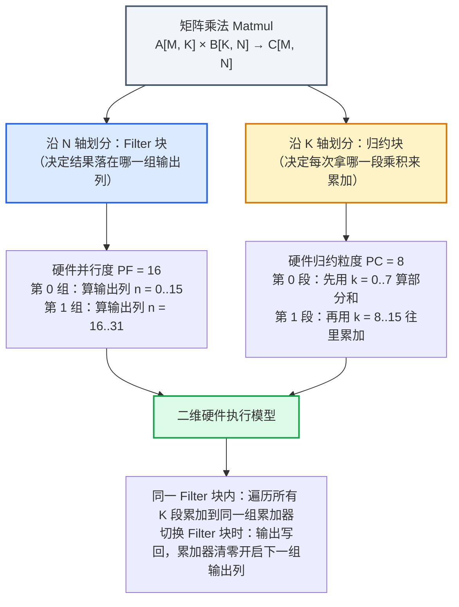
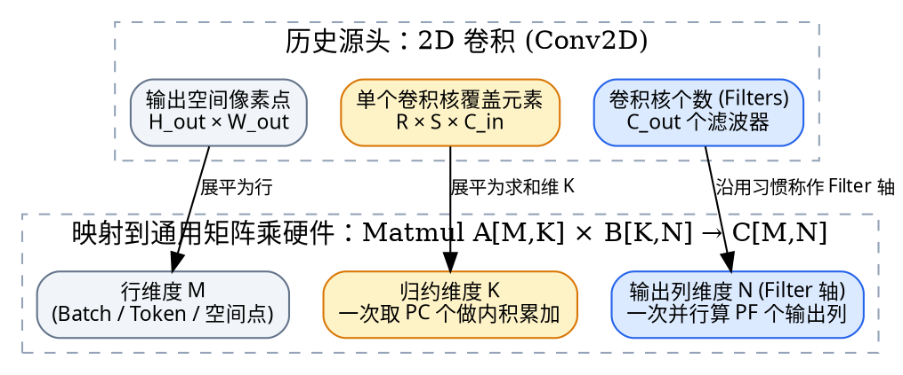
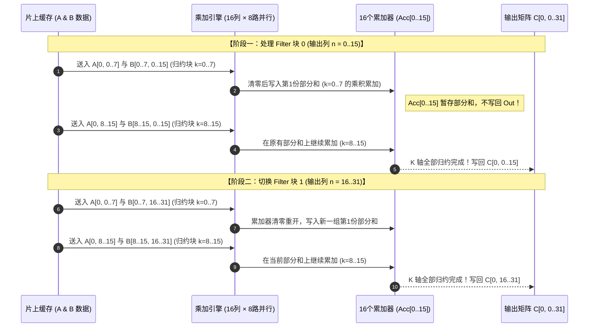
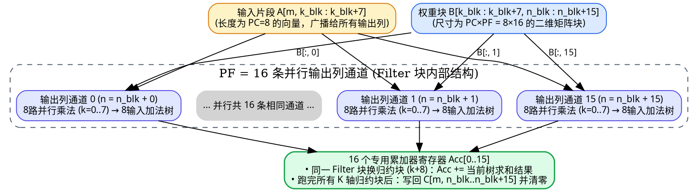

> **导读**：几乎所有现代人工智能模型——无论是大语言模型（LLM）里的注意力机制与前馈网络，还是图像模型里的卷积层——在底层硬件上最终都会收敛到同一个最核心的计算：**矩阵乘法（Matmul, Matrix Multiplication）**。
>
> 当初学者翻看 AI 芯片资料或底层算子优化教程时，很快就会被两个高频出现的“分块术语”绕晕：**Filter 块（Filter Block）**与**归约块（Reduction Block）**，以及随之而来的 **`PF=16`**、**`PC=8`** 等硬件参数。明明是一个普通的矩阵乘法 $A \times B \to C$，为什么里面会冒出“Filter”这个词？为什么有的块切完可以独立算，有的块切完却必须反复累加到同一个地方？
>
> 本文将完全站在**零基础初学者**的视角，用最朴素的直觉、逐个名词破冰、具体数值推演以及多张 **Graphviz / Mermaid 可视化图解**，把这两个概念彻底拆解清楚。

---

## 零、初学者核心名词破冰速查表

在正式进入矩阵分块之前，我们先为后文第一次出现的专业术语做好“通俗翻译”。正文首次提及这些概念时，也会结合具体场景再次展开。

| 术语 / 缩写               | 英文全称                                              | 一句话通俗解释                                                                                              |
| :------------------------ | :---------------------------------------------------- | :---------------------------------------------------------------------------------------------------------- |
| **Matmul / GEMM**         | Matrix Multiplication / General Matrix Multiplication | 矩阵乘法（通用矩阵乘）。深度学习算力的绝对主力，即计算 $A \times B \to C$。                                 |
| **张量与轴（Axis）**      | Tensor & Axis / Dimension                             | 可以把二维矩阵理解成一张 Excel 表格，“轴”就是表格的方向（比如行方向 $M$、列方向 $N$）。                     |
| **乘加（MAC）**           | Multiply-Accumulate                                   | 芯片里最基础的算术动作：**先把两个数相乘，再把结果加到之前的总和上**（$acc \leftarrow acc + a \times b$）。 |
| **分块（Tiling）**        | Tiling                                                | 把一张超大矩阵“切瓷砖”一样切成一块块小矩阵，每次只搬一块进高速小仓库算，装得下也算得快。                    |
| **Filter 块**             | Filter Block                                          | 沿输出列方向（$N$ 轴）切出来的一组列。**同一组里的输出列在同一轮一起被算出来**。                            |
| **归约（Reduction）**     | Reduction                                             | “多对一”的汇总压缩动作，例如把 100 个乘积相加变成 1 个最终数值。                                            |
| **归约块**                | Reduction Block                                       | 沿求和下标方向（$K$ 轴）切出来的一段数据。每次只取这一段做乘加，结果需要继续累加。                          |
| **PF**                    | Parallel Filter（输出列并行度）                       | 硬件一次并行计算多少个输出列（Filter 块的大小），例如 $PF = 16$ 表示一组同时算 16 列。                      |
| **PC**                    | Packed Channels / Parallel Reduction（归约切分粒度）  | 硬件一次沿着求和方向（$K$ 轴）打包读取并乘加的元素个数，例如 $PC = 8$ 表示每次算 8 个乘积之和。             |
| **部分和（Psum）**        | Partial Sum                                           | Sum（求和）只算到一半的“半成品结果”。必须等后面所有的归约块都加上去，才变成最终答案。                       |
| **累加器（Accumulator）** | Accumulator                                           | 硬件计算单元内部专门用来“接住并持续累加部分和”的高速暂存寄存器。                                            |

---

## 一、知识全景图：先看清两根轴在干什么

在陷入公式下标之前，我们先用一张全景图建立最高层的直觉：**Filter 块管“算哪几列结果”，归约块管“每次加哪一段材料”**。



---

## 二、回到第一性原理：看懂 Matmul 公式里的 $m, k, n$

我们先来看最标准的矩阵乘法定义。假设有两个输入矩阵 $A$ 和 $B$，相乘得到输出矩阵 $C$：

$$
A[M, K] \times B[K, N] \rightarrow C[M, N]
$$

其中，大写字母 $M, K, N$ 代表矩阵三条边的总长度，而小写字母 $m, k, n$ 代表具体某一个元素在这三条边上的位置编号（下标，从 $0$ 开始）：

- $m \in [0, M-1]$：输出矩阵 $C$ 的**行号**（对应输入 $A$ 的第 $m$ 行）；
- $n \in [0, N-1]$：输出矩阵 $C$ 的**列号**（对应权重/右矩阵 $B$ 的第 $n$ 列）；
- $k \in [0, K-1]$：左右两个矩阵相乘时，**必须对齐并消掉的那条公共边**（内积维 / 求和维）。

结果矩阵 $C$ 中第 $m$ 行、第 $n$ 列的单个数值 $C[m, n]$，等于 $A$ 的第 $m$ 行与 $B$ 的第 $n$ 列**逐元素相乘再全部相加**：

$$
C[m, n] = \sum_{k=0}^{K-1} A[m, k] \cdot B[k, n]
$$

> [!NOTE] 生活类比：把抽象公式变成“成绩加权总分表”
> 想象你是教务处老师，要统计全年级学生的加权总分：
>
> - 有 $M$ 个学生（比如 $M = 100$ 人），每人考了 $K$ 门科目（比如 $K = 16$ 门课）——这就是矩阵 $A[M, K]$。
> - 学校制定了 $N$ 套不同的评优算分方案（比如 $N = 32$ 种奖学金权重方案），每种方案给 $K$ 门课设定了不同权重——这就是矩阵 $B[K, N]$。
> - 最终你要填出一张结果表 $C[M, N]$：算出**第 $m$ 位同学在第 $n$ 套方案下的总分**。
> - 怎么算？把这位同学第 $k$ 门课的分数 $A[m, k]$ 乘以第 $n$ 套方案对该门课的权重 $B[k, n]$，把所有科目 $k = 0 \dots K-1$ 的乘积**加起来**，就得到了 $C[m, n]$！

### 为什么硬件不能“一口吃成胖子”？

在纸上写公式很简单，但放到真实的 AI 芯片硬件上就会遇到两堵墙：

1. **片上仓库装不下（SRAM 容量限制）**：芯片内部的高速存储区（通常称为片上缓存 **SRAM** 或 **Scratchpad**）非常宝贵，真实大模型中 $M, K, N$ 动辄几千甚至上万，根本不可能把整张 $A$、$B$、$C$ 一次性塞进计算核心旁边的寄存器里。
2. **计算单元数量固定（硬件物理规模限制）**：芯片上焊接的乘法器、加法器数量是固定的，例如芯片设计师造了一套“每次只能同时算 16 列、每列每次只能接 8 个输入做乘加”的矩阵计算引擎。

于是，硬件和编译器就必须做同一件事——**分块（Tiling）**：把大矩阵切成硬件刚好一口能吞下的小块，一小块一小块地算完、拼出全局结果。而在 Matmul 里，切分最核心的两条刀法，一条切在 **$N$ 轴（Filter 块）**，另一条切在 **$K$ 轴（归约块）**。

```dot
digraph MatmulAnatomy {
    rankdir=LR;
    node [shape=record, fontname="sans-serif", fontsize=11];
    edge [fontname="sans-serif", fontsize=10];

    subgraph cluster_A {
        label="左矩阵 A [M, K]";
        style="rounded,dashed";
        color="#64748b";
        A_box [label="{行 m | 归约块 0\n(k = 0..7)\n[长度 PC=8] | 归约块 1\n(k = 8..15)\n[长度 PC=8] | ...}", fillcolor="#fef3c7", style="filled"];
    }

    subgraph cluster_B {
        label="右矩阵 B [K, N]";
        style="rounded,dashed";
        color="#64748b";
        B_box [label="{<b0> Filter 块 0 (n = 0..15, PF=16)\n当前归约块 k = 0..7 (PC=8) | <b1> Filter 块 1 (n = 16..31, PF=16)\n下一轮再算的输出列组} | {后续归约块 k = 8..15\n继续累加到 Filter 块 0 | 后续归约块 k = 8..15\n继续累加到 Filter 块 1}", fillcolor="#dbeafe", style="filled"];
    }

    subgraph cluster_C {
        label="输出矩阵 C [M, N]";
        style="rounded,dashed";
        color="#64748b";
        C_box [label="{行 m | Filter 块 0 输出列\nC[m, 0..15]\n由同一组累加器汇聚完成 | Filter 块 1 输出列\nC[m, 16..31]\n切换到下一组后独立计算}", fillcolor="#dcfce7", style="filled"];
    }

    A_box -> B_box [label="沿着 K 轴取段\n(k=0..7 做内积)", color="#d97706", penwidth=1.8];
    B_box -> C_box [label="沿着 N 轴并行展开\n(16 列同时出部分和)", color="#2563eb", penwidth=1.8];
}
```



---

## 三、Filter 块：沿 $N$ 轴并肩作战的“输出列战队”

### 3.1 什么是 Filter 块？

> **核心定义**：在 Matmul 中，**Filter 块是一组一起计算的输出列，沿着 $N$ 轴划分。**

回头看公式 $C[m, n] = \sum_{k=0}^{K-1} A[m, k] B[k, n]$：

- 下标 **$n$** 决定算出来的结果落在结果矩阵 $C$ 的**哪一列**。
- 当给定某一行 $m$ 时，不同列 $n$ 之间**互不干扰、完全独立**（第 0 列算出来的值永远不会加到第 16 列上去）。这在计算机体系结构里叫做**天然的并行轴（Parallel Axis）**——只要硬件资源够，完全可以同时派出 16 个计算通道一起算 16 个不同的 $n$！

假设硬件在这一条并行轴上的并发能力是 **$PF = 16$**（即每个 Filter 块包含 16 个输出列）：

1. **第一组 Filter 块**：硬件同时处理 **$n = 0 \dots 15$** 这 16 个输出列。在这轮计算期间，不管 $K$ 轴怎么循环，硬件目标始终锁死在 $C[m, 0 \dots 15]$ 这 16 个结果位置上。
2. **第二组 Filter 块**：等 $n = 0 \dots 15$ 全部算完并写回内存后，硬件切到下一组 **$n = 16 \dots 31$**，开始算另一批全新的 16 个输出列。
3. **依此类推**：$n = 32 \dots 47$、$n = 48 \dots 63$……直到走完整个 $N$ 轴。

> [!TIP] 为什么大家共用同一个 $A[m, k]$？
> 当计算同一行 $m$ 上的 16 个输出列 $n = 0 \dots 15$ 时，它们用到的左矩阵元素全都是 **$A[m, k]$**！这意味着硬件只需要从缓存里**读一次 $A[m, k]$**，就可以同时**广播（Broadcast）**给 16 列并行计算通道一起使用，把输入数据的复用率直接放大了 16 倍。

### 3.2 初学者必问：纯矩阵乘法里哪来的“Filter”？

很多刚学线性代数和 GPU/NPU 的同学都会好奇：**卷积神经网络（CNN）里才有卷积核（Filter），为什么通用矩阵乘法 Matmul 里也管 $N$ 轴叫 Filter 块？**

这其实是一个非常经典的**软硬件演进历史沿革**：

1. 在早期的深度学习加速器设计中，最核心的算子是 **2D 卷积（Conv2D）**。假设输入特征图大小是 $[H, W, C_{in}]$，我们有 $C_{out}$ 个独立的卷积核（每个卷积核就是一个 **Filter / 滤波器**，负责提取一种特征，比如边缘、纹理）。
2. 当硬件工程师设计**矩阵乘硬件引擎（Matrix Compute Engine）**时，为了用同一套乘加阵列既能算卷积又能算全连接/Matmul，编译器会把卷积通过 `im2col`（图像转矩阵列）展开成标准的 Matmul：$A[M, K] \times B[K, N] \to C[M, N]$。
3. 展开之后，各条维度对号入座：
   - 空间像素点数（$H_{out} \times W_{out}$）$\longrightarrow$ 变成了行维度 **$M$**；
   - 卷积核大小 $\times$ 输入通道数（$R \times S \times C_{in}$）$\longrightarrow$ 变成了内积求和维度 **$K$**；
   - 卷积核的个数（$C_{out}$，即 **Filter 的数量**）$\longrightarrow$ 正好落在了输出列维度 **$N$**！

因此，许多面向 AI 加速的矩阵计算硬件架构便顺理成章地将 $N$ 轴称作 **Filter 轴**，把沿 $N$ 轴的一次并行输出列数量称为 **$PF$（Parallel Filter）**，把这一组并行处理的输出列称为 **Filter 块**。



---

## 四、归约块：沿 $K$ 轴接力累加的“求和片段”

搞懂了负责横向铺开输出列的 Filter 块，我们再来看另一条截然不同的轴——**$K$ 轴**。

### 4.1 什么是“归约（Reduction）”和“归约块”？

> **归约（Reduction）**：在计算机科学里，“归约”的意思是**把一组多个数值，通过某种结合律运算（最常见就是求和 $\sum$、求最大值 $\max$）浓缩成 1 个结果值**。

在公式 $C[m, n] = \sum_{k=0}^{K-1} A[m, k] B[k, n]$ 中：

- 下标 **$k$** 决定的不是结果落在哪里，而是**哪些乘积要被累加到同一个 $C[m, n]$ 上**！
- **归约块（Reduction Block）**，就是沿着 $K$ 轴切出来的、**一次参与乘加计算的一段求和下标**。

### 4.2 当 $PC = 8$ 时，硬件如何接力累加？

假设在真实的神经网络里，公共维度 $K = 16$（甚至 $K = 4096$），而硬件矩阵引擎在 $K$ 轴方向一次只能吞下 **$PC = 8$** 个元素（这里的 $PC$ 通常源自硬件沿通道/内积维度的并行打包宽度，如 Packed Channels = 8）：

1. **第 1 个归约块（$k = 0 \dots 7$）**：
   硬件先读取 $A[m, 0 \dots 7]$ 和 $B[0 \dots 7, 0 \dots 15]$，为当前这组输出列（$n = 0 \dots 15$）算出**第一份部分和（Partial Sum）**：

   $$
   P^{(0)}[m, n] = \sum_{k=0}^{7} A[m, k] \cdot B[k, n]
   $$

   注意：此时 $P^{(0)}[m, n]$ **还不是最终答案**，因为 $k = 8 \dots 15$ 的账还没算进来！所以它会被暂时保存在硬件内部的**累加器（Accumulator）**里，**不能写回最终内存**。

2. **第 2 个归约块（$k = 8 \dots 15$）**：
   紧接着，硬件保持“目标输出列依然是 $n = 0 \dots 15$”不变，换上第二段输入数据 $A[m, 8 \dots 15]$ 和 $B[8 \dots 15, 0 \dots 15]$，算出下一份 8 个乘积的和，并**继续累加到刚才同一组累加器中**：

   $$
   P^{(1)}[m, n] = P^{(0)}[m, n] + \sum_{k=8}^{15} A[m, k] \cdot B[k, n] = \sum_{k=0}^{15} A[m, k] \cdot B[k, n]
   $$

3. **累加完成，释放结果（Drain / Writeback）**：
   只有当 $K$ 轴上的所有归约块全部跑完，累加器里的部分和才正式“转正”为最终结果 $C[m, 0 \dots 15]$，此时才能打包写回输出缓存，并把累加器清零，准备迎接下一组 Filter 块（$n = 16 \dots 31$）。

> [!IMPORTANT] 一句话区分两块的核心差异
>
> - **换 Filter 块（移动 $n$）**：是在算**别人家的结果**（一组全新的输出列），旧结果必须存走，累加器要清零重开。
> - **换归约块（移动 $k$）**：是在**补全同一家的结果**（还是那几列输出），绝对不能清零，必须接着刚才的部分和继续往上加！

---

## 五、双轴合体实战：完整推演一个 $PF=16, PC=8$ 的执行流

为了让你脑海里能清晰“放映”出硬件运转的每一个节拍，我们设定一个具体而完整的小例子：

- 输入矩阵：$A[1, 16]$（即 $M=1, K=16$，看单行的变化最直观）
- 权重矩阵：$B[16, 32]$（即 $K=16, N=32$）
- 输出矩阵：$C[1, 32]$
- 硬件规格：**Filter 块大小 $PF = 16$**，**归约块大小 $PC = 8$**

算一下总共需要切多少块：

- 沿 $N$ 轴（Filter 块数）：$N / PF = 32 / 16 = 2$ 组（Group 0: $n=0\dots15$，Group 1: $n=16\dots31$）；
- 沿 $K$ 轴（每组内的归约块数）：$K / PC = 16 / 8 = 2$ 段（Step 0: $k=0\dots7$，Step 1: $k=8\dots15$）。

下面用时序图追踪硬件在连续几个阶段里的状态切换：



### 深入芯片微架构：这 $PF \times PC$ 的电路长什么样？

如果把上面的计算引擎拆开看里面的物理连线，它实际上是一个**二维展开的乘加与累加阵**（总共包含 $PF \times PC = 16 \times 8 = 128$ 个乘法器）：



### 用伪代码一眼看穿循环嵌套关系

把上述硬件逻辑写成等价的伪代码，初学者立刻就能看懂为什么软件/编译器必须把 **$N$ 轴放在外层、$K$ 轴放在内层**（即典型的**输出驻留 Output Stationary** 调度顺序）：

```python
# 假设矩阵维度 M, K, N 分别已被 PF=16, PC=8 整除
for m in range(M):
    # 外层循环：切换 Filter 块（沿着 N 轴，每次步进 PF=16 列）
    for n_blk in range(0, N, PF):  # PF = 16: n=0..15, 然后 n=16..31 ...

        # 1. 开启新一组输出列前，先把 16 个累加器清零
        acc = [0.0] * PF

        # 内层循环：遍历归约块（沿着 K 轴，每次步进 PC=8）
        for k_blk in range(0, K, PC):  # PC = 8: k=0..7, 然后 k=8..15 ...
            a_vec = A[m, k_blk : k_blk + PC]                 # 长度 8
            b_tile = B[k_blk : k_blk + PC, n_blk : n_blk + PF] # 形状 8 x 16

            # 2. 对这 16 个输出列同时做 8 次乘加，并累加到同一组部分和上
            for col in range(PF):
                partial_dot = sum(a_vec[i] * b_tile[i, col] for i in range(PC))
                acc[col] += partial_dot  # 关键：跨归约块累加！

        # 3. 只有 K 轴归约块全部走完，才一次性写回结果矩阵 C
        C[m, n_blk : n_blk + PF] = acc
```

> [!WARNING] 为什么内层通常是归约块（$K$），而不是反过来？
> 如果你把循环写反（外层遍历 `k_blk`，内层遍历 `n_blk`），后果会很严重：每算完一组 `n_blk` 的 $k=0\dots7$ 部分和，因为马上要切到下一组 `n_blk+16` 用累加器，你就不得不把还没算完的**半成品部分和写回外部缓存**；等到下一轮 `k_blk=8..15` 回来时，又得把它们**重新读回累加器**！
>
> 在 AI 芯片里，片外和片上缓存之间的读写开销远高于计算本身。把归约块 $K$ 放在内层，让部分和**稳稳地留在累加器里直接加到天荒地老**，算完一次写回，这就是硬件架构师追求极致的**减少部分和搬运（Minimize Psum Traffic）**。

---

## 六、一张表彻底对比：Filter 块 vs 归约块

| 对比维度                       | Filter 块（Filter Block）                                                | 归约块（Reduction Block）                                                  |
| :----------------------------- | :----------------------------------------------------------------------- | :------------------------------------------------------------------------- |
| **所在矩阵维度**               | **$N$ 轴**（$B$ 的列轴、$C$ 的列轴）                                     | **$K$ 轴**（$A$ 的列轴、$B$ 的行轴，公共消去维）                           |
| **核心下标含义**               | **$n$**：决定算出的数值落在**哪一列**                                    | **$k$**：决定哪些乘积要**加进同一个结果**                                  |
| **典型硬件参数**               | **$PF$**（如 $PF = 16$，一次并行算 16 列）                               | **$PC$**（如 $PC = 8$，每次取 8 个下标做乘加）                             |
| **块与块之间的关系**           | **彼此独立**：$n=0\dots15$ 和 $n=16\dots31$ 是完全不同的输出列，互不影响 | **必须接力累加**：$k=0\dots7$ 和 $k=8\dots15$ 必须相加，共同拼出同一个结果 |
| **切到下一块时累加器如何动作** | 写回上一组完整结果 $\rightarrow$ **清零累加器**                          | **保留部分和** $\rightarrow$ 继续向上累加                                  |
| **如果尺寸不整除怎么办？**     | 尾部不足 $PF$ 列时，多余通道结果丢弃或做输出写掩码（Mask）               | 尾部不足 $PC$ 个元素时，硬件在末尾位置补零（Zero-Padding）                 |

---

## 七、工程细节延伸：遇到“除不尽”的尾块怎么办？

真实模型里的矩阵尺寸不可能永远刚好是 $16$ 或 $8$ 的整数倍。比如遇到了 $K = 10, N = 20$，而硬件依然是 $PF = 16, PC = 8$：

1. **归约块（$K=10, PC=8$）除不尽怎么处理？**
   - 第 1 块：$k = 0 \dots 7$（全部 8 个都是有效数据）。
   - 第 2 块：只剩 $k = 8, 9$ 两个真实下标，剩下的 $k = 10 \dots 15$ 位置没有数据。
   - **做法**：由于数学上 $0 \times x = 0$，且任何数加 $0$ 不变，硬件或编译器只需在剩下的 6 个槽位**补零（Zero-Padding）**，计算结果依然完全精确！

2. **Filter 块（$N=20, PF=16$）除不尽怎么处理？**
   - 第 1 块：$n = 0 \dots 15$（16 列全有效，正常写回）。
   - 第 2 块：只有 $n = 16 \dots 19$ 这 4 列是有效输出，其余 12 个硬件并行通道在空转（或算垃圾值）。
   - **做法**：写回内存时必须通过**写使能掩码（Write Mask）**控制只把前 4 列写入 $C[m, 16 \dots 19]$，防止把后面不属于矩阵 $C$ 的内存区域踩坏（越界写覆盖）。这也是为什么工程上 AI 模型设计常建议把隐藏层维度（$K, N$）尽量设为 $16$ 或 $32$ 的倍数——**避免尾块通道空转，榨干硬件利用率！**

---

## 八、自测小练习：检验你是否真正掌握

试着不看答案，自己口算一下下面三个问题：

### 问题 1：分块步数计算

> 假设某次 Matmul 计算中，$M = 1, K = 24, N = 48$，硬件配置为 $PF = 16, PC = 8$。
>
> 1. 沿 $N$ 轴一共有多少个 Filter 块？分别对应哪些输出列？
> 2. 每个 Filter 块需要执行多少次归约块乘加？整个计算总共需要执行多少个 $(PC \times PF)$ 硬件计算步？

<details>
<summary>点击查看解答</summary>

1. 沿 $N$ 轴有 $48 \div 16 = 3$ 个 Filter 块：分别是 $n = 0 \dots 15$、$n = 16 \dots 31$、$n = 32 \dots 47$。
2. 每个 Filter 块沿 $K$ 轴需要 $24 \div 8 = 3$ 个归约块（$k = 0 \dots 7$、$k = 8 \dots 15$、$k = 16 \dots 23$）。
3. 整个计算总共需要 $3 \times 3 = 9$ 个硬件计算步。

</details>

### 问题 2：内存写回次数对比

> 在上述 $K = 24, N = 48$（3 个 Filter 块，3 个归约块）的例子中：
> 如果按“外层 $N$、内层 $K$”调度，需要往输出缓存写几次一行 16 列的数据？如果写反成“外层 $K$、内层 $N$”，部分和需要被读写多少次？

<details>
<summary>点击查看解答</summary>

- **外层 $N$、内层 $K$**：每个 Filter 块在片上累加器原地攒齐 3 个归约块后，**只写回 1 次**最终结果。3 个 Filter 块一共只需要 **3 次写操作**（0 次部分和重读）。
- **外层 $K$、内层 $N$**：第 1 个归约块产生 3 组部分和（写 3 次）；第 2 个归约块必须先读回这 3 组部分和再累加写回（读 3 次 + 写 3 次）；第 3 个归约块再读 3 次 + 写 3 次。总共产生 **6 次读 + 9 次写 = 15 次访存**，是正常调度的 5 倍带宽浪费！

</details>

### 问题 3：如何继续把 $M$ 轴也加进来？

> 本文为了聚焦 $N$ 轴和 $K$ 轴，把 $M$ 固定成了单行 $m$。如果硬件在 $M$ 轴上也能同时并行算多行（例如一次处理 $PM = 4$ 行），权重矩阵 $B$ 会发生什么好处？

<details>
<summary>点击查看解答</summary>

- 在原本单行 $M=1$ 时，读入一块 $8 \times 16$ 的权重 $B$ 只能算 1 行结果就丢掉了；
- 当 $M$ 轴也一次并行算 4 行时，读入同一块 $B[k\dots k+7, n\dots n+15]$，可以直接同时与 $A$ 的 4 行（$A[m\dots m+3, k\dots k+7]$）做乘加！
- 这样不仅 $A$ 沿 $N$ 轴复用了 16 次，**权重 $B$ 也沿 $M$ 轴复用了 4 次**，进一步降低了外部存储的访存压力。这正是三维分块（$M \times N \times K$ 空间脉动/矩阵阵列）的核心威力所在。

</details>

---

## 九、总结

下次再在算子代码、编译器配置或硬件架构文档里看到 **Filter 块** 和 **归约块**，你只需要在脑海里瞬间定位两条坐标轴：

1. **Filter 块（$N$ 轴，步长 $PF$）** 决定**“横向并行算哪几列输出”**——同一组内共享输入 $A$，换组时切换输出列并清零累加器；
2. **归约块（$K$ 轴，步长 $PC$）** 决定**“纵向切出哪一段下标往里累加”**——同一组输出列在所有归约块跑完前，只攒部分和，不写回最终结果。

抓住了**“$N$ 轴铺并行、$K$ 轴做累加”**这一底层几何直觉，后续无论是学习三维分块（加上 $M$ 轴）、双缓冲流水线（Double Buffering），还是更复杂的卷积与 Attention 分块优化，都会水到渠成。
