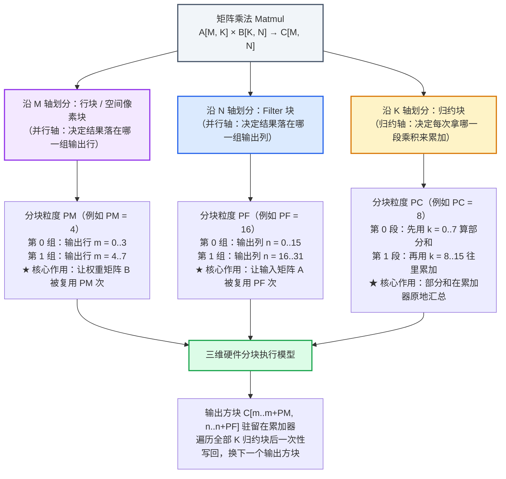
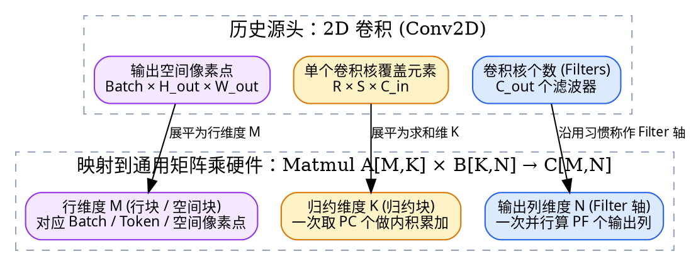
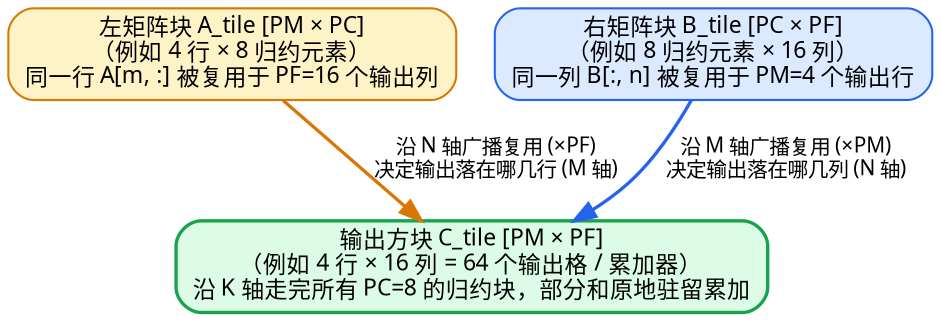
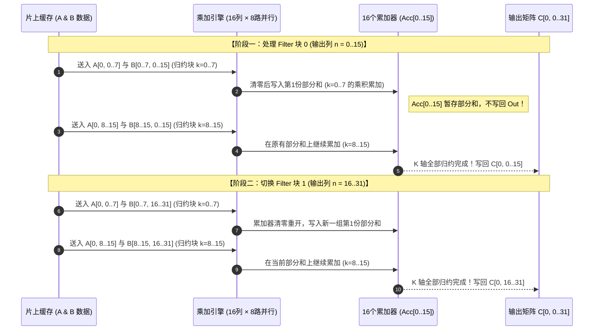
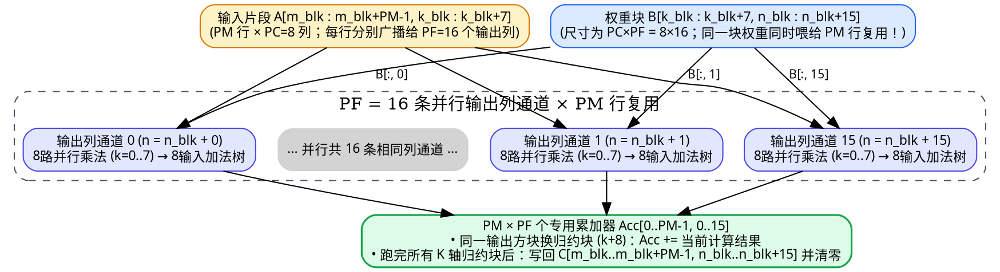

> **导读**：几乎所有现代人工智能模型——无论是大语言模型（LLM）里的注意力机制与前馈网络，还是图像模型里的卷积层——在底层硬件上最终都会收敛到同一个最核心的计算：**矩阵乘法（Matmul, Matrix Multiplication）**。
>
> 当初学者翻看 AI 芯片资料或底层算子优化教程时，很快就会被一连串“分块术语”绕晕：**行块（Row / Spatial Block）**、**Filter 块（Filter Block）**与**归约块（Reduction Block）**，以及随之而来的 **`PM=4`**、**`PF=16`**、**`PC=8`** 等硬件参数。明明是一个普通的矩阵乘法 $A \times B \to C$，为什么里面会冒出“Filter”这个词？沿 $M$ 轴切的块又对应什么？为什么有的块切完可以独立算，有的块切完却必须反复累加到同一个地方？
>
> 本文将完全站在**零基础初学者**的视角，用最朴素的直觉、逐个名词破冰、具体数值推演以及多张 **Graphviz / Mermaid 可视化图解**，把 Matmul 三条坐标轴上的分块本质彻底拆解清楚。

---

## 零、初学者核心名词破冰速查表

在正式进入矩阵分块之前，我们先为后文第一次出现的专业术语做好“通俗翻译”。正文首次提及这些概念时，也会结合具体场景再次展开。

| 术语 / 缩写               | 英文全称                                              | 一句话通俗解释                                                                                                                 |
| :------------------------ | :---------------------------------------------------- | :----------------------------------------------------------------------------------------------------------------------------- |
| **Matmul / GEMM**         | Matrix Multiplication / General Matrix Multiplication | 矩阵乘法（通用矩阵乘）。深度学习算力的绝对主力，即计算 $A \times B \to C$。                                                    |
| **张量与轴（Axis）**      | Tensor & Axis / Dimension                             | 可以把二维矩阵理解成一张 Excel 表格，“轴”就是表格的方向（比如行方向 $M$、列方向 $N$）。                                        |
| **乘加（MAC）**           | Multiply-Accumulate                                   | 芯片里最基础的算术动作：**先把两个数相乘，再把结果加到之前的总和上**（$acc \leftarrow acc + a \times b$）。                    |
| **分块（Tiling）**        | Tiling                                                | 把一张超大矩阵“切瓷砖”一样切成一块块小矩阵，每次只搬一块进高速小仓库算，装得下也算得快。                                       |
| **行块 / 空间块**         | Row Block / Spatial Block                             | 沿输出行方向（$M$ 轴）切出来的一组行（对应输入样本、Token 或图像像素点）。**同一组里的输出行互相独立，但可以共用同一块权重**。 |
| **Filter 块**             | Filter Block                                          | 沿输出列方向（$N$ 轴）切出来的一组列。**同一组里的输出列在同一轮一起被算出来**。                                               |
| **归约（Reduction）**     | Reduction                                             | “多对一”的汇总压缩动作，例如把 100 个乘积相加变成 1 个最终数值。                                                               |
| **归约块**                | Reduction Block                                       | 沿求和下标方向（$K$ 轴）切出来的一段数据。每次只取这一段做乘加，结果需要继续累加。                                             |
| **PM / PF / PC**          | Parallel M / Parallel Filter / Packed Channels        | 分别表示硬件在 **$M$ 轴（行）、$N$ 轴（列）、$K$ 轴（归约维）** 上的单步分块尺寸（通用编译器中也常写作 $B_M, B_N, B_K$）。     |
| **部分和（Psum）**        | Partial Sum                                           | Sum（求和）只算到一半的“半成品结果”。必须等后面所有的归约块都加上去，才变成最终答案。                                          |
| **累加器（Accumulator）** | Accumulator                                           | 硬件计算单元内部专门用来“接住并持续累加部分和”的高速暂存寄存器。                                                               |

---

## 一、知识全景图：先看清三条轴各自在干什么

在陷入公式下标之前，我们先用一张全景图建立最高层的直觉：**行块（$M$ 轴）管“算哪几行”，Filter 块（$N$ 轴）管“算哪几列”，归约块（$K$ 轴）管“每次加哪一段材料”**。



---

## 二、回到第一性原理：看懂 Matmul 公式里的 $m, k, n$

我们先来看最标准的矩阵乘法定义。假设有两个输入矩阵 $A$ 和 $B$，相乘得到输出矩阵 $C$：

$$
A[M, K] \times B[K, N] \rightarrow C[M, N]
$$

其中，大写字母 $M, K, N$ 代表矩阵三条边的总长度，而小写字母 $m, k, n$ 代表具体某一个元素在这三条边上的位置编号（下标，从 $0$ 开始）：

- $m \in [0, M-1]$：输出矩阵 $C$ 的**行号**（对应输入 $A$ 的第 $m$ 行）；
- $n \in [0, N-1]$：输出矩阵 $C$ 的**列号**（对应权重/右矩阵 $B$ 的第 $n$ 列）；
- $k \in [0, K-1]$：左右两个矩阵相乘时，**必须对齐并消掉的那条公共边**（内积维 / 求和维）。

结果矩阵 $C$ 中第 $m$ 行、第 $n$ 列的单个数值 $C[m, n]$，等于 $A$ 的第 $m$ 行与 $B$ 的第 $n$ 列**逐元素相乘再全部相加**：

$$
C[m, n] = \sum_{k=0}^{K-1} A[m, k] \cdot B[k, n]
$$

> [!NOTE] 生活类比：把抽象公式变成“成绩加权总分表”
> 想象你是教务处老师，要统计全年级学生的加权总分：
>
> - 有 $M$ 个学生（比如 $M = 100$ 人），每人考了 $K$ 门科目（比如 $K = 16$ 门课）——这就是矩阵 $A[M, K]$。
> - 学校制定了 $N$ 套不同的评优算分方案（比如 $N = 32$ 种奖学金权重方案），每种方案给 $K$ 门课设定了不同权重——这就是矩阵 $B[K, N]$。
> - 最终你要填出一张结果表 $C[M, N]$：算出**第 $m$ 位同学在第 $n$ 套方案下的总分**。
> - 怎么算？把这位同学第 $k$ 门课的分数 $A[m, k]$ 乘以第 $n$ 套方案对该门课的权重 $B[k, n]$，把所有科目 $k = 0 \dots K-1$ 的乘积**加起来**，就得到了 $C[m, n]$！

### 为什么硬件不能“一口吃成胖子”？

在纸上写公式很简单，但放到真实的 AI 芯片硬件上就会遇到两堵墙：

1. **片上仓库装不下（SRAM 容量限制）**：芯片内部的高速存储区（通常称为片上缓存 **SRAM** 或 **Scratchpad**）非常宝贵，真实大模型中 $M, K, N$ 动辄几千甚至上万，根本不可能把整张 $A$、$B$、$C$ 一次性塞进计算核心旁边的寄存器里。
2. **计算单元数量固定（硬件物理规模限制）**：芯片上焊接的乘法器、加法器数量是固定的，例如芯片设计师造了一套“每次只算几行、16 列、每列每次接 8 个输入做乘加”的矩阵计算引擎。

于是，硬件和编译器就必须做同一件事——**分块（Tiling）**：把大矩阵切成硬件刚好一口能吞下的小块，一小块一小块地算完、拼出全局结果。在 Matmul 的三条轴上，这分别对应了：**$N$ 轴上的 Filter 块**、**$K$ 轴上的归约块**，以及 **$M$ 轴上的行块（空间块）**。

```dot
digraph MatmulAnatomy {
    rankdir=LR;
    node [shape=record, fontname="sans-serif", fontsize=11];
    edge [fontname="sans-serif", fontsize=10];

    subgraph cluster_A {
        label="左矩阵 A [M, K]";
        style="rounded,dashed";
        color="#64748b";
        A_box [label="{行块 0 (m=0..3, PM=4) | 归约块 0\n(k = 0..7)\n[长度 PC=8] | 归约块 1\n(k = 8..15)\n[长度 PC=8]} | {行块 1 (m=4..7, PM=4) | 下一批样本 / 行 | ...}", fillcolor="#fef3c7", style="filled"];
    }

    subgraph cluster_B {
        label="右矩阵 B [K, N]";
        style="rounded,dashed";
        color="#64748b";
        B_box [label="{<b0> Filter 块 0 (n = 0..15, PF=16)\n当前归约块 k = 0..7 (PC=8) | <b1> Filter 块 1 (n = 16..31, PF=16)\n下一轮再算的输出列组} | {后续归约块 k = 8..15\n继续累加到 Filter 块 0 | 后续归约块 k = 8..15\n继续累加到 Filter 块 1}", fillcolor="#dbeafe", style="filled"];
    }

    subgraph cluster_C {
        label="输出矩阵 C [M, N]";
        style="rounded,dashed";
        color="#64748b";
        C_box [label="{行块 0 (m=0..3) | 输出方块 (0,0)\nC[0..3, 0..15]\n由同一批累加器汇聚完成 | 输出方块 (0,1)\nC[0..3, 16..31]\n切换到下一列组后独立计算} | {行块 1 (m=4..7) | 下一组输出行\nC[4..7, 0..15] | 下一组输出行\nC[4..7, 16..31]}", fillcolor="#dcfce7", style="filled"];
    }

    A_box -> B_box [label="沿着 K 轴取段\n(k=0..7 做内积)", color="#d97706", penwidth=1.8];
    B_box -> C_box [label="沿着 M 与 N 轴二维展开\n(PM 行 × PF 列输出方块)", color="#2563eb", penwidth=1.8];
}
```



---

## 三、Filter 块：沿 $N$ 轴并肩作战的“输出列战队”

### 3.1 什么是 Filter 块？

> **核心定义**：在 Matmul 中，**Filter 块是一组一起计算的输出列，沿着 $N$ 轴划分。**

回头看公式 $C[m, n] = \sum_{k=0}^{K-1} A[m, k] B[k, n]$：

- 下标 **$n$** 决定算出来的结果落在结果矩阵 $C$ 的**哪一列**。
- 当给定某一行 $m$ 时，不同列 $n$ 之间**互不干扰、完全独立**（第 0 列算出来的值永远不会加到第 16 列上去）。这在计算机体系结构里叫做**天然的并行轴（Parallel Axis）**——只要硬件资源够，完全可以同时派出 16 个计算通道一起算 16 个不同的 $n$！

假设硬件在这一条并行轴上的并发能力是 **$PF = 16$**（即每个 Filter 块包含 16 个输出列）：

1. **第一组 Filter 块**：硬件同时处理 **$n = 0 \dots 15$** 这 16 个输出列。在这轮计算期间，不管 $K$ 轴怎么循环，硬件目标始终锁死在 $C[m, 0 \dots 15]$ 这 16 个结果位置上。
2. **第二组 Filter 块**：等 $n = 0 \dots 15$ 全部算完并写回内存后，硬件切到下一组 **$n = 16 \dots 31$**，开始算另一批全新的 16 个输出列。
3. **依此类推**：$n = 32 \dots 47$、$n = 48 \dots 63$……直到走完整个 $N$ 轴。

> [!TIP] 为什么大家共用同一个 $A[m, k]$？
> 当计算同一行 $m$ 上的 16 个输出列 $n = 0 \dots 15$ 时，它们用到的左矩阵元素全都是 **$A[m, k]$**！这意味着硬件只需要从缓存里**读一次 $A[m, k]$**，就可以同时**广播（Broadcast）**给 16 列并行计算通道一起使用，把输入数据的复用率直接放大了 16 倍。

### 3.2 初学者必问：纯矩阵乘法里哪来的“Filter”？

很多刚学线性代数和 GPU/NPU 的同学都会好奇：**卷积神经网络（CNN）里才有卷积核（Filter），为什么通用矩阵乘法 Matmul 里也管 $N$ 轴叫 Filter 块？**

这其实是一个非常经典的**软硬件演进历史沿革**：

1. 在早期的深度学习加速器设计中，最核心的算子是 **2D 卷积（Conv2D）**。假设输入特征图大小是 $[H, W, C_{in}]$，我们有 $C_{out}$ 个独立的卷积核（每个卷积核就是一个 **Filter / 滤波器**，负责提取一种特征，比如边缘、纹理）。
2. 当硬件工程师设计**矩阵乘硬件引擎（Matrix Compute Engine）**时，为了用同一套乘加阵列既能算卷积又能算全连接/Matmul，编译器会把卷积通过 `im2col`（图像转矩阵列）展开成标准的 Matmul：$A[M, K] \times B[K, N] \to C[M, N]$。
3. 展开之后，三条维度精准对号入座：
   - 空间像素点数（$\text{Batch} \times H_{out} \times W_{out}$）$\longrightarrow$ 变成了行维度 **$M$**；
   - 卷积核大小 $\times$ 输入通道数（$R \times S \times C_{in}$）$\longrightarrow$ 变成了内积求和维度 **$K$**；
   - 卷积核的个数（$C_{out}$，即 **Filter 的数量**）$\longrightarrow$ 正好落在了输出列维度 **$N$**！

因此，许多面向 AI 加速的矩阵计算硬件架构便顺理成章地将 $N$ 轴称作 **Filter 轴**，把沿 $N$ 轴的一次并行输出列数量称为 **$PF$（Parallel Filter）**，把这一组并行处理的输出列称为 **Filter 块**。



---

## 四、归约块：沿 $K$ 轴接力累加的“求和片段”

搞懂了负责横向铺开输出列的 Filter 块，我们再来看第二条截然不同的轴——**$K$ 轴**。

### 4.1 什么是“归约（Reduction）”和“归约块”？

> **归约（Reduction）**：在计算机科学里，“归约”的意思是**把一组多个数值，通过某种结合律运算（最常见就是求和 $\sum$、求最大值 $\max$）浓缩成 1 个结果值**。

在公式 $C[m, n] = \sum_{k=0}^{K-1} A[m, k] B[k, n]$ 中：

- 下标 **$k$** 决定的不是结果落在哪里，而是**哪些乘积要被累加到同一个 $C[m, n]$ 上**！
- **归约块（Reduction Block）**，就是沿着 $K$ 轴切出来的、**一次参与乘加计算的一段求和下标**。

### 4.2 当 $PC = 8$ 时，硬件如何接力累加？

假设在真实的神经网络里，公共维度 $K = 16$（甚至 $K = 4096$），而硬件矩阵引擎在 $K$ 轴方向一次只能吞下 **$PC = 8$** 个元素（这里的 $PC$ 通常源自硬件沿通道/内积维度的并行打包宽度，如 Packed Channels = 8）：

1. **第 1 个归约块（$k = 0 \dots 7$）**：
   硬件先读取 $A[m, 0 \dots 7]$ 和 $B[0 \dots 7, 0 \dots 15]$，为当前这组输出列（$n = 0 \dots 15$）算出**第一份部分和（Partial Sum）**：

   $$
   P^{(0)}[m, n] = \sum_{k=0}^{7} A[m, k] \cdot B[k, n]
   $$

   注意：此时 $P^{(0)}[m, n]$ **还不是最终答案**，因为 $k = 8 \dots 15$ 的账还没算进来！所以它会被暂时保存在硬件内部的**累加器（Accumulator）**里，**不能写回最终内存**。

2. **第 2 个归约块（$k = 8 \dots 15$）**：
   紧接着，硬件保持“目标输出列依然是 $n = 0 \dots 15$”不变，换上第二段输入数据 $A[m, 8 \dots 15]$ 和 $B[8 \dots 15, 0 \dots 15]$，算出下一份 8 个乘积的和，并**继续累加到刚才同一组累加器中**：

   $$
   P^{(1)}[m, n] = P^{(0)}[m, n] + \sum_{k=8}^{15} A[m, k] \cdot B[k, n] = \sum_{k=0}^{15} A[m, k] \cdot B[k, n]
   $$

3. **累加完成，释放结果（Drain / Writeback）**：
   只有当 $K$ 轴上的所有归约块全部跑完，累加器里的部分和才正式“转正”为最终结果 $C[m, 0 \dots 15]$，此时才能打包写回输出缓存，并把累加器清零，准备迎接下一组 Filter 块（$n = 16 \dots 31$）。

> [!IMPORTANT] 一句话区分两块的核心差异
>
> - **换 Filter 块（移动 $n$）**：是在算**别人家的结果**（一组全新的输出列），旧结果必须存走，累加器要清零重开。
> - **换归约块（移动 $k$）**：是在**补全同一家的结果**（还是那几列输出），绝对不能清零，必须接着刚才的部分和继续往上加！

---

## 五、那沿 $M$ 轴的应该是什么？——行块与三维数据复用拼图

讲完了沿 $N$ 轴的 Filter 块和沿 $K$ 轴的归约块，你一定会顺理成章地问：**$A[M, K] \times B[K, N] \to C[M, N]$ 明明有三条轴，沿 $M$ 轴切出来的块到底是什么？**

### 5.1 沿 $M$ 轴的准确定义与不同语境下的叫法

沿 $M$ 轴切出来的块，本质上是**一组一起计算的输出行**（通常称为**行块 Row Block / M-Tile**）。在不同领域和硬件抽象层次下，它有几个常见但完全等价的名字：

1. **通用线性代数 / 编译器视角**：直接称为**行块（Row Block / M-Tile）**，分块大小通常记为 $BM$ 或 $PM$。
2. **大语言模型（LLM）视角**：在 Transformer 的线性层里，$M$ 轴就是 **Batch × Token 序列长度**，因此沿 $M$ 轴切出来的块常叫 **Token 块 / 序列块**（例如每次一起算 16 个词元）。
3. **卷积 / 历史 NPU 硬件视角**：正如前文图 3.2 所展示的，在 CNN 转 Matmul 时，$M$ 轴对应特征图上的空间点数量（$\text{Batch} \times H_{out} \times W_{out}$），因此在部分矩阵硬件架构中，沿 $M$ 轴的分块也被称为**空间块（Spatial Block）**或**像素块（Pixel Block）**，对应的硬件并行/分块粒度有时也会记为 **$PM$**（Parallel M）或并入矢量通道参数。

用与前文完全对称的方式来定义它：

> **行块（Row Block / 空间块）沿 $M$ 轴**。$m$ 决定结果落在结果矩阵 $C$ 的**哪一行**。当 $PM = 4$ 时，一组处理 4 个输出行，例如 $m = 0 \dots 3$；换到下一组 $m = 4 \dots 7$，就开始算另一组输出行。

### 5.2 它和 Filter 块一样是“并行轴”，但解决的是另一半访存瓶颈！

在性质上，$M$ 轴和 $N$ 轴是“亲兄弟”——**两者都是天然的并行轴**（第 0 行的算分结果和第 4 行的算分结果毫无关系，绝对不会互相累加），它们共同撑起了输出矩阵 $C$ 的二维平面：

- **$M$ 轴决定“行号”**：$m = 0 \dots 3$ 落在上面 4 行，$m = 4 \dots 7$ 落在下面 4 行；
- **$N$ 轴决定“列号”**：$n = 0 \dots 15$ 落在左边 16 列，$n = 16 \dots 31$ 落在右边 16 列。

但为什么要同时沿 $M$ 轴和 $N$ 轴分块，而不能只沿 $N$ 轴切呢？**答案藏在“右矩阵 $B$ 的数据复用”里！**

- **如果只沿 $N$ 轴算（每次只算 $M=1$ 单行）**：你从外部缓存好不容易搬来一块 $B[0\dots7, 0\dots15]$（128 个权重），它只和 $A$ 的第 0 行乘了一次就被丢掉了！等到算第 1 行 $m=1$ 时，又得把一模一样的权重 $B$ 重新搬一遍——**权重没有任何复用！**
- **如果同时沿 $M$ 轴一次抓 $PM = 4$ 行（行块）**：这一块权重 $B[0\dots7, 0\dots15]$ 搬进片上缓存后，可以连续跟 $A$ 的第 $0, 1, 2, 3$ 行各乘一次！**权重 $B$ 的读取成本瞬间被摊薄了 4 倍！**

回到开头的“成绩加权总分表”类比：如果你要算 4 位同学（$m=0\dots3$）在 16 套评优方案（$n=0\dots15$）下的分数，只要把那 16 套评分标准表（矩阵 $B$ 的分块）拿在手里看一遍，就能顺手把这 4 位同学的分数全算出来，不用每算一个同学就去资料室重查一遍评分标准！



### 5.3 $PM$ 什么时候等于 $1$？什么时候大于 $1$？

初学者在看不同硬件文档时，会发现一个有趣的现象：有的文档重点只提 `PF=16, PC=8`，好像没怎么提 `PM`；而另一些矩阵引擎文档则把 `PM × PF × PC` 并列写在一起。这取决于硬件在 $M$ 轴的**并行度设计**：

1. **向量-矩阵乘法模式（$PM = 1$，常见于大模型 Decode 解码阶段或单行输入）**：
   此时每次输入只有 1 行（比如自回归生成时一次只处理 1 个 Token，即 $M=1$）。硬件在 $M$ 轴没有并行度，只需要把精力放在 $N$ 轴（$PF$）和 $K$ 轴（$PC$）上即可。
2. **矩阵-矩阵乘法模式（$PM > 1$，常见于二维矩阵乘阵列 / 大批量 Prefill / 卷积特征图）**：
   当 $M$ 很大时（例如一次输入几百个 Token 或一张大图有上千个像素点），硬件会在空间上或寄存器排布上同时展开 $PM$ 行（如 $PM = 4, 8$ 或 $16$），或者外层由片上缓存把 $PM$ 行留在一起，让权重块 $B$ 获得成倍复用，把算力利用率拉满。

---

## 六、双轴到三轴合体实战：完整推演执行流

我们先来看单行（$M=1$，$PF=16, PC=8$）时的硬件节拍，再把它直接扩展到完整三维（$PM=4, PF=16, PC=8$）的嵌套循环！

### 6.1 硬件时序节拍（单行特例 $M=1, K=16, N=32$）

设定：$A[1, 16] \times B[16, 32] \to C[1, 32]$，硬件规格 $PF=16, PC=8$。

- 沿 $N$ 轴（Filter 块数）：$32 / 16 = 2$ 组（Group 0: $n=0\dots15$，Group 1: $n=16\dots31$）；
- 沿 $K$ 轴（每组内的归约块数）：$16 / 8 = 2$ 段（Step 0: $k=0\dots7$，Step 1: $k=8\dots15$）。



### 6.2 深入芯片微架构：二维与三维乘加阵列

当只有 $PF=16, PC=8$（即 $PM=1$）时，电路包含 $16 \times 8 = 128$ 个乘法器；而当支持 $PM$ 行并行（比如 $PM=4$）时，硬件会在垂直方向复制出 $PM$ 套类似的行通道（或由 1 套引擎在连续 4 个节拍内复用同一块已加载的权重 $B$），形成 $PM \times PF$ 个结果累加器：



### 6.3 用伪代码一眼看穿三维循环嵌套关系

把完整的三轴分块（$M$ 轴行块 $PM$、$N$ 轴 Filter 块 $PF$、$K$ 轴归约块 $PC$）写成等价伪代码，初学者立刻就能看懂三条轴的分工与嵌套顺序：

```python
# 假设矩阵维度 M, K, N 分别已被 PM=4, PF=16, PC=8 整除
# 外层双循环（M 轴行块 + N 轴 Filter 块）：划定当前要算的输出方块 C_tile [PM x PF]
for m_blk in range(0, M, PM):          # PM = 4: m=0..3, 然后 m=4..7 ...
    for n_blk in range(0, N, PF):      # PF = 16: n=0..15, 然后 n=16..31 ...

        # 1. 开启新一块 [PM x PF] 输出区域前，先把对应的 PM*PF 个累加器清零
        acc = [[0.0] * PF for _ in range(PM)]

        # 最内层循环：遍历归约块（沿着 K 轴，每次步进 PC=8）
        for k_blk in range(0, K, PC):  # PC = 8: k=0..7, 然后 k=8..15 ...
            a_tile = A[m_blk : m_blk + PM, k_blk : k_blk + PC]  # 形状 4 x 8
            b_tile = B[k_blk : k_blk + PC, n_blk : n_blk + PF]  # 形状 8 x 16

            # 2. b_tile 被这 PM=4 行共同复用；a_tile 每行被 PF=16 列共同复用
            for row in range(PM):
                for col in range(PF):
                    partial_dot = sum(
                        a_tile[row][i] * b_tile[i][col] for i in range(PC)
                    )
                    acc[row][col] += partial_dot  # 关键：跨归约块原地累加！

        # 3. 只有 K 轴归约块全部走完，才一次性写回整个输出方块 C_tile
        C[m_blk : m_blk + PM, n_blk : n_blk + PF] = acc
```

> [!WARNING] 为什么最内层通常是归约块（$K$），而外层是行块（$M$）和 Filter 块（$N$）？
> 如果你把 $K$ 放在外层，每算完一个 $k=0\dots7$ 归约块后就切去算下一组 $(m\_blk, n\_blk)$，后果会很严重：你不得不把还没算完的**半成品部分和写回外部缓存**；等到下一轮 $k=8\dots15$ 回来时，又得把它们**重新读回累加器**！
>
> 在 AI 芯片里，外部存储的读写能耗和延迟远高于计算本身。把归约块 $K$ 放在最内层，让输出方块 $C[PM \times PF]$ 的部分和**稳稳地驻留在累加器里（Output Stationary，输出驻留）**，算完一次写回，是硬件架构师最经典的调度准则。

---

## 七、一张表彻底对比 Matmul 三轴分块

| 对比维度           | 行块 / 空间块（Row / Spatial Block）    | Filter 块（Filter Block）              | 归约块（Reduction Block）                        |
| :----------------- | :-------------------------------------- | :------------------------------------- | :----------------------------------------------- |
| **所在矩阵维度**   | **$M$ 轴**（$A$ 的行轴、$C$ 的行轴）    | **$N$ 轴**（$B$ 的列轴、$C$ 的列轴）   | **$K$ 轴**（$A$ 的列轴、$B$ 的行轴，公共消去维） |
| **核心下标含义**   | **$m$**：决定算出的数值落在**哪一行**   | **$n$**：决定算出的数值落在**哪一列**  | **$k$**：决定哪些乘积要**加进同一个结果**        |
| **典型物理语义**   | 样本 Batch / Token 序列 / 空间像素点    | 输出特征通道 / 卷积核 Filter 个数      | 内积求和维 / 输入特征通道打包维                  |
| **典型硬件参数**   | **$PM$**（或 $BM$，如 $PM = 4$ 或 $1$） | **$PF$**（或 $BN$，如 $PF = 16$）      | **$PC$**（或 $BK$，如 $PC = 8$）                 |
| **主要数据复用**   | 提高右矩阵（权重 $B$）复用率 $PM$ 倍    | 提高左矩阵（输入 $A$）复用率 $PF$ 倍   | 让输出部分和 $C$ 原地累加，减少写回              |
| **块与块之间关系** | **彼此独立**：不同行组互不累加          | **彼此独立**：不同列组互不累加         | **必须接力累加**：多段求和共同拼出同一格         |
| **切换块时累加器** | 写回旧结果 $\rightarrow$ **清零重开**   | 写回旧结果 $\rightarrow$ **清零重开**  | **保留部分和** $\rightarrow$ 继续向上累加        |
| **不整除如何处理** | 尾部多余行结果丢弃或用行写掩码（Mask）  | 尾部多余列结果丢弃或用列写掩码（Mask） | 尾部不足 $PC$ 槽位处硬件补零（Zero-Padding）     |

---

## 八、工程细节延伸：遇到“除不尽”的尾块怎么办？

真实模型里的矩阵尺寸不可能永远刚好是 $4$、$16$ 或 $8$ 的整数倍。比如遇到了 $M = 5, K = 10, N = 20$，而硬件分块规格是 $PM = 4, PF = 16, PC = 8$：

1. **归约块（$K=10, PC=8$）除不尽怎么处理？**
   - 第 1 块：$k = 0 \dots 7$（全部 8 个都是有效数据）。
   - 第 2 块：只剩 $k = 8, 9$ 两个真实下标，剩下的 $k = 10 \dots 15$ 位置没有数据。
   - **做法**：由于数学上 $0 \times x = 0$，且任何数加 $0$ 不变，硬件或编译器只需在剩下的 6 个槽位**补零（Zero-Padding）**，计算结果依然完全精确！

2. **行块（$M=5, PM=4$）与 Filter 块（$N=20, PF=16$）除不尽怎么处理？**
   - $M$ 轴第 2 块只有 $m = 4$ 这 1 行有效，其余 3 行是填充行；$N$ 轴第 2 块只有 $n = 16 \dots 19$ 这 4 列有效，其余 12 列是无效列。
   - **做法**：写回内存时必须通过**二维写使能掩码（Write Mask）**控制只将有效行列范围写入输出矩阵 $C$，防止把后面不属于矩阵 $C$ 的内存区域踩坏（越界写覆盖）。这也是为什么工程上 AI 模型设计常建议把 Batch/序列块与隐藏层维度（$M, K, N$）尽量对齐为 $8, 16, 32$ 的倍数——**避免尾块通道空转，榨干硬件利用率！**

---

## 九、自测小练习：检验你是否真正掌握

试着不看答案，自己口算一下下面三个问题：

### 问题 1：三维分块步数计算

> 假设某次 Matmul 计算中，$M = 8, K = 24, N = 48$，硬件分块规格为 $PM = 4, PF = 16, PC = 8$。
>
> 1. 沿 $M$ 轴有多少个行块？沿 $N$ 轴有多少个 Filter 块？输出矩阵 $C$ 一共被切成了多少个 $[4 \times 16]$ 的输出方块？
> 2. 每个输出方块需要执行多少次归约块乘加？整个计算总共需要执行多少个 $(PM \times PF \times PC)$ 硬件计算步？

<details>
<summary>点击查看解答</summary>

1. 沿 $M$ 轴有 $8 \div 4 = 2$ 个行块（$m=0\dots3$ 与 $m=4\dots7$）；沿 $N$ 轴有 $48 \div 16 = 3$ 个 Filter 块（$n=0\dots15$、$n=16\dots31$、$n=32\dots47$）。
2. 输出矩阵 $C$ 一共被切成了 $2 \times 3 = 6$ 个 $[4 \times 16]$ 输出方块。
3. 每个输出方块沿 $K$ 轴需要 $24 \div 8 = 3$ 个归约块，因此总共需要 $6 \times 3 = 18$ 个硬件计算步。

</details>

### 问题 2：内存写回次数对比

> 在单行示例 $M = 1, K = 24, N = 48$（$PF=16, PC=8$，共 3 个 Filter 块、3 个归约块）的例子中：
> 如果按“外层 $N$、内层 $K$”调度，需要往输出缓存写几次一行 16 列的数据？如果写反成“外层 $K$、内层 $N$”，部分和需要被读写多少次？

<details>
<summary>点击查看解答</summary>

- **外层 $N$、内层 $K$**：每个 Filter 块在片上累加器原地攒齐 3 个归约块后，**只写回 1 次**最终结果。3 个 Filter 块一共只需要 **3 次写操作**（0 次部分和重读）。
- **外层 $K$、内层 $N$**：第 1 个归约块产生 3 组部分和（写 3 次）；第 2 个归约块必须先读回这 3 组部分和再累加写回（读 3 次 + 写 3 次）；第 3 个归约块再读 3 次 + 写 3 次。总共产生 **6 次读 + 9 次写 = 15 次访存**，是正常调度的 5 倍带宽浪费！

</details>

### 问题 3：为什么大模型推理的 Prefill 和 Decode 阶段对 $PM$ 的利用率截然不同？

> 在大语言模型推理中：
>
> - **Prefill（预填充）阶段**会一次性输入几百个提示词 Token（例如 $M = 512$）；
> - **Decode（逐词生成）阶段**每次通常只处理当前生成的 1 个 Token（$M = 1$，如果 Batch=1）。
>   请结合本文的 $M$ 轴行块概念，解释为什么 Decode 阶段往往容易受限于“访存瓶颈（Memory-Bound）”？

<details>
<summary>点击查看解答</summary>

- 在 **Prefill 阶段**，$M = 512$ 足够大，硬件可以充分切出多个沿 $M$ 轴的行块（$PM > 1$），每搬运一次权重块 $B[PC \times PF]$ 都能被 $PM$ 个 Token 共同复用，算力与访存比（算术强度）极高；
- 而在 **Decode 阶段**，当 $M = 1$ 时，$M$ 轴退化为单行（无法做多行复用），每搬运一整块权重矩阵 $B$ 只能算 1 个 Token 的输出就丢弃了，几乎绝大部分时间都在从片外高带宽内存往计算单元搬运权重 $B$，因此表现为典型的“访存瓶颈”。

</details>

---

## 十、总结

下次再在算子代码、编译器配置或硬件架构文档里看到 Matmul 的分块参数时，你只需要在脑海里瞬间定位三维坐标系：

1. **行块 / 空间块（$M$ 轴，步长 $PM$）** 决定**“算哪几行输出”**——并行轴，换组清零累加器，核心价值是**复用权重矩阵 $B$**；
2. **Filter 块（$N$ 轴，步长 $PF$）** 决定**“算哪几列输出”**——并行轴，换组清零累加器，核心价值是**复用输入矩阵 $A$**；
3. **归约块（$K$ 轴，步长 $PC$）** 决定**“取哪一段下标往里累加”**——归约轴，同一输出方块内只攒部分和，不写回最终结果，核心价值是**让部分和在累加器里原地归约**。

抓住了**“$M$ 轴切行复用权重、$N$ 轴切列复用输入、$K$ 轴切段原地累加”**这一三维几何直觉，后续无论是学习双缓冲流水线（Double Buffering）、共享内存分块（Shared Memory Tiling），还是更复杂的卷积与 Attention 分块优化，都会水到渠成。
