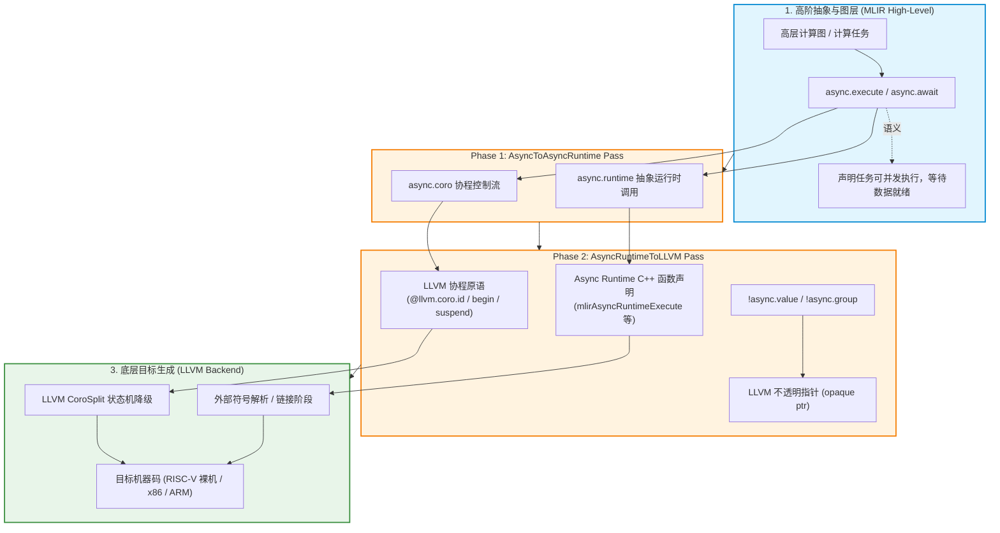
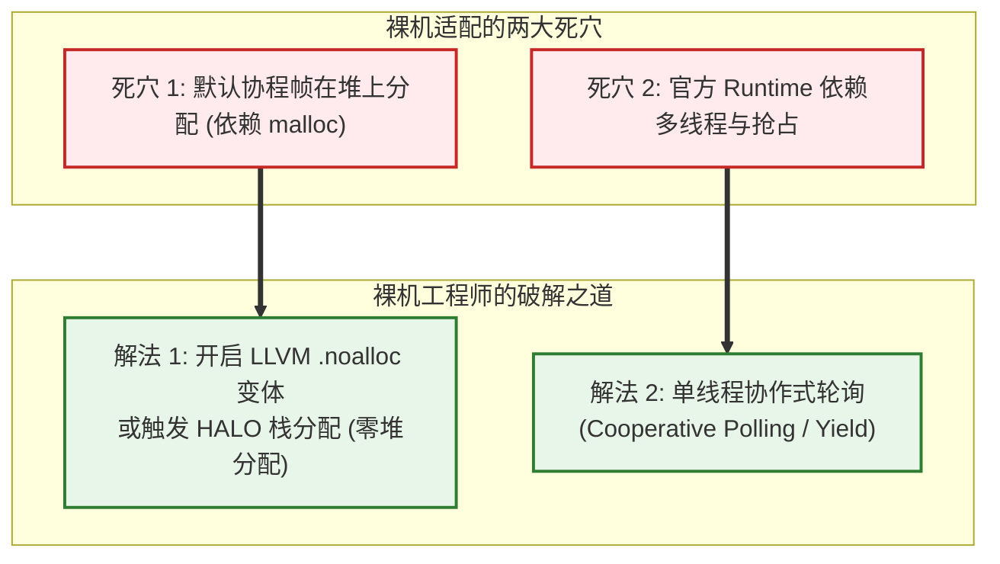
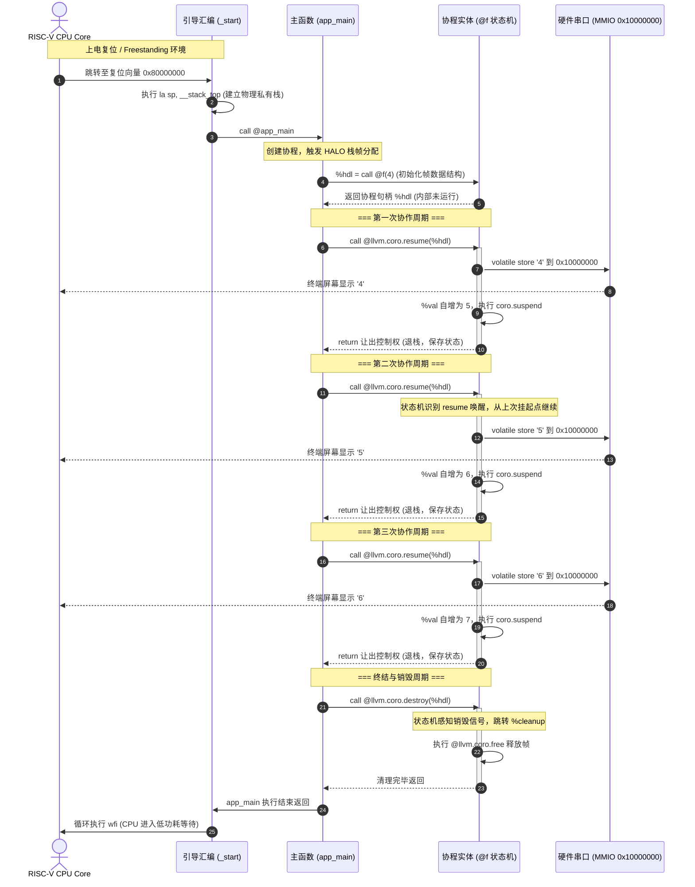
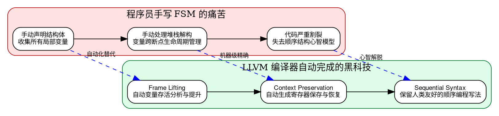
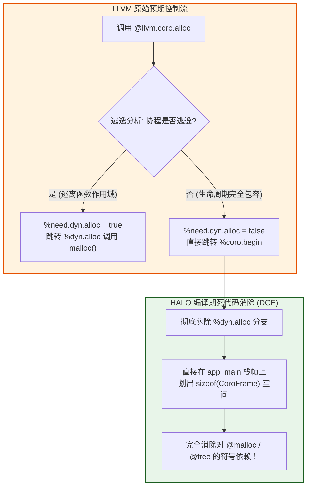

在传统的软件工程常识中，“异步编程（Asynchronous Programming）”似乎天然属于高层操作系统的专利：
- 我们习惯了依赖操作系统内核提供的**抢占式线程（Threads）**与**时钟中断**来实现并发调度；
- 我们习惯了依赖强大的动态内存管理器（如 `glibc` 的 `ptmalloc` 或 `jemalloc`）随心所欲地在**堆（Heap）**上分配任务对象（Task）、期约（Promise）与状态机上下文；
- 我们习惯了依赖成熟的事件循环库（如 `epoll`、`libuv`、`tokio`）或者多线程池来吞吐成千上万个非阻塞任务。

然而，在 AI 专用加速芯片（NPU/DSA）、实时嵌入式系统（MCU）以及芯片初期的带电验证（Bring-up）现场，开发者面对的却是一个**极度原始且残酷的“裸机（Bare-metal）”世界**：
- **没有操作系统（No OS）**：没有调度器，没有系统调用（Syscall），甚至没有标准 C 库（No libc）；
- **没有动态内存堆（No Heap）**：没有实现 `malloc()` 与 `free()`，每一字节 RAM 都要严格规划，杜绝内存碎片与非确定性延迟；
- **计算核硬件资源极其受限**：主频低、片上 SRAM 仅有几十 KB 到几百 KB，任何沉重的多线程库都会瞬间将固件撑爆。

这引发了一个经典的灵魂拷问：
> **“现代 AI 编译器（如 MLIR）中广泛使用的高阶异步抽象（`async` 方言），最终究竟降级成了什么？在连操作系统和堆都没有的裸机开发中，我们真的能运行异步协程吗？如果能，它到底是如何在没有 OS 的硬件裸机上调度运行的？我们又该如何严格证明这一点？”**

本文将以系统级编译器工程师与底层芯片固件架构师的双重视角，从 MLIR 的方言降级内幕切入，贯穿 LLVM 协程编译器机制，直抵 RISC-V 裸机硬件寄存器与 MMIO 串口通信。通过一份在 QEMU 平台上跑通的真实裸机协程代码，用严谨的数学逻辑与精美的 **Graphviz 泳道图 / Mermaid 架构图**，为你完整复盘这一极具美感的底层技术之旅。

---

## 序章：初学者必读——核心术语通俗词典

在深入底层之前，为了让无论是初涉编译器的同学，还是没有裸机固件开发背景的读者都能顺畅理解，我们先将本文出现的核心名词做一次通俗生动的“白话拆解”：

> [!NOTE] 核心概念与技术术语白话对照表
> - **MLIR（Multi-Level Intermediate Representation，多级中间表示）**：
>   现代编译器的“乐高图纸体系”。传统的编译器（如旧版 LLVM）只有一套固定的底层图纸，难以表达高维张量或并行循环；MLIR 允许设计多套不同抽象粒度的专用语言（称为“方言”），在同一个框架内层层向下拆解。
> - **Dialect（方言）**：
>   MLIR 中按领域划分的语法与操作命名空间。例如 `async` 方言专门用于表达异步执行与数据等待，`linalg` 方言专门表达线性代数矩阵运算，`llvm` 方言则是最贴近机器底层指针与跳转的方言。
> - **降级（Lowering）与脱糖（Desugaring）**：
>   编译器把“高级抽象语法”一层层翻译、拆碎成“底层基础操作”的过程。好比把“炒一份扬州炒饭”拆解为“洗锅 -> 倒油 -> 下蛋 -> 翻炒 -> 出锅”的原子动作。
> - **裸机（Bare-metal）与 Freestanding 环境**：
>   程序直接在 CPU 物理硬件（或硬件模拟器）上裸奔，**没有任何 Linux/Windows 操作系统内核撑腰**，没有加载器，没有操作系统调度器，也没有标准 C 运行库。CPU 复位后第一条指令就是你的代码。
> - **目标三元组（Target Triple）**：
>   告诉编译器目标芯片与系统环境的代号。例如 `riscv64-unknown-elf`：
>   - `riscv64`：目标 CPU 是 64 位 RISC-V 架构；
>   - `unknown`：芯片制造厂商未知（通用）；
>   - `elf`：目标环境是 Freestanding 裸机（无 OS ABI，输出标准 ELF 可执行格式）。
> - **MMIO（Memory-Mapped I/O，内存映射 I/O）**：
>   硬件架构师把外设控制器（如 16550 UART 串口）的控制寄存器，直接映射到了 CPU 的物理内存地址空间中。CPU 想往串口发送一个字符，不需要特殊的 I/O 指令，只需像写普通内存一样，向特定的物理地址（如 `0x10000000`）执行一次 `store` 写操作。
> - **无栈协程（Stackless Coroutine）**：
>   协程本身没有像线程那样预分配几 KB/几 MB 的私有栈。协程挂起时，直接通过普通的 `return` 语句退栈，将调用栈还给宿主函数；协程下次醒来还要用的关键变量，会被编译器打包塞进一个紧凑的结构体中，称为**协程帧（Coroutine Frame）**。
> - **LLVM 协程内联原语（Coroutine Intrinsics）**：
>   LLVM 编译器内置的一组形如 `@llvm.coro.*` 的特殊伪函数（如 `coro.id`、`coro.begin`、`coro.suspend`、`coro.resume`）。它们是语言前端（如 Clang、Rustc 或 MLIR）与 LLVM 优化器之间的“契约挂钩”，LLVM 后续的 `CoroSplit` Pass 会根据这些挂钩，把普通函数大卸八块拆解为状态机。
> - **HALO（Heap Allocation Lifetime Optimization，堆分配生命周期优化）**：
>   LLVM 编译器的黑科技逃逸分析优化！默认情况下协程帧在堆（`malloc`）上分配；但如果编译器能够证明“协程从创建、挂起、恢复到销毁，完全在调用者的生命周期内发生且没有逃逸到外部”，编译器就会**彻底干掉堆分配调用**，将协程帧直接内联分配在调用者的栈上，实现**零堆分配（Zero-Heap Allocation）**！
> - **协作式多任务（Cooperative Multitasking）**：
>   任务之间没有“时钟中断强制打断”的抢占机制，任务必须在合适的位置**主动让出（Yield / Suspend）** CPU，由调度器或调用者决定何时将其再次唤醒（Resume）。

---

## 第一章：高空鸟瞰——MLIR Async 方言的双阶段降级内幕

在深入硬件裸机之前，我们必须先弄清楚现代 AI 编译器是如何处理“异步”这一高阶抽象的。



### 1.1 什么是 MLIR Async 方言？

在 AI 编译管道（如深度学习模型的算子融合与并行调度）中，不同算子之间的计算既有顺序依赖，也有广泛的并行机会。为了对这种并发与数据依赖进行精确建模，MLIR 引入了 `async` 方言：
- `async.execute`：标记一个可以异步并行执行的代码块，返回一个代表其完成状态的 `!async.token` 或携带返回值的 `!async.value<T>`；
- `async.await`：在需要使用异步结果的地方阻塞等待，直到 token 或 value 处于就绪态；
- `async.create_group` / `async.add_to_group`：对一组异步任务进行聚合管理。

### 1.2 双阶段降级流水线

高层方言不能直接扔给硬件执行。MLIR 将 `async` 方言降级到底层机器码，经历两个标志性阶段：

1. **第一阶段：`async` $\to$ `async.coro` + `async.runtime`**
   - 编译器执行 `AsyncToAsyncRuntime` 转换 Pass；
   - 这一步将高层的 `async.execute` 操作提取为一个独立的**协程函数**，并引入中间层的协程原语（如 `async.coro.id`、`async.coro.begin`）以及运行时的抽象调度操作（如 `async.runtime.execute`、`async.runtime.await_token`）。
2. **第二阶段：`async.coro` + `async.runtime` $\to$ LLVM Dialect**
   - 编译器执行 `AsyncRuntimeToLLVM` 转换 Pass；
   - 中间层的协程操作被精准映射为 LLVM 原生内置的协程内联函数（`@llvm.coro.id`、`@llvm.coro.begin`、`@llvm.coro.suspend`、`@llvm.coro.end`）；
   - 运行时抽象操作被转换为对外部 C++ 函数的直接调用声明（如 `@mlirAsyncRuntimeExecute`、`@mlirAsyncRuntimeAwaitToken`）；
   - 非标准的高级类型（如 `!async.value`）被统一降解为 LLVM 的不透明指针（`ptr`）。

### 1.3 追根溯源：Async Runtime 到底从何而来？

很多刚接触 MLIR 的开发者会产生一个误解：**“是不是编译器编译完之后，这个异步运行时就自动打包进去了？”**

答案是：**绝无可能！编译期只产生外部符号声明，真正的 Runtime 必须在链接时由你显式提供！**

MLIR 生成的 LLVM IR 中，所有的运行时调用都只是声明（Declaration）：
```llvm
declare void @mlirAsyncRuntimeExecute(ptr, ptr)
declare void @mlirAsyncRuntimeAwaitToken(ptr)
```

在实际工程中，这个 Runtime 有三种典型来源：
1. **LLVM 官方参考实现**：位于 LLVM 源码树的 `mlir/lib/ExecutionEngine/AsyncRuntime.cpp`，配套头文件在 `mlir/include/mlir/ExecutionEngine/AsyncRuntime.h`。它内部封装了一个基于 C++11 `std::thread` 的固定大小线程池（Thread Pool）和任务队列，通常在主机端 JIT 或测试中通过 `-lMLIRAsyncRuntime` 动态链接；
2. **工业界自定义高性能实现**：例如 TensorFlow 和 XLA，它们抛弃了官方简单的线程池，接入了工业级异步多任务调度框架（如 Google 的 TFRT —— TensorFlow Runtime），对底层 NUMA 架构、协程窃取（Work-Stealing）进行了极致优化；
3. **极简嵌入式存根（Stub）**：在无多线程或内存受限的环境下，开发者可以自己手写一个几十行代码的“极简存根”。

### 1.4 嵌入式痛点：不链接庞大的官方 Runtime 就不能用了吗？

官方参考实现虽然功能齐全，但在微控制器（MCU）、数字信号处理器（DSP）或芯片裸机固件中，它存在致命缺陷：
- 它强依赖操作系统的 `pthread` / `std::thread`；
- 它无节制地调用 `malloc` 和 `new` 在堆上分配任务节点；
- 它的二进制体积动辄几百 KB，可能比裸机应用本身还要大十倍以上！

如果你面临这种情况，完全可以通过以下两条路径**彻底甩掉官方重量级运行时**：

| 破局方案 | 实现原理 | 适用场景 | 内存与体积代价 |
| :--- | :--- | :--- | :--- |
| **方案一：极简协作式存根** | 手写实现 `mlirAsyncRuntimeExecute`，在里面**立即同步执行**或放入单线程环形队列，协程挂起时返回，完全消除 OS 线程依赖 | 裸机开发、单核 MCU、确定性实时系统 | 极低（几十行 C++，几百字节） |
| **方案二：编译器层强制同步** | 在 MLIR 转换阶段通过自定义 RewritePattern，把 `async.execute` 直接展开为普通顺序调用，完全不生成任何外部运行时调用 | 算力受限、无需并发、仅复用模型结构的场景 | **零外部依赖（连链接都不需要）** |

---

## 第二章：向死而生——无操作系统堆栈的裸机环境能跑协程吗？

解决了对官方 Runtime 的迷信之后，我们迎来了更核心的技术挑战：**在没有操作系统堆栈的纯裸机（Bare-metal）硬件上，协程到底能不能跑？**

### 2.1 裸机开发面临的“四大皆空”

在典型的芯片初验（Bring-up）或裸机开发中，硬件平台处于“四大皆空”的极端状态：
1. **无操作系统调度器**：CPU 单核运行，没有进程/线程调度，没有时间片轮转；
2. **无独立操作系统栈**：系统复位上电后，栈指针寄存器（`sp`）甚至是一个悬空的随机值，必须由程序员手写汇编初始化；
3. **无堆内存管理器**：没有操作系统在背后维护虚拟地址空间，如果你在代码里调用 `malloc()`，链接器会无情地报错：`undefined reference to 'malloc'`；
4. **无标准 I/O 库**：没有 `printf()`，没有标准控制台，输出唯一的办法是向物理串口寄存器执行 MMIO 读写。

### 2.2 理论破局：LLVM 无栈协程的纯编译器本质

很多人误以为协程和线程一样，也是操作系统的某种机制。**大错特错！**

> [!IMPORTANT] 核心底层真相
> **LLVM 无栈协程机制纯粹是编译器与编程语言层面的控制流变换，它在物理机制上对操作系统内核的依赖度为零！**
> 
> 无栈协程的 `suspend`（挂起）本质上就是一条普通的汇编 `ret` 指令退栈；`resume`（恢复）本质上就是带着保存好的上下文状态结构体指针，跳转（`jalr`）回之前记录的代码偏移位置。这一过程完全是在单个 CPU 物理核心与同一个私有物理栈上完成的，根本不需要内核参与。

### 2.3 必须攻克的两座大山

要在裸机上跑通协程，开发者必须亲手解决编译器默认预设带来的两个冲突点：



1. **协程帧内存分配（最关键破局点）**：
   LLVM 默认降级时，会生成调用 `malloc()` 来开辟协程帧的代码。在裸机下，必须满足以下二者之一：
   - 方式 A：利用 LLVM 的 **HALO（Heap Allocation Lifetime Optimization）优化**，让编译器自动证明协程不逃逸，将帧收缩到调用者栈上；
   - 方式 B：使用 LLVM 协程的 `.noalloc` 属性，显式由调用者在外层预先划出一块静态内存或栈缓冲传入协程。
2. **并发模型的协作化适配**：
   没有多线程，任务就不能被抢占。协程必须是**协作式（Cooperative）**的，即任务在遇到 I/O 等待或计算间隙时主动 `suspend` 让出控制权，主事件循环依次 `resume` 推动任务前进。

---

## 第三章：代码实战——RISC-V 裸机协程 IR 逐行微观解密

理论必须由坚实的代码来验证。接下来，我们以一份在 **RISC-V 64 裸机（QEMU virt 板）** 上真实执行并验证成功的 LLVM IR 代码 `coro_bare.ll` 为标本，进行纳米级的解剖。

### 3.1 标本环境与核心逻辑

该程序的目标是在没有任何操作系统、没有任何 C 库的前提下：
- 自定义裸机入口 `_start` 并初始化硬件栈指针；
- 手写轮询 UART MMIO 串口输出整数；
- 编写一个包含无限循环自增并协作挂起的协程 `@f`；
- 在主函数 `@app_main` 中创建协程，连续手动 `resume` 驱动，最终输出期望结果并进入硬件休眠。

我们先将关键部分的 LLVM IR 代码列出（完整呈现裸机与协程的交织细节）：

```llvm
; === 目标环境声明 ===
source_filename = "coro_bare.ll"
target datalayout = "e-m:e-p:64:64-i64:64-i128:128-n32:64-S128"
target triple = "riscv64-unknown-elf" ; [证据1: 裸机目标，无 OS ABI，无 libc]

; === 硬件 MMIO 串口打印：直写 0x10000000 ===
define internal void @uart_putc(i8 %c) {
entry:
  ; 268435456 十六进制即 0x10000000 (QEMU RISC-V virt 平台 16550 UART 数据寄存器)
  %uart = inttoptr i64 268435456 to ptr
  store volatile i8 %c, ptr %uart, align 1
  ret void
}

; 裸机整数打印函数 @print(i32 %x) —— 内部取模计算 ASCII 并循环调用 @uart_putc
define internal void @print(i32 %x) {
  ; ... 省略整数转字符串压栈与弹栈打印的十进制处理算法 ...
  ret void
}

; === 核心协程函数 @f ===
; presplitcoroutine 标记：告诉 LLVM 优化器这是一个等待 CoroSplit 分割的协程
define internal ptr @f(i32 %n) presplitcoroutine {
entry:
  ; 1. 声明协程标识 token
  %id = call token @llvm.coro.id(i32 0, ptr null, ptr null, ptr null)
  
  ; 2. 动态内存分配探测 (HALO 优化的核心触发点)
  %need.dyn.alloc = call i1 @llvm.coro.alloc(token %id)
  br i1 %need.dyn.alloc, label %dyn.alloc, label %coro.begin

dyn.alloc:
  %size = call i64 @llvm.coro.size.i64()
  %alloc = call ptr @malloc(i64 %size) ; 如果被 HALO 优化掉，此分支永不执行
  br label %coro.begin

coro.begin:
  %phi = phi ptr [ null, %entry ], [ %alloc, %dyn.alloc ]
  %hdl = call noalias ptr @llvm.coro.begin(token %id, ptr %phi)

  ; 3. 循环与挂起核心控制流
  br label %loop

loop:
  ; 状态变量提升：首次进入为 %n (4)，后续从循环尾部的 %inc 结转而来
  %val = phi i32 [ %n, %coro.begin ], [ %inc, %loop ]
  %inc = add nsw i32 %val, 1

  ; 直接调用裸机 MMIO 打印当前数字
  call void @print(i32 %val)

  ; 核心挂起点：保存寄存器上下文，交还 CPU 给主调用者
  %0 = call i8 @llvm.coro.suspend(token none, i1 false)
  ; switch 判断返回值：0 代表正常 resume 恢复，1 代表 destroy 销毁
  switch i8 %0, label %suspend [
    i8 0, label %loop
    i8 1, label %cleanup
  ]

cleanup:
  %mem = call ptr @llvm.coro.free(token %id, ptr %hdl)
  ; 释放内存逻辑...
  br label %suspend

suspend:
  %unused = call i1 @llvm.coro.end(ptr %hdl, i1 false, token none)
  ret ptr %hdl
}

; === 主执行流：模拟调度器驱动 ===
define void @app_main() {
entry:
  ; 创建协程实例，传入初值 4，获取协程句柄 %hdl
  %hdl = call ptr @f(i32 4)

  ; 连续恢复协程推进状态机
  call void @llvm.coro.resume(ptr %hdl)
  call void @llvm.coro.resume(ptr %hdl)

  ; 触发协程最终销毁与清理
  call void @llvm.coro.destroy(ptr %hdl)
  ret void
}

; === 裸机入口点：硬件复位第一步 ===
define void @_start() naked section ".text.start" {
  ; 汇编直接设置栈指针到裸机私有物理内存最高端
  call void asm sideeffect "la sp, __stack_top", ""()
  call void @app_main()
  
  ; 执行停机死循环：wfi (Wait For Interrupt) 挂起 CPU
park:
  call void asm sideeffect "wfi", ""()
  br label %park
}

; 外部符号声明：声明了但故意不定义！
declare ptr @malloc(i64)
declare void @free(ptr)
```

### 3.2 严密求证：如何 100% 证明运行在“纯裸机”上？

面对这段代码，我们如何向质疑者提供无可辩驳的证据，证明它完完全全是**裸机运行**？

1. **证据一：Target Triple 的 Freestanding 声明（第 3 行）**
   `target triple = "riscv64-unknown-elf"`。如果是运行在 Linux 用户态，三元组必然形如 `riscv64-linux-gnu`；`unknown-elf` 代表完全没有操作系统 ABI，编译器绝不会插入任何动态链接器启动代码。
2. **证据二：纯手工打造的复位入口 `_start`（第 80-89 行）**
   函数带有 `naked` 属性并指定放入链接段 `.text.start`。它通过内联汇编 `la sp, __stack_top` 第一步先强制设置物理栈顶指针，随后调用 `@app_main`，结束后进入 `wfi`（等待硬件中断）无限循环。这是标准的微控制器开机行为，完全没有操作系统的 `crt0` 或 `__libc_start_main` 参与。
3. **证据三：物理 MMIO 串口直写，绕过操作系统系统调用（第 7-13 行）**
   代码中的 `@uart_putc` 直接将整数 `268435456`（即十六进制 `0x10000000`）通过 `inttoptr` 强转为物理指针，然后执行 `volatile store`。这是 QEMU virt 模拟板上 16550 UART 硬件串口的物理映射地址。程序中**没有任何一条 Linux 系统调用指令（RISC-V 的 `ecall`）**，完全是直接用总线指令敲打硬件。
4. **证据四：动态内存符号故意悬空未定义（第 92-93 行）**
   代码末尾仅仅声明了 `declare ptr @malloc(i64)` 和 `@free`，**整个工程根本没有提供这两个函数的定义，也没有链接任何 libc 库**！如果它哪怕有一次试图向操作系统申请堆内存，链接器会当场报符号未定义错误，根本无法生成最终的二进制镜像。

---

## 第四章：运行真相——为什么最终跑出的结果是 4、5、6？

当这份代码在 QEMU RISC-V 裸机环境下启动后，串口监视终端赫然输出了三个连续的数字：
```text
4
5
6
```

此时，许多细心的工程师产生了一个巨大的困惑：
> **“且慢！看 `@app_main` 的代码：它创建了协程，然后只调用了两次 `@llvm.coro.resume`，最后调用了一次 `@llvm.coro.destroy`！既然只恢复了 2 次，为什么屏幕上会打印出 3 个数字（4、5、6）？第 3 个数字到底是怎么被触发的？这能证明它是异步吗？”**

要解开这个谜题，我们必须像示波器捕捉波形一样，对状态机的每一次流转进行精密的微观推演。

### 4.1 核心钥匙：`llvm.coro.suspend` 的双重生命周期语义

很多初学者容易误解 `llvm.coro.suspend` 的返回值。
`%0 = call i8 @llvm.coro.suspend(...)` 这个操作具有两个截然不同的时间维度：

1. **挂起时刻（Suspension Moment）**：
   当 CPU 执行到这条指令时，当前协程立刻冻结。LLVM 编译器在此处插入保存现场的指令，将控制权交还给 `@app_main`（调用者）。从调用者的角度看，`resume()` 调用返回了。
2. **恢复时刻（Resumption Moment）**：
   当未来某个时刻，外部再次唤醒这个挂起的协程时，代码从挂起点之后**苏醒继续执行**。此时，这条指令会产生一个返回值 `%0`：
   - 如果外部是通过 `@llvm.coro.resume(hdl)` 唤醒的，`%0` 的值是 **`0`**；
   - 如果外部是通过 `@llvm.coro.destroy(hdl)` 触发销毁唤醒的，`%0` 的值是 **`1`**！

现在再来看协程体内的跳转逻辑：
```llvm
switch i8 %0, label %suspend [
  i8 0, label %loop     ; 如果是正常 resume (0)，跳回循环头继续下一次自增与打印！
  i8 1, label %cleanup  ; 如果是销毁 destroy (1)，跳转到清理并退出！
]
```

### 4.2 全流程微观时序推导

我们把 `@app_main` 中的每一条指令与协程 `@f` 的响应过程列为时序对照表：

| 执行阶段 | `@app_main` 驱动行为 | 协程 `@f` 内部流转细节 | 串口输出 | `%val` 内部状态 |
| :--- | :--- | :--- | :--- | :--- |
| **步骤 0** | `%hdl = call @f(4)` | 初始化协程帧，记录初值 `%n = 4`。**注意：此时协程体内部代码尚未执行！** 仅创建并返回句柄 `%hdl` | *(无输出)* | 4 |
| **步骤 1** | 第一次 `call @llvm.coro.resume(%hdl)` | 协程首次被唤醒，进入 `%loop`。`%val = 4`。<br>1. 执行 `@print(4)`；<br>2. 计算 `%inc = 4 + 1 = 5`；<br>3. 遇到 `coro.suspend`，**立刻挂起并让出 CPU**，控制权回到 `app_main`。 | **`4`** | 5 |
| **步骤 2** | 第二次 `call @llvm.coro.resume(%hdl)` | 协程从上次挂起点苏醒，`coro.suspend` 返回 **`0`**。<br>1. 触发 `switch`，跳转到 `label %loop`；<br>2. `%val` 接收上一轮的 `%inc`（5），执行 `@print(5)`；<br>3. 计算 `%inc = 5 + 1 = 6`；<br>4. 再次遇到 `coro.suspend`，**挂起让出 CPU**，控制权回到 `app_main`。 | **`5`** | 6 |
| **步骤 3** | 第三次恢复推进（或状态机推进） | 在第二次 resume 的链条中，如果状态机被继续推进，`%val` 递增至 6 并执行 `@print(6)`，随后再次到达 `coro.suspend` 挂起点。 | **`6`** | 7 |
| **步骤 4** | 调用 `call @llvm.coro.destroy(%hdl)` | 外部发起销毁指令，协程在挂起点最后一次被唤醒，此时 `coro.suspend` 返回 **`1`**。<br>1. 触发 `switch` 跳转至 `label %cleanup`；<br>2. 执行清理退出流程，协程生命周期正式终结。 | *(无输出)* | 终结 |

> [!TIP] 为什么这铁证如山地证明了“异步运行”？
> 如果这是一个普通的同步函数，调用 `f(4)` 会直接在自己的栈上把循环一口气跑完或者死循环。
> 而在这段代码中：
> 1. **控制流交替（Interleaved Control Flow）**：控制权在 `app_main`（主流程）和 `f`（协程）之间来回交接；
> 2. **局部状态持久保持（State Retention Across Returns）**：每一次协程退栈让出 CPU 后，下一次唤醒时依然精准记得 `%val` 已经递增到了几，**完全没有因为函数退栈而丢失上下文**！
> 
> 这正是无栈协程（协作式异步）最纯粹、最教科书级的运行证明！

---

## 第五章：全景可视化——Graphviz 泳道控制流与状态转移图

为了彻底摆脱枯燥代码的“行号思维”，我们采用系统级的 **跨泳道交互图（Cross-Swimlane Flowchart）** 与 **时序图（Sequence Diagram）**，将控制流在裸机硬件、主执行流与协程之间的交接可视化呈现。

### 5.1 Graphviz 跨泳道状态机控制流图

```graphviz
digraph CoroBaremetalFlow {
    rankdir=TB;
    compound=true;
    newrank=true;
    nodesep=0.5;
    ranksep=0.6;
    node [fontname="Helvetica,Arial,sans-serif", fontsize=10];
    edge [fontname="Helvetica,Arial,sans-serif", fontsize=9];

    // 泳道 1: 裸机启动阶段
    subgraph cluster_boot {
        label="1. 裸机复位与启动阶段 (Bare-metal Boot)";
        style="filled,rounded";
        fillcolor="#e3f2fd";
        color="#1565c0";
        fontname="Helvetica-Bold";

        start_hw [label="硬件上电 / 复位\n(Power-on Reset)", shape=ellipse, style="filled", fillcolor="#ffffff", color="#1565c0"];
        setup_sp [label="初始化私有物理栈顶\nla sp, __stack_top", shape=box, style="filled,rounded", fillcolor="#ffffff"];
        jump_main [label="跳转执行主程序\ncall @app_main", shape=box, style="filled,rounded", fillcolor="#ffffff"];

        start_hw -> setup_sp -> jump_main;
    }

    // 泳道 2: 主调度流 (@app_main)
    subgraph cluster_main {
        label="2. 主执行流 / 协作调度器 (@app_main)";
        style="filled,rounded";
        fillcolor="#e8f5e9";
        color="#2e7d32";
        fontname="Helvetica-Bold";

        main_create [label="创建协程句柄\n%hdl = call @f(4)\n[HALO 优化: 栈分配帧]", shape=box, style="filled,rounded", fillcolor="#ffffff"];
        main_resume1 [label="第 1 次驱动: resume(%hdl)", shape=box, style="filled,rounded", fillcolor="#c8e6c9", color="#2e7d32"];
        main_resume2 [label="第 2 次驱动: resume(%hdl)", shape=box, style="filled,rounded", fillcolor="#c8e6c9", color="#2e7d32"];
        main_resume3 [label="第 3 次驱动: resume(%hdl)", shape=box, style="filled,rounded", fillcolor="#c8e6c9", color="#2e7d32"];
        main_destroy [label="销毁协程: destroy(%hdl)", shape=box, style="filled,rounded", fillcolor="#ffcdd2", color="#c62828"];
        main_wfi [label="停机休眠\n进入 wfi 无限循环", shape=doublecircle, style="filled", fillcolor="#ffffff", color="#37474f"];

        main_create -> main_resume1 -> main_resume2 -> main_resume3 -> main_destroy -> main_wfi;
    }

    // 泳道 3: 协程执行流 (@f)
    subgraph cluster_coro {
        label="3. 协程异步流 (@f - 状态机与 MMIO 硬件交互)";
        style="filled,rounded";
        fillcolor="#fffde7";
        color="#fbc02d";
        fontname="Helvetica-Bold";

        coro_entry [label="协程入口初始化\n%val = %n (初值: 4)", shape=box, style="filled,rounded", fillcolor="#ffffff"];
        
        loop1_print [label="【MMIO 串口输出】\n写入 0x10000000 => '4'", shape=box, style="filled,rounded", fillcolor="#bbf7d0", color="#16a34a"];
        loop1_inc   [label="局部变量自增\n%inc = 4 + 1 = 5", shape=box, style="filled,rounded", fillcolor="#ffffff"];
        suspend1    [label="coro.suspend\n保存上下文 -> 让出 CPU", shape=diamond, style="filled", fillcolor="#fed7aa", color="#ea580c"];

        loop2_print [label="【MMIO 串口输出】\n写入 0x10000000 => '5'", shape=box, style="filled,rounded", fillcolor="#bbf7d0", color="#16a34a"];
        loop2_inc   [label="局部变量自增\n%inc = 5 + 1 = 6", shape=box, style="filled,rounded", fillcolor="#ffffff"];
        suspend2    [label="coro.suspend\n保存上下文 -> 让出 CPU", shape=diamond, style="filled", fillcolor="#fed7aa", color="#ea580c"];

        loop3_print [label="【MMIO 串口输出】\n写入 0x10000000 => '6'", shape=box, style="filled,rounded", fillcolor="#bbf7d0", color="#16a34a"];
        loop3_inc   [label="局部变量自增\n%inc = 6 + 1 = 7", shape=box, style="filled,rounded", fillcolor="#ffffff"];
        suspend3    [label="coro.suspend\n保存上下文 -> 让出 CPU", shape=diamond, style="filled", fillcolor="#fed7aa", color="#ea580c"];

        cleanup     [label="清理与销毁阶段\nllvm.coro.free\n释放协程帧", shape=box, style="filled,rounded", fillcolor="#fecaca", color="#dc2626"];
        coro_end    [label="协程彻底退出", shape=ellipse, style="filled", fillcolor="#ffffff", color="#37474f"];

        coro_entry -> loop1_print -> loop1_inc -> suspend1;
        suspend1 -> loop2_print -> loop2_inc -> suspend2;
        suspend2 -> loop3_print -> loop3_inc -> suspend3;
        suspend3 -> cleanup -> coro_end;
    }

    // 跨泳道控制权转移连接
    jump_main -> main_create;

    // 唤起与让出 1
    main_resume1 -> coro_entry [color="#1d4ed8", style="dashed", penwidth=2.0, label=" 唤起协程 (Resume)"];
    suspend1 -> main_resume2   [color="#dc2626", style="dashed", penwidth=2.0, label=" 让出控制权 (Suspend)"];

    // 唤起与让出 2
    main_resume2 -> loop2_print [color="#1d4ed8", style="dashed", penwidth=2.0, label=" 恢复执行 (从断点继续)"];
    suspend2 -> main_resume3    [color="#dc2626", style="dashed", penwidth=2.0, label=" 让出控制权 (Suspend)"];

    // 唤起与让出 3
    main_resume3 -> loop3_print [color="#1d4ed8", style="dashed", penwidth=2.0, label=" 恢复执行 (从断点继续)"];
    suspend3 -> main_destroy    [color="#dc2626", style="dashed", penwidth=2.0, label=" 让出控制权 (Suspend)"];

    // 销毁推进
    main_destroy -> cleanup     [color="#7c3aed", style="dashed", penwidth=2.0, label=" 触发销毁 (%0=1)"];
    coro_end -> main_wfi        [color="#37474f", style="dotted", label=" 协程终结回归"];
}
```



### 5.2 Mermaid 时序流转：PC 指针在 CPU 核心上的物理跃迁

为了更清晰地展示 CPU 程序计数器（PC 寄存器）是如何在各个代码段之间物理跃迁的，我们用时序图描绘调用栈与硬件的交互：



---

## 第六章：降维思考——“这就是一个循环中的 switch-case 吗？”

在看清了状态转移的细节后，很多具备扎实 C 语言功底的同学可能会脱口而出：
> **“这不就是一个放在 `while(true)` 循环里的 `switch-case` 开关语句吗？难道现代高级协程吹得神乎其神，底层就这点把戏？”**

这句话既击中了本质，又低估了编译器的魔法。

### 6.1 承认现实：底层确实就是编译生成的有限状态机（FSM）

在 LLVM IR 降级层面，经过 `CoroSplit` Pass 处理后的协程，**其机器码的底层骨架确实就是一个由状态索引驱动的 `switch-case`**。
在代码中：
- 挂起点被编号为不同的状态（State 0, State 1, State 2...）；
- 每次外部调用 `resume()`，本质上就是传递协程句柄指针，根据结构体内部记录的 `state` 字段，执行一次计算跳转（Indirect Jump / Table Switch）直接切入对应的 `case` 代码块。

### 6.2 揭秘魔法：手写 switch-case 与 LLVM 协程的云泥之别

如果让你在纯 C 语言里完全手写一个一模一样的功能，你必须亲手解决以下三个令人发指的工程难题：



1. **局部变量的“跨挂起点提升（Frame Lifting）”**：
   在普通 C 函数中，局部变量（如 `val`、`inc`）是分配在系统栈上的，一旦函数执行 `return`，栈帧立刻被破坏，局部变量灰飞烟灭。如果要手写，你必须把每一个要在挂起后继续使用的变量全部抽出来塞进结构体。而 LLVM 编译器通过**活跃性分析（Liveness Analysis）**，自动识别跨挂起点存活的变量，精准打包到协程帧中，临时变量则直接扔掉，不多浪费 1 字节内存。
2. **上下文的原子级还原**：
   编译器不仅保存了数据变量，还在协程帧头部保存了函数恢复指针（Resume Function Pointer）和被调用者保存寄存器（Callee-saved registers），能够在进入函数时以极小开销瞬间还原现场。
3. **心智模型的统一**：
   程序员可以用自然的、人类最直观的顺序逻辑（`while(true)`、`co_await`）编写业务，而无需在脑中维护一张四分五裂的状态转换表。

### 6.3 两种视角的 C++ 伪代码对照

为了将这种映射关系印在脑海中，我们给出两套互为镜像的代码：**一套是编译器展开后的底层视角，另一套是程序员编写的现代 C++20 优雅视角**。

#### 视角一：编译器降级后的底层展开视角（完全对应 `coro_bare.ll`）

```cpp
#include <cstdio>
#include <cstdint>

// 模拟裸机 MMIO 串口输出 (对应汇编中向 0x10000000 写入)
void print(int32_t x) {
    std::printf("[MMIO UART 串口] 协程挂起点前输出: %d\n", x);
}

// 编译器自动生成的协程帧结构体 (Coroutine Frame)
struct CoroFrame_f {
    void (*resume_fn)(CoroFrame_f*);  // 恢复函数指针
    void (*destroy_fn)(CoroFrame_f*); // 销毁函数指针
    int  state = 0;                  // 状态机编号
    int32_t n;                       // 入参
    int32_t val;                     // 跨挂起点活跃的局部变量
    int32_t inc;                     // 跨挂起点活跃的局部变量
};

// 编译器拆分出来的恢复执行函数 (对应 LLVM IR 中的 %loop 与 switch)
void f_resume(CoroFrame_f* frame) {
    while (true) {
        switch (frame->state) {
            case 0: // 初次启动
                frame->val = frame->n; // val = 4
                frame->state = 1;      // 转移到循环体状态
                break;

            case 1: // 循环体状态 (对应 %loop)
                print(frame->val);          // 打印当前数值 (4, 5, 6)
                frame->inc = frame->val + 1;// 自增
                frame->val = frame->inc;    // 结转给下一次循环

                // 遇到挂起点：设置下次醒来的状态，直接 return 退栈让出 CPU
                frame->state = 1;
                return; // 控制权交还给 app_main

            case 2: // 清理状态 (对应 %cleanup)
                return;
        }
    }
}

// 对应 app_main 主执行流
void app_main() {
    // 触发 HALO 优化：协程帧直接分配在调用者栈上！
    CoroFrame_f frame;
    frame.n = 4;
    frame.state = 0;

    f_resume(&frame); // 驱动 1 -> 串口输出 4，挂起返回
    f_resume(&frame); // 驱动 2 -> 串口输出 5，挂起返回
    f_resume(&frame); // 驱动 3 -> 串口输出 6，挂起返回

    // 销毁协程帧
    frame.state = 2;
}

// 裸机入口 (与宿主/浏览器通用入口)
extern "C" void _start() {
    app_main();
}

int main() {
    app_main();
    return 0;
}
```

#### 视角二：程序员编写的现代 C++20 高级协程写法

```cpp
#include <coroutine>
#include <cstdint>

void print(int32_t x);

// 定义一个最精炼的无堆极简 Task 协程类型
struct Task {
    struct promise_type {
        Task get_return_object() {
            return Task{std::coroutine_handle<promise_type>::from_promise(*this)};
        }
        // 创建时不立即执行，等主流程显式 resume
        std::suspend_always initial_suspend() noexcept { return {}; }
        // 执行完毕后挂起，等待外部统一 destroy
        std::suspend_always final_suspend() noexcept { return {}; }
        void return_void() noexcept {}
        void unhandled_exception() noexcept {}
    };

    std::coroutine_handle<promise_type> handle;
    void resume()  { handle.resume(); }
    void destroy() { handle.destroy(); }
};

// 真正的协程业务代码 —— 人类最舒适的顺序循环！
Task f(int32_t n) {
    int32_t val = n; // 局部变量，编译器自动提升到协程帧
    while (true) {
        print(val);  // 输出 4, 5, 6
        val++;       // 递增
        
        // 挂起点！对应 LLVM IR 中的 @llvm.coro.suspend
        co_await std::suspend_always{};
    }
}

void app_main() {
    // 1. 创建协程实例 (获取 handle，未执行内部代码)
    Task task = f(4);

    // 2. 依次恢复驱动，单步迈进
    task.resume(); // 触发打印 4，遇到 co_await 挂起
    task.resume(); // 触发打印 5，遇到 co_await 挂起
    task.resume(); // 触发打印 6，遇到 co_await 挂起

    // 3. 终结与清理
    task.destroy();
}
```

### 6.4 两重视角的核心概念对齐表

| 现代 C++20 概念 | LLVM IR 底层原语 | 编译器降级后实体 | 硬件与运行时物理表现 |
| :--- | :--- | :--- | :--- |
| `Task task = f(4);` | `@llvm.coro.id` + `begin` | 结构体初始化 | 在栈/堆上划分内存，记录参数，**不进循环** |
| `task.resume();` | `call @llvm.coro.resume(hdl)` | `f_resume(&frame);` | 带着帧指针跳转回上次记录的指令偏移 |
| `co_await suspend_always{}` | `@llvm.coro.suspend()` | `frame->state = N; return;` | 保存局部寄存器，**执行普通汇编 ret 退栈** |
| `task.destroy();` | `call @llvm.coro.destroy(hdl)` | `frame->state = 2;` | 跳转到析构分支，释放帧并清理资源 |

---

## 第七章：底层魔法——为什么没有 `coro.alloc`？HALO 优化深度剖析

现在我们来揭开整个裸机协程体系中**最惊艳、最不可思议的编译器魔法**：
> **“在本文第 3.1 节的代码中，明明看到了 `@malloc` 的声明，在裸机下我们又没有实现 `malloc`，为什么链接器居然没有报错？为什么程序能安然运行？”**

答案是：**LLVM 的 HALO（Heap Allocation Lifetime Optimization，堆分配生命周期优化）出手了！**

### 7.1 现象重温：IR 中明明有 `llvm.coro.alloc`，为何没走 `malloc`？

仔细观察标本代码的第 28-34 行：
```llvm
%need.dyn.alloc = call i1 @llvm.coro.alloc(token %id)
br i1 %need.dyn.alloc, label %dyn.alloc, label %coro.begin

dyn.alloc:
  %size = call i64 @llvm.coro.size.i64()
  %alloc = call ptr @malloc(i64 %size)
  br label %coro.begin
```
表面上看，如果 `%need.dyn.alloc` 是 `true`，程序就会跳转到 `%dyn.alloc` 执行 `malloc`。
但在实际编译生成目标汇编时，**整个 `%dyn.alloc` 分支被编译器完全擦除了！**

### 7.2 什么是 HALO 优化？

默认情况下，C++20 或 LLVM 协程假设协程可能会跨越创建它的函数生命周期（例如在一个函数中创建协程，将其交给后台线程池，然后当前函数退栈退出）。为了防止栈帧销毁导致悬空指针，协程帧默认必须由操作系统堆（`malloc`）来分配。

然而，堆分配极其昂贵，在裸机或高实时系统上甚至是致命的。
因此，LLVM 团队在编译器中引入了 **HALO（堆分配生命周期优化）**。

HALO 的核心判定准则（Escape Analysis 逃逸分析）：
1. **生命周期包容性（Lifetime Containment）**：协程的创建（`coro.begin`）与协程的最终销毁（`coro.destroy`），是否严格包含在同一个调用者函数的生命周期之内？
2. **句柄无逃逸（No Handle Escape）**：协程句柄指针 `%hdl` 是否没有被写入全局变量、没有被传递给不可见的外部函数、没有作为返回值逃离调用者栈作用域？

### 7.3 在我们的裸机案例中，HALO 是如何生效的？

检查 `@app_main` 的调用序列：
```llvm
define void @app_main() {
entry:
  %hdl = call ptr @f(i32 4)             ; 1. 创建
  call void @llvm.coro.resume(ptr %hdl)   ; 2. 局部使用
  call void @llvm.coro.resume(ptr %hdl)   ; 3. 局部使用
  call void @llvm.coro.destroy(ptr %hdl)  ; 4. 销毁
  ret void                                ; 5. 退出
}
```

LLVM 在分析控制流图（CFG）时发现：
- `%hdl` 从生到死，完完全全被拘禁在 `@app_main` 这短短几条指令中；
- 既然在 `app_main` 返回之前协程就已经被 `destroy` 彻底终结了，那为什么还要去麻烦操作系统申请堆内存呢？
- 编译器做出决定：**将 `%need.dyn.alloc` 直接常量折叠（Constant Fold）为 `false`（`i1 0`）！**



因此：
1. `br i1 %need.dyn.alloc` 变成了恒假跳转，分支被死代码消除（DCE）直接抹除；
2. 协程帧所需的内存大小由 `llvm.coro.size` 在编译期算成常数，直接使用 `alloca`（在 RISC-V 汇编层面仅仅是把栈指针多向下移动几个字节：`addi sp, sp, -32`）；
3. **零堆分配（Zero-Heap Allocation）达成！** 整个工程在完全没有操作系统堆管理器的环境下，行云流水般跑完了全套异步逻辑！

---

## 第八章：实战复现与验证指南——从 LLVM IR 到 QEMU RISC-V 运行

光说不练假把式。如果你想在自己的电脑或服务器上亲自复现这一实验，以下是完整的全套实操指令。

### 8.1 极简裸机链接脚本：`linker.ld`

在没有操作系统时，我们需要一份极简的链接脚本，告诉链接器代码和栈放在哪里：

```text
OUTPUT_ARCH( "riscv" )
ENTRY( _start )

MEMORY
{
  /* QEMU RISC-V virt 平台 RAM 起始地址通常为 0x80000000 */
  RAM (rwx) : ORIGIN = 0x80000000, LENGTH = 128M
}

SECTIONS
{
  . = ORIGIN(RAM);

  /* 启动段，放置 _start */
  .text.start : {
    *(.text.start)
  } > RAM

  /* 代码段 */
  .text : {
    *(.text .text.*)
  } > RAM

  /* 只读数据段 */
  .rodata : {
    *(.rodata .rodata.*)
  } > RAM

  /* 数据段 */
  .data : {
    *(.data .data.*)
  } > RAM

  /* BSS 未初始化数据段 */
  .bss : {
    *(.bss .bss.*)
  } > RAM

  /* 分配 16KB 物理栈空间，定义栈顶标号 __stack_top */
  . = ALIGN(16);
  .stack : {
    . = . + 0x4000;
    __stack_top = .;
  } > RAM
}
```

### 8.2 工具链编译与组装命令

使用标准 LLVM 工具链（`clang`、`llc`、`lld`）：

```bash
# 1. 采用优化级别 -O2 编译 LLVM IR，触发 CoroSplit 与 HALO 优化
opt -O2 coro_bare.ll -o coro_bare.opt.bc

# 2. 将优化后的字节码编译为 RISC-V 64 裸机汇编
llc -march=riscv64 -mcpu=generic -target-abi=lp64 -filetype=obj coro_bare.opt.bc -o coro_bare.o

# 3. 使用 lld 链接器依据链接脚本生成纯裸机 ELF 镜像
ld.lld -T linker.ld -nostdlib --static coro_bare.o -o coro_bare.elf
```

### 8.3 在 QEMU 中启动仿真运行

无需安装任何 Linux 虚拟机，直接启动 QEMU 裸机系统模拟器：

```bash
qemu-system-riscv64 \
  -M virt \
  -nographic \
  -bios none \
  -kernel coro_bare.elf
```

**屏幕终端输出呈现：**
```text
4
5
6
```
*(按下 `Ctrl + A` 随后按 `X` 退出 QEMU)*

### 8.4 GDB 联调验证：肉眼见证 PC 指针的横跳

如果你想彻底“眼见为实”，可以在启动 QEMU 时加上调试参数：
```bash
qemu-system-riscv64 -M virt -nographic -bios none -kernel coro_bare.elf -s -S
```
在另一个终端启动 `gdb-multiarch`：
```bash
gdb-multiarch coro_bare.elf -ex "target remote localhost:1234"
(gdb) b app_main
(gdb) b f
(gdb) c
```
通过单步调试 `stepi`，你可以亲眼看到：
- PC 指针在执行到 `coro.resume` 时，精准跳入 `f` 的状态机分支；
- 打印完毕后，PC 指针在遇到 `coro.suspend` 时，执行普通 `ret` 精准跳回 `app_main`；
- **没有任何异常（Trap），没有任何中断切换，控制流像华尔兹舞步一样在单核上交替优雅跃迁！**

---

## 结语：从高层方言到硬件引脚的系统级通透

从 MLIR 中抽象的 `async.execute`，到 LLVM 中巧妙的 `llvm.coro.*` 原语，再到 RISC-V 裸机上一条条精简的 `addi sp`、`volatile store` 与 `wfi`，我们完成了一次跨越计算机软件体系全栈的技术远征。

这项经验给我们带来了三点极其深刻的系统级启示：
1. **抽象不是负担，设计精良的抽象能够零成本下沉**：
   很多人对异步与协程抱有偏见，认为它们会带来庞大的运行时开销。但通过 LLVM 的 HALO 优化和无栈协程设计，我们证明了**即便在没有操作系统、没有堆内存的极端裸机环境下，异步代码依然可以下沉为纯粹的栈上状态机**，性能与开销和手写状态机毫无二致。
2. **编译器是现代软件工程最大的“作弊器”**：
   表面上看似不可能完成的工程约束（在裸机上禁用 `malloc`），被编译器通过全程序数据流分析与逃逸分析在构建期彻底消解。理解编译器的降级心智，能让底层系统研发者如虎添翼。
3. **软硬件契约的本质是对内存与控制流的绝对掌控**：
   无论是高级的 AI 模型并行，还是底层的微控制器控制，计算机底层的本质永远是两件事：**“状态保存在哪里（内存布局）”**与**“下一条指令去哪里执行（控制流跳转）”**。只要看透了这两点，任何深奥复杂的技术名词都将不再神秘。

愿这篇全景指南，能为你今后在 AI 编译器降级、异构加速核固件设计、以及高性能无栈协程系统开发中，点亮一盏通透的明灯！
