> **导读**：在现代 AI 编译器与高性能领域专用语言（DSL）的构建中，MLIR（Multi-Level Intermediate Representation，多级中间表示）凭借其极高的模块化、声明式抽象与可扩展性，成为了连接上层深度学习框架（PyTorch、TensorFlow、JAX）与底层异构硬件芯片（CPU、GPU、NPU、DSP、RISC-V）的标准基础设施。
>
> 然而，许多开发者在研读 [MLIR 官方文档](https://mlir.llvm.org/docs/) 或编写自定义方言降级（Dialect Lowering）时，往往会被官方高度形式化、抽象晦涩的术语劝退：**为什么有了 `tensor` 还要引入 `memref`？什么是“目标传递风格（Destination-Passing Style）”？Block Argument 究竟如何优雅地彻底废除 LLVM 的 PHI 节点？`IsolatedFromAbove` 等 Trait 和 OpInterface 到底扮演什么角色？Dialect Conversion 框架里的 ConversionTarget、Adaptor、回滚模式、签名转换（Signature Conversion）与双向物化（Source/Target/Argument Materialization）究竟是如何协同工作的？**
>
> 本文严格对照 [MLIR 官方文档体系](https://mlir.llvm.org/docs/)（涵盖 LangRef、DialectConversion、Bufferization、PassManagement 等核心规范），以初学者易懂的语言，辅以生活化比喻、C++/MLIR 代码推演与丰富的 **Mermaid / Graphviz** 可视化架构图，对 MLIR 从核心底层结构、类型系统、数据流控制流到方言转换框架进行地毯式展开扩充，帮助你建立全面且深刻的编译器心智模型。

---

## 一、初学者必读：核心术语通俗图解与概念速查

在进入细节之前，我们先对贯穿全篇的核心编译器专业名词做一次通俗而形象的界定，扫清后续的概念障碍。

> [!NOTE] 核心概念形象速查表
> - **IR (Intermediate Representation, 中间表示)**：
>   高级语言（如 Python、C++）是业主的口头需求，机器码（0101 二进制）是砌砖工人的具体操作。IR 则是位于两者之间的**工程建筑图纸**，便于做力学受力分析与结构精简。
> - **MLIR (Multi-Level IR, 多级中间表示)**：
>   传统编译器（如经典 LLVM）通常只有一套固定抽象层级的图纸（LLVM IR）。MLIR 允许系统内共存**多套不同抽象粒度的图纸**——从高阶计算图（Graph）、多维张量与循环嵌套（Tensor/Linalg/Affine），到向量计算（Vector）、结构化控制流（SCF），再到底层物理内存与裸指针（Memref/LLVM），层层嵌套、无缝互通。
> - **Dialect (方言)**：
>   MLIR 中的命名空间与功能语法子集。例如 `arith` 负责基础四则运算，`math` 负责浮点超越函数，`linalg` 负责线性代数结构化计算，`func` 负责函数定义，`llvm` 负责直通 LLVM 底层代码生成。
> - **Operation (操作 / 算子，简称 Op)**：
>   MLIR 中最基本的可执行单元。函数定义、循环、张量加法、常数定义甚至整个模块本身，都是一个 Operation！
> - **Value (SSA 值)**：
>   数据流中的流动实体。MLIR 中的 Value 只有两类：**Operation 的产出结果（OpResult）** 或 **基本块的形参（BlockArgument）**。
> - **Attribute (属性) vs Operand (操作数)**：
>   - **Operand**：参与运行时数据流的动态 SSA Value；
>   - **Attribute**：编译期已知的常量或静态元数据（例如卷积核步长、函数名称字符串、常量张量的内容等）。
> - **Location (源码定位元数据)**：
>   绑定在每个 Op 上的代码来源追踪信息（文件名、行号、调用栈等）。在 MLIR 中，**Location 是强制要求必须存在的**，以确保编译调试与报错信息能穿越数十个 Pass 准确指回上层源代码。
> - **Trait (静态特征) vs Interface (动态多态接口)**：
>   - **Trait**：算子的固有静态属性，编译期即可确定（如 `Commutative` 交换律、`IsolatedFromAbove` 作用域隔离）；
>   - **Interface**：可扩展的多态机制，允许不同方言的算子按统一协议交互（如 `BufferizableOpInterface` 允许任意算子参与内存分配优化）。
> - **Lowering (降级 / 下沉 / 去抽象化)**：
>   将高级、宏观的抽象操作，逐步“翻译”、“拆解”为更贴近物理机器指令的低阶操作的过程。
> - **Value Semantics vs Reference Semantics (值语义 vs 引用语义)**：
>   值语义好比数学上的数字 $5$，不可更改，任何计算都产生新值；引用语义好比一个内存地址或快递柜柜号，多个变量可以指向同一个柜子，打开柜子可以原地修改里面的物品。
> - **Side Effect (副作用)**：
>   一个操作除了返回计算结果外，是否修改了外部世界的状态（如写内存、写全局变量、控制台打印、发网络包）。
> - **SSA (Single Static Assignment, 静态单赋值)**：
>   每个变量（SSA Value）在其生命周期内只能被赋值一次，不可就地重写。
> - **Basic Block (基本块，简称 Block)**：
>   一段顺序执行的代码序列。只要进入该块的第一条指令，就必然执行到该块的最后一条指令，中途没有分支跳入跳出。
> - **Terminator Operation (终结符操作)**：
>   位于基本块末尾的最后一条指令，专门决定程序的下一步执行流向（例如分支跳转 `cf.br`、函数返回 `return`、不可达 `ub.unreachable`）。
> - **Region (区域)**：
>   装载一组 Block 的代码容器，直接嵌套在 Operation 的内部花括号 `{ }` 中。
> - **Dominance (支配关系)**：
>   如果从函数入口到指令 B 的所有执行路径都必然经过指令 A，则称 A **支配** B。只有被支配的变量，才能在 B 处安全读取。
> - **Bufferization (缓冲区化)**：
>   将高层抽象的、无物理地址的 `tensor` 运算，转化为在具体内存块 `memref` 上的分配、读取与原地写入的过程。

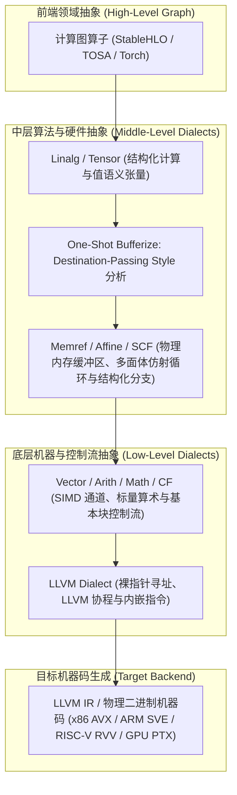

---

## 二、MLIR 的物理细胞：Operation 结构解剖、Location 与 Traits/Interfaces

在官方文档 [LangRef (MLIR Language Reference)](https://mlir.llvm.org/docs/LangRef/) 中，MLIR 的整个世界是由 **Operation（操作）** 递归构成的。理解 Operation 的结构是读懂任何 MLIR 代码的第一步。

### 1. Operation 的通用语法解剖

MLIR 中无论是顶层模块 `builtin.module`、函数 `func.func`，还是简单的加法 `arith.addi`，其底层通用文本表示（Generic Form）完全统一：

```mlir
// 通用语法形式:
// %results = "dialect.op_name"(%operands) [successors] (regions) {attributes} : function-type loc(location)

%res:2 = "toy.custom_op"(%arg0, %arg1) [^bb1, ^bb2] ({
  ^bb_inner(%inner_arg: i32):
    "toy.yield"(%inner_arg) : (i32) -> ()
}) {fastmath = true, stride = 2 : i32} : (f32, i32) -> (i64, f64) loc("model.py":42:10)
```

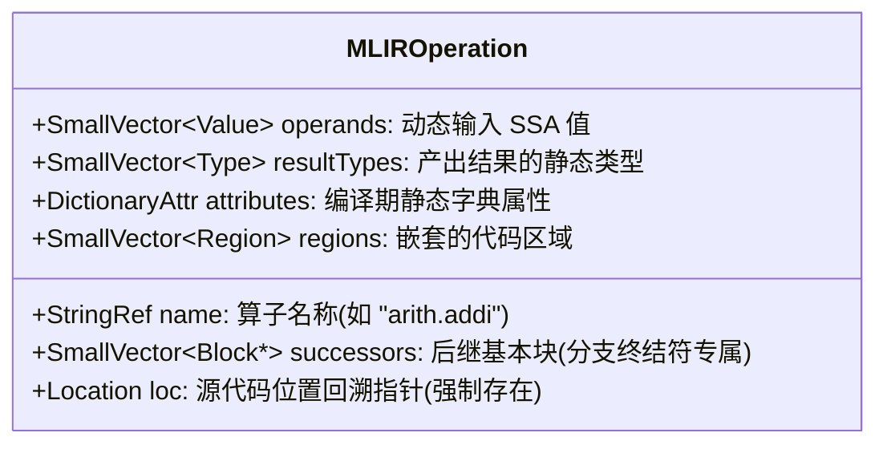

- **`%res:2`**：该 Op 产生的 SSA 结果值（Result），可以返回 0 个、1 个或多个值。
- **`"dialect.op_name"`**：带命名空间的 Op 名称。
- **`(%arg0, %arg1)`**：操作数（Operands），必须是已在外部定义且当前可见的动态 SSA Value。
- **`{fastmath = true, stride = 2 : i32}`**：属性字典（Attributes），编译期完全固化，不占用运行时寄存器。
- **`regions`**：包含的 Region 嵌套体，用于封装子控制流或运算逻辑。
- **`loc(...)`**：位置信息。

> [!IMPORTANT] 为什么 MLIR 强制要求每一个 Operation 都必须携带 Location？
> 在传统编译器中，经过多次 Pass 优化后，Debug 信息常常丢失或错乱，导致最终生成机器码出错时无法定位源头。
> MLIR 将 `Location` 提升为一等公民（First-Class Entity）：每一个重写 Pattern 在生成新 Op 时，必须显式传递 Location（如 `rewriter.create<arith::AddIOp>(loc, ...)`）。
> MLIR 支持丰富的位置表示：
> - `FileLineColLoc`：文件名、行号、列号（如 `"foo.py":12:4`）；
> - `CallSiteLoc`：记录函数调用堆栈；
> - `FusedLoc`：当多个算子被融合为一个算子时，将多个源位置融合绑定；
> - `NameLoc`：附带用户可读命名标识。

---

### 2. Traits（静态特征）与 Interfaces（动态接口）：解决多态爆炸

在面向对象编程中，若想让数百个算子具备某种通用能力，传统的继承类层次往往会导致深不见底的菱形继承与虚表膨胀。MLIR 创新性地引入了 **Traits** 与 **Interfaces**。

#### ① Traits（特征）
Trait 是算子拥有的静态声明式标记，直接注入在算子的 TableGen（ODS）定义中：
- **`SameOperandsAndResultType`**：声明该 Op 的所有操作数与所有返回值的类型必须严格一致；
- **`Commutative`**：满足交换律（例如加法 $a + b = b + a$），规范化 Pass 会自动将操作数按 SSA 编号排序，简化后续匹配；
- **`IsolatedFromAbove`**：**最重要的作用域隔离特征**！声明该 Operation 内部包含的 Region **绝不能隐式访问外部的作用域变量**。例如，`func.func` 拥有此 Trait，因此函数内部不能随随便便抓取函数外的 SSA 值；而 `scf.for` 没有此 Trait，循环体内可以自由捕获外层定义的变量。
- **`SingleBlockImplicitTerminator<"yield">`**：声明该 Op 内部的 Region 只能有单一 Block，且如果省略终结符，默认以 `yield` 结尾。

#### ② Interfaces（接口）
Interface 是 MLIR 实现跨方言通信的动态多态桥梁：
- **`OpInterface`**：例如 `MemoryEffectsOpInterface`（查询 Op 是否具有内存读写副作用）、`DestinationStyleOpInterface`（声明算子是否支持目标传递风格）、`BufferizableOpInterface`（参与 One-Shot Bufferize 内存分配）；
- **`TypeInterface` / `AttrInterface`**：类型或属性的抽象行为接口。

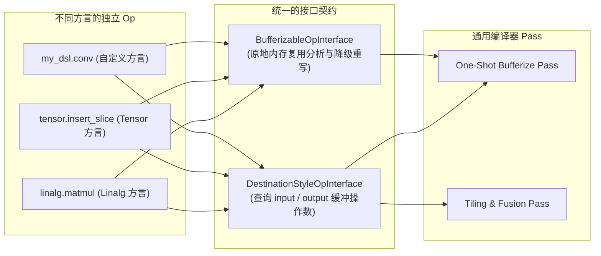

---

## 三、MLIR 类型系统三层观与核心基础方言全景

在 MLIR 中，“某个方言支持哪些数据类型”必须从官方规范界定的**三层认知透镜**来剖析：

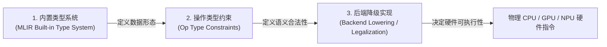

1. **第一层：MLIR 内置类型系统（Built-in Types）**：语法上允许构造哪些类型（如 `i32`、`f32`、`memref<...>`、`f8E4M3FN`）。
2. **第二层：特定 Dialect 特定 Op 的类型约束（Type Constraints）**：Op 的 Verifier 校验器允许哪些输入输出（例如加法 `arith.addf` 仅限浮点，`arith.addi` 仅限整型）。
3. **第三层：后端 Lowering / 代码生成的物理支持**：Verifier 即使放行，如果目标硬件缺少底层指令，仍需通过 Pass 转换合法化（Legalize）。

### 1. MLIR 常见核心内置类型详表

| 类型类别 | MLIR 语法标识 | 典型语法示例 | 底层物理语义与注意事项 |
|---|---|---|---|
| **Signless 整型** | `i1` ~ `i128` (任意位宽) | `%x = arith.constant 42 : i32` | 默认无符号印记，补码运算，ALU 电路直接对应 |
| **Signed / Unsigned 整型** | `si8`, `ui8`, `si32`, `ui32` | `%y = ... : ui32` | 显式标记符号，仅在特定接口与转换算子中使用 |
| **标准浮点** | `f16`, `bf16`, `f32`, `f64` | `tensor<4x8xf32>` | 覆盖 IEEE 754 标准与深度学习主流精度 |
| **微缩低精度浮点** | `f8E4M3FN`, `f8E5M2`, `f4`, `f6` | `tensor<128xbf16, f8E4M3FN>` | 针对现代大模型 FP8/FP4 矩阵乘加速核 |
| **平台索引类型** | `index` | `%idx = arith.constant 0 : index` | 专门用于循环下标、维度寻址，位宽与目标硬件平台裸指针等宽 |
| **复数类型** | `complex<f32>`, `complex<f64>` | `%c = ... : complex<f32>` | 实部与虚部组合，算术运算路由到 `complex` 方言 |
| **量化数据类型** | `!quant.uniform<i8:f32, 0.034:12>` | `%q = ... : !quant.uniform` | 携带缩放因子（Scale）和零点偏移（Zero-point）的定点表示 |
| **张量 (Tensor)** | `tensor<4x8xf32>`, `tensor<?x?xf32>` | 高维不可变数组值 | 值语义，支持动态维度 `?` 与无秩 `tensor<*xf32>` |
| **内存引用 (MemRef)** | `memref<16x16xf32, strided<...>, 1>` | 物理内存缓冲区视图 | 引用语义，含物理地址、跨步（Strides）、存储空间（Memory Space） |
| **向量 (Vector)** | `vector<4xf32>`, `vector<[4]xf32>` | 硬件寄存器级 SIMD/VLA | 直接映射到硬件向量通道，`[4]` 代表可伸缩向量 (Scalable Vector) |

---

### 2. 深入辨析：MemRef 的跨步布局（Strided Layout）与内存空间（Memory Space）

官方文档 [MemRef Dialect](https://mlir.llvm.org/docs/Dialects/MemRef/) 中，`memref` 的完整形态远比普通 C 语言指针丰富：

```mlir
// 语法：memref< 形状 x 元素类型, 布局映射, 存储空间 >
memref<4x8xf32, strided<[16, 2], offset: 0>, 1>
```

- **`strided<[16, 2], offset: 0>`**：
  物理跨步布局。表示第 0 维前进 1 个步长，在内存指针上跨越 16 个元素；第 1 维前进 1 个步长，跨越 2 个元素。这种抽象能够以极小代价零拷贝表达**子视图切片（`memref.subview`）、矩阵转置与非连续内存提取**！
- **`Memory Space`（存储空间）**：
  数字 `1` 或属性（如 `#gpu.address_space<workgroup>`）。用来精准区分当前内存到底是位于全局 DDR、CPU 栈空间（`memref.alloca`）、GPU 共享内存（Shared Memory），还是 NPU 片上 Scratchpad SRAM！

---

### 3. 三大核心基础 Dialect 的类型约束与设计哲学

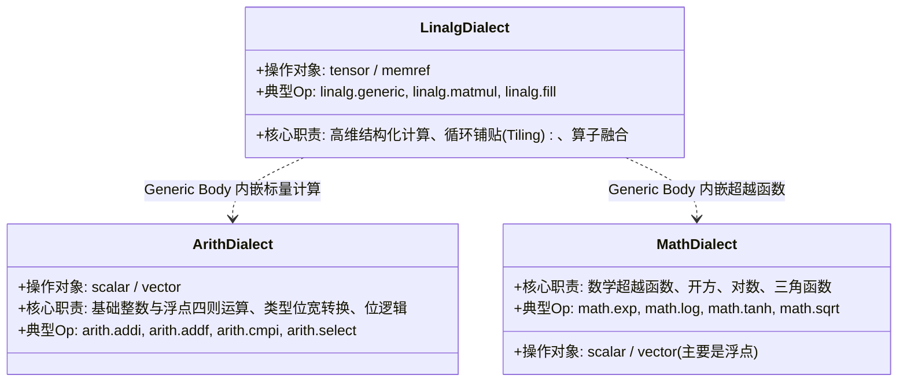

#### ① `linalg`：操作容器与结构化计算
- **不定义任何独立的标量类型**：它只操作多维容器 `tensor` 与 `memref`。
- **`linalg.generic` 类型极其开放**：其内部包裹一个标量计算区域（Region），只要区域内使用的标量算子（来自 `arith`、`math`、`complex`）类型合法，`linalg.generic` 即可成立：
  ```mlir
  linalg.generic {
    indexing_maps = [affine_map<(d0) -> (d0)>, affine_map<(d0) -> (d0)>],
    iterator_types = ["parallel"]
  } ins(%in : tensor<8xf32>) outs(%out : tensor<8xf32>) {
  ^bb0(%arg0: f32, %arg1: f32):
    %0 = math.tanh %arg0 : f32
    linalg.yield %0 : f32
  }
  ```
- **命名算子的严格限制**：像 `linalg.matmul`、`linalg.conv_2d_*` 等特定算法 Op，通常限定为数值类型（整型、浮点型），部分算子支持复数；非数值类型（如自定义结构体）无法直接参与命名矩阵乘。

#### ② `arith`：标量与向量的代数运算与类型转换
- **面向 Scalar 与 Vector**：核心二元运算（如 `arith.addi`, `arith.mulf`）不支持直接操作 `tensor`！不能写 `%c = arith.addf %a, %b : tensor<4xf32>`。张量级元素加法必须通过 `linalg.generic` 或 `linalg.add` 表达。
- **丰富的类型转换算子集**：
  - 整型与浮点互转：`arith.sitofp` (有符号整型转浮点), `arith.uitofp`, `arith.fptosi`, `arith.fptoui`；
  - 位宽延伸与截断：`arith.extsi` (符号扩展), `arith.extui` (零扩展), `arith.trunci` (整型截断), `arith.extf` (浮点升精度), `arith.truncf` (浮点降精度)；
  - 索引与指针映射：`arith.index_cast` (在 `index` 与 `i64/i32` 之间转换)；
  - 位模式重解释：`arith.bitcast` (保持底层二进制不变，重解释类型，如将 `i32` 看作 `f32`)。

#### ③ `math`：浮点超越函数专精
- 专精于浮点数学库函数（`exp`, `log`, `log2`, `sin`, `cos`, `tanh`, `sqrt`, `rsqrt`, `erf` 等）；
- 核心操作对象为浮点标量与浮点向量（`f16`, `bf16`, `f32`, `f64`, `vector<Nxf32>`）；
- 包含少量针对整数的高效位计算（如 `math.ipowi` 整数幂、`math.ctlz` 前导零计数）；
- 不直接处理 `complex` 复数（复数必须路由至 `complex` 方言）。

---

## 四、值语义 vs 引用语义：`tensor` 与 `memref` 的本质对决与 Destination-Passing Style

在 MLIR 中，`tensor<...>` 和 `memref<...>` 都能表达多维数组，但它们的计算机科学内涵天差地别。

### 1. 核心差异全维度对照表

| 对比维度 | `tensor<...>` (张量) | `memref<...>` (内存引用) |
|---|---|---|
| **计算机语义** | **值语义 (Value Semantics)**，代表纯粹的数学数组值 | **引用语义 (Reference Semantics)**，代表具体的物理内存缓冲区描述符 |
| **可变性 (Mutability)** | **不可变 (Immutable)**，每一个 SSA Value 赋值后永不改变 | **可变 (Mutable)**，指向的底层物理内存可随时被 load/store |
| **副作用 (Side Effect)** | **无内存副作用**，纯粹的输入到输出的函数式映射 | **具有显著副作用**，alloc/dealloc 分配释放，store 改变内存 |
| **物理内存位置** | 概念抽象，**不对应具体物理地址**（不知道分配在栈还是堆） | 明确包含底层指针、基址偏移（Offset）、各维大小与跨步（Strides）、存储空间（Memory Space） |
| **别名风险 (Aliasing)** | **无别名**，SSA 体系下变量互不干扰 | **存在别名风险**，多个 memref 可能切片指向同一片重叠内存 |
| **编译器优化难度** | **极易优化**（算子融合 Fusion、死代码消除 DCE、公共子表达式消除 CSE） | **优化受限**（必须先做别名分析与读写依赖冲突检测） |
| **所属编译阶段** | 编译流水线**前端与中层**（Bufferization 之前） | 编译流水线**底层**（Bufferization 之后，直通 LLVM / GPU） |

---

### 2. 什么是“副作用（Side Effect）”？为什么编译器如此敬畏它？

> **副作用（Side Effect）的严格定义**：
> 一个操作除了产生它声明的返回值之外，如果还**改变了程序运行时的其他状态**，或者**对外部世界产生了可被察觉的影响**，那么这个操作就带有副作用。

```c
// 1. 无副作用的纯函数 (Pure Function)
int add(int a, int b) {
    return a + b; // 只要 a, b 相同，输出恒定；外部内存与硬件毫无改变
}

// 2. 带有显著副作用的函数
int g_counter = 0;
int add_and_record(int a, int b, int *history_buffer) {
    g_counter++;                  // 副作用1：修改了全局变量
    *history_buffer = a + b;      // 副作用2：向传入指针写内存
    printf("Result: %d\n", a+b);  // 副作用3：向控制台做 I/O 输出
    return a + b;
}
```

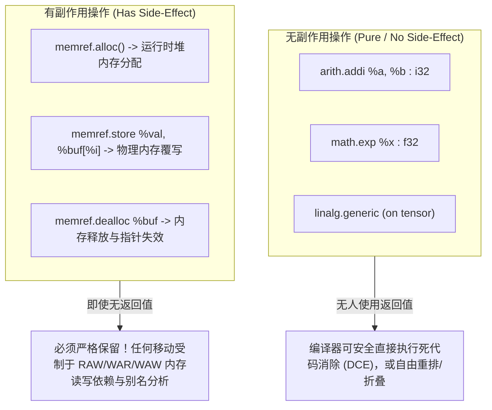

#### 编译器对副作用的优化原则：
1. **死代码消除（DCE）**：若 `%res = arith.addi %a, %b` 的结果后续未被使用，编译器可直接连根拔起抹去该行；但 `memref.store` 即使没有任何返回值，也绝对不能擦除！
2. **算子重排与融合（Fusion）**：纯函数式张量计算 `%t2 = linalg.matmul ins(%t1)` 可以随时与消费者算子融合，消除中间临时存储；然而一旦变成带副作用的内存写入，就必须验证两段内存是否有地址别名（Alias）和依赖冲突（Read-after-Write, Write-after-Read）。

---

### 3. 目标传递风格（Destination-Passing Style, DPS）

由于张量在数学上不可修改，当我们想把一个 $4 \times 4$ 小矩阵写入一个 $100 \times 100$ 大矩阵的局部时，纯函数式语法必须返回一个**全新的完整大矩阵**：

```mlir
// 目标传递风格 (Destination-Passing Style)
%result = tensor.insert_slice %sub into %dest[0, 0] [4, 4] [1, 1] 
    : tensor<4x4xf32> into tensor<100x100xf32>
```

在 MLIR 的 [Bufferization 规范](https://mlir.llvm.org/docs/Bufferization/) 中，算子通过实现 `DestinationStyleOpInterface`，将“预期存放结果的容器”显式作为操作数传入（如 `linalg.matmul ins(...) outs(%init_tensor)`）。
- **非 DPS 算子（如 `tensor.generate`）**：bufferize 时必须强制分配全新物理内存；
- **DPS 算子**：驱动通过分析能够发现 `outs` 操作数与输出结果存在潜在别名，从而**直接原地覆写（In-place Write）已有的物理内存，实现 0 内存开销的高性能降级**！

---

### 4. 经典案例解密：MLIR LangRef 中的 `@mul` 与 `@multiply`

在官方文档中，展示了两个矩阵乘法函数，展现了 MLIR **多层抽象混合（Multi-Level Abstraction）** 的绝妙设计：

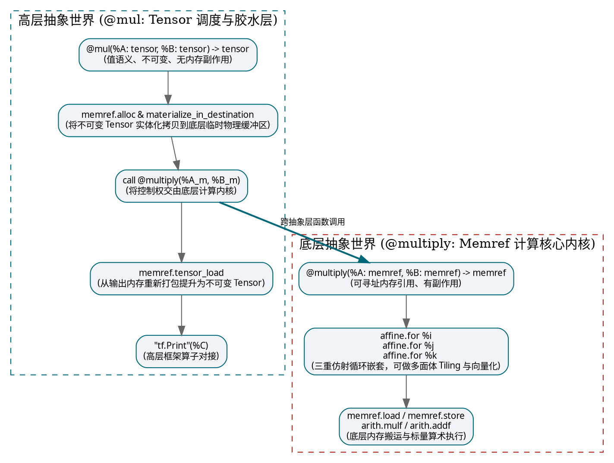

- **`@mul`（Tensor 调度层）**：只负责将上层框架的不可变张量数据**物化下沉**到内存，并在计算完毕后将其重新**封装提升**为张量交付给外部；
- **`@multiply`（MemRef 内核层）**：压根不关心张量概念，直接在硬件指针与多维内存块上，利用仿射循环 `affine.for` 执行最高效的内存读写与算术指令。

---

## 五、自动化 Bufferization 架构：One-Shot Bufferize 深度内幕

在实际工业工程中，**我们绝对不需要手工去写 `memref.alloc` 和 `memref.dealloc`**。MLIR 内置了功能强大的自动化转化流水线：**One-Shot Bufferize**。

```mermaid
sequenceDiagram
    autonumber
    participant Dev as 开发者输入 (Tensor IR)
    participant OSB as One-Shot Bufferize
    participant Dealloc as Buffer Deallocation Pipeline
    participant Out as 最终输出 (Memref IR)

    Dev->>OSB: 提交 Destination-Passing Style 的张量计算
    Note over OSB: 阶段 1: 静态依赖分析 (In-Place Analysis)<br/>遍历 SSA Use-Def 链，构建别名集合与等价类集合，<br/>运行 RaW (Read-after-Write) 冲突检测算法
    Note over OSB: 阶段 2: 内存缓冲区物理重写 (Rewrite)<br/>无冲突操作数直接原地复用缓冲区 (In-place);<br/>仅在存在 RaW 冲突时精准插入 memref.alloc 与 copy
    OSB->>Dealloc: 交付已完全 Memref 化的中间代码
    Note over Dealloc: 基于所有权模型 (Ownership-based) 遍历作用域，<br/>精准插入 memref.dealloc，根治内存泄漏
    Dealloc->>Out: 交付具备高效内存利用率的底层机器就绪代码
```

### 1. `BufferizableOpInterface` 的五大核心查询协议

任何方言的算子若想无缝参与到 One-Shot Bufferize 中，只需实现 `BufferizableOpInterface` 接口：
1. **`bufferizesToMemoryRead(OpOperand)`**：该操作数是否会触发底层内存读取？
2. **`bufferizesToMemoryWrite(OpOperand)`**：该操作数是否会被原地修改覆写？
3. **`getAliasingOpResult(OpOperand)`**：该输入操作数与哪一个输出结果共享底层同一块内存？
4. **`bufferRelation(OpOperand)`**：别名关系是绝对等价（`Equivalent`）还是仅仅非互斥？
5. **`bufferize(Rewriter)`**：具体的重写动作——将当前 Tensor Op 抹去，换成对应的 MemRef 指令。

---

## 六、MLIR 的结构骨架：Block、Region、Terminator 与控制流全景

MLIR 的语法之所以极度规整，是因为它基于高度统一的递归嵌套模型：**Operation 套 Region，Region 套 Block，Block 装 Operation**。

```
Operation (如 func.func)
  └── Region (代码区域，用花括号 { } 包裹)
        ├── Block 0 (如 ^bb0: 入口基本块)
        │     ├── Operation 1
        │     ├── Operation 2
        │     └── Terminator Operation (如 cf.cond_br, return)
        └── Block 1 (如 ^bb1: 分支基本块)
              ├── Operation 3
              └── Terminator Operation
```

### 1. 结构三要素定义速查

#### ① Block（基本块）
语法规范：
```text
block       ::= block-label operation+
block-label ::= `^` block-name `(` block-argument-list? `)` `:`
```
- 以 `^` 开头命名的顺序执行单元（如 `^bb0`, `^bb1`）；
- 内部的操作**严格从上到下顺序执行**，中途绝不允许跳转进出；
- **最后一个操作必须是 Terminator**。

#### ② Terminator Operation（终结符操作）
- 位于 Block 末尾，专门解答：**“当前块跑完了，下一步该去哪？”**
- 常见终结符：
  - `cf.br ^bbX(...)`：无条件分支跳转到同 Region 的另一个块；
  - `cf.cond_br %cond, ^bb1, ^bb2`：根据布尔条件进行双向分支；
  - `func.return %val`：离开当前 Region，把计算值交还给外层调用方；
  - `scf.yield %val`：从循环或分支块中产出当前迭代的数值；
  - `ub.unreachable`：声明控制流在此终止（异常或未定义行为分支）。
- **特例声明**：具有 `NoTerminator` Trait 的 Operation（例如顶层 `builtin.module`），其内部 Block 允许没有终结符。

#### ③ SSACFG Region vs Graph Region
Region 是装载 Block 的容器。MLIR 支持两种截然相反语义的 Region：

| 特性 | SSACFG Region (控制流图区域) | Graph Region (图状并发区域) |
|---|---|---|
| **控制流机制** | 存在明确控制流，Block 之间通过分支跳转连接成图 | **完全不存在控制流跳转**，只建模并发与数据流 |
| **包含 Block 数量** | 允许包含**任意多个** Block（`^bb0`, `^bb1`, ...） | **仅允许单个 Block**（通常只有一个入口块） |
| **代码执行顺序** | **从上到下顺序执行**，代码先后顺序具备严格时间语义 | **代码编写顺序完全无意义**，可以随意重排或规范化 |
| **值的可见性** | 严格遵循**支配关系（Dominance）**，未定义不可使用 | **所有值全局相互可见**，支持任意循环引用与自环 |
| **典型应用场景** | 传统函数体（`func.func`）、条件分支（`scf.if`） | 硬件电路描述（CIRCT 方言）、数据流任务并发 |

---

### 2. Block Argument：彻底淘汰 LLVM PHI 节点的革命设计

在传统经典 LLVM IR 中，分支汇聚必须使用虚拟的 `phi` 指令：

```llvm
; 经典 LLVM IR: PHI 节点作为特殊的伪指令硬塞在 Basic Block 头部
bb3:
  %val = phi i64 [ %a, %bb1 ], [ %b, %bb2 ]
```

这种机制在编译器做控制流分裂、合并或内联时极其容易破坏支配树，维护成本极高。

**MLIR 采用了一套极其优雅的解法：Block Argument（基本块参数）！**

```mlir
func.func @simple(%cond: i1, %a: i64) -> i64 {
^bb0:
  cf.cond_br %cond, ^bb1, ^bb2

^bb1:
  cf.br ^bb3(%a : i64)          // 把 %a 作为实参传给 ^bb3

^bb2:
  %b = arith.addi %a, %a : i64
  cf.br ^bb3(%b : i64)          // 把 %b 作为实参传给 ^bb3

// ^bb3 声明了一个形参 %c！完全不需要伪指令 PHI 节点！
^bb3(%c: i64):
  return %c : i64
}
```

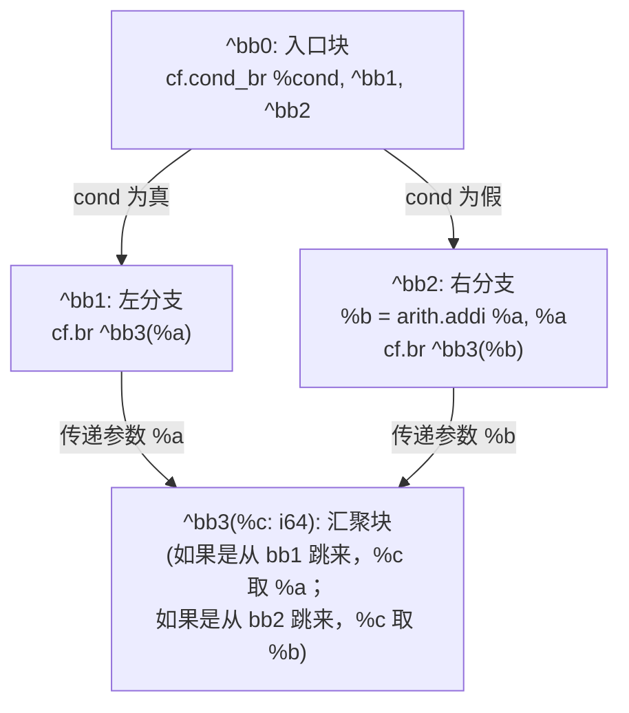

> [!IMPORTANT] 彻底参透这一设计法则：
> **“Region 入口 Block 的 Block Argument，就是 Region 自身的形参！”**
>
> 在 MLIR 中，Region **压根不需要定义独立的形参列表**。
> `func.func @foo(%x: i32)` 中声明的函数形参，在 MLIR 底层 IR 结构中，就是该函数 Region 第一个基本块 `^bb0(%x: i32)` 的 Block Argument！
> 外部调用者向函数传参，本质上就是在向入口块的 Block Argument 绑定数值。这一设计消除了语法冗余，使得函数调用、块间跳转与循环迭代参数拥有了完全统一的底层数据结构。

---

### 3. 作用域与支配关系（Dominance）

在包含嵌套 Region 的代码中，变量的作用域遵循类似传统编程语言的“闭包与作用域”铁律：

```mlir
func.func @accelerator_compute(%a: i64, %cond: i1) -> i64 {
^bb0:
  cf.cond_br %cond, ^bb1, ^bb2

^bb1:
  %value = "op.convert"(%a) : (i64) -> i64
  cf.br ^bb3(%a: i64)

^bb2:
  accelerator.launch() {
    ^bb_inner:
      // ✅ 合法：能够安全读取 %a，因为 %a 位于外层入口块，支配了整个函数
      // ❌ 非法：绝对不能读取 %value！因为 %value 定义在平级分支 ^bb1 中，并不支配 ^bb2
      %new_val = "accelerator.compute"(%a) : (i64) -> ()
  }
  // ❌ 非法：在 accelerator.launch 外面绝不能访问 %new_val！
  // 铁律：嵌套 Region 内部生成的值，绝不能逃逸到 Region 外部使用！

^bb3(%c: i64):
  return %c : i64
}
```

---

## 七、MLIR 原生异步机制：`async` Dialect 与 LLVM 协程降级

随着异构加速计算的发展，任务往往需要在主机端 CPU 与设备端加速器之间非阻塞并行流转。MLIR 原生提供了 `async` Dialect。

### 1. 异步编程三剑客类型

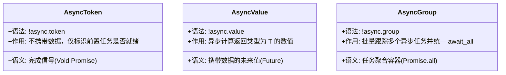

---

### 2. 实战演练：双路并发与合并等待

```mlir
func.func @parallel_add(%a: f32, %b: f32) -> f32 {
  // 1. 启动第一个异步任务：计算 a * a
  %tok1, %val1 = async.execute -> (f32) {
    %r1 = arith.mulf %a, %a : f32
    async.yield %r1 : f32
  }

  // 2. 启动第二个异步任务：计算 b * b (与任务 1 并发执行)
  %tok2, %val2 = async.execute -> (f32) {
    %r2 = arith.mulf %b, %b : f32
    async.yield %r2 : f32
  }

  // 3. 非阻塞或阻塞等待结果产出
  %v1 = async.await %val1 : !async.value<f32>
  %v2 = async.await %val2 : !async.value<f32>

  // 4. 合并相加
  %sum = arith.addf %v1, %v2 : f32
  return %sum : f32
}
```

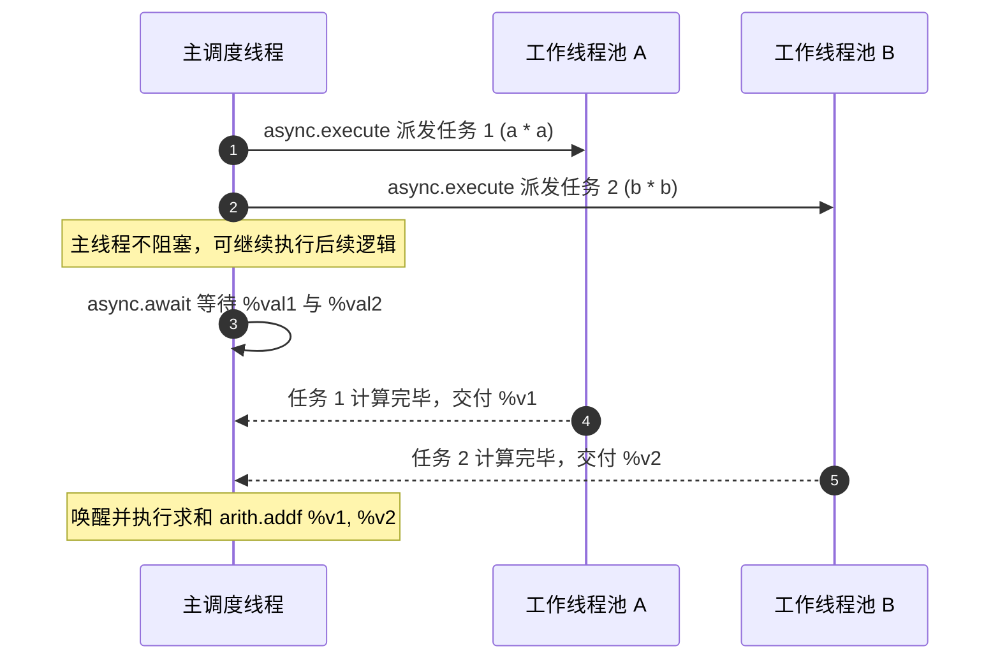

---

### 3. 底层 Lowering 核心：LLVM 协程状态机拆分（CoroSplit）

MLIR 的 `async` 并不是一门独立的虚拟运行时语言，它最终会通过 `async-to-llvm` 编译下降为 **LLVM 官方的协程指令集（LLVM Coroutines）**：

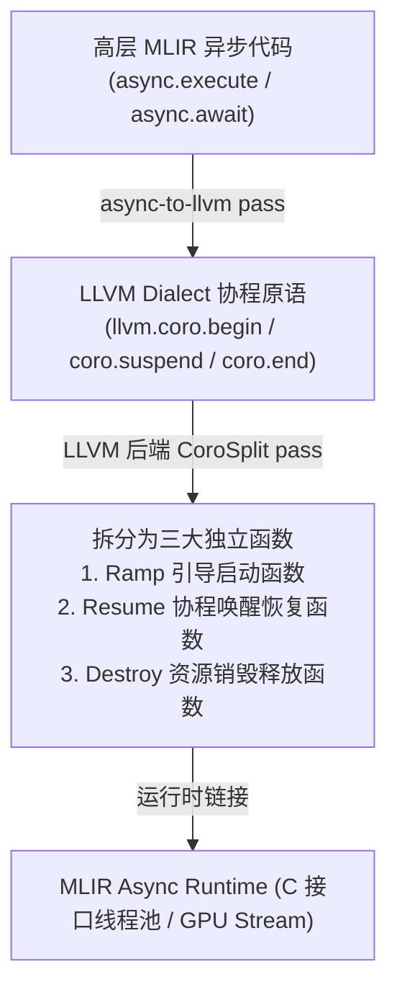

当程序执行到 `async.await` 时，底层并不是死循环空转或挂死线程，而是**通过 `llvm.coro.suspend` 自动把当前函数的调用栈现场打包保存到堆上的协程帧中，立即让出当前 CPU 核心**；当异步任务真正执行完成时，运行时环境（Async Runtime）在某个可用工作线程上调用 `Resume` 函数，无缝恢复现场继续执行。

---

## 八、方言转换框架（Dialect Conversion）：底层机制与降级哲学

官方文档 [Dialect Conversion Architecture](https://mlir.llvm.org/docs/DialectConversion/) 是整个 MLIR 编译系统的“中央调度中枢”，负责将高层方言有计划、可控地降级为低层方言。

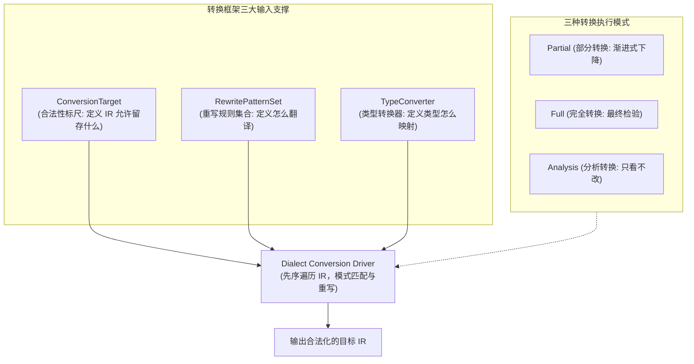

### 1. 三大核心支撑组件

#### ① ConversionTarget（目标合法性标尺）
它回答一个关键问题：**“在我的转换目标里，哪些 Op 可以保留？哪些必须彻底消灭？”**
- **Legal（合法）**：
  `target.addLegalDialect<LLVMDialect>()`
  该方言的所有 Op 都被认可，原样保留，编译器跳过不再重写。
- **Dynamic（动态合法）**：
  `target.addDynamicallyLegalOp<arith::AddIOp>([](auto op) { ... })`
  只有满足指定回调条件的实例才合法（例如：只允许操作 32 位整型的加法存在）。
- **Illegal（非法）**：
  `target.addIllegalDialect<LinalgDialect>()`
  绝对不容忍存在！如果转换流水线结束时还有该 Op 残留，转换宣告失败。
- **Unknown（未知）**：
  未做任何声明的方言。在 Partial 模式下允许保留，在 Full 模式下视为非法。

#### ② RewritePatternSet（重写模式集合）
具体的翻译字典。当框架遇到一个 Illegal 或 Unknown Op 时，从集合中寻找匹配的 Pattern，将其替换为合法的新 Op。

#### ③ TypeConverter（类型转换器）
负责源类型与目标类型之间的映射规则（例如将所有的 `tensor` 转换为 `memref`，或将浮点精度由 `f32` 缩微映射为 `i32`）。

---

### 2. 转换模式的选择：何时用 Partial，何时用 Full？

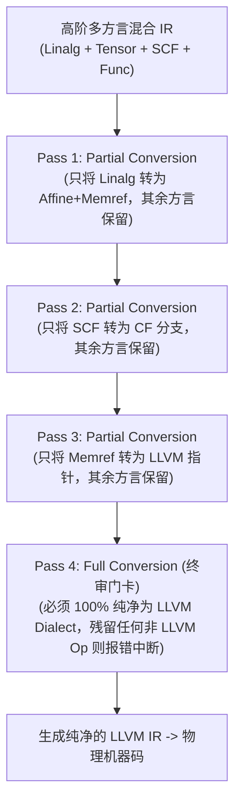

| 转换模式 | API 接口 | 核心行为 | 适用典型阶段 |
|---|---|---|---|
| **部分转换 (Partial)** | `applyPartialConversion` | 尽力而为。非法 Op 尝试重写，未知 Op 允许保留 | 复杂流水线的中间步骤，允许多种抽象共存 |
| **完全转换 (Full)** | `applyFullConversion` | 极度严格。所有 Op 必须在 Target 上证明合法，任何残留即刻报错 | 编译降级的最终出口（如导出到 LLVM IR 前） |
| **分析转换 (Analysis)** | `applyAnalysisConversion` | 只做模拟分析，**绝对不修改 IR**，产出合法化报告 | 调试排错、前端可行性检查、预先路径评估 |

---

### 3. 递归合法性（Recursive Legality）：信任边界机制

在大型复杂函数中，常常出现某些 Operation 内部嵌套着深厚的 Region：

```mlir
func.func @heavy_kernel() {
  scf.for %i = ... {
    linalg.matmul ... // 假设全局已将 linalg 标记为 Illegal
  }
}
```

在默认情况下，驱动框架会**像海关翻箱倒柜一样钻进每一层 Region 的最深处**。一旦发现 `linalg.matmul` 未被降级，整个 Pass 就会报错。

但如果你手动编写了一个高度优化的底层特定内核，或者当前 Pass 阶段压根不希望框架去触碰某个 Op 肚子里的实现，你可以声明**递归合法性**：

```cpp
// 1. 声明该 Op 本身合法
target.addLegalOp<scf::ForOp>();

// 2. 授予该 Op "外交豁免权"：它肚子里的所有子 Op 全部免检！
target.markOpRecursivelyLegal<scf::ForOp>();
```

> **形象比喻**：
> - **普通合法**：旅客本人身份合格，但他的行李箱必须打开，里面的每一件物品都要过安检机检查。
> - **递归合法（外交豁免）**：旅客本人身份尊贵，免予开箱检查，他箱子里的所有物品不管是什么，一律免检直接通行！

---

## 九、Conversion Pattern 的 Adaptor 机制与回滚/无回滚模式深度调试

编写 Conversion Pattern 时，最让初学者困惑的莫过于 `matchAndRewrite` 钩子接收的两个参数：`Operation *op` 与 `OpAdaptor adaptor`。

```cpp
LogicalResult matchAndRewrite(
    MyOp op,
    OpAdaptor adaptor, // <-- 这到底和 op 有什么区别？
    ConversionPatternRewriter &rewriter) const override;
```

### 1. Adaptor（重映射操作数）的本质解密

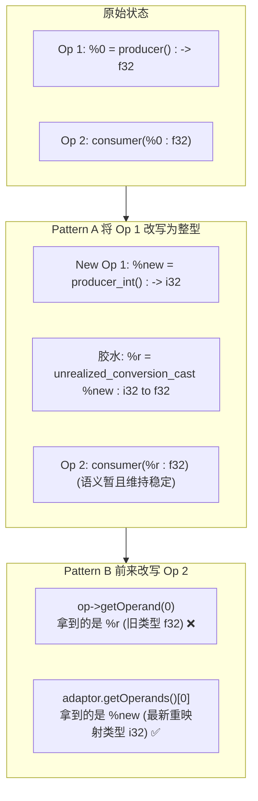

- **问题根源**：在流水线重写过程中，前面的 Pattern 可能已经改变了某个 SSA 值的类型（例如从 `f32` 变为了 `i32`）。但为了维持 IR 临时的类型安全，框架会自动插入一个胶水操作 `builtin.unrealized_conversion_cast`。
- **获取真相**：
  - 如果你通过 `op->getOperand(0)` 查询，你拿到的是胶水返回的过时旧类型；
  - 如果你通过 `adaptor.getOperands()[0]` 查询，**Adaptor 像移动运营商一样，为你追踪到了最新的替换号码**，直接返回最新生成的 `i32` 值！
- **黄金铁律**：在任何带类型转换的 `ConversionPattern` 中，**获取输入操作数必须永远通过 `adaptor`，获取属性（Attributes）则可以直接从 `op` 读取**！

---

### 2. 回滚模式（Rollback）vs 无回滚模式（No-Rollback）

Dialect Conversion 驱动允许以两种截然不同的策略管理 IR 修改：

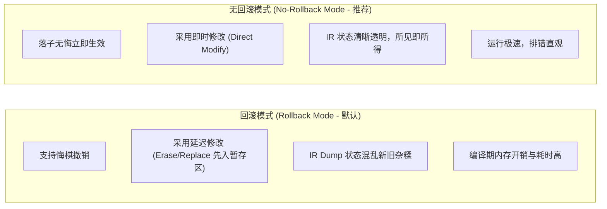

| 行为差异 | 回滚模式 (Rollback Mode) | 无回滚模式 (No-Rollback Mode) |
|---|---|---|
| **核心机制** | 记录庞大的 C++ 撤销账本，重写失败时可回退 | 所有的 IR 增删改查立即反映到实际数据结构上 |
| **`rewriter.eraseOp()`** | **延迟擦除**。Op 依然停留在 IR 遍历中，打上删除标签 | **立即销毁**。Op 瞬间脱离链表并释放 |
| **`rewriter.replaceOp()`** | **延迟更新引用**。转换结束前旧的使用者仍存在 | **立即更新**。直接替换所有 SSA 引用关系 |
| **调试体验** | **极差**。Dump IR 时能看到新旧两套算子诡异并存，连接逻辑隐匿于 C++ 内存中 | **极佳**。每次 Dump 出来的都是百分百真实的当前状态 |
| **工业界最佳实践** | 适合高度试验性、容错冗余的大型模糊探索流水线 | **现代实践强烈推荐！** 配合前置静态检查，高效稳定 |

---

### 3. 无回滚模式的专业调试指南

在无回滚模式下，由于“落子无悔”，调试的关键就在于：**“预检先行、日志跟踪、用例精简”**。

```bash
# 1. 开启方言转换全过程专属日志，追踪每一个 Pattern 的匹配细节
mlir-opt input.mlir \
  --my-conversion-pass \
  --debug-only=dialect-conversion

# 2. 开启差异化 IR 打印：只有当 IR 发生真实篡改时才打印快照，避免终端刷屏
mlir-opt input.mlir \
  --my-conversion-pass \
  --mlir-print-ir-after-change

# 3. 当遇到合法化失败时，精准输出 C++ 内部报错堆栈
mlir-opt input.mlir \
  --my-conversion-pass \
  --mlir-print-stacktrace-on-diagnostic

# 4. 关闭多线程并发，让所有调试日志按单一时间线严格单调输出
mlir-opt input.mlir \
  --my-conversion-pass \
  --mlir-disable-threading

# 5. 遭遇诡异崩溃？利用官方神器 mlir-reduce 自动进行二分法缩减！
# 它会自动化删减无关 Op，将上千行的 IR 自动精简为 10 行最小可复现用例！
mlir-reduce input.mlir \
  --pass-pipeline="builtin.module(my-conversion-pass)" \
  -o minimal_reproduce.mlir
```

---

## 十、类型安全（Type Safety）与三类物化（Materialization）机制终极解密

在官方 [Dialect Conversion Type Safety](https://mlir.llvm.org/docs/DialectConversion/#type-safety) 文档中，“转换（Conversion）”与“物化（Materialization）”是最容易混淆的一对孪生兄弟。

### 1. 概念界定：汇率表 vs 去银行换钱

```
类型转换 (Conversion) = 查汇率表 (1 美元 = 7.2 人民币)
  -> 纯逻辑映射规则，绝对不会在 IR 中生成任何新指令！

类型物化 (Materialization) = 实际去银行开具交易单把美元换成人民币现钞
  -> 在 IR 中真正插入显式的类型转换/桥接操作 (如 unrealized_conversion_cast)！
```

---

### 2. 三种物化类型：Source、Target 与 Argument Materialization

根据官方文档界定，物化精确分为三种情形：

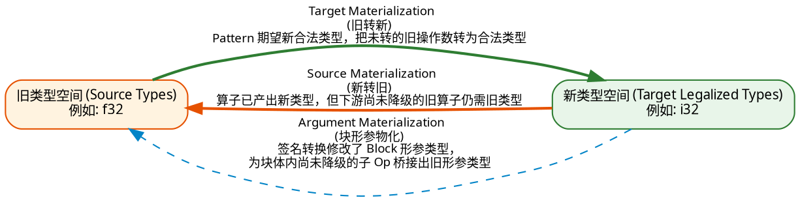

#### ① Target Materialization（目标物化：旧 $\rightarrow$ 新）
- **触发情境**：新的 Pattern 准备处理算子 `consumer`，该 Pattern 声明自己只接收合法化的新类型（如 `i32`）；然而，上游输入 `%a` 目前由于尚未转换，仍然是一个 `f32`。
- **驱动行为**：框架自动调用 `addTargetMaterialization` 回调，将 `f32` 强制转为 `i32` 喂给 Pattern，确保 Pattern 的类型安全性。

#### ② Source Materialization（源物化：新 $\rightarrow$ 旧）
- **触发情境**：上游的 `producer` 已经被成功改写，产出了全新类型 `i32`；但是，下游还存在好几个由于顺序问题尚未被转换的旧算子（或者在 Partial 模式下无需转换的第三方算子），这些旧算子点名必须吃 `f32`。
- **驱动行为**：框架自动调用 `addSourceMaterialization` 回调，把已经生成的新类型 `i32` 临时“逆向降维转回” `f32`，给旧的使用者兜底。

#### ③ Argument Materialization（参数物化）
- **触发情境**：执行 **Region 签名转换（Signature Conversion）** 时，入口块的形参从 `f32` 改成了 `i32`。如果块内部的指令尚未全部降级，它们依然需要使用 `f32`。此时 Argument Materialization 负责在块的头部生成适配桥梁。

---

### 3. 终结瞬态胶水：`builtin.unrealized_conversion_cast` 与 `reconcile-unrealized-casts`

如果在 TypeConverter 中没有提供具体的 C++ 物化实现，MLIR 转换框架会自动插入通用的万能胶水：`builtin.unrealized_conversion_cast`。

```mlir
// 临时胶水：假装把 i32 当成 f32，保持 IR 类型系统验证通过
%0 = builtin.unrealized_conversion_cast %val_i32 : i32 to f32
```

当所有的 Pass 完成、全图都完成合法化后，理论上所有成对出现的物化胶水应当“正负相消”。MLIR 提供了专门的官方清理 Pass：
```bash
# 自动消除成对相逆的 unrealized_conversion_cast，擦除所有临时胶水
mlir-opt input.mlir --reconcile-unrealized-casts
```
如果运行该 Pass 后仍然报错，说明 IR 中存在**真正的类型不匹配漏洞（如孤立的单向类型泄漏）**，这正是驱动框架保护类型安全的最后一道坚固防线！

---

### 4. 签名转换（Signature Conversion）与 1:N 映射

在真实的跨方言下沉中，类型往往不是简单的 1 对 1 替换。例如，在将复杂的张量或自定义结构体下沉到底层 C ABI 时，**一个高层复合类型可能需要拆解为 $N$ 个底层基础标量**（例如一个动态 Memref 需要下沉为基址指针、对齐指针、偏移量、各维尺寸数组与跨步数组五个底层参数！）。

```cpp
// 1:N 签名转换示例
TypeConverter::SignatureConversion sigConversion(origNumArgs);
for (auto [idx, type] : llvm::enumerate(origTypes)) {
  if (auto complexType = dyn_cast<ComplexType>(type)) {
    // 将一个 complex<f32> 拆解为两个独立的 f32 (实部与虚部)
    sigConversion.addInputs(idx, {f32Type, f32Type});
  } else {
    sigConversion.addInputs(idx, typeConverter.convertType(type));
  }
}

// 应用到 Region 或 Block 入口
rewriter.applySignatureConversion(&block, sigConversion);
```

---

## 十一、工业级端到端 Dialect 降级全景图谱

通过以上章节对官方文档核心规范的抽丝剥茧，我们掌握了从底层数据类型、值语义边界、基本块控制流到方言转换框架的全套核心技术。最后，让我们将所有技术节点汇总为一张工业级端到端降级全景图，作为后续编译器研发与日常调试的永久心智地图：

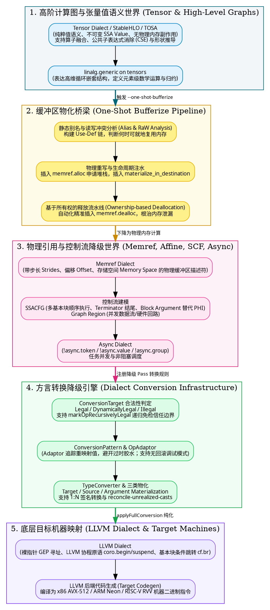

---

## 参考文献与官方文档直通车

1. **MLIR 官方设计论文**：[MLIR: A Compiler Infrastructure for New Hardware and Software Ecosystems](https://arxiv.org/abs/2002.11054) (C. Lattner et al.)
2. **MLIR 语言规范 (LangRef)**：[https://mlir.llvm.org/docs/LangRef/](https://mlir.llvm.org/docs/LangRef/)
3. **MLIR 方言转换架构 (Dialect Conversion)**：[https://mlir.llvm.org/docs/DialectConversion/](https://mlir.llvm.org/docs/DialectConversion/)
4. **MLIR 一次性缓冲区化 (One-Shot Bufferization)**：[https://mlir.llvm.org/docs/Bufferization/](https://mlir.llvm.org/docs/Bufferization/)
5. **MLIR 通用 Pass 管理架构 (Pass Infrastructure)**：[https://mlir.llvm.org/docs/PassManagement/](https://mlir.llvm.org/docs/PassManagement/)
6. **MLIR 算子定义规范 (TableGen ODS)**：[https://mlir.llvm.org/docs/DefiningDialects/Operations/](https://mlir.llvm.org/docs/DefiningDialects/Operations/)
7. **LLVM 协程官方指南**：[https://llvm.org/docs/Coroutines.html](https://llvm.org/docs/Coroutines.html)
