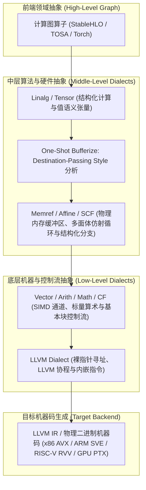
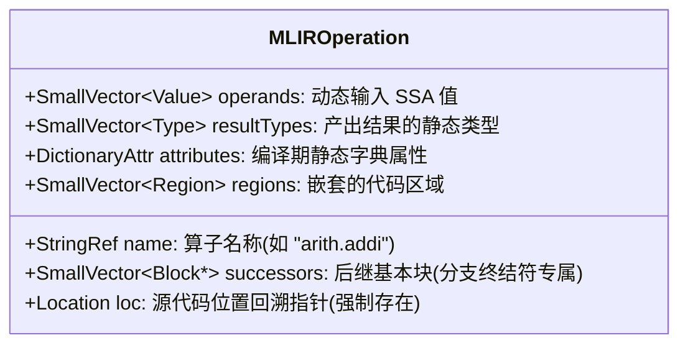
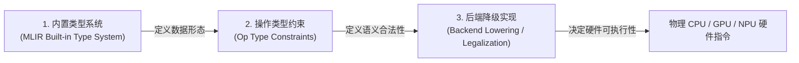
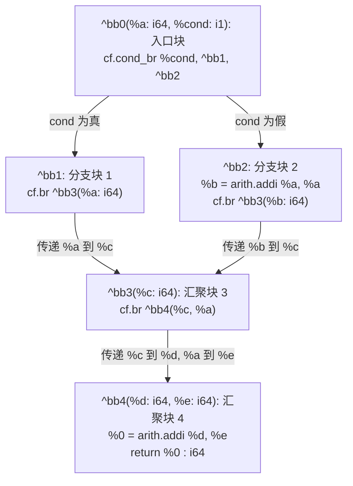
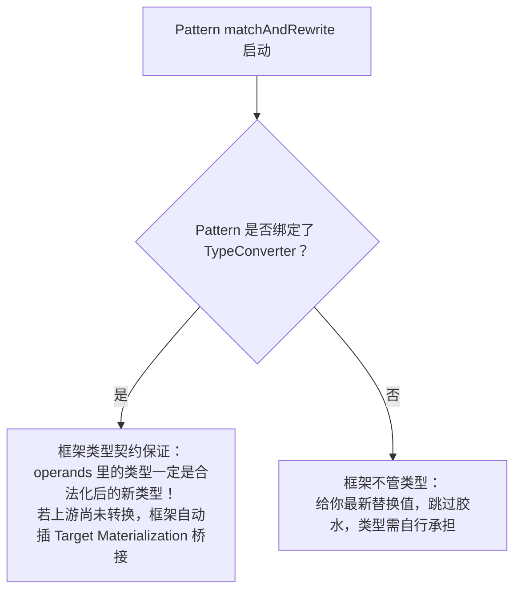
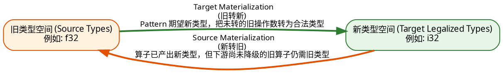
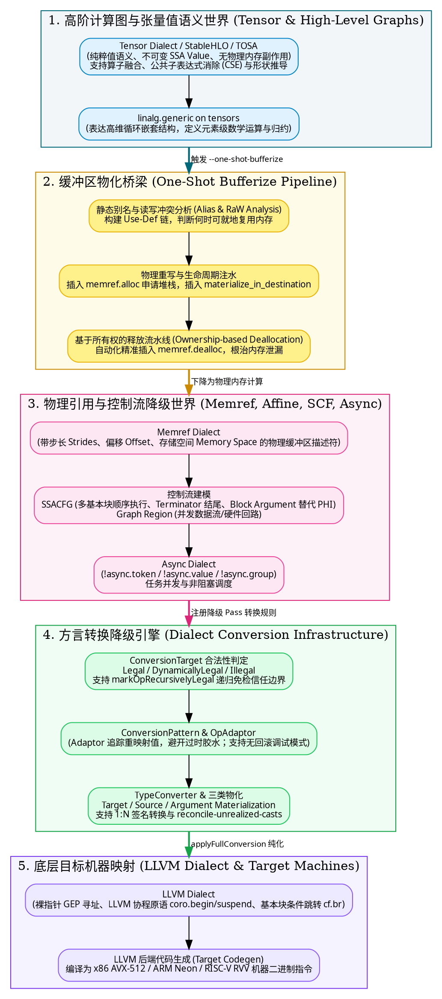

> **导读**：在现代 AI 编译器与高性能领域专用语言（DSL）的构建中，MLIR（Multi-Level Intermediate Representation，多级中间表示）凭借其极高的模块化、声明式抽象与可扩展性，成为了连接上层深度学习框架（PyTorch、TensorFlow、JAX）与底层异构硬件芯片（CPU、GPU、NPU、DSP、RISC-V）的标准基础设施。
>
> 然而，许多开发者在初次接触 MLIR、研读 [MLIR 官方文档](https://mlir.llvm.org/docs/) 或编写自定义方言降级（Dialect Lowering）时，往往会被官方形式化、抽象甚至“不说人话”的文档劝退：
> - **为什么有了 `tensor` 还要引入 `memref`？什么是“副作用”？**
> - **官方文档里的 `@mul` 与 `@multiply` 两个矩阵乘法到底有什么本质区别？**
> - **什么是 Destination-Passing Style（目标传递风格）？Tensor 转 Memref 难道必须手写内存分配吗？**
> - **到底什么是 Block、SSACFG Region、Terminator？为什么说 Block Argument 彻底革了 LLVM PHI 节点的命？**
> - **“Region 入口 Block 的 Block Argument 也是 Region 的参数”这句话究竟在说什么？**
> - **MLIR 的异步并发是怎么实现的？如何降级为 LLVM 协程状态机？**
> - **Dialect 转换框架里的 Conversion Target、Rewrite Pattern、Type Converter 是如何协同的？**
> - **什么是“递归合法性”？什么是 Adaptor？回滚模式与无回滚模式有什么本质区别，无回滚模式下又该如何高效调试？**
> - **类型转换（Conversion）与物化（Materialization）到底有什么区别？什么是 Source Materialization、Target Materialization 与 Argument Materialization？**
>
> 本文严格以 [MLIR 官方文档体系](https://mlir.llvm.org/docs/) 为准绳，结合真实编译工程实践，将上述所有核心问题转化为通俗生动的“人话版”与“深度原理解析”。配以大量直观的生活比喻、C++/MLIR 源码对照与高对比度 **Mermaid / Graphviz** 架构图，带你建立扎实、通透、工业级的 MLIR 全景心智模型。

---

## 一、初学者必读：核心术语通俗图解与概念速查卡片

在深入各大专题前，我们先为初学者扫清前方所有的概念路障。以下名词是贯穿编译器领域的基石：

> [!NOTE] 核心概念形象速查表
> - **IR (Intermediate Representation, 中间表示)**：
>   高级语言（如 Python、C++）是业主的口头需求，机器码（0101 二进制）是砌砖工人的具体操作。IR 则是位于两者之间的**工程建筑设计蓝图**，便于做力学受力分析、抗震计算与结构精简。
> - **MLIR (Multi-Level IR, 多级中间表示)**：
>   传统编译器（如经典 LLVM）通常只有一套固定抽象层级的图纸（LLVM IR）。MLIR 允许系统内共存**多套不同抽象粒度的图纸**——从高阶计算图（Graph）、多维张量与循环嵌套（Tensor/Linalg/Affine），到向量计算（Vector）、结构化控制流（SCF），再到底层物理内存与裸指针（Memref/LLVM），层层嵌套、无缝互通。
> - **Dialect (方言)**：
>   MLIR 中的命名空间与功能语法子集。例如 `arith` 负责基础四则运算，`math` 负责浮点超越函数，`linalg` 负责线性代数结构化计算，`func` 负责函数定义，`llvm` 负责直通 LLVM 底层代码生成。
> - **Operation (操作 / 算子，简称 Op)**：
>   MLIR 中最基本的可执行单元。函数定义、循环、张量加法、常数定义甚至整个模块本身，在 MLIR 里统统是一个 Operation！
> - **Value (SSA 值)**：
>   数据流中的流动实体。MLIR 中的 Value 只有两类：**Operation 的产出结果（OpResult）** 或 **基本块的形参（BlockArgument）**。
> - **Attribute (属性) vs Operand (操作数)**：
>   - **Operand**：参与运行时数据流的动态 SSA Value；
>   - **Attribute**：编译期已知的常量或静态元数据（例如卷积核步长、函数名称字符串、常量张量的内容等）。
> - **Location (源码定位元数据)**：
>   绑定在每个 Op 上的代码来源追踪信息（文件名、行号、调用栈等）。在 MLIR 中，**Location 是强制要求必须存在的**，以确保编译调试与报错信息能穿越数十个 Pass 准确指回上层源代码。
> - **Trait (静态特征) vs Interface (动态多态接口)**：
>   - **Trait**：算子的固有静态属性，编译期即可确定（如 `Commutative` 交换律、`IsolatedFromAbove` 作用域隔离）；
>   - **Interface**：可扩展的多态机制，允许不同方言的算子按统一协议交互（如 `BufferizableOpInterface` 允许任意算子参与内存分配优化）。
> - **Lowering (降级 / 下沉 / 去抽象化)**：
>   将高级、宏观的抽象操作，逐步“翻译”、“拆解”为更贴近物理机器指令的低阶操作的过程。
> - **Value Semantics vs Reference Semantics (值语义 vs 引用语义)**：
>   值语义好比数学上的数字 $5$，不可更改，任何计算都产生新值；引用语义好比一个内存地址或快递柜柜号，多个变量可以指向同一个柜子，打开柜子可以原地修改里面的物品。
> - **Side Effect (副作用)**：
>   一个操作除了返回计算结果外，是否修改了外部世界的状态（如写内存、写全局变量、控制台打印、发网络包）。
> - **SSA (Single Static Assignment, 静态单赋值)**：
>   每个变量（SSA Value）在其生命周期内只能被赋值一次，不可就地重写。
> - **Basic Block (基本块，简称 Block)**：
>   一段顺序执行的代码序列。只要进入该块的第一条指令，就必然执行到该块的最后一条指令，中途没有分支跳入跳出。
> - **Terminator Operation (终结符操作)**：
>   位于基本块末尾的最后一条指令，专门决定程序的下一步执行流向（例如分支跳转 `cf.br`、函数返回 `return`、不可达 `ub.unreachable`）。
> - **Region (区域)**：
>   装载一组 Block 的代码容器，直接嵌套在 Operation 的内部花括号 `{ }` 中。
> - **Dominance (支配关系)**：
>   如果从函数入口到指令 B 的所有执行路径都必然经过指令 A，则称 A **支配** B。只有被支配的变量，才能在 B 处安全读取。
> - **Bufferization (缓冲区化)**：
>   将高层抽象的、无物理地址的 `tensor` 运算，转化为在具体内存块 `memref` 上的分配、读取与原地写入的过程。



---

## 二、MLIR 的物理细胞：Operation 结构解剖、Location 与 Traits/Interfaces

在官方文档 [LangRef (MLIR Language Reference)](https://mlir.llvm.org/docs/LangRef/) 中，MLIR 的整个世界是由 **Operation（操作）** 递归构成的。理解 Operation 的结构是读懂任何 MLIR 代码的第一步。

### 1. Operation 的通用语法解剖

MLIR 中无论是顶层模块 `builtin.module`、函数 `func.func`，还是简单的加法 `arith.addi`，其底层通用文本表示（Generic Form）完全统一：

```mlir
// 通用语法形式:
// %results = "dialect.op_name"(%operands) [successors] (regions) {attributes} : function-type loc(location)

%res:2 = "toy.custom_op"(%arg0, %arg1) [^bb1, ^bb2] ({
  ^bb_inner(%inner_arg: i32):
    "toy.yield"(%inner_arg) : (i32) -> ()
}) {fastmath = true, stride = 2 : i32} : (f32, i32) -> (i64, f64) loc("model.py":42:10)
```



- **`%res:2`**：该 Op 产生的 SSA 结果值（Result），可以返回 0 个、1 个或多个值；
- **`"dialect.op_name"`**：带命名空间的 Op 名称；
- **`(%arg0, %arg1)`**：操作数（Operands），必须是已在外部定义且当前可见的动态 SSA Value；
- **`{fastmath = true, stride = 2 : i32}`**：属性字典（Attributes），编译期完全固化，不占用运行时寄存器；
- **`regions`**：包含的 Region 嵌套体，用于封装子控制流或运算逻辑；
- **`loc(...)`**：位置信息。

> [!IMPORTANT] 为什么 MLIR 强制要求每一个 Operation 都必须携带 Location？
> 在传统编译器中，经过多次 Pass 优化后，Debug 信息常常丢失或错乱，导致最终生成机器码出错时无法定位源头。
> MLIR 将 `Location` 提升为一等公民（First-Class Entity）：每一个重写 Pattern 在生成新 Op 时，必须显式传递 Location（如 `rewriter.create<arith::AddIOp>(loc, ...)`）。
> MLIR 支持丰富的位置表示：
> - `FileLineColLoc`：文件名、行号、列号（如 `"foo.py":12:4`）；
> - `CallSiteLoc`：记录函数调用堆栈；
> - `FusedLoc`：当多个算子被融合为一个算子时，将多个源位置融合绑定；
> - `NameLoc`：附带用户可读命名标识。

---

### 2. Traits（静态特征）与 Interfaces（动态接口）：解决多态爆炸

在面向对象编程中，若想让数百个算子具备某种通用能力，传统的继承类层次往往会导致深不见底的菱形继承与虚表膨胀。MLIR 创新性地引入了 **Traits** 与 **Interfaces**。

#### ① Traits（特征）
Trait 是算子拥有的静态声明式标记，直接注入在算子的 TableGen（ODS）定义中：
- **`SameOperandsAndResultType`**：声明该 Op 的所有操作数与所有返回值的类型必须严格一致；
- **`Commutative`**：满足交换律（例如加法 $a + b = b + a$），规范化 Pass 会自动将操作数按 SSA 编号排序，简化后续匹配；
- **`IsolatedFromAbove`**：**最重要的作用域隔离特征**！声明该 Operation 内部包含的 Region **绝不能隐式访问外部的作用域变量**。例如，`func.func` 拥有此 Trait，因此函数内部不能随随便便抓取函数外的 SSA 值；而 `scf.for` 没有此 Trait，循环体内可以自由捕获外层定义的变量。
- **`SingleBlockImplicitTerminator<"yield">`**：声明该 Op 内部的 Region 只能有单一 Block，且如果省略终结符，默认以 `yield` 结尾。

#### ② Interfaces（接口）
Interface 是 MLIR 实现跨方言通信的动态多态桥梁：
- **`OpInterface`**：例如 `MemoryEffectsOpInterface`（查询 Op 是否具有内存读写副作用）、`DestinationStyleOpInterface`（声明算子是否支持目标传递风格）、`BufferizableOpInterface`（参与 One-Shot Bufferize 内存分配）；
- **`TypeInterface` / `AttrInterface`**：类型或属性的抽象行为接口。

---

## 三、MLIR 类型系统三层观与核心基础方言全景支持

在 MLIR 里，**“某个 dialect 支持哪些数据类型”** 绝不能孤立看待，必须从官方规范界定的**三层认知透镜**来剖析：



1. **第一层：MLIR 内置类型系统（Built-in Types）**：语法上允许构造哪些类型（如 `i32`、`f32`、`tensor<...xf32>`、`memref<...xbf16>`、`complex<f32>`）。
2. **第二层：特定 Dialect 特定 Op 的类型约束（Type Constraints）**：Op 的 Verifier 校验器允许哪些输入输出（例如 `arith.addf` 主要接受浮点类型，`arith.addi` 主要接受 signless integer 类型）。
3. **第三层：后端 Lowering / 代码生成的物理支持**：Verifier 即使放行，如果目标硬件缺少底层指令，仍需通过 Pass 转换合法化（Legalize）。例如 verifier 可能接受 `f8E4M3FN`，但 LLVM / GPU / SPIR-V 后端未必有直接指令，可能需要 legalize 到 `f16/f32`。

### 1. 一句话结论表

| Dialect | 主要操作对象 | 常见支持类型 |
|---|---|---|
| `linalg` | `tensor` / `memref` | 元素类型可以是 `iN`、`f16/bf16/f32/f64`、`index`、`complex`、量化类型等，具体看 op |
| `arith` | scalar / vector | signless integer `iN`、`index`、浮点 `f16/bf16/f32/f64` 等 |
| `math` | scalar / vector | 主要是浮点 `f16/bf16/f32/f64`，少量 integer / float-integer 混合 op |

---

### 2. MLIR 常见核心内置类型详解

#### ① 整数类型
```mlir
i1, i4, i8, i16, i32, i64, i128
```
MLIR 默认使用 **signless integer**，即 `i32` 这种不显式带 signed/unsigned 的整数类型。也有 signed / unsigned integer 类型：
```mlir
si8, ui8, si32, ui32
```
但很多核心算术 op 默认使用 signless integer，signed/unsigned 语义通常通过具体 op 或 predicate 表达：
```mlir
arith.divsi    // 有符号除法
arith.divui    // 无符号除法
arith.extsi    // 符号扩展
arith.extui    // 零扩展
arith.cmpi slt, ...  // 有符号小于比较
arith.cmpi ult, ...  // 无符号小于比较
```

> [!TIP] 为什么 MLIR 核心算术采用“无印记整数（Signless Integer）”？
> 在硬件层面，加法器对于有符号数（补码）和无符号数的运算二进制逻辑完全相同！例如，`0xFF` 加 `0x01`，无论是当作 `-1 + 1 = 0` 还是 `255 + 1 = 0`，底层 ALU 的加法门电路毫无区别。
> 统一为 Signless 既精简了类型系统，又避免了大量无谓的类型强转。

#### ② 浮点类型
常见：`f16`, `bf16`, `f32`, `f64`。还有窄浮点或特殊浮点格式：
```mlir
f8E4M3FN, f8E5M2, f8E4M3FNUZ, f8E5M2FNUZ
```
不同 MLIR 版本可能还会增加更多 `f8/f6/f4` 类型。这些类型是否可用，取决于 MLIR 版本、op 的 type constraint 以及后端 lowering 支持。

#### ③ Index 类型
```mlir
index
```
专门用于循环索引、shape、stride 等，其位宽在编译到目标机器时自动对齐目标平台的裸指针位宽（如 64 位机器对应 64 位）。

#### ④ 复合 / shaped 类型
```mlir
tensor<4x8xf32>
tensor<?x128xbf16>
memref<16x16xf32>
memref<?x?xf64>
vector<8xf32>
vector<4xi32>
```

#### ⑤ Complex 类型
```mlir
complex<f32>, complex<f64>
```
复数运算通常由专门的 `complex` dialect 处理，而不是 `arith` 或 `math`。

#### ⑥ 量化类型
```mlir
!quant.uniform<i8:f32, 0.034:12>
!quant.uniform<i8:f32, 0.1>
```
量化类型常出现在 ML 编译器中。`linalg` 可以承载量化类型的 tensor/memref，但通常后续需要 legalize 到普通 integer/float 计算。

---

### 3. 三大核心基础 Dialect 的类型支持对比表

#### ① 标量 / 元素类型支持对照表

| 类型 | `linalg` | `arith` | `math` | 说明 |
|---|---:|---:|---:|---|
| `i1` | 可用作元素类型 | 支持 | 局部支持 | 常用于 predicate/mask |
| `i8`, `i16`, `i32`, `i64` | 支持 | 支持 | 局部支持 | 常见于量化/整型计算 |
| 任意宽度 `iN` | 可能支持 | 可能支持 | 可能支持 | lowering 可能需扩展或模拟 |
| `si8/ui8` 等符号整型 | 可出现，但限制多 | 部分支持 | 很少 | MLIR 更常用 signless integer |
| `index` | 支持索引/部分元素 | 支持 | 一般不支持 | 常用于 loop index/shape |
| `f16`, `bf16`, `f32`, `f64` | 支持 | 支持 | 支持 | 深度学习与科学计算常用 |
| `f8E4M3FN` 等 | 版本相关 | 版本相关 | 版本相关 | 后端支持很关键 |
| `complex<f32/f64>` | 可支持，尤其 generic | 一般不支持 | 一般不支持 | 路由至 `complex` dialect |
| quantized types | 可承载 | 一般不直接支持 | 一般不直接支持 | 通常需要 legalize |

#### ② 容器类型支持对照表

| 容器类型 | `linalg` | `arith` | `math` | 说明 |
|---|---:|---:|---:|---|
| scalar | 不是主要对象 | 支持 | 支持 | `arith/math` 主要处理 scalar |
| `vector<...>` | 可 vectorize 产生 | 支持 | 支持 | 向量化后常用 |
| `tensor<...>` | 主要对象 | 有限支持 | 一般不直接支持 | tensor 计算主要用 `linalg` |
| `memref<...>` | 主要对象 | 一般不直接支持 | 一般不直接支持 | buffer 化后主要用 `linalg` |
| unranked tensor/memref | 有限支持 | 很少 | 很少 | 通常先 rank 化 |

---

### 4. 典型示例与常见误区剖析

#### 典型代码示例
```mlir
// 1. arith 支持标量 i32
%0 = arith.addi %a, %b : i32

// 2. arith 支持向量
%1 = arith.mulf %va, %vb : vector<4xf32>

// 3. math 支持标量/向量浮点
%2 = math.exp %x : f32
%3 = math.tanh %y : f16
%4 = math.sqrt %v : vector<8xf32>

// 4. linalg.generic 处理 tensor 元素
linalg.generic {
  indexing_maps = [affine_map<(d0) -> (d0)>, affine_map<(d0) -> (d0)>],
  iterator_types = ["parallel"]
} ins(%in : tensor<8xf32>) outs(%out : tensor<8xf32>) {
^bb0(%arg0: f32, %arg1: f32):
  %res = math.tanh %arg0 : f32
  linalg.yield %res : f32
}
```

> [!WARNING] 四大常见认知误区
> 1. **误区 1：`linalg` 自己定义了很多标量数据类型**
>    不是！`linalg` 操作 `tensor<...x element_type>` 和 `memref<...x element_type>`，它关心的是 shaped type 和 element type，而不是自己造标量类型。
> 2. **误区 2：`arith` 支持所有 MLIR 类型**
>    不是！`arith` 主要支持 signless integer、index、float 及其 vector。复数、量化类型、自定义类型不能直接用 `arith`。
> 3. **误区 3：`math` 支持所有数学函数和所有数值类型**
>    不是！`math` 主要面向 float scalar 和 float vector。复数超越函数不在 `math` 里。
> 4. **误区 4：verifier 通过就等于后端能生成机器码**
>    不是！例如 `%0 = arith.addf %a, %b : f8E4M3FN` 语法检验合法，但如果目标硬件没有 f8 加法指令，依然需要 legalize 降级到 f16/f32 模拟。

---

## 四、值语义 vs 引用语义：`tensor` 与 `memref` 的本质对决与副作用剖析

在 MLIR 里，`tensor<...>` 和 `memref<...>` 都表示多维数组，但它们的语义层次完全不同。

> **一句话概括**：
> **`tensor` 是“数组值”，强调值语义和不可变性；`memref` 是“内存引用”，强调实际内存缓冲区、可读写、别名和副作用。**

### 1. 最核心区别全景表

| 维度 | `tensor<...>` | `memref<...>` |
|---|---|---|
| 语义 | 值类型，表示一个数组“值” | 引用类型，表示一块内存的“引用/视图” |
| 是否可变 | SSA 值不可变 | 指向的内存可读写 |
| 是否有副作用 | 通常无内存副作用 | 有 load/store/alloc/dealloc 等副作用 |
| 是否显式内存 | 不显式表示内存 | 显式表示内存缓冲区 |
| 是否可能别名 | 值语义上不考虑别名 | 可能多个 `memref` 指向同一块内存 |
| 常见阶段 | 高层 IR、bufferization 前 | 低层 IR、bufferization 后 |
| 典型操作 | `linalg` on tensors、`tensor.*` | `memref.*`、`linalg` on memrefs、`vector.transfer_read/write` |
| 是否接近硬件 | 较远 | 较近，类似指针 + shape/stride 描述 |
| 是否适合 lowering 到 LLVM/GPU | 需要先 bufferize | 更容易 lowering |

---

### 2. 深入辨析：值语义与引用语义

#### ① `tensor`：数组值（不可变）
`tensor` 类似于数学上的张量值：
$$A = \begin{bmatrix} 1 & 2 \\ 3 & 4 \end{bmatrix}$$
在 MLIR 中，`tensor` 是一个 SSA value，SSA value 本身是不可变的：
```mlir
%0 = arith.addf %a, %b : tensor<4xf32>
```
这表示**产生一个新的 tensor 值 `%0`，绝不会修改 `%a` 或 `%b`**。
函数参数传递也同样：
```mlir
func.func @add_one(%arg0: tensor<4xf32>) -> tensor<4xf32> {
  %cst = arith.constant dense<1.0> : tensor<4xf32>
  %0 = arith.addf %arg0, %cst : tensor<4xf32>
  return %0 : tensor<4xf32>
}
```
函数内部不能也不应该通过 tensor 值直接“修改调用者的内存”。

#### ② `memref`：内存引用（可读写）
`memref` 表示对一块内存缓冲区的引用，更接近底层概念：
```text
指针 + offset + sizes + strides + memory space
```
可以理解为类似 C/C++ 里的 `float *ptr`，但带有了形状、stride、offset 等元数据。
```mlir
%v = memref.load %A[%i, %j] : memref<4x4xf32>
memref.store %v, %B[%i, %j] : memref<4x4xf32>  // 有副作用的内存写入！
```

---

### 3. 函数签名区别

#### Tensor 版本（纯输入输出映射）
```mlir
func.func @compute(%A: tensor<4xf32>, %B: tensor<4xf32>) -> tensor<4xf32> {
  %0 = arith.addf %A, %B : tensor<4xf32>
  return %0 : tensor<4xf32>
}
```
输入两个 tensor 值，返回一个新 tensor 值。调用者不需要关心内存分配。

#### MemRef 版本（显式输出缓冲区）
```mlir
func.func @compute(%A: memref<4xf32>, %B: memref<4xf32>, %C: memref<4xf32>) {
  %c0 = arith.constant 0 : index
  %a = memref.load %A[%c0] : memref<4xf32>
  %b = memref.load %B[%c0] : memref<4xf32>
  %c = arith.addf %a, %b : f32
  memref.store %c, %C[%c0] : memref<4xf32>
  return
}
```
输入三块内存，从 A/B 读取，把结果写入输出缓冲区 C。

---

### 4. 什么是副作用（Side Effect）？

> **副作用（Side Effect）的严格定义**：
> 一个操作除了产生返回值之外，还**改变了程序的其他状态**，或者**对外部世界产生了影响**。

```c
// 无副作用：纯计算
int add(int a, int b) {
  return a + b;
}

// 有副作用：修改外部状态
int x = 0;
int add_and_save(int a, int b) {
  x = a + b; // 修改了外部变量 x，这就是副作用！
  return a + b;
}
```

#### 常见副作用清单：
1. **写内存**：`*p = 10` 或 MLIR 的 `memref.store`；
2. **修改全局变量**：`g = 42`；
3. **输入输出 (I/O)**：`printf("hello\n")`；
4. **读写文件 / 网络通信**：`write(file, data)`、`send(socket, data)`；
5. **内存分配与释放**：`memref.alloc()`、`memref.dealloc()` 改变了运行时堆状态。

#### 为什么编译器如此在乎副作用？
- **无副作用的操作可以随意删除**：如果 `%0 = arith.addi %a, %b : i32` 算出来的值后续没人用，死代码消除（DCE）可以直接将它抹除；
- **有副作用的操作不能随便删除**：`memref.store %v, %A[%i]` 即使没有返回值，也绝不能删，因为内存被真实改变了；
- **有副作用的操作不能随意重排**：两次连续的 store 操作颠倒顺序，内存数据就会彻底损坏。

---

### 5. 别名（Alias）问题与类型语法对比

#### ① 别名风险
- **Tensor**：因为是不可变的 SSA 值，编译器通常按值语义处理，不认为修改 `%A` 会影响 `%B`；
- **MemRef**：可能出现两个形参 `%A` 与 `%B` 实际指向底层同一片物理内存（如 `call @f(%buf, %buf)`），这会极大地限制向量化、循环展开与指令重排。

#### ② 常见操作语法对比

| 操作语义 | `tensor` 语法 | `memref` 语法 |
|---|---|---|
| **创建空数据** | `%0 = tensor.empty() : tensor<4x4xf32>` | `%0 = memref.alloc() : memref<4x4xf32>` (或 `alloca`) |
| **读取元素** | `%v = tensor.extract %A[%i, %j]` | `%v = memref.load %A[%i, %j]` |
| **写入元素** | `%new = tensor.insert %v into %A[%i, %j]` (返回新张量) | `memref.store %v, %A[%i, %j]` (原地修改) |
| **释放内存** | 无显式释放（由编译器/GC管理） | `memref.dealloc %A : memref<4x4xf32>` |

---

## 五、经典案例解密：LangRef 矩阵乘法 `@mul` 与 `@multiply` 的分层抽象协作

官方文档中展示了一段经典的矩阵乘法示例，展示了 MLIR **多层抽象混合（Multi-Level Abstraction）** 的核心精髓：

```mlir
// 使用乘法内核的实现计算 A*B，并使用 TensorFlow op 打印结果。
// A 和 B 的维度部分已知。假设形状匹配。
func.func @mul(%A: tensor<100x?xf32>, %B: tensor<?x50xf32>) -> (tensor<100x50xf32>) {
  // 使用 dim 操作计算 %A 的内部维度。
  %n = memref.dim %A, 1 : tensor<100x?xf32>

  // 分配可寻址的“缓冲区”并将张量 %A 和 %B 复制到其中。
  %A_m = memref.alloc(%n) : memref<100x?xf32>
  bufferization.materialize_in_destination %A in writable %A_m
      : (tensor<100x?xf32>, memref<100x?xf32>) -> ()

  %B_m = memref.alloc(%n) : memref<?x50xf32>
  bufferization.materialize_in_destination %B in writable %B_m
      : (tensor<?x50xf32>, memref<?x50xf32>) -> ()

  // 调用函数 @multiply，将 memref 作为参数传递，并返回乘法结果。
  %C_m = call @multiply(%A_m, %B_m)
          : (memref<100x?xf32>, memref<?x50xf32>) -> (memref<100x50xf32>)

  memref.dealloc %A_m : memref<100x?xf32>
  memref.dealloc %B_m : memref<?x50xf32>

  // 将缓冲区数据加载到更高级别的“tensor”值中。
  %C = memref.tensor_load %C_m : memref<100x50xf32>
  memref.dealloc %C_m : memref<100x50xf32>

  // 调用 TensorFlow 内建函数打印结果张量。
  "tf.Print"(%C){message: "mul result"} : (tensor<100x50xf32>) -> (tensor<100x50xf32>)

  return %C : tensor<100x50xf32>
}

// 一个将两个 memref 相乘并返回结果的函数。
func.func @multiply(%A: memref<100x?xf32>, %B: memref<?x50xf32>)
          -> (memref<100x50xf32>)  {
  %n = memref.dim %A, 1 : memref<100x?xf32>
  %C = memref.alloc() : memref<100x50xf32>

  // 乘法仿射循环嵌套。
  affine.for %i = 0 to 100 {
     affine.for %j = 0 to 50 {
        memref.store 0 to %C[%i, %j] : memref<100x50xf32>
        affine.for %k = 0 to %n {
           %a_v  = memref.load %A[%i, %k] : memref<100x?xf32>
           %b_v  = memref.load %B[%k, %j] : memref<?x50xf32>
           %prod = arith.mulf %a_v, %b_v : f32
           %c_v  = memref.load %C[%i, %j] : memref<100x50xf32>
           %sum  = arith.addf %c_v, %prod : f32
           memref.store %sum, %C[%i, %j] : memref<100x50xf32>
        }
     }
  }
  return %C : memref<100x50xf32>
}
```

### 1. 逐层全景对比

| 维度 | `@mul`（外层调度） | `@multiply`（内层内核） |
|---|---|---|
| **操作的数据类型** | `tensor`（值语义、不可变） | `memref`（引用语义、物理缓冲区） |
| **系统角色** | 接口 / 胶水代码 / 流程调度 | 纯粹的计算执行内核（Kernel） |
| **是否包含算术逻辑** | ❌ 不包含，只做数据搬运与函数调用 | ✅ 包含三重 `affine.for` 乘加计算 |
| **内存管理职责** | 分配输入缓冲区、释放所有中间缓冲区 | 只分配输出结果缓冲区 `%C` |
| **涉及的 Dialect** | `func`, `memref`, `bufferization`, `tf` | `func`, `memref`, `affine`, `arith` |

```
┌─────────────────────────────────────────────┐
│  @mul：Tensor 层（值语义、高层框架交互）       │  ← 抽象高
│    ├─ bufferization（tensor ↔ memref）       │
│    ├─ call @multiply                         │
│    └─ tf.Print（框架 op）                    │
├─────────────────────────────────────────────┤
│  @multiply：Memref + Affine 层（内存+循环）   │  ← 抽象低
│    ├─ affine.for 三重循环                    │
│    ├─ memref.load / store                    │
│    └─ arith.mulf / addf                     │
└─────────────────────────────────────────────┘
```

**核心设计哲学**：**`@mul` 管“数据从哪来、到哪去”，`@multiply` 管“怎么算”**。两者共存展示了 MLIR 从高层语义逐步下降到低层内存操作的完整生命周期。

---

## 六、自动化 Bufferization 架构：One-Shot Bufferize 与所有权释放流水线

在实际工程中，**完全不需要手动编写 `memref.alloc`、`dealloc` 和 `materialize_in_destination`**。文档示例的手写纯粹是为了教学演示底层语义。

### 1. 自动核心：`--one-shot-bufferize` Pass

```bash
mlir-opt input.mlir -one-shot-bufferize="bufferize-function-boundaries"
```

| 手动繁琐工作 | Pass 自动化完成 |
|---|---|
| `memref.alloc(...)` 分配缓冲区 | ✅ 自动分析生存期并插入 `memref.alloc` |
| `bufferization.materialize_in_destination` 拷贝 | ✅ 静态判断是否原地复用还是插入物理拷贝 |
| `memref.dealloc` 释放内存 | ✅ 配套的 deallocation pipeline 自动管理 |
| `memref.tensor_load` 转回 tensor | ✅ 自动插入/折叠 `to_tensor` / `to_buffer` |
| 判断哪些 tensor 可以共享缓冲区 | ✅ 基于 SSA use-def 链分析 + alias 分析 |

### 2. One-Shot Bufferize 的两阶段工作原理

```
┌──────────────────────────────────────────────────┐
│  阶段 1：分析（Analysis）                         │
│  • 遍历整个函数的 SSA use-def 链                  │
│  • 构建 alias 集合和 equivalence 集合             │
│  • 检测 RaW（Read-after-Write）冲突              │
│  • 决定每个 tensor 操作数：原地复用 or 拷贝        │
├──────────────────────────────────────────────────┤
│  阶段 2：重写（Rewrite）                         │
│  • 将 tensor op 替换为对应的 memref op            │
│  • 插入 memref.alloc（需要新缓冲区时）            │
│  • 插入 memref.copy（有 RaW 冲突时）             │
│  • 插入 to_tensor / to_buffer（边界处）           │
└──────────────────────────────────────────────────┘
```

### 3. 完整的 Bufferization 流水线

```
Tensor IR（高层代码）
    │
    ▼
┌─────────────────────────────────┐
│  预处理 pass                     │  ← 如 empty-tensor-elimination
│  （让 IR 更适合 bufferize）       │
└─────────────────────────────────┘
    │
    ▼
┌─────────────────────────────────┐
│  --one-shot-bufferize           │  ← 核心：tensor → memref 分析与重写
└─────────────────────────────────┘
    │
    ▼
┌─────────────────────────────────┐
│  buffer-deallocation-pipeline   │  ← 基于所有权自动插入 dealloc，杜绝内存泄漏
└─────────────────────────────────┘
    │
    ▼
Memref IR（可继续做内存优化并降级到 LLVM）
```

---

## 七、MLIR 结构基石：Block、Region、Terminator 与控制流全景

许多初学者在阅读 MLIR 结构规范时感到困惑。我们直接用一段经典的带有分支与参数传递的代码进行全景透视：

```mlir
func.func @simple(i64, i1) -> i64 {          // ← Operation（func.func）
//                                              ← 花括号 { } 内 = 一个 SSACFG Region
^bb0(%a: i64, %cond: i1):                    // ← Block 0（入口 Block）
  cf.cond_br %cond, ^bb1, ^bb2               // ← Terminator（条件分支）

^bb1:                                        // ← Block 1
  cf.br ^bb3(%a: i64)                        // ← Terminator（无条件分支，传递 %a）

^bb2:                                        // ← Block 2
  %b = arith.addi %a, %a : i64               // ← 普通 Operation
  cf.br ^bb3(%b: i64)                        // ← Terminator（无条件分支，传递 %b）

^bb3(%c: i64):                               // ← Block 3（形参 %c）
  cf.br ^bb4(%c, %a : i64, i64)              // ← Terminator（传递两个值）

^bb4(%d : i64, %e : i64):                    // ← Block 4
  %0 = arith.addi %d, %e : i64               // ← 普通 Operation
  return %0 : i64                            // ← Terminator（返回）
}
```



### 1. 结构三要素本质定义

1. **Block**：`^bbX` 标签 + 一串按顺序执行的 Operation。对应传统编译器里的 **基本块（Basic Block）**，从头执行到尾，中间没有跳转；
2. **Terminator Operation**：每个 Block 的**最后一个 Operation**，决定“接下来去哪”，只负责控制流走向；
3. **SSACFG Region**：包含多个 Block 的花括号容器 `{ }`，Block 之间通过 Terminator 的分支连成控制流图。

---

## 八、消灭 PHI 节点：Block Argument 的革命性设计与“入口块即区域形参”铁律

### 1. Block Argument 彻底颠覆 LLVM PHI 节点

在传统 LLVM IR 中，分支汇聚必须使用虚拟指令 `phi`：
```llvm
; LLVM IR 经典写法: PHI 节点作为伪操作指令
bb3:
  %c = phi i64 [ %a, %bb1 ], [ %b, %bb2 ]
```

| 对比维度 | LLVM PHI 节点 | MLIR Block Argument |
|---|---|---|
| **本质** | 一条特殊的指令（Operation） | Block 标签上的**形参**（类似函数参数） |
| **位置** | 硬性塞在 Block 最内部顶端 | 声明在 Block 标签的括号里 `^bb3(%c: i64):` |
| **值的来源** | PHI 节点自己罗列所有前驱来源 | 由**前驱块的终结符（`cf.br`）显式传入** |
| **特殊情况** | 函数参数需要特殊处理与特殊数据结构 | 函数参数 = 入口 Block 的 Block Argument，**毫无特殊情况** |

### 2. “Region 入口 Block 的 Block Argument 也是 Region 的参数”深度剖析

> **核心内涵**：**Region 没有自己独立的参数声明语法，它的形参直接“借用”了入口 Block 的 Block Argument！**

```mlir
func.func @simple(i64, i1) -> i64 {     // ← func.func 拥有一个 Region
^bb0(%a: i64, %cond: i1):               // ← 入口 Block
  ...
}
```

`%a` 和 `%cond` 同时扮演双重身份：
- **作为 Block Argument**：它是 `^bb0` 这个基本块的输入实参；
- **作为 Region 的参数**：它是整个函数从外部调用者接收的实参！两者合二为一，消除了语法冗余。

---

## 九、控制流人话版：5 大执行法则、支配作用域与 Graph Region 无序自环

### 1. SSACFG Region 的 5 大执行铁律

```
┌─────────────────────────────────────────────────────────────┐
│ 1. Block 内部，从上往下顺序执行                              │
│ 2. 进入 Region，永远从第一个 Block（入口 Block）开始          │
│ 3. 走到 Block 末尾的 Terminator，由它决定下一步去哪           │
│ 4. 只能跳到 Terminator 明确指定的后继 Block（未指定的为死代码）│
│ 5. 单入口，多出口（SEME）：只能从 ^bb0 进，但可从任意 return 出 │
└─────────────────────────────────────────────────────────────┘
```

### 2. 嵌套 Region 的作用域与支配关系（Dominance）

```mlir
func.func @accelerator_compute(%a: i64, %cond: i1) -> i64 {
^bb0:
  cf.cond_br %cond, ^bb1, ^bb2

^bb1:
  %value = "op.convert"(%a) : (i64) -> i64   // 定义在 bb1
  cf.br ^bb3(%a: i64)

^bb2:
  accelerator.launch() {                      // 嵌套 Region
    ^bb_inner:
      // ✅ 能引用 %a（定义在外层入口 bb0，支配整个函数）
      // ❌ 不能引用 %value（定义在平级分支 bb1，不支配 bb2）
      %new_val = "accelerator.compute"(%a) : (i64) -> ()
  }
  // ❌ 出了 accelerator.launch，%new_val 就彻底销毁消失了！

^bb3:
  ...
}
```

**作用域核心铁律**：**Region 内部定义的值绝对出不去；外层支配的值可以安全传进来。**

### 3. Graph Region：无序数据流与自环图

与 SSACFG Region 相对，MLIR 还支持一种没有分支跳转的 **Graph Region**（图状区域）：

| 对比维度 | SSACFG Region | Graph Region |
|---|---|---|
| **控制流** | 有，Block 之间通过分支跳转 | **没有**，不存在控制流分支 |
| **Block 数量** | 可以有多个 | **目前严格限制为单个 Block** |
| **执行顺序** | 从上到下，顺序有严格时间语义 | **编写顺序完全无意义**，可任意重排 |
| **Terminator** | 必须有 | 不需要（标记 `NoTerminator`） |
| **值的可见性** | 受支配关系严格约束 | 区域内**所有值互相全局可见** |
| **典型用途** | 传统函数体、条件循环 | 硬件电路（CIRCT）、并发数据流图 |

```mlir
"test.graph_region"() ({
  // 在 Graph Region 中，顺序无意义，所有节点同时存在！
  %1 = "op1"(%1, %3) : (i32, i32) -> (i32)  // ✅ 合法：自环引用 %1，前向引用尚未定义的 %3！
  %2 = "test.ssacfg_region"() ({
     %5 = "op2"(%1, %2, %3, %4) : (i32, i32, i32, i32) -> (i32)
  }) : () -> (i32)
  %3 = "op2"(%1, %4) : (i32, i32) -> (i32)  // ✅ 合法：引用后面的 %4
  %4 = "op3"(%1) : (i32) -> (i32)
}) : () -> ()
```

---

## 十、MLIR 原生异步机制：`async` 方言、并发编程三剑客与 LLVM 协程降级

MLIR 原生提供 `async` dialect，允许开发者**用顺序同步的代码心智，编写高并发异步流水线**。

### 1. 异步三大核心类型

```
!async.token    → "完成信号" (JS: Promise<void>，仅表示任务完成)
!async.value<T> → "未来值"   (JS: Promise<T>，承载未来的计算结果)
!async.group    → "任务分组" (JS: Promise.all([...])，批量等待)
```

### 2. 双任务并发与合并实战

```mlir
func.func @parallel_add(%a: f32, %b: f32) -> f32 {
  // 任务 1：异步计算 a * a
  %tok1, %val1 = async.execute -> (f32) {
    %r1 = arith.mulf %a, %a : f32
    async.yield %r1 : f32
  }

  // 任务 2：异步计算 b * b（与任务 1 并发）
  %tok2, %val2 = async.execute -> (f32) {
    %r2 = arith.mulf %b, %b : f32
    async.yield %r2 : f32
  }

  // 等待结果
  %r1 = async.await %val1 : !async.value<f32>
  %r2 = async.await %val2 : !async.value<f32>

  // 合并结果
  %sum = arith.addf %r1, %r2 : f32
  return %sum : f32
}
```

```
主线程 ──► 启动任务1 ──► 启动任务2 ──► await val1 ──► await val2 ──► 合并求和 ──► 返回
              │               │              │              │
              ▼               ▼              │              │
工作线程A:  计算 a*a ────────►完成 ─────────►│              │
                                             │              │
工作线程B:  计算 b*b ──────────────────────►完成 ──────────►│
```

### 3. 底层实现：Lowering 到 LLVM Coroutines 状态机

```
async.func / async.execute
        │
        ▼ (async-to-llvm pass)
LLVM 协程原语 (llvm.coro.begin / llvm.coro.suspend / llvm.coro.end)
        │
        ▼ (LLVM CoroSplit pass)
异步状态机 (编译器自动拆分成 ramp / resume / destroy 三大函数)
        │
        ▼
Async Runtime 运行时调度 (线程池 / GPU 流)
```

`async.await` 在底层**绝非忙轮询空转**，而是调用 `llvm.coro.suspend` 将上下文打包保存，立即释放 CPU 线程；当任务完成时，由 Runtime 调度器在可用工作线程上调用 `resume` 恢复执行。

---

## 十一、方言转换框架（Dialect Conversion）：三大组件、三大模式与降级执行引擎

方言转换框架负责将一种 Dialect 的 Operation “翻译”为另一种 Dialect 的 Operation。

### 1. 三大组件通俗比喻

| 组件 | 类比 | 作用 |
|---|---|---|
| **Conversion Target** | “目标语言是英语” | 定义转换完的 IR 里**允许留存什么、消灭什么** |
| **Rewrite Pattern** | “你好 $\rightarrow$ Hello” | 定义**具体每一条转换规则** |
| **Type Converter** | “公里 $\rightarrow$ 英里” | 定义**类型系统怎么映射**（可选） |

### 2. Conversion Target 的三种标记态度

```
┌────────────────────────────────────────────────────────────┐
│ ✅ Legal（合法）                                           │
│    "这个 Op 可以原样保留，不用动"                             │
│    addLegalDialect<LLVMDialect>()                          │
│                                                            │
│ ⚠️ Dynamic（动态合法）                                      │
│    "仅在特定条件下可以留，其余情况必须转换"                     │
│    addDynamicallyLegalOp<arith::AddIOp>([](auto op) {...}) │
│                                                            │
│ ❌ Illegal（非法）                                          │
│    "必须被消灭替换掉，一个都不能留"                           │
│    addIllegalDialect<LinalgDialect>()                      │
│                                                            │
│ ❓ Unknown（未标记）                                        │
│    "没说合法也没说非法，看转换模式处理"                       │
└────────────────────────────────────────────────────────────┘
```

### 3. 三种转换模式对比

```
原文："Hello 你好 World 谢谢 MLIR"
```

| 模式 | 做法 | 结果 | 失败条件 |
|---|---|---|---|
| **Partial（部分转换）** | 能翻的翻，翻不了的**保留原文** | `"Hello Hello World Thank-you MLIR"` | 尽力而为，不会因未知 Op 失败 |
| **Full（完全转换）** | **必须全翻完**，一个字都不能留中文 | `"Hello Hello World Thank-you Machine-Learning-IR"` | 有任何非法或未知残留就**整体失败** |
| **Analysis（分析转换）** | **只看不动**，输出可行性报告 | 报告：`"你好"可翻，"谢谢"可翻` | 不修改 IR 原文 |

---

## 十二、递归合法性（Recursive Legality）：信任边界机制与“外交豁免权”通俗拆解

### 1. 问题场景：Op 肚子里套 Op

```mlir
func.func @foo() {          // 外层 Op
  scf.for %i = ... {        // 中间 Op（肚子里有 Region）
    %0 = arith.addi ...
    %1 = linalg.matmul ...  // 内层 Op（已被全局标记为 Illegal）
  }
}
```

在正常情况下，转换驱动会**翻箱倒柜钻进每一层 Region 的最深处**。一旦发现 `linalg.matmul` 未被降级，整个转换就会报错崩溃。

### 2. 递归合法性：给箱子贴上“免检标签”

如果你已经手工处理好了该循环体，或者不希望框架去触碰该算子内部细节：

```cpp
// 1. 声明 scf.for 本身合法
target.addLegalOp<scf::ForOp>();

// 2. 赋予递归合法性：肚子里的所有子 Op 统统免检！
target.markOpRecursivelyLegal<scf::ForOp>();
```

> **生活比喻**：
> - **普通合法（普通旅客）**：人过了安检门，但行李箱必须开箱，每一层都要翻出来检查；
> - **递归合法（外交官）**：享有**外交豁免权**！不仅人不用搜身，**手里的手提箱也整箱直接通关，绝不开箱检查**！

---

## 十三、Conversion Pattern 的 Adaptor 机制与回滚 vs 无回滚模式深度抉择

### 1. Adaptor 是什么？

#### 问题场景：类型突变
```mlir
// 原始 IR
%0 = "test.foo"() : () -> i1
"test.bar"(%0) : (i1) -> ()
```
假设 Pattern A 先把 `test.foo` 换成产出 `i2` 的 `test.qux`。此时 `test.bar` 依然需要 `i1`。框架会自动插入临时胶水：
```mlir
%0 = "test.qux"() : () -> i2
%r = builtin.unrealized_conversion_cast %0 : i2 to i1  // 临时胶水
"test.bar"(%r) : (i1) -> ()
```
现在 Pattern B 来改写 `test.bar`：
```cpp
LogicalResult matchAndRewrite(Operation *op, OpAdaptor adaptor, ...) const {
  // 方式 1: 从 op 自身查
  Value old_val = op->getOperand(0);  // 拿到 %r (过时的 i1 胶水) ❌

  // 方式 2: 从 adaptor 查
  Value new_val = adaptor.getOperands()[0]; // 拿到 %0 (最新的 i2 真实值) ✅
}
```

> **生活比喻**：
> 朋友换了手机号：
> - 查自己的旧通讯录 $\rightarrow$ 拿到旧号码（`op->getOperand()`）；
> - 问电信运营商 $\rightarrow$ 告诉你追踪到的最新号码（`adaptor.getOperands()`）。
> **Adaptor 就是运营商，永远给你最新的合法值！**

### 2. 回滚模式 vs 无回滚模式

| 对比维度 | 回滚模式 (Rollback - 默认) | 无回滚模式 (No-Rollback) |
|---|---|---|
| **生活类比** | 下棋有悔棋按钮，搬家旧物先贴标签不真扔 | 落子无悔，搬新家旧物立刻扔掉 |
| **删除 Op (`eraseOp`)** | **延迟**。不真删，先打删除标记放进回收站 | **立即**真删并释放内存 |
| **替换 Op (`replaceOp`)** | **延迟**。转换结束时才统一更新所有使用方 | **立即**替换并重定向 SSA 引用 |
| **调试体验** | **极差**！Dump IR 时新旧算子诡异并存，链接关系隐匿在 C++ 内部 | **极佳**！IR 就是当前真实物理状态 |
| **编译性能** | 慢（庞大的撤销账本记录开销） | 快 |

---

## 十四、无回滚模式怎么调试？工业级调试秘籍与 `mlir-reduce` 实战指南

无回滚模式不能悔棋，其调试哲学是：**“预防为主，日志为辅，二分用例”**。

### 1. 五步排错工作流

```
第 1 步：先跑 applyAnalysisConversion 分析预检
         → 确认哪些 Op 能转，排查缺少 Pattern 的情况

第 2 步：开启详细转换日志
         → mlir-opt --debug-only=dialect-conversion

第 3 步：捕获差异化 IR 快照
         → mlir-opt --mlir-print-ir-after-change

第 4 步：在 Pattern 内部嵌入 LLVM_DEBUG 打印 adaptor 操作数类型

第 5 步：遇到复杂崩溃，利用 mlir-reduce 自动二分缩减最小复现用例
```

### 2. 常见调试命令行速查表

```bash
# 观察 Pattern 匹配过程
mlir-opt input.mlir -my-pass --debug-only=dialect-conversion

# 仅在 IR 发生真实篡改时 Dump
mlir-opt input.mlir -my-pass --mlir-print-ir-after-change

# 打印报错堆栈
mlir-opt input.mlir -my-pass --mlir-print-stacktrace-on-diagnostic

# 关闭多线程，防止日志穿插
mlir-opt input.mlir -my-pass --mlir-disable-threading

# 自动化二分缩减最小用例 (从 1000 行缩减至 10 行！)
mlir-reduce input.mlir -pass-pipeline="builtin.module(my-pass)" -o minimal.mlir
```

---

## 十五、类型安全（Type Safety）与 Adaptor 的类型契约保障

Pattern 接收到的 `operands`（adaptor）里的值到底是什么类型？
答案取决于：**你的 Pattern 在注册时有没有绑定 Type Converter！**



---

## 十六、类型转换 vs 双向物化（Materialization）：汇率表、银行换汇与瞬态胶水折叠

### 1. 核心概念本质

- **类型转换 (Type Conversion)** = **查汇率表**（1 美元 = 7.2 人民币）。只是一张映射规则，**绝对不在 IR 中生成任何指令**！
- **类型物化 (Type Materialization)** = **去银行柜台换外汇**。在 IR 中**实打实地插入转换/桥接 Op**（如 `unrealized_conversion_cast`）！

### 2. 双向物化对比



> **生活比喻（出国换外汇）**：
> - **Target Materialization（去程）**：你从美国去中国，要把美元（旧）换成人民币（新），才能在中国消费；
> - **Source Materialization（回程）**：你已经在中国持有人民币（新），但美国老朋友托你买东西只要美元，你必须把部分人民币换回美元（旧）给他用！

---

## 十七、签名转换（Signature Conversion）、1:N 映射与 `reconcile-unrealized-casts`

### 1. 1:N 签名转换
当把一个高层复数 `complex<f32>` 降级到 C ABI 时，往往需要将其拆解为两个独立的标量参数（实部与虚部）：

```cpp
TypeConverter::SignatureConversion sigConversion(origNumArgs);
sigConversion.addInputs(0, {f32Type, f32Type}); // 1 个参数裂变为 2 个！
rewriter.applySignatureConversion(&block, sigConversion);
```

### 2. 终结胶水：`--reconcile-unrealized-casts`
当整个编译流程结束时，所有成对插入的 `unrealized_conversion_cast` 胶水应该相互抵消。运行官方清理 Pass：
```bash
mlir-opt input.mlir --reconcile-unrealized-casts
```
如果该 Pass 依然报错，说明你的降级流水线存在**真正的单向类型泄漏漏洞**，它能帮助你在最终代码生成前精准拦截类型 Bug！

---

## 十八、总结：工业级 MLIR 编译降级端到端全景心智图谱与速查清单



---

## 参考文献与官方文档直通车

1. **MLIR 官方设计论文**：[MLIR: A Compiler Infrastructure for New Hardware and Software Ecosystems](https://arxiv.org/abs/2002.11054) (C. Lattner et al.)
2. **MLIR 语言规范 (LangRef)**：[https://mlir.llvm.org/docs/LangRef/](https://mlir.llvm.org/docs/LangRef/)
3. **MLIR 方言转换架构 (Dialect Conversion)**：[https://mlir.llvm.org/docs/DialectConversion/](https://mlir.llvm.org/docs/DialectConversion/)
4. **MLIR 一次性缓冲区化 (One-Shot Bufferization)**：[https://mlir.llvm.org/docs/Bufferization/](https://mlir.llvm.org/docs/Bufferization/)
5. **MLIR 通用 Pass 管理架构 (Pass Infrastructure)**：[https://mlir.llvm.org/docs/PassManagement/](https://mlir.llvm.org/docs/PassManagement/)
6. **MLIR 算子定义规范 (TableGen ODS)**：[https://mlir.llvm.org/docs/DefiningDialects/Operations/](https://mlir.llvm.org/docs/DefiningDialects/Operations/)
7. **LLVM 协程官方指南**：[https://llvm.org/docs/Coroutines.html](https://llvm.org/docs/Coroutines.html)
