> **导读**：在现代 AI 编译器与高性能领域专用语言（DSL）的构建中，MLIR（Multi-Level Intermediate Representation，多级中间表示）凭借其极高的模块化与可扩展性，成为了连接上层深度学习框架（PyTorch、TensorFlow）与底层异构硬件芯片（CPU、GPU、NPU、RISC-V）的标准基础设施。
>
> 然而，许多开发者在初次研读 MLIR 官方文档或编写自定义方言降级（Dialect Lowering）时，往往会被官方形式化、抽象晦涩的术语劝退：**为什么有了 `tensor` 还要引入 `memref`？什么是“副作用”与“支配关系”？Block Argument 究竟如何彻底颠覆 LLVM 的 PHI 节点？Dialect Conversion 框架里的 ConversionTarget、Adaptor、回滚模式与双向物化（Source/Target Materialization）到底是怎样协同工作的？**
>
> 本文以初学者易懂的语言，辅以生活化比喻、代码推演与丰富的 **Mermaid / Graphviz** 可视化架构图，对 MLIR 从类型系统、数据流控制流到方言转换框架的核心知识体系进行地毯式拆解，帮助你建立全面且深刻的编译器心智模型。

---

## 一、初学者必读：核心术语通俗图解

在深入各个专题之前，我们先对贯穿全篇的核心名词做一次通俗而形象的界定，扫清后续的概念障碍。

> [!NOTE] 核心概念形象速查表
> - **IR (Intermediate Representation, 中间表示)**：
>   高级语言（如 Python、C++）是业主的口头需求，机器码（0101 二进制）是砌砖工人的具体操作。IR 则是位于两者之间的**工程建筑图纸**，便于做力学受力分析与结构精简。
> - **MLIR (Multi-Level IR, 多级中间表示)**：
>   传统编译器（如经典 LLVM）通常只有一套固定抽象层级的图纸（LLVM IR）。MLIR 允许系统内共存**多套不同抽象粒度的图纸**——从高阶计算图（Graph）、多维张量与循环嵌套（Tensor/Linalg/Affine），到向量计算（Vector）、结构化控制流（SCF），再到底层物理内存与裸指针（Memref/LLVM），层层嵌套、无缝互通。
> - **Dialect (方言)**：
>   MLIR 中的命名空间与功能语法子集。例如 `arith` 负责基础四则运算，`math` 负责浮点超越函数，`linalg` 负责线性代数结构化计算，`func` 负责函数定义，`llvm` 负责直通 LLVM 底层代码生成。
> - **Lowering (降级 / 下沉 / 去抽象化)**：
>   将高级、宏观的抽象操作，逐步“翻译”、“拆解”为更贴近物理机器指令的低阶操作的过程。
> - **Pass (遍历转换流水线)**：
>   编译器流水线上的“流水线工人”，专门负责代码检查、冗余折叠、跨方言转换或优化重写。
> - **Value Semantics vs Reference Semantics (值语义 vs 引用语义)**：
>   值语义好比数学上的数字 $5$，不可更改，任何计算都产生新值；引用语义好比一个内存地址或快递柜柜号，多个变量可以指向同一个柜子，打开柜子可以原地修改里面的物品。
> - **Side Effect (副作用)**：
>   一个操作除了返回计算结果外，是否修改了外部世界的状态（如写内存、写全局变量、控制台打印、发网络包）。
> - **SSA (Single Static Assignment, 静态单赋值)**：
>   每个变量（SSA Value）在其生命周期内只能被赋值一次，不可就地重写。
> - **Basic Block (基本块，简称 Block)**：
>   一段顺序执行的代码序列。只要进入该块的第一条指令，就必然执行到该块的最后一条指令，中途没有分支跳入跳出。
> - **Terminator Operation (终结符操作)**：
>   位于基本块末尾的最后一条指令，专门决定程序的下一步执行流向（例如分支跳转 `cf.br`、函数返回 `return`、不可达 `ub.unreachable`）。
> - **Region (区域)**：
>   装载一组 Block 的代码容器，直接嵌套在 Operation 的内部花括号 `{ }` 中。
> - **Dominance (支配关系)**：
>   如果从函数入口到指令 B 的所有执行路径都必然经过指令 A，则称 A **支配** B。只有被支配的变量，才能在 B 处安全读取。
> - **Bufferization (缓冲区化)**：
>   将高层抽象的、无物理地址的 `tensor` 运算，转化为在具体内存块 `memref` 上的分配、读取与原地写入的过程。

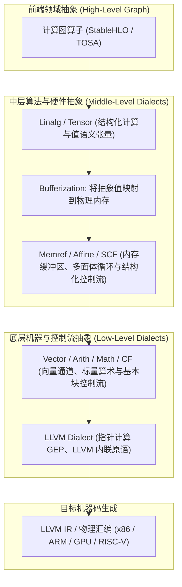

---

## 二、MLIR 类型系统三层观与基础方言支持

在 MLIR 中，“某个方言究竟支持什么数据类型”绝不能孤立看待，必须建立清晰的**三层认知透镜**：


1. **第一层：MLIR 内置类型系统（Built-in Types）**：语法上允许构造哪些类型（如 `i32`、`f32`、`memref<...>`、`f8E4M3FN`）。
2. **第二层：特定 Dialect 特定 Op 的类型约束（Type Constraints）**：Op 的 Verifier 校验器允许哪些输入输出（例如加法 `arith.addf` 仅限浮点，`arith.addi` 仅限整型）。
3. **第三层：后端 Lowering / 代码生成的物理支持**：Verifier 即使放行，如果目标硬件缺少底层指令，仍需通过 Pass 转换合法化（Legalize）。

### 1. MLIR 常见核心内置类型

| 类型类别 | MLIR 类型标识 | 典型用途与语法示例 | 特殊说明 |
|---|---|---|---|
| **Signless 整型** | `i1`, `i4`, `i8`, `i16`, `i32`, `i64`, `i128` | `%x = arith.constant 42 : i32` | 默认无符号印记，位宽任意定义 |
| **Signed / Unsigned 整型** | `si8`, `ui8`, `si32`, `ui32` | 显式标记符号的整型，部分转换 Op 支持 | 核心算术 Op 更倾向于使用 Signless |
| **浮点类型** | `f16`, `bf16`, `f32`, `f64` | 标准 IEEE 754 浮点与 Bfloat16 | AI 模型推理/训练通用标准 |
| **窄浮点与低精度** | `f8E4M3FN`, `f8E5M2`, `f4`, `f6` | 现代大语言模型量化与微缩精度 | 取决于编译器版本与后端硬件算力 |
| **索引类型** | `index` | `%idx = arith.constant 0 : index` | 专门用于循环索引、内存寻址，平台指针位宽一致 |
| **复合容器类型** | `tensor<...>`, `memref<...>`, `vector<...>` | `tensor<4x8xf32>`, `memref<16x16xbf16>` | 代表多维抽象值、内存引用与物理 SIMD 向量 |
| **复数与量化** | `complex<f32>`, `!quant.uniform<...>` | 频域信号计算与定点量化模型 | 复数需配合 `complex` 方言运算 |

> [!TIP] 为什么 MLIR 核心算术采用“无印记整数（Signless Integer）”？
> 在硬件层面，加法器对于有符号数（补码）和无符号数的运算二进制逻辑完全相同！例如，`0xFF` 加 `0x01`，无论是当作 `-1 + 1 = 0` 还是 `255 + 1 = 0`，底层 ALU 的加法门电路毫无区别。
>
> 因此，MLIR 将 `i32` 统一设计为 Signless，简化了类型系统；当真正涉及符号行为时（如除法、扩展、比较），再由具体的指令语义来界定：
> - **有符号除法**：`arith.divsi %a, %b : i32`
> - **无符号除法**：`arith.divui %a, %b : i32`
> - **有符号比较**：`arith.cmpi slt, %a, %b : i32`（Signed Less Than）
> - **无符号比较**：`arith.cmpi ult, %a, %b : i32`（Unsigned Less Than）

---

### 2. Linalg、Arith、Math 三大方言的职责与类型边界

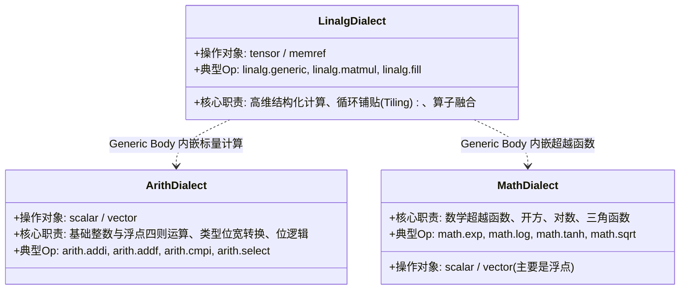

#### ① `linalg`：面向多维容器的结构化计算方言
`linalg` **本身不定义标量算术类型**，它操作的是高阶容器 `tensor` 与 `memref`。
- **元素类型的高度开放性**：通过 `linalg.generic`，内部可以用一个嵌套计算区域（Region）定义任意元素级操作：
  ```mlir
  linalg.generic {
    indexing_maps = [affine_map<(d0) -> (d0)>, affine_map<(d0) -> (d0)>],
    iterator_types = ["parallel"]
  } ins(%in : tensor<8xf32>) outs(%out : tensor<8xf32>) {
  ^bb0(%arg0: f32, %arg1: f32):
    %0 = math.tanh %arg0 : f32
    linalg.yield %0 : f32
  }
  ```
- **命名算子的严格限制**：像 `linalg.matmul`、`linalg.conv_2d_*` 等特定算法 Op，通常限定为数值类型（整型、浮点型），部分算子支持复数；非数值类型（如自定义结构体）无法直接参与命名矩阵乘。

#### ② `arith`：面向标量与向量的四则基础算术
- 主要面向 `scalar`（标量）和 `vector`（向量）；
- **核心算术指令并不直接支持 `tensor` 运算**！不能直接写 `%res = arith.addf %A, %B : tensor<4x4xf32>`。张量级别的运算必须借助 `linalg`、`tensor` 或 `tosa` 方言来表达；
- 少数非计算类 Op（如 `arith.constant dense<...>` 常量构造、`arith.select` 条件选择）可以在特定情况下承载张量。

#### ③ `math`：专攻浮点数学超越函数
- 专注于计算复杂的超越函数（`exp`, `log`, `sin`, `tanh`, `sqrt`, `rsqrt`, `erf`）；
- 核心操作对象为浮点标量与浮点向量（`f16`, `bf16`, `f32`, `f64`, `vector<Nxf32>`）；
- 包含少量针对整数的高效位计算（如 `math.ipowi` 整数幂、`math.ctlz` 前导零计数）；
- 不直接处理 `complex` 复数（复数必须路由至 `complex` 方言）。

---

## 三、值语义 vs 引用语义：`tensor` 与 `memref` 的本质对决与副作用剖析

在 MLIR 中，`tensor<...>` 和 `memref<...>` 都能表达多维数组，但它们的计算机科学内涵天差地别。

### 1. 核心差异全维度对照表

| 对比维度 | `tensor<...>` (张量) | `memref<...>` (内存引用) |
|---|---|---|
| **计算机语义** | **值语义 (Value Semantics)**，代表纯粹的数学数组值 | **引用语义 (Reference Semantics)**，代表具体的物理内存缓冲区描述符 |
| **可变性 (Mutability)** | **不可变 (Immutable)**，每一个 SSA Value 赋值后永不改变 | **可变 (Mutable)**，指向的底层物理内存可随时被 load/store |
| **副作用 (Side Effect)** | **无内存副作用**，纯粹的输入到输出的函数式映射 | **具有显著副作用**，alloc/dealloc 分配释放，store 改变内存 |
| **物理内存位置** | 概念抽象，**不对应具体物理地址**（不知道分配在栈还是堆） | 明确包含底层指针、基址偏移（Offset）、各维大小与跨步（Strides）、存储空间（Memory Space） |
| **别名风险 (Aliasing)** | **无别名**，SSA 体系下变量互不干扰 | **存在别名风险**，多个 memref 可能切片指向同一片重叠内存 |
| **编译器优化难度** | **极易优化**（算子融合 Fusion、死代码消除 DCE、公共子表达式消除 CSE） | **优化受限**（必须先做别名分析与读写依赖冲突检测） |
| **所属编译阶段** | 编译流水线**前端与中层**（Bufferization 之前） | 编译流水线**底层**（Bufferization 之后，直通 LLVM / GPU） |

---

### 2. 深度剖析：什么是“副作用（Side Effect）”？

> **副作用（Side Effect）的严格定义**：
> 一个操作除了产生它声明的返回值之外，如果还**改变了程序运行时的其他状态**，或者**对外部世界产生了可被察觉的影响**，那么这个操作就带有副作用。

```c
// 1. 无副作用的纯函数 (Pure Function)
int add(int a, int b) {
    return a + b; // 只要 a, b 相同，输出恒定；外部内存与硬件毫无改变
}

// 2. 带有显著副作用的函数
int g_counter = 0;
int add_and_record(int a, int b, int *history_buffer) {
    g_counter++;                  // 副作用1：修改了全局变量
    *history_buffer = a + b;      // 副作用2：向传入指针写内存
    printf("Result: %d\n", a+b);  // 副作用3：向控制台做 I/O 输出
    return a + b;
}
```

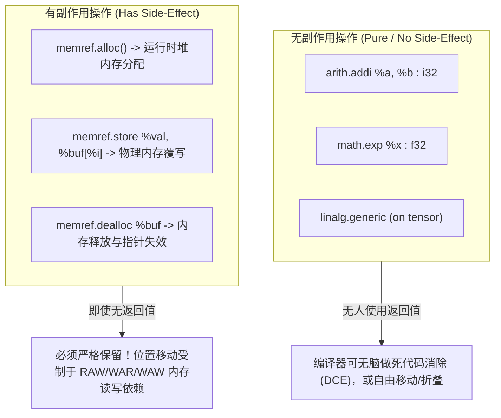

#### 为什么编译器在乎副作用？
1. **死代码消除（DCE）**：
   - 如果 `%0 = arith.addi %a, %b` 的结果后续没有任何算子读取，编译器可以直接将这一行安全抹除。
   - 但是，`memref.store %v, %A[%i]` **绝对不能抹除**！因为它真实修改了内存中索引 `%i` 的数值，后续函数或外部调用可能会读取该内存。
2. **算子重排与乱序执行**：
   - 无副作用的表达式计算可以随意提前或推迟。
   - 对同一块内存的两次连续 store 操作（例如写 `A[0]=1`，随后写 `A[0]=2`），若被错误地颠倒顺序，程序逻辑就会彻底崩塌。

---

### 3. 经典案例解密：MLIR LangRef 中的 `@mul` 与 `@multiply`

在 MLIR 官方文档中，经常展示两段矩阵乘法，很多初学者误以为是“两种不同的矩阵乘算法实现”。实际上，它是**同一个计算任务在两个完全不同抽象层次上的分工协作**！

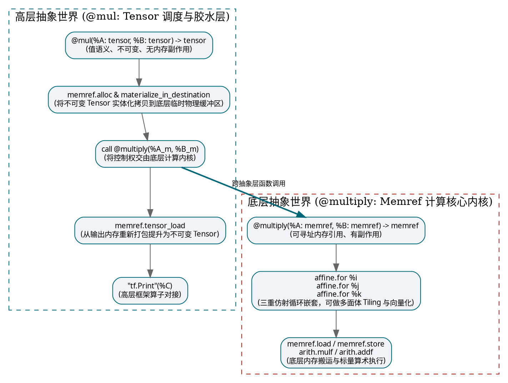

- **`@mul` 的职责**：充当“翻译官与调度中枢”。它接受高层框架（如 TensorFlow / JAX）传入的 `tensor`，申请临时内存，调用底层计算内核，最后把结果提取为 `tensor` 交付给外部。它展示了 **Bufferization 过程的手工原理**。
- **`@multiply` 的职责**：充当“纯粹的执行内核（Kernel）”。它压根不知道张量或框架的存在，直接通过 `memref.load` / `memref.store` 在硬件内存上进行三重循环的累加搬运。

---

### 4. 自动化 Bufferization：One-Shot Bufferize

在实际工业工程中，**我们绝对不需要手工去写 `memref.alloc` 和 `memref.dealloc`**。MLIR 内置了功能强大的自动化转化器：`--one-shot-bufferize`。

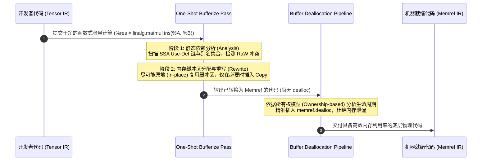

---

## 四、MLIR 的结构骨架：Block、Region、Terminator 与控制流全景

MLIR 的语法之所以极度规整，是因为它基于高度统一的嵌套模型：**Operation 套 Region，Region 套 Block，Block 装 Operation**。

```
Operation (如 func.func)
  └── Region (代码区域，用花括号 { } 包裹)
        ├── Block 0 (如 ^bb0: 入口基本块)
        │     ├── Operation 1
        │     ├── Operation 2
        │     └── Terminator Operation (如 cf.cond_br, return)
        └── Block 1 (如 ^bb1: 分支基本块)
              ├── Operation 3
              └── Terminator Operation
```

### 1. 结构三要素定义速查

#### ① Block（基本块）
语法规范：
```text
block       ::= block-label operation+
block-label ::= `^` block-name `(` block-argument-list? `)` `:`
```
- 以 `^` 开头命名的执行单元（如 `^bb0`, `^bb1`）；
- 内部的操作**严格从上到下顺序执行**，中途绝不允许跳转进出；
- **最后一个操作必须是 Terminator**。

#### ② Terminator Operation（终结符操作）
- 位于 Block 末尾，专门解答：**“当前块跑完了，下一行代码该去哪？”**
- 常见终结符：
  - `cf.br ^bbX(...)`：无条件分支跳转到同 Region 的另一个块；
  - `cf.cond_br %cond, ^bb1, ^bb2`：根据布尔条件进行双向分支；
  - `func.return %val`：离开当前 Region，把计算值交还给外层调用方；
  - `ub.unreachable`：声明控制流在此终止（异常或未定义行为分支）。
- **特例声明**：具有 `NoTerminator` Trait 的 Operation（例如顶层 `builtin.module`），其内部 Block 允许没有终结符。

#### ③ SSACFG Region vs Graph Region
Region 是装载 Block 的容器。MLIR 支持两种截然相反语义的 Region：

| 特性 | SSACFG Region (控制流图区域) | Graph Region (图状并发区域) |
|---|---|---|
| **控制流机制** | 存在明确控制流，Block 之间通过分支跳转连接成图 | **完全不存在控制流跳转**，只建模并发与数据流 |
| **包含 Block 数量** | 允许包含**任意多个** Block（`^bb0`, `^bb1`, ...） | **仅允许单个 Block**（通常只有一个入口块） |
| **代码执行顺序** | **从上到下顺序执行**，代码先后顺序具备严格时间语义 | **代码编写顺序完全无意义**，可以随意重排或规范化 |
| **值的可见性** | 严格遵循**支配关系（Dominance）**，未定义不可使用 | **所有值全局相互可见**，支持任意循环引用与自环 |
| **典型应用场景** | 传统函数体（`func.func`）、条件分支（`scf.if`） | 硬件电路描述（CIRCT 方言）、数据流任务并发 |

---

### 2. Block Argument：为什么彻底淘汰 LLVM 的 PHI 节点？

在传统编译器（如经典 LLVM IR）中，当控制流从不同分支汇聚到同一块时，必须借助特殊的 `phi` 虚拟指令：

```llvm
; LLVM IR 经典写法: PHI 节点必须位于 Basic Block 顶端
bb3:
  %val = phi i64 [ %a, %bb1 ], [ %b, %bb2 ]
```

这种设计存在诸多痛点：`phi` 节点并不是真实的 CPU 操作，却在 IR 中占据指令行；在优化过程中，一旦前驱块被合并或分裂，维护 `phi` 节点的源标签极为脆弱。

**MLIR 采用了一套极其优雅的解法：Block Argument（基本块参数）！**

```mlir
func.func @simple(%cond: i1, %a: i64) -> i64 {
^bb0:
  cf.cond_br %cond, ^bb1, ^bb2

^bb1:
  cf.br ^bb3(%a : i64)          // 把 %a 作为实参传给 ^bb3

^bb2:
  %b = arith.addi %a, %a : i64
  cf.br ^bb3(%b : i64)          // 把 %b 作为实参传给 ^bb3

// ^bb3 声明了一个形参 %c！
^bb3(%c: i64):
  return %c : i64
}
```

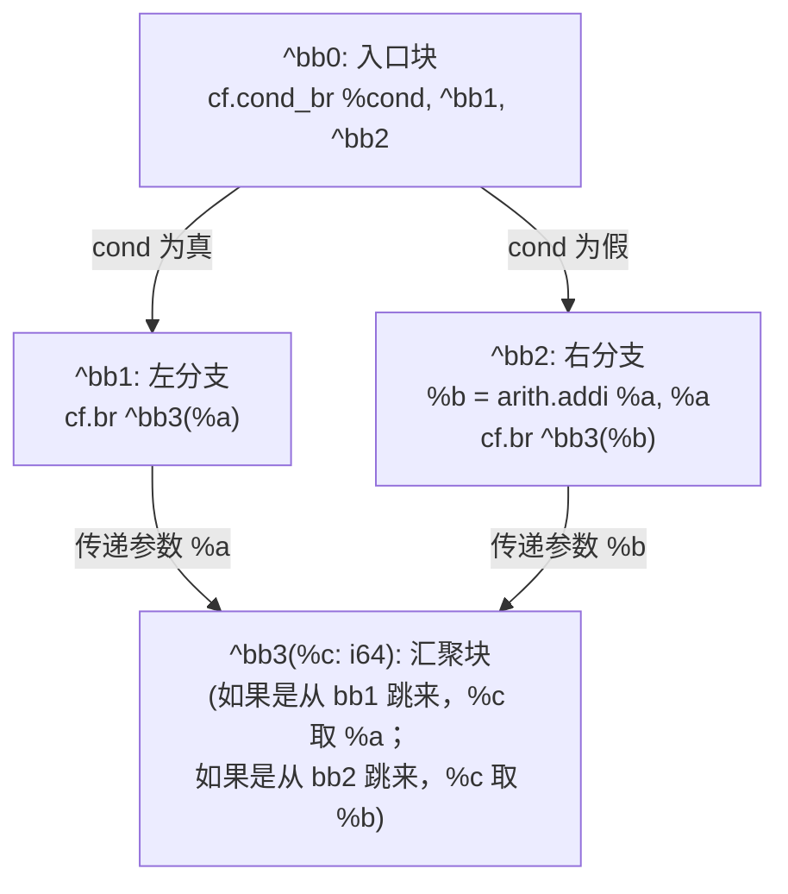

> [!IMPORTANT] 彻底参透这一设计法则：
> **“Region 入口 Block 的 Block Argument，就是 Region 自身的形参！”**
>
> 在 MLIR 中，Region **压根不需要定义独立的参数列表**。
> `func.func @foo(%x: i32)` 中声明的函数形参，在 MLIR 底层 IR 结构中，就是该函数 Region 第一个基本块 `^bb0(%x: i32)` 的 Block Argument！
> 外部调用者向函数传参，本质上就是在向入口块的 Block Argument 绑定数值。这一设计消除了语法冗余，使得函数调用、块间跳转与循环迭代参数拥有了完全统一的底层数据结构。

---

### 3. 作用域与支配关系（Dominance）

在包含嵌套 Region 的代码中，变量的作用域遵循类似传统编程语言的“闭包与作用域”铁律：

```mlir
func.func @accelerator_compute(%a: i64, %cond: i1) -> i64 {
^bb0:
  cf.cond_br %cond, ^bb1, ^bb2

^bb1:
  %value = "op.convert"(%a) : (i64) -> i64
  cf.br ^bb3(%a: i64)

^bb2:
  accelerator.launch() {
    ^bb_inner:
      // ✅ 合法：能够安全读取 %a，因为 %a 位于外层入口块，支配了整个函数
      // ❌ 非法：绝对不能读取 %value！因为 %value 定义在平级分支 ^bb1 中，并不支配 ^bb2
      %new_val = "accelerator.compute"(%a) : (i64) -> ()
  }
  // ❌ 非法：在 accelerator.launch 外面绝不能访问 %new_val！
  // 铁律：嵌套 Region 内部生成的值，绝不能逃逸到 Region 外部使用！

^bb3(%c: i64):
  return %c : i64
}
```

---

## 五、MLIR 原生异步机制：`async` Dialect 与 LLVM 协程降级

随着异构加速计算的发展，任务往往需要在主机端 CPU 与设备端加速器之间非阻塞并行流转。MLIR 原生提供了 `async` Dialect。

### 1. 异步编程三剑客类型

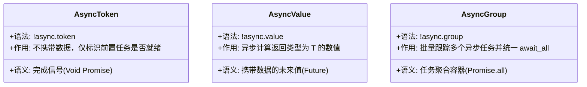

---

### 2. 实战演练：双路并发与合并等待

```mlir
func.func @parallel_add(%a: f32, %b: f32) -> f32 {
  // 1. 启动第一个异步任务：计算 a * a
  %tok1, %val1 = async.execute -> (f32) {
    %r1 = arith.mulf %a, %a : f32
    async.yield %r1 : f32
  }

  // 2. 启动第二个异步任务：计算 b * b (与任务 1 并发执行)
  %tok2, %val2 = async.execute -> (f32) {
    %r2 = arith.mulf %b, %b : f32
    async.yield %r2 : f32
  }

  // 3. 非阻塞或阻塞等待结果产出
  %v1 = async.await %val1 : !async.value<f32>
  %v2 = async.await %val2 : !async.value<f32>

  // 4. 合并相加
  %sum = arith.addf %v1, %v2 : f32
  return %sum : f32
}
```

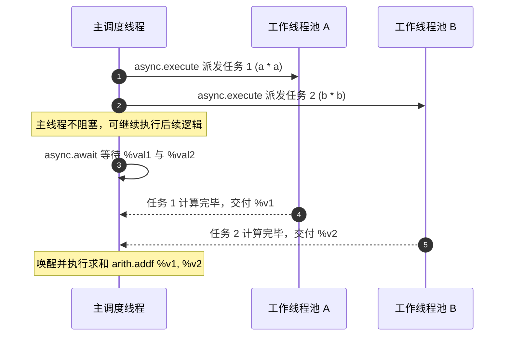

---

### 3. 底层 Lowering 核心：LLVM 协程状态机拆分（CoroSplit）

MLIR 的 `async` 并不是一门独立的虚拟运行时语言，它最终会通过 `async-to-llvm` 编译下降为 **LLVM 官方的协程指令集（LLVM Coroutines）**：

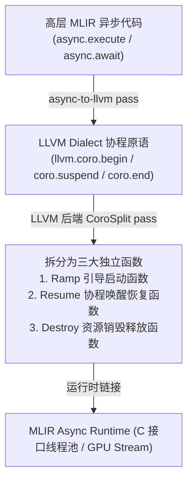

当程序执行到 `async.await` 时，底层并不是死循环空转或挂死线程，而是**通过 `llvm.coro.suspend` 自动把当前函数的调用栈现场打包保存到堆上的协程帧中，立即让出当前 CPU 核心**；当异步任务真正执行完成时，运行时环境（Async Runtime）在某个可用工作线程上调用 `Resume` 函数，无缝恢复现场继续执行。

---

## 六、方言转换框架（Dialect Conversion）：底层机制与降级哲学

方言转换框架（Dialect Conversion Framework）是整个 MLIR 编译系统的“中央枢纽”，负责将高层方言有计划、可控地降级为低层方言。

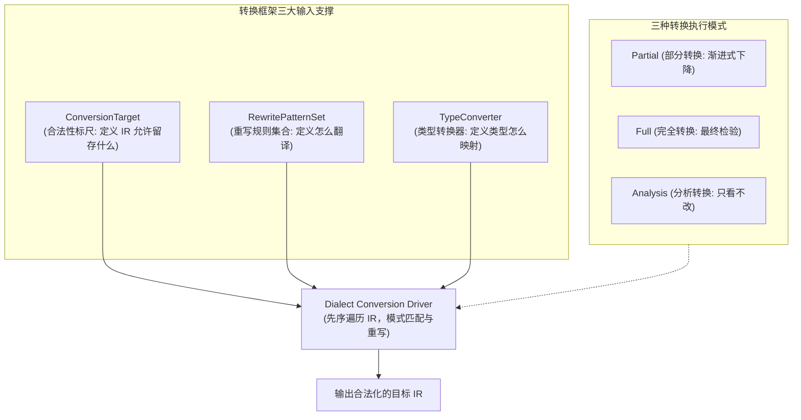

### 1. 三大核心支撑组件

#### ① ConversionTarget（目标合法性标尺）
它回答一个关键问题：**“在我的转换目标里，哪些 Op 可以保留？哪些必须彻底消灭？”**
- **Legal（合法）**：
  `target.addLegalDialect<LLVMDialect>()`
  该方言的所有 Op 都被认可，原样保留，编译器跳过不再重写。
- **Dynamic（动态合法）**：
  `target.addDynamicallyLegalOp<arith::AddIOp>([](auto op) { ... })`
  只有满足指定回调条件的实例才合法（例如：只允许操作 32 位整型的加法存在）。
- **Illegal（非法）**：
  `target.addIllegalDialect<LinalgDialect>()`
  绝对不容忍存在！如果转换流水线结束时还有该 Op 残留，转换宣告失败。
- **Unknown（未知）**：
  未做任何声明的方言。在 Partial 模式下允许保留，在 Full 模式下视为非法。

#### ② RewritePatternSet（重写模式集合）
具体的翻译字典。当框架遇到一个 Illegal 或 Unknown Op 时，从集合中寻找匹配的 Pattern，将其替换为合法的新 Op。

#### ③ TypeConverter（类型转换器）
负责源类型与目标类型之间的映射规则（例如将所有的 `tensor` 转换为 `memref`，或将浮点精度由 `f32` 缩微映射为 `i32`）。

---

### 2. 转换模式的选择：何时用 Partial，何时用 Full？

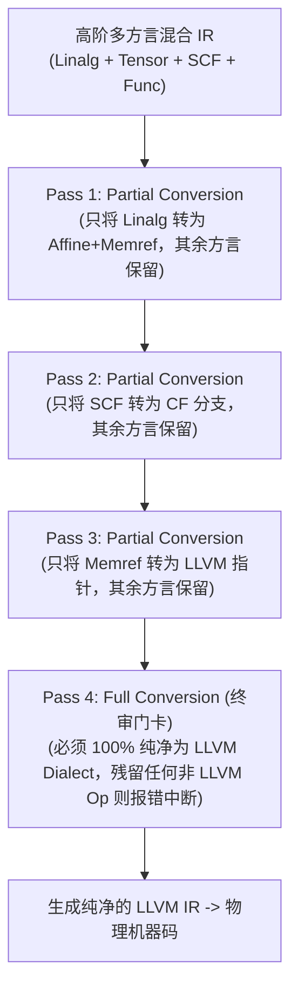

| 转换模式 | API 接口 | 核心行为 | 适用典型阶段 |
|---|---|---|---|
| **部分转换 (Partial)** | `applyPartialConversion` | 尽力而为。非法 Op 尝试重写，未知 Op 允许保留 | 复杂流水线的中间步骤，允许多种抽象共存 |
| **完全转换 (Full)** | `applyFullConversion` | 极度严格。所有 Op 必须在 Target 上证明合法，任何残留即刻报错 | 编译降级的最终出口（如导出到 LLVM IR 前） |
| **分析转换 (Analysis)** | `applyAnalysisConversion` | 只做模拟分析，**绝对不修改 IR**，产出合法化报告 | 调试排错、前端可行性检查、预先路径评估 |

---

### 3. 递归合法性（Recursive Legality）：信任边界机制

在大型复杂函数中，常常出现某些 Operation 内部嵌套着深厚的 Region：

```mlir
func.func @heavy_kernel() {
  scf.for %i = ... {
    linalg.matmul ... // 假设全局已将 linalg 标记为 Illegal
  }
}
```

在默认情况下，驱动框架会**像海关翻箱倒柜一样钻进每一层 Region 的最深处**。一旦发现 `linalg.matmul` 未被降级，整个 Pass 就会报错。

但如果你手动编写了一个高度优化的底层特定内核，或者当前 Pass 阶段压根不希望框架去触碰某个 Op 肚子里的实现，你可以声明**递归合法性**：

```cpp
// 1. 声明该 Op 本身合法
target.addLegalOp<scf::ForOp>();

// 2. 授予该 Op "外交豁免权"：它肚子里的所有子 Op 全部免检！
target.markOpRecursivelyLegal<scf::ForOp>();
```

> **形象比喻**：
> - **普通合法**：旅客本人身份合格，但他的行李箱必须打开，里面的每一件物品都要过安检机检查。
> - **递归合法（外交豁免）**：旅客本人身份尊贵，免予开箱检查，他箱子里的所有物品不管是什么，一律免检直接通行！

---

## 七、Conversion Pattern 的 Adaptor 机制与回滚/无回滚模式调试秘籍

编写 Conversion Pattern 时，最让初学者困惑的莫过于 `matchAndRewrite` 钩子接收的两个参数：`Operation *op` 与 `OpAdaptor adaptor`。

```cpp
LogicalResult matchAndRewrite(
    MyOp op,
    OpAdaptor adaptor, // <-- 这到底和 op 有什么区别？
    ConversionPatternRewriter &rewriter) const override;
```

### 1. Adaptor（重映射操作数）的本质解密

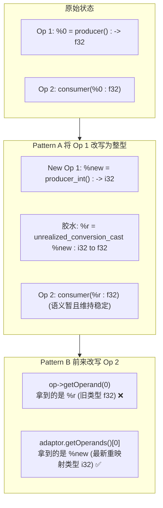

- **问题根源**：在流水线重写过程中，前面的 Pattern 可能已经改变了某个 SSA 值的类型（例如从 `f32` 变为了 `i32`）。但为了维持 IR 临时的类型安全，框架会自动插入一个胶水操作 `builtin.unrealized_conversion_cast`。
- **获取真相**：
  - 如果你通过 `op->getOperand(0)` 查询，你拿到的是胶水返回的过时旧类型；
  - 如果你通过 `adaptor.getOperands()[0]` 查询，**Adaptor 像移动运营商一样，为你追踪到了最新的替换号码**，直接返回最新生成的 `i32` 值！
- **黄金铁律**：在任何带类型转换的 `ConversionPattern` 中，**获取输入操作数必须永远通过 `adaptor`，获取属性（Attributes）则可以直接从 `op` 读取**！

---

### 2. 回滚模式（Rollback）vs 无回滚模式（No-Rollback）

Dialect Conversion 驱动允许以两种截然不同的策略管理 IR 修改：

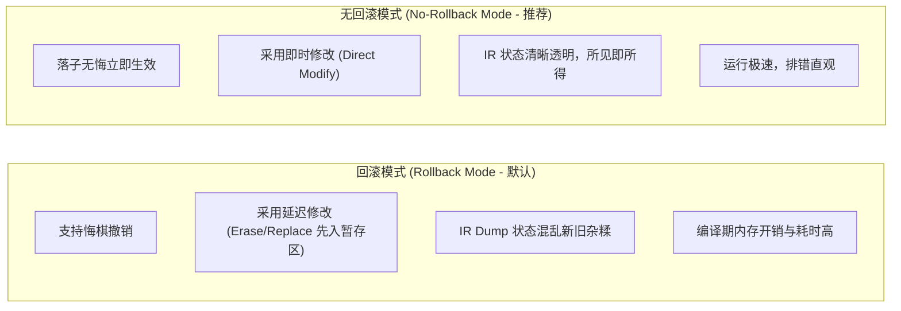

| 行为差异 | 回滚模式 (Rollback Mode) | 无回滚模式 (No-Rollback Mode) |
|---|---|---|
| **核心机制** | 记录庞大的 C++ 撤销账本，重写失败时可回退 | 所有的 IR 增删改查立即反映到实际数据结构上 |
| **`rewriter.eraseOp()`** | **延迟擦除**。Op 依然停留在 IR 遍历中，打上删除标签 | **立即销毁**。Op 瞬间脱离链表并释放 |
| **`rewriter.replaceOp()`** | **延迟更新引用**。转换结束前旧的使用者仍存在 | **立即更新**。直接替换所有 SSA 引用关系 |
| **调试体验** | **极差**。Dump IR 时能看到新旧两套算子诡异并存，连接逻辑隐匿于 C++ 内存中 | **极佳**。每次 Dump 出来的都是百分百真实的当前状态 |
| **工业界最佳实践** | 适合高度试验性、容错冗余的大型模糊探索流水线 | **现代实践强烈推荐！** 配合前置静态检查，高效稳定 |

---

### 3. 无回滚模式的专业调试指南

在无回滚模式下，由于“落子无悔”，调试的关键就在于：**“预检先行、日志跟踪、用例精简”**。

```bash
# 1. 开启方言转换全过程专属日志，追踪每一个 Pattern 的匹配细节
mlir-opt input.mlir \
  --my-conversion-pass \
  --debug-only=dialect-conversion

# 2. 开启差异化 IR 打印：只有当 IR 发生真实篡改时才打印快照，避免终端刷屏
mlir-opt input.mlir \
  --my-conversion-pass \
  --mlir-print-ir-after-change

# 3. 当遇到合法化失败时，精准输出 C++ 内部报错堆栈
mlir-opt input.mlir \
  --my-conversion-pass \
  --mlir-print-stacktrace-on-diagnostic

# 4. 关闭多线程并发，让所有调试日志按单一时间线严格单调输出
mlir-opt input.mlir \
  --my-conversion-pass \
  --mlir-disable-threading

# 5. 遭遇诡异崩溃？利用官方神器 mlir-reduce 自动进行二分法缩减！
# 它会自动化删减无关 Op，将上千行的 IR 自动精简为 10 行最小可复现用例！
mlir-reduce input.mlir \
  --pass-pipeline="builtin.module(my-conversion-pass)" \
  -o minimal_reproduce.mlir
```

---

## 八、类型安全（Type Safety）与双向物化（Materialization）机制终极解密

在类型转换系统中，“转换（Conversion）”与“物化（Materialization）”是最容易混淆的一对孪生兄弟。

### 1. 概念界定：汇率表 vs 去银行换钱

```
类型转换 (Conversion) = 查汇率表 (1 美元 = 7.2 人民币)
  -> 纯逻辑映射规则，绝对不会在 IR 中生成任何新指令！

类型物化 (Materialization) = 实际去银行开具交易单把美元换成人民币现钞
  -> 在 IR 中真正插入显式的类型转换/桥接操作 (如 unrealized_conversion_cast)！
```

---

### 2. 双向物化：Source Materialization vs Target Materialization

什么时候需要往 IR 里插入物化节点？取决于类型流动的**方向**。

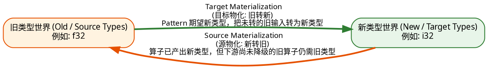

#### ① Target Materialization（目标物化：旧 $\rightarrow$ 新）
- **触发情境**：新的 Pattern 准备处理算子 `consumer`，该 Pattern 声明自己只接收合法化的新类型（如 `i32`）；然而，上游输入 `%a` 目前由于尚未转换，仍然是一个 `f32`。
- **驱动行为**：框架自动插入一个 Target 物化节点，将 `f32` 强制转为 `i32` 喂给 Pattern，确保 Pattern 的类型安全性。

#### ② Source Materialization（源物化：新 $\rightarrow$ 旧）
- **触发情境**：上游的 `producer` 已经被成功改写，产出了全新类型 `i32`；但是，下游还存在好几个由于顺序问题尚未被转换的旧算子（或者在 Partial 模式下无需转换的第三方算子），这些旧算子点名必须吃 `f32`。
- **驱动行为**：框架自动插入一个 Source 物化节点，把已经生成的新类型 `i32` 临时“逆向降维转回” `f32`，给旧的使用者兜底。

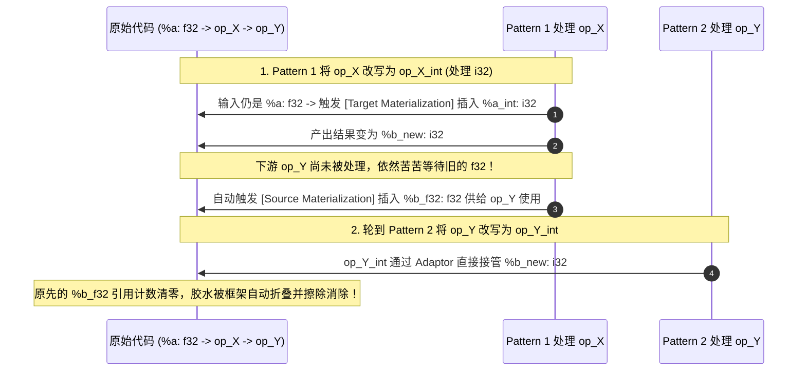

通过这套自动化的双向物化协议，编译器在进行复杂的局部、渐进式降级时，既保证了任何时刻 IR 的严格类型约束不被破坏，又让开发者能够专注于单个 Pattern 内部的核心逻辑，免去了编写冗长防御性类型适配代码的负担。

---

## 九、总结与工业级 MLIR 编译降级流全景图谱

通过以上章节的抽丝剥茧，我们掌握了从底层数据类型、值语义边界、基本块控制流到方言转换框架的全套核心技术。最后，让我们将所有技术节点汇总为一张工业级端到端降级全景图，作为后续编译器研发与日常调试的永久心智地图：

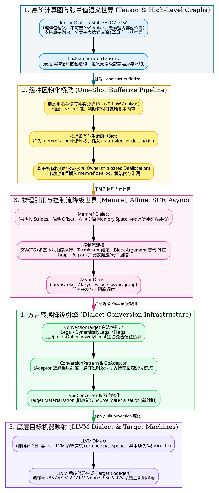

---

## 参考文献与扩展阅读

1. **MLIR 官方设计原则**：[MLIR: A Compiler Infrastructure for New Hardware and Software Ecosystems](file:///home/ubuntu/git/blog) (C. Lattner et al.)
2. **MLIR 语言参考手册 (LangRef)**：[MLIR Language Reference](https://mlir.llvm.org/docs/LangRef/)
3. **One-Shot Bufferization 详解**：[Comprehensive Bufferization in MLIR](https://mlir.llvm.org/docs/Bufferization/)
4. **Dialect Conversion 机制**：[Dialect Conversion Architecture](https://mlir.llvm.org/docs/DialectConversion/)
5. **LLVM 协程设计**：[LLVM Coroutines Documentation](https://llvm.org/docs/Coroutines.html)
