> **导读**：在研读 MLIR（多级中间表示）官方文档或编写基于 `linalg` 方言的矩阵计算时，几乎每一位初学者都会被一个看似极其违背直觉的语法现象所困惑：
>
> 为什么在数学上一个纯粹的加法 $C = A + B$ 或矩阵乘法 $C = A \times B$，在 MLIR 中偏偏要写成 `linalg.generic ins(%A, %B) outs(%C)`？既然 `%A` 和 `%B` 已经包含了所有输入信息，**为什么计算结果还需要作为一个额外的输入参数（`outs`）传进去？**
> 
> 如果我们不采用这种“目标传递风格”（Destination-Passing Style，简称 DPS），编译器真的就不能工作了吗？没有 DPS 到底会导致哪些编译分析崩溃，或者产生怎样的性能灾难？它与硬件底层的物理显式地址、NPU 片上 SRAM 动态地址生成（AG）又有着怎样的本质区别？
>
> 本文将从**编译第一性原理**出发，抽丝剥茧推演不可变 SSA 值语义与物理可变内存之间的永恒矛盾，完整剖析 MLIR 为何在架构顶层确立 DPS，并结合 LLVM 官方源码与工业级 NPU 编译器场景，为读者建立一套坚不可摧的底层认知模型。

---

## 零、初学者名词形象速查表 (Primer)

为了确保零基础或刚进入 AI 编译器领域的读者能够无障碍阅读，下表对文中首次出现的关键术语做出一对一的物理世界映射与通俗定义：

| 术语名称 | 英文全称 | 核心本质与通俗比喻 |
| :--- | :--- | :--- |
| **IR** | Intermediate Representation | **编译器中间表示**。介于高级语言（如 PyTorch/C++）与底层机器指令（如汇编）之间的通用数据结构，相当于编译器的“世界语”。 |
| **MLIR** | Multi-Level IR | **多级中间表示框架**。LLVM 孵化的下一代模块化编译器基础设施，允许开发者自定义不同抽象层级的领域语言。 |
| **Dialect** | 方言 | **MLIR 的模块化词表**。每个 Dialect 是一组特定领域的类型（Types）与操作（Operations）集合，如 `arith`（标量算术）、`tensor`（高维张量）、`memref`（物理内存指针）、`linalg`（线性代数）。 |
| **SSA** | Static Single Assignment | **静态单赋值**。一种编译器代码属性，要求**每个变量必须有且仅有一个赋值点**。数学世界中 $x=5$ 是永恒真理，不可被修改；变量只有“新值”，没有“覆盖”。 |
| **Tensor** | 张量类型 (`tensor<...>`) | **纯值语义（Value Semantics）**。不可变的高级数学实体。它只代表“数据的内容与维度”，**没有任何物理内存地址**，也不存在“指针”概念。 |
| **MemRef** | 内存引用类型 (`memref<...>`) | **缓冲区语义（Buffer Semantics）**。底层的物理指针包装体。包含数据物理基地址指针、偏移量（offset）、形状（sizes）与步长（strides），**内容完全可变**。 |
| **Bufferization** | 缓冲化 / 内存降级 | **连接虚拟数学与物理硬件的桥梁**。将抽象、不可变的 `tensor` 计算全面转换为在具体物理内存 `memref` 上进行读写的编译器 Pass。 |
| **One-Shot Bufferize** | 一次性整模块缓冲化 | MLIR 官方核心的 Bufferization 算法。它采用模块级全局分析，在尽可能**避免额外内存分配与数据拷贝（Copy）**的前提下完成原地内存复用。 |
| **DPS** | Destination-Passing Style | **目标传递风格**。一种在 Operation 定义中显式提供 `init` 或 `outs` 操作数作为计算结果承载候选者的 IR 建模模式。 |
| **Tied Operand** | 绑定操作数 | DPS 中输入操作数（`init`/`outs`）与输出结果（OpResult）之间形成的**一对一关联契约**，声明“这个结果在逻辑上准备更新到这个目标”。 |
| **In-place Mutation** | 原地覆写 / 原地计算 | 直接复用输入的物理内存来存储计算输出，避免重新分配一块内存，达到节约空间与带宽的目的。 |
| **Alias Analysis** | 别名分析 | 编译器用于判断“两个不同的变量/指针是否可能在底层指向同一块物理内存”的静态推导算法。 |
| **RaW Conflict** | Read-after-Write Conflict | **写后读冲突**。当编译器尝试原地覆写一块内存时，如果后续的代码还需要读取这块内存被修改前的“旧值”，就会发生脏读错误。 |
| **Use-Def Chain** | 使用-定义链 | 编译器中连接“一个值的产生位置（Def）”与其“所有被引用的位置（Use）”的有向依赖链条。 |
| **Tiling** | 循环分块 / 切片分块 | 将无法一次性塞入芯片高速缓存（Cache）或片上 SRAM 的巨大张量计算，切分成若干小块（Tile）逐个执行的高性能优化技术。 |
| **AG** | Address Generator | **硬件地址生成器**。专用芯片（如 NPU/DSP）中独立于 ALU 的专用寻址硬件，能够在时钟周期内根据基址、步长与循环余数自动吐出访存物理地址。 |

---

## 一、物理内存危机：从第一性原理推导内存分析的必要性

为了真正明白 MLIR 为何需要 DPS，我们必须暂时忘掉复杂的编译器接口，回到最朴素的硬件物理现实。

### 1.1 纯函数式数学世界 vs 极其残酷的硬件 SRAM

在高级深度学习框架（如 PyTorch、JAX）或 MLIR 的 `tensor` 抽象层中，一切都是**纯函数式（Pure Functional）**且满足 **SSA（静态单赋值）** 的：

```text
C = A + B   // C 是一个全新诞生的张量值，A 和 B 保持原样、永不改变
D = C * 2   // D 又是一个全新诞生的张量值，C 同样不可变
```

在数学逻辑上，这种“不可变性”极其优美，它没有任何副作用（Side Effects），编译器可以极其自由地进行死代码消除、公共子表达式折叠以及无顾虑的算子融合。

然而，**物理硬件（CPU 内存、GPU 显存、NPU 片上 SRAM）不是无限的数学宇宙**。在硅片上，每一字节的存储都需要消耗真实的晶体管与功耗。假设上述张量 $A, B, C, D$ 均包含 $1024$ 个 `f32` 浮点数，每个张量占据物理内存：

$$\text{Memory Size} = 1024 \times 4\text{ Bytes} = 4096\text{ Bytes} = 4\text{ KB}$$

此时，编译器有两种将其映射到底层物理内存的方案：

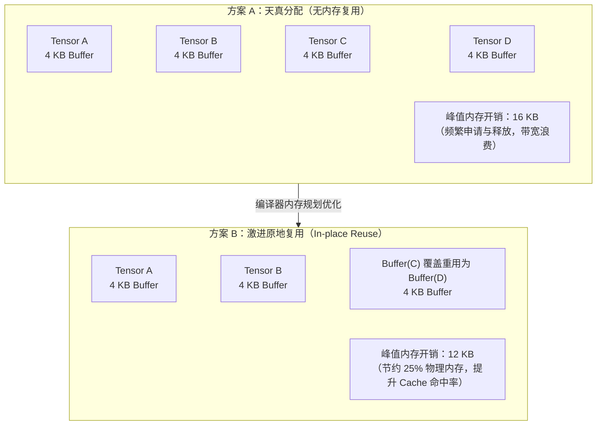

在方案 B 中，当计算 $D = C \times 2$ 时，硬件可以直接将计算结果写回 $C$ 所在的物理内存地址。在片上存储资源极其昂贵的嵌入式 NPU（例如片上 SRAM 仅有几百 KB 到数 MB）中，**能否进行就地覆写（In-place），往往直接决定了超大模型算子能否被容纳在片上执行，亦或被迫溢出（Spill）到延迟高出两个数量级的外部 DDR/DRAM**。

### 1.2 原地覆写的致命陷阱：写后读（RaW）冲突

但是，编译器能够无脑地将 $D$ 覆写到 $C$ 的内存中吗？

我们来看一段极细微的代码改动：

```cpp
C = A + B;
D = C * 2;
E = C + 1; // 警告：后续计算仍然需要读取 C 的历史旧值！
```

如果我们允许执行 $D = C \times 2$ 时原地销毁 $C$ 的内存：

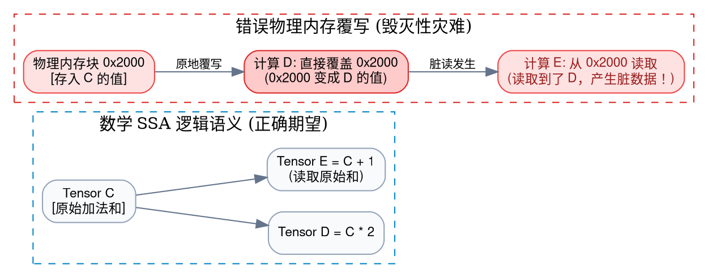

在上述时序下，当程序试图计算 $E$ 时，物理内存 `0x2000` 已经被 $D$ 彻底污染。最终 $E$ 读取到的根本不是 $C$，而是 $D$ 的计算结果！

这就是编译器在管理内存时必须直面的核心矛盾：
1. **为了极致性能与低空间占用**，我们必须尽可能让输出结果复用输入的物理内存（Buffer Sharing / In-place Mutation）；
2. **为了程序执行的绝对正确性**，我们必须绝对杜绝在数据的旧值仍有存活使用者（Live Users）时发生物理覆盖。

这正是 **Bufferization（缓冲化分析）** 的核心使命：**它必须在编译期静态证明，某一块内存是否可以安全地原地覆写；如果不能，它必须明智地插入内存分配（`memref.alloc`）与深拷贝（`memref.copy`）。**

---

## 二、没有 DPS 的世界：编译器到底面临怎样的“搜索风暴”？

现在，我们终于可以触及问题的咽喉：**为什么编译器在做上述内存复用分析时，迫切需要 DPS？没有 DPS 会怎样？**

### 2.1 非 DPS 操作的形式化困境

假设我们为一个自定义的加法操作定义了非 DPS 风格的 MLIR IR：

```mlir
// 非 DPS 风格操作：纯粹的数学函数式输入输出
%result = "my.add"(%a, %b) : (tensor<1024xf32>, tensor<1024xf32>) -> tensor<1024xf32>
```

这段代码精准地表达了高层语义：
- 它需要读取 `%a`；
- 它需要读取 `%b`；
- 它产出了一个全新的不可变 SSA 值 `%result`。

现在，假设你是负责将这段代码转换为物理内存分配的编译器工程师（即实现 Bufferization Pass）。当你遍历到这一行指令时，你面临的第一个致命问题是：

> **“我的运算结果 `%result`，到底应该写入哪一块内存缓冲区（Buffer）？”**

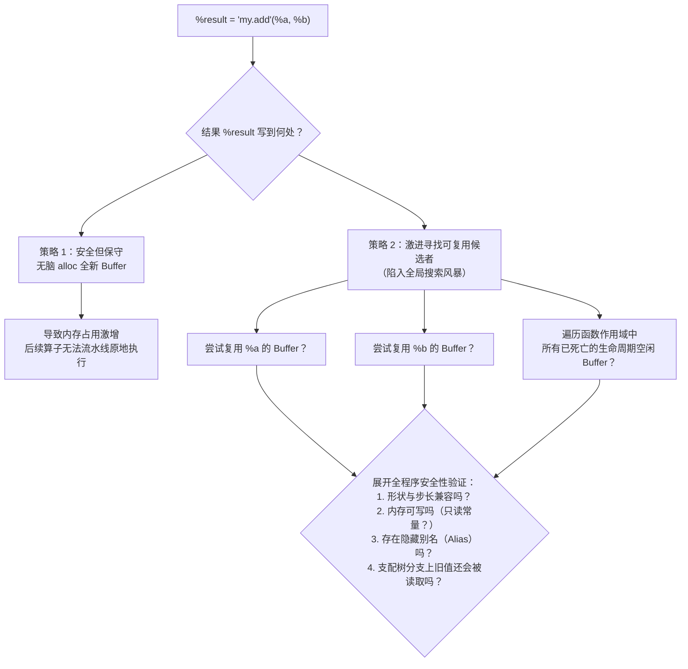

在非 DPS 体系下，要实现内存复用，编译器必须执行**全程序或全函数范围的无约束缓冲区匹配（Unconstrained Buffer Search）**：
1. **输入参数复用推断**：它需要探查 `%a` 和 `%b` 的生命周期，判断算子执行后它们是否彻底死亡；
2. **算子内部覆写约束**：它必须查阅算子内部行为，判断该计算是否支持源与目标重合（例如快速傅里叶变换 FFT 或矩阵原地转置可能不支持原地址输出）；
3. **空闲池图着色搜索**：如果在参数中找不到候选者，它必须遍历当前基本块及支配树上所有已释放的临时缓冲区，检查类型、大小、生命周期是否完全匹配；
4. **控制流复杂性**：在包含复杂 `if-else` 分支与循环（Loops）的场景下，由于不同路径上缓冲区的存活状态动态变化，全局寻找最优复用位置的算法复杂度将迅速退化为类似 NP-Complete 的寄存器分配图着色难题。

### 2.2 澄清关键误区：没有 DPS，编译器就不能做分析了吗？

**绝对不是！** 许多初学者容易产生一个认知偏差：“没有 DPS，MLIR 的分析就完全做不下去了。”

我们需要做出清晰、严密的界定：

> [!NOTE] 事实澄清：分析能力 vs 算法复杂度
> 1. **没有 DPS，MLIR 依然可以进行完备的 SSA 分析、数据流分析、别名分析以及支配树分析**。编译器并没有丧失图遍历的能力。
> 2. **没有 DPS，使得“高效、受控的内存复用决策”在工程上变得极其昂贵和不可维护。**
> 3. 对 MLIR 官方的核心框架 **One-Shot Bufferize** 而言，它的算法策略被显式设计为：**绝不跨全函数进行昂贵的、全局启发式的可复用 Buffer 任意搜索**。因此，如果一个产生新张量的操作没有显式指定可复用的目标，One-Shot Bufferize 的保守策略就只能是：**直接为该结果分配一块全新的内存！**

我们通过 MLIR 官方自带的非 DPS 算子 `tensor.generate` 来看这一惨痛后果：

```mlir
// 非 DPS 操作：tensor.generate 仅描述如何生成一个新张量
%result = tensor.generate %size {
^bb0(%i : index):
  %c0 = arith.constant 0.0 : f32
  tensor.yield %c0 : f32
} : tensor<?xf32>

// 紧接着，这个结果被写入大张量 %C 的某个切片中
%next = tensor.insert_slice %result into %C[%offset] [%size] [1] : tensor<?xf32> into tensor<?xf32>
```

站在人类开发者的视角，我们一眼就能看出：既然 `%result` 最终要塞入 `%C` 的某个切片中，为什么不在生成时直接就地写入 `%C` 对应的切片内存呢？

然而，在 One-Shot Bufferize 面临非 DPS 的 `tensor.generate` 时：
- `tensor.generate` 没有提供任何输出目标候选操作数；
- 编译器不会顺着 Use-Def 链去反向猜测“消费者 `tensor.insert_slice` 可能会提供一片内存”；
- **最终降级结果**：编译器不得不执行一次 `memref.alloc` 分配临时小内存，在临时内存中把数据算完，然后再通过一次昂贵的全量内存复制（`memref.copy`）把数据搬进 `%C` 的物理切片中！

这正是非 DPS 带来的本质性能代价：**无谓的内存分配风暴与数据拷贝开销。**

---

## 三、DPS 机制全景解密：把“搜索问题”降维为“安全性校验”

为了终结这种无休止的全局搜索风暴，MLIR 引入了源自函数式编程的高级设计模式——**DPS（Destination-Passing Style，目标传递风格）**。

### 3.1 核心思想：操作自己声明它的“归宿”

DPS 的思想大道至简：

> **既然让编译器去整个宇宙中大海捞针寻找输出缓冲区如此昂贵，为什么不让操作（Operation）在构建 IR 的那一刻，就显式告诉编译器：“我希望把我的计算结果安放在哪里”？**

让我们对比非 DPS 与 DPS 在 MLIR 中的语法差异：

#### 方案 1：非 DPS（函数式抽象）
```mlir
// 编译器不知道 %result 未来想住在哪，只能给它买一套新房子（alloc）
%result = "my.add"(%a, %b) : (tensor<1024xf32>, tensor<1024xf32>) -> tensor<1024xf32>
```

#### 方案 2：DPS（目标传递抽象）
```mlir
// 编译器清晰知道：%result 期望复用 %dest 的居所！
%result = my.add
    ins(%a, %b : tensor<1024xf32>, tensor<1024xf32>)
    outs(%dest : tensor<1024xf32>) -> tensor<1024xf32>
```

`outs(%dest)`（在通用接口中统称为 `init` 操作数）就是 DPS 的点睛之笔！

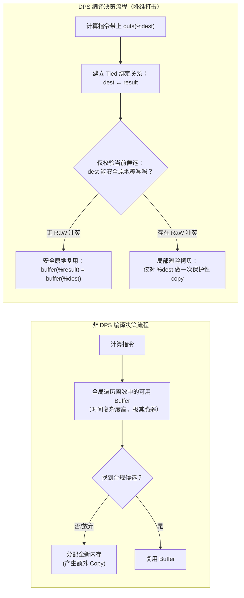

### 3.2 关键契约：Tied Operand 与数学关系式

在 DPS 规范下，输入操作数与输出结果之间建立了一种强约束的结构性联系，官方称之为 **Tied Relationship（绑定关系）**：

$$\operatorname{destination}(\%result) = \%dest$$

> [!IMPORTANT] 认知红线：绑定关系绝对不等于 SSA 值相等！
> 请务必牢记：在 Tensor 语义的世界中，`%dest` 和 `%result` 是**两个完全独立、互不侵犯的 SSA 逻辑值**！`%dest` 依然是不可变的旧值，`%result` 是产出的新值。
>
> 这个绑定关系仅仅是在向编译器传达一个**物理候选倾向**：
>
> $$\operatorname{buffer}(\%result) = \begin{cases} \operatorname{buffer}(\%dest), & \text{当且仅当静态证明原地覆写绝对安全（无 RaW 冲突）} \\ \operatorname{newBuffer}(), & \text{当检测到潜在冲突，必须分配隔离保护} \end{cases}$$

通过引入 DPS，编译器将原本发散的、开放式的**“无界搜索问题”**，瞬间降维收敛为确定性的、封闭式的**“单点二元安全性验证问题”**！

---

## 四、实战剖析：DPS 不等于原地修改！RaW 冲突分析内幕

许多初学者容易产生第二个严重误区：“既然我写了 `outs(%dest)`，编译器就一定会原地覆写 `%dest` 的内存。”

**大错特错！DPS 只是提供了“候选目标”，而是否允许原地写入，必须由 One-Shot Bufferize 的冲突检测器进行无情的审查。**

让我们通过一个经典的 MLIR 算子 `tensor.insert` 深入其分析内核。

### 4.1 场景 A：无冲突下的极致优雅（零开销就地覆写）

```mlir
// 初始不可变张量 %t0
// 此时通过 tensor.insert 产生更新后的 %t1
%t1 = tensor.insert %scalar into %t0[%idx] : tensor<4xf32>

// 在后续的代码中，只有 %t1 被读取，%t0 彻底死亡！
"my.consumer"(%t1) : (tensor<4xf32>) -> ()
```

我们来观察编译器在这个过程中的推导逻辑：

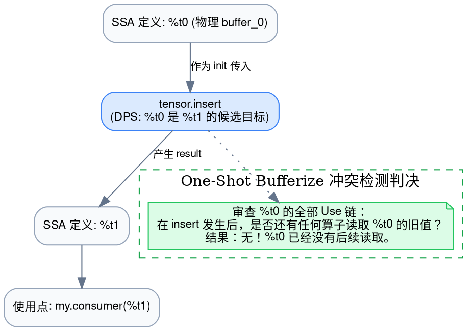

降级为底层 `memref` 物理表示后的效果极其优异：

```mlir
// 伪代码表示降级结果：完全没有 malloc/alloc，没有数据搬运！
%buffer_t0[%idx] = %scalar; // 直接单点写入已有物理缓冲区
// %t1 的缓冲区句柄直接复用 %buffer_t0
```

整个过程零分配、零拷贝，达到了与手写 C 语言数组赋值完全相同的机器性能！

### 4.2 场景 B：RaW 冲突爆发！编译器被迫防御性拷贝

现在，我们故意在代码中保留对旧值的读取：

```mlir
// 初始不可变张量 %t0
%t1 = tensor.insert %scalar into %t0[%idx] : tensor<4xf32>

// 致命冲突：在计算发生之后，依然有算子要求读取 %t0 的旧内容！
%old_val = tensor.extract %t0[%idx] : tensor<4xf32>
"my.consumer"(%t1, %old_val) : (tensor<4xf32>, f32) -> ()
```

此时，One-Shot Bufferize 的冲突检测器被立刻触发：

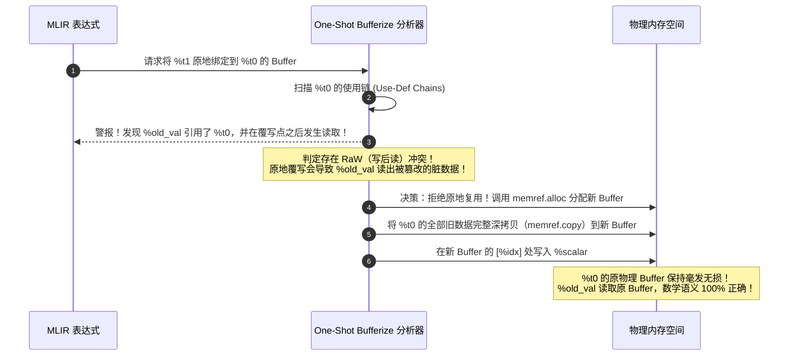

### 4.3 概念全景对照表

为了将这些容易混淆的概念彻底剥离，请读者反复品味以下职责分工：

| 机制名称 | 核心职责与回答的问题 | 属于哪个阶段 | 举例 |
| :--- | :--- | :--- | :--- |
| **SSA 语义** | 哪个计算操作从逻辑上产生了哪个不可变的数学实体？ | 前端 / 计算图表示 | `%r = arith.addf %a, %b` |
| **DPS 契约** | 计算结果在物理降级时，**优先推荐**谁作为它的存储候选容器？ | 结构建模 / 变换准备 | `outs(%dest)` / `init(%dest)` |
| **Alias 分析** | 哪些不同的引用实际上在指向同一块物理内存底座？ | 内存分析辅助 | `memref.subview` 是否发生交叠 |
| **RaW 分析** | 如果我顺水推舟原地覆写这个候选目标，未来的读取者会读到脏数据吗？ | 内存安全仲裁 | 检查覆写与读取的先后偏序关系 |
| **Bufferization** | 真正发出内存申请、生成释放指令、将 Tensor 彻底抹杀为物理指针。 | 代码生成前夕降级 | 生成 `memref.alloc` / `memref.copy` |

---

## 五、拨开迷雾：DPS 与显式物理地址、动态地址生成（AG）的正交边界

在与一线硬件与算子工程师交流时，最常遇到的另一个核心混淆是：

> “既然我的操作已经写了 `outs(%dest)`，这难道不就等于显式指定了写回内存地址吗？它和我们 NPU 的动态地址生成器（AG）到底是什么关系？”

必须给出一个斩钉截铁的结论：

> [!WARNING] 架构结论：三个完全独立的抽象维度
> **DPS、物理地址显式化、动态地址计算，是编译器在不同阶段解决的三个正交（Orthogonal）问题！它们之间绝不能画等号。**

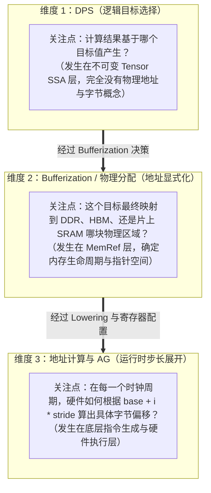

### 5.1 从 Tensor 一路推演到底层硬件物理地址

让我们以一个典型的矩阵乘累加（GEMM Tile）为例，观察同一个计算在编译器流水线中是如何层层蜕变的：

#### 第一层：Tensor SSA + DPS 表达（纯逻辑目标候选）
```mlir
// 此时编译器根本不知道物理内存地址是什么，只知道逻辑绑定
%result = linalg.matmul
    ins(%A, %B : tensor<16x16xf32>, tensor<16x16xf32>)
    outs(%C_init : tensor<16x16xf32>) -> tensor<16x16xf32>
```
在这一层，`outs(%C_init)` **既承担了计算的数学初值（$C_{\text{result}} = A \times B + C_{\text{init}}$），又承担了未来内存复用的候选宿主**。

#### 第二层：Bufferization 后的 MemRef 表达（物理目标显式化）
```mlir
// 此时确定了存储容器，但具体的字节访问仍是多维坐标表达
memref.subview %C_buffer[%offset_row, %offset_col] [16, 16] [1, 1]
    : memref<1024x1024xf32> to memref<16x16xf32, strided<[1024, 1], offset: ?>>
```
在这一层，数据结构转变成了 `memref`。它包含四个物理要素：
1. **Base Pointer**（基地址指针）：指向分配在片上 SRAM（`memory_space = 1`）还是系统 DDR（`memory_space = 0`）；
2. **Offset**（偏移量）：切片相对于基地址的偏移；
3. **Sizes**（各维度尺寸）：`[16, 16]`；
4. **Strides**（步长）：跨行跨列需要跨越的元素数量。

#### 第三层：硬件指令与动态地址生成器（AG）寄存器配置
当进入实际的 NPU 后端（如配备专职硬件地址生成器 AG 的专用架构）时，硬件需要计算具体的物理字节地址：

$$\operatorname{Addr}(i, j) = \text{Base} + \left( \text{Offset} + i \cdot \text{Stride}_0 + j \cdot \text{Stride}_1 \right) \times \operatorname{sizeof}(\text{fp32})$$

在许多 NPU 架构中，CPU 或控制核只需要向硬件 AG 写入配置寄存器：
- `cfg_ag_base = Base + Offset * 4`
- `cfg_ag_step_inner = Stride_1 * 4`（内层步长）
- `cfg_ag_step_outer = Stride_0 * 4`（外层换行步长）

随后，计算核心开跑，硬件 AG 每个时钟周期自动泵出物理地址，直接将乘加结果冲刷进对应的片上 SRAM Bank。

**结论清晰明了**：DPS 绝不是去配置 AG 寄存器，也不是生成物理指针！**DPS 只是在最高层为这一整套物理内存的平滑演进铺平了道路。**

### 5.2 状态组合正交阵列

为了彻底破除思维壁垒，我们考察下述四种组合在工业界中的真实存在性：

| 组合分类 | 物理场景真实案例 |
| :--- | :--- |
| **DPS + 静态地址** | 嵌入式单片机/定点 DSP：编译期就确定了权重与输出存放在 SRAM 固定的绝对物理地址（如 `0x2000_0000`），IR 采用 DPS 显式绑定算子输入与目标。 |
| **DPS + 动态地址** | **现代 NPU/GPU 大模型推理的主流场景**：矩阵分块 Tile 的偏移量依赖运行时的外层循环变量 `%i`（`offset = %i * 256`），基地址由运行时驱动动态传入，但在 MLIR 中完全遵循 DPS 组织 `outs(%tile)`。 |
| **非 DPS + 静态地址** | 简单的全局标量常量计算：如 `"my.const"() -> tensor<4xf32>`，没有 DPS 目标，但最终可能被编译器静态固化在二进制文件的 `.rodata` 段。 |
| **非 DPS + 动态地址** | 动态形状动态生成操作：如 `tensor.generate %dyn_size`，既无 DPS 候选，又需在运行时根据动态输入临时调用 `malloc` 申请物理地址。 |

---

## 六、溯源官方标准：LLVM `DestinationStyleOpInterface` 深度剖析

了解了原理后，让我们以严谨的治学态度，直接翻开 LLVM/MLIR 官方底层源码定义，看看编译器顶层设计大师们是如何定义 DPS 的。

### 6.1 官方 TableGen 接口定义拆解

MLIR 在核心接口库中定义了 [`DestinationStyleOpInterface.td`](https://github.com/llvm/llvm-project/blob/main/mlir/include/mlir/Interfaces/DestinationStyleOpInterface.td)。源码的核心摘要如下：

```tablegen
def DestinationStyleOpInterface : OpInterface<"DestinationStyleOpInterface"> {
  let description = [{
    Ops that are in destination style have designated "init" operands, which
    can be tensors or memrefs.
    
    If the "init" operand is a tensor, the op has an OpResult that is tied
    to the "init" operand with a OpResult:OpOperand 1:1 relationship.
    
    For tensor semantics, the "init" operand provides the initial value of
    the result. For memref semantics, the "init" operand provides the memory
    to write to.
    ...
  }];

  let methods = [
    InterfaceMethod<
      /*desc=*/"Return start and end index of the inits/destinations.",
      "std::pair<int64_t, int64_t>", "getDpsInitsPositionRange"
    >,
    InterfaceMethod<
      /*desc=*/"Return the tied OpResult for a given init OpOperand.",
      "OpResult", "getTiedOpResult", (ins "OpOperand *":$opOperand)
    >,
    InterfaceMethod<
      /*desc=*/"Return the tied init OpOperand for a given OpResult.",
      "OpOperand *", "getTiedOpOperand", (ins "OpResult":$opResult)
    >
  ];
}
```

官方接口定义了极其严格的三大约束：
1. **操作数命名**：DPS 操作必须明确指定哪些操作数是 `init`（即目标操作数）；
2. **严格 1:1 绑定**：每一个 Tensor 类型的 `init` 操作数，必须与算子的某一个输出结果（`OpResult`）存在**严格单射、一一对应的绑定关系**；
3. **类型与维度绝对一致**：`init` 操作数的类型、元素类型、Shape 以及运行时的动态维度大小，必须与对应的 `OpResult` 严格相等。

### 6.2 官方给出的两大终极使命：Tiling 与 Bufferization

为什么 MLIR 核心库要大费周章制定这个接口？官方在文档与代码注释中给出了白纸黑字的明确回答：

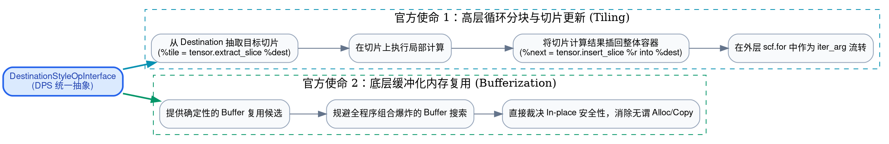

#### 使命 1：让 Tiling（分块变换）的数学表达变得极其自然
在大模型推理中，没有任何一颗芯片能一口吞下一个 $4096 \times 4096$ 的巨型矩阵。编译器必须通过 **Tiling** 将其切分为 $16 \times 16$ 个 $256 \times 256$ 的小分块。

如果没有 DPS，输入是 $A$ 和 $B$，输出凭空冒出来一个小结果，编译器根本无从得知这个分块局部计算产生的结果，在全局逻辑上属于哪一个整体容器的哪一个局部视窗（Slice）。

而在 DPS 体系下，Tiling 变得如丝般顺滑：
```mlir
// 整体输出容器大张量 %C 作为循环的累积变量 iter_arg
%result = scf.for %iv = %c0 to %c1024 step %c256 iter_args(%C_iter = %C) -> tensor<1024x1024xf32> {
    // 1. 顺理成章：直接从目标容器提取当前循环迭代对应的输出切片！
    %tile_dest = tensor.extract_slice %C_iter[%iv, 0] [256, 256] [1, 1] ...
    
    // 2. 顺理成章：将切片作为 DPS 候选传给局部计算
    %tile_res = linalg.matmul ins(...) outs(%tile_dest) ...
    
    // 3. 顺理成章：将计算结果插回整体张量，并作为下一次迭代的初值传递
    %C_next = tensor.insert_slice %tile_res into %C_iter[%iv, 0] [256, 256] [1, 1] ...
    scf.yield %C_next : tensor<1024x1024xf32>
}
```
**正是 DPS 中明确存在的“目标”概念，使得循环切片（Slice）、计算与写回构成了自洽的闭环！**

#### 使命 2：将 Bufferization 的内存开销降至绝对极小
正如前文所详述，它让 One-Shot Bufferize 从图着色搜索的泥潭中解脱出来，使内存优化算法能够在线性时间内收敛，并最大限度地抹平内存拷贝。

官方在 Bufferization 文档中留下的经典定论，堪称现代编译器的设计格言：

> **"DPS exists in itself independently of bufferization."**  
> （DPS 绝非 Bufferization 的附属品，它自身作为一种高级算子结构表达而独立存在。）

### 6.3 架构辨析：`DestinationStyleOpInterface` vs `BufferizableOpInterface`

在 MLIR 开发中，许多工程师容易混淆这两个接口。请务必记住它们分属于两个不同的抽象维度：

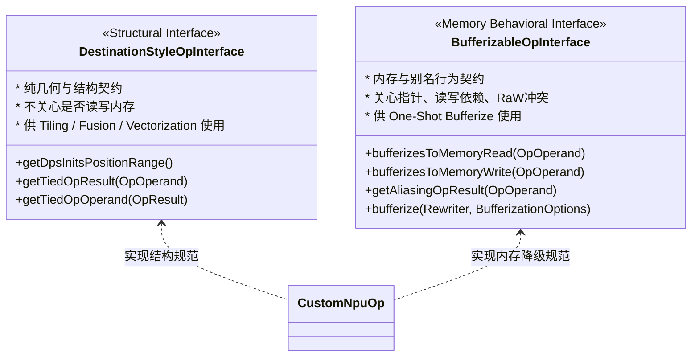

- **`DestinationStyleOpInterface`**：描述**语法与结构**。它告诉外部转换 pass：“我的第 3 个参数是第 0 个结果的候选目标，它们遵循绑定契约”。
- **`BufferizableOpInterface`**：描述**行为与副作用**。它告诉 Bufferization 引擎：“我的这个操作数在物理上到底会发生内存读还是内存写？我和谁可能是别名关系？”

在设计自己的自定义方言算子时，两者各司其职、相辅相成。

---

## 七、工业级实战：在自定义 NPU Dialect 中优雅落地 DPS

假设你目前正在为团队研发一款面向边缘端或端侧的专用 NPU 编译栈，该芯片具有片上 SRAM，依赖 DMA 搬运与硬件加速核计算。你该如何在自定义方言（Dialect）中优雅地运用 DPS 呢？

### 7.1 第一步：在 TableGen 中声明 DPS 算子

在你的 `NpuOps.td` 中定义一个矩阵乘算子，继承 `DestinationStyleOpInterface`：

```tablegen
def NPU_MatmulOp : NPU_Op<"matmul", [
    Pure,
    DestinationStyleOpInterface,
    DeclareOpInterfaceMethods<BufferizableOpInterface>
]> {
  let summary = "NPU 专用矩阵乘算子（DPS 风格）";
  
  let arguments = (ins
    AnyTensor:$lhs,
    AnyTensor:$rhs,
    AnyTensor:$output // 关键：指定为目标操作数
  );

  let results = (outs
    AnyTensor:$result
  );

  let extraClassDeclaration = [{
    // 实现 DestinationStyleOpInterface 所需的核心方法
    std::pair<int64_t, int64_t> getDpsInitsPositionRange() {
      // 声明 $output 是作为 init 的候选目标（位于操作数索引 2）
      return {2, 3};
    }
  }];
}
```

### 7.2 第二步：实现 `BufferizableOpInterface` 内存行为

在算子的 C++ 实现中，向 One-Shot Bufferize 准确汇报内存副作用与别名意图：

```cpp
bool NPU_MatmulOp::bufferizesToMemoryRead(OpOperand &opOperand, 
                                         const AnalysisState &state) {
  // lhs 和 rhs 必然发生物理读
  if (&opOperand == &getOperation()->getOpOperand(0) || 
      &opOperand == &getOperation()->getOpOperand(1))
    return true;
  
  // 对于输出目标 output，如果计算是 C = A * B + C (累加)，则必须读！
  // 如果计算是直接纯覆写 C = A * B，则不需要读其旧值
  return isAccumulate(); 
}

bool NPU_MatmulOp::bufferizesToMemoryWrite(OpOperand &opOperand, 
                                          const AnalysisState &state) {
  // 只有 output 操作数会被物理写入
  return &opOperand == &getOperation()->getOpOperand(2);
}

AliasingOpResultList NPU_MatmulOp::getAliasingOpResults(OpOperand &opOperand, 
                                                       const AnalysisState &state) {
  AliasingOpResultList result;
  // 关键：声明 output 操作数与结果 result 具有潜在的别名（复用）意图
  if (&opOperand == &getOperation()->getOpOperand(2)) {
    result.addAlias({getOperation()->getOpResult(0), BufferRelation::Equivalent});
  }
  return result;
}
```

### 7.3 第三步：配合 `tensor.empty` 与 Empty Tensor Elimination

当我们在编写前端生成代码时，如果一个计算完全是纯覆写（例如不需要累加旧值），我们该传给 `outs(...)` 什么呢？

MLIR 提供了极其精妙的标准方案——**`tensor.empty`**：

```mlir
// 1. 创建一个纯粹的形式化空张量（完全不分配实际内存，仅表达形状与类型）
%init_dest = tensor.empty() : tensor<128x128xf32>

// 2. 作为 DPS 候选传入算子
%res = npu.matmul ins(%a, %b) outs(%init_dest) -> tensor<128x128xf32>
```

在 MLIR 的优化流水线中，内置了强大的 **Empty Tensor Elimination** 变换 Pass。如果编译器检测到这个 `%res` 紧接着被塞入一个更大的切片或者有外层缓冲区可以容纳，**它会直接将 `%init_dest` 消除并锚定到最终宿主上，从而使得整个计算过程完全不经历任何多余的临时内存分配！**

### 7.4 第四步：NPU 双缓冲（Ping-Pong Buffer）与硬件同步边界

在真实的 NPU 加速场景中，DPS 还能与双缓冲流水线极其完美地融合：

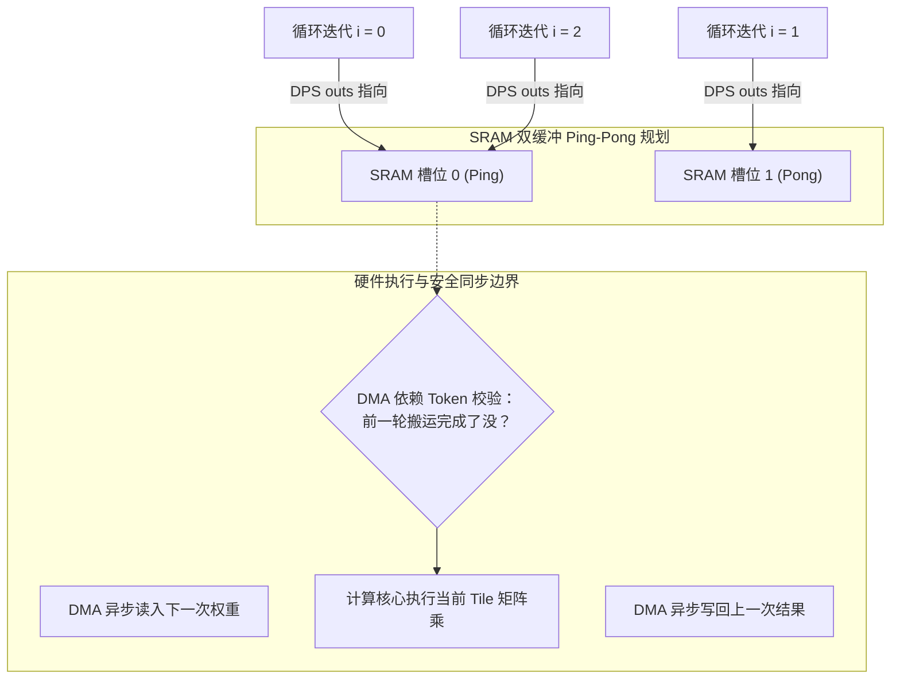

> [!TIP] 架构师视角的终极领悟
> 在 NPU 双缓冲设计中：
> 1. **DPS 的 `outs(%tile)` 解决的是“空间归属”**：计算结果准备落入 Ping 还是 Pong 槽位；
> 2. **异步 DMA 的 Event / Token / Semaphore 解决的是“时间同步”**：何时硬件计算被允许启动，何时上一轮数据被安全搬走。
>
> 空间逻辑归属（DPS）与时间执行时序（Token/Barrier）清晰解耦，这正是现代专业编译器架构的最纯粹之美！

---

## 八、全景总结：MLIR 内存哲学的终极图景

行文至此，我们已经穿越了从不可变数学逻辑到物理芯片微架构的重重关卡。让我们用一张全景概念流向图，作为这场思维远航的终极注脚：

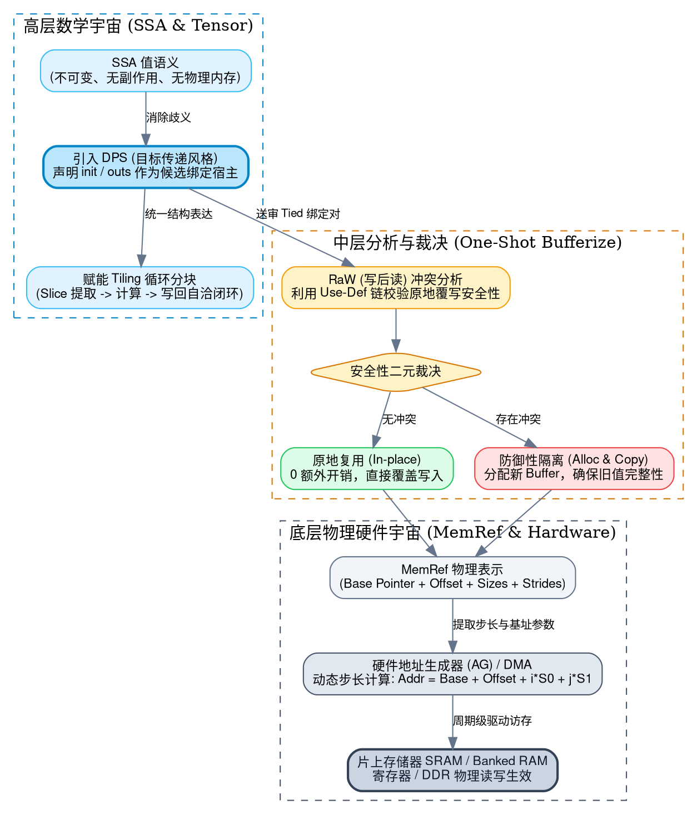

### 核心要点终极备忘清单：
1. **本质定位**：DPS 是一种在 IR 层显式声明“计算结果以谁为初始目标产生”的结构模式；
2. **解决的核心痛点**：
   - 彻底免除编译器在全局空间进行组合爆炸式的无界 Buffer 搜索；
   - 让 One-Shot Bufferize 能够以 $O(N)$ 的高效确定性决策原地复用；
   - 为高层循环分块（Tiling）提供切片提取与写回的天然语义载体；
3. **正交界限**：DPS 是逻辑维度的候选指定，不等于物理地址显式化，不等于动态地址计算，更不保证 100% 原地覆写（安全性仍由 RaW 冲突仲裁保证）；
4. **两套接口**：牢记 `DestinationStyleOpInterface`（结构几何规范）与 `BufferizableOpInterface`（内存行为规范）的职责分离。

希望本篇教程能帮助每一位在 AI 编译器与高性能计算道路上求索的开发者，真正参透 MLIR 架构设计的深邃智慧与工程权衡之美！

