> **导读**：在现代深度学习框架（PyTorch、JAX、TensorFlow）与异构芯片计算引擎（NPU、GPU、RISC-V 向量扩展、DSA）之间，MLIR（Multi-Level Intermediate Representation，多级中间表示）凭借其极致的模块化与多层抽象能力，已经成为下一代 AI 编译器的核心基石。
>
> 然而，许多开发者在跨入 MLIR 领域时，常常带着强烈的传统思维定式：
> - 有人试图把 MLIR 当成单纯的**计算图（DAG）**，结果在面对 `Region`、`Block` 和控制流时处处碰壁；
> - 有人试图用 **LLVM IR 的指令与 PHI 节点**套用 MLIR，却对 `BlockArgument` 和多级嵌套的作用域感到困惑；
> - 更令人头疼的是 MLIR 中极其繁多的**“孪生名词”**：`Interface` 与 `Inference`、`OpInterface` 与 `DialectInterface`、`Trait` 与 `Interface`、`Verifier` 与 `Analysis`、`Operand` 与 `Property`……名字只差几个字母，概念层级却天差地别！
>
> 本文旨在为初学者及进阶开发者彻底扫清这些认知迷雾。我们将以**图论**为引子，横跨 **C++ 对象体系**、**LLVM IR / 汇编底层**、**DAG 计算图**与 **NPU 硬件架构**四大维度，建立起立体透彻的认知映射，并系统解剖 MLIR 最易混淆的 24 组核心概念，全篇配备高对比度的 **Mermaid** 与 **Graphviz** 可视化架构图。

---

## 目录（Table of contents）

---

## 一、初学者必读：核心术语通俗图解与概念速查卡片

在深入各大专题之前，我们先为初学者铺平道路。以下名词在编译器文献与 MLIR 源码中高频出现，如果第一次接触容易望文生义，在此我们先给出最接地气的“人话解释”：

> [!NOTE] 核心术语通俗速查词典
> 1. **IR（Intermediate Representation，中间表示）**：
>    连接高级语言（如 Python/C++）与底层机器码（0101 二进制）的“工程设计图纸”。有了图纸，编译器才能在不关心具体芯片细节的前提下做图优化、去冗余和结构重组。
> 2. **DAG（Directed Acyclic Graph，有向无环图）**：
>    一种由节点（代表操作）和单向箭头（代表数据流动）组成的网络结构，且**绝对不存在闭环回路**（就像一条永不回头的单行道河流）。计算图通常是 DAG。
> 3. **SSA（Static Single Assignment，静态单赋值）**：
>    编译器的一种核心约束规则：**每一个变量名在源码或 IR 文本中只能被赋值一次**。如果你想修改它的值，必须创建并赋予一个新的变量名（如 `%x_1 = %x_0 + 1`）。这彻底消除了变量被不同指令覆盖时产生的时序歧义。
> 4. **CFG（Control Flow Graph，控制流图）**：
>    描述程序**执行跳转路径**的图。节点是“基本块（BasicBlock）”，边是跳转指令（如条件分支 `if-else`、循环 `while`）。**注意：CFG 中通常包含回环（循环结构），因此 CFG 往往不是 DAG！**
> 5. **AST（Abstract Syntax Tree，抽象语法树）**：
>    源码语法层次的树状表达（例如：函数节点包含 if 语句节点，if 节点包含条件表达式与复合语句块）。它表达的是**代码嵌套归属关系**，而不是执行数据流。
> 6. **BasicBlock（基本块）**：
>    一段**直线执行**的代码序列：只能从第一条指令进入，只能从最后一条指令跳出，中间绝不包含任何跳转或分支。
> 7. **Def-Use Chain（定义-使用链）**：
>    编译器内部维护的数据结构网络。它明确记录了：“这个变量是谁生产出来的（Def）”以及“这个变量被下游哪些算子消费使用了（Use）”。
> 8. **PHI 节点（$\phi$ node）**：
>    经典 LLVM IR 中用于在控制流汇合处挑选变量值的指令。比如分支 `if (cond) x=1; else x=2;` 汇合后，LLVM 会插入 `%x = phi [1, %then], [2, %else]`。
> 9. **BlockArgument（块参数）**：
>    MLIR 用来彻底取代 PHI 节点的现代设计。类似于 C++ 函数的形参，每个基本块可以直接在头部声明入参，分支跳转时像调用函数一样显式传递实参。
> 10. **Terminator（终结操作）**：
>     位于一个基本块末尾的最后一条指令，它的职责是明确控制流下一步走向（如返回 `return`、无条件跳转 `br`、条件分支 `cond_br` 或向父区域传递结果的 `yield`）。
> 11. **Dialect（方言）**：
>     MLIR 中的自包含命名空间与词汇库（如算术运算 `arith`、高层线性代数 `linalg`、结构化控制流 `scf` 等）。每个 Dialect 可以自由定义自己的类型、属性与操作。
> 12. **Lowering（降级 / 下沉）**：
>     将高抽象层级的 IR（如矩阵乘法 `linalg.matmul`）一步步拆解、转化为更贴近机器底层的 IR（如嵌套循环 `scf.for`、向量操作 `vector`、乃至底层硬件指令）的编译阶段。
> 13. **Bufferization（内存缓冲化）**：
>     将数学意义上不可变、纯数值的张量（`tensor`，类似纯函数中的值）映射到硬件实际物理内存缓冲区（`memref`，带有物理地址与跨步布局）的过程。
> 14. **DPS（Destination-Passing Style，目标传递风格）**：
>     一种让算子显式接收一个用于存放输出结果的“目标缓冲区（Destination）”的 API 风格，利于编译器在早期识别并消除不必要的物理内存分配与拷贝。
> 15. **ODS（Operation Definition Specification）**：
>     基于 LLVM TableGen 工具的声明式 DSL。开发者只需编写简短的 `.td` 配置文件，即可自动生成数千行严谨的 C++ Op 定义、校验器和构建方法。
> 16. **RAUW（Replace All Uses With）**：
>     图重写中最基础的原子操作：将某一个 SSA 值在所有下游消费者中的引用，一键全部切换指向另一个新的 SSA 值。
> 17. **Tiling（循环分块 / 平铺）**：
>     把处理海量数据的超大循环，切分成一个个适合芯片内部高速缓存（SRAM/SMEM/Cache）容量的微小分块（Tile）来分别执行的优化算法。
> 18. **DMA（Direct Memory Access，直接内存访问）**：
>     专用硬件搬运引擎，能够在不占用计算核心 CPU/NPU 算力的情况下，在片外大内存（DRAM）与片上高速内存（SRAM）之间批量搬移数据。
> 19. **SMEM（Shared Memory / Scratchpad Memory，片上暂存内存）**：
>     紧贴计算核的超高速硬件 SRAM，读写延迟通常仅有外部主存的数十分之一，是深度学习算子性能优化的兵家必争之地。

---

## 二、图论视角下的 MLIR IR 深度解构

初学者接触计算图时，往往最先联想到 TensorFlow 1.x 或 ONNX 的计算图：节点是算子（Add、MatMul），边是流动张量（Tensor）。

但在 MLIR 中，这个模型只能解释其中一部分！我们先给出 MLIR 整体架构的根本数学方程式：

$$\boxed{\text{MLIR IR} = \text{树状嵌套结构 (AST)} + \text{SSA 数据依赖图 (Def-Use DAG)} + \text{控制流图 (CFG)} + \text{语义约束规范}}$$

### 2.1 MLIR 核心类型与图论概念完整对应表

MLIR 官方语言参考明确将 `Operation` 视为节点，将 `Value` 视为边（且具有一源多宿的超边性质）：

| MLIR C++ 类型 | 对应图论概念 | 具体职责与编译器语义 |
| :--- | :--- | :--- |
| **`Operation`** | **节点（Vertex）** | IR 的核心计算/操作单元，表示一次运算、一条指令或一个语法容器 |
| **`Op`** | 节点的强类型 C++ 包装 | 面向具体操作的便利接口（如 `arith::AddIOp` 包装底层 `Operation*`） |
| **`Value`** | **有向超边（Hyperedge）** | 表示计算产生或在节点间传递的数据载体，连接单个生产者与零个或多个消费者 |
| **`OpResult`** | **边的发射源（Source）** | `Value` 的一种子类型：由某个 `Operation` 的输出端口计算生成的 SSA 结果 |
| **`BlockArgument`** | **边的外部发源点（Input Source）** | `Value` 的另一种子类型：由基本块 `Block` 入口接收的形参数据 |
| **`OpOperand`** | **边的消费端 / 入射槽位（Use Slot）** | **不是 Value**！表示某个 `Operation` 对某个 `Value` 的一次具体引用 |
| **`Block`** | **基本块 / 线性节点序列** | 包含单入口、单出口、按指令顺序直线执行的 `Operation` 链表 |
| **`Region`** | **子图容器 / 作用域** | 包含若干基本块的层次化容器，表达函数体、循环体、分支等控制边界 |
| **`BlockOperand`** | **控制流转移引用（CFG Target）** | 表示跳转类 Op 对目标 Block 的前驱/后继引用关联 |
| **`Type`** | **边的静态元数据标注** | 描述 `Value` 的数据类型（如 `i32`、`f16`、`tensor<4x4xf32>`、`memref<64xi8>`） |
| **`Attribute`** | **节点的编译期静态常态** | 描述 `Operation` 的固有静态参数、超参数（如卷积步长 `stride`、转置标记） |
| **`Location`** | **节点与源文本映射** | 强制携带的调试定位信息（文件名、行号、列号、调用链），用于错误诊断 |
| **`Dialect`** | **节点与类型的词汇本体库** | 算子和类型的逻辑命名空间（如 `arith`、`linalg`、`scf`、`vector`） |
| **`SymbolRefAttr`** | **全局命名符号引用关系** | 跨作用域引用函数、全局常量等的静态字符串符号，**非普通 SSA Value** |
| **`MLIRContext`** | **IR 基础设施上下文总线** | 管理全局唯一性池化存储（如全局常量 Attribute/Type 折叠去重），并非图元素 |

> [!IMPORTANT] 核心血统关系辨析
> - `OpResult` 和 `BlockArgument` 是 `Value` 的**仅有的两类具体实体**；
> - `OpOperand` **绝对不是一种 Value**，它是某个 Op 内部的一个“插槽（Use）”，里面保存着对某个 `Value` 的指针引用。

### 2.2 用具体计算图剖析 Operation、Value、OpOperand

考虑一个简单的四则运算数学表达式：

$$s = a + b, \quad q = s \times s, \quad y = q + a$$

在 MLIR 文本格式中，它被表示为：

```mlir
func.func @example(%a: i32, %b: i32) -> i32 {
  // Op #1: 产生结果 %sum
  %sum = arith.addi %a, %b : i32

  // Op #2: 将同一个 %sum 消费两次！
  %square = arith.muli %sum, %sum : i32

  // Op #3: 消费 %square 与外部输入的 %a
  %out = arith.addi %square, %a : i32

  // Op #4: 函数终结符，消费 %out
  func.return %out : i32
}
```

#### 数据依赖图（Def-Use DAG）可视化

我们使用 Graphviz 来清晰地展现上述计算中的节点与边连接关系：

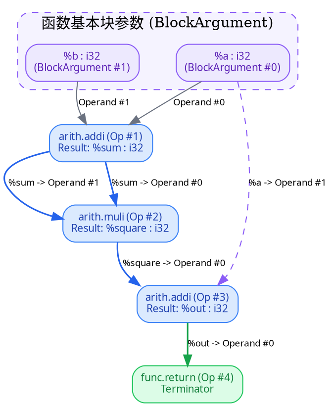

仔细剖析乘法语句 `%square = arith.muli %sum, %sum : i32` 内部的 C++ 实体构成：

| 组成部分 | 对应的 MLIR 内部对象 | 内存实体数量 | 属性与功能 |
| :--- | :--- | :---: | :--- |
| `arith.muli` | `Operation` | 1 | 承载整个运算的节点容器 |
| 第一个 `%sum` | `OpOperand` | 1 | 槽位 0：记录对 `%sum` 的第一次使用 |
| 第二个 `%sum` | `OpOperand` | 1 | 槽位 1：记录对 `%sum` 的第二次使用 |
| `%square` | `OpResult`（继承自 `Value`） | 1 | 此 Op 定义的唯一输出 SSA 值 |
| 变量数据类型 | `Type` (`i32`) | 1（池化共享） | 描述值的位宽与格式 |

> [!TIP] 黄金法则：两份使用，一个实体
> `%sum` 既是 `OpOperand #0` 的指向目标，也是 `OpOperand #1` 的指向目标。**内存中只存在一个 `%sum`（`Value` 实例）**！它只有 1 个生产源（Definition），但在下游拥有 2 次使用（Uses）。

### 2.3 Def-Use Chain 的底层组织模型与 C++ 遍历 API

在现代编译器中，死代码消除（DCE）、公共子表达式消除（CSE）以及算子融合（Operator Fusion）等核心 Pass，完全依赖高效的 **Def-Use 链** 双向追踪。

#### Def-Use 内部对象指针网络

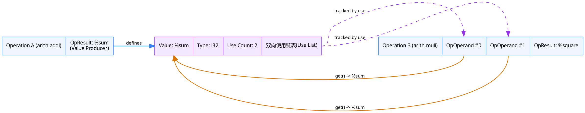

#### 工业级 C++ Def-Use 遍历模板

在开发 MLIR 优化 Pass 时，遍历输入与输出边的标准 C++ API 如下：

```cpp
void traceDefUseChain(mlir::Operation *op) {
    // -------------------------------------------------------------------------
    // 1. 向上回溯：遍历当前 Op 的所有输入操作数 (Operands)
    // -------------------------------------------------------------------------
    for (unsigned i = 0; i < op->getNumOperands(); ++i) {
        mlir::Value inputVal = op->getOperand(i);

        // 查找这个 Value 的生产者
        if (mlir::Operation *producerOp = inputVal.getDefiningOp()) {
            llvm::outs() << "Operand #" << i << " 由操作定义: "
                         << producerOp->getName() << "\n";
        } else {
            // 如果 getDefiningOp() 返回 nullptr，它必然是一个 BlockArgument！
            auto blockArg = mlir::cast<mlir::BlockArgument>(inputVal);
            llvm::outs() << "Operand #" << i << " 是所属 Block 的第 "
                         << blockArg.getArgNumber() << " 个参数\n";
        }
    }

    // -------------------------------------------------------------------------
    // 2. 向下追踪：遍历当前 Op 产生的所有输出结果 (Results) 的下游消费端
    // -------------------------------------------------------------------------
    for (mlir::OpResult result : op->getOpResults()) {
        llvm::outs() << "结果索引 #" << result.getResultNumber()
                     << " 被消费次数: " << result.getUses().empty() ? 0 :
                        std::distance(result.use_begin(), result.use_end())
                     << "\n";

        // 遍历所有精准的使用插槽 (OpOperand)
        for (mlir::OpOperand &use : result.getUses()) {
            mlir::Operation *consumerOp = use.getOwner();
            unsigned operandIdx = use.getOperandNumber();
            llvm::outs() << "  -> 消费者: " << consumerOp->getName()
                         << " (位于其操作数槽位 #" << operandIdx << ")\n";
        }

        // 遍历唯一的消费者 Operation (注意：同一 Op 引用多次只会返回一次)
        for (mlir::Operation *userOp : result.getUsers()) {
            llvm::outs() << "  -> 消费算子: " << userOp->getName() << "\n";
        }
    }
}
```

> [!CAUTION] `getUsers()` vs `getUses()` 陷阱
> - `result.getUsers()`：返回使用该值的 `Operation*` 迭代器（如果某算子如 `muli %sum, %sum` 消费了两次，该算子在迭代中**只出现一次**）；
> - `result.getUses()`：返回每一次具体引用的 `OpOperand&`（在上述例子中会准确遍历到 **2 个独立的 `OpOperand`**）。编写精确重写逻辑时，优先使用 `getUses()`！

---

## 三、认知多面体：四大熟悉模型的立体映射

如果只从 DAG 这一单一维度审视 MLIR，一旦遇到 `scf.if`、`scf.for`、`BlockArgument`、`memref` 与 `linalg.generic`，你的心智模型就会立刻崩塌。

为了帮助开发者融会贯通，我们通过四种开发者最熟悉的模型建立多维映射：
1. **C++ 语言 AST 模型**：函数定义、复合语句块、分支语句、作用域、局部变量；
2. **LLVM IR / RISC-V 汇编模型**：指令、BasicBlock、SSA 虚拟寄存器、条件跳转；
3. **计算图 / DAG 模型**：拓扑节点、数据边、输入端口、输出端口、无环调度；
4. **NPU 硬件架构模型**：脉动阵列计算引擎、DMA 数据搬运通道、片上 SRAM 缓冲区、控制寄存器。

### 3.1 核心概念全景观宏大对照表

| MLIR 概念 | C++ 语义类比 | LLVM IR / 汇编类比 | DAG 计算图 / 硬件类比 |
| :--- | :--- | :--- | :--- |
| **`Operation`** | 一条表达式或复合语句节点 | `Instruction` 或高层语法结构 | 图中的计算节点 / 硬件执行动作 |
| **`Op`** | AST 节点的类型化包装类 | 具体的 `BinaryOperator` 等指令包装 | MatMul、Conv、DMA 等具体算子类别 |
| **`Value`** | 一次计算求得的逻辑临时量 | SSA 虚拟寄存器（不可变值） | 节点间传输的数据 / 连线 |
| **`OpOperand`** | 函数调用中的实参表达式插槽 | 指令的操作数槽位 | 节点的输入端口（Input Port） |
| **`OpResult`** | 函数或表达式的计算返回值 | 指令写入的 SSA 目标寄存器 | 节点的输出端口（Output Port） |
| **`BlockArgument`** | 函数形参或局部代码块入参 | 函数参数 / **PHI 节点的替代形式** | 子图输入管道 / 汇合流入参 |
| **`Block`** | 大括号内部按序执行的代码序列 | `BasicBlock`（无分支的直线代码块） | 基本执行序列块 |
| **`Region`** | 函数体、`if` 分支体等嵌套作用域 | 函数体 / 扩展 CFG 边界 | 嵌套子图 / 控制域 |
| **`Type`** | `int`、`float`、`struct` 等类型 | `i32`、`float*`、向量类型 | 数据维度、形状（Shape）与物理内存格式 |
| **`Attribute`** | `constexpr` 编译期常量、注解 | 指令的立即数、静态元数据 | 静态配置参数（Tile 大小、Padding 模式） |
| **`Properties`** | C++ 对象的结构化内联成员变量 | 指令的固定硬件字段 | 算子固有的几何配置 |
| **`Location`** | `__FILE__` 与 `__LINE__` 宏 | `DebugLoc` 调试符号 | 源码与生成机器码的双向追踪线索 |
| **`Dialect`** | 独立的 C++ 命名空间与库头文件 | 独立的指令集架构模块（ISA 扩展） | 芯片专用的语义算子集合 |
| **`Terminator`** | `return`、`goto`、`break` | `ret`、`br`、`switch` 跳转指令 | 控制流的出口阀门 |
| **`SymbolRefAttr`** | 外部函数名（如 `&printf`） | 全局符号引用 `@func_name` | 静态链接的外部组件名 |
| **`Trait`** | 编译期模板特征（CRTP 风格） | 指令的静态属性分类（如 `isCommutative`）| 节点满足的固有代数性质 |
| **`Interface`** | C++ 虚函数纯虚接口（多态抽象） | 通用 Pass 驱动的多态行为抽象 | 查询算子 Tiling、访存等能力的统一接口 |
| **`Pattern`** | 基于 AST 模式匹配的重写规则 | 指令合并优化规则（Peephole 优化） | 图模式匹配与局部融合规则 |
| **`Pass`** | 编译器的优化阶段管道 | LLVM Optimization Pass | 全局图优化、降级（Lowering）工序 |

### 3.2 MLIR 内部四层世界总览

我们在分析一段 MLIR 代码时，必须首先在脑海中厘清当前到底处于哪一层：

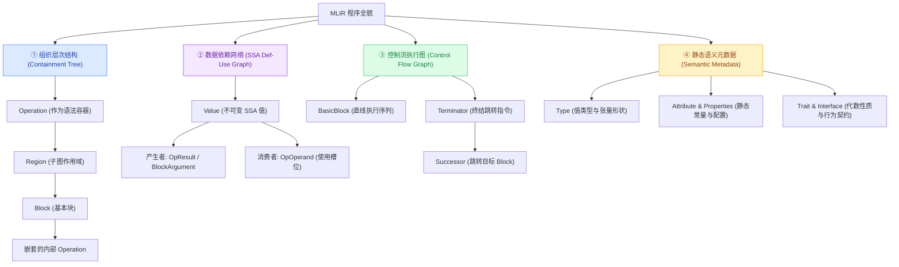

---

## 四、深入控制流与嵌套：Region、Block 与 BlockArgument 的革命性设计

很多熟悉 LLVM 的开发者在初学 MLIR 时，最困惑的莫过于：**“为什么 MLIR 抛弃了经典的 PHI 节点，转而使用基本块参数（BlockArgument）？”**

### 4.1 C++ 分支到 CFG 基本块的降级

考虑一段经典的 C++ if-else 逻辑：

```cpp
int choose(bool cond, int a) {
    int result;
    if (cond) {
        result = a + 1;
    } else {
        result = a + 2;
    }
    return result;
}
```

在低级控制流中，它必须被拆解为 4 个直线执行的 `BasicBlock`：`entry`、`then`、`else` 和 `merge`。

#### LLVM IR PHI 指令 vs MLIR BlockArgument 架构大对决

```graphviz
digraph PHI_vs_BlockArg {
    compound=true;
    rankdir=LR;
    nodesep=0.5;
    ranksep=0.6;
    node [shape=record, style="filled", fontname="sans-serif", fontsize=10];

    subgraph cluster_llvm {
        label = "【传统 LLVM IR 模型】\n依靠汇合块内部的专用 PHI 指令";
        style = "dashed,rounded";
        color = "#ef4444";
        bgcolor = "#fef2f2";

        LLVM_Then [label="{Block %then | %x = add %a, 1\lbr label %merge\l}", fillcolor="#fee2e2", color="#ef4444"];
        LLVM_Else [label="{Block %else | %y = add %a, 2\lbr label %merge\l}", fillcolor="#fee2e2", color="#ef4444"];
        LLVM_Merge [label="{Block %merge | %res = phi i32 [%x, %then], [%y, %else]\lret %res\l}", fillcolor="#fca5a5", color="#b91c1c", style="filled,bold"];

        LLVM_Then -> LLVM_Merge [label="无参跳转"];
        LLVM_Else -> LLVM_Merge [label="无参跳转"];
    }

    subgraph cluster_mlir {
        label = "【现代 MLIR 模型】\n依靠基本块传参 (BlockArgument)，彻底消除 PHI";
        style = "dashed,rounded";
        color = "#10b981";
        bgcolor = "#ecfdf5";

        MLIR_Then [label="{^then | %x = arith.addi %a, %c1\lcf.br ^merge(%x : i32)\l}", fillcolor="#d1fae5", color="#10b981"];
        MLIR_Else [label="{^else | %y = arith.addi %a, %c2\lcf.br ^merge(%y : i32)\l}", fillcolor="#d1fae5", color="#10b981"];
        MLIR_Merge [label="{^merge(%res: i32)  <-- BlockArgument 入参 | func.return %res : i32\l}", fillcolor="#6ee7b7", color="#047857", style="filled,bold"];

        MLIR_Then -> MLIR_Merge [label="cf.br 显式传参 (%x)", color="#059669", fontcolor="#047857", penwidth=1.5];
        MLIR_Else -> MLIR_Merge [label="cf.br 显式传参 (%y)", color="#059669", fontcolor="#047857", penwidth=1.5];
    }
}
```

#### 为什么 MLIR 要大动干戈干掉 PHI 节点？

1. **统一的语法模型**：
   在 MLIR 中，**函数参数与块参数完全统一**！函数的入口 Block（Entry Block）的入参，就是该函数的输入参数。处理函数参数和处理基本块控制流汇合使用完全相同的逻辑与 API；
2. **彻底消除“临界边”与代码下沉歧义**：
   传统 LLVM 的 PHI 节点要求必须位于 BasicBlock 的最顶端，在进行指令重排、关键边分割（Critical Edge Splitting）或寄存器分配并行拷贝展开（Parallel Copy Problem）时，PHI 指令经常引发极其晦涩的时钟序竞争 bug；
3. **显式数据流传递**：
   跳转指令 `cf.br ^merge(%x : i32)` 显式说明了向后继块投递哪一个变量，这使得数据流依赖完全直观化，Def-Use 分析无需特判“从哪个 BasicBlock 路径跳过来”。

### 4.2 结构化控制流：为什么需要 `Operation -> Region -> Block -> Operation` 的递归？

在支持结构化控制流（如 `scf.if`、`scf.for`）的现代方言中，代码并没有被立刻拍平（Flatten）为无序的分支跳转，而是通过树状嵌套予以优雅保存：

```mlir
func.func @structured_if(%cond: i1, %x: i32) -> i32 {
  // scf.if 是一个 Operation，但它内部嵌套了两个独立的 Region
  %res = scf.if %cond -> (i32) {
    %c1 = arith.constant 1 : i32
    %true_val = arith.addi %x, %c1 : i32
    scf.yield %true_val : i32    // Terminator: 结束 then 区域并返回结果
  } else {
    %c2 = arith.constant 2 : i32
    %false_val = arith.addi %x, %c2 : i32
    scf.yield %false_val : i32   // Terminator: 结束 else 区域并返回结果
  }
  return %res : i32
}
```

#### 结构包含树（Containment Hierarchy）架构

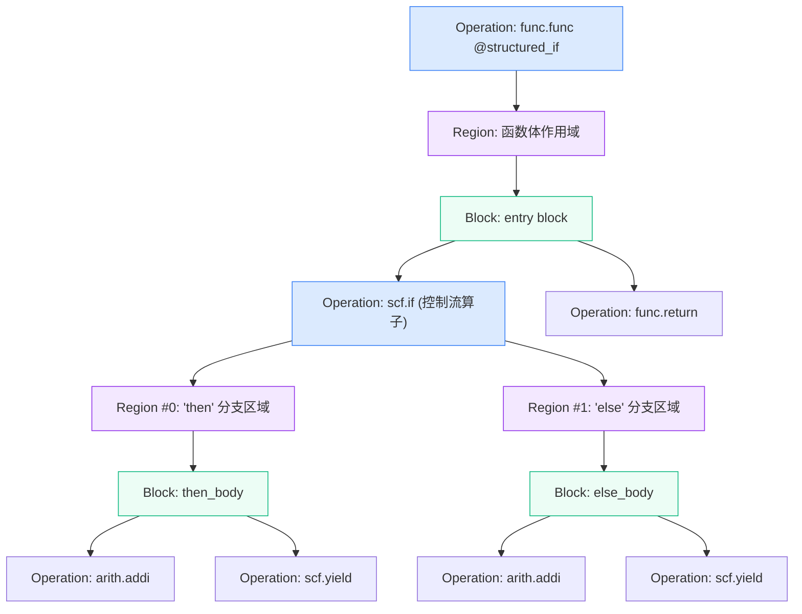

> [!IMPORTANT] 核心原则：一切皆为 Operation
> 在上述树中，`func.func` 是 Operation，`scf.if` 是 Operation，最底层的 `arith.addi` 也是 Operation！
> MLIR 不需要为“函数定义”、“循环语句”、“数学指令”分别设计互不兼容的 AST 数据结构。所有层级统一遵守相同的黄金律：
> $$\boxed{\text{Operation} \longrightarrow \text{Region} \longrightarrow \text{Block} \longrightarrow \text{Operation}}$$

---

## 五、深入语义与数据边界：SSA 数据依赖 vs 物理内存依赖

这是所有从算法模型（PyTorch/TensorFlow）转向硬件体系结构（NPU/DSA）的开发者最容易踩坑的暗礁！

### 5.1 纯值世界（Tensor）与物理世界（MemRef）的根本差异

在 MLIR 中，两大数据类型体系扮演着截然相反的角色：

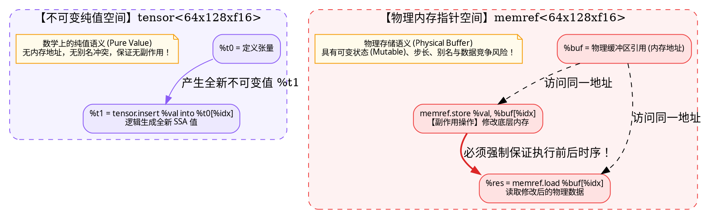

在 MLIR 中：
```mlir
// store 操作没有返回值！它没有产生任何新的 SSA OpResult
memref.store %c42, %buf[%c0] : memref<16xi32>

// load 读取内存
%result = memref.load %buf[%c0] : memref<16xi32>
```

> [!WARNING] 致命误区：SSA 值不变 $\neq$ 物理内存不变
> 上述代码中，`%buf` 这个 SSA Value 从头到尾都没有发生任何变化。但它所指向的那片**底层物理内存的内容已经被重写了**！
> 这意味着：**单靠 SSA Def-Use 链无法追踪内存读写冲突！** 编译器必须引入内存别名分析（Alias Analysis）与 `MemoryEffectsOpInterface`，来构建专门的**内存依赖图（Memory Dependency Graph）**以避免指令错误重排。

### 5.2 目标传递风格（DPS）与 One-Shot Bufferization 机制

为了消除高层张量算子降级到底层时漫无节制的 `malloc` / 内存拷贝开销，MLIR 提出了 **Destination-Passing Style (DPS)**：

```graphviz
digraph DPS_Flow {
    rankdir=LR;
    nodesep=0.5;
    ranksep=0.6;
    node [shape=box, style="rounded,filled", fontname="sans-serif", fontsize=10];
    edge [fontname="sans-serif", fontsize=9];

    InA [label="输入张量 %arg0", fillcolor="#eff6ff", color="#3b82f6"];
    InDest [label="目标预分配容器 %dest\n(作为目的地 Operand 传入)", fillcolor="#fef3c7", color="#f59e0b", fontcolor="#b45309", style="rounded,filled,bold"];

    MatmulOp [label="linalg.matmul\n(实现 DestinationStyleOpInterface)", fillcolor="#dbeafe", color="#3b82f6"];

    OutVal [label="结果张量 %res", fillcolor="#dcfce7", color="#22c55e"];

    InA -> MatmulOp [label="inputs"];
    InDest -> MatmulOp [label="outputs (DPS 槽位)"];
    MatmulOp -> OutVal [label="逻辑产出 (结果绑定到目标空间)"];

    Analysis [label="Bufferization 静态分析:\n检查 %dest 在下游是否发生读写冲突 (RAW 危险)？", shape=diamond, fillcolor="#f3e8ff", color="#9333ea"];

    OutVal -> Analysis;

    InPlace [label="【In-place 原地复用】\n直接将计算写入 %dest 底层 Buffer，零拷贝！", fillcolor="#d1fae5", color="#059669"];
    OutOfPlace [label="【Out-of-place 逃逸拷贝】\n发现数据冲突，插入分配并复制副本", fillcolor="#fee2e2", color="#dc2626"];

    Analysis -> InPlace [label="安全"];
    Analysis -> OutOfPlace [label="存在冲突"];
}
```

> [!NOTE] 核心公式三位一体
> $$\boxed{\text{DPS (接口表达形式)} + \text{BufferizableOpInterface (合法性分析)} \Longrightarrow \text{零拷贝高效代码生成}}$$

---

## 六、全景落地：映射至 NPU 编译器与异构代码生成

假设我们需要构建一个专用的 NPU 编译器工具链，把一个深度学习中的矩阵乘法网络降级生成为可在芯片内部 RISC-V 控制核上运行的固件。

### 6.1 端到端多级降级（Lowering Pipeline）全景架构

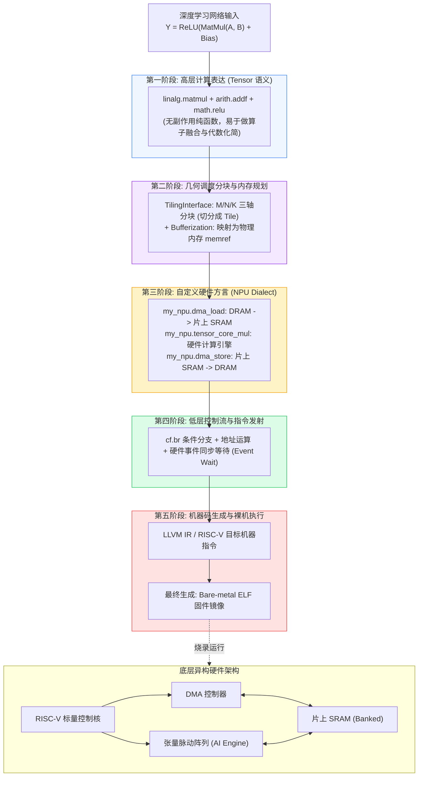

### 6.2 工业级 C++ 算子多维巡检实战模板

当你作为 NPU 架构师编写一个专用的调度 Pass 时，面对任意一个传进来的未知 `Operation*`，你必须学会像医生使用内窥镜一样，从四个方向做立体诊断：

```cpp
#include "mlir/IR/Operation.h"
#include "mlir/IR/Dominance.h"
#include "mlir/Interfaces/SideEffectInterfaces.h"
#include "llvm/Support/raw_ostream.h"

void inspectNPUOperation(mlir::Operation *op, mlir::DominanceInfo &domInfo) {
    llvm::outs() << "====================================================\n";
    llvm::outs() << "正在巡检操作: " << op->getName() << "\n";
    llvm::outs() << "位置信息 (Loc): " << op->getLoc() << "\n";

    // -------------------------------------------------------------------------
    // ① 向上回溯操作数 (Operands) 与依赖生产者
    // -------------------------------------------------------------------------
    for (const auto &it : llvm::enumerate(op->getOperands())) {
        mlir::Value val = it.value();
        unsigned idx = it.index();
        llvm::outs() << "  [输入 #" << idx << "] 类型: " << val.getType();

        if (mlir::Operation *producer = val.getDefiningOp()) {
            llvm::outs() << " | 由算子定义: " << producer->getName() << "\n";
            // 检查支配性：定义点必须支配当前使用点！
            if (!domInfo.properlyDominates(producer, op)) {
                llvm::errs() << "    [警告] 违反 SSA 支配约束！\n";
            }
        } else {
            auto bArg = mlir::cast<mlir::BlockArgument>(val);
            llvm::outs() << " | 来自 Block 形参 #" << bArg.getArgNumber() << "\n";
        }
    }

    // -------------------------------------------------------------------------
    // ② 向下检索产出结果 (Results) 与所有下游消费者
    // -------------------------------------------------------------------------
    for (mlir::OpResult res : op->getOpResults()) {
        llvm::outs() << "  [产出 #" << res.getResultNumber() << "] 类型: "
                     << res.getType() << " (下游消费次数: "
                     << std::distance(res.use_begin(), res.use_end()) << ")\n";

        for (mlir::OpOperand &use : res.getUses()) {
            mlir::Operation *consumer = use.getOwner();
            llvm::outs() << "    -> 被算子消费: " << consumer->getName()
                         << " (位于参数槽位 #" << use.getOperandNumber() << ")\n";
        }
    }

    // -------------------------------------------------------------------------
    // ③ 深入内部查看是否包含嵌套 Region (如循环体、分支体)
    // -------------------------------------------------------------------------
    if (op->getNumRegions() > 0) {
        llvm::outs() << "  [嵌套容器] 包含 " << op->getNumRegions() << " 个 Region\n";
        for (const auto &regIt : llvm::enumerate(op->getRegions())) {
            llvm::outs() << "    Region #" << regIt.index() << " 包含 "
                         << regIt.value().getBlocks().size() << " 个基本块\n";
        }
    }

    // -------------------------------------------------------------------------
    // ④ 检查内存副作用 (是否读写芯片内存？)
    // -------------------------------------------------------------------------
    if (auto memEffect = mlir::dyn_cast<mlir::MemoryEffectOpInterface>(op)) {
        bool hasWrite = memEffect.hasEffect<mlir::MemoryEffects::Write>();
        bool hasRead  = memEffect.hasEffect<mlir::MemoryEffects::Read>();
        llvm::outs() << "  [内存效应] 读内存: " << (hasRead ? "YES" : "NO")
                     << " | 写内存: " << (hasWrite ? "YES" : "NO") << "\n";
    }
}
```

---

## 七、MLIR 易混淆概念终极对照手册：从机制到编译器工程

在 MLIR 开发中，最令开发者痛苦的莫过于大量拼写类似、功能看似重叠的名词。本章专门建立“高精度鉴别镜”，彻底扫除所有概念混淆！

### 7.1 Interface vs Inference：能力契约 vs 计算推断

这是社区初学者最常见的一对混淆：
- **Interface（接口）**：C++ 中的多态纯虚接口类比。表示**某对象对外承诺具备某种行为能力**（如 `TilingInterface` 承诺自己能够被切块）；
- **Inference（推断）**：一种**根据已知信息演算未知信息的算法过程**（如根据输入矩阵大小推导输出矩阵大小）。

#### 四大 Interface 的挂载层级剖析

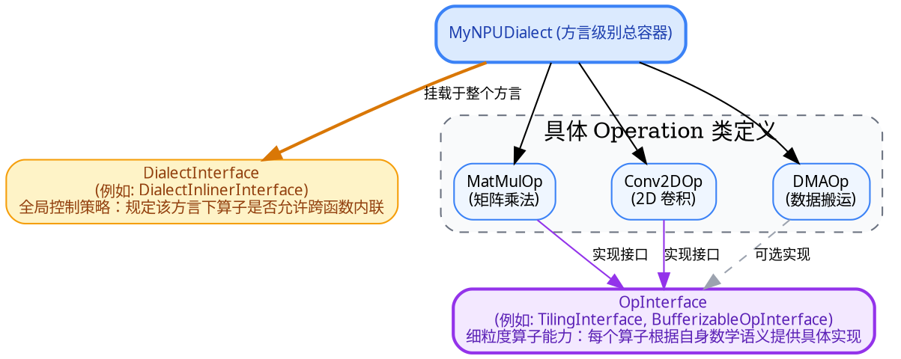

| 接口类型 | 挂载对象 | 典型代表 | 核心解决的问题 |
| :--- | :--- | :--- | :--- |
| **`OpInterface`** | 单个具体的 Op | `TilingInterface`、`BufferizableOpInterface` | **“这一个特定指令”**能怎么被变换？ |
| **`DialectInterface`** | 整个 Dialect 命名空间 | `DialectInlinerInterface` | **“这一整套方言”**在内联、常量折叠时的全局政策是什么？ |
| **`TypeInterface`** | 某个具体自定义 Type | `DataLayoutTypeInterface` | **“这一种数据类型”**在物理内存中的对齐、大小与排布规则？ |
| **`AttrInterface`** | 某个具体 Attribute | 属性泛化行为接口 | **“这一类编译期属性”**的通用行为契约？ |

#### 什么是 `InferTypeOpInterface`？

现在我们把两个词合并在一起：
`InferTypeOpInterface` 是一个具体的 **`OpInterface`**（操作接口）！它的职责是：让某个 Op 能够向编译器提供**推断自身输出数据类型（Type）的能力**。

例如，当我们已知 $A \in \mathbb{R}^{64 \times 32}$ 与 $B \in \mathbb{R}^{32 \times 128}$ 时，只要算子实现了 `InferTypeOpInterface`，构建器就能在不显式指定输出类型的情况下，自动推导产出 `tensor<64x128xf32>`。

### 7.2 Trait vs Interface vs Verifier vs Analysis 四维矩阵辨析

这四者经常同时出现在一个 Op 的定义中，分工却截然不同：

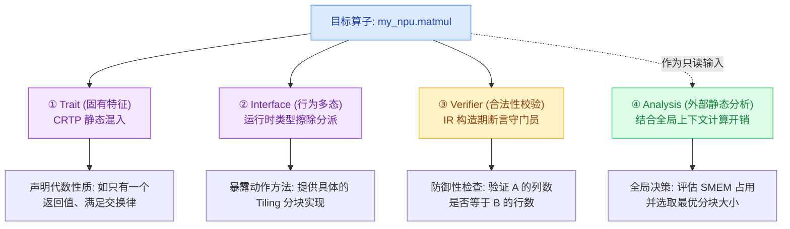

| 机制 | C++ 近似类比 | 执行时机 | 是否修改 IR？ | 核心职责 |
| :--- | :--- | :--- | :---: | :--- |
| **`Trait`** | C++ 模板 CRTP 静态继承 | 编译期绑定 | 否 | 声明该 Op 具备的固有性质（如 `IsCommutative` 交换律、`OneResult` 独占单一结果） |
| **`Interface`** | C++ 纯虚虚函数基类 | 运行时查询 | 否（仅暴露方法） | 面向通用 Pass 暴露标准调用接口（如获取 Tiling 循环控制参数） |
| **`Verifier`** | 构造函数内部的 `assert` / 异常检查 | IR 构造与验证期 | 否 | 严格防御非法 IR（如静态维度不匹配、属性越界），失败则直接报错拦截 |
| **`Analysis`** | 独立的静态分析算法类 | Pass 执行时按需运行 | 否 | 计算更高级的派生数据（如活跃变量分析、支配树、SRAM 资源消耗模型） |

### 7.3 Inference vs Verification vs Analysis vs Conversion 对比

| 维度 | 输入数据源 | 输出产物 | 是否修改 IR？ | 典型场景 |
| :--- | :--- | :--- | :---: | :--- |
| **Inference（推断）** | 输入参数的类型与静态属性 | 自动计算得到的结果类型与形状 | 否（辅助构建） | `InferTypeOpInterface` 自动推导输出张量形状 |
| **Verification（验证）** | 已经构造完毕的现存 IR | `LogicalResult::success()` 或错误诊断 | 否 | 检查矩阵乘法内积维度 $K$ 是否严格对齐 |
| **Analysis（分析）** | 现有 IR + 硬件参数上下文 | 派生分析数据结构（如别名缓存、开销模型） | 否 | 计算最省 SRAM 的 Tile 尺寸建议 |
| **Conversion（转换）** | 源 IR + 类型转换器 + 重写模式 | **全新降级后的目标 IR** | **是！** | 将高层 `linalg.matmul` 降级为嵌套 `scf.for` 循环 |

### 7.4 Operand vs Attribute vs Property vs Result vs Type

许多开发者在给自定义 Op 添加字段时，常纠结到底该设计成 `Operand`、`Attribute` 还是 `Property`？

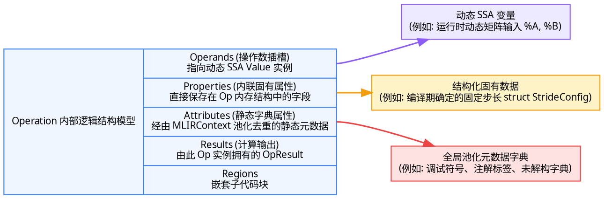

> [!CAUTION] 编译器工程警示：连续 Pass 滥用 Attribute 传递信息的“雪崩陷阱”
> 某些开发者喜欢在前面的 Pass 计算出优化结论（例如 `best_tile = [32, 64]`），随手将其作为一个 `Attribute` 挂载在 Op 上；后面的 Pass 再读取该 Attribute。
> **这种做法极其脆弱！**
> 因为 Attribute **不会自动感知外部 IR 的改变**。如果中间某一个常规 Pass 修改了矩阵的 Layout 或填充了 Padding，原先挂在上面的 `best_tile` 早已失效，但系统无法察觉，最终导致代码生成静默错误。
> **正规方案**：使用 `AnalysisManager` 缓存分析结果。一旦中间 Pass 修改了 IR，系统会自动使受影响的 Analysis 失效！

### 7.5 Operation vs 具体 Op 类 vs OpOperand vs OpResult vs Value vs BlockArgument vs OpFoldResult

| 概念 | 真实的底层 C++ 身份 | 常见认知误区 |
| :--- | :--- | :--- |
| **`Operation`** | 堆上分配的通用底层 IR 实体节点对象 | 误以为每种指令都会派生出庞大的 C++ 类继承树（其实底层都是单一的 `Operation`） |
| **`arith::AddIOp`** | 仅包含一个 `Operation*` 指针的**浅层类型化句柄（Wrapper）** | 误以为它比 `Operation` 占用更多内存或包含独立生命周期 |
| **`Value`** | 指向具体值实体的句柄（指针大小） | 误以为它是 C++ 普通可变变量，或者天然代表物理内存地址 |
| **`OpOperand`** | `Operation` 内部的一个槽位引用 | 误以为它是 `Value`（其实它是消费点，持有对 `Value` 的指针） |
| **`OpResult`** | `Value` 的子类：表示由 Op 输出端口定义的值 | 误把它当成普通操作数 |
| **`BlockArgument`** | `Value` 的子类：表示由 Block 头部形参定义的值 | 误以为它是由上一个基本块里的某个操作计算出的局部临时量 |
| **`OpFoldResult`** | **`PointerUnion<Value, Attribute>` 联合体** | **误以为它和 `OpResult` 是一回事！** |

> [!IMPORTANT] 深入理解 `OpFoldResult` 的精妙设计
> 为什么 MLIR 要设计 `OpFoldResult`？
> 考虑矩阵切片（Slice）操作的偏移量 `offset`：
> - 场景 A：静态切片，偏移量是常量 `64`（用 `Attribute` 表示最省资源）；
> - 场景 B：动态切片，偏移量来自前驱算子运行时的计算输出 `%dyn_offset`（用 `Value` 表示）。
>
> 如果没有 `OpFoldResult`，编译器就必须为切片算子设计两套完全分裂的 API（一套处理静态常量，一套处理动态 SSA 值）。而 `OpFoldResult` 巧妙地通过联合体将两者统一为：
> $$\boxed{\text{OpFoldResult} = \text{Value (动态运行时值)} \quad \bigcup \quad \text{Attribute (编译期静态常量)}}$$

### 7.6 Pattern vs Rewriter vs Pass vs Driver vs Analysis

很多初学者分不清优化是在 Pattern 里做，还是在 Pass 里做：


- **`RewritePattern` 只是规则**：它只回答“发现形如 $A + 0$ 的子图时，把它替换为 $A$”，它自己没有驱动循环遍历的能力；
- **`Pass` 是完整的工序**：它负责注册一系列 Pattern，并调用 Driver（如 `applyPatternsGreedily`）进行贪婪迭代收敛。

### 7.7 Fold vs Canonicalization vs Optimization vs Lowering

| 变换类型 | 作用作用域 | 是否允许创建全新 Op？ | 核心目标 | 典型范例 |
| :--- | :--- | :---: | :--- | :--- |
| **`fold()`** | 极度局部（仅限当前单个算子） | **严禁！** | 常量计算折叠与简单恒等代换 | `x + 0 -> x`，`constant(2) + constant(3) -> constant(5)` |
| **`Canonicalization`** | 局部子图模式（基于 Pattern） | 允许 | **代码规范化、标准化**，消除无用转置与冗余 Cast | 将各种奇形怪状的表达式重写为统一的通用标准范式 |
| **`Optimization`** | 局部或全局 | 允许 | **大幅提升执行性能、降低显存占用** | 算子融合（Fusion）、循环展开（Unroll）、Tiling |
| **`Lowering`** | 全局或模块级 | 允许 | **消除抽象层级，拉近与硬件指令的距离** | `linalg.matmul` $\to$ `scf.for` $\to$ `llvm.intr` |

---

## 八、开发场景决策树与最值得熟记的 24 组高频混淆概念速查

### 8.1 编译器开发场景快速决策指南

当你准备编写一段 MLIR 功能代码时，请查阅此决策树，迅速选出最契合的机制：

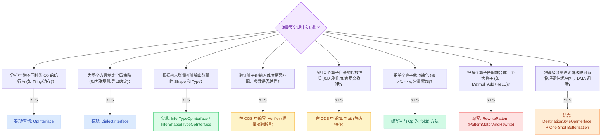

### 8.2 终极速查：最值得背诵的 24 组核心易混概念一览表

| 序号 | 概念对比组 | 一句话本质区别 |
| :---: | :--- | :--- |
| **1** | **Interface vs Inference** | 前者是**多态能力契约**（能不能做），后者是**计算推断算法**（算不出来） |
| **2** | **OpInterface vs DialectInterface** | 前者挂在**单类算子**上表达指令行为，后者挂在**整个方言**上掌管全局策略 |
| **3** | **Trait vs Interface** | `Trait` 表达**固有的静态分类属性**，`Interface` 表达**动态多态的可调用方法** |
| **4** | **Inference vs Verifier** | `Inference` 用于从前驱信息**推导未知量**，`Verifier` 用于**防御拦截非法 IR** |
| **5** | **Inference vs TypeConverter** | 前者计算算子原本的输出类型，后者在 Dialect Conversion 降级阶段将旧类型转为新类型 |
| **6** | **Operation vs 具体 Op 类** | `Operation` 是**底层统一的堆实体**，具体 Op 类是**零开销的浅层强类型句柄** |
| **7** | **Value vs OpOperand** | `Value` 是**被生产出的不可变数据实体**，`OpOperand` 是算子引用该数据的一个**输入槽位** |
| **8** | **OpResult vs BlockArgument** | 两者皆为 `Value`：前者由 **Op 的输出端口**产生，后者由 **Block 的形参列表**产生 |
| **9** | **OpResult vs OpFoldResult** | `OpResult` 必为 SSA 变量，`OpFoldResult` 是动态 `Value` 与静态 `Attribute` 的联合体 |
| **10** | **Type vs Attribute** | `Type` 描述 **Value 的运行时格式形态**，`Attribute` 保存 **Op 绑定的编译期静态常量** |
| **11** | **Attribute vs Property** | `Attribute` 存放于全局池化字典，`Property` 直接内嵌保存在 Op 内存结构中以提升性能 |
| **12** | **Region vs Block** | `Region` 是包含 Block 的**树状作用域容器**，`Block` 是存放 Op 的**线性直线执行链表** |
| **13** | **Branch vs Terminator** | `Branch` 特指控制流跳转 Op，`Terminator` 是位于 Block 末尾、指示控制流归宿的泛称 |
| **14** | **CallOpInterface vs CallableOpInterface** | 前者由**函数调用方（Call 节点）**实现，后者由**函数被调用方（Func 节点）**实现 |
| **15** | **SymbolOpInterface vs SymbolUserOpInterface** | 前者表明自己**定义了一个全局命名符号**，后者表明自己**引用消费了某个全局符号** |
| **16** | **Analysis vs Pass** | `Analysis` 负责只读计算与缓存数据，`Pass` 负责统筹执行变换并实际修改 IR |
| **17** | **Pattern vs Rewriter** | `Pattern` 负责**图拓扑规则的匹配判定**，`Rewriter` 负责**执行实际的增删改图操作** |
| **18** | **Pattern vs Driver** | `Pattern` 是一条独立的替换法则，`Driver` 是贪婪迭代驱动这群法则收敛的引擎 |
| **19** | **Fold vs Canonicalization** | `Fold` 是不创建新算子的**极度就地折叠**，`Canonicalization` 是全局图的**模式规范化重写** |
| **20** | **Canonicalization vs Lowering** | 规范化是为了让同一抽象层的表达式更统一，降级是为了跨越抽象鸿沟走近硬件 |
| **21** | **DPS vs Bufferization** | DPS 是一种显式提供输出容器的**编码风格**，Bufferization 是将张量转为物理内存的**编译阶段** |
| **22** | **SSA Def-Use vs Memory Dependency** | SSA 依赖只表达纯值的数据流向，内存依赖用于强制约束底层带副作用的访存先后时序 |
| **23** | **Dialect Conversion vs 普通 PatternRewrite** | 普通 Pattern 只做局部重写，Dialect Conversion 拥有强大的跨方言类型转换与非法算子递归合法化保障 |
| **24** | **SymbolRefAttr vs SSA Value** | SSA Value 遵守严格的作用域与支配性，`SymbolRefAttr` 仅是一个名字符号，用于跨作用域查找 |

---

## 结语：建立清晰的心智模型

掌握 MLIR 的过程，本质上是**摆脱对传统单一图结构（DAG）的简单执念，建立起一套多层并发心智模型的过程**：

```text
    ┌────────────────────────────────────────────────────────┐
    │                 MLIR 编译开发者多维心智模型             │
    ├────────────────────────────────────────────────────────┤
    │  1. 结构维 (Containment): Op -> Region -> Block -> Op  │
    │  2. 数据维 (Dataflow):    Def-Use 纯值依赖超边 (SSA)    │
    │  3. 控制维 (Control Flow): Block -> Successor (CFG)    │
    │  4. 物理维 (Memory):      副作用与内存别名调度          │
    │  5. 契约维 (Semantics):   Trait / Interface 抽象多态    │
    │  6. 演进维 (Transform):   Pattern -> Rewriter -> Pass  │
    └────────────────────────────────────────────────────────┘
```

每当你在写 Pass 或设计自定义 Dialect 陷入纠结时，请先退一步自问：**“我现在面对的究竟是数据流问题、控制流问题、作用域问题，还是硬件内存映射问题？”** 只要将问题准确定位到对应的维度上，MLIR 丰富的工具箱就能为你提供最优雅、坚固的解决方案。
