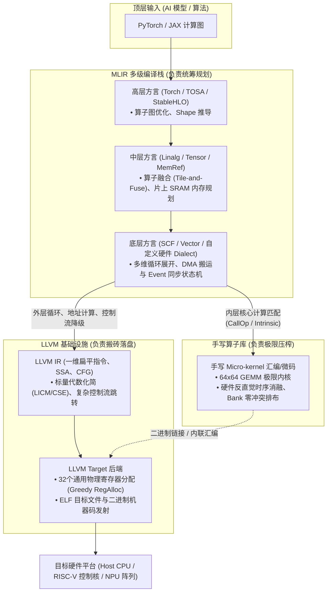
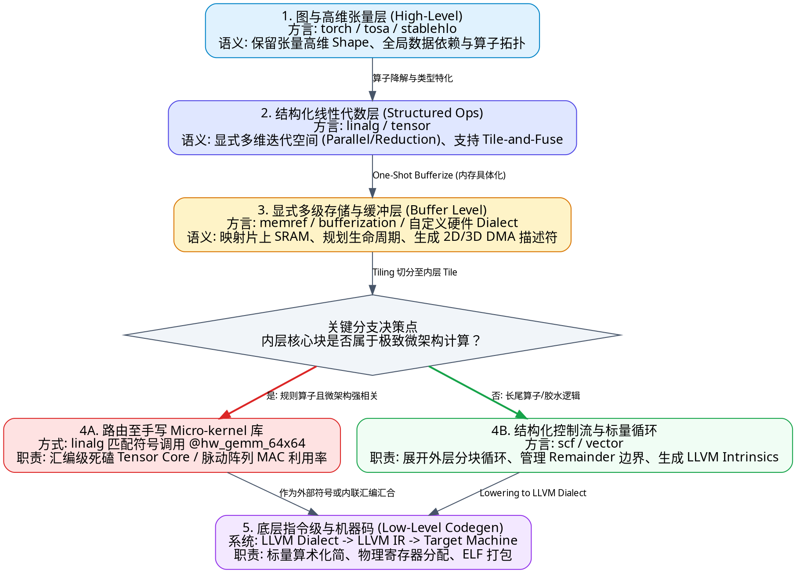
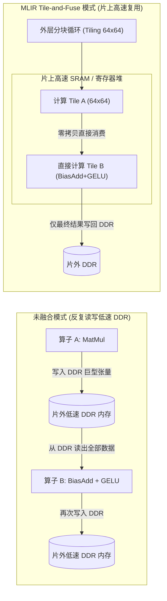
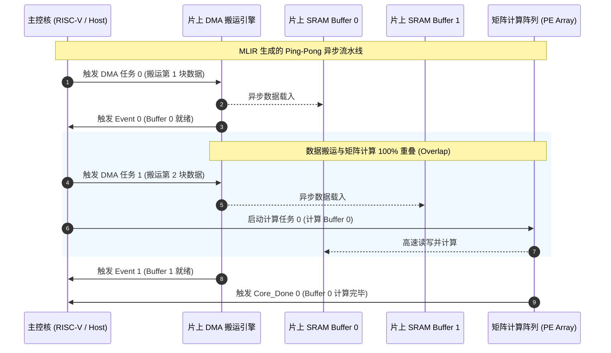
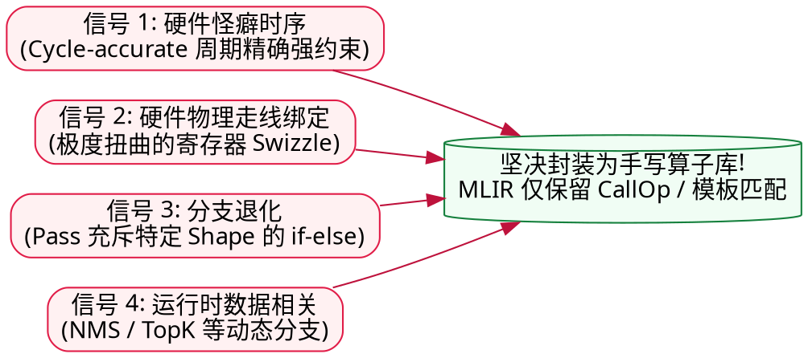
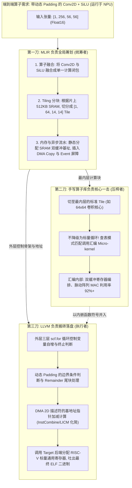
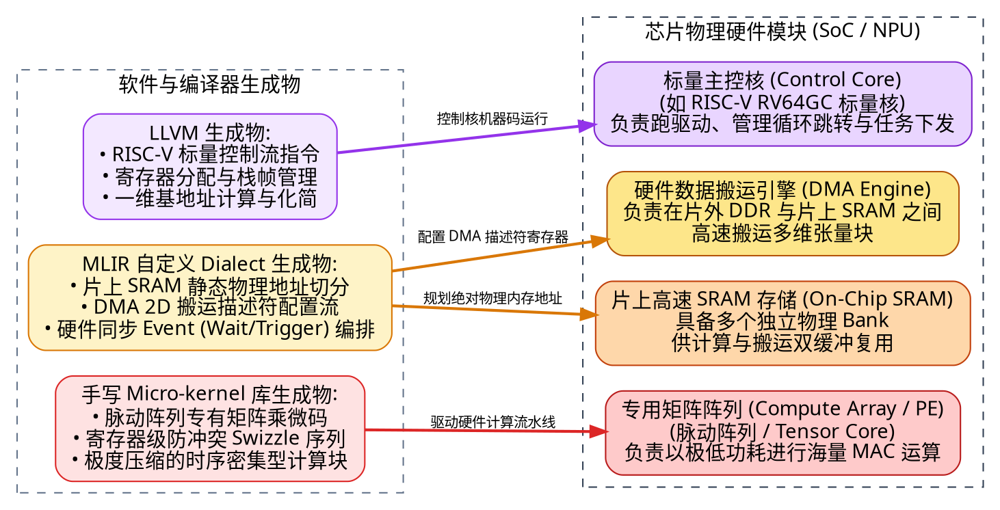
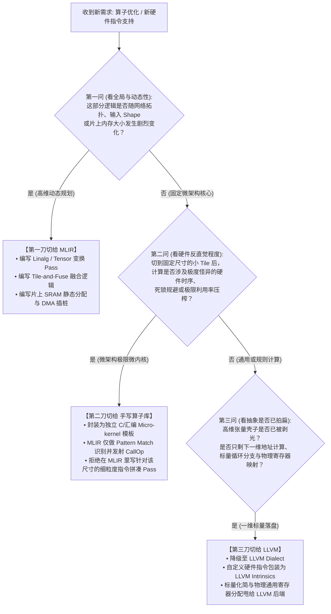

在高性能计算（HPC）与异构 AI 编译器（如 IREE、TVM Unity、OpenXLA 以及各大 NPU 厂商自研编译器栈）的架构研发中，团队经常会爆发激烈的架构争论：

> **“既然 MLIR 从图、张量、多维循环、寄存器配置到内联汇编全都能够表达，理论上它是图灵完备的，为什么我们不直接用 MLIR 一竿子捅到底？为什么还要养一个庞大的底层手写算子库团队？又为什么还要在最后一公里把 IR 降级给老态龙钟的 LLVM？”**

这个疑问切中了每一个初入编译器工程领域的研发者的灵魂。

答案非常残酷：**在真实的工业级编译器工程中，决定把一个功能放在哪一层的，根本不是‘能不能表达’，而是‘信息保真度’、‘组合爆炸’与‘工程实现维护代价（ROI）’的无情博弈。**

如果你在 MLIR 里干了本该由“手写库”或“LLVM”干的活，写出来的 Pass 会迅速沦为充斥着成百上千行 `if-else` 的脆弱屎山；反之，如果你把本该由 MLIR 统筹的高维数据流过早降级给 LLVM，关键的全局优化机会将永远丢失。

本文将彻底打破理论抽象的迷雾，以一线编译器研发视角，为你系统拆解 **MLIR、手写算子库（Micro-kernel）与 LLVM** 的三方边界，并奉上一份可直接在工位落地的**实战决策指南**。

---

## 序章：初学者必读——拨开概念迷雾

在深入讨论分界线之前，我们必须先统一认知语言。如果你是初涉编译器与底层硬件的新手，遇到以下名词时无须畏惧，它们在本质上是计算机科学为了管理复杂度而搭建的阶梯：

> [!NOTE] 核心术语直白通俗解析
> - **IR (Intermediate Representation, 中间表示)**：
>   就像盖大楼时的**工程蓝图**。高级语言（Python/C++）是业主的口头需求，底层机器码（0101 二进制）是工人的搬砖动作。IR 就是介于二者之间、便于架构师进行结构力学验算和空间优化的图纸。
> - **MLIR (Multi-Level Intermediate Representation, 多级中间表示)**：
>   传统的 IR（如 LLVM IR）只有一套固定层级的图纸；而 MLIR 允许存在**多套不同抽象粒度的图纸（Dialects，方言）**。从顶层的神经网络算子图，到中层的多维循环嵌套，再到底层的物理内存缓冲区，都可以在同一个系统里共存并逐级演化。
> - **Dialect (方言)**：
>   MLIR 中的领域专用命名空间。比如 `tosa` 方言懂张量算子，`linalg` 方言懂线性代数结构，`scf` 方言懂结构化循环（for/while），`llvm` 方言懂底层指针与跳转。
> - **Progressive Lowering (渐进式降级)**：
>   编译器将高级别抽象一步一步拆解为低级别指令的过程。就像把一句“做一个番茄炒蛋”逐步拆解为“买菜 -> 洗切 -> 热油 -> 翻炒 -> 装盘”，绝不一步跨越，以确保每一步都能被精确分析。
> - **LLVM**：
>   工业界极其成熟的通用底层编译器框架。它专注于传统 CPU/GPU 的一维指令级优化、通用寄存器分配和最终机器码生成。
> - **算子库 (Operator Library / Micro-kernel)**：
>   由人类性能专家针对特定硬件单元（如 64×64 矩阵乘），使用手写汇编或内建微码写出的极致优化核心代码块（如 cuBLAS、oneDNN、CUTLASS）。
> - **DSA / NPU (领域特定架构 / 神经网络处理器)**：
>   不按通用 CPU 那套套路出牌的专用计算加速芯片，通常拥有片上专用 SRAM、硬件 DMA 搬运引擎和脉动阵列。

三者在现代 AI 编译器中的宏观协作关系如下图所示：



---

## 一、全景对比：三者的核心定位与能力天平

在高性能计算与异构编译器体系中，三者的定位本质上是**“分层协作”**，而非“替代竞争”：

| 维度 | 手写算子库 (cuBLAS / oneDNN / 厂商定制 Micro-kernel) | MLIR (多级可扩展中间表示) | LLVM (底层机器码生成框架) |
| :--- | :--- | :--- | :--- |
| **抽象层级** | **算子级黑盒**<br/>固定函数接口，内部直达底层汇编或微码 | **图级 → 张量级 → 循环/内存级**<br/>保留多维结构、多面体循环与显式数据流 | **一维指令级**<br/>扁平内存地址、标量/定长向量、CFG 基本块 |
| **核心优势** | **极限压榨硬件微架构**<br/>寄存器零冲突排布、双缓冲流水线打满、非公开硬件通道利用 | **保留高维空间拓扑**<br/>消除跨算子访存墙，驱动异构数据流，统一多后端抽象 | **极其成熟的通用基建**<br/>标量优化、NP-Hard 通用寄存器分配、跨平台机器码生成 |
| **致命痛点** | **组合爆炸与访存墙**<br/>无法穷举所有融合算子组合；连续调用无法消除跨 Kernel 的 DDR 往返开销 | **微内核生成能力有限**<br/>通用启发式模型极难自动生成超越顶尖人类专家的微架构汇编 | **高维语义丢失**<br/>指针别名分析困难，无法从扁平循环反推高维矩阵结构与张量生命周期 |
| **核心职责** | **计算密集型核心块的微架构实现**<br/>（如 64×64 MatMul 的最内层计算） | **全局统筹、切分、融合与调度**<br/>（Tile-and-Fuse、片上 SRAM 分配、DMA 状态机） | **标量控制流与机器码落盘**<br/>（外层控制循环、一维地址加减、寄存器分配、ELF 打包） |

### 渐进式降级（Progressive Lowering）的 Graphviz 视角

MLIR 的灵魂是**渐进式降级**，官方第一设计原则就是：**“Don't lose information too quickly（不要过早丢失高层信息）”**。



---

## 二、第一边界：MLIR 必须死守的核心领地

既然理论上任何层级都可以做优化，为什么以下这些工作**必须、且只能留在 MLIR 里完成**？

### 1. 访存密集型算子与长尾算子融合（Tile-and-Fuse）

> [!NOTE] 什么是访存密集型（Memory-Bound）与算子融合（Operator Fusion）？
> - **访存密集型**：程序的瓶颈不在于数学计算太慢，而在于**内存带宽不够用**。比如 `A + B`，每个数据只读一次、加一次就写回，ALU 计算单元大部分时间都在“饿肚子”等数据从片外内存运过来。
> - **算子融合**：如果不做融合，执行 `C = Relu(A + B)` 时，程序必须先将 `A + B` 写回到几百纳秒延迟的片外 DDR 内存，再重新读入 DDR 执行 `Relu`。算子融合就是在数据刚被算出来、还躺在纳秒级片上高速缓存（SRAM）或寄存器里时，当场把 `Relu` 算完，从而**彻底消灭往返 DDR 的访存墙**。

**为什么手写库做不了？**
手写库是静态的、黑盒的。工业界有成百上千种算子组合（如 `Conv2D + Add + SiLU`、`MatMul + Bias + LayerNorm`、`Concat + Slice + Transpose`）。没有任何一个工程团队能够穷举并手写出所有排列组合的汇编 Kernel。

**为什么 LLVM 做不了？**
一旦进入 LLVM IR，多维张量被全面压平成了一维指针偏移量。LLVM 只能看到一堆扁平的循环和指针别名，很难恢复出“这是两个张量在做逐元素生产-消费”的宏观拓扑，更无法完成跨多维维度的 Tile-and-Fuse。

**MLIR 的解法：**
在 MLIR 的 `linalg` 方言中，算子用**结构化迭代空间（Structured Ops）**表示。编译器可以通过标准变换规则，自动将消费者的计算内嵌到生产者的循环切片中：



### 2. 显式片上内存规划与生命周期分析（Storage Planning）

专用加速芯片（NPU/DSA）通常没有传统 CPU 那样复杂的硬件自动缓存一致性机制，而是配备了物理受限的**片上静态随机存储器（SRAM）**（通常仅数 MB 到数十 MB）。

编译器必须精确回答：
1. 算子 A 产生的临时数据，什么时候可以被算子 B 覆盖？
2. 哪个张量应该被放在 SRAM 的哪个物理基地址（如 `0x1000_4000`）？
3. 如何安排多维张量的排布，以避开 SRAM Bank Conflict（分体冲突）？

> [!TIP] 为什么必须在 MLIR 的 `memref` 层级做？
> 在 MLIR 的 `memref` 抽象下，张量的生命周期由清晰的 **SSA Value 定值-使用链（Def-Use Chain）** 牢牢锁定。张量的 Shape（如 `1x64x64x16`）和 Stride（步长）清晰可见。编译器可以在几百行代码内完成贪心或基于图着色的 SRAM 地址复用。
> 
> 如果拖延到 LLVM 层级，所有的访存都变成了 `getelementptr (%base, %offset)`。此时编译器必须面对最臭名昭著的**指针别名分析（Alias Analysis）**——在不知道两个指针是否发生重叠（Overlap）的情况下，为了保证程序正确性，LLVM 只能保守地假设它们冲突，从而彻底丧失复用片上内存的机会。

### 3. 异步硬件流水线与状态机编排（DMA + Event + SREG）

在真实的 NPU 硬件中，数据搬运引擎（DMA）与矩阵计算阵列（Systolic Array）是物理解耦的并发硬件单元。为了不让计算单元空转，必须采用**双缓冲（Ping-Pong Buffer）**机制：



这类调度本质上是**粗粒度的硬件原语状态机**。
在 MLIR 中，通过定义厂商专有的硬件方言（如 `npu.dma_async_copy`, `npu.wait_event`, `npu.write_sreg`），编译器在全局依赖图的俯瞰视角下，几条 Pass 就能优雅地将 Ping-Pong 调度逻辑注入循环骨架中。

---

## 二、第二边界：什么时候必须“甩锅”给手写算子库（Micro-kernel）？

既然 MLIR 的表达能力如此强悍，为什么我们不直接用 MLIR 生成最底层的计算指令，而必须保留底层的 C / 手写汇编 Micro-kernel 库？

**核心判据：**
> **当你在 MLIR 里写 Lowering 变换时，发现自己不是在做“通用模式替换”，而是在“用 C++ 代码一行行机械地拼凑针对特定 Shape 的硬件指令序列”时——立刻停止写 Pass！这是硬件在逼你建库！**

只要命中以下 **四大工程信号** 之一，果断将计算核心封装为独立的 Micro-kernel 算子库，MLIR 仅保留一个黑盒调用（`CallOp`）或粗粒度内置宏（`IntrinsicOp`）：



### 信号 1：硬件存在“反编译器直觉”的奇葩时序或死锁约束

- **真实场景**：硬件架构师告诉你：“*在发射 `Matrix_Load` 指令后，硬件总线需要 4 个时钟周期的建立时间。这 4 个 Cycle 内绝对不能读写控制寄存器 SREG_0，且必须在第 5 个 Cycle 紧跟一条微码 Clear 指令，否则硬件流水线直接锁死（Hang）且芯片无硬件互锁保护。*”
- **工程代价**：如果你想在 MLIR 里用 Pass 来处理这个逻辑，你必须在编译器内部建立一套**周期精确（Cycle-accurate）的时钟级指令模拟与重排系统**，开发与维护周期动辄按年计。
- **最佳实践**：让底层驱动或芯片验证工程师直接手写一段几十行的固定汇编代码块，用汇编宏把这几条指令死死焊死在一起。MLIR 只负责分块后在最内层 emit 一个 `call @hw_microkernel(...)`，两天就能稳定交付上线。

### 信号 2：数据排布与硬件内部物理走线死死绑定（Swizzle）

- **真实场景**：某款 NPU 的脉动阵列为了将 MAC（乘累加）利用率推向 95% 以上，要求寄存器内的数据必须按极其扭曲的格式排列（例如在 `NC1HWC0` 基础之上，再按奇偶交错进行 8-bit 的空间 Z-Ordering 交叉排列，以完全规避物理 SRAM Bank 的读写冲突）。
- **最佳实践**：不要在 MLIR 里写几千行细粒度的 Shuffle 指令生成逻辑。MLIR 只负责粗粒度地感知这个布局属性（比如打上标记 `Layout = Custom_Swizzled_Format`），计算出所需的总空间大小。至于最底层的寄存器洗牌动作，全部封在手写 Micro-kernel 汇编内。

### 信号 3：Pass 代码中出现了超过 3 层的特定 Shape 硬编码分支

- **反面教材（代码异味）**：
  你在写一个通用降级 Pass，结果代码变成了：
  ```cpp
  if (M == 64 && N == 64 && dtype == BF16) {
      emit_instruction_sequence_A();
  } else if (M == 32 && N == 128 && dtype == MXInt8) {
      emit_instruction_sequence_B();
  } else if (M == 16 && N == 256) {
      emit_instruction_sequence_C();
  }
  ```
- **本质**：一旦编译器的 Pass 充斥着针对特定 Tile 尺寸的硬编码序列，说明**编译器已经被降维打击成了“用 C++ AST 语法树拼汇编的笨拙工具”**。
- **最佳实践**：将这些固定的指令序列直接写成 C/ASM Micro-kernel 模板库。MLIR 只做高维度 Tiling，将大矩阵切分成标准的 64×64 块，然后查表匹配（Pattern Match）调用对应的库接口。

### 信号 4：算子内部控制流完全由“运行时数值（Data-Dependent）”驱动

- **典型代表**：非极大值抑制（NMS）、TopK、稀疏张量的动态非零元提取。
- **原因**：这类算子每次循环跑多少步、往哪个分支跳，完全取决于当前计算出来的浮点数是多少。MLIR 的静态多面体分析和 Linalg 结构化建模面对这类动态分支完全失效。此时强行在 MLIR 里用 `scf.while` 构建复杂的动态状态机，不仅没有任何编译优化收益，反而容易引发编译期崩溃。直接作为 External Library 调用宿主核（Host CPU 或控制核）手写 C++ 库才是正道。

---

## 三、第三边界：什么时候必须坚决“甩锅”给 LLVM？

当张量的高维壳子已经被剥掉，多维迭代空间已经拆解完毕，剩下的全是**一维标量算术、控制流分支跳转与物理寄存器映射**时，必须立刻停止在 MLIR 里的操作，全面交给 LLVM！

针对带有内置标量核（如 RISC-V 控制核 + 自定义扩展指令）的 NPU 系统，请务必坚守以下 **四条工程红线**：

### 红线 1：绝对不要在 MLIR 里手工分配物理通用标量寄存器（GPR）

> [!CAUTION] 真实的惨痛血泪教训
> 某团队在 MLIR 自定义 Dialect 中引入了底层指令，为了图省事，在 MLIR Pass 里直接硬编码写死该指令使用 RISC-V 物理寄存器 `a0 (x10)` 和 `a1 (x11)` 传参。
> 
> **灾难**：外层循环的控制变量、动态基地址计算在降级到 LLVM 后，LLVM 的寄存器分配器完全不知道 MLIR 曾经私自挪用了 `a0/a1`，在做标量代码生成时直接将循环计数器分配到了 `a0` 上。运行结果是外层循环变量被直接踩爆覆盖，程序陷入死循环或跑飞（Memory Corruption）。

- **最佳实践**：在 MLIR 里，所有寄存器配置值、SRAM 偏移地址一律保持为**虚拟 SSA 变量（SSA Value）**。将底层硬件指令封装为 **LLVM Intrinsics**（如 `llvm.riscv.custom.dma(%addr, %size)`），物理寄存器的分配（Register Allocation）以及因寄存器不足导致的压栈溢出（Spill to Stack），**100% 甩给 LLVM 的 Greedy Register Allocator**。

### 红线 2：绝对不要在 MLIR 里手搓一维地址的代数化简

- **场景**：一个 4 维张量切片后，某个元素的物理偏移计算展开为：
  `offset = (((b * 16 + c) * 32 + h) * 32 + w) * 4`
- **最佳实践**：
  在 MLIR 中使用标准 `memref.subview` 表达完切片语义后，直接调用标准 Pass（`-finalize-memref-to-llvm`），将其无脑拍扁成一连串原始的 `llvm.getelementptr` 和乘加操作。
  **千万不要试图在 MLIR 里写 Pass 去把乘法优化为移位，或者提取循环不变量！**
  LLVM 经过二十余年工业级锤炼的 `InstCombine`（指令结合）、`LICM`（循环不变量外提）和 `StrengthReduction`（强度削减）Pass 会在几毫秒内将其化简到极致。在 MLIR 里重复实现这套机制属于完全吃力不讨好的重复造轮子。

### 红线 3：复杂标量分支与尾块（Remainder Loop）指令重排交给 LLVM

当张量维度无法被 Tile 尺寸整除时，必然会留下边界边角料（Tail/Remainder Loop）。这部分通常需要结合向量掩码（Mask）或标量循环来处理。
MLIR 只需要负责生成基本的 `scf.if` 分支结构即可。至于底层指令流水线的防气泡交错（Instruction Scheduling）、分支预测对齐和基本块重排（Basic Block Placement），全部推给 LLVM 的 `MachineScheduler`。

### 红线 4：C ABI 栈帧管理与目标文件（ELF）打包

除非你的芯片是一个完全没有 PC 指针和调用栈的纯硬件连线状态机，否则只要存在函数调用、参数入栈、异常处理，就必须通过 LLVM 生成符合标准 Target ABI 的 `.o` 目标文件。绝不要在 MLIR 里自己手写二进制机器码发射器（Assembler）。

---

## 四、工业界黄金范式：三者协同作战实战案例

在当今领先的 AI 编译器体系中，三者不是水火不容的割裂存在，而是形成了如同现代交响乐团般的**黄金结合范式**：

> **“外层 MLIR 全局调度 + 内层 Micro-kernel 极限压榨 + 底层 LLVM 穿针引线”**



### 映射到芯片物理硬件的直观视角

为了彻底打破抽象感，我们将三者的软件产物与 NPU 芯片的物理硬件模块进行一次一对一的灵魂映射：



---

## 五、一线研发实战决策宝典

当你明天坐在工位上，面对一个新的算子优化需求或异构后端支持任务时，请掏出以下这份《三步决策漏斗》与《三秒钟速查表》。

### 1. 实战三步决策漏斗



### 2. 研发场景“三秒钟速查表”

| 你正在面临的开发任务 | 正确归属层级 | 典型实现机制 | 如果选错层级会发生的“车祸现场” |
| :--- | :--- | :--- | :--- |
| **算子融合（Fusion）与分块（Tiling）尺寸计算** | **MLIR** | `linalg` / `tensor` 结构化变换 Pass | **放库里**：面临组合爆炸，写几千个排列组合；<br/>**放 LLVM**：高维语义已丢失，无法重构算子依赖图。 |
| **片上 SRAM 物理基址分配与生命周期复用** | **MLIR** | `memref` / 自定义 Memory Planning Pass | **放 LLVM**：深陷指针别名分析泥潭，无法确认两块 Buffer 生命周期是否重叠，SRAM 复用彻底失效。 |
| **DMA 描述符装配与双缓冲（Ping-Pong）状态机插桩** | **MLIR** | 自定义硬件方言 + SCF 循环展开 | **放库里**：算子之间丧失数据搬运流水线重叠能力，每个算子必须阻塞等待 DMA 传输完毕。 |
| **切块后的 64×64 矩阵乘 / 卷积极限阵列指令流** | **手写算子库** | 手写汇编 / 微码内核，MLIR 查表发射 `CallOp` | **放 MLIR**：为了满足硬件严格的时序规避与 Swizzle，Pass 沦为写满特定 Shape 的上万行硬编码屎山。 |
| **NMS / TopK 等强依赖运行时数据的动态分支算子** | **手写算子库** | 外部 C++ 库接口调用（Host/控制核执行） | **放 MLIR**：静态多面体与结构化分析全面失效，Pass 极度臃肿且毫无性能收益。 |
| **一维数组下标展开后的标量代数化简 (`base + i*stride`)** | **LLVM** | `InstCombine` / `LICM` / `StrengthReduction` | **放 MLIR**：在 Dialect 里重新发明一遍标量代数化简轮子，耗时耗力且 Bug 百出。 |
| **RISC-V 标量主控核的 32 个通用寄存器（GPR）分配** | **LLVM** | `llvm.intr.*` + LLVM Greedy RegAlloc | **放 MLIR**：手动硬编码分配寄存器极易与控制流变量冲突，直接导致踩栈或内存跑飞。 |
| **生成符合目标平台的 ELF 目标文件与函数栈帧** | **LLVM** | Target Machine Code Emission | **放 MLIR**：自己造一个二进制 Assembler 与 Linker，维护成本高不可攀。 |

---

## 结语：架构的终极艺术是“克制与分工”

回到最初的那个灵魂拷问：既然 MLIR 能表达一切，为什么不能包揽一切？

计算科学的发展史告诉我们：**“图灵完备并不意味着工程合理”**。

- **MLIR 的伟大之处**，在于它提供了一张可以自由伸缩的画布，让我们能够在“领域语义未丢失之前”，以极高的确定性和极低的代价统筹全局数据流与内存架构；
- **手写算子库的不可替代**，在于人类专家对特定芯片物理微架构极限的敬畏与极致抠取的工匠精神，这种经验无法被通用的编译启发式模型廉价取代；
- **LLVM 的基石价值**，在于它承载了软件工业界几十年来在底层标量指令、寄存器调度和硬件 ABI 上沉淀的最坚固的地基。

在编译器架构设计的道路上，永远记住这句核心心法：

> **“高层全局看拓扑，切块排布留 MLIR；**  
> **阵列极限拼手速，黑盒硬核封做库；**  
> **地址展开标量跑，寄存落盘归 LLVM。”**
