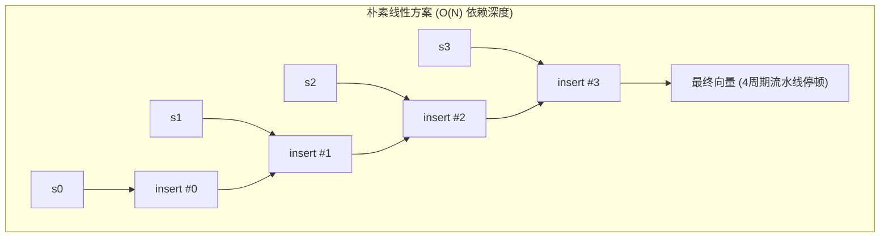
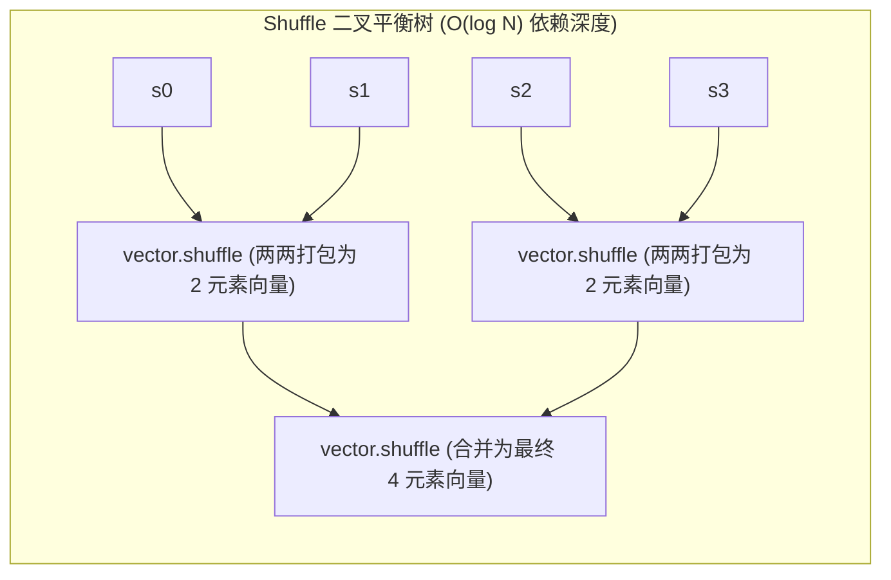
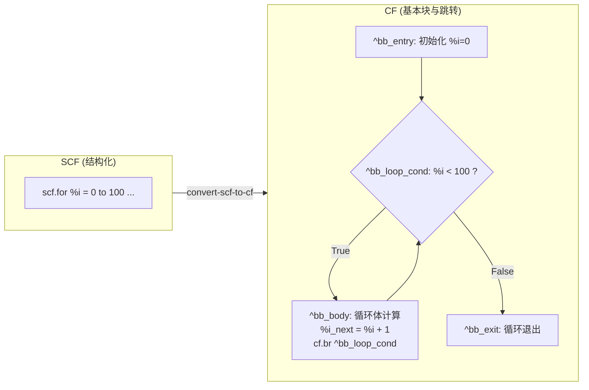

> **导读**：在 AI 编译器与高性能计算系统研发中，将高层张量算子编译降级（Lowering）并高效部署到底层物理硬件，往往是决定模型推理与训练速度的“最后一公里”。然而，当开发者第一次面对 `mlir-opt` 那串密密麻麻的转换流水线参数（如 `--lower-vector-mask`、`--lower-vector-to-from-elements-to-shuffle-tree`、`--convert-vector-to-scf`）时，往往会感到困惑：**这些 Pass 到底对代码动了什么手术？为什么不能一步到位直接转成 LLVM IR？高维向量操作究竟是如何一步步蜕变为底层物理寄存器和 SIMD 指令的？**
>
> 本文基于实战编译降级流水线，系统拆解从 MLIR Vector Dialect 到 LLVM 目标架构的完整转换路径。文章配有详尽的初学者术语释义、每一步 Pass 转换前后的真实 MLIR 代码对照，以及支持横屏全景沉浸阅读的 Graphviz / Mermaid 架构图，帮助你彻底建立端到端向量编译降级的清晰心智模型。

---

## 一、初学者必读：核心术语通俗图解

在深入剖析每个具体的 Pass 之前，我们必须先扫清前方的概念路障。如果你刚刚接触编译器底层领域，以下名词是贯穿全篇的基石。

> [!NOTE] 核心概念形象速查表
> - **IR (Intermediate Representation, 中间表示)**：
>   就像建筑师设计的**工程设计蓝图**。高级语言（Python、C++）是业主的口头需求，机器码（0101 二进制）是砌砖工人的具体动作。IR 是位于二者之间、便于做力学分析与结构优化的工程图纸。
> - **MLIR (Multi-Level Intermediate Representation, 多级中间表示)**：
>   传统编译器（如经典 LLVM）通常只有一套固定抽象层级的图纸；而 MLIR 允许存在**多套不同抽象粒度的图纸**。从神经网络层（Graph）、张量循环层（Linalg/Affine），到向量层（Vector）、结构化控制流（SCF），再到底层指针内存层（LLVM），它们能无缝拼接并在同一体系中共存。
> - **Dialect (方言)**：
>   MLIR 中的领域命名空间与语法子集。例如 `vector` 方言专门描述向量操作，`arith` 负责基础四则运算，`scf` 负责结构化循环（for/if），`memref` 负责多维物理内存管理，`llvm` 则是直接对接 LLVM IR 的方言。
> - **Lowering (降级 / 下沉 / 去抽象化)**：
>   将高层次、抽象语义的操作，逐步翻译、拆解为更加贴近硬件底层物理实现的低层次操作的过程。
> - **Pass (编译通路 / 遍历变换)**：
>   编译器流水线上的**流水线工人**。每个 Pass 专注于执行某一种特定的语法检查、代码重写、优化折叠或跨方言降级。
> - **SIMD 与 Lane (单指令多数据 与 向量通道)**：
>   传统标量计算好比单车道收费站，每次只能过一辆车；SIMD 相当于把收费站拓宽为 8 车道，一条指令同时让 8 辆车并行通行。每一个独立的车道，就称为一个 **Lane（通道）**。
> - **Predication / Masking (谓词化 / 掩码执行)**：
>   如果 8 车道收费站只想让前 4 辆车通过，后 4 辆车暂停，这就需要一张类似通行证的标记布尔向量 `[1, 1, 1, 1, 0, 0, 0, 0]`，这个布尔掩码就叫 **Mask**。
> - **Reduction (归约)**：
>   将多维或多个数值按照某种规则聚合为更少维度的过程，例如将一个长度为 8 的向量所有元素全部相加得到单个数值（Sum Reduction）。
> - **Shuffle (洗牌 / 数据重排)**：
>   像洗扑克牌一样，在单条向量指令内重新排列各个 Lane 中元素的位置，或从多个向量中交织拼接出新向量。
> - **SCF vs CF (结构化控制流 vs 控制流)**：
>   `scf` 拥有高级语法概念（如带有步长和迭代参数的 `scf.for` 循环）；而 `cf` 则是底层基础块（Basic Block）和原始条件跳转（`cf.cond_br`），没有嵌套概念。

通过以下架构图，可以直观看到 MLIR 是如何自顶向下逐层完成“去抽象化”下沉的：

```mermaid
flowchart TD
    subgraph HighLevel["高层领域抽象 (High-Level Abstractions)"]
        A["高维张量 / 矩阵计算 (Tensor / Linalg)"]
    end

    subgraph MidLevel["中层硬件语义抽象 (Mid-Level Dialects)"]
        B["Vector Dialect (向量抽象: 掩码、多维归约、元素构造)"]
        C["SCF Dialect (结构化循环与分支: scf.for / scf.if)"]
        D["MemRef Dialect (多维数组引用与跨步寻址)"]
    end

    subgraph LowLevel["底层硬件物理映射 (Low-Level / LLVM Dialect)"]
        E["CF Dialect (基本块 + 分支跳转 cf.br / cf.cond_br)"]
        F["LLVM Dialect (指针计算 GEP、LLVM 向量与内联指令)"]
    end

    subgraph Hardware["物理机器码生成 (Target Backend)"]
        G["LLVM IR -> 目标物理机器码 (x86 AVX / ARM SVE / RISC-V RVV)"]
    end

    A -->|Tiling & Vectorization| B
    B -->|Lowering: 去掩码 / 拆归约 / 构造Shuffle树| B
    B -->|标量化展开 (Full Unroll)| C
    B -->|直接映射 SIMD| F
    C -->|结构消除| E
    D -->|展开步幅元数据| F
    E --> F
    F --> G
```

---

## 二、端到端 Lowering 流水线概览

在工业级编译器（如 IREE、MLIR-LLVM 编译栈）中，将包含高级向量逻辑的 MLIR 文件降级为 LLVM IR，通常会执行如下由 `mlir-opt` 调度的标准流水线：

```bash
mlir-opt input.mlir \
  --lower-vector-mask \
  --lower-vector-multi-reduction \
  --lower-vector-to-from-elements-to-shuffle-tree \
  --convert-vector-to-scf='full-unroll=true lower-scalable=true' \
  --convert-scf-to-cf \
  --convert-vector-to-llvm \
  --expand-strided-metadata \
  --lower
```

### 1. 流水线的混合处理哲学

仔细观察这条流水线，你会发现它采取了一种非常精妙的**混合降级策略（Hybrid Lowering Strategy）**：

1. **前序去抽象化（Pass ① ~ ③）**：剥离高层掩码黑盒，将多维高阶归约分解为单维，将元素构造变成硬件友好的二叉树。
2. **标量化分支路径（Pass ④ ~ ⑤）**：对于超出硬件寄存器能力、目标平台缺少原生 SIMD 算子或开发者显式要求展开的操作，直接转化为标量循环（SCF），进而抹平为底层分支跳转（CF）。
3. **原生向量化分支路径（Pass ⑥）**：对于目标硬件原生支持的高效 SIMD 向量计算，直接 1:1 映射为 LLVM 的向量指令。
4. **内存与收尾展开（Pass ⑦ ~ ⑧）**：把高级 MemRef 抽象的步幅和偏移转换为底层扁平指针的算术寻址，完成最后的闭环。

---

## 三、全景横屏架构画卷：主流水线与 Pass 演进图

为了给工程研发人员提供全局且一目了然的参考，下图采用了**横屏全景布局（Wide Screen View）**。顶部为端到端主 Pipeline 的演进方向，底部清晰对比了五个关键 Vector Pass 在代码形态与数据流上的蜕变：

```graphviz
digraph MLIR_Vector_Passes {
    rankdir=TB;
    compound=true;
    node [shape=box, style=filled, fontname="Helvetica", fontsize=10];
    edge [fontname="Helvetica", fontsize=9];

    // ================= 顶部：主 Pipeline (横向) =================
    subgraph cluster_main {
        label="主 Pipeline 演进全景 (Main Pipeline Flow)";
        style=filled;
        color="#E6F3FF";
        rankdir=LR;

        input [label="输入 MLIR\n(High-level Vector Ops)", fillcolor="#FFFFCC", shape=ellipse];
        p1 [label="1. lower-vector-mask", fillcolor="#90EE90"];
        p2 [label="2. lower-vector-multi-reduction", fillcolor="#90EE90"];
        p3 [label="3. to-shuffle-tree", fillcolor="#90EE90"];
        p4 [label="4. convert-vector-to-scf", fillcolor="#90EE90"];
        p5 [label="5. convert-scf-to-cf", fillcolor="#FFFFCC"];
        p6 [label="6. convert-vector-to-llvm", fillcolor="#90EE90"];
        p7 [label="7. expand-strided-metadata", fillcolor="#FFFFCC"];
        p8 [label="8. lower-to-llvm", fillcolor="#FFFFCC"];
        out [label="输出 LLVM 方言\n(LLVM Dialect IR)", fillcolor="#FFB6C1", shape=ellipse];

        input -> p1 -> p2 -> p3 -> p4 -> p5 -> p6 -> p7 -> p8 -> out;
    }

    // ================= 底部：详细图 (分为两排排列) =================

    // 详细图 1: Mask
    subgraph cluster_mask {
        label="Pass 1: lower-vector-mask (消除谓词化执行)";
        style=filled;
        color="#FFFACD";

        m_before [label=<
            <b>BEFORE: vector.mask 高层谓词黑盒</b><br/>
            <font face="Courier">%mask = vector.constant_mask [4] : vector&lt;8xi1&gt;<br/>
            %res = vector.mask %mask, %a, %b {<br/>
            &nbsp;&nbsp;%sum = arith.addf %va, %vb : vector&lt;8xf32&gt;<br/>
            &nbsp;&nbsp;vector.yield %sum : vector&lt;8xf32&gt;<br/>
            } : vector&lt;8xf32&gt;</font>
        >, fillcolor=white];

        m_after [label=<
            <b>AFTER: arith.select 显式数据流选择</b><br/>
            <font face="Courier">%sum = arith.addf %a, %b : vector&lt;8xf32&gt;<br/>
            %res = arith.select %mask, %sum, %a : vector&lt;8xi1&gt;, vector&lt;8xf32&gt;</font>
        >, fillcolor=white];

        m_before -> m_after [label="lower-vector-mask", color=orange];
    }

    // 详细图 2: Multi-Reduction
    subgraph cluster_mred {
        label="Pass 2: lower-vector-multi-reduction (拆解多维归约)";
        style=filled;
        color="#FFFACD";

        mr_before [label=<
            <b>BEFORE: multi_reduction 跨多维度归约</b><br/>
            <font face="Courier">%res = vector.multi_reduction<br/>
            &nbsp;&nbsp;#reduction, %vec, %init<br/>
            &nbsp;&nbsp;: vector&lt;4x8xf32&gt; into f32</font>
        >, fillcolor=white];

        mr_after [label=<
            <b>AFTER: 单维 reduction 级联串联</b><br/>
            <font face="Courier">%row = vector.reduction<br/>
            &nbsp;&nbsp;dim=1, %vec : vector&lt;4x8xf32&gt; -&gt; vector&lt;4xf32&gt;<br/>
            %res = vector.reduction<br/>
            &nbsp;&nbsp;dim=0, %row : vector&lt;4xf32&gt; -&gt; f32</font>
        >, fillcolor=white];

        mr_before -> mr_after [label="lower-vector-multi-reduction", color=orange];
    }

    // 详细图 3: Shuffle Tree
    subgraph cluster_shuffle {
        label="Pass 3: to-shuffle-tree (线性构造转二叉平衡树)";
        style=filled;
        color="#FFFACD";

        s_before [label=<
            <b>BEFORE: from_elements 标量线性构造</b><br/>
            <font face="Courier">%vec = vector.from_elements<br/>
            &nbsp;&nbsp;%s0, %s1, %s2, %s3<br/>
            &nbsp;&nbsp;: vector&lt;4xf32&gt;</font>
        >, fillcolor=white];

        s_after [label=<
            <b>AFTER: shuffle 平衡树 O(log N)</b><br/>
            <font face="Courier">%v01 = vector.shuffle %s0, %s1 [0, 1] : vector&lt;2xf32&gt;<br/>
            %v23 = vector.shuffle %s2, %s3 [0, 1] : vector&lt;2xf32&gt;<br/>
            %vec = vector.shuffle %v01, %v23 [0, 1, 2, 3] : vector&lt;4xf32&gt;</font>
        >, fillcolor=white];

        s_before -> s_after [label="to-shuffle-tree", color=orange];
    }

    // 详细图 4: Vector to SCF
    subgraph cluster_scf {
        label="Pass 4: convert-vector-to-scf (向量标量化与完全展开)";
        style=filled;
        color="#FFFACD";

        v_before [label=<
            <b>BEFORE: 纯向量批量抽象</b><br/>
            <font face="Courier">%res = arith.addf %a, %b<br/>
            &nbsp;&nbsp;: vector&lt;4x8xf32&gt;</font>
        >, fillcolor=white];

        v_after [label=<
            <b>AFTER: scf.for 双重嵌套循环与标量抽取</b><br/>
            <font face="Courier">scf.for %r = 0 to 4 {<br/>
            &nbsp;&nbsp;scf.for %c = 0 to 8 {<br/>
            &nbsp;&nbsp;&nbsp;&nbsp;%va = vector.extract %a[%r, %c]<br/>
            &nbsp;&nbsp;&nbsp;&nbsp;%vb = vector.extract %b[%r, %c]<br/>
            &nbsp;&nbsp;&nbsp;&nbsp;%s = arith.addf %va, %vb : f32<br/>
            &nbsp;&nbsp;}<br/>
            }</font>
        >, fillcolor=white];

        v_before -> v_after [label="convert-vector-to-scf", color=orange];
    }

    // 详细图 5: Vector to LLVM
    subgraph cluster_llvm {
        label="Pass 6: convert-vector-to-llvm (映射至 LLVM IR 指令)";
        style=filled;
        color="#FFFACD";

        l_before [label=<
            <b>BEFORE: MLIR Vector 方言</b><br/>
            <font face="Courier">%sum = arith.addf %a, %b : vector&lt;4xf32&gt;<br/>
            %e = vector.extract %a[2] : vector&lt;4xf32&gt;</font>
        >, fillcolor=white];

        l_after [label=<
            <b>AFTER: LLVM Dialect 原生向量操作</b><br/>
            <font face="Courier">%sum = llvm.fadd %a, %b : !llvm.vec&lt;4 x f32&gt;<br/>
            %e = llvm.extractelement %a[%idx] : !llvm.vec&lt;4 x f32&gt;</font>
        >, fillcolor=white];

        l_before -> l_after [label="convert-vector-to-llvm", color=orange];
    }

    // ================= 布局约束 =================
    { rank=same; cluster_mask; cluster_mred; cluster_shuffle; }
    { rank=same; cluster_scf; cluster_llvm; }

    // ================= 主图到子图的虚线指引 =================
    p1 -> m_before [style=dashed, color=orange, constraint=false];
    p2 -> mr_before [style=dashed, color=orange, constraint=false];
    p3 -> s_before [style=dashed, color=orange, constraint=false];
    p4 -> v_before [style=dashed, color=orange, constraint=false];
    p6 -> l_before [style=dashed, color=orange, constraint=false];
}
```



---

## 四、8 大核心 Pass 逐个深度解析

现在，让我们像手术刀一样，对流水线中的每一个 Pass 进行逐一解剖。

### 1. `--lower-vector-mask`：消除谓词化执行

#### 🎯 核心使命
消除 `vector.mask` 这一带有条件区域（Region）的高层谓词化操作，将其拆解为显式的“无条件计算 + 数据选择（`arith.select`）”。

#### 💡 为什么需要？
- **硬件现状**：虽然现代架构（如 AVX-512、ARM SVE、RISC-V RVV）支持硬件级掩码寄存器，但较早或较主流的架构（如 x86 SSE、AVX2、ARM NEON）并没有普遍的原生“掩码加法”指令。
- **优化死角**：`vector.mask` 内部包裹了一个封闭的代码块（Region）。只要这个闭包结构存在，编译器的公共子表达式消除（CSE）、死代码消除（DCE）以及常量折叠就无法看透其内部逻辑。

#### ⚙️ 转换前后的 MLIR 源码对比

**转换前（BEFORE）：**
```llvm
// 掩码向量加法：只对前 4 个元素做加法
%mask = vector.constant_mask [4] : vector<8xi1>
%result = vector.mask %mask, %a, %b : vector<8xf32> {
^bb0(%va: vector<8xf32>, %vb: vector<8xf32>):
  %sum = arith.addf %va, %vb : vector<8xf32>
  vector.yield %sum : vector<8xf32>
} : vector<8xf32>
```

**转换后（AFTER）：**
```llvm
// 暴露数据流：无条件全部计算，随后按掩码选路
%mask = vector.constant_mask [4] : vector<8xi1>
%sum = arith.addf %a, %b : vector<8xf32>
%result = arith.select %mask, %sum, %a : vector<8xi1>, vector<8xf32>
```

> [!TIP] 架构师视角：性能与发散（Divergence）的权衡
> 很多初学者会质疑：“后 4 个元素明明不需要算，为什么还要执行 `arith.addf`？”
> 这是因为在 SIMD 处理器上，**引入标量条件分支的开销远远高于白算 4 个浮点加法**。通过将其转换为全量计算加 `arith.select`（在汇编级对应 `blendps` 或按位与非），消除了任何 CPU 分支预测失败的惩罚。

---

### 2. `--lower-vector-multi-reduction`：拆解多维多轴归约

#### 🎯 核心使命
将高阶多维张量上的多轴同时归约操作（`vector.multi_reduction`），按轴逐步拆解为一系列**单维度**的 `vector.reduction`。

#### 💡 为什么需要？
硬件的向量执行单元是物理一维线性的。没有任何一款 CPU 或 GPU 能在单个硬件时钟周期内直接完成一个 4×8 二维矩阵在行和列两个方向上的同时累加。多维归约在硬件底层必然要求**先后分步计算**。

#### ⚙️ 转换前后的 MLIR 源码对比

**转换前（BEFORE）：**
```llvm
// 对一个 4x8 的 2D 向量同时沿第 0 维和第 1 维求和，归约成一个标量 f32
%vec = ... : vector<4x8xf32>
%result = vector.multi_reduction <add>, %vec, %init 
  [0, 1] : vector<4x8xf32> to f32
```

**转换后（AFTER）：**
```llvm
// Step 1: 先沿 dim 1（列方向，8 -> 1）做水平归约，得到 4 个行和
%row_sums = vector.reduction <add>, %vec : vector<4x8xf32> into vector<4xf32>

// Step 2: 再沿 dim 0（行方向，4 -> 1）归约这 4 个元素，得到最终标量
%result = vector.reduction <add>, %row_sums, %init : vector<4xf32> into f32
```

---

### 3. `--lower-vector-to-from-elements-to-shuffle-tree`：元素构造转 Shuffle 树

#### 🎯 核心使命
将从 N 个标量构造向量（`vector.from_elements`）或将向量打散提取标量（`vector.to_elements`）的线性串行逻辑，重写为**深度为 $O(\log N)$ 的二叉向量洗牌平衡树（Shuffle Tree）**。

#### 💡 为什么需要？深入剖析复杂度陷阱
如果直接采用朴素方案将 4 个标量组装为向量，通常会生成串行的插入操作：



每一次 `insertelement` 都强依赖上一次的结果，CPU 指令流水线将被迫串行等待。
而通过将其转换为**二叉 Shuffle 树**：



#### ⚙️ 转换前后的 MLIR 源码对比

**转换前（BEFORE）：**
```llvm
%vec = vector.from_elements %s0, %s1, %s2, %s3 : vector<4xf32>
```

**转换后（AFTER）：**
```llvm
// 第一层：左右两个分支并行执行打包
%v01 = vector.shuffle %s0, %s1 [0, 1] : vector<2xf32>
%v23 = vector.shuffle %s2, %s3 [0, 1] : vector<2xf32>

// 第二层：交织合并为目标宽度
%vec = vector.shuffle %v01, %v23 [0, 1, 2, 3] : vector<4xf32>
```

在 x86 汇编层面，这直接映射为高度并行的 `unpcklps` / `movlhps` 指令组合，发射效率远高于连续的 `pinsrd`。

---

### 4. `--convert-vector-to-scf='full-unroll=true lower-scalable=true'`：向量标量化

#### 🎯 核心使命
当目标硬件没有原生 SIMD 指令、向量超长，或者开发者需要对向量计算进行极尽细致的标量级指令排布时，将剩余的向量操作降级为 `scf.for` 嵌套循环结构，或直接完全展开（Full Unroll）为纯标量计算。

#### ⚙️ 关键参数意义
| 参数配置 | 含义与底层动作 | 典型应用场景 |
| :--- | :--- | :--- |
| `full-unroll=true` | 将生成的遍历循环**彻底展开**，不生成循环分支跳转，直接暴露出全量的标量计算指令链 | 循环轮数小（如 4、8 次），追求零分支开销的极致性能 |
| `lower-scalable=true` | 兼容支持 **可伸缩向量（Scalable Vectors）**（如 ARM SVE 的 `vector<[4]xf32>`、RISC-V RVV） | 适配向量长度在运行时决定的现代微架构 |

**展开效果示例：**
一个原本抽象的 `vector.add %a, %b : vector<4xf32>`，在 `full-unroll=true` 作用下，将被完全展开为 4 次显式的 `vector.extract` 搭配 4 个底层的 `arith.addf` 标量浮点加法指令。

---

### 5. `--convert-scf-to-cf`：结构化循环降级为底层控制流

#### 🎯 核心使命
LLVM IR 在本质上是一个**控制流图（CFG, Control Flow Graph）**系统，它没有 `for` 或 `if` 这种高阶嵌套结构，只有由基本块（Basic Block）和分支跳转构成的有向图。该 Pass 负责抹平这一层鸿沟。



- `scf.for` $\rightarrow$ 条件分支基本块 + 回边跳转（Loop Backedge）
- `scf.if` $\rightarrow$ `cf.cond_br` 分支跳转至 then/else 目标块

---

### 6. `--convert-vector-to-llvm`：直通 LLVM 向量指令

#### 🎯 核心使命
这是向量操作通往最终硬件机器码的**高速直通车**。它将仍然保持向量形态的 MLIR 结构，1:1 映射为 LLVM Dialect 原生类型与指令：

| MLIR Vector Dialect | LLVM Dialect | 生成的物理汇编对齐（以 x86 为例） |
| :--- | :--- | :--- |
| `vector<4xf32>` | `!llvm.vec<4 x f32>` | 128 位 XMM 寄存器 |
| `vector.add` | `llvm.fadd` (向量版) | `addps` / `vaddps` |
| `vector.shuffle` | `llvm.shufflevector` | `shufps` / `vpermps` |
| `vector.extract` | `llvm.extractelement` | `vextractf128` / 标量提取 |
| `vector.insert` | `llvm.insertelement` | `vinsertf128` / 标量注入 |

经过这个 Pass，所有的向量语义都变成了 LLVM 后端代码生成器（Target CodeGen）能够直接消费的标准中间表达。

---

### 7. `--expand-strided-metadata`：展开多维访存步幅元数据

#### 🎯 核心使命
在 MLIR 中，多维内存抽象 `memref` 能够携带复杂的切片元数据，如：
```llvm
memref<?x?xf32, strided<[?, 1], offset: ?>>
```
这种多维数组的高维切片表达在底层 C 或 LLVM 指针模型中是不存在的。该 Pass 将这些隐式的 `stride`（步幅）与 `offset`（偏移量）元数据，全部转换为显式的整型乘加算术运算（Base Pointer + Offset + Index * Stride），以便后续顺利映射为 LLVM 的 **GEP (GetElementPtr)** 寻址指令。

---

### 8. `--lower`：统一终极下沉收尾

在很多工程模板与构建脚本中，`--lower` 是用于触发最终 Dialect 收敛的综合降级 Pass（如 `--lower-to-llvm` 或特定的工具链收尾步骤）。它负责：
- 将标量基础算术（`arith` 方言）、函数定义与调用（`func` 方言）、底层控制流（`cf` 方言）一次性全部归一化至 `llvm` 方言。
- 确保整个编译单元（Module）中只剩下纯净的 `llvm.*` 操作，从而可以直接交给 `mlir-translate --mlir-to-llvmir`，导出原汁原味的 `.ll` 文件并交由 `clang` / `llc` 编译链接为物理二进制。

---

## 五、Vector Lowering 核心三件套横向对比

为了让大家在日常编译开发与优化排查中做到心中有数，我们将最具代表性的三个 Vector Lowering Pass 的设计哲学横向对比归纳如下：

```
┌───────────────────────────────────────────────────────────────────────────┐
│                    MLIR Vector Lowering 核心三件套设计哲学                  │
├─────────────────────┬──────────────────────┬──────────────────────────────┤
│ 1. lower-vector-mask │ 2. to-shuffle-tree   │ 3. multi-reduction           │
│ (条件执行 -> 显式选择)│ (线性插入 -> 二叉树) │ (多轴聚合 -> 单轴串联级联)   │
├─────────────────────┼──────────────────────┼──────────────────────────────┤
│ 解决核心问题："怎么算"│ 解决核心问题："怎么组"│ 解决核心问题："怎么约"       │
│ 消除复杂控制流区域   │ 打破串行硬件依赖链   │ 匹配硬件物理单维执行单元     │
│ vector.mask          │ vector.from_elements │ vector.multi_reduction       │
│    ↓                 │    ↓                 │    ↓                         │
│ arith.select 选路    │ vector.shuffle 树    │ vector.reduction 级联        │
└─────────────────────┴──────────────────────┴──────────────────────────────┘
```

经过这三件套的“去黑盒化”洗礼，高层向量代码中所有的**隐藏控制流、隐式依赖链与高维聚合**全部被摊平在明面上，编译器后端能够极其容易地执行指令重排、寄存器重命名与循环向量化融合。

---

## 六、工程实战：Graphviz 与 Mermaid 源码排坑经验

在撰写包含大量底层技术图解的工程技术文档时，图表代码的渲染往往隐藏着不少深坑。本博客原生支持通过 `@hpcc-js/wasm-graphviz` 渲染 Graphviz 以及前端动态加载 Mermaid。在此沉淀两点极具价值的避坑指南：

### 1. Graphviz 中的 HTML-Like 标签转义禁忌

在编写复杂的 Graphviz BEFORE/AFTER 代码对比节点时，通常会使用 `label=<...>` 语法。但在使用 WebAssembly 或原生 Graphviz 解析器时，极易触发如下报错：
```
syntax error in line 68 near 'xf32'
```

> [!WARNING] 踩坑排错要点：
> 1. **避免在不支持的形状上使用 HTML 标签**：Graphviz 的 `shape=note` 等特殊形状对 `label=<...>` 的支持非常脆弱，推荐使用标准的 `shape=box` 或 `shape=rect`。
> 2. **尖括号必须严格实体化**：MLIR 的类型标注（如 `vector<4xf32>`、`!llvm.vec<4 x f32>`）中的 `<` 和 `>`，**必须 100% 替换为 `&lt;` 与 `&gt;`**，箭头 `->` 亦建议替换为 `-&gt;`。否则词法分析器会将 `<4xf32>` 误认为未闭合的非法 HTML 标签从而直接抛出语法错误！

### 2. 横屏宽图的布局约束技巧

在 Graphviz 中制作主流水线与子图对照并存的复杂全景图时：
- 主图推荐使用 `rankdir=LR`（从左往右横向展开），充分吃满现代 16:9 宽屏显示器的水平视野。
- 主图节点指向详细子图的连线，务必加上 `constraint=false` 属性（例如 `p1 -> m_before [style=dashed, constraint=false];`）。这样连线仅作为视觉指引，**不会强行扭曲或拉扯全局拓扑的层级布局**，确保整张架构图美观对称、严丝合缝。

---

## 七、总结与展望

从高层 MLIR 向量表达式向 LLVM 的降级过程，本质上是一场**剥离高维抽象、暴露物理细节、精准匹配硬件指令集**的精密手术：

1. **去黑盒化**：通过掩码分离与归约拆解，消除了让编译器优化器棘手的高层闭包；
2. **结构优化**：利用 Shuffle 平衡树，在中间表示层面将原本低效的线性串行依赖提前优化为硬件友好的并行树；
3. **混合出口**：根据目标架构能力，分流为“SCF 标量化循环展开”与“LLVM 原生 SIMD 映射”两条高效路径。

掌握了这条流水线的底层脉络，未来在面对定制 AI 芯片（NPU / DSA）自研方言的设计、或在为 RISC-V RVV / ARM SVE 移植高性能向量算子时，你将拥有胸有成竹的全局架构视野。
