> **导读**：在当今大模型（LLM）与生成式 AI 狂飙突进的时代，显存容量（HBM Capacity）、访存带宽（Memory Bandwidth Wall）与计算能效（FLOPs/Watt）已成为制约计算系统扩展的核心瓶颈。从经典的 FP32（32 位单精度）到 FP16/BF16（16 位半精度），再到如今被 OCP（开放计算项目联盟）与 NVIDIA（Blackwell 架构）奉为新一代硬件标准的 **MXFP8、MXFP4 与 NVFP4**，量化技术正在经历一场从“整网统一缩放”向“细粒度微缩放（Microscaling）”与“双层自适应标定”的历史性跃迁。
>
> 然而，许多初入 AI 编译器、NPU 体系结构或推理部署领域的工程师，往往在面对琳琅满目的新名词时感到无所适从：
>
> - **为什么 FP32 不能直接截断成 FP4？量化的物理损失究竟是什么？**
> - **什么是 Scale（缩放因子）？为什么 32 个数字可以共用一个 Scale？**
> - **E4M3、E5M2、E2M1、E8M0 到底是如何用几个 bit 拼装出一个浮点数的？为什么 E8M0 没有尾数？**
> - **OCP 联盟标准与 NVIDIA 在 Scale 计算上为什么产生分歧？谁的精度更好？**
> - **NVFP4 为什么要在每个 Block 拥有 Scale 的基础上，再加一层 Tensor 级别的 Global Scale？**
> - **最近偶数舍入（RNE）与随机舍入（Stochastic Rounding）有什么本质区别？为什么训练时需要“掷骰子”？**
> - **NPU 底层硬件是如何在不将低精度还原回 FP32 的情况下，直接完成高效矩阵乘法（GEMM）的？**
>
> 本文将抛开所有晦涩的套话，**从最基础的第一性原理（First Principles）出发**，自底向上推导低精度量化的演进逻辑。不仅为初学者对每一个专业名词建立具象心智模型，同时配备大量高对比度 **Mermaid 流程图、Graphviz 硬件与数轴架构图、LaTeX 数学证明与工业部署避坑指南**，带你彻底穿透现代低比特量化的软硬件全栈。

---

## 一、初学者必读：低精度量化核心术语通俗速查卡片

为了让零基础与跨领域的读者轻松起步，我们在深入公式与硬件电路之前，先对全文贯穿出现的核心专业术语进行生活化比喻与本质界定：

> [!NOTE] 核心概念形象速查字典
>
> - **量化（Quantization）**：
>   将高精度数值（如 32 位连续浮点数）映射到低比特离散集合（如 8 位、4 位有限数）的过程。好比用像素极低的黑白马赛克拼图来逼近一幅高分辨率彩色油画，用一定的画质损失换取几十倍的存储压缩。
> - **动态范围（Dynamic Range）**：
>   一个数据格式所能表示的“最大数值”与“最小非零数值”的比值区间。动态范围越大，既能容纳如雷鸣般的超级大数，也能捕获如窃窃私语般的极微小数。
> - **精度 / 分辨率（Precision / Resolution）**：
>   在同一数量级内，可表示数之间的稠密程度（相邻两个刻度的间距）。刻度越细密，精度越高，量化误差越小。
> - **缩放因子（Scale Factor，简称 Scale）**：
>   数字的“缩放放大镜”。当低比特格式能表示的数值范围太小（比如最大只能到 6），而原始数据高达 1000 时，我们先用 Scale 把原始数据缩小后再存储；在需要计算或恢复时，再通过 Scale 放大还原。
> - **截断 / 饱和（Saturation / Clamping）**：
>   当缩放后的数值超过了目标格式所能容纳的物理上限时，强行将其拉回到最大允许值。好比水桶装满了水直接溢出，多余的数据直接被丢弃。
> - **下溢（Underflow）**：
>   数值极其微小，甚至小于目标格式能表示的最小非零刻度，最终被强行舍入归零，导致小信号彻底丢失。
> - **符号位（Sign）、指数位（Exponent）与尾数位（Mantissa）**：
>   计算机表示浮点数的“三驾马车”：符号位决定正负；指数位决定数量级（把尺度缩放多少个二进制幂次）；尾数位则负责在当前数量级内切分出更细的尺子刻度。
> - **偏置（Bias）**：
>   浮点数指数位专用的“平移基准”。因为二进制指数必须表达负幂次（如 $2^{-5}$），而硬件为了简化比较器电路，通常用无符号正整数存储指数，因此引入 Bias 作为原点偏移量。
> - **规格化数（Normal） vs 非规格化数（Subnormal）**：
>   - **规格化数**：尾数默认隐藏最高位为 $1$（即 $1.M$），能提供标准的高精度表达；
>   - **非规格化数**：当指数位全为 $0$ 时，隐藏前导位变为 $0$（即 $0.M$），专门用于平滑过渡到绝对零度附近，防止出现精度悬崖（渐进下溢）。
> - **微缩放（Microscaling / MX）**：
>   传统量化让整张张量（可能包含上亿个参数）共享一个 Scale，容易出现“一颗老鼠屎坏了一锅粥”；微缩放将数据切分为非常短的向量小块（如 32 个数字一组），每组独立拥有一套专属 Scale。
> - **amax（ReduceMaxAbs）**：
>   一组数据中**绝对值的最大值**，即 $\max(|V_i|)$。它是决定该组数据需要配多大 Scale 的唯一试金石。
> - **最近偶数舍入（Round to Nearest, Ties to Even - RNE）**：
>   IEEE 754 标准的黄金舍入法：尽量往最近的刻度靠；当恰好落在正中间时，选择二进制最低有效位为 $0$（偶数）的刻度，以统计学消除向上或向下的单向积累漂移。
> - **随机舍入（Stochastic Rounding - SR）**：
>   以目标值到两侧刻度的距离作为概率进行伯努利掷骰子，数学期望等于原始值。它能在极低位宽（如 FP4）的深度学习反向传播中，让极其微小的梯度更新不会因确定性舍入而被无情抹杀。

---

## 二、从最基本的第一性原理出发：为什么需要量化与 Scale？

### 1. 为什么 FP32 不能直接切成 4 bit？

假设一个深度学习模型某一层前向传播中的权重向量包含四个数值：

$$V = [1.0,\ 2.0,\ 4.0,\ 100.0]$$

在现代高精度计算中，如果采用经典的 IEEE 754 **FP32（32 位单精度浮点数）**，每个数值占 32 bit（4 字节）：

$$4 \times 32 = 128 \text{ bits} = 16 \text{ Bytes}$$

现在，算法工程师与芯片架构师希望将这四个数字压缩为 **FP4（4 bit 低精度）**，以换取 8 倍的存储削减与成倍的芯片算力爆发。

然而，物理铁律无法违背：

- **32 bit** 能够提供 $2^{32} \approx 42.9\text{ 亿}$ 种不同的二进制状态组合；
- **4 bit** 仅能表达区区 $2^4 = 16$ 种状态组合！

用 16 个离散状态去容纳数十亿个潜在实数，唯一的途径就是**信息有损压缩**：放弃连续平滑性，把大部分数字投影近似到少数几个预设的标尺刻度上。这就是**量化（Quantization）**。

### 2. 量化误差与截断灾难

假设我们有一种极简的 4 bit 整数格式，只能表示 $0 \sim 15$ 的非负整数。

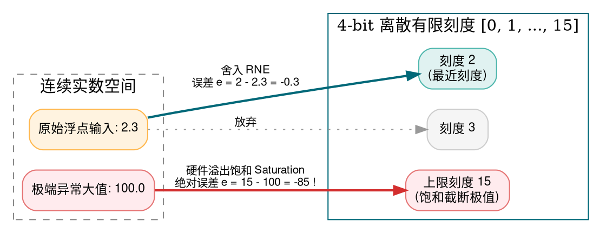

从上述物理映射中，我们立刻遭遇两个致命困境：

1. **精度损失（Rounding Error）**：对于落在刻度中间的值（如 `2.3`），存储为 `2` 后产生的绝对量化误差为 $e = \hat{v} - v = 2 - 2.3 = -0.3$。这种微小损失是不可逆的。
2. **动态范围崩溃（Overflow / Saturation）**：对于 `100.0`，由于 4 bit 封顶只有 `15`，如果直接强行饱和截断（Saturation），误差直接高达 $-85$！神经网络的输出将彻底崩溃。

### 3. 第一层破解：引入 Scale（缩放因子）

面对“大数装不下”的困境，人类在尺规测量中最直观的智慧就是：**比例尺缩放**。

$$\boxed{v \approx X \times p}$$

- $v$：原始高精度实数（如 FP32）；
- $X$：缩放因子（Scale Factor），充当比例尺；
- $p$：量化并紧凑存储的低精度代码（如 FP4）；
- 量化过程（压缩）：$p = Q\left(\frac{v}{X}\right)$；
- 反量化过程（解压）：$\hat{v} = X \times p$。

#### 手算一个示例：感受 Scale 的魔力与代价

依然以 $V = [1, 2, 4, 100]$ 为例。为了把 $100$ 安全装进 $0 \sim 15$ 的刻度，我们设定比例尺 $X = 8$：

| 原始输入 $v$ | 除以比例尺 $v/X$ | 4-bit 量化编码 $p$    | 恢复反量化值 $8 \times p$ | 绝对量化误差 $e$       |
| :----------- | :--------------- | :-------------------- | :------------------------ | :--------------------- |
| **1.0**      | $0.125$          | **0**                 | **0.0**                   | $-1.0$ (下溢失真)      |
| **2.0**      | $0.25$           | **0**                 | **0.0**                   | $-2.0$ (下溢失真)      |
| **4.0**      | $0.5$            | **0** (最近偶数舍入)  | **0.0**                   | $-4.0$ (下溢失真)      |
| **100.0**    | $12.5$           | **12** (最近偶数舍入) | **96.0**                  | $-4.0$ (相对误差仅 4%) |

通过比例尺 $X=8$，大数 $100$ 的溢出危机被成功化解（恢复出 $96$，保住了大体量级）；**但代价极其惨重：小数字 1、2、4 全部被压扁成了 0（发生下溢）！**

这逼迫我们走向第二层思考：**绝不能在整个巨大的张量（Tensor）上只用一把尺度统一的大比例尺！**

---

## 三、微缩放（Microscaling / MX）：为什么 32 个数字可以共享 Scale？

### 1. 全局 Scale vs 逐块 Block Scale

在真实的深度神经网络中，激活值和权重分布极不均匀：有的神经元处于静默状态，数值集中在 $0 \sim 1$；而某些注意力头或通道会出现峰值离群点（Outliers），数值高达数百甚至上千。

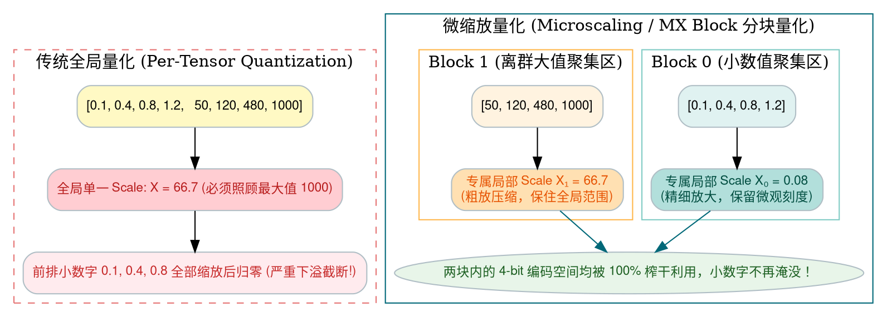

微缩放的核心思想非常纯粹：

- **将连续的数据切分成较短的物理向量块（称为 Scaling Block）**；
- **每个 Block 自行通过其局部最大绝对值计算一个专属 Scale**；
- **同一 Block 内的少量元素（如 32 个）共享这个局部 Scale**。

### 2. OCP MX 块结构与存储压缩比推演

在开放计算项目（Open Compute Project, OCP）发布的 Microscaling Formats (MX) v1.0 规范中，定义了标准的物理块拓扑：

$$\boxed{\text{MX Block} = (X,\ P_1,\ P_2,\ \ldots,\ P_k)}$$

- $k$：**Block Size（块大小）**，即多少个数据共享一个 Scale（在 MX 标准中主流为 **32**）；
- $d$：每个量化元素 $P_i$ 的位宽（如 FP4 为 4 bit，FP8 为 8 bit）；
- $w$：共享 Scale $X$ 占用的位宽（MX 规范固定使用 8-bit 的 **E8M0** 格式）；
- 一个完整 MX Block 所占用的总存储比特数为：

$$\boxed{B = w + k \times d \quad (\text{bits})}$$

以工业界最受瞩目的 **MXFP4**（$k=32, d=4, w=8$）为例，让我们来算一笔账：

$$B = 8 + 32 \times 4 = 8 + 128 = 136 \text{ bits} = 17 \text{ Bytes}$$

对比如果存储 32 个原始 IEEE FP32 数据：

$$32 \times 32 = 1024 \text{ bits} = 128 \text{ Bytes}$$

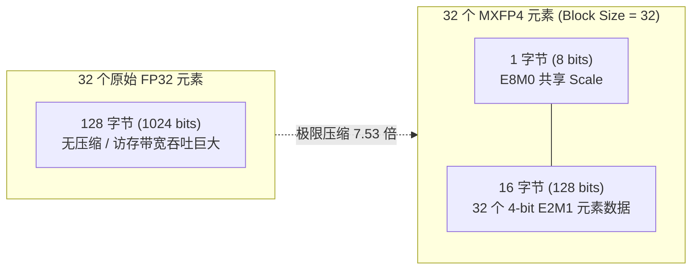

- **理论压缩比**：$128 / 17 \approx \mathbf{7.53 \times}$（相较于 FP32 节省了 **86.7%** 的内存容量与访存流量）；
- **等效每个元素的平均位宽**：$136 / 32 = \mathbf{4.25 \text{ bits}}$。
  也就是说，仅仅花费了区区 **0.25 bit / 元素** 的元数据（Metadata）微小开销，就让 4-bit 浮点数摆脱了全局量化的溢出诅咒！

---

## 四、FP8 与 FP4：计算机究竟如何用几个 bit 拼装浮点数？

要彻底搞清楚 MXFP8、MXFP4 与 NVFP4 的底细，必须先回到 IEEE 754 二进制浮点数的本原结构。

### 1. 浮点数的三大骨架：S、E、M

任何浮点数在物理芯片中的逻辑本质，都可以拆解为十进制科学计数法的二进制翻版：

$$\boxed{\text{数值} = (-1)^S \times \text{有效尾数} \times 2^{\text{实际指数}}}$$

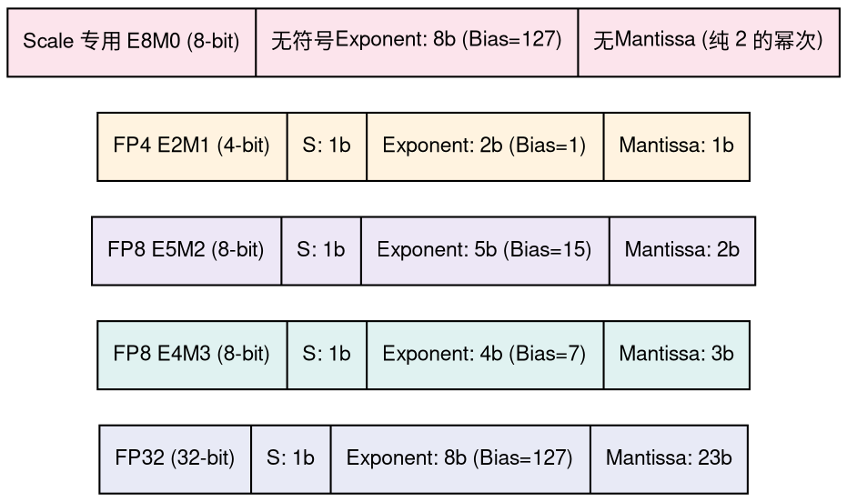

- **Sign（S，符号位）**：$0$ 表示正数，$1$ 表示负数；
- **Exponent（E，指数段）**：决定数字处于哪个粗放的数量级（如微观的 $2^{-5}$ 还是宏观的 $2^8$）；
- **Mantissa（M，尾数段）**：决定在选定数量级内，尺子的刻度切得有多细密。

### 2. 为什么需要指数偏置（Bias）？

由于 $E$ 段是用无符号纯二进制整数存储的（例如 2 bit 只能表示 $0, 1, 2, 3$），但物理世界需要负指数（如 $2^{-1}$）。为了避免在指数端引入繁琐的补码加减法硬件逻辑，工业界采用**偏置平移（Bias）**：

$$\text{实际指数} = E - \text{Bias}$$

#### 规格化数（Normal Number）解码通用公式：

$$\boxed{v = (-1)^S \times 2^{E - \text{Bias}} \times \left(1 + \frac{M}{2^m}\right)}$$

其中 $m$ 为尾数的实际二进制位宽。注意括号内的前导 $1$：在二进制中，任何非零规格化数字的第一位必然是 $1$，因此硬件将其**隐式前置**，白白省下 1 个 bit 的宝贵存储！

#### 非规格化数（Subnormal Number）——拯救零附近的“精度悬崖”：

如果只有规格化公式，当 $E=0$ 时，所能表示的最小正数也是 $2^{0-\text{Bias}} \times 1.0$。在它与数字 $0$ 之间，会形成一片巨大的“数值沙漠”。
因此，浮点标准规定：**当指数 $E$ 全为 0 时，取消前导 1，转为以固定最小指数步进**：

$$\boxed{v = (-1)^S \times 2^{1 - \text{Bias}} \times \frac{M}{2^m}}$$

### 3. 解构 FP4 E2M1：它究竟能表示哪 16 个数？

FP4 极其小巧，全宇宙总共只有 $2^4 = 16$ 个状态。让我们通过公式，逐一推导它的正数空间（另外 8 个对应符号位取反的负数）：

> **参数设定**：$S=1\text{ bit}, E=2\text{ bits}, M=1\text{ bit}$，约定 $\text{Bias}=1$，$m=1$。

| 二进制编码 `S EE M` | 类别判别               | 展开计算过程                                      | 真实十进制实数     |
| :------------------ | :--------------------- | :------------------------------------------------ | :----------------- |
| `0 00 0`            | 零值 (Zero)            | $+0$                                              | **0.0**            |
| `0 00 1`            | 非规格化数 (Subnormal) | $2^{1-1} \times \frac{1}{2^1} = 1 \times 0.5$     | **0.5**            |
| `0 01 0`            | 规格化数 ($E=1$)       | $2^{1-1} \times (1 + \frac{0}{2}) = 1 \times 1.0$ | **1.0**            |
| `0 01 1`            | 规格化数 ($E=1$)       | $2^{1-1} \times (1 + \frac{1}{2}) = 1 \times 1.5$ | **1.5**            |
| `0 10 0`            | 规格化数 ($E=2$)       | $2^{2-1} \times (1 + \frac{0}{2}) = 2 \times 1.0$ | **2.0**            |
| `0 10 1`            | 规格化数 ($E=2$)       | $2^{2-1} \times (1 + \frac{1}{2}) = 2 \times 1.5$ | **3.0**            |
| `0 11 0`            | 规格化数 ($E=3$)       | $2^{3-1} \times (1 + \frac{0}{2}) = 4 \times 1.0$ | **4.0**            |
| `0 11 1`            | 规格化数 ($E=3$)       | $2^{3-1} \times (1 + \frac{1}{2}) = 4 \times 1.5$ | **6.0** (极限峰值) |

```graphviz
digraph FP4Axis {
    rankdir=LR;
    node [fontname="Helvetica,Arial,sans-serif", fontsize=10, shape=circle, style=filled, fillcolor="#006878", fontcolor="#ffffff", width=0.4];
    edge [fontname="Helvetica,Arial,sans-serif", fontsize=9, color="#999999"];

    z0 [label="0.0", fillcolor="#757575"];
    p05 [label="0.5", fillcolor="#00897b"];
    p1 [label="1.0"];
    p15 [label="1.5"];
    p2 [label="2.0"];
    p3 [label="3.0"];
    p4 [label="4.0"];
    p6 [label="6.0\nMax", fillcolor="#d84315"];

    z0 -> p05 [label="步长 0.5\n(Subnormal)", color="#00897b", penwidth=2];
    p05 -> p1 [label="步长 0.5"];
    p1 -> p15 [label="步长 0.5"];
    p15 -> p2 [label="步长 0.5"];
    p2 -> p3 [label="步长 1.0\n(刻度变疏)", color="#f57c00"];
    p3 -> p4 [label="步长 1.0", color="#f57c00"];
    p4 -> p6 [label="步长 2.0\n(稀疏度加剧)", color="#d84315", penwidth=2];
}
```

> [!IMPORTANT] 审视 FP4 数轴的第一性洞察：
>
> 1. **为什么最大值是 6.0 而不是 7 或 8？**
>    因为最大指数是 $E=3$，对应 $2^{3-1}=4$；而尾数只有 1 位，最高加成是 $(1 + 0.5) = 1.5$。两者相乘：$4 \times 1.5 = \mathbf{6.0}$。它天然不是均匀分布的整数！
> 2. **非线性间距**：在 $0 \sim 2$ 之间刻度最密（步长 0.5）；在 $2 \sim 4$ 之间步长拉大到 1.0；在 $4 \sim 6$ 之间步长扩大到 2.0。**越靠近零点，量化精度越高**，这与深度学习权重和激活的钟形正态分布形态形成了极佳的数学契合！

### 4. 两大 8-bit 主力对比：FP8 E4M3 vs FP8 E5M2

在 OCP 与各家硬件支持的 FP8 体系中，存在两种不同的变体，这是动态范围与精度的经典妥协：

| 关键属性                       | FP8 E4M3 (高精度计算型)          | FP8 E5M2 (高动态范围型)              | FP4 E2M1 (极限压缩型)          |
| :----------------------------- | :------------------------------- | :----------------------------------- | :----------------------------- |
| **符号 / 指数 / 尾数 (S/E/M)** | $1 / 4 / 3$                      | $1 / 5 / 2$                          | $1 / 2 / 1$                    |
| **指数偏置 Bias**              | 7                                | 15                                   | 1                              |
| **最大有限正数 ($F_{\max}$)**  | **448**                          | **57344**                            | **6.0**                        |
| **最小规格化正数**             | $2^{-6} \approx 0.0156$          | $2^{-14} \approx 6.1 \times 10^{-5}$ | 1.0                            |
| **最小非规格化正数**           | $2^{-9} \approx 0.00195$         | $2^{-16} \approx 1.5 \times 10^{-5}$ | 0.5                            |
| **是否支持无穷大 (Inf)**       | **否** (位编码全让给数值)        | **是**                               | 否                             |
| **首要应用场景**               | **Forward 推理与前向 GEMM 计算** | **Backward 反向传播梯度更新**        | **极速端侧推理与显存极限压缩** |

- **E4M3** 拥有 3 位尾数，能在 $0 \sim 448$ 范围内提供更加细腻平滑的数值描述能力，几乎成为当前大模型前向推理的黄金标准；
- **E5M2** 指数高达 5 位，结构与 FP16 保持一致，最大能跨越到 57344，专门抵御反向传播中梯度的剧烈爆炸。

---

## 五、E8M0：为什么 Scale 要设计成一种“只有指数”的怪异 FP8？

前文提到，MX 格式的 Scale 占用 8 个 bit，采用一种叫 **E8M0** 的格式。

初学者往往一头雾水：“没有尾数（M=0），甚至没有符号位（S=0），这还是浮点数吗？”

### 1. E8M0 的数学定义

E8M0 是一种**纯粹由 8 位无符号整数构成的 2 的幂次方格式**：

$$\boxed{X = 2^{E - 127}}$$

- 指数范围：$E \in [0, 254]$，对应实际 Scale 范围为 $2^{-127} \sim 2^{127}$；
- 特殊保留：`11111111`（255）保留代表 NaN；
- 它的全部取值只能是：$\ldots, \frac{1}{8}, \frac{1}{4}, \frac{1}{2}, 1, 2, 4, 8, 16, 32, 64, \ldots$

### 2. 为什么硬件架构师坚决只允许 Scale 是 2 的整数次幂？

这触及到了数字芯片电路设计的第一性考量：

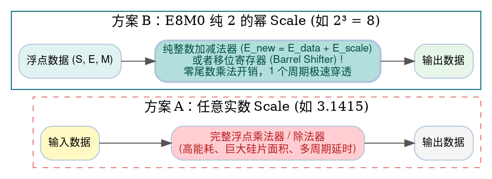

在二进制底层：

- **除以一个任意浮点数（如 3.72）**：需要动用复杂的浮点乘除法执行阵列，耗费上百个逻辑门，发热巨大且耗时多个时钟周期；
- **乘以或除以 $2^n$（如 $X=8=2^3$）**：对于浮点数，**直接给指数段加上或减去 3** 即可；对于定点数，**直接硬件桶形移位（Bit-Shift）3 位**！

**极简的硬件实现，换来了吞吐率的极致飙升**。这就是 E8M0 统治微缩放 Scale 标准的底层硬核原因。

---

## 六、OCP 标准 vs NVIDIA 工业界实现：两种 Scale 算法的巅峰对决

现在问题来了：既然 E8M0 只能表达 2 的幂，那么面对一个包含 32 个数字的实际数据块时，我们应该选哪一个 2 的幂作为 Scale？

这引发了 OCP 官方参考规范与 NVIDIA 架构师之间的一场经典设计分流。

### 1. 现实矛盾：理想 Scale 永远卡在两个 2 的幂之间

假设某一个 Block 内的局部最大绝对值（$a_{\max} = \max(|V_i|)$）测得为 **1000.0**。
我们准备将其压缩为 **MXFP8 E4M3**（其最大有限可表示值 $F_{\max} = 448$）。

如果 Scale 是连续实数，最完美的理想缩放因子是让 1000 恰好贴合到 448：

$$X_{\mathrm{ideal}} = \frac{a_{\max}}{F_{\max}} = \frac{1000}{448} \approx \mathbf{2.23214}$$

然而，E8M0 字典里根本没有 2.232！它只提供相邻的两个选择：**Scale = 2 ($2^1$)** 或是 **Scale = 4 ($2^2$)**。

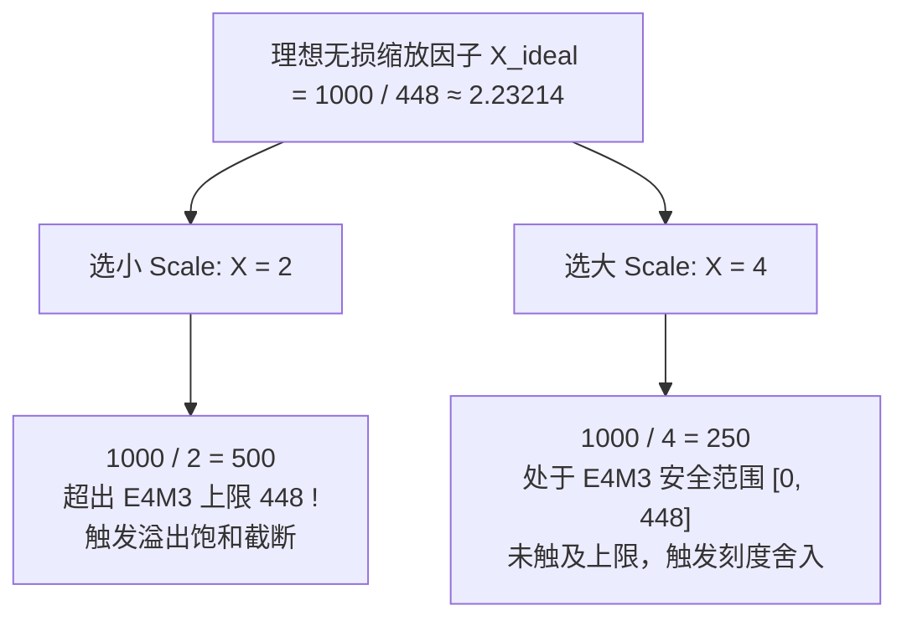

### 2. OCP 参考算法：对齐数量级，允许局部截断

在 OCP Microscaling Formats 规范 v1.0 第 6.3 节中，给出的官方参考计算法则如下：

$$\boxed{X_{\mathrm{OCP}} = \frac{2^{\lfloor\log_2(a_{\max})\rfloor}}{2^{\lfloor\log_2(F_{\max})\rfloor}}}$$

> 注意：分母不是直接除以 448，而是除以目标格式所能表达的**最大 2 的整数次幂**！
>
> - 对于 FP8 E4M3（最大值 448）：最大 2 的幂是 $2^8 = \mathbf{256}$；
> - 对于 FP4 E2M1（最大值 6.0）：最大 2 的幂是 $2^2 = \mathbf{4}$。

#### 带入 $a_{\max} = 1000$ 实测演算：

1. 分子：不超过 1000 的最大 2 的幂是 $2^9 = 512$；
2. 分母：E4M3 最大 2 的幂是 256；
3. 计算 Scale：$X_{\mathrm{OCP}} = \frac{512}{256} = \mathbf{2}$；
4. 缩放最大元素：$1000 / 2 = 500$；
5. **悲剧发生**：$500 > 448$，超出硬件容量上限！触发强制截断饱和（Saturation），存储为 448；
6. 反量化恢复值：$\hat{v} = 448 \times 2 = \mathbf{896}$；
7. **绝对量化误差**：$896 - 1000 = \mathbf{-104}$（相对误差高达 **-10.4%**）。

### 3. NVIDIA MXFP8 算法：严格向上取整，上界誓不溢出

NVIDIA 在其开源的高性能量化库 **Transformer Engine (TE)** 中，推翻了 OCP 上述参考公式，采用了更加契合实际工程的稳健法则：

$$\boxed{X_{\mathrm{NV}} = 2^{\left\lceil\log_2(a_{\max} / F_{\max})\right\rceil}}$$

#### 带入 $a_{\max} = 1000$ 再次演算：

1. 寻找能够完全覆盖最大值的理想比率：$\frac{1000}{448} \approx 2.23214$；
2. 向上寻找第一个不小于该比率的 2 的幂次：$\lceil \log_2(2.23214) \rceil = 2 \implies 2^2 = \mathbf{4}$；
3. 计算 Scale：$X_{\mathrm{NV}} = \mathbf{4}$；
4. 缩放最大元素：$1000 / 4 = 250$；
5. **安全入舱**：$250 \le 448$，处于安全区间内，绝不发生溢出截断！
6. 在 E4M3 对应区间内（刻度间距为 16），距 250 最近的可表示点是 256；
7. 反量化恢复值：$\hat{v} = 256 \times 4 = \mathbf{1024}$；
8. **绝对量化误差**：$1024 - 1000 = \mathbf{+24}$（相对误差骤降至 **+2.4%**）！

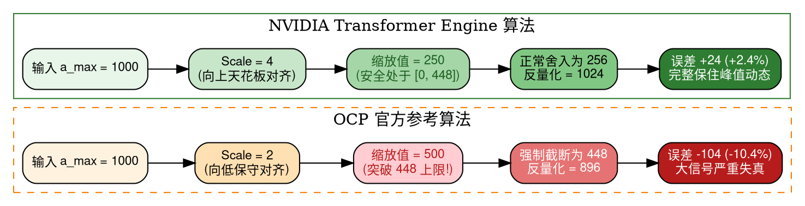

> [!TIP] 架构师视角的深刻权衡：
> 难道 NVIDIA 算法就一定在所有数学意义上完胜 OCP 吗？**不一定！**
>
> - **NVIDIA 的哲学**：保住极值不截断。代价是放大了 Scale，导致该 Block 内所有原本微小的数据被压缩得更小，可能会损失小数值的分辨率；
> - **OCP 的哲学**：为了保住小数字的分辨率，故意选择较紧凑的 Scale，不惜牺牲少量的极值离群点。
>
> 在实际工业级量化编译器构建中，OCP 规范本身定义的是物理位格式协议，**并不强制要求使用其参考 Scale 算法**。工业界通常优先采用 NVIDIA 的安全上界策略或基于均方误差（MSE）搜索的最优 Scale。

---

## 七、NVFP4：为什么有了 Block Scale，还需要 Global Scale？

如果说 MXFP4 是向低比特迈进的一大步，那么 NVIDIA 在 Blackwell B200 架构中正式重磅落地的 **NVFP4**，则是对量化体系的一次精妙重构。

很多开发者初读 NVFP4 规格时感到费解：它既有 Block Scale，为什么还要在外层挂一个 FP32 Global Scale？

### 1. 审视 MXFP4 的硬伤：E8M0 粗糙的步进间隔

回顾前文，MXFP4 的 Block Scale 是 E8M0。

- E8M0 只能在 $1, 2, 4, 8, 16\ldots$ 中跳跃；
- 如果两个相邻 Block 的理想 Scale 分别是 2.1 和 3.8，在 E8M0 下它们只能被迫妥协，产生严重的尺度量化误差。

为了让局部 Scale 拥有更细腻的刻度，NVIDIA 做出了一个大胆决定：
**把 Block Scale 从“粗犷的 E8M0”换成“拥有 3 位尾数的 FP8 E4M3”！**

E4M3 拥有尾数，可以极其精细地表示诸如 $2.25, 2.5, 3.5$ 等中间值。但新的物理灾难随之降临：
**E4M3 的物理极限只有 448！而 E8M0 的上限可是 $2^{127}$！**
如果网络中某一层的数据特别庞大，局部 Scale 动辄突破数千上万，E4M3 瞬间就会被打爆。

### 2. 双层缩放（Dual Scaling）架构解密

NVIDIA 提出的解法犹如精密的钟表齿轮联动：**由全局 FP32 掌控大局，局部 E4M3 负责精调微澜**。

$$\boxed{v \approx P_i \times S_{\mathrm{block}} \times S_{\mathrm{global}}}$$

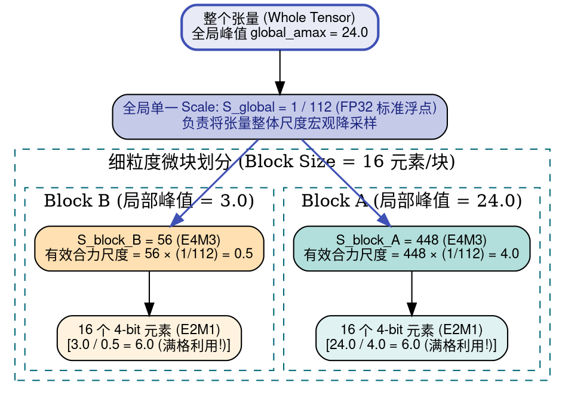

### 3. 从零推导 Global Scale 与 Block Scale 公式

不要死记硬背公式，让我们用第一性原理将其完全手算推导出来：

1. **三者分工界定**：
   - 元素 $P_i$（FP4 E2M1）：最大表示幅度固定为 $\mathbf{6.0}$；
   - 块缩放 $S_{\mathrm{block}}$（FP8 E4M3）：最大表示幅度固定为 $\mathbf{448.0}$；
   - 两者合体，局部所能展现的最大数值吞吐极限为：$6.0 \times 448.0 = \mathbf{2688.0}$。
2. **Global Scale 的唯一职责**：
   让整张 Tensor 中最极端、最狂暴的峰值绝对值（$\text{global\_amax}$），在通过 $S_{\mathrm{global}}$ 平抑后，恰好能被 2688.0 彻底吃下：

$$2688.0 \times S_{\mathrm{global}} = \text{global\_amax}$$

$$\boxed{S_{\mathrm{global}} = \frac{\text{global\_amax}}{448 \times 6} = \frac{\text{global\_amax}}{2688}}$$

3. **Block Scale 的自适应推导**：
   对于任何一个局部块，其局部峰值为 $a_{\mathrm{block}}$。我们希望在双层 Scale 协同下，该峰值恰好映射到 FP4 的上限 6.0：

$$\frac{a_{\mathrm{block}}}{S_{\mathrm{block}} \times S_{\mathrm{global}}} = 6$$

将 $S_{\mathrm{global}}$ 代入：

$$\frac{a_{\mathrm{block}}}{S_{\mathrm{block}} \times \left(\frac{\text{global\_amax}}{448 \times 6}\right)} = 6 \implies S_{\mathrm{block}} = 448 \times \frac{a_{\mathrm{block}}}{\text{global\_amax}}$$

> [!IMPORTANT] 完美的数学对称性验证：
> 因为任何子块的峰值 $a_{\mathrm{block}}$ 必然小于等于全局峰值 $\text{global\_amax}$：
>
> $$\frac{a_{\mathrm{block}}}{\text{global\_amax}} \le 1.0 \implies \mathbf{S_{\mathrm{block}} \le 448.0}$$
>
> **这就从数学根源上彻底保证了：局部 Block Scale 永远不可能超过 448，永远安全地驻留在 FP8 E4M3 的物理容量之内！** 每一个子块都能将自己的局部动态范围无损拉伸到最饱满状态！

---

## 八、随机舍入（Stochastic Rounding）：为什么在极低比特训练中需要“掷骰子”？

在将连续实数转换到 FP4 离散空间时，舍入策略直接决定了模型训练能否收敛。

### 1. 经典 RNE（最近偶数舍入）的系统性盲区

假设缩放后的实数结果是 **2.4**，落在 FP4 刻度 $2.0$ 与 $3.0$ 之间。
按照确定性 RNE 规则：因为 $|2.4 - 2.0| = 0.4 < 0.6 = |3.0 - 2.4|$，硬件**永远无情地将其归整为 2.0**。

在推理（Inference）阶段，这无可厚非。但在**大模型低比特训练（Low-precision Training）**中，反向传播计算出的参数梯度更新往往极其微弱（例如每次更新量仅有 0.1 甚至更小）。
如果每一次更新都被确定性舍入为 0，就会造成**系统性暗电流损失**——几万步训练下来，权重纹丝不动，模型彻底“装死”停止学习。

### 2. 随机舍入（SR）的无偏期望推导

Stochastic Rounding 并非毫无章法的随机乱猜，而是**以距两侧离散刻度的物理距离作为概率权重进行伯努利采样**：

设 $v_1 \le x \le v_2$ 为相邻的两个硬件可表示点，舍入到两端的概率定义为：

$$P(Q(x) = v_2) = \frac{x - v_1}{v_2 - v_1}$$

$$P(Q(x) = v_1) = \frac{v_2 - x}{v_2 - v_1} = 1 - P(Q(x) = v_2)$$

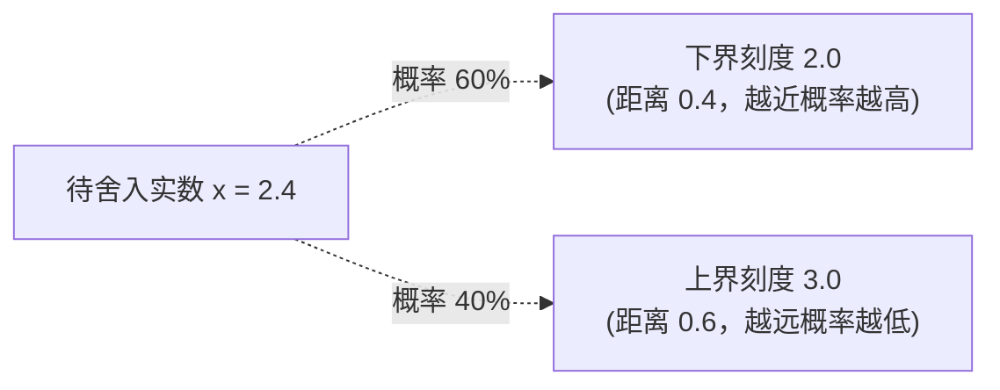

#### 神奇的数学期望证明：

$$E[Q(x)] = v_1 \cdot P(Q(x) = v_1) + v_2 \cdot P(Q(x) = v_2)$$

$$E[Q(x)] = v_1 \left(\frac{v_2 - x}{v_2 - v_1}\right) + v_2 \left(\frac{x - v_1}{v_2 - v_1}\right)$$

$$E[Q(x)] = \frac{v_1 v_2 - v_1 x + v_2 x - v_1 v_2}{v_2 - v_1} = \frac{x (v_2 - v_1)}{v_2 - v_1} = \mathbf{x}$$

$$\boxed{E[Q(x)] = x}$$

> [!NOTE] 这一结论具有划时代的工程意义：
> 虽然单次硬件操作存在随机误差，但**在统计学意义上，舍入误差的数学期望严格为零！**
> 微弱的梯度小信号通过多次概率翻转，在漫长的时间序列上得以忠实地累加进权重中。这就是为什么 NVIDIA 在 Blackwell 架构与 Transformer Engine 中，将随机舍入作为 FP4 训练梯度反向传播的核心法宝。而在纯前向推理（Inference）中，通常仍采用 RNE 保持结果确定可复现。

---

## 九、站在 NPU 硬件设计者视角：Scale 到底如何参与底层物理计算？

算法工程师往往以为，量化数据进入硬件后，芯片必须先做一个循环，把每个 4-bit 乘以 Scale 变回 FP32，然后再丢进计算单元。
**大错特错！如果这样设计，低精度的高能效优势将被彻底归零。**

### 1. 结合律带来的硬件极致优化

考察两个微缩放向量的点积计算：

$$C = \sum_{i=1}^k A_i \cdot B_i$$

根据微缩放定义，向量 $A$ 与 $B$ 分别由其局部数据和 Scale 表示：

$$A_i = X_A \cdot P_{A,i}, \quad B_i = X_B \cdot P_{B,i}$$

代入点积公式：

$$C = \sum_{i=1}^k (X_A P_{A,i}) \cdot (X_B P_{B,i})$$

**核心关键在于：在同一个 Block 内部，$X_A$ 与 $X_B$ 是完全不变的常数！根据纯粹的乘法结合律与分配律：**

$$\boxed{C = (X_A \cdot X_B) \sum_{i=1}^k (P_{A,i} \cdot P_{B,i})}$$

### 2. NPU 低精度计算通路微架构图解

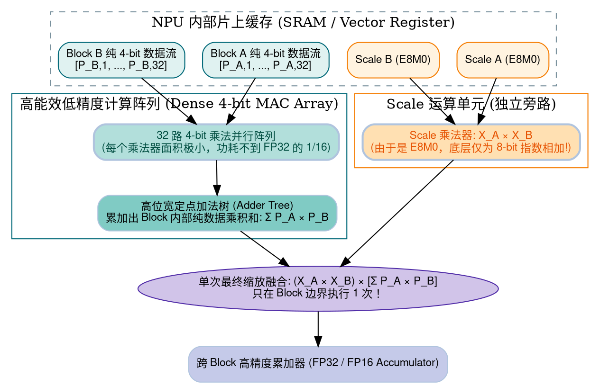

> [!TIP] 硬件实现奇迹：
>
> 1. **32 次乘法全部在廉价、紧凑的 4-bit 乘法阵列中完成**；
> 2. **原本需要 32 次的昂贵浮点缩放，被压缩到了 Block 边界处仅执行 1 次！**
> 3. 硅片上 90% 以上的面积可以留给高密度的 MAC 阵列，这正是现代 AI 加速芯片在 FP4/FP8 模式下算力（TFLOPs）暴涨的终极密码。

---

## 十、作为 AI 编译器/算子工程师：实际落地部署踩坑指南

当你将模型导出为 MXFP8 或 NVFP4，并在 AI 编译器（如 MLIR、TensorRT、Triton、TVM）中编写后端 Lowering 管道时，必须警惕以下硬核陷阱：

### 1. 致命转置陷阱：行优先（Row-wise）与列优先（Column-wise）不可互换

在通用矩阵乘法 $C = A \times B$ 中：

- 矩阵 $A$（Activation）通常按**行（Row）**分组求 Scale，以便与后序的点积沿 $K$ 轴契合；
- 矩阵 $B$（Weight）如果也是按行量化的，当你尝试转置 $B$（即 $B^T$）以加速 GEMM 访问时：
  **原本属于同一行的 32 个元素被打散到了 32 个不同的列中！原本共享的 Scale 瞬间错位失效！**
- **铁律**：权重在离线静态量化打包时，必须**根据芯片底层 GEMM 指令的具体微架构布局要求（如 Tensor Core MMA 形状），提前选择沿哪一个 Axis 进行 Block 分割**，绝不可在运行时随意转置。

### 2. 全零 Block 与数值保护

如果某个 Block 的数据全为 0（在 ReLU 激活函数后极为普遍）：

- 此时 $a_{\max} = 0$；
- 如果代码中直接套用 $\log_2(a_{\max})$，数学库会返回 $-\infty$ 或抛出浮点异常，导致生成的 Scale 成为 NaN！
- **防御机制**：必须在编译器 IR 或硬件指令发射前注入保护下限：

$$a_{\max} = \max(a_{\max}, \epsilon) \quad (\text{例如 } \epsilon = 2^{-32})$$

### 3. 编译器前端到后端的完整降级管线（Lowering Pipeline）

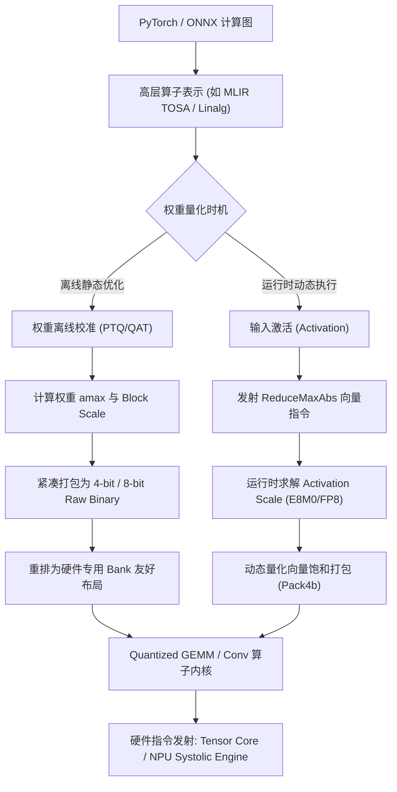

---

## 十一、全景知识压缩对照表

| 核心概念                   | 核心定位与第一性物理理解                                     |
| :------------------------- | :----------------------------------------------------------- |
| **Quantization（量化）**   | 用极少位数近似连续数值，以精度损失换取带宽与存储飞跃         |
| **Scale（缩放因子）**      | 调节数值尺度的比例尺，将大数安全压缩进小容量格式             |
| **Microscaling（微缩放）** | 放弃全局一刀切，让短向量（如 32 元素）独立共享局部 Scale     |
| **FP4 E2M1**               | 仅 4 bit（1 符 2 指 1 尾），全空间仅 16 个状态，最大值为 6.0 |
| **FP8 E4M3**               | 8 bit，高精度，最大 448，前向推理的首选黄金格式              |
| **FP8 E5M2**               | 8 bit，大动态范围，最大 57344，专为反向梯度抵御溢出设计      |
| **E8M0**                   | 纯 8 bit 指数（2 的幂次），为硬件节省 90% 缩放电路面积       |
| **OCP 参考算法**           | 对齐最大 2 的幂，允许局部离群点截断以保护小数值              |
| **NVIDIA 工业算法**        | 严格向上对齐天花板（Ceil），确保物理上限绝不溢出截断         |
| **NVFP4 双层缩放**         | FP32 Global Scale 定基调 + FP8 E4M3 Block Scale 细腻微调     |
| **Stochastic Rounding**    | 距离概率采样，数学期望误差为零，低比特训练收敛的关键武器     |

---

## 十二、硬核自测与深度思考题（附详细推演解析）

为了检验你是否真正吃透了这套体系，请尝试不看答案独立回答以下三道实战架构题：

<strong>🧠 思考题 1：为什么 FP4 E2M1 的最大正数恰好是 6.0，而不是 7.0 或 8.0？</strong>

> **解析**：
> 很多初学者误以为 4 个 bit 类似定点数，能表示到更连续的值。
>
> 1. E2M1 具有 2 位指数，最大有限二进制指数编码为 `11`（无符号整数为 3）；
> 2. 其约定的偏置 $\text{Bias} = 1$，因此最大实际指数幂次为 $2^{3 - 1} = 2^2 = 4$；
> 3. 其尾数只有 1 个 bit，最大有效尾数编码为 `1`，对应附加值为 $M / 2^1 = 0.5$；
> 4. 规格化数前置隐藏 1，故最大有效数字部分为 $(1 + 0.5) = 1.5$；
> 5. 最终数值等于：$4 \times 1.5 = \mathbf{6.0}$。
>    浮点数的本质不是简单的线性累加，而是“阶码缩放基准尾数”，因此其上限由阶码顶峰与尾数顶峰的乘积严格决定。

<strong>🧠 思考题 2：某 Block 内 32 个数据的 $a_{\max} = 1000$，若压缩为 MXFP8 E4M3，为什么 OCP 算法选出的 Scale 是 2，而 NVIDIA 选出的 Scale 是 4？</strong>

> **解析**：
>
> 1. **OCP 参考算法公式**：$X = \frac{2^{\lfloor\log_2(a_{\max})\rfloor}}{2^{\lfloor\log_2(F_{\max})\rfloor}}$。
>    - $a_{\max} = 1000$，不超过 1000 的最大 2 的幂是 $2^9 = 512$；
>    - E4M3 的上限为 448，其所能表达的最大 2 的幂是 $2^8 = 256$；
>    - 两者相除：$512 / 256 = \mathbf{2}$。
> 2. **NVIDIA 工业算法公式**：$X = 2^{\lceil\log_2(a_{\max} / F_{\max})\rceil}$。
>    - 理想覆盖比率：$1000 / 448 \approx 2.23214$；
>    - 向上取下一个 2 的整数次幂：$\lceil \log_2(2.23214) \rceil = 2 \implies 2^2 = \mathbf{4}$。
>
> OCP 的法则倾向于让基底对齐数量级下界（导致 $1000/2=500>448$ 触发截断饱和）；NVIDIA 的法则誓死保住物理上界不发生溢出截断。

<strong>🧠 思考题 3：NVFP4 已经有了每 16 个元素一个的局部 Block Scale，为什么还要在整个 Tensor 外层套一个 FP32 Global Scale？</strong>

> **解析**：
> 这是一次针对**局部 Scale 精度与动态范围兼得**的精妙架构解法：
>
> 1. 为了消除 E8M0 只能以 2 的幂跳跃的粗糙缺陷，NVFP4 将局部 Block Scale 换成了带有 3 位尾数的精细格式 **FP8 E4M3**；
> 2. 但 E4M3 最大的物理死穴是上限只有 **448**，如果网络中张量出现超大数值，局部 Scale 会直接爆表溢出；
> 3. NVIDIA 引入全局 FP32 Scale（$S_{\mathrm{global}} = \frac{\text{global\_amax}}{448 \times 6}$），先对整张 Tensor 做一次宏观的尺度平抑；
> 4. 这一宏观平抑保证了：在数学上，整张 Tensor 中任何一个子块所需的理论局部 Scale 永远不可能超过 448（$S_{\mathrm{block}} \le 448$）！
> 5. 从而让所有 Block Scale 安全、饱和地浸润在 E4M3 的高精度表示空间中，实现了**宏观尺度不溢出、微观刻度极致细腻**的完美融合。

---

## 结语：在物理极限与数学美感之间

从最初粗糙的全局 INT8/FP16，到 OCP 联盟标准化的微缩放 MX 格式，再到 NVIDIA Blackwell 将 NVFP4 锻造为工业级算力基石，我们见证了计算系统工程师如何在最严苛的物理限制下（晶体管面积、光纤带宽与功耗天花板），运用精妙的数学工具拓展算力边界。

记住这套演进的终极脉络：
**位数不够 $\to$ 引入低比特浮点 $\to$ 数值范围不够 $\to$ 引入 Scale $\to$ 全局统一误差大 $\to$ 引入 Block 微缩放 $\to$ 移位成本考量 $\to$ 引入 E8M0 $\to$ 追求极致细腻刻度 $\to$ 引入 NVFP4 双层自适应缩放 $\to$ 解决训练梯度抹杀 $\to$ 引入随机舍入。**

这不仅仅是一行行冷冰冰的编译器 Pass 或芯片微指令，更是人类工程学在逼近计算极限时，所展现出的极致权衡之美。
