> **导读**：在进入神经网络处理器（NPU, Neural Processing Unit）的硬件微架构设计、专用集成电路（ASIC）实现或底层算子优化时，初学者往往会遇到极其陡峭的学习曲线：
>
> 1. 上层算法工程师张口闭口是“注意力机制、自回归解码、RMSNorm、RoPE 与低比特量化”，而底层硬件电路看到的却全是“乘加器阵列（MAC Array）、处理单元（PE）、片上缓存（SRAM/Scratchpad）、流水线停顿（Pipeline Stall）与总线带宽（Memory Bandwidth）”；
> 2. 为什么业界巨头（AMD, Arm, Intel, Meta, Microsoft, NVIDIA, 高通）联合通过 OCP 推出 **MX（Microscaling，微缩放）量化规范**？为什么 DeepSeek-V3 如此钟爱 **E8M0** 格式作为缩放因子？
> 3. 为什么标准的数学公式在硬件电路上不能直接套用？为什么 Softmax 需要拆成多 Pass 或转成 Online 增量模式（FlashAttention 的基石）？为什么 LayerNorm 的 2-pass Naive 实现会在硬件中引发灾难性的精度坍塌？
> 4. 面对海量的张量矩阵乘加，MAC 阵列究竟该如何组织数据流动？权重驻留（WS）、输入驻留（IS）与输出驻留（OS）在硬件面积、片上访存和 MAC 利用率上有何取舍？
>
> 本文面向刚接触 NPU 芯片设计、AI 加速器体系结构与高性能算子开发的工程师和初学者。全篇严格遵循**“初学者友好”**原则：**所有关键专业术语在第一次出现时，均提供生动的生活类比、精准的技术定义与硬件设计的存在意义**。文内配备大量精心设计的 **Mermaid 架构流程图** 与 **Graphviz 电路拓扑图**，帮助读者建立端到端贯通算法与芯片硬件的完整知识图谱。

---

## 目录导览

```mermaid
flowchart TD
    subgraph S1["第一模块：基础认知与量化底座"]
        M1["1. 为什么需要专用 NPU 芯片？<br/>(DSA / 访存墙 / 算力密度)"] --> M2["2. OCP 微缩放格式规范 MX Formats<br/>(E8M0 / E4M3 / Block Size / Scale 存储)"]
    end

    subgraph S2["第二模块：Transformer 全栈计算与硬件流水"]
        M2 --> M3["3. Token / Embedding / d_model 特征维度"]
        M3 --> M4["4. QKV 生成 / 注意力打分 / 残差与 FFN"]
        M4 --> M5["5. Encoder 堆叠与 Decoder 交叉注意力<br/>(KV Cache 跨周期硬件拼接与隔离)"]
    end

    subgraph S3["第三模块：硬件常需实现的 AI 算子深度设计"]
        M5 --> M6["6. Safe-Softmax 与 2/3-pass 硬件流水逼近<br/>(2 的幂次位移代替自然指数)"]
        M6 --> M7["7. FlashAttention 硬件破局哲学<br/>(Tiling 分块 + Online Softmax 消除 HBM 访存)"]
        M7 --> M8["8. LayerNorm / RMSNorm / Welford 算法<br/>(灾难性数值抵消防范与单 Pass 均方根)"]
        M8 --> M9["9. RoPE 旋转位置编码与硬件 LUT 查表"]
        M9 --> M10["10. 非对称量化与 Zero-Point 零点硬件对齐"]
    end

    subgraph S4["第四模块：多维卷积算子全体系硬件展开"]
        M10 --> M11["11. 2D 多通道常规卷积 -> Pointwise 1x1 Conv"]
        M11 --> M12["12. 分组卷积 Group Conv -> Depthwise 卷积"]
        M12 --> M13["13. 3D 卷积软硬件切分与转置卷积 (反卷积)"]
        M13 --> M14["14. Per-Block / Per-Group Scale 量化卷积恢复时机"]
    end

    subgraph S5["第五模块：MAC 阵列微架构与经典数据流"]
        M14 --> M15["15. WS 权重驻留 / IS 输入驻留 / OS 输出驻留<br/>(NVDLA 并行映射与访存能耗极致对比)"]
    end

    style S1 fill:#f8fafc,stroke:#3b82f6,stroke-width:2px
    style S2 fill:#f0fdf4,stroke:#10b981,stroke-width:2px
    style S3 fill:#fefce8,stroke:#f59e0b,stroke-width:2px
    style S4 fill:#fdf2f8,stroke:#ec4899,stroke-width:2px
    style S5 fill:#faf5ff,stroke:#8b5cf6,stroke-width:2px
```

---

## 序言：理解现代 AI 芯片的软硬件断层

在学习具体算子和芯片电路之前，我们必须先跳出纯数学公式，建立**硬件芯片设计者（Hardware Designer）**的核心视角。

| 维度 | 深度学习算法工程师视角 | NPU 芯片微架构工程师视角 |
| :--- | :--- | :--- |
| **核心目标** | 模型精度（Accuracy）、困惑度（Perplexity）、Loss 收敛 | 吞吐量（TOPS）、能效比（TOPS/W）、芯片面积（mm²）、成本（PPA） |
| **计算抽象** | 多维连续张量（Tensor）、数学符号变换、微分求导 | 离散存储地址（SRAM/DDR）、时钟周期（Clock Cycle）、乘加流水线 |
| **访存认知** | 假设内存无限大、读写几乎免费（`x + y`） | **访存极其昂贵**：片外 DRAM 读写能耗是片上乘加的 200 倍以上！ |
| **精度选择** | 偏好 FP32、BF16 保证模型训练稳定性 | 追求 INT8、FP8、MXFP4 压缩存储并成倍翻倍 MAC 算力密度 |

> [!IMPORTANT]
> **NPU 设计的第一天条**：**算力并不昂贵，访存才是瓶颈（The Memory Wall）**。在硅片上多放 1024 个乘加器（MAC）非常容易，但要保证每个时钟周期都能从内存中把数据“喂饱”这些乘加器，几乎是不可能的任务。因此，**NPU 的一切硬件设计（无论是微缩放量化、Online Softmax、FlashAttention 还是权重驻留数据流），本质上全都是在为“减少数据搬运、提高片上数据复用”而服务！**

---

## 第一篇：OCP 微缩放量化规范（Microscaling Formats, MX）与数据编码

### 1.1 新手初识专业术语

在进入 MX 格式前，我们先为零基础初学者扫清几个高频概念：

> **DSA (Domain Specific Architecture, 特定领域架构)**
> * 通俗类比：如果说通用 CPU 是一把什么都能切但切不快的瑞士军刀，GPU 是一队干体力活的搬家工，那么 NPU 就是专门为切土豆丝定制的高速切菜机。
> * 硬件定义：专为特定工作负载（如深度学习神经网络中的矩阵乘法和张量卷积）进行深度硬化定制的芯片架构。

> **量化 (Quantization)**
> * 通俗类比：把用高精度尺子测出来的微米级身高（例如 178.532 厘米），四舍五入映射为有限的几个尺码档位（S、M、L、XL），从而大幅节省记录空间。
> * 硬件定义：将高位宽数值（如 32 位浮点数 FP32）映射到低位宽定点或浮点表示（如 8 位 INT8/FP8 甚至 4 位 FP4）的过程。

> **动态范围 (Dynamic Range)**
> * 通俗类比：你的耳朵能听到的最小耳语与最大雷鸣声之间的范围跨度。
> * 硬件定义：一种数据类型所能表示的最大有效数值与最小非零数值之间的比率。神经网络中间激活值经常出现“大异常值（Outliers）”，动态范围不足会导致大数溢出或小数被截断为零。

> **微缩放 (Microscaling, MX)**
> * 通俗类比：传统量化是全班同学统一扣掉相同的平均分（Per-Tensor 量化），导致拔尖生和后进生的差距被严重压缩；微缩放则是每 32 个人分成一个小组，组内根据自己的最大值单独确定一个“小组缩放比例”。
> * 硬件定义：由 AMD、Arm、Intel、Meta、Microsoft、NVIDIA、高通组成的联盟在开放计算项目（OCP, Open Compute Project）中标准化的细粒度分块量化技术。

---

### 1.2 为什么传统量化在大模型时代遇到瓶颈？

在传统的 INT8 / FP8 量化中，通常采用 **Per-Tensor（全张量共用一个缩放系数）** 或 **Per-Channel（每个输出通道共用一个缩放系数）**。

然而，现代大语言模型（如 LLaMA、DeepSeek）在激活值中存在极其明显的**离群异常值（Outliers）**：某些维度的数值可能达到正常维度的数十倍甚至上百倍。如果采用全张量缩放，为了容纳极个别的极大值，绝大部分正常数值在低比特下都会被截断为 0；如果为了保全小数，大数又会严重溢出。

OCP 推出的 **MX（Microscaling Formats）规范**，通过硬件级的**细粒度分块（Block-level Scaling）**完美化解了这一矛盾。

---

### 1.3 MX 格式的三大核心组件与编码规则

符合 OCP MX 规范的数据格式由以下三个核心组件严格构成：

1. **缩放因子 Scale ($X$)**：数据类型通常为纯指数无尾数的 **E8M0** 格式，位宽为 $w$ bits（通常 $w = 8$）；
2. **元素本身 Element**：块内每个元素的数据格式，位宽为 $d$ bits（例如 8 位 MXFP8 E4M3/E5M2、6 位 MXFP6、4 位 MXFP4 E2M1 或 MXINT8）；
3. **缩放块大小 Block Size ($k$)**：每个共享同一个缩放因子的元素个数，规范典型取值为 $k = 32$。

因此，一个大小为 $k$ 个元素的 MX 块在物理内存中的存储总位宽为：
$$\text{Storage Bits} = w + k \cdot d$$

若 $k = 32$ 且元素采用 8 位 MXFP8（$d = 8$），则一个 Block 的总存储大小为 $8 + 32 \times 8 = 264\text{ bits} = 33\text{ Bytes}$。如果连续多个块共享相同的 Scale，还能进一步剔除冗余的 $w$ bits。

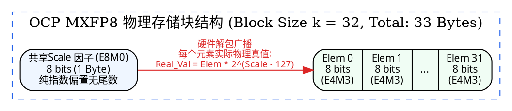

---

### 1.4 E8M0 编码：为什么 DeepSeek 与主流 NPU 如此青睐？

在 MX 规范中，Scale 绝大多数采用 **E8M0** 编码。

> **E8M0 格式定义**：
> * 8 位无符号纯指数格式（Exponent 8 bits, Mantissa 0 bits）；
> * 无符号位（Sign bit），数值恒为正的比例因子；
> * 指数偏置（Bias）通常设为 127（基本与 IEEE 754 FP32 的指数部分对齐，但不表示无穷大与 NaN）；
> * 实际表示的缩放值为：
>   $$\text{Scale Value} = 2^{S - 127}, \quad S \in [0, 255]$$

#### 硬件设计者的绝妙之处
在 NPU 电路设计中，乘除法器的芯片面积和功耗远大于加法器与移位寄存器。
如果 Scale 带有尾数，在硬件反量化时就必须用一个完整的浮点乘法器将 Element 与 Scale 相乘；而 **E8M0 没有尾数，它本质上就是一个以 2 为底的纯幂次（Power-of-Two）**！
* 在硬件进行乘加计算时，**乘以 $2^{S-127}$ 只需要对指数执行简单的整数加减法，或者在定点桶移位器（Barrel Shifter）中进行左右移位**！
* 硬件无需昂贵的浮点乘法器，极大精简了 NPU 解包（Dequantization）逻辑的晶体管面积。

---

### 1.5 从 FP32 到 MXFP8 (E4M3) 的量化流程实战

为了彻底破除黑盒，我们以一个包含 32 个 FP32 浮点数的向量为例，展示如何转换为 MXFP8 规范块：

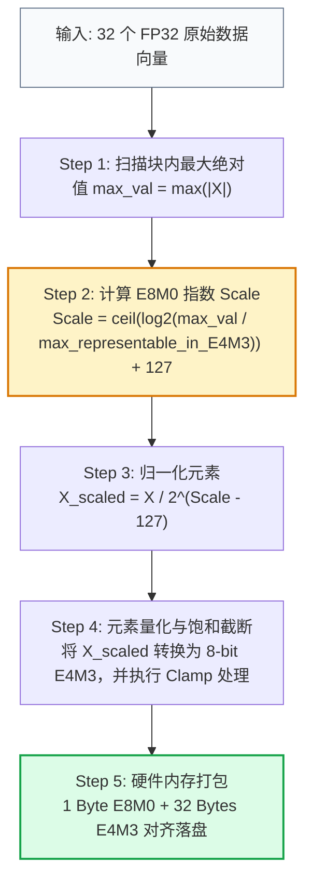

以下为可执行的 Python 教学代码：

```python
import numpy as np

def quantize_to_mxfp8_e4m3(fp32_block: np.ndarray):
    """
    教学实现：将 32 个 FP32 数值转换为 MX 规范块 (1 个 E8M0 scale + 32 个 E4M3 元素)
    """
    assert len(fp32_block) == 32, "MX 块标准尺寸为 32 个元素"
    
    # E4M3 的最大可表示有效数字（无无穷大，最大约为 448）
    E4M3_MAX = 448.0
    
    # 1. 寻找块内绝对值最大值
    max_abs = np.max(np.abs(fp32_block))
    if max_abs == 0:
        return 0, np.zeros(32, dtype=np.uint8)
    
    # 2. 计算 E8M0 共享指数（无符号，偏置 127）
    # 需要满足：max_abs / 2^(scale_exp - 127) <= E4M3_MAX
    scale_unbiased = np.ceil(np.log2(max_abs / E4M3_MAX))
    scale_e8m0 = int(np.clip(scale_unbiased + 127, 0, 255))
    
    # 实际缩放倍率
    scale_factor = 2.0 ** (scale_e8m0 - 127)
    
    # 3. 元素缩放
    scaled_elements = fp32_block / scale_factor
    
    # 4. 饱和截断至 E4M3 最大范围 [-448, 448]
    clamped_elements = np.clip(scaled_elements, -E4M3_MAX, E4M3_MAX)
    
    return scale_e8m0, clamped_elements

# 验证测试
raw_data = np.random.randn(32).astype(np.float32) * 100.0
scale, elems = quantize_to_mxfp8_e4m3(raw_data)
print(f"生成的 E8M0 Scale 编码: {scale} (物理缩放因子: {2.0**(scale - 127):.4f})")
print(f"前 4 个元素在块内的缩放值: {elems[:4]}")
```

---

## 第二篇：Transformer 全栈计算与硬件数据流（Encoder-Decoder 算子拆解）

现代大语言模型（如 GPT、BERT、LLaMA、DeepSeek）的骨架均脱胎于 **Transformer**。在 NPU 上运行大模型，本质就是将 Transformer 的算子流映射到底层的硬件流水线上。

### 2.1 新手初识专业术语

> **Token 与 Tokenizer (分词与分词器)**
> * 通俗类比：把一本厚书拆成一个个基本的汉字或英文单词切片。
> * 硬件定义：自然语言文本输入计算机的最小离散单元（如词或字）。Tokenizer 负责将字符串切分并映射为整数编号（Token ID）。

> **Embedding (嵌入矩阵) 与 $d_{\text{model}}$ (特征维度)**
> * 通俗类比：给每个词一张由多重属性构成的“身份证”。比如“苹果”：维度 1 代表“水果概率 0.95”，维度 2 代表“科技公司概率 0.88”，维度 3 代表“硬度”。
> * 硬件定义：一个巨大的二维查找表（Look-Up Table, LUT），形状为 $[\text{Vocab\_Size}, d_{\text{model}}]$。根据输入的 Token ID，查出一行长度为 $d_{\text{model}}$ 的连续浮点向量。$d_{\text{model}}$ 越大，模型能表达的特征语义越丰富（从早期的 512/768 扩展到现代大模型的 4096/8192）。

> **Q、K、V (Query, Key, Value)**
> * 通俗类比（图书检索）：
>   * **Q (Query)**：读者在搜索框里输入的关键词（“我在找什么？”）；
>   * **K (Key)**：图书标签和目录分类（“我有什么内容可供检索？”）；
>   * **V (Value)**：书籍的实际正文（“如果命中，我能提供什么具体知识？”）。

> **KV Cache (键值缓存)**
> * 通俗类比：你在回答一系列连贯问题时，不用每次都从头把对方讲的前 100 句话重新在脑子里逐字分析一遍，而是把前 100 句话提取好的要点（Key 和 Value）记在便签本上，来了第 101 句话时直接拿出来拼在一起算。
> * 硬件定义：在自回归大模型推理的解码（Decode）阶段，片上及片外内存专门开辟的一块物理缓存区，用来存储历史生成 Token 的 Key 和 Value 张量，避免每生成一个新 Token 都要重算历史长文本。

---

### 2.2 Encoder 的硬件计算全生命周期

假设输入一句话：“我喜欢猫”，经过 Tokenizer 分词得到 3 个 Token，序列长度 $\text{seq\_len} = 3$。

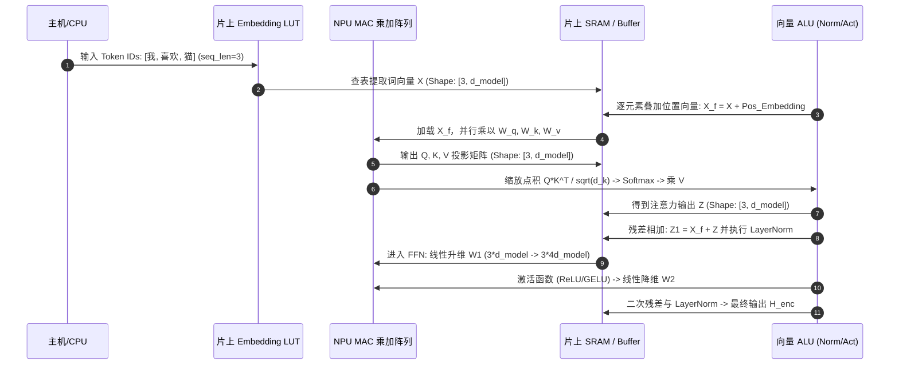

#### 关键步骤与形状演进分析
1. **输入与位置注入**：
   * 词向量查表矩阵 $X \in \mathbb{R}^{3 \times d_{\text{model}}}$。
   * 注意：**Attention 机制在数学上对顺序是完全不敏感的（置换不变性，Permutation Invariance）**。“我喜欢猫”与“猫喜欢我”如果不加位置信息，算出的自注意力权重完全相同！
   * 因此必须将形状完全相同的空间位置编码加到 $X$ 上：$X_f = X + \text{Location}$。
2. **Q、K、V 线性投影（GEMM 密集运算）**：
   * $W_q, W_k \in \mathbb{R}^{d_{\text{model}} \times d_k}$，$W_v \in \mathbb{R}^{d_{\text{model}} \times d_v}$。
   * 多头注意力下，一般 $d_k = d_v = d_{\text{model}}$。输出的 $Q, K, V$ 形状均为 $[3, d_{\text{model}}]$。
3. **注意力得分与 Softmax**：
   * 计算 $Q \times K^T$，结果维度为 $[3, 3]$。这个方阵中的点 $(i, j)$ 精确刻画了第 $i$ 个词对第 $j$ 个词的关注意愿！
   * 除以 $\sqrt{d_k}$ 进行数值降温（防止点积方差随维度线性膨胀，导致 Softmax 指数溢出或梯度极度饱和）；
   * 经过 Softmax 得到概率权重，再乘以 $V$（维度恢复为 $[3, d_{\text{model}}]$）。
4. **前馈神经网络（FFN / MLP）的双层投影**：
   * 传统 Transformer FFN 包含两层线性层：
     $$\text{FFN}(Z) = \text{Linear}_2(\text{ReLU}(\text{Linear}_1(Z)))$$
   * 第一层 $\text{Linear}_1$ 通常将特征维度从 $d_{\text{model}}$ 扩大 4 倍（如从 768 扩大到 3072），在更高维的稀疏空间中完成非线性特征解耦；
   * 第二层 $\text{Linear}_2$ 重新降维压缩回 $d_{\text{model}}$。

---

### 2.3 Decoder 的层间数据流与 KV Cache 硬件组织

在完整的 Encoder-Decoder 架构或现代纯 Decoder 生成模型（如 GPT、LLaMA）中，数据交互更加精巧：

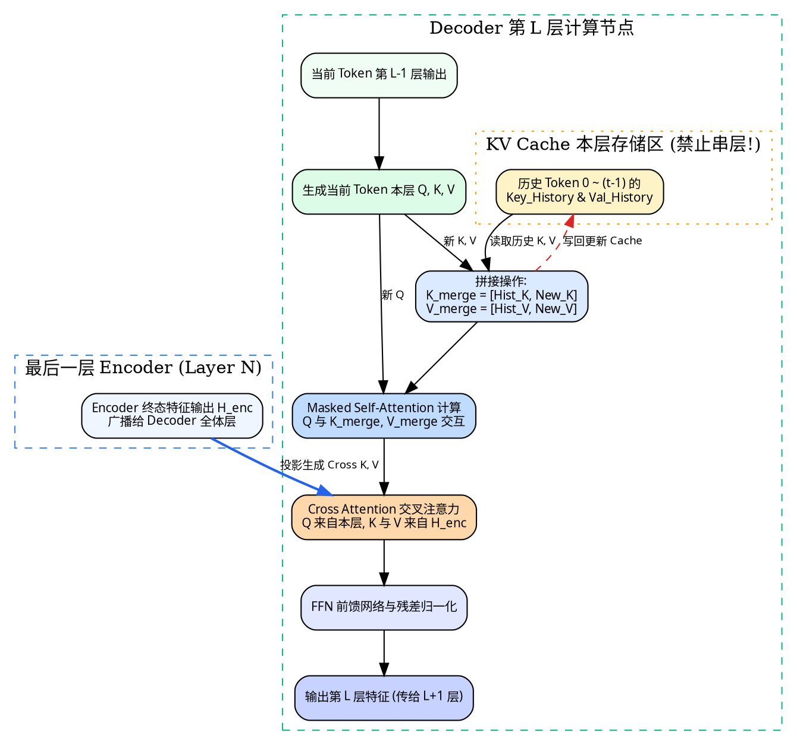

> [!WARNING]
> **硬件工程师的核心避坑守则：KV Cache 绝不可跨层穿透**！
> 在硬件分配 SRAM 地址空间或 DMA 描述符时必须严格注意：第 2 层的自注意力必须使用历史 Token 在**第 2 层**生成的 Key/Value。每一层神经网络提取的语义抽象层级完全不同，不同层的 KV 混合将导致计算彻底错乱。

---

## 第三篇：NPU 核心非线性与归一化硬件算子深度设计

### 3.1 新手初识专业术语

> **Pass (多趟扫描 / 遍历)**
> * 通俗类比：你在草稿纸上算平均分，第一趟先从头到尾把所有分数加起来算总和；第二趟再从头到尾把每个分数与平均值相减算方差。这里你把试卷扫了 2 遍，就叫“2-Pass”。
> * 硬件定义：计算流水线完整从内存或片上缓存遍历读写一遍张量数据的过程。Pass 越多，意味着访存开销越大、耗时越长。

> **Catastrophic Cancellation (灾难性抵消 / 严重精度丢失)**
> * 通俗类比：你用一把只有 4 位有效数字的秤，去称“一辆装了大象的卡车（5000 kg）”和“大象下车后的卡车（4999 kg）”，两者的差值（1 kg）在粗糙的量程下很容易因为舍入误差变成 0 甚至是负数！
> * 硬件定义：当两个大小极其接近的高精度大数执行浮点减法时，有效数字的高位全部互相抵消变为零，导致最终结果被低位的量化舍入噪声主导，精度发生雪崩。

> **Online Algorithm (在线递推算法)**
> * 通俗类比：不要等 1000 万个学生考完试才统计最高分；每交上来一份试卷，立刻与手头的最高分比大小，随时更新“当前最高分”与“当前总分”。
> * 硬件定义：无需一次性掌握全局数据，能够随着数据流的到达动态增量更新统计量（如均值、最大值、方差）的数学计算方法。

---

### 3.2 Safe-Softmax 与硬件低代价逼近

#### 数学定义与经典上溢灾难
标准 Softmax 公式为：
$$P_i = \frac{e^{x_i}}{\sum_{j=1}^N e^{x_j}}$$
如果输入的特征值稍大（例如 $x_i = 100$），$e^{100} \approx 2.68 \times 10^{43}$，在标准的 16 位浮点数（FP16 最大表示范围为 65504）甚至 32 位浮点数中都会瞬间发生**指数上溢（Overflow）**变成无穷大（Inf），导致计算崩溃。

为此，所有实际硬件均采用 **Safe-Softmax**（减去最大值）：
$$P_i = \frac{e^{x_i - \max(X)}}{\sum_{j=1}^N e^{x_j - \max(X)}}$$
由于最大项指数变为 $e^0 = 1$，其余项全为负数（$e^{\text{负数}} \in (0, 1]$），数学上结果完全等价，却彻底杜绝了上溢风险。

#### 3-Pass 经典流水线硬件拆解
在纯硬件电路中，自然指数 $e^x$ 的计算非常昂贵。硬件架构师通常利用对数换底公式将其转换为以 2 为底的指数：
$$e^x = 2^{x \cdot \log_2 e} = 2^{x \times 1.44269504...}$$

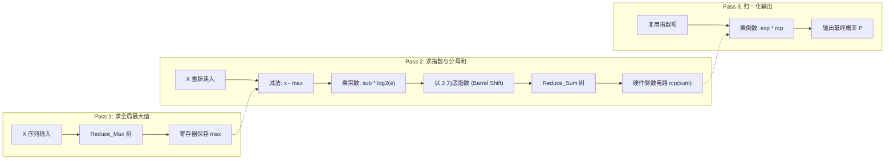

* **硬件工程优化点**：$2^{\text{mul}}$ 的整数部分可以直接作为浮点数的阶码（Exponent），小数部分通过查找表（LUT）快速插值，极大节省了专用硬件乘法器面积！

#### 2-Pass Online Softmax：分块与流式计算的数学基石
3-Pass 算法最大的缺陷在于：**必须遍历完整序列 3 遍**。如果输入是上万 Token 的长文本，片上 SRAM 放不下，每次遍历都要往返 DDR/HBM，带宽被严重耗尽。

**Online Softmax（在线 Softmax）**引入了递推归约公式：
当新流入一块数据时，维护局部最大值 $m_{\text{new}} = \max(m_{\text{old}}, x_{\text{new}})$。
此时之前的指数和只需乘以缩放补偿系数 $e^{m_{\text{old}} - m_{\text{new}}}$，即可将历史计算无损迁移到新的参考基准下！这使得 Softmax 可以与外部乘法**融合在一起流式计算**，无需等待全局数据到达。

---

### 3.3 FlashAttention 的硬件破局哲学

在传统 Transformer 注意力计算中：
1. $S = Q \cdot K^T$：如果序列长度 $N = 32768$，则 $S$ 是一个 $32768 \times 32768$ 的庞大矩阵，在 FP16 下占用 **2 GB 显存**！
2. 芯片核心紧邻的片上 SRAM（通常仅几十 MB）根本不可能放得下整个 $S$。
3. 传统实现只能把 $S$ 完整写入片外高带宽内存（HBM），再从 HBM 读回来算 Softmax，算完再写回 HBM，再读出来乘以 $V$！

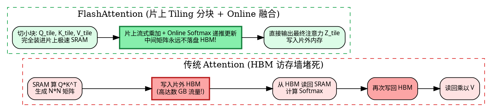

FlashAttention 的精髓就在于：**利用前面讲到的 Online Softmax 递归更新公式，对 $Q, K, V$ 进行 Tiling（分块），在片上 SRAM 中一次性完成点积、Softmax 局部归约和与 $V$ 的相乘，中间结果 $N \times N$ 矩阵从始至终从未在片外物理内存中物化过**！

---

### 3.4 LayerNorm、RMSNorm 与 Welford 数值稳定性

#### 2-Pass Naive 实现与“灾难性抵消”惨剧
LayerNorm 计算公式为：
$$y = \frac{x - \mu}{\sqrt{\sigma^2 + \epsilon}} \cdot \gamma + \beta$$
标准 3-Pass 需要：Pass 1 算均值 $\mu$；Pass 2 算差值平方和（方差 $\sigma^2$）；Pass 3 归一化。

为了节省访存，某些工程师会采用教科书上的方差恒等式：
$$\sigma^2 = \mathbb{E}[X^2] - (\mathbb{E}[X])^2$$
试图通过在 Pass 1 同时累加 $x$ 与 $x^2$，从而实现 2-Pass 计算。

> [!CAUTION]
> **硬件致命雷区：灾难性抵消（Catastrophic Cancellation）**！
> 假设输入数据均值很大，但波动极小：例如 $x \in [1000.1, 1000.2]$。
> 此时 $\mathbb{E}[X^2] \approx 1000000$ 级别，$(\mathbb{E}[X])^2$ 也是 $1000000$ 级别。在有效位宽有限的硬件浮点数（如 FP16 或定点数）下，**两个极其接近的巨大数相减，有效尾数被全部抹杀，产生极大的舍入截断噪声。甚至在极端情况下，硬件算出来的方差居然会变成负数（开根号直接报 NaN 崩溃）！**

#### Welford 算法：在线稳定方差更新
PyTorch 底层与优秀 NPU 硬件常采用 **Welford 在线增量算法**：
对于新到来的第 $n$ 个数据 $x_n$：
$$\mu_n = \mu_{n-1} + \frac{x_n - \mu_{n-1}}{n}$$
$$M_{2, n} = M_{2, n-1} + (x_n - \mu_{n-1})(x_n - \mu_n)$$
$$\sigma_n^2 = \frac{M_{2, n}}{n}$$
每次递推都是小幅度的修正量计算，彻底避免了两个大平方数相减的惨剧，具有极其坚韧的数值稳定性。

#### RMSNorm：大模型时代的绝对主流
均方根归一化（Root Mean Square Normalization, RMSNorm）直接砍掉了“中心化（减均值）”操作：
$$y = \frac{x}{\text{RMS}(x)} \cdot \gamma + \beta, \quad \text{RMS}(x) = \sqrt{\frac{1}{n} \sum_{i=1}^n x_i^2 + \epsilon}$$
* **硬件硬件工程师的最爱**：完全不需要计算和维护均值 $\mu$，无需执行 $x - \mu$ 减法流水线；
* 一趟扫描直接做平方累加，开根号后直接乘以倒数并融合缩放系数 $\gamma$；
* 现代开源大模型（LLaMA-3、Mistral、DeepSeek 等）全部拥抱 RMSNorm。

---

### 3.5 RoPE（旋转位置编码）的硬件高效实现

传统绝对位置编码直接执行加法 $X + \text{Pos}$，难以泛化到超长上下文。
**RoPE (Rotary Position Embedding)** 将二维平面上的向量旋转数学推广到了高维：
它将向量每两两元素划分为一个子平面，并乘以一个旋转角度矩阵：

$$\begin{pmatrix} x_{2i}' \\ x_{2i+1}' \end{pmatrix} = \begin{pmatrix} \cos(m\theta_i) & -\sin(m\theta_i) \\ \sin(m\theta_i) & \cos(m\theta_i) \end{pmatrix} \begin{pmatrix} x_{2i} \\ x_{2i+1} \end{pmatrix}$$

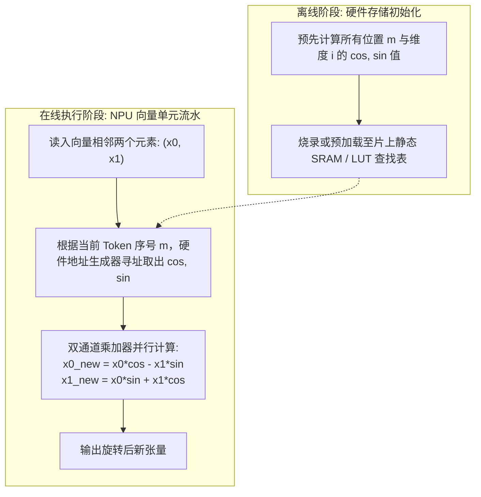

* **硬件友好性**：由于旋转角频率 $\theta_i = 10000^{-2i/d}$ 是固定常数，**NPU 在硬件中绝不会实时调用耗时几百周期的三角函数指令，而是直接利用片上 SRAM / ROM 设立查找表（LUT）**，通过基地址索引直接秒级读取正弦/余弦权重！

---

### 3.6 非对称量化与 Zero-Point 零点硬件对齐

在将连续浮点数据映射为低比特整数（如 UINT8，范围 $0 \sim 255$）时：

$$\text{Quant}(x) = \text{round}\left(\frac{x}{\text{Scale}}\right) + Z$$
$$\text{Dequant}(q) = (q - Z) \times \text{Scale}$$

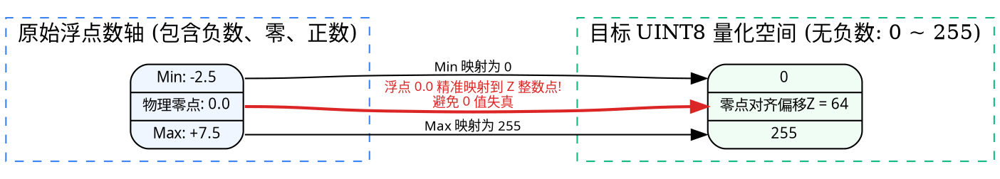

* **为什么必须引入 $Z$ (Zero-Point)？**
  神经网络中有大量的 Padding 填充和 ReLU 后的纯零点。如果采用无零点的对称映射，浮点数 $0.0$ 可能会被量化成非零整数（例如 $1$），这意味着原本不应该产生活性特征的无意义背景在经过成千上万次乘加累加后，会产生巨大的数值漂移！**引入 $Z$ 就是为了让浮点数 $0.0$ 毫无误差地死死钉在整型零点上**。

---

## 第四篇：多维卷积算子体系与硬件展开

卷积神经网络（CNN）与现代视觉多模态架构中包含着极其多样的卷积变体。理解这些变体在 NPU 内部的张量维度映射，是设计硬件地址生成器（AGU）的前提。

### 4.1 新手初识专业术语

> **Dilated Convolution (空洞卷积 / 膨胀卷积)**
> * 通俗类比：你拿放大镜看报纸，原本每次紧贴着读相邻的字（普通卷积）；现在把放大镜镜片镂空，隔一个字看一个字。在不增加镜片大小（参数量）的前提下，视野（感受野）瞬间翻倍。
> * 硬件定义：在卷积核元素之间人为插入“虚拟间隔（Dilation Rate）”，硬件在寻址抓取特征时按照跳跃步长拉取数据。

> **Pointwise 卷积 (逐点卷积 / 1x1 卷积)**
> * 通俗类比：只调配鸡尾酒的成分，不改变酒杯的位置。
> * 硬件定义：空间尺寸为 $1 \times 1$ 的卷积核。它不做空间相邻像素的加权，只在通道（Channel）维度上进行纯粹的特征线性组合重组。

> **Depthwise 卷积 (深度可分离卷积之通道独立卷积)**
> * 通俗类比：流水线上有 64 条不同的传送带，每个工人（卷积核）只专心管自己那一条传送带上的工件，互相之间绝不交头接耳、绝不跨带累加。
> * 硬件定义：输入有多少个通道，就只用多少个单通道的卷积核分别独立卷积，在通道维度上不发生任何累加（Reduction）。

---

### 4.2 2D 多通道常规卷积与张量维度映射

设输入特征图尺寸为 $[H, W, C]$，卷积核集合尺寸为 $[K, R, S, C]$，输出特征图尺寸为 $[P, Q, K]$：
* $K$：卷积核数量（也是输出通道数 Output Channel）；
* $R \times S$：卷积核的空间高宽（如 $3 \times 3$）；
* $C$：输入特征通道数（Input Channel）。

计算公式为：
$$\text{Output}[p, q, k] = \sum_{r=0}^{R-1} \sum_{s=0}^{S-1} \sum_{c=0}^{C-1} \text{Input}[p \cdot \text{stride} + r, q \cdot \text{stride} + s, c] \times \text{Weight}[k, r, s, c]$$

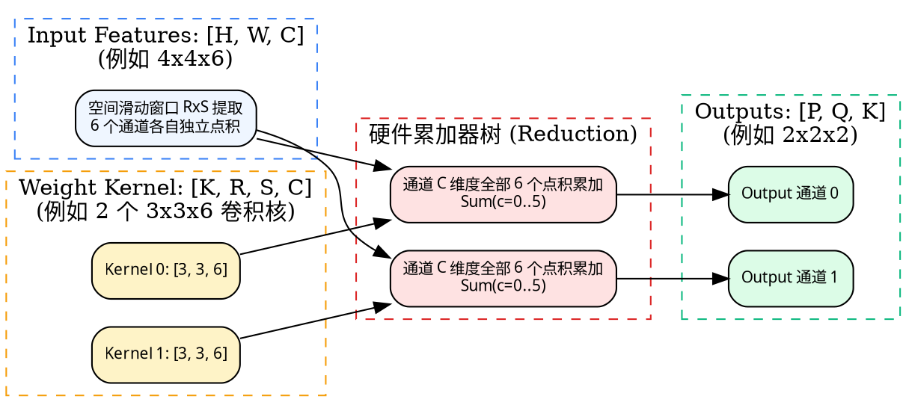

* **退化到 Pointwise 卷积**：当 $R = 1, S = 1$ 时，空间无滑动窗口，计算直接退化为向量内积：
  $$\text{Output}[p, q, k] = \sum_{c=0}^{C-1} \text{Input}[p, q, c] \times \text{Weight}[k, c]$$
  这在硬件上**与标准通用矩阵乘法（GEMM）在内存排布上完全等价**！因此 NPU 中的矩阵加速单元可以直接无缝跑 Pointwise 卷积。

---

### 4.3 分组卷积 (Group Conv) 与 Depthwise 卷积

在分组卷积中，通道 $C$ 被等分为 $G$ 个小组，每个小组内部的通道数为 $C / G$。
* **计算规则**：第 $g$ 组的输入特征只与第 $g$ 组的权重进行点积，**累加仅在组内发生，绝不跨组累加**！

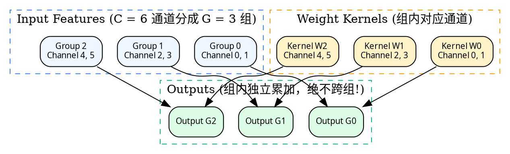

* **极致特例：Depthwise 卷积**：当分组数 $G = C$ 时，每个通道自成一组，通道内只有 1 个元素，**累加器树完全失效（不需要通道累加）**！
  * 这对硬件极其不友好：因为常规 NPU 内部的大位宽累加树在算 Depthwise 卷积时全部处于空闲闲置状态，硬件算力利用率暴跌。优秀 NPU 通常为此配备专用的 SIMD/Vector 单元进行旁路加速。

---

### 4.4 3D 卷积与转置卷积（反卷积）

#### 3D 多通道卷积的硬件切分
输入扩展为 $[H, W, D_i, C]$，卷积核为 $[R, S, D_f, C]$。点积在三维立体空间（$H \times W \times D_i$）内同时滑动并累加。
* **硬件实现策略**：在绝大多数 NPU 中，硬件不需要专门设计 3D 物理计算电路。编译器可以通过地址跨度计算（Stride），**在离线阶段将 3D 卷积在时间上拆分为 $D_f$ 次标准的 2D 卷积流水**，然后在片上累加器中按时钟周期逐步累加。

#### 转置卷积（Transposed 2D Conv / 反卷积）
正向卷积是特征降采样（分辨率变小），而转置卷积是为了做**特征上采样（分辨率放大）**。
* **硬件计算三步法**：
  1. **插零膨胀（Fractional Stride）**：在输入特征的每个像素之间插入 $(\text{stride} - 1)$ 个零；
  2. **边缘填充（Padding）**：在边界补零；
  3. **旋转核与正向卷积**：将卷积核沿中心点旋转 180 度，然后直接调用硬件现成的正向卷积流水线！硬件只需控制输入 DMA 的发牌寻址，无需新增任何专用乘加电路。

---

### 4.5 量化卷积中的 Scale 恢复时机权衡

在采用 MX 格式（例如 Per-Block Scale，块大小 $k = 32$）进行低比特卷积时，特征缩放因子为 $\text{Scale}_f$，权重缩放因子为 $\text{Scale}_w$。芯片架构师必须在以下三个物理阶段中做出硬件面积与精度的权衡：

| 恢复方案 | 硬件动作 | 芯片面积开销 | 数值精度与溢出风险 |
| :--- | :--- | :--- | :--- |
| **方案 1：乘法时立即恢复** | 每一个低比特乘法完成后，硬件乘法器立刻乘以 $\text{Scale}_f \times \text{Scale}_w$ 转换为高精度浮点数 | **极高**：每个乘法器旁边都要绑一个高精度浮点转换模块，硬件面积爆炸 | 精度最高，绝无截断损失 |
| **方案 2：空间窗口内恢复** | 在单个 $R \times S$（如 $3 \times 3 = 9$ 个点）点积完成并在本地累加后，乘一次 Scale | **中等**：累加器需保证中间整型位宽（如 24 位），然后再统一缩放 | 适中，折中工程选择 |
| **方案 3：通道 Block 累加后恢复 (推荐)** | 充分利用定点整数累加树，**将整个 $k=32$ 大小的 Block 在通道维度彻底累加完毕后**，在最终输出寄存器处统一乘一次 Scale | **最低**：整个阵列共享极少数几个浮点缩放单元，面积利用率极高 | **需要注意累加器溢出**：整型累加器必须预留足够的保护位（Guard Bits） |

---

## 第五篇：MAC 阵列微架构与经典数据流（Dataflow）

在 NPU 内部，执行矩阵乘法和卷积的核心引擎是成百上千个微小的**处理单元（PE, Processing Element）**组成的 **MAC 阵列**。

### 5.1 新手初识专业术语

> **Stationary (驻留 / 复用)**
> * 通俗类比：
>   * **权重驻留 (WS)**：厨师站在原地不动，食材一盘盘送过来炒；
>   * **输入驻留 (IS)**：食材放在砧板上不动，多把不同的调味刀具依次拿过来加工；
>   * **输出驻留 (OS)**：炒菜锅固定在炉灶上，厨师不断往锅里加食材和调料，直到整道菜彻底炒熟出锅。
> * 硬件定义：指定某一种数据类型（权重、输入特征或中间累加和）长期保存在 PE 内部的本地寄存器（Register File）中，最大化复用，避免通过片上总线来回反复读写。

---

### 5.2 三种经典数据流的微架构与控制策略

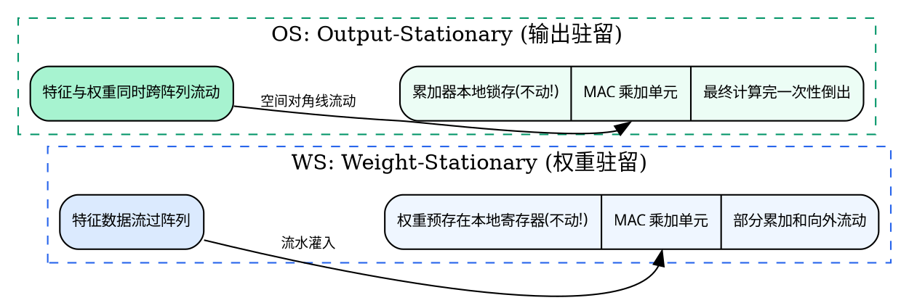

#### 1. 权重驻留 (Weight-Stationary, WS)
* **运行逻辑**：将一组卷积核权重预先灌入每个 PE 的内部寄存器并死死锁定；随后，庞大的输入特征图（Feature Map）像波浪一样在时钟周期中依次流过各个 PE。
* **硬件展开模式**：
  * **单 Kernel 展开**：如果仅展开单个卷积核的 $R \times S$ 空间，当卷积核很小（例如 $1 \times 1$ 或 $3 \times 3$）而 MAC 阵列很大时，**大量的 PE 将无法被填满，硬件利用率极低**！
  * **多 Kernel 并行展开（如 NVDLA 模式）**：
    将 $K$ 个不同的卷积核在阵列的横向铺开（展开 PK 维），特征在纵向铺开。在输出通道并行推进的同时，隐藏了 $K$ 维度的切换延迟。当输出通道数 $K$ 远大于 $R \times S$ 时，MAC 利用率能逼近 100%。
* **优缺点**：特别适合大尺寸特征图的卷积，权重一旦加载绝不再动，权重访存带宽几乎为零；但如果模型层频繁切换小尺寸矩阵，加载权重的预热时间开销较大。

#### 2. 输入特征驻留 (Input-Stationary, IS)
* **运行逻辑**：将一个局部的特征图切块驻留在 PE 阵列中；外部存储将大量的权重 Kernel 依次轮流灌入阵列中与该特征进行点积。
* **优缺点**：在全连接层（FC Layer）或特征尺寸极小而权重海量的场景下表现极好，最大程度消除了大特征图的反复重读。

#### 3. 输出驻留 (Output-Stationary, OS)
* **运行逻辑**：每个 PE 内部绑定一个专用的输出部分和累加器（Accumulator）。输入特征和权重分别从横向和纵向总线同时注入并在 PE 内相乘累加。在整个计算过程中，**中间累加和从未离开过当前 PE 一步**！
* **优缺点**：
  * **最大优势**：彻底干掉了阵列外部高昂的“跨核累加器加法树”和中间结果写回网络，中间部分和无需任何片上总线带宽；
  * **劣势**：输入特征与权重必须双向同时高速灌入，对输入分配网络的扇出（Fanout）带宽要求极为苛刻。

---

### 5.3 三大数据流核心指标全景对照表

| 评估维度 | 权重驻留 (WS) | 输入特征驻留 (IS) | 输出驻留 (OS) |
| :--- | :--- | :--- | :--- |
| **权重加载访存开销** | **最低（加载一次长期复用）** | 极高（权重需轮番穿梭注入） | 较高（权重跨行流动） |
| **特征输入访存开销** | 较高（特征需在阵列中流动） | **最低（特征锁死在本地）** | 较高（特征跨列流动） |
| **中间部分和带宽** | 较高（部分和需沿脉动方向传递累加） | 较高（部分和向外输出累加） | **为零（本地累加，最终一次性出炉）** |
| **PE 内部存储开销** | 需要容纳权重的寄存器 | 需要容纳输入特征的缓冲器 | 需要高精度大位宽累加寄存器 |
| **最佳适应算子场景** | 大特征图、常规深度 CNN 卷积 | 批处理批量大（Batch > 1）、全连接层 | 长序列矩阵乘法 GEMM、Pointwise 卷积 |

---

## 第六篇：知识贯通总结与实战自测

### 6.1 核心易混淆术语全景速查

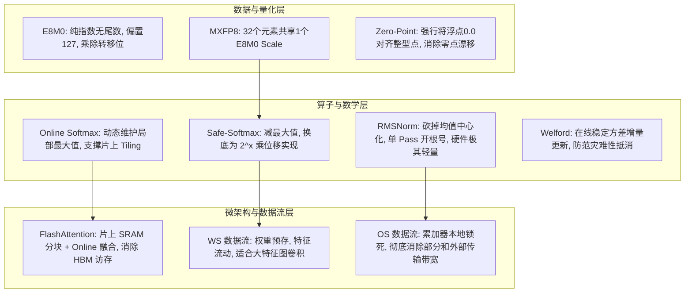

---

### 6.2 启发式自测练习与硬核解答

为了检验你的学习成果，尝试回答以下 3 道硬件设计推导题：

#### Q1：为什么 MXFP8 规范选择 Block Size $k = 32$ 作为主流，而不是 $k = 4$ 或 $k = 1024$？
<details>
<summary>👉 点击展开详细解答</summary>

* **当 $k = 4$ 时（过小）**：每 4 个字节的元素就要配备 1 个字节的 E8M0 Scale，元数据存储开销高达 $1 / (1 + 4) = 20\%$！内存带宽浪费严重，且硬件频繁切换 Scale 会使解包逻辑频繁震荡。
* **当 $k = 1024$ 时（过大）**：跨越 1024 个元素时，激活值内部的离群值（Outliers）大概率会淹没同组的微小数值，退化为传统 Tensor-level 量化，低比特精度严重崩塌。
* **选择 $k = 32$**：此时元数据存储开销仅为 $1 / (1 + 32) \approx 3\%$，既维持了极高的数据压缩比，又能精确捕获局部离群值，且 **32 恰好与现代 GPU 的 Warp Size 以及典型 NPU 的向量通道数（SIMD Lanes）完全对齐**，硬件调度效率最高。
</details>

---

#### Q2：在设计 NPU 的 Softmax 硬件流水线时，为什么宁可增加一个乘法器去算 $x \times \log_2 e$，也绝不在硅片上做 $e^x$ 的直接硬件浮点计算？
<details>
<summary>👉 点击展开详细解答</summary>

自然指数 $e^x$ 是一个超越函数，如果直接用硬件逻辑电路实现，必须使用高阶泰勒展开或 CORDIC 算法，需要几十个级联流水线周期，占用极其庞大的芯片硅片面积。
而将其改写为 $2^{x \cdot \log_2 e}$ 后：
1. $\log_2 e \approx 1.44269504$ 是一个**编译期完全已知的固定常数**，常数乘法可以用极少量的逻辑门（甚至加移位树）极速完成；
2. 转换为以 2 为底后，整数部分直接作为浮点数的 Exponent 字段，小数部分用极小的查找表（LUT）一拍出结果，**硬件面积节省 80% 以上，主频可提升一倍**！
</details>

---

#### Q3：在 Decoder 生成第 100 个 Token 时，为什么 KV Cache 能够将时间复杂度从 $O(N^2)$ 降低到 $O(N)$？
<details>
<summary>👉 点击展开详细解答</summary>

在没有 KV Cache 的朴素实现中，为了预测第 100 个词，必须将前 99 个词重新输入模型，完整重新做一遍所有矩阵乘法重新生成前 99 个词的 $Q, K, V$，序列长度为 $N$ 时的总计算量为 $\sum_{i=1}^N i \approx O(N^2)$。
引入 KV Cache 后：
前 99 个词在每一层的 Key 和 Value 已经作为静态特征缓存在片上或片外内存中。在第 100 步，**只需要将当前的 1 个新 Token 乘以权重生成 1 个新 Query、1 个新 Key 和 1 个新 Value**。随后只需读取历史缓存的 Key/Value 执行单行向量与矩阵的点积（GEMV），这一步的计算量仅仅是 $O(N)$，彻底摆脱了重复计算的算力浪费。
</details>

---

> **结语**：NPU 芯片架构与 AI 算子的设计，永远是**“数学算法极限”与“物理晶体管约束”之间的艺术博弈**。从 OCP MX 的 E8M0 微缩放、FlashAttention 的在线 Softmax 融合，到 MAC 阵列的驻留数据流，理解了“访存与计算的权衡”，你就真正掌握了现代 AI 芯片架构的灵魂。
