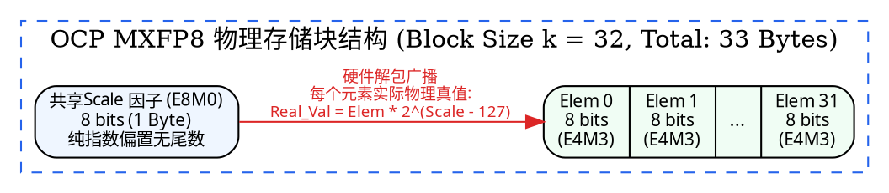
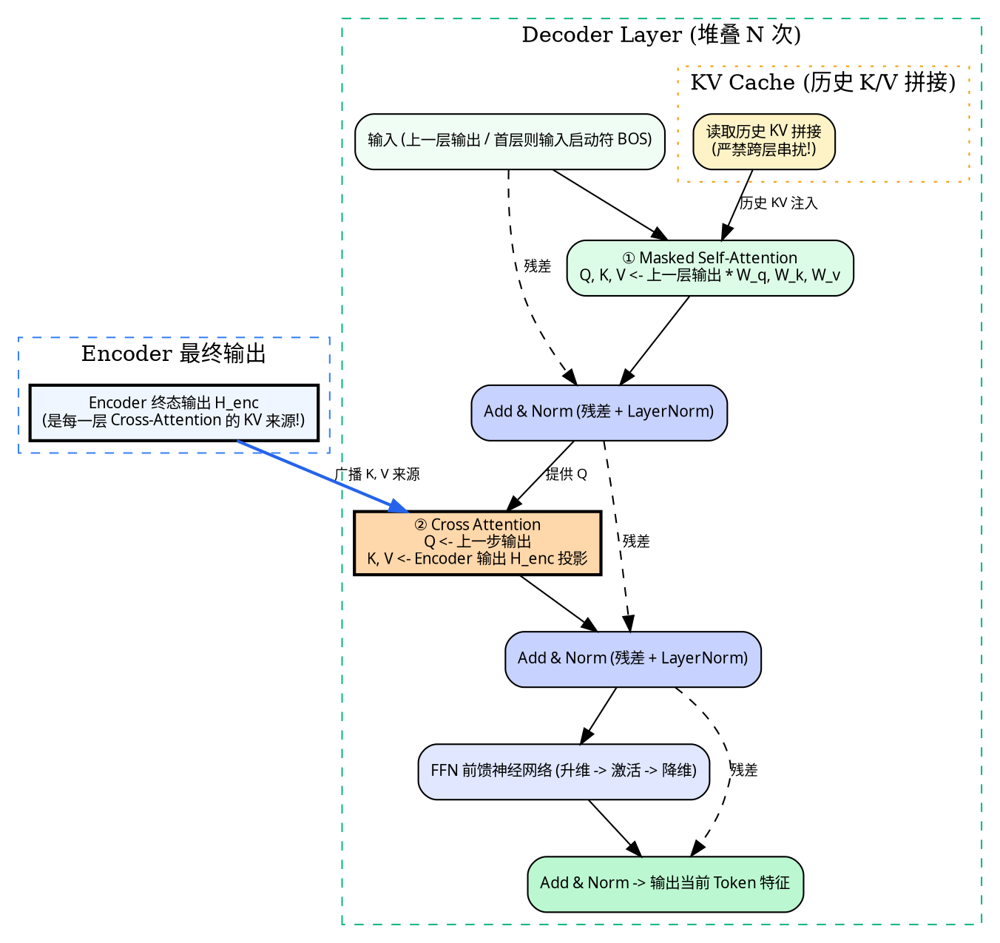
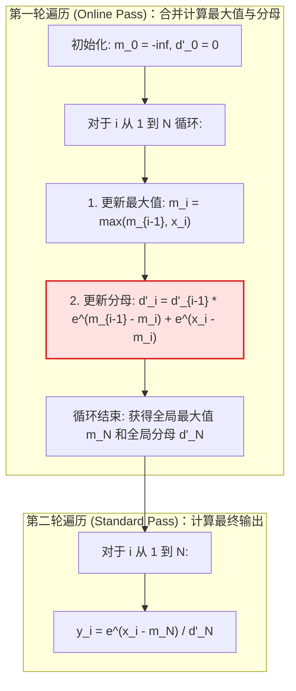
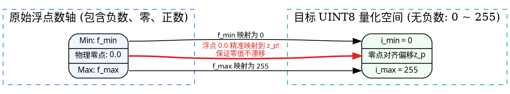
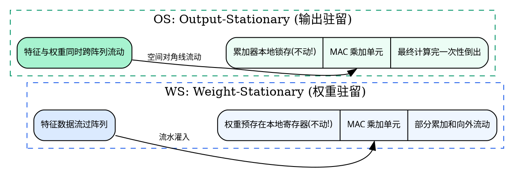
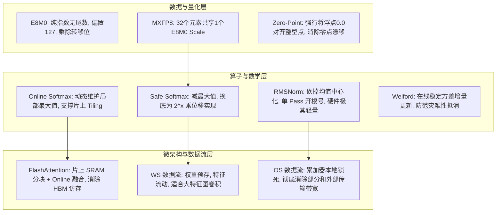

> **导读**：在进入神经网络处理器（NPU, Neural Processing Unit）的硬件微架构设计、专用集成电路（ASIC）实现或底层高性能算子优化时，初学者往往会遇到极其陡峭的学习曲线：
>
> 1. 上层算法工程师关注的是“注意力机制、自回归解码、RMSNorm、RoPE 与低比特量化”，而底层硬件电路面对的却是“乘加器阵列（MAC Array）、处理单元（PE）、片上缓存（SRAM/Scratchpad）、流水线停顿（Pipeline Stall）与总线带宽（Memory Bandwidth）”；
> 2. 为什么业界巨头（AMD, Arm, Intel, Meta, Microsoft, NVIDIA, 高通）联合通过 OCP 推出 **MX（Microscaling，微缩放）量化规范**？为什么 DeepSeek-V3 如此钟爱 **E8M0** 格式作为缩放因子？它的指数范围、NaN 编码以及从 FP32 到 MXFP8 的逐比特转换是如何完成的？
> 3. 为什么标准的数学公式在硬件电路上不能直接套用？为什么 Softmax 需要拆成多 Pass 或转成 Online 增量模式（FlashAttention 的基石）？为什么 LayerNorm 的 2-pass Naive 实现会在硬件中引发灾难性的精度坍塌？
> 4. 2D 卷积、Pointwise 卷积、分组卷积（GC）、Depthwise 卷积与 3D 卷积在底层张量维度上是如何连续演进的？转置卷积（反卷积）在硬件控制中究竟是如何通过“插零、补零、核翻转、普通卷积”这四步实现的？
> 5. 面对海量的张量矩阵乘加，MAC 阵列究竟该如何组织数据流动？权重驻留（WS）中的“单 Kernel 展开”与“NVDLA 的 PC/PK 展开”在利用率上有何本质区别？输入驻留（IS）与输出驻留（OS）又该如何权衡？
>
> 本文面向刚接触 NPU 芯片设计、AI 加速器体系结构与高性能算子开发的工程师和初学者。全篇严格遵循**“初学者友好”**原则：**所有关键专业术语在第一次出现时，均提供生动的生活类比、精准的技术定义与硬件设计的存在意义**。文内对核心知识点配备了大量详尽的参数规范表、数值计算推导、**Mermaid 架构流程图** 与 **Graphviz 电路拓扑图**，帮助读者建立端到端贯通算法与芯片硬件的完整知识图谱。

---

## 目录导览

```mermaid
flowchart TD
    subgraph S1["第一模块：基础认知与量化底座"]
        M1["1. 为什么需要专用 NPU 芯片？<br/>(DSA / 访存墙 / 算力密度)"] --> M2["2. OCP 微缩放格式规范 MX Formats<br/>(Table 1 具体参数 / Table 7 E8M0 / FP32转MXFP8计算)"]
    end

    subgraph S2["第二模块：Transformer 全栈计算与硬件流水"]
        M2 --> M3["3. Token / Embedding / d_model 各大模型参数表"]
        M3 --> M4["4. QKV 生成 / 注意力打分 / 残差与 FFN 升降维数值"]
        M4 --> M5["5. Encoder 堆叠与 Decoder 交叉注意力<br/>(KV Cache 跨周期硬件拼接与严格防串层)"]
    end

    subgraph S3["第三模块：硬件常需实现的 AI 算子深度设计"]
        M5 --> M6["6. Safe-Softmax 与 2/3-pass 硬件流水逼近<br/>(2 的幂次位移代替自然指数 / Online Softmax 递推公式)"]
        M6 --> M7["7. FlashAttention 硬件破局哲学<br/>(Tiling 分块 + Online Softmax 消除 HBM 访存)"]
        M7 --> M8["8. LayerNorm / RMSNorm / Welford 算法<br/>(灾难性数值抵消防范 / 符号说明表 / 单 Pass 均方根)"]
        M8 --> M9["9. RoPE 旋转位置编码与硬件 LUT 查表<br/>(公式15逐位相乘稀疏优化)"]
        M9 --> M10["10. 非对称量化与 Zero-Point 零点硬件对齐<br/>(Scale与Z计算公式 / Clamp截断约束)"]
    end

    subgraph S4["第四模块：多维卷积算子全体系硬件展开"]
        M10 --> M11["11. 空洞卷积感受野推导 (有效感受野公式与网格图)"]
        M11 --> M12["12. 2D 多通道卷积 (4x4x6 输入 / 2x2x6 核 / 3x3x2 输出) -> Pointwise"]
        M12 --> M13["13. 分组卷积 Group Conv (组内累加 / 3x3x6 输出) -> Depthwise"]
        M13 --> M14["14. 3D 卷积软硬件切分与转置卷积四步法 (插零/补零/翻转/卷积)"]
        M14 --> M15["15. Per-Block / Per-Group Scale 量化卷积恢复时机 (优先沿 C 维切块)"]
    end

    subgraph S5["第五模块：MAC 阵列微架构与经典数据流"]
        M15 --> M16["16. WS 权重驻留 (单Kernel展开 vs NVDLA PC/PK 展开)"]
        M16 --> M17["17. IS 输入驻留 / OS 输出驻留 (外部累加器必要性 / 全维度权衡)"]
    end

    style S1 fill:#f8fafc,stroke:#3b82f6,stroke-width:2px
    style S2 fill:#f0fdf4,stroke:#10b981,stroke-width:2px
    style S3 fill:#fefce8,stroke:#f59e0b,stroke-width:2px
    style S4 fill:#fdf2f8,stroke:#ec4899,stroke-width:2px
    style S5 fill:#faf5ff,stroke:#8b5cf6,stroke-width:2px
```



---

## 序言：理解现代 AI 芯片的软硬件断层

在学习具体算子和芯片电路之前，我们必须先跳出纯数学公式，建立**硬件芯片设计者（Hardware Designer）**的核心视角。

| 维度 | 深度学习算法工程师视角 | NPU 芯片微架构工程师视角 |
| :--- | :--- | :--- |
| **核心目标** | 模型精度（Accuracy）、困惑度（Perplexity）、Loss 收敛 | 吞吐量（TOPS）、能效比（TOPS/W）、芯片面积（mm²）、成本（PPA） |
| **计算抽象** | 多维连续张量（Tensor）、数学符号变换、微分求导 | 离散存储地址（SRAM/DDR）、时钟周期（Clock Cycle）、乘加流水线 |
| **访存认知** | 假设内存无限大、读写几乎免费（`x + y`） | **访存极其昂贵**：片外 DRAM 读写能耗是片上乘加的 200 倍以上！ |
| **精度选择** | 偏好 FP32、BF16 保证模型训练稳定性 | 追求 INT8、FP8、MXFP4 压缩存储并成倍翻倍 MAC 算力密度 |

> [!IMPORTANT]
> **NPU 设计的第一天条**：**算力并不昂贵，访存才是瓶颈（The Memory Wall）**。在硅片上多放 1024 个乘加器（MAC）非常容易，但要保证每个时钟周期都能从内存中把数据“喂饱”这些乘加器，几乎是不可能的任务。因此，**NPU 的一切硬件设计（无论是微缩放量化、Online Softmax、FlashAttention 还是权重驻留数据流），本质上全都是在为“减少数据搬运、提高片上数据复用”而服务！**

---

## 第一篇：OCP 微缩放量化规范（Microscaling Formats, MX）与数据编码

### 1.1 新手初识专业术语

在进入 MX 格式前，我们先为零基础初学者扫清几个高频概念：

> **DSA (Domain Specific Architecture, 特定领域架构)**
> * 通俗类比：如果说通用 CPU 是一把什么都能切但切不快的瑞士军刀，GPU 是一队干体力活的搬家工，那么 NPU 就是专门为切土豆丝定制的高速切菜机。
> * 硬件定义：专为特定工作负载（如深度学习神经网络中的矩阵乘法和张量卷积）进行深度硬化定制的芯片架构。

> **量化 (Quantization)**
> * 通俗类比：把用高精度尺子测出来的微米级身高（例如 178.532 厘米），四舍五入映射为有限的几个尺码档位（S、M、L、XL），从而大幅节省记录空间。
> * 硬件定义：将高位宽数值（如 32 位浮点数 FP32）映射到低位宽定点或浮点表示（如 8 位 INT8/FP8 甚至 4 位 FP4）的过程。

> **动态范围 (Dynamic Range)**
> * 通俗类比：你的耳朵能听到的最小耳语与最大雷鸣声之间的范围跨度。
> * 硬件定义：一种数据类型所能表示的最大有效数值与最小非零数值之间的比率。神经网络中间激活值经常出现“大异常值（Outliers）”，动态范围不足会导致大数溢出或小数被截断为零。

> **微缩放 (Microscaling, MX)**
> * 通俗类比：传统量化是全班同学统一扣掉相同的平均分（Per-Tensor 量化），导致拔尖生和后进生的差距被严重压缩；微缩放则是每 32 个人分成一个小组，组内根据自己的最大值单独确定一个“小组缩放比例”。
> * 硬件定义：由 AMD、Arm、Intel、Meta、Microsoft、NVIDIA、高通组成的联盟在开放计算项目（OCP, Open Compute Project）中标准化的细粒度分块量化技术。

---

### 1.2 为什么传统量化在大模型时代遇到瓶颈？

在传统的 INT8 / FP8 量化中，通常采用 **Per-Tensor（全张量共用一个缩放系数）** 或 **Per-Channel（每个输出通道共用一个缩放系数）**。

然而，现代大语言模型（如 LLaMA、DeepSeek）在激活值中存在极其明显的**离群异常值（Outliers）**：某些维度的数值可能达到正常维度的数十倍甚至上百倍。如果采用全张量缩放，为了容纳极个别的极大值，绝大部分正常数值在低比特下都会被截断为 0；如果为了保全小数，大数又会严重溢出。

OCP 推出的 **MX（Microscaling Formats）规范**（官方规范文档为《*OCP Microscaling Formats (MX) Specification Version 1.0*》），通过硬件级的**细粒度分块（Block-level Scaling）**完美化解了这一矛盾，成为当前 NPU 芯片设计中最火热的数据格式规范。

---

### 1.3 MX 格式规范参数表（Table 1 完整还原）

符合 MX 规范的数据格式由三个组件构成：
1. **缩放因子 Scale ($X$)**：数据类型/编码，位宽是 $w$ bits；
2. **元素本身 Element**：数据类型/编码，位宽是 $d$ bits；
3. **缩放块大小 Scaling Block Size ($k$)**：该缩放块内包含的连续元素个数（通常为 32）。

由此，一个缩放块存储可以使用 $(w + k \cdot d)$ bits 编码。如果连续多个这样的块共享缩放因子，还能进一步精简若干个 $w$ bits。

根据 OCP MX 官方规范，具体格式和配置如下表所示（完整还原 OCP Table 1）：

| Format Name (格式名称) | Element Data Type (元素数据类型) | Element Bits $d$ (元素位宽) | Scaling Block Size $k$ (缩放块大小) | Scale Data Type (缩放因子类型) | Scale Bits $w$ (缩放因子位宽) |
| :--- | :--- | :---: | :---: | :---: | :---: |
| **MXFP8** | FP8 (E5M2) | 8 | 32 | E8M0 | 8 |
| | FP8 (E4M3) | 8 | 32 | E8M0 | 8 |
| **MXFP6** | FP6 (E3M2) | 6 | 32 | E8M0 | 8 |
| | FP6 (E2M3) | 6 | 32 | E8M0 | 8 |
| **MXFP4** | FP4 (E2M1) | 4 | 32 | E8M0 | 8 |
| **MXINT8** | INT8 | 8 | 32 | E8M0 | 8 |



---

### 1.4 E8M0 编码规范详解（Table 7 完整还原）

可以看到，缩放因子 Scale 的数据类型基本都是 8 bits 的 **E8M0** 格式。这也是 DeepSeek-V3 / V3.1 大上热搜的核心数据格式。

> **E8M0 定义与规格**：
> E8M0 是传统带偏置 Float32 指数（biased Float32 exponent）的无符号表示。与 Float32 指数不同的是，**E8M0 没有表示无穷大（Inf）的编码，并且只保留了一个唯一的 NaN 编码，同时没有零（Zeros）的专用表示**。

OCP 官方关于 Scale 数据类型 E8M0 的编码细节如下表所示（完整还原 OCP Table 7）：

| 参数项 | E8M0 规格数值 | 说明 |
| :--- | :--- | :--- |
| **Exponent bias (指数偏置)** | **127** | 与 IEEE 754 FP32 的偏置完全对齐 |
| **Supported exponent range (支持指数范围)** | **-127 到 127** | 对应未偏置指数 $E \in [-127, 127]$ |
| **Infinities (无穷大)** | **N/A** | 不支持表示无穷大 Inf |
| **NaN (非数)** | **$11111111_2$ (255)** | 仅保留全 1 这一种 NaN 编码 |
| **Zeros (零表示)** | **N/A** | 没有专门的零编码（无需为 Scale 编码零） |

#### 硬件设计者的绝妙之处
在 NPU 电路设计中，乘除法器的芯片面积和功耗远大于加法器与移位寄存器。
如果 Scale 带有尾数，在硬件反量化时就必须用一个完整的浮点乘法器将 Element 与 Scale 相乘；而 **E8M0 没有尾数，它本质上就是一个以 2 为底的纯幂次（Power-of-Two）**！
* 在硬件进行乘加计算时，**乘以 $2^{S-127}$ 只需要对指数执行简单的整数加减法，或者在定点桶移位器（Barrel Shifter）中进行左右移位**！
* 硬件无需昂贵的浮点乘法器，极大精简了 NPU 解包（Dequantization）逻辑的晶体管面积。

---

### 1.5 从 FP32 到 MXFP8 (E4M3) 的量化转换全过程实例（逐数值演算）

为了彻底破除黑盒，我们完全还原知乎原文中将典型 FP32 数据转换为 MXFP8（E4M3）缩放块的具体计算过程。

假设我们有一个包含 **4 个 FP32 数值** 的小数据块（为简化演示，块大小设为 4，实际规范中通常为 32）：
$$\text{Data} = [0.125, 0.25, 0.5, 1.0]$$

#### 第 1 步：计算共享缩放因子 (X)
1. **找出最大值**：首先，在数据块中找到绝对值最大的元素 $amax$。在这个例子中，$amax = 1.0$。
2. **计算共享指数**：接着，计算这个最大值的以 2 为底的对数，并向下取整到最近的整数：
   $$\text{共享指数} = \lfloor \log_2(amax) \rfloor$$
   对于 $1.0$，$\log_2(1.0) = 0$，所以共享指数是 $0$。
3. **确定缩放因子**：共享缩放因子 $X$ 就是 $2^{\text{共享指数}}$。这里：
   $$X = 2^0 = 1.0$$
   这个缩放因子将存储为 **UE8M0** 格式（8 位无符号整数，仅表示 2 的幂次方，偏置 127，因此存储的二进制编码为 $0 + 127 = 127 = 01111111_2$）。

#### 第 2 步：归一块内元素
将数据块中的每一个原始 FP32 值都除以共享缩放因子 $X$，得到一组归一化后的值 $P_i$：
* $0.125 / 1.0 = 0.125$
* $0.25 / 1.0 = 0.25$
* $0.5 / 1.0 = 0.5$
* $1.0 / 1.0 = 1.0$

现在，我们得到归一化数组 $P_i = [0.125, 0.25, 0.5, 1.0]$。这些值将被量化为 FP8 格式。

#### 第 3 步：量化为 FP8 格式
将每个归一化后的值 $P_i$ 转换为 **FP8 E4M3 格式**（1 位符号位、4 位指数位、3 位尾数位）：
* 以 $0.125$ 为例：
  * 其二进制科学计数法表示为 $1.0 \times 2^{-3}$；
  * 在 FP8 E4M3 格式中，需要将其指数部分（$-3$）加上偏置（bias，对于 E4M3 通常是 7），即 $-3 + 7 = 4$（二进制表示为 `0100`）；
  * 尾数部分为 $1.0$ 后面的小数部分，即 $0$（二进制表示为 `000`）；
  * 符号位为正，即 `0`；
  * 因此 $0.125$ 最终存储的 8 位二进制编码为 `0 0100 000`。
* 在实际的硬件或部署库（如 MNN 转换代码）中，此过程通常涉及位操作和舍入。例如，提取 FP32 数的符号位、指数域并对尾数进行截断处理，最终每个 $P_i$ 被存储为一个 8 位的 FP8 值。

```python
import numpy as np

def fp32_to_mxfp8_step_by_step(data: list):
    """
    完全复现教程中的逐步数值演算
    """
    arr = np.array(data, dtype=np.float32)
    amax = np.max(np.abs(arr))
    
    # 共享指数 = floor(log2(amax))
    shared_exp = int(np.floor(np.log2(amax))) if amax > 0 else 0
    scale_factor = 2.0 ** shared_exp
    scale_e8m0_code = shared_exp + 127
    
    # 归一化
    norm_arr = arr / scale_factor
    
    print(f"原始数据: {data}")
    print(f"绝对值最大值 amax: {amax}")
    print(f"共享指数: {shared_exp}, 缩放因子 X: {scale_factor}, E8M0 编码: {scale_e8m0_code}")
    print(f"归一化数组 P_i: {norm_arr.tolist()}")

fp32_to_mxfp8_step_by_step([0.125, 0.25, 0.5, 1.0])
```

---

## 第二篇：Transformer 全栈计算与硬件数据流（Encoder-Decoder 细化）

现代大语言模型（如 GPT、BERT、LLaMA、DeepSeek）的骨架均脱胎于 **Transformer**。在 NPU 上运行大模型，本质就是将 Transformer 的算子流映射到底层的硬件流水线上。

### 2.1 新手初识专业术语

> **Token 与 Tokenizer (分词与分词器)**
> * 通俗类比：把一本厚书拆成一个个基本的汉字或英文单词切片。
> * 硬件定义：自然语言文本输入计算机的最小离散单元（如词或字）。Tokenizer 负责将字符串切分并映射为整数编号（Token ID）。

> **Embedding (嵌入矩阵) 与 $d_{\text{model}}$ (特征维度)**
> * 通俗类比：给每个词一张由多重属性构成的“身份证”。比如“苹果”：维度 1 代表“水果概率 0.95”，维度 2 代表“科技公司概率 0.88”，维度 3 代表“硬度”。
> * 硬件定义：一个巨大的二维查找表（Look-Up Table, LUT），形状为 $[\text{Vocab\_Size}, d_{\text{model}}]$。根据输入的 Token ID，查出一行长度为 $d_{\text{model}}$ 的连续浮点向量。

> **Q、K、V (Query, Key, Value)**
> * 通俗类比（图书检索）：
>   * **Q (Query)**：读者在搜索框里输入的关键词（“我在找什么？”）；
>   * **K (Key)**：图书标签和目录分类（“我有什么内容可供检索？”）；
>   * **V (Value)**：书籍的实际正文（“如果命中，我能提供什么具体知识？”）。

> **KV Cache (键值缓存)**
> * 通俗类比：你在回答一系列连贯问题时，不用每次都从头把对方讲的前 100 句话重新在脑子里逐字分析一遍，而是把前 100 句话提取好的要点（Key 和 Value）记在便签本上，来了第 101 句话时直接拿出来拼在一起算。
> * 硬件定义：在自回归大模型推理的解码（Decode）阶段，片上及片外内存专门开辟的一块物理缓存区，用来存储历史生成 Token 的 Key 和 Value 张量，避免每生成一个新 Token 都要重算历史长文本。

---

### 2.2 输入、Embedding 与不同模型的 $d_{\text{model}}$ 尺寸

假设输入序列：“我喜欢猫”，经过 Tokenizer 进行分割，得到 `[我, 喜欢, 猫]` 三个 token，并获得 Token IDs。
基于 ID 从已有的词汇表中查询对应的向量，获得形状为 $(3, d_{\text{model}})$ 的矩阵 $X$。
这里的 $3$ 就是 token 长度，即 $\text{seq\_len}$。

其中 $d_{\text{model}} = \text{模型中每一个词（Token）对应的向量长度}$。它的含义是特征信息维度，比如：
* 维度 1：代表“是不是动词”
* 维度 2：代表“情感倾向”
* 维度 3：代表“生物属性”
* ...

有了特征维度，给 token 的定义和描述就会更加准确。比如同样是“苹果”，既可以是水果，也可以是苹果手机，需要不同的特征维度来精准描述。

下表完整汇总了不同经典模型中 $d_{\text{model}}$ 的尺寸演进（完整还原原文对照表）：

| 模型 (Model) | $d_{\text{model}}$ 大小 | 说明与定位 |
| :--- | :---: | :--- |
| **Transformer (Vaswani 原论文)** | **512** | 最经典的基准配置 |
| **BERT-Base** | **768** | 工业界最常用的中文/英文底座 |
| **BERT-Large** | **1024** | 大模型，参数量翻倍 |
| **GPT-2 (Small)** | **768** | 小型生成模型 |
| **GPT-2 (Medium)** | **1024** | 中型生成模型 |
| **GPT-2 (Large)** | **1280** | 大型生成模型 |
| **GPT-3 (175B)** | **12288** | 超大规模云端大模型 |
| **LLaMA-7B** | **4096** | 主流开源大模型标准尺寸 |
| **LLaMA-13B / 70B** | **5120 / 8192** | 顶尖高性能开源大模型 |

#### 位置编码相加
Token 原生不带位置信息，同样一个词语在句子中的位置不一样，句子含义完全相反：`["我", "喜欢", "猫"]` 和 `["猫", "喜欢", "我"]`。
所以会添加位置信息到 $X$ 上。位置编码是一个和词向量**形状相同**的向量，因此可以逐元素相加到 $X$ 上：
$$X_f = X + \text{location}$$
编码信息的生成有多重算法（绝对位置编码、正弦位置编码或后续详述的 RoPE）。

---

### 2.3 生成 Q、K、V 与注意力打分

得到 $X_f$ 后，会直接乘以三个不同的权重矩阵：$W_q, W_k, W_v$。这三个矩阵是在不断训练中得到的，尺寸分别是：
$$(d_{\text{model}}, d_k), \quad (d_{\text{model}}, d_k), \quad (d_{\text{model}}, d_v)$$

> [!NOTE]
> **特别注意**：$W_q$ 和 $W_k$ 的尺寸必须严格相同！这是因为后面计算 Self-Attention 时需要执行 $Q \times K^T$ 矩阵乘法。

在多头注意力下，$d_k, d_v$ 一般就等于 $d_{\text{model}}$。此时输出的 $Q, K, V$ 均变成 $(\text{seq\_len}, d_{\text{model}})$ 的尺寸。

这三种角色分别是：
* **Q (Query)**：“我在找什么信息”
* **K (Key)**：“我能提供什么信息（被检索的标签）”
* **V (Value)**：“我实际携带的语义内容”

直觉类比（搜资料）：
* $Q =$ 搜索框里输的关键词
* $K =$ 每篇文章的标题/标签
* $V =$ 文章正文

#### Self-Attention 核心公式与组件全貌（Table 完整还原）
得到 $Q, K, V$ 后，计算公式为：
$$\text{Attention}(Q, K, V) = \text{softmax}\left(\frac{Q K^T}{\sqrt{d_k}}\right) V$$

| 组件名称 | 数学符号 | 角色与深度硬件意义 |
| :--- | :---: | :--- |
| **查询** | $Q$ (Query) | 代表当前需要获取信息的“问题”，通常由输入序列通过线性变换得到。 |
| **键** | $K$ (Key) | 代表序列中每个位置的“标识”，用于与查询进行匹配，计算相似度。 |
| **值** | $V$ (Value) | 代表每个位置实际携带的“信息内容”，最终的输出是值的加权和。 |
| **缩放因子** | $\frac{1}{\sqrt{d_k}}$ | 用于控制点积结果的数量级，防止内积方差膨胀导致梯度消失与溢出，稳定训练。 |
| **注意力权重** | $\text{softmax}(\cdot)$ | 将相似度分数转化为概率分布，表示对上下文各位置的关注程度。 |

#### 深度推导：为什么必须除以 $\sqrt{d_k}$？
1. **内积含义**：矩阵转置乘 $Q K^T$ 相当于计算 $Q$ 中每条 token 和 $K$ 中每条 token 的内积（内积结果体现 token 间的关联性，向量越接近则值越大）。结果矩阵中 $[a, b]$ 这个点的值表示第 $a$ 个 token ($Q$) 对第 $b$ 个 token ($K$) 的关联性。
2. **方差缩放**：结果再除以 $\sqrt{d_k}$ 可把内积方差缩减回 1（假设特征元素服从独立同分布的标准正态分布）。这能有效避免内积结果出现过大值。因为后续 Softmax 会以自然指数二次方放大数值差异，若数值过大将导致：
   * **指数位溢出**；
   * **累加指数位过高**，导致较小数值超出最小表示区间被硬件直接截断为零，严重破坏训练与推理收敛。
3. **尺寸变化**：做 Softmax 时是 $Q \times K^T$，结果尺寸变为 $(\text{seq\_len}, \text{seq\_len})$；再乘以 $V$，输出 Attention $Z$ 又恢复为 $(\text{seq\_len}, d_{\text{model}})$ 的尺寸。

---

### 2.4 残差连接、LayerNorm 与 FFN 升降维数值实例

计算得到注意力输出 $Z$ 后，进入后续标准流水：

```python
Z1 = X_f + Z             # 残差连接：得到的 attention Z 需要加上输入，防止梯度消失
Z1_norm = LayerNorm(Z1)  # 对每个样本的向量内部做归一化（均值 0，方差 1），稳定计算
```

#### Feed Forward Network (前馈神经网络, FFN)
FFN 是做两次线性变换 + 激活，过程定义是：
$$\text{FFN}(Z_{1\_\text{norm}}) = \text{Linear}_2(\text{ReLU}(\text{Linear}_1(Z_{1\_\text{norm}})))$$
其中 Linear 指的是：$\text{变量} \cdot W + b$。

以下为完整的数值演进实例：
```python
# 假设输入特征矩阵维度 (seq_len=3, d_model=4)
z1_norm ∈ R^{3×4}

# Linear 1 权重与偏置 (升维: 4 -> 16)
W₁ ∈ R^{4×16}
b₁ ∈ R^{16}
h = z1_norm · W₁ + b₁        # (3×4) · (4×16) = (3×16)  // Linear1: 升维，把信息铺开

# 激活函数
h_relu = max(0, h)           # ReLU: 增强非线性表达能力

# Linear 2 权重与偏置 (降维: 16 -> 4)
W₂ ∈ R^{16×4}
b₂ ∈ R^{4}
output = h_relu · W₂ + b₂    # (3×16) · (16×4) = (3×4)  // Linear2: 再降维恢复原尺寸
```

FFN 计算完成后，还需要再一次**残差连接**：$\text{FFN 输出} + \text{FFN 输入}$，然后再一次做 LayerNorm。

---

### 2.5 Encoder 堆叠与 Decoder 架构交互（Image 5 完整还原）

上述步骤：**Attention → Add & Norm → FFN → Add & Norm**，就是完整的 **1 层 Encoder**。
在不同模型中会重复这样的 Encoder 多次（例如 12 到 80 层），每次的输入是上一层的输出，再和本层自己的 $W_q / W_k / W_v$ 计算新的 QKV，逐步完成深层抽象，输出最终的终态特征矩阵 $H_{\text{enc}}$。

#### Decoder 详细结构与数据交互流
最后一层 Encoder 的输出，会广播到 Decoder 中每一层的 **Cross-Attention** 入口，进行一次新的线性投影变换，从而得到用于 Cross-Attention 计算的 $K$ 和 $V$。
而 Cross-Attention 的输入 $Q$ 则来自前序 Masked Self-Attention 的输出。

每一层 Self-Attention 的输入则是上一层的输出，拿它生成新的 $Q, K, V$，**同时把 KV Cache 中存放的历史生成 Token 在“这一层”的 $K$ 和 $V$ 拿出来拼接上**，得到 $K_{\text{merge}}$ 和 $V_{\text{merge}}$，用 $Q$ 和它们进行 Attention 计算。

> [!WARNING]
> **严禁串层原则**：
> 比如现在是在生成第 10 个 token 的第 2 层，它的 Self-Attention 中用的是之前 9 个 token 生成过程中在**第 2 层**的历史 $K$ 和 $V$，**绝对不能串层**！



---

## 第三篇：硬件常需实现的 AI 算子深度设计

### 3.1 Safe-Softmax 与硬件低代价流水逼近

#### 数学定义与经典上溢
标准 Softmax 公式为：
$$\text{Softmax}(x_i) = \frac{e^{x_i}}{\sum_{j=1}^N e^{x_j}}, \quad \text{对于 } i = 1, 2, \dots, N$$

基础含义就是将输入向量 $X$ 的每个元素，计算其落在整体元素之和的概率分布。
而采取 $e$ 的幂次，一方面保证为正数，一方面将每个元素的差异借助指数来放大，占比大的元素会进一步加大。

传统的 Softmax 由于指数爆炸极易溢出，工程中基本改用 Safe 版，即指数先减去最大值 $\max(x)$ 降低指数：
$$\text{SafeSoftmax}(x_i) = \frac{e^{x_i - \max(x)}}{\sum_{j=1}^N e^{x_j - \max(x)}}$$

#### 3-Pass 硬件流水线实现
硬件实现时，一般要拆流水（Pipeline）实现：

```python
# 3-Pass 硬件经典流水线伪代码
max = reduce_max(X)        # pass 1: 对于输入的向量 X 求出其中最大值 max
sub = each_x - max         # pass 2: 求差
mul = sub * log2(e)        # 乘常数 (对数换底)
exp = 2^mul                # 硬件低代价实现 e 的幂次: 先做乘法，然后做 2 的指数 (shift 实现)
sum = reduce_sum(exp)      # 求和
rcp = rcp(sum)             # 求倒数
result = exp * rcp         # pass 3: 计算最终结果
```

> [!TIP]
> **硬件关键优化：换底为以 2 为底的幂次**
> 上述流水中一个极关键的优化是：直接计算 $e$ 的幂次硬件代价极高，往往通过如下公式进行转换：
> $$e^x = 2^{x / \ln 2} = 2^{x \cdot \log_2 e}$$
> 转换成一个常数乘法（$\log_2 e \approx 1.442695$）和 2 的幂次（在硬件中直接通过 Barrel Shifter 移位实现），硬件实现代价急剧降低。

---

### 3.2 2-Pass Online Softmax 递推算法（Image 8 算法完整还原）

上述 3-pass 实现需要遍历三次全局：求 max、求差和指数、再求和计算分母。
2-pass Online Softmax 本质是通过**递归迭代**，合并了“计算最大值”与“分母求和”两件事，将 3 次遍历减少为 2 次，更少的数据搬运，从而显著提升计算效率。



* **递推核心公式（原图红框重点）**：
  $$d'_i = d'_{i-1} \cdot e^{m_{i-1} - m_i} + e^{x_i - m_i}$$
  这里 $d'_i$ 是基于当前局部最大值 $m_i$ 计算的局部分母。当新数据流入产生更大的 $m_i$ 时，历史累加分母只需乘以尺度缩放因子 $e^{m_{i-1} - m_i}$ 即可完成基准对齐！
* **第二轮遍历** 直接归一化输出：
  $$y_i = \frac{e^{x_i - m_N}}{d'_N}$$

#### FlashAttention 的硬件破局哲学
Online Softmax 为 FlashAttention 在硬件上的实现奠定了最核心的基础：
* 传统 Attention 必须算完完整的 $S = Q K^T$（$N \times N$ 大矩阵，片上极近核的 SRAM 根本放不下），被迫存储回片外高带宽内存（HBM），后续计算再搬回来；
* 传统 Softmax 必须依赖全局数据，无法切块；
* **有了 Online 2-pass Softmax，Attention 矩阵可以进行细粒度 Tiling（分块）**！每个分块在 SRAM 内部流式完成局部更新，中间 $N \times N$ 大矩阵从不落盘 HBM，彻底打破访存墙。

---

### 3.3 LayerNorm 算子与符号详解（Table 完整还原）

LayerNorm 计算公式为：
$$y = \frac{x - E[x]}{\sqrt{\text{Var}[x] + \epsilon}} \cdot \gamma + \beta$$

下表完整列出公式中所有核心组件及其角色说明（完整还原原文表）：

| 符号 | 含义 | 角色说明 |
| :--- | :--- | :--- |
| **$x$** | 输入张量 | 需要被归一化的原始数据，例如一个词嵌入向量或一个隐藏层的输出。 |
| **$E[x]$** | 输入 $x$ 的均值 | 在指定的维度集合上计算所有元素的平均值，作为中心化的基准。 |
| **$\text{Var}[x]$** | 输入 $x$ 的方差 | 在相同维度上计算所有元素与均值的平均平方差，衡量数据的离散程度。 |
| **$\epsilon$** | 极小常数 | 一个为防止分母为零、保证数值稳定性的小正数（通常为 $10^{-5}$ 量级）。 |
| **$\gamma$ (gamma)** | 可学习的缩放参数 | 归一化后，用于对数据重新进行缩放（缩放至合适范围）。 |
| **$\beta$ (beta)** | 可学习的偏移参数 | 归一化后，用于对数据重新进行偏移（调整至合适位置）。 |
| **$y$** | 输出张量 | 经过归一化和仿射变换后的最终结果，与输入 $x$ 形状相同。 |

#### 3-Pass 经典实现
```python
# pass 1: 求全局均值，第一次遍历所有输入 x
aver = reduce_mean(X)

# pass 2: 求方差和分母，第二次遍历所有输入 x
sub = X - aver              # 求每个 x 和均值的差值
mul = sub * sub
var = reduce_mean(mul) + epsilon  # 方差
rsqrt = rsqrt(var)          # 平方根倒数，分母

# pass 3: 归一化并乘系数，第三次遍历
norm = sub * rsqrt
result = norm * gamma + beta
```

#### 2-Pass Naive 实现与方差恒等式
通过计算方差的一个数学恒等式：
$$\sigma^2 = E[x^2] - (E[x])^2$$

将原本求均值和求方差合并为一次遍历，实现 2-pass 计算：
```python
# pass 1: 求全局均值和方差，第一次遍历所有输入 x
aver = reduce_mean(X)
aver_2 = reduce_mean(X * X) + epsilon  # 平方均值
var = aver_2 - aver * aver             # 计算方差
rsqrt = rsqrt(var)

# pass 2: 算差值，归一化并乘系数
sub = X - aver
norm = sub * rsqrt
result = norm * gamma + beta
```

> [!CAUTION]
> **致命缺陷：灾难性抵消（Catastrophic Cancellation）**
> Naive 2-pass 方法的核心问题在于数值稳定性。当数据值很大而方差很小时，平方的均值与均值的平方会是两个非常接近的大数。在硬件有限有效数字位数下，**两个相近的大数相减会导致有效数字严重丢失，产生巨大的舍入误差。极端情况下甚至可能算出生负的方差（导致开根号直接崩溃）**！

#### Welford 算法：在线稳定方差更新（Image 12 还原）
PyTorch 底层与优秀 NPU 硬件引入了 **Welford 算法**，这是一种数值稳定性极好的在线迭代算法：
每次统计递推：
$$M_{2, n} = M_{2, n-1} + (x_n - \overline{x_{n-1}})(x_n - \overline{x_n})$$
最后再得到方差：
$$\sigma_n^2 = \frac{M_{2, n}}{N}$$
其中 $M_{2, n} = n \cdot \sigma_n^2$。由于是挨个迭代计算微小差值，彻底避免了大数相减，数值稳定性极好。

---

### 3.4 RMSNorm（均方根归一化）

**RMSNorm (Root Mean Square Normalization)** 是 LayerNorm 的经典简化版本，它去掉了减均值的过程（去除中心化）：
$$y = \frac{x}{\text{RMS}(x)} \cdot \gamma + \beta$$

其中 $\text{RMS}(x)$ 的计算公式为：$x$ 平方的均值，加上极小常数 $\epsilon$（防止分母为 0）：
$$\text{RMS}(x) = \sqrt{\frac{1}{d} \sum_{i=1}^d x_i^2 + \epsilon}$$

* **硬件工程优势**：无需计算均值，无需做减均值操作，**仅需单 Pass 累加平方和并开根号**，硬件流水线大为简化，已成为 LLaMA、DeepSeek 等大模型的绝对标配。

---

### 3.5 RoPE（旋转位置编码）稀疏优化（Image 14 完整还原）

RoPE 提供了一种截然不同且极其优雅的方案：它不再是把位置信息“贴”在词向量上，而是通过“旋转”词向量本身来编码位置，更关注词与词之间的相对距离。

#### 为什么不用稠密矩阵乘法？
由于高维旋转矩阵 $R_{\Theta, m}^d$ 极度稀疏，直接用矩阵乘法计算会耗费 $O(d^2)$ 的乘加操作，非常浪费算力。
在工程和硬件实现中，推荐通过逐位相乘（$\otimes$）的方式来实现 RoPE（公式 15 还原）：

$$R_{\Theta, m}^d x = \begin{pmatrix} x_0 \\ x_1 \\ x_2 \\ x_3 \\ \vdots \\ x_{d-2} \\ x_{d-1} \end{pmatrix} \otimes \begin{pmatrix} \cos m\theta_0 \\ \cos m\theta_0 \\ \cos m\theta_1 \\ \cos m\theta_1 \\ \vdots \\ \cos m\theta_{d/2-1} \\ \cos m\theta_{d/2-1} \end{pmatrix} + \begin{pmatrix} -x_1 \\ x_0 \\ -x_3 \\ x_2 \\ \vdots \\ -x_{d-1} \\ x_{d-2} \end{pmatrix} \otimes \begin{pmatrix} \sin m\theta_0 \\ \sin m\theta_0 \\ \sin m\theta_1 \\ \sin m\theta_1 \\ \vdots \\ \sin m\theta_{d/2-1} \\ \sin m\theta_{d/2-1} \end{pmatrix}$$

其中 $\otimes$ 是逐位对应相乘（即计算框架中的 `*` 元素乘操作）。从这个实现也可以看到，RoPE 可以视为乘性位置编码的变体。

* **RoPE 运行全流程**：对于 token 序列中的每个词嵌入向量，首先计算其对应的 Query 和 Key 向量，然后对每个 token 位置计算对应的旋转编码，接着对 Query 和 Key 向量的元素按照**两两一组**应用旋转变换，最后再计算 Query 与 Key 之间的内积。
* **硬件实现机制**：在硬件中直接以 **LUT（查找表）方式** 或片上专用 Memory 存放预先计算好的正弦/余弦常数值，算子执行时只需通过两路向量乘加器（MAC）并行完成，耗时极低。

---

### 3.6 非对称量化与 Zero-Point 零点硬件对齐（Image 15 & 16 完整还原）

量化是将浮点数值区间（如 FP32）映射到整数数值空间（如 INT8），极大减少特征和权重的存储空间，且低比特指令吞吐量远高于 FP32。

#### 1. 符号定义与核心公式（Image 15 还原）
* $x_f$：原始浮点数
* $x_i$：量化后整数
* $scale$：缩放因子
* $z_p$：zero_point 零点偏移

**量化公式（浮点 $\rightarrow$ 整数）**：
$$x_i = \text{round}\left(\frac{x_f}{scale} + z_p\right)$$
约束：计算结果还要裁剪到整数类型合法区间 $[i_{\min}, i_{\max}]$：
$$x_i = \text{clamp}\left(\text{round}\left(\frac{x_f}{scale} + z_p\right), i_{\min}, i_{\max}\right)$$

**反量化公式（整数 $\rightarrow$ 近似浮点）**：
$$x_f \approx (x_i - z_p) \times scale$$

#### 2. Scale 与 Zero-Point 的求值公式（Image 16 还原）
当输入一批浮点数据后，需要找到其中的最大值 $f_{\max}$ 和最小值 $f_{\min}$：
* $f_{\min}$：浮点张量最小值
* $f_{\max}$：浮点张量最大值
* $i_{\min}$：量化后整数最小值（如 UINT8 为 0，INT8 为 -128）
* $i_{\max}$：量化后整数最大值（如 UINT8 为 255，INT8 为 127）

**Scale 缩放因子公式**：
$$scale = \frac{f_{\max} - f_{\min}}{i_{\max} - i_{\min}}$$

**Zero_point ($z_p / Z$) 零点公式**：
$$z_p = \text{round}\left(i_{\min} - \frac{f_{\min}}{scale}\right)$$



* **为什么要引入 $z_p$ 形成非对称量化？**
  原因在于两边数轴的对称差异性。浮点输入通常包含负数、0、正数，而目标 UINT8 类型是 $0 \sim 255$，没有负数。若不加偏移，负浮点数得到的量化值全为负，只能强行截断为 0，这会导致严重失真。引入 $z_p$ 保证**输入范围中的 0 在量化后严格对应输出中的 $z_p$**，使得输出中 $z_p$ 左侧对应负数轴，$z_p$ 右侧对应正数轴。

---

## 第四篇：多维卷积算子体系与硬件展开

### 4.1 空洞卷积 (Dilated Convolution) 与感受野推导（Image 17 完整还原）

Dilate Size (Dilation Rate) 指的是卷积核在处理数据时，每隔多少个像素（或特征点）采样一次。
**核心价值**：在不增加参数量和计算量的情况下，大幅扩大感受野。

```
3x3 卷积核，Dilate size = 2 的空间采样网格图 (5x5 范围):
■ □ ■ □ ■   (第 0 行: 采样第 0, 2, 4 列)
□ □ □ □ □
■ □ ■ □ ■   (第 2 行: 采样第 0, 2, 4 列)
□ □ □ □ □
■ □ ■ □ ■   (第 4 行: 采样第 0, 2, 4 列)
[注: ■ 表示被采样的权重位置，□ 表示跳过的间隔]
```

* **有效感受野公式（原图推导）**：
  对于一个 $k \times k$ 的卷积核，当 Dilate Size = $d$ 时：
  $$\text{有效感受野大小} = k + (k - 1) \times (d - 1) = d \cdot (k - 1) + 1$$
  * 例子：对于 $3 \times 3$ 的卷积核（$k=3$），当 Dilate Size $d = 2$ 时：
    $$\text{有效感受野} = 3 + (3 - 1) \times (2 - 1) = 3 + 2 = 5$$
    即仅用 9 个物理权重参数，就能覆盖 $5 \times 5$ 的大范围感受野！

---

### 4.2 2D 多通道常规卷积与 Pointwise 卷积（Image 18 完整数值还原）

卷积核 Kernel（尺寸为 $K \times R \times S \times C$）在 Inputs/Features（尺寸为 $H \times W \times C$）上面按照 stride 滑动，计算窗口内的点积。

#### 图像尺寸参数实战分析（还原 Image 18）
* **Features/Inputs**：尺寸为 $4 \times 4 \times 6$（Height=4, Width=4, Channel=6）
* **Weights**：包含 2 个卷积核（$K \#0$ 和 $K \#1$），每个尺寸为 $2 \times 2 \times 6$（Row=2, Column $S=2$, Channel=6）
* **计算过程**：
  1. 两个卷积核分别对 inputs 做卷积；
  2. 在 Channel ($C$) 维度上分开进行点积，channel 对 channel 进行卷积计算；
  3. 图中 $\text{stride} = 1$，6 个 HW 平面的卷积完成后，得到的 6 个平面**在 C 方向累加**，得到一个 $3 \times 3$ 的结果；
  4. 2 个卷积核各自得到一个独立的 $3 \times 3$ 结果，最终组成一个 $3 \times 3 \times 2$ 的 **Outputs**（Height $P=3$, Width $Q=3$, Channel $C'=K=2$）。
* **物理约束**：Weight 的 Channel 数量必须与 Feature 的 Channel 数量严格一致。

#### 退化为 Pointwise 卷积 (1x1 卷积)
当卷积核的尺寸 $R \times S$ 变为 $1 \times 1$ 时：
此时相当于 inputs 的每个点都会参与到计算，没有了 kernel 窗口内的加和操作，再经过 C 维度累加后，对应到一个输出点上，所以输出尺寸的高宽与输入保持一致（$H \times W$）。
* 上例中 inputs 为 $4 \times 4 \times 6$，若 kernel 改为 $1 \times 1 \times 6$（共 2 个核），输出会直接变成 **$4 \times 4 \times 2$**！
* **这种卷积称为 Pointwise 卷积**，在硬件上等价于 GEMM 矩阵乘法。

---

### 4.3 分组卷积 (Group Conv) 与 Depthwise 卷积（Image 19 完整数值还原）

在多通道卷积的基础上，分组卷积（GC, Group Convolution）就是在 C 维度上将 Feature 和 Weight 切割成 $G$ 个组，每个组的 Channel 数变为 $C / G$。

> [!IMPORTANT]
> **分组卷积铁律**：**同组的 feature 和 weight 进行计算，输出到同组的 output 上，绝不跨组，只会在同组之内做累加！**

#### 图像参数实战分析（还原 Image 19）
* 在 $C = 6$ 维度上，以 2 个点作为一个分组，一共切为 $G = 3$ 个组；
* 卷积累加只能在组内完成，因此最终的 outputs 中，1 个 kernel 能计算出 $3 \times 3 \times 3$ 的输出；
* **2 个 kernel 则算出 $3 \times 3 \times 6$ 的输出**（Outputs 尺寸为 $3 \times 3 \times 6$）；
* 方便表述时，设每组 Channel 为 $C_{\text{per}}$，总 Channel 为 $G \times C_{\text{per}}$。

#### 退化为 Depthwise 卷积
当分组数 $\text{Group number} == C$ 时，相当于**每个 Channel 独立成组**，卷积结果绝不会在 C 维度上发生累加。
此时输出通道数直接为：$C' = K \times C$。这种卷积被称为 **Depthwise 卷积**。

---

### 4.4 3D 多通道卷积与转置卷积（反卷积四步法）

#### 3D 多通道卷积的软硬件切分
在 2D 多通道卷积的基础上，将每个 Channel 的 features 从 $H \times W$ 扩展为 $H \times W \times D_i$。
对应的 kernel 在每个 Channel 改为 $R \times S \times D_f$。
* 在 3D 范围内做点积计算得到一个输出点（例如 $3 \times 3 \times 5$ 的 kernel，代表要在 45 个点上做点积求和输出一个值）；
* 计算完后，在 HW 和 $D_i$ 三个维度滑动该 kernel；$D$ 维度也是累加维度，最终所有 Channel 结果再做一次累加；
* **物理约束**：$D_f \le D_i$ 是必须条件；
* **软件工程处理**：通常软件编译器可以离线将其拆分为多个 2D 多通道卷积，**硬件底层不需要专门感知 3D Conv**。

#### 转置卷积 (Transposed 2D Conv / 反卷积) 的精确四步法（Image 20 完整还原）
正常的卷积常常是下采样，inputs 大于 outputs；而反卷积是为了做上采样，让输出尺寸超过输入尺寸。概括其含义是用正向卷积的 output 和 kernel 反推 inputs 的过程。

下表完整列出硬件实现反卷积的标准四步法（完整还原原文表）：

| 步骤 | 操作名称 | 硬件具体动作与参数说明 |
| :---: | :--- | :--- |
| **①** | **插零** | 按 Stride 在输入元素之间插 $S - 1$ 个 0。 |
| **②** | **补零** | 四周补 $K - P - 1$ 圈 0。<br>（注：$K$ 是 kernel 尺寸 $k \times k$，$P$ 是原本正向卷积的 padding 尺寸，此处不能直接作用于 inputs）。 |
| **③** | **翻转** | 卷积核进行 $180^\circ$ 旋转（上下颠倒并左右翻转）。<br>数值实例：$\begin{pmatrix} 1 & 2 \\ 3 & 4 \end{pmatrix} \rightarrow \begin{pmatrix} 4 & 3 \\ 2 & 1 \end{pmatrix}$。 |
| **④** | **卷积** | 使用翻转后的卷积核，做 $\text{stride} = 1$ 的标准普通卷积。 |

---

### 4.5 低比特卷积中的 Scale 恢复时机与切块策略

在卷积运算中结合量化时，有多种粒度控制：

#### 1. Per-Block Scale (MX 格式) 下的 2D 卷积
切 block（block size = 32 个点），对每个 block 做量化，共享一个 scale（如 E8M0）。
* **在 C 维度上优先切 block 规则**：
  * 一个 $4 \times 4 \times 32$ 的 feature，优先在 C 维切，切成 16 个 block，每个是 $1 \times 1 \times 32$；
  * 一个 $4 \times 4 \times 8$ 的 feature，切成 4 个 block，每个是 $1 \times 4 \times 8$。
* **三个 Scale 恢复阶段权衡**：
  1. `feature * weight` 时，同步乘 scale_f 和 scale_w；
  2. `per window`（$R \times S$ 窗口内）：例如 $3 \times 3 = 9$ 个点各自乘法做完并累加后，乘 scale 恢复；
  3. `per block`：该 output 点不仅做完 HW 操作，还完成了 C 维度上 block 内全部累加，再统一乘 scale 恢复。

#### 2. Per-Group Scale 下的分组卷积 (GC)
思路和原理类似，但硬件控制器必须处理两种情况：**Group 内包含 Block** 与 **Block 内包含 Group**。

#### 3. Per-Channel 量化
按照 Outputs 的一个输出 Channel，将对应这个 Channel 的所有 features 和 weight 进行量化，即共有 $K$ 个 scale。

---

## 第五篇：MAC 阵列微架构与经典数据流（Dataflow）

MAC 阵列是完成卷积和矩阵乘法计算的核心引擎。根据数据的固定与复用，主流数据流分为：**WS (Weight-Stationary)**、**IS (Input-Stationary)** 和 **OS (Output-Stationary)**。

> [!NOTE]
> 流控思想是逻辑层面，而非硬件实现。即便同样是 WS 思想，对应到硬件行为上也有不同的展开方式。

### 5.1 权重驻留 (WS) 的两种硬件展开对比（单 Kernel 展开 vs NVDLA 展开）

#### 方式一：单 Kernel 展开（PC 和 PF 展开）
* **硬件行为**：将一个 Kernel 的 weight 驻留在 MAC array 的各个 element 内部，feature 不断流动，完成一次 outputs 的整个 $P \times Q$ 维度计算；
* 一个输出通道的 $P \times Q$ 走完，再切换下一个 Kernel 进入，重新灌入 feature；
* **开销与缺陷**：总共要切换 $K$ 次 Kernel，重新灌入 $K$ 次 features！如果卷积核尺寸 $R \times S$ 较小（如 $1 \times 1$ 或 $3 \times 3$），**驻留的 weight 无法填满大阵列，大量的 MAC 处于闲置状态，利用率极低**。

#### 方式二：NVDLA 流控方式（PC 和 PK 展开）
* **硬件行为**：将 $K$ 个不同 Kernel 的权重 $W_0$ 同时驻留，feature 全部和这 $K$ 个 $W_0$ 计算完；
* 接着切换 $K$ 个不同 Kernel 的 $W_1$，重新灌入 feature 和所有的 $W_1$ 计算；依此类推！
* **深度优势**：从输出角度来看，是在输出通道并行计算的同时，不断推进 $P \times Q$ 平面。平面完成之时，整个 outputs 也完成了，**$K$ 被完全隐藏**！若 $K > R \times S$，这种方式能极高效地打满 MAC 阵列；
* **切换开销对比**：在这种方式下，仅需切换 $R \times S$ 次 Kernel，重新灌入 $R \times S$ 次 features！

---

### 5.2 输入驻留 (IS) 与输出驻留 (OS)

#### 输入驻留 (Input-Stationary, IS)
* **运行逻辑**：把一次 outputs 的一个完整通道算完，在输出通道方向推进计算过程；
* 要求 feature 驻留在 MAC array 中，$K$ 个 Kernel 依次灌入做遍历计算，得到一个输出通道的完整结果；
* 灌入一个卷积窗口的 feature 和第 1 个 Kernel，完成输出点 #00 的计算；然后 feature 维持不动，切换下一个 Kernel 灌入，在输出 $C'$ 方向计算点 #01（相同的 PQ 位置）。

#### 输出驻留 (Output-Stationary, OS)
* **运行逻辑**：在 element 中保持 partial result（部分累加和）不变，feature 和 weight 都不断变动，以此在这个 element 中直接完成这个输出点的完整计算过程；
* **控制代价与累加器**：控制方式最复杂。**且 array 之外的累加器也没能完全因此删去**，因为在通道 C 维度上的全局累加依然需要去 array 之外的累加器做一次。



---

### 5.3 三大数据流核心指标全景对照表

| 评估维度 | 权重驻留 (WS) | 输入特征驻留 (IS) | 输出驻留 (OS) |
| :--- | :--- | :--- | :--- |
| **权重加载访存开销** | **最低（加载一次长期复用）** | 极高（权重需轮番穿梭注入） | 较高（权重跨行流动） |
| **特征输入访存开销** | 较高（特征需在阵列中流动） | **最低（特征锁死在本地）** | 较高（特征跨列流动） |
| **中间部分和带宽** | 较高（部分和需沿脉动方向传递累加） | 较高（部分和向外输出累加） | **为零（本地累加，最终一次性出炉）** |
| **PE 内部存储开销** | 需要容纳权重的寄存器 | 需要容纳输入特征的缓冲器 | 需要高精度大位宽累加寄存器 |
| **最佳适应算子场景** | 大特征图、常规深度 CNN 卷积 | 批处理批量大（Batch > 1）、全连接层 | 长序列矩阵乘法 GEMM、Pointwise 卷积 |

---

## 第六篇：知识贯通总结与实战自测

### 6.1 核心易混淆术语全景速查



---

### 6.2 启发式自测练习与硬核解答

#### Q1：为什么 MX 规范中 Scale 绝大多数采用 E8M0，而 Element 采用 E4M3 或 E2M1？
<details>
<summary>👉 点击展开详细解答</summary>

* **Scale 采用 E8M0**：Scale 只需要表示整个数据块的“宏观数量级”，不需要尾数精度。8 位纯指数提供了 $[-127, 127]$ 的极大动态范围跨度，足以覆盖大语言模型的离群激增值。更关键的是，**无尾数的纯 2 的幂次在硬件解包时只需要定点移位器或指数整数相加**，硬件成本几乎为零。
* **Element 采用 E4M3 / E2M1**：Element 必须表征块内各个特征之间的细微相对差距，因此必须保留尾数位（Mantissa）。例如 E4M3 拥有 3 位尾数，能在局部分块中提供极好的局部相对精度。两者分工明确：Scale 负责大动态范围，Element 负责局部精度。
</details>

---

#### Q2：在反卷积（转置卷积）硬件计算中，为什么正向卷积的 padding 参数 P 不能直接作为反卷积的 padding？
<details>
<summary>👉 点击展开详细解答</summary>

反卷积的本质是利用正向卷积的输出尺寸恢复输入尺寸（上采样）。在正向卷积中，padding $P$ 会让输出特征图变大；但在反卷积中，如果依然对插零后的输入做外圈补 $P$，则输出尺寸会被错误地进一步放大，无法与原始正向输入尺寸对应。
数学严格推导表明，反卷积为了与正向卷积互逆，输入特征外圈必须补充的零圈数为 $K - P - 1$。只有这样，通过翻转后的卷积核执行标准步长 1 的卷积，才能精确恢复出目标上采样尺寸。
</details>

---

#### Q3：NVDLA 的 WS 展开方式相比单 Kernel 展开，为什么能将 Kernel 切换次数从 K 次骤降到 R×S 次？
<details>
<summary>👉 点击展开详细解答</summary>

在单 Kernel 展开中，阵列每次只驻留 1 个核的全部 $R \times S$ 权重，算完当前输出通道的 $P \times Q$ 平面后必须换下一个核，因此遍历全部输出通道总共需要切换 $K$ 次 Kernel。
而在 NVDLA 的 PC/PK 展开中，阵列横向同时驻留了全部 $K$ 个不同核的第 0 个权重点（$W_0$）。此时输入特征灌入一次，就同时完成了所有 $K$ 个核关于 $W_0$ 的计算；随后换所有核的 $W_1$……由于每个核有 $R \times S$ 个权重元素，因此总共只需要轮换 $R \times S$ 轮即可全部算完。当输出通道数 $K$（如 128、256）远大于空间核尺寸 $R \times S$（如 $3 \times 3 = 9$）时，切换次数从 128 次锐减到 9 次，流水线停顿几乎彻底消除。
</details>

---

> **结语**：NPU 芯片架构与 AI 算子的设计，永远是**“数学算法极限”与“物理晶体管约束”之间的艺术博弈**。从 OCP MX 的 E8M0 微缩放、FlashAttention 的在线 Softmax 融合，到多维卷积的多粒度 Scale 管理与 MAC 阵列的 NVDLA 并行映射，理解了“访存与计算的权衡”，你就真正掌握了现代 AI 芯片架构的灵魂。
