在接触专用神经网络处理器（NPU）及 AI 编译器（如 MLIR、TVM、IREE、CANN 等）时，许多工程师和研究人员常陷入一种困惑：

> **“为什么文档里充斥着大量的术语——一会儿是 Beat、Lane、Bank、Burst，一会儿又是 Parallel Axis、Reduce Axis、Tiling、Grid；一会儿在算地址步长 Stride，一会儿又在写 `linalg.generic`、Bufferization 和 RVV 向量指令？”**

这些名词往往分散在芯片数据手册、编译器 Pass 源码、驱动 Runtime 以及算子优化论文中，孤立去背它们的定义极其容易混淆。

事实上，**这些术语并不是同一个平面的概念**：有的描述一次物理传输搬运了多少字节，有的刻画芯片上有多少硬件算力在同时运转；有的定义数学维度的张量迭代，有的则负责将庞大的计算切片并调度到有限的片上片外存储中。

本文将彻底打破“软硬件两张皮”的隔阂，自底向上建立一套横跨**微观硬件电路、存储访存体系、循环调度抽象、编译器 IR 降低与大模型推理**的完整知识体系。

---

## 目录导览

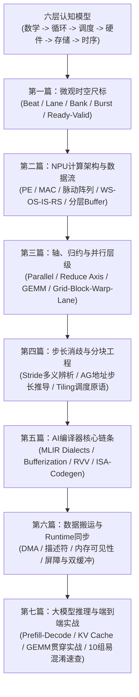

---

## 序言：理解 AI 计算与硬件的六层认知模型

在展开具体名词之前，我们必须先在脑海中建立一套立体的分层视角。从顶层的一行 PyTorch 数学公式，到底层硅片晶体管翻转，计算任务需要穿透以下六个层次：

| 层级 | 核心关注点 | 核心术语 |
| :--- | :--- | :--- |
| **01 数学层** | 要计算什么数学变换？ | Tensor、Shape、Rank、Axis、Dimension、Reduction |
| **02 循环层** | 数学公式如何拆解为嵌套循环？ | Loop Nest、Induction Variable、Step、Iteration Space |
| **03 调度层** | 循环任务如何切块与组织分配？ | Tile、Tiling、Grid、Block、Schedule、Split-K |
| **04 计算硬件层** | 多少物理硬件单元能并发参与运算？ | Core、PE (Processing Element)、MAC、SIMD Lane、Systolic Array |
| **05 存储与访存层** | 数据存放在哪？如何寻址与搬运？ | DDR、SRAM、Bank、Bank Conflict、Layout、Stride、AGU |
| **06 时序与传输层** | 数据和指令在时钟周期中何时成立？ | Cycle、Frequency、Beat、Burst、Pipeline、Stall、Latency |

记住这个漏斗：**数学决定依赖，循环决定遍历，调度决定分块，硬件提供算力，存储提供数据，时序保证成立**。

---

## 第一篇：微观时空尺标——数据传输与并行硬件基石

我们从最容易在芯片文档中撞见的微观物理名词开始：**Beat** 与 **Lane**。它们分别从“时间”和“空间”两个正交维度，定义了硬件搬运与计算的边界。

### 1. Beat（传输拍）：时间维度上的有效数据单元

#### 为什么硬件需要 Beat？
假设 NPU 内部的 DMA 引擎需要从片外 DDR 搬运 $64\text{ B}$ 的权重数据到片上 SRAM。

然而，DMA 与存储控制器之间的数据总线物理位宽只有 $128\text{ bit}$（即 $16\text{ B}$）。这意味着总线在物理引脚上**一次绝对不可能把 $64\text{ B}$ 瞬间全部倒过去**，必须分成多批按节奏通过总线传输。

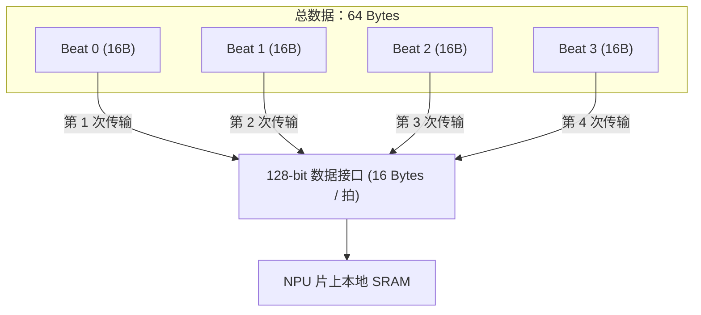

由此得出：

$$\text{Beat 数量} = \frac{64\text{ B}}{16\text{ B}} = 4\text{ Beats}$$

- **Beat 0**：传输第 $0 \sim 15$ 字节
- **Beat 1**：传输第 $16 \sim 31$ 字节
- **Beat 2**：传输第 $32 \sim 47$ 字节
- **Beat 3**：传输第 $48 \sim 63$ 字节

> [!NOTE]
> **定义**：**Beat（传输拍）**是指在数据总线接口上**完成一次有效数据传输的物理数据包**。它的大小绝非固定常量，完全由硬件总线位宽（Bus Width）、接口协议配置决定。

| 单个 Beat 大小 | 传输 64 字节所需 Beat 数 | 常见总线物理位宽 |
| :---: | :---: | :---: |
| $4\text{ B}$ | 16 | 32-bit 总线 |
| $8\text{ B}$ | 8 | 64-bit 总线 |
| $16\text{ B}$ | 4 | 128-bit 总线（边缘 NPU 常见） |
| $32\text{ B}$ | 2 | 256-bit 总线 |
| $64\text{ B}$ | 1 | 512-bit 总线（高性能 NPU/GPU 常见） |

在业界标准的 **ARM AXI 协议**中，一次数据传输被称为一个 Beat；而多个连续的 Beat 组合在一起发起的连贯传输，被称为一次 **Burst（突发传输）**。

#### Beat 与 Cycle 的本质区别
这是硬件初学者最容易混淆的地方：**1 个 Beat 是否就等于 1 个时钟周期（Clock Cycle）？**

**答案是：不一定！**
- **Cycle（时钟周期）**：时钟信号从上升沿到下一个上升沿的物理时间间隔（例如 $1\text{ GHz}$ 下为 $1\text{ ns}$），无论硬件工作与否，Cycle 都在流逝。
- **Beat**：数据接口上真正**成功交付了一次数据**的事件。

只有在最理想的无等待、满吞吐流水状态下，数据接口才能做到每周期吞吐 1 个 Beat（$1\text{ Beat/Cycle}$）。

但在真实电路中，数据传输必须满足 **Ready / Valid 握手协议**：
- **`VALID = 1`**：发送端声明数据已稳定放置在总线上。
- **`READY = 1`**：接收端声明自己有空闲缓冲可接纳数据。
- 只有当 `VALID` 与 `READY` **在同一时钟上升沿同时为高电平时，一个 Beat 的传输才真正宣告达成！**

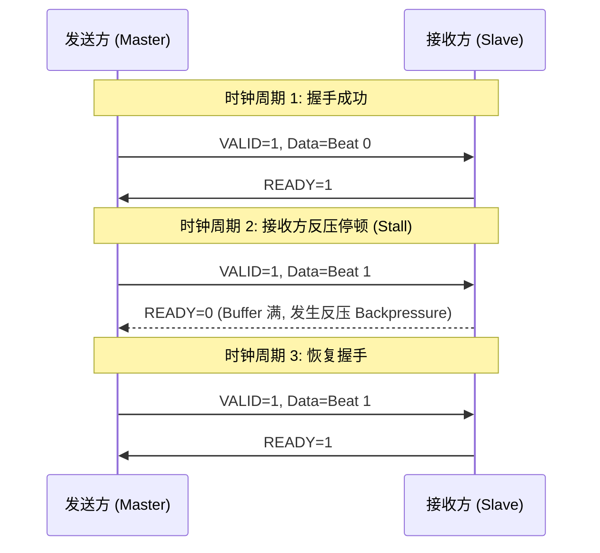

若接收端因本地 Buffer 已满拉低 `READY`（产生**反压 Backpressure**），发送端必须持续保持数据有效，硬件产生停顿（**Stall**）。此时虽然时钟周期还在递增，但没有任何 Beat 发生。

---

### 2. Lane（通道/泳道）：空间维度上的并行路径

如果说 Beat 刻画了数据在时间轴上的流水节拍，那么 **Lane** 则刻画了硬件在空间物理排布上的**并行处理宽度**。

#### 为什么需要 Lane？
假设 NPU 向量单元需要计算 8 组独立的加法：

$$C_i = A_i + B_i,\quad i = 0, 1, \dots, 7$$

若芯片内只有一个标量加法器，串行执行必须耗费 8 个周期。
但如果在空间上并排放置 8 条独立的计算数据通路，每条通路分配一对输入，就能在单周期内同时完成 8 次加法。

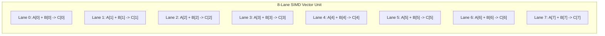

这就是典型的 **SIMD Lane（向量处理通道）**。每条 Lane 负责处理向量寄存器中一个特定位置的数据元素。

#### Lane 的多义性消歧
在阅读不同芯片和编译器文档时，“Lane”一词出现在不同上下文时含义截然不同：

| 术语名称 | 物理/逻辑语境 | 典型示例 |
| :--- | :--- | :--- |
| **SIMD Lane** | 向量计算单元中的并行算术通路 | 向量加法器中的 8 个 FP16 通道 |
| **MAC Lane** | 专用矩阵乘加阵列中的乘累加并行路径 | 脉动阵列每列的独立乘加单元 |
| **Byte Lane** | 数据总线位宽按字节划分的物理引线位置 | 128-bit 总线拥有 16 个 Byte Lane，支持字节掩码写入 |
| **Memory Lane** | 内存控制器或片上存储中的独立并行数据通路 | 宽位宽 SRAM 内部的并行写入通道 |
| **Warp Lane** | GPU / SIMT 体系中 Warp 内线程的逻辑槽位 | NVIDIA Warp 中的 Lane 0 ~ 31（通过 `__shfl_sync` 交换数据） |
| **SerDes Lane** | 芯片间高速串行差分物理接口 | PCIe 5.0 的 x4, x8, x16 物理链路 |

> [!WARNING]
> 在 NPU 硬件规格书中看见 `16 lanes` 时，**切勿直接脑补为一个独立的完整 Core**！必须结合上下文确认它究竟是指 16 个乘加单元、16 字节物理引线，还是 SIMD 向量通路。

---

### 3. Beat 与 Lane 的正交关系：传输 vs 计算

把两者放在一起对比，便能清晰洞察它们的正交设计本质：

- **Beat 回答**：总线接口“一次能传输多少数据？”（传输带宽属性）
- **Lane 回答**：计算单元“能同时并行运算多少数据？”（计算通量属性）

**示例**：
假设总线接口位宽 $128\text{ bit}$（$1\text{ Beat} = 16\text{ B}$），传输数据类型为 FP16（$2\text{ B}$）。
则单次一个 Beat 能运送：

$$\frac{16\text{ B}}{2\text{ B}} = 8\text{ 个 FP16 元素}$$

- 若下游计算单元恰好拥有 **8 条 FP16 SIMD Lane**，则该 Beat 的数据刚好一次性填满所有计算通路；
- 若下游仅有 **4 条 Lane**，则该 Beat 运来的数据需要分两批计算；
- 若下游拥有 **16 条 Lane**，则需要连续接收 2 个 Beat 的数据才能将所有计算通路完全喂饱。

**Beat 宽度与 Lane 数量是两个相互解耦、独立权衡的芯片硬件架构参数。**

---

### 4. Bank 与 Bank Conflict：存储资源的分裂之道

有了计算单元（Lane），计算单元需要源源不断地从片上 SRAM 读取操作数。
如果 8 条 Lane 同时去读 SRAM，而 SRAM 只有一个读取端口，那么 Lane 算力再强，也会长期饥饿停顿。

为了解决多通路并发读取问题，硬件将 SRAM 在物理上切割为多个相互独立寻址的存储子块，称为 **Bank（存储体）**。

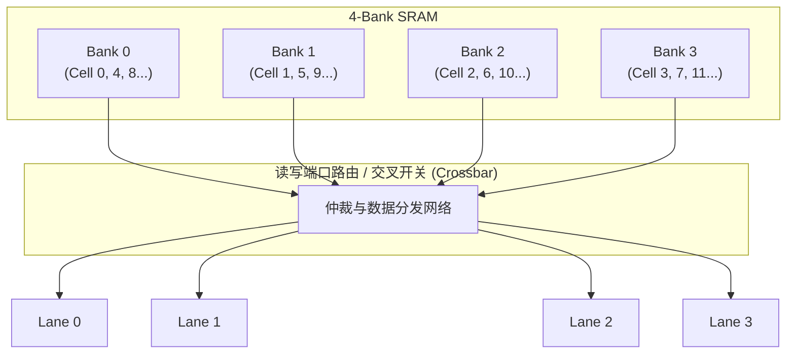

#### Bank 与 Lane 的区别
- **Bank** 是**存储资源**的并发分组，解决“如何同周期读出多个数据”；
- **Lane** 是**计算单元**的并发通路，解决“如何同周期计算多个数据”。

#### 什么是 Bank Conflict（存储体访问冲突）？
若 4 条 Lane 分别访问 Bank 0、1、2、3，交叉开关可以同时建立 4 条无干扰通路，单周期完成；
但如果 4 条 Lane 在同一时刻好巧不巧，**同时请求读取 Bank 0 内部的不同地址**，而单端口 Bank 硬件每个时钟周期只能响应 1 个地址的读请求，此时就会爆发 **Bank Conflict**！

冲突发生后，硬件仲裁器必须将原本 1 周期的读取请求强行**串行化（Serialization）**为 4 个周期分批读取，导致吞吐瞬间暴跌至原来的 $25\%$。这是高性能 NPU 算子编写与编译调度必须极力规避的瓶颈。

---

### 5. 微观串联实战：一个像素的搬运与计算

我们用一个完整的微观案例把 **Beat、Lane、Bank、Burst、Tile** 彻底串起来：

**设定场景**：
- 输入张量格式为经典图像布局 **NHWC**；
- 目标处理相邻两个像素，每个像素有 $C = 32$ 个通道，数据类型为 FP16（$2\text{ B}$）；
- 总线 Beat 大小为 $16\text{ B}$，片上 SRAM 划分为 4 个 Bank，向量单元拥有 8 条 FP16 Lane。

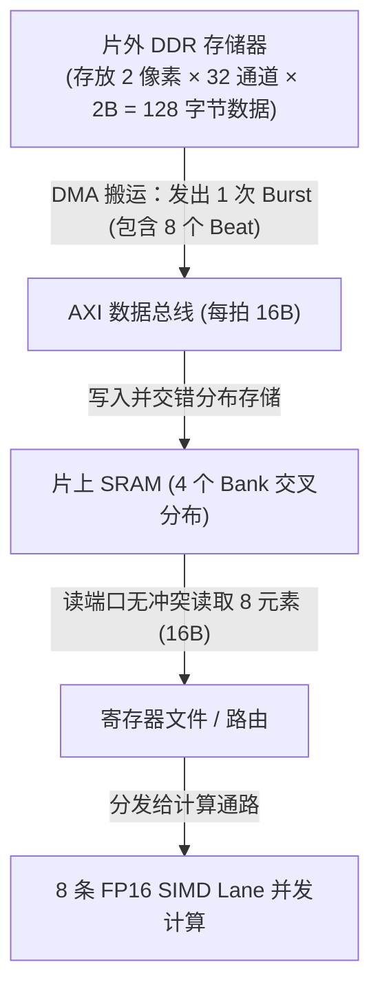

1. **容量推导**：单个像素大小 $= 32 \times 2\text{ B} = 64\text{ B}$。2 个像素总数据量 $= 128\text{ B}$。
2. **传输切分（Beat & Burst）**：$128\text{ B} / 16\text{ B} = 8\text{ Beats}$。DMA 发起一次连续突发传输（Burst），突发长度 $BL = 8$。
3. **存储布局（Bank）**：数据被交错写入片上 SRAM 的 4 个 Bank 中，确保后续计算读取时能并行无冲突输出。
4. **计算发射（Lane）**：一个像素有 32 个通道元素。8 条 SIMD Lane 每次吞吐 8 个元素，因此单像素计算被拆分成 4 批发射：
   - 第 1 批：Lane 0 ~ 7 计算 $C_0 \sim C_7$
   - 第 2 批：Lane 0 ~ 7 计算 $C_8 \sim C_{15}$
   - 第 3 批：Lane 0 ~ 7 计算 $C_{16} \sim C_{23}$
   - 第 4 批：Lane 0 ~ 7 计算 $C_{24} \sim C_{31}$

在这短短的一连串动作中：**Beat 负责总线流转，Burst 负责通信聚合，Bank 负责并发供数，Lane 负责并行吞吐，Tile 则对应这 2 个像素组成的工作切片**。

---

## 第二篇：计算结构与数据流范式——NPU 微架构解密

理解了微观通道后，我们上升到 NPU 核心计算模块的微架构设计：NPU 为什么能在矩阵乘法上大幅超越传统 CPU？

### 1. 乘累加核心：从 PE、MAC 到脉动阵列（Systolic Array）

神经网络的核心本质是大量的线性代数乘累加操作（MAC）：

$$\text{acc} \leftarrow \text{acc} + a \times b$$

#### 基础单元：PE（Processing Element）
PE 是加速器计算阵列的基本细胞。一个标准的 PE 内部通常集成：
- 一个或多个乘法器与加法器（MAC / FMA 单元）；
- 局部输入与权重流水线暂存寄存器；
- 累加器（Accumulator），用于暂存尚未最终收敛的部分和（Partial Sum）。

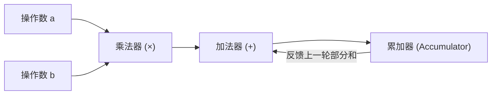

#### 脉动阵列（Systolic Array）：节奏化的二维数据流水
如果每个周期都要从片上 SRAM 读取操作数并写回结果，SRAM 带宽很快就会枯竭。
脉动阵列的设计思想极为巧妙：**让数据像心脏跳动的血液一样，在相邻规则排布的 PE 阵列之间步调一致地流动传递**！

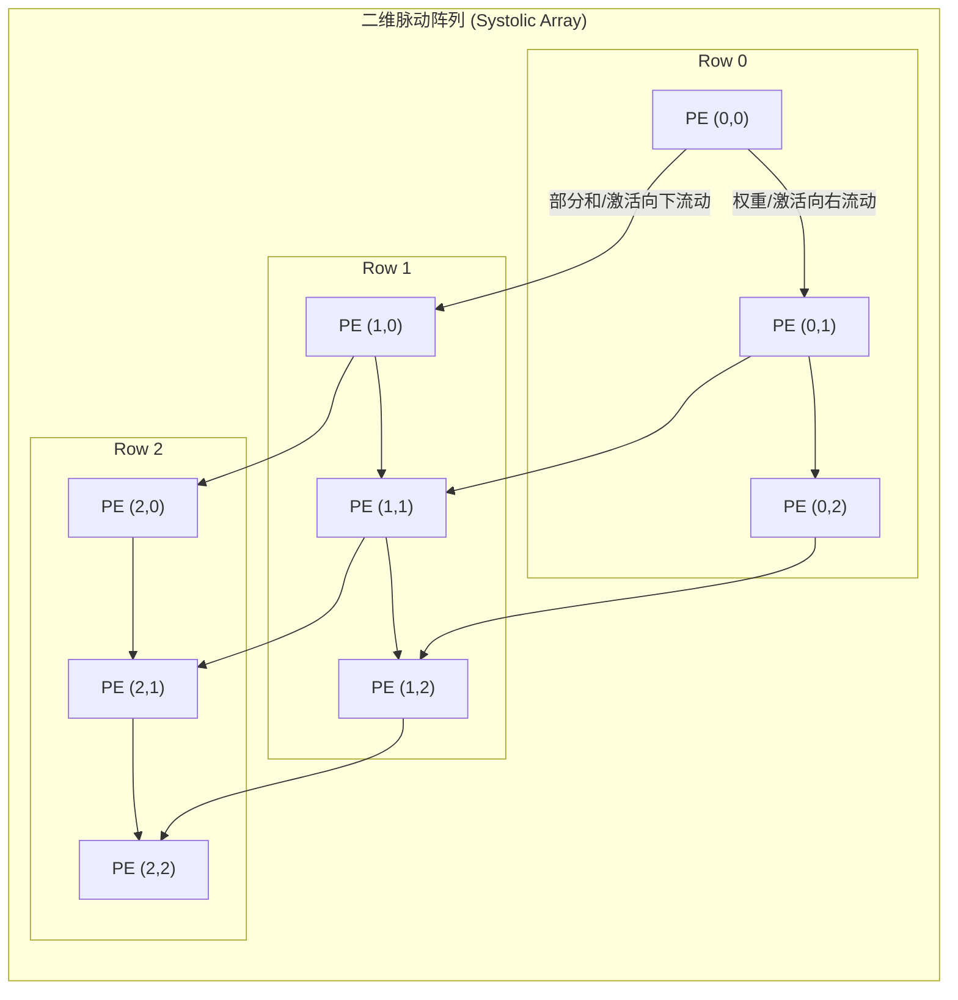

- 输入特征与权重从阵列的左侧和顶部分步泵入；
- 数据在 PE 间直接传递，省去了频繁进出外部存储器的巨额能耗；
- 每个 PE 持续消耗流经的数据并累积部分和，最终将结果汇出阵列。著名的 Google TPU、开源 Gemmini 均深度采用了这一架构。

---

### 2. 异构计算单元的三大家族：Cube、Vector 与 Scalar

在现代成熟的工业级 NPU 架构（如华为昇腾 Ascend 系列）中，核心计算资源通常由功能各异的三大异构单元组成协同体系：

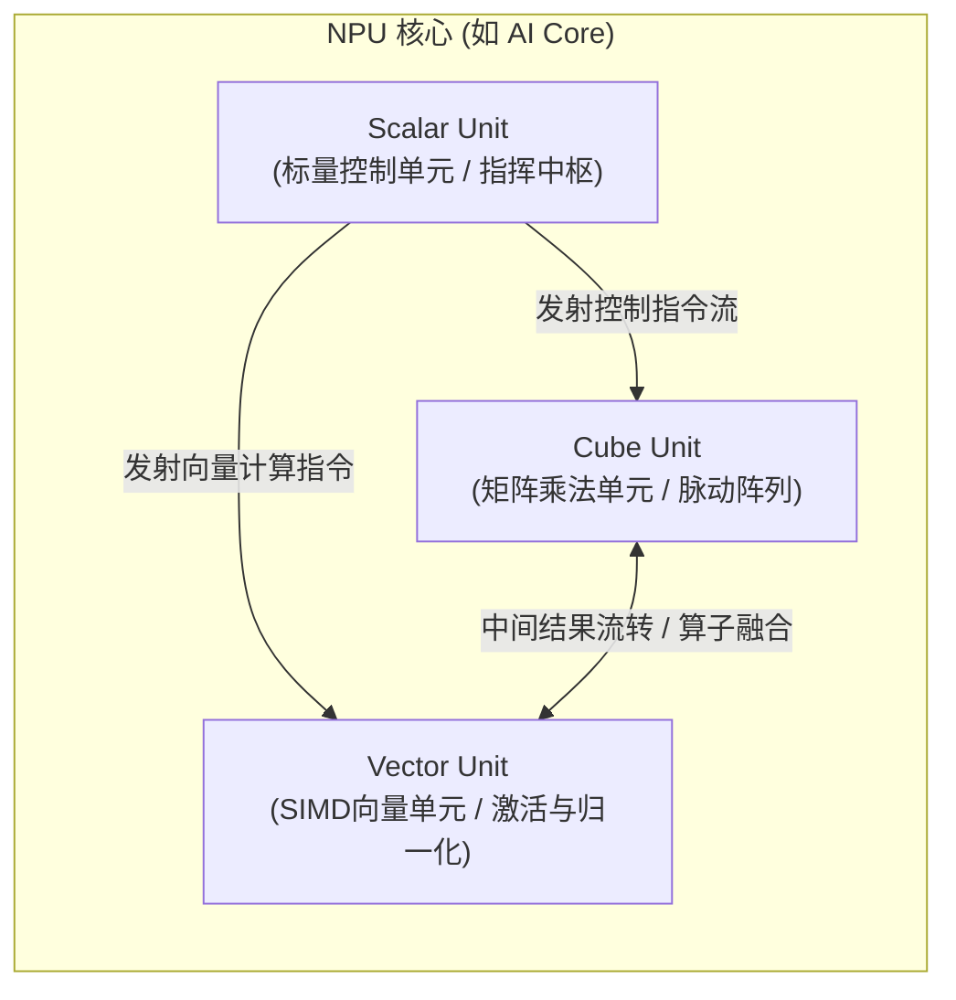

| 计算单元 | 硬件形态与擅长领域 | 算子执行示例 |
| :--- | :--- | :--- |
| **Cube Unit（矩阵单元）** | 稠密二维 MAC 脉动阵列，NPU 绝大部分算力来源（如昇腾一次处理 $16 \times 16 \times 16$ 矩阵乘） | Conv2D、MatMul、GEMM、BatchMatMul |
| **Vector Unit（向量单元）** | 宽位宽 SIMD 计算通道，擅长逐元素高并发处理 | ReLU、LayerNorm、Softmax、Elementwise Add |
| **Scalar Unit（标量单元）** | 精简 RISC 指令执行核，负责循环计数、地址步长计算与指令发射 | 循环边界判断、分支跳转、DMA 寄存器配置 |

---

### 3. 四大经典数据流范式（Dataflow）

数据流决定了“谁留在原地被反复重用，谁在阵列中穿梭流动”。选择不同的数据流，芯片的能耗和访存瓶颈截然不同：

| 数据流范式 | 留在 PE 内部不动的对象 | 在阵列中穿梭流动的对象 | 适用场景与优劣势 |
| :--- | :--- | :--- | :--- |
| **Weight Stationary (WS)** | **权重（Weight）** 被常驻于 PE 本地寄存器 | 输入激活向右流，部分和向下累加流出 | 适合**权重复用率高**的批处理（Large Batch GEMM / 卷积） |
| **Output Stationary (OS)** | **输出部分和（Partial Sum）** 常驻于 PE 累加器中 | 输入激活与权重矩阵从两侧持续泵入 | 适合**大矩阵归约**，极大减少中间结果往返片上 SRAM 的开销 |
| **Input Stationary (IS)** | **输入特征（Activation）** 驻留在 PE 内部 | 不同的权重流经 PE 并完成计算 | 适合小 Batch 或权重流式加载场景 |
| **Row Stationary (RS)** | 在行级别混合固定 | 权重与特征图在二维网格内折叠滑动 | 空间局部性最强（如 Eyeriss 芯片），但硬件路由控制最复杂 |

---

### 4. 片上分层存储缓冲区与 Fractal（分形）排布

为了喂饱高速 Cube 阵列，片上 SRAM 会被进一步细分为专用的物理 Buffer：

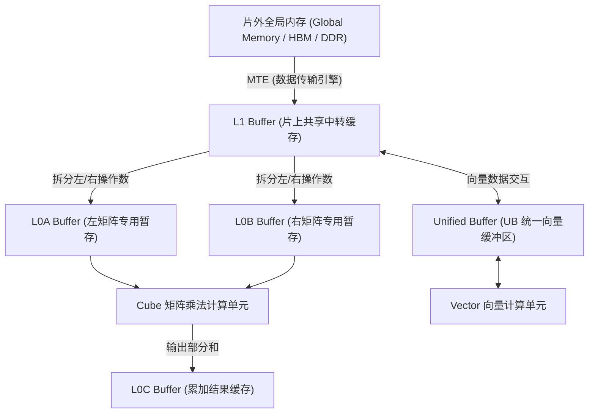

#### 为什么需要 Fractal（分形）格式？
在传统 CPU/GPU 中，张量常用连续格式（如 NCHW 或 NHWC）。但 NPU 的 Cube 硬件每次计算是一个固定的微小矩阵块（例如 $16 \times 16$）。

如果直接以行优先连续内存读取，硬件每次寻址跨度极大。因此 NPU 编译器在将数据送入 L0A/B 时，会先通过 DMA 硬件将连续内存重整为 **Fractal（分形）排布**（如昇腾的 `FRACTAL_NZ`、`FRACTAL_ZZ`）：
- **外部宏观**是一个二维网格；
- **微观内部**每个单元又是一个自洽对齐的 $16 \times 16$ 矩阵小块！
这种硬件友好的排布让 Cube 单元能够以最大突发带宽无停顿灌入数据。

---

## 第三篇：数学空间到调度空间——轴、归约与并行层级

现在我们从底层电路向上跃迁，进入**算法数学公式与循环结构映射**的领域。

### 1. 重新审视张量坐标系：Axis、Shape、Rank

假设有一个简单的二维张量：

$$A = \begin{bmatrix} 1 & 2 & 3 \\ 4 & 5 & 6 \end{bmatrix}$$

- **Rank / NDim（秩 / 维数）**：$= 2$，代表坐标系中有 2 个独立的观察方向（轴 Axis）；
- **Shape（形状）**：`[2, 3]`，代表 Axis 0 长度为 2，Axis 1 长度为 3；
- **Index（坐标索引）**：`A[1, 2] = 6`。

> [!IMPORTANT]
> **“轴（Axis）”是算法逻辑上的坐标方向，绝不代表芯片物理上有根对应的“铁轴”！**
> 在不同领域中，轴具有不同的工程别名：在图像中常用 `N, H, W, C`；在通用矩阵乘法中常用 `M, N, K`；在注意力机制中常用 `B, S, H, D`。

---

### 2. 核心分水岭：并行轴（Parallel Axis）vs 归约轴（Reduction Axis）

这是 AI 编译器做任务切分（Tiling）与多核分发时最核心的依据！

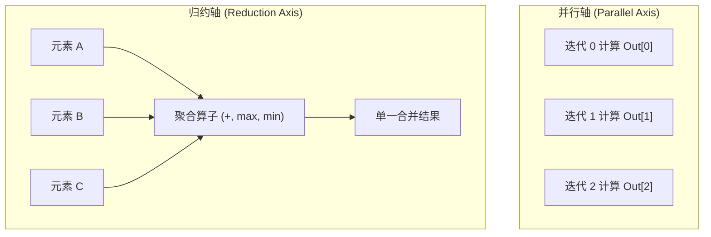

#### 并行轴（Parallel Axis）：用于“拆分”与“独立并发”
沿并行轴推进的各个迭代之间**毫无数据依赖**。
例如对矩阵每行做加法：第 0 行的结果完全不依赖第 1 行的结果。
- **编译器行为**：可以毫无顾忌地将并行轴迭代直接切开，分配给不同的 NPU Core、不同的 Warp 或不同的 Lane 同时计算！

#### 归约轴（Reduction Axis）：用于“聚合”与“信息汇总”
沿归约轴推进的各个迭代，**目标是共同把多个元素通过某种结合运算（Sum, Max, Min, ArgMax）融合成一个值**。
在下面的按行求和代码中：

```cpp
for (int i = 0; i < 2; ++i) {        // Axis 0: 并行轴 (Parallel)
    float sum = 0;
    for (int j = 0; j < 3; ++j) {    // Axis 1: 归约轴 (Reduction)
        sum += A[i][j];
    }
    Y[i] = sum;
}
```
- 外层 `i` 是并行轴：计算 $Y[0]$ 与 $Y[1]$ 互相独立；
- 内层 `j` 是归约轴：多个 $A[i][j]$ 共同累积向同一个标量变量 `sum`。

#### 归约轴就绝对不能并行吗？
**能！这就是著名的树形归约（Tree Reduction）与 Split-K 机制。**

例如对 4 个数连加：$1 + 2 + 3 + 4$。
我们可以让 Core 0 先并发算 $1 + 2 = 3$，Core 1 并发算 $3 + 4 = 7$，最后再通过第二阶段两数相加得 $10$。
- **代价与权衡**：树形归约改变了浮点累加的顺序，由于 IEEE 754 浮点数**不满足严格的结合律**，改变顺序可能导致微小精度舍入差异；同时归约并行需要引入额外的阶段同步与临时中间缓冲区。

---

### 3. 经典 GEMM 矩阵乘法的三轴映射与 MLIR 描述

矩阵乘法 $C_{M \times N} = A_{M \times K} \times B_{K \times N}$ 是 AI 计算的基石：

$$C[m, n] = \sum_{k=0}^{K-1} A[m, k] \times B[k, n]$$

它的标准 C++ 嵌套循环展开如下：

```cpp
for (int m = 0; m < M; ++m) {          // Parallel: 决定输出第几行
    for (int n = 0; n < N; ++n) {      // Parallel: 决定输出第几列
        C[m][n] = 0;
        for (int k = 0; k < K; ++k) {  // Reduction: 沿公共维度乘积累加
            C[m][n] += A[m][k] * B[k][n];
        }
    }
}
```

在现代工业级编译器 **MLIR 的 Linalg 方言**中，这一结构被高度规范地形式化为：

```text
#matmul_trait = {
  // 定义循环空间映射到各个张量的仿射变换
  indexing_maps = [
    affine_map<(m, n, k) -> (m, k)>, // A[m, k]
    affine_map<(m, n, k) -> (k, n)>, // B[k, n]
    affine_map<(m, n, k) -> (m, n)>  // C[m, n]
  ],
  // 显式标注每个循环维度的迭代性质
  iterator_types = ["parallel", "parallel", "reduction"]
}
```

编译器前端只要看到 `iterator_types` 中前两个是 `parallel`，就知道可以对 $M$ 和 $N$ 轴放心地进行多核切分；看到最后一个是 `reduction`，就知道需要为其安排 Accumulator 累加循环或 Split-K 树形归约。

---

### 4. 调度执行层次：Grid、Block、Warp 与 NPU 的物理核绑定

在编写 GPU 代码（CUDA / Triton）时，我们常听见 **Grid -> Block -> Warp -> Thread** 的层级；但在 NPU 上，这一映射有着根本性的物理约束差异。

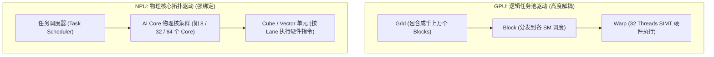

| 维度 | GPU (NVIDIA CUDA) | NPU (如昇腾 Ascend) |
| :--- | :--- | :--- |
| **Grid 的本质** | **无限的逻辑任务池**，与物理硬件解耦。你可以开 $10000$ 个 Block，硬件 SM 会自动排队轮换执行 | **物理核组映射表**。Grid 大小通常**强绑定**物理 AI Core 的总数量（如启动 32 个 Block 对应 32 个物理核） |
| **超额调度处理** | 硬件自带 Warp 调度器自动高并发隐藏停顿 | 若逻辑分块超出物理核数，编译器必须显式生成 **Grid-Stride 循环**（单核内部用 for 循环处理多个数据块） |
| **底层并行粒度** | SIMT 线程分支调度（Lane 对应 Warp 内的线程号） | 严格的 SIMD / 脉动阵列向量化（Lane 对应物理算术通道） |

---

## 第四篇：步长（Stride）消歧与分块（Tiling）工程

在 NPU 与编译开发中，**“步长（Stride）”是出镜率最高、却也是含义歧义最多的一个词**。如果在沟通时没有指明语境，极易引发严重逻辑缺陷。

### 1. 步长（Stride）的四重物理/逻辑消歧

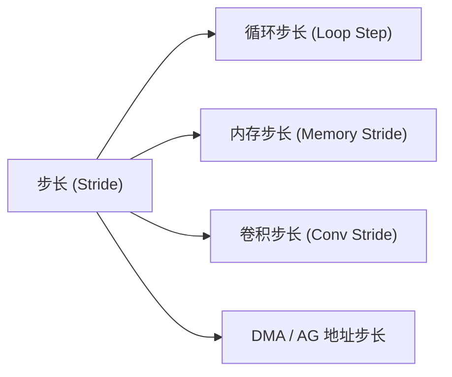

#### ① 循环步长（Loop Step）
```cpp
for (int i = 0; i < 16; i += 4) { ... }
```
这里的 Stride 就是循环变量的增量步长（`Step = 4`），单位是**循环迭代次数**。

#### ② 内存步长（Memory Stride）
张量在内存中的物理排布。假设连续二维张量 $A_{2 \times 3}$，每个元素是 FP16（$2\text{ B}$）：
- 沿列方向移动 1 步，跨过 1 个元素（$2\text{ B}$）；
- 沿行方向移动 1 步，必须跨过整整一行（3 个元素，即 $6\text{ B}$）。
因此它的元素步长是 `[3, 1]`，**字节步长是 `[6, 2]`**。
> **核心公理**：Shape 决定张量有多少数据容量，Stride 决定改变一个逻辑坐标在物理内存中需要跳过多少字节！

#### ③ 卷积步长（Convolution Stride）
卷积滑动窗口在输入特征图上每次移动的**像素距离**（如 $S=2$ 表示每次跳过 2 个像素进行采样，特征图尺寸通常减半）。

#### ④ DMA / AG 地址步长（Address Stride）
硬件地址生成单元（AGU）在完成上一段搬运后，跳到下一个目标位置所增加的**物理地址偏移**。

---

### 2. 经典深度剖析：为什么地址生成公式里会出现 Beat？

在研究 NPU 硬件地址生成单元（AGU）时，经常会遇到类似如下的硬件步长公式：

$$u = sw \times \frac{C}{PC}$$

**公式背后的物理与数学本质推导**：
- **场景假设**：输入数据为 NHWC 格式，连续存储。
- 每个空间位置（像素点）拥有 $C = 32$ 个通道，每个通道元素为 FP16（$2\text{ B}$）；
- 单个像素点占据内存空间 $= 32 \times 2\text{ B} = 64\text{ B}$；
- 存储控制器与 DMA 的基本存取块大小（Block / Beat）为 $16\text{ B}$；
- **$PC$（Packing Channel）**：一个 $16\text{ B}$ 块能容纳的通道数。此处 $16\text{ B} / 2\text{ B} = 8$；
- 则一个空间像素点所需的存储块数为：$\frac{C}{PC} = \frac{32}{8} = 4\text{ 个存储块（或 4 Beats）}$；
- **$sw$（卷积在 W 方向的采样步长）**：若 $sw = 2$，意味着下一次取样必须跳过相邻的 1 个像素！

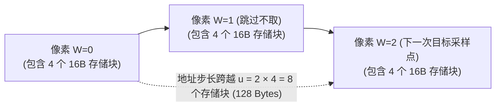

因此，从 $W=0$ 的起点跳到 $W=2$ 的起点，硬件计数器必须增加的步长为：

$$u = 2 \times 4 = 8\text{ 个存储块（即跳过 } 8 \times 16\text{ B} = 128\text{ 字节）}$$

> [!CAUTION]
> 在阅读芯片寄存器手册时，**第一要务是确认寄存器写入数值的“量纲”！** 这个数字究竟代表多少个字节、多少个元素、还是多少个 $16\text{ B}$ 存储块？一旦量纲看错，生成的 DMA 命令就会引发全盘内存错位。

---

### 3. Tiling（分块）技术与六大核心调度原语

芯片片上 SRAM 极其昂贵且容量有限（通常几百 KiB 到几 MiB），根本装不下动辄数百兆的神经网络大矩阵。
**Tiling（分块）的本质，就是把超出芯片胃口的大计算，优雅地切成片上存储放得下的一小块一小块工作。**

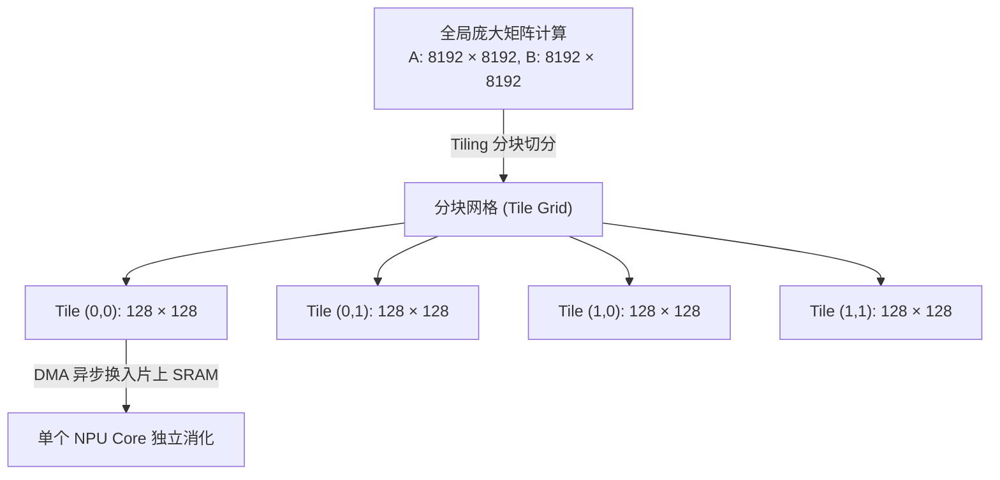

在 AI 编译器（如 TVM、Halide、MLIR）中，改写循环结构的工具被称为**调度原语（Scheduling Primitives）**：

| 调度原语 | 动作本质 | 解决什么问题？ |
| :--- | :--- | :--- |
| **`split`（拆分）** | 将一根循环轴拆成外层（Outer）和内层（Inner）两级循环 | 实现分块的基础，外层走块间步长，内层走块内步长 |
| **`reorder`（重排）** | 调整多层嵌套循环的先后遍历顺序 | 让最内层循环紧贴**连续内存轴**，最大化 Cache / Burst 吞吐 |
| **`fuse`（融合轴）** | 将多根循环轴压平合并成单一循环轴 | 减少循环控制与分支开销，扩大可并行调度的总迭代空间 |
| **`bind`（绑定）** | 将某层逻辑循环直接绑定到物理硬件单元（Core / Thread） | 完成任务在物理芯片上的空间映射 |
| **`compute_at`（计算附着）**| 将生产者的计算流程挪到消费者的循环体内部 | 实现**内存就地复用**，彻底消灭回写片外全局内存的冗余开销 |
| **`unroll`（循环展开）**| 将循环体直接拷贝展开多次 | 消除循环索引递增开销，暴露指令级并行度（ILP） |

#### 昇腾体系中的合轴（Axis Merging）与 TilingData
在昇腾 CANN 等实际工业级编译器中，Tiling 还有着更加极致的工程规约：
1. **合轴（Axis Merging）**：将输入的所有维度标记为 **A（保留轴/并行轴）** 或 **R（归约轴）**，自动消除尺寸为 1 的冗余维，将复杂的任意多维算子压缩为标准三元组 `(A1, R, A0)`；
2. **TilingData**：编译器在编译阶段推演切分参数，生成一个结构体包（包含每次搬运块大小、多核分配数、循环步数），在运行时作为元数据下发给硬件 Kernel；
3. **TilingKey**：面对动态形状（Dynamic Shape），编译器会提前生成多套不同的优化分支（如小矩阵走内存优先、大矩阵走算力优先），运行时根据实际尺寸匹配对应的 TilingKey。

---

## 第五篇：AI 编译器全栈核心链条（MLIR、Bufferization 与代码生成）

当计算图经过了分块与循环重排后，编译器是如何把它一步步翻译成芯片硬件能够识别并执行的纯二进制指令的？

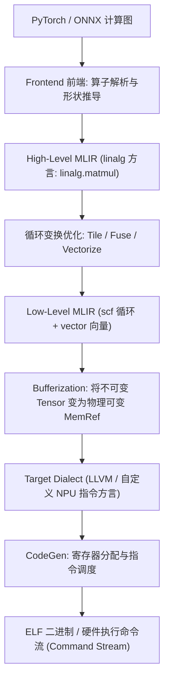

### 1. MLIR 核心架构基石

MLIR（Multi-Level Intermediate Representation）是现代编译器的主流基础设施。它彻底打破了传统单层 IR 的局限，允许不同抽象程度的概念在同一个框架内共存：

- **Operation（Op）**：MLIR 中的基本语义节点（如 `arith.addi`, `linalg.matmul`）；
- **SSA Value**：静态单赋值值，每个值有且仅有一次定义，便于追踪数据流依赖；
- **Block & Region**：Operation 内部可嵌套包含 Region，Region 内包含基本块 Block，完美表达结构化控制流；
- **Dialect（方言）**：一套自洽的命名空间，汇聚了一组相关的 Op、类型和属性。

#### 常用核心 Dialect 分工

| Dialect 名称 | 抽象层级 | 负责解决的核心问题 |
| :--- | :--- | :--- |
| **`linalg`** | 结构化张量计算 | 表达带有清晰并行/归约维度的算子（如 `generic`, `matmul`, `conv`） |
| **`tensor`** | 高层纯值张量 | 处理张量的切片、拼接、插入与重塑（无内存副作用） |
| **`memref`** | 物理内存引用 | 带有步长、偏移、布局的底层物理存储引用（具有内存读写副作用） |
| **`scf`** | 结构化控制流 | 表达 `scf.for`, `scf.if`, `scf.while` 等高层循环与分支 |
| **`vector`** | 目标无关向量操作 | 表达 SIMD 级别的向量加载、打散、归约与乘加 |
| **`llvm`** | 硬件底层映射 | 对应传统 LLVM IR，准备翻译为最终汇编 |

---

### 2. Bufferization：从“数学值”跃迁到“物理内存”

在编译器中，**Bufferization 是最关键、也是最惊险的一跃！**

看看这两种类型的根本区别：
- **`tensor<4x8xf32>`**：**数学上的不可变值对象**。如果做修改，数学上产生的是一个“全新的 Tensor”，没有内存分配的概念；
- **`memref<4x8xf32>`**：**物理世界的一块具体内存指针**。可以就地读写，具有副作用（Side Effect）。

将 Tensor 转换为 MemRef，绝不是查找替换名字那么简单。编译器必须做出极其复杂的规划：
- **In-Place（原地覆写）还是 Out-of-Place？** 能否直接复用输入缓冲存储输出？（One-Shot Bufferize 通过别名分析 Alias Analysis 判断是否有读写冲突 RAW Hazard）；
- **内存规划（Memory Planning）**：什么时候开辟 Buffer？用完什么时候释放（Deallocation）？生命周期是否存在重叠？如何实现多张量共享重用同一片片上物理 SRAM？

---

### 3. 后端代码生成（CodeGen）与硬件寄存器

经过 Bufferization 后，代码进入后端，面临真实的指令集与微架构（ISA & Microarchitecture）：

#### 指令选择与调度（Instruction Selection & Scheduling）
- 依据芯片微架构的流水线时延和执行部件数量，打散并穿插排列指令，避免执行冲突（Hazard）和流水线气泡（Bubble）。

#### 物理寄存器与硬件控制（SREG / CSR / MMIO）
- **CSR（Control and Status Register）**：控制与状态寄存器，用于读取硬件标志位、设置浮点舍入模式等；
- **MMIO（Memory-Mapped I/O）**：通过特殊内存地址直接向外设与计算核写入控制命令；
- **SREG（Special Registers）**：专用状态寄存器。编译器必须根据算子需求，生成对这些控制寄存器的配置字（如设置 DMA 突发长度、使能脉动阵列工作模式）。

#### RISC-V Vector（RVV）在 NPU 向量扩展中的关键角色
许多现代 NPU 选用 RISC-V 搭配专用 Vector 扩展作为其向量计算控制核：
- **`VLEN`**：向量寄存器的固定物理硬件位宽（如 256-bit 或 512-bit）；
- **`SEW`**：当前选中的单元素位宽（如 FP16 下 `SEW=16`）；
- **`LMUL`**：向量寄存器成组倍率（将多个物理寄存器虚拟成一个超长寄存器，增大吞吐）；
- **`VL`**：当前向量指令实际处理的有效元素个数。当数据剩余长度不足以填满硬件时，编译器利用 **Strip-Mining** 动态收敛调整 `VL`，完美规避复杂的边界判定分支！

---

## 第六篇：数据搬运引擎、Runtime 调度与内存可见性

代码生成完毕并打成二进制（ELF / Flat Binary）后，需要依靠 Runtime（运行时）和驱动下发硬件执行。**在此层级，核心挑战转变为：如何确保数据按时就位、执行无竞争？**

### 1. 异步搬运引擎：DMA、AGU 与 MTE

NPU 算力极高，CPU 绝不能亲自下场逐字读写内存，否则系统性能将彻底崩溃。NPU 标配专用搬运硬件：
- **DMA / MTE（Memory Transfer Engine）**：专门负责片外片内批量搬移数据的独立引擎；
- **DMA 描述符（Descriptor）**：CPU 或标量核预先在内存里排布好的一张任务清单（源地址、目的地址、传输长度、步长配置）。DMA 读取描述符后自主运作，释放 CPU 算力；
- **Scatter-Gather 与 2D DMA**：能够直接跨行、跨步长收集非连续数据，在硬件搬运的同时无缝完成张量重整。

---

### 2. 内存可见性（Memory Visibility）与同步原语

硬件小白最容易犯的逻辑错误：**“我已经在代码里把 DMA 发射出去了，紧接着让计算核心读 SRAM，为什么算出的全是一塌糊涂的乱码？”**

> [!CAUTION]
> **在硬件世界中，`Submit`（已提交） $\neq$ `Started`（已开始） $\neq$ `Completed`（已完成） $\neq$ `Visible`（已全局可见）！**

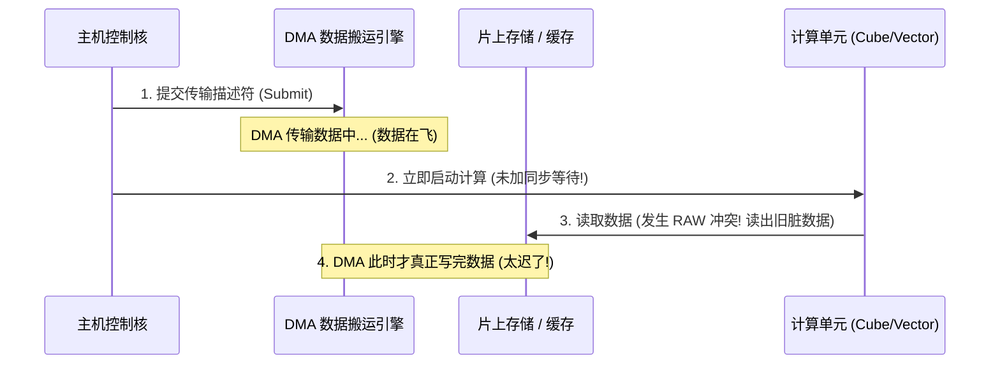

为了保证正确的因果依赖（Happens-Before），Runtime 与硬件必须引入显式同步：

- **Event & Flag（事件标志）**：如昇腾的 `SetFlag` / `WaitFlag`，在指令流中插上同步锁，计算指令必须等待搬运标志位置位方可发射；
- **Barrier（屏障）**：强制屏障之前的所有内存写入彻底收敛落盘，才能跨过屏障执行后续操作；
- **Cache Invalidate & Flush**：
  - **Flush**：强制把缓存里的更新刷写回主存；
  - **Invalidate**：将当前缓存标记失效，强制计算核心下次读取必须重新从主存拉取最新数据，防止读到陈旧数据。

---

### 3. 双缓冲（Double Buffering / Ping-Pong Buffer）隐藏延迟

“计算单元等数据”是加速器最大的罪过。如何让计算永不停顿？**答案是双缓冲！**

在 SRAM 中开辟两块对称的缓冲区：**Buffer A** 与 **Buffer B**。

```mermaid
gantt
    title 双缓冲 (Double Buffering) 流水线重叠机制
    dateFormat X
    axisFormat %s
    section DMA 搬运
    加载 Chunk 0 (A) :0, 10
    加载 Chunk 1 (B) :10, 20
    加载 Chunk 2 (A) :20, 30
    加载 Chunk 3 (B) :30, 40
    section Cube 计算
    等待数据就绪       :0, 10
    计算 Chunk 0 (A) :10, 20
    计算 Chunk 1 (B) :20, 30
    计算 Chunk 2 (A) :30, 40
```

- 当计算单元在全力消耗 **Buffer A** 中的当前数据块时；
- DMA 引擎在后台并发向 **Buffer B** 预取装载下一个数据块；
- 一旦计算完毕，两者角色瞬间互换（Ping-Pong 轮转）！
通过空间上增加一倍 Buffer 的微小代价，**彻底将耗时漫长的 DMA 访存延迟隐藏在持续的计算时间背后**。

---

## 第七篇：大模型（LLM）推理专项与端到端实战贯通

进入大模型时代，NPU 的编译器和硬件设计迎来了全新的挑战。LLM 的计算特征与传统 CNN / ResNet 有着颠覆性的差异。

### 1. Prefill vs Decode：双重性格的推理瓶颈

Transformer 自回归生成包含两个特征截然相反的阶段：

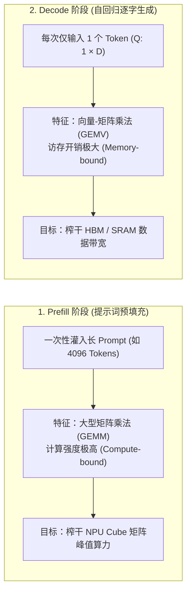

| 维度对比 | Prefill 阶段（预填充） | Decode 阶段（自回归解码） |
| :--- | :--- | :--- |
| **输入形态** | $S$ 个 Token 一并进入（Sequence Length 很大） | 每次仅进来 $1$ 个新 Token（$S = 1$） |
| **核心运算** | 经典的 Compute-bound 大 GEMM 矩阵乘 | 极度 Memory-bound 的 GEMV 向量乘 |
| **访存特征** | 算术强度（FLOP/Byte）很高，易于打满硬件利用率 | 算术强度极低，必须从内存拉出全部历史长上下文权重与 KV Cache |
| **编译器优化重点** | 关注大型 Tile 分块、脉动阵列填充度与算子融合 | 关注内存布局对齐、连续内存搬运、**Paged Attention** 与带宽瓶颈压榨 |

---

### 2. KV Cache 与 Paged Attention：内存碎片的破局之道

在自回归解码中，历史 Token 的 Key 和 Value 向量如果不保存，每步都要重算全部历史。**KV Cache** 就是把历史的 K 和 V 驻留在内存中。

然而，随着对话轮次增加，KV Cache 长度不可预测。传统静态预分配显存会导致严重的**内存碎片**和巨大的显存浪费：
- **Paged Attention（分页注意力机制）**：借鉴操作系统的虚拟内存分页思想，将连续的 KV 缓存逻辑切分成固定大小的 **Block（如每个 Block 装 16 个 Token）**；
- 逻辑上连续的上下文在物理显存中可以分散存储；
- 编译器和算子无需面对连续物理内存假设，极大提升了并发推理的吞吐量与显存利用率。

---

### 3. 端到端实战贯通：一个矩阵乘法（GEMM）在 NPU 上的全旅程

最后，我们用一个精简完备的端到端案例，将本文涉及的全部概念完整串接复盘一遍！

#### 设定硬件架构
- **计算阵列**：$4 \times 4$ PE 脉动阵列，峰值吞吐 $16\text{ MAC/Cycle}$，频率 $1\text{ GHz}$；
- **接口位宽**：$128\text{ bit}$（$1\text{ Beat} = 16\text{ B}$）；
- **数据精度**：输入为 FP16（$2\text{ B}$），累加器为 FP32（$4\text{ B}$）；
- **片上存储**：支持双缓冲的分 Bank SRAM。

#### 目标计算任务
计算小矩阵乘法：$A_{8 \times 16} \times B_{16 \times 8} = C_{8 \times 8}$

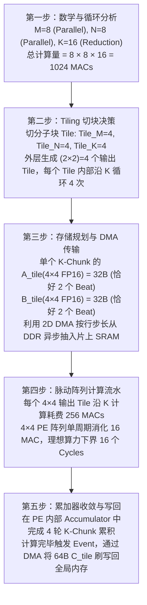

这就是一个算子从高层数学描述，穿越编译器调度、内存切块、总线搬运，最终在硅片物理晶体管上闪烁收敛的完整旅程。

---

## 附录：10 组最易混淆的核心概念极简速查表

在芯片研发或编译器日常讨论中，若感到概念模糊，随时查阅下表：

| 容易混淆的概念对 | 核心本质差异速查 |
| :--- | :--- |
| **Beat vs Cycle** | **有效传输拍**（数据接口真正完成了 1 次传输） vs **物理时钟周期**（时钟沿震荡，停顿时不发 Beat） |
| **Beat vs Burst** | **单次离散数据块**（如 16B） vs **一组连续连贯的 Beat 聚合传输事务** |
| **Lane vs Bank** | **计算并发通路**（多少算术单元在并行计算） vs **存储并发分组**（多少存储子块在并行供数） |
| **Lane vs PE** | **独立计算路径** vs **物理处理单元**（一个复杂 PE 内部可能包含多条 SIMD Lane） |
| **Parallel Axis vs Reduction Axis** | **各迭代互不依赖**，可无缝空间分发 vs **各迭代依赖累加**，共同收敛汇总为一个结果 |
| **Latency vs Throughput** | **单次操作从发射到完成耗费多长时间**（时延） vs **单位时间内系统总共完成了多少次操作**（吞吐） |
| **SRAM vs Cache** | **软件/硬件显式精细管理的存储区** vs **依据访问局部性自动置换的透明缓存** |
| **DMA vs AGU** | **在物理存储间真正扛数据搬运的动力引擎** vs **专门按照步长公式计算下一个访存物理地址的生成单元** |
| **Tile vs Beat** | **算法和编译器逻辑切分的庞大数据矩阵块** vs **总线物理引脚在单拍内所能承载的微观数据单元** |
| **Stride vs Offset** | **相邻两次规则访问之间的固定步进跳跃跨度** vs **相对于某个基准基地址（Base）的绝对偏差量** |

---

## 结语：如何建立属于你的技术护城河？

掌握 NPU 与 AI 编译器绝非一朝一夕之功，背诵名词只是最浅显的第一步。要真正具备独立研发编译器 Pass、优化算子极限性能或设计芯片架构的能力，建议按照以下**三层进阶标准**来衡量自己的掌握程度：

1. **第一层：定义与量纲清晰**
   - 面对任何新名词，能够立即明确它所处的层次（数学、循环、硬件、存储还是时序？）、属于哪个模块、物理单位究竟是什么。
2. **第二层：公式与手推闭环**
   - 给出芯片核心参数（位宽、频率、Bank 数、PE 阵列规格），能亲手在纸上推导算术强度、地址生成步长、传输 Beat 数、Bank 冲突概率以及流水线理论周期下界。
3. **第三层：代码与硬件实证**
   - 能够编写实际的 MLIR Dialect 转换 Pass、手写 Tiling 算子、利用 DMA 异步流水双缓冲隐藏时延，并在模拟器或真实开发板上通过 Profile 工具排查 Stall 气泡与访存瓶颈。

后续在面对不同厂商自定义的生僻缩写（如华为昇腾体系的 `PV/PF`、寒武纪体系的各种特殊寄存器命名）时，只需掏出**“终极八问”**：

> **它属于什么模块？描述什么对象？量纲是什么？对应哪种逻辑计算？对应多少物理硬件资源？每个周期能吞吐什么？与前后指令存在什么依赖？由编译器、驱动还是硬件自动调度？**

建立起这套认知范式后，无论底层芯片架构如何日新月异，你都能穿透繁杂的名词迷雾，一眼洞穿其最底层的运作真容。
