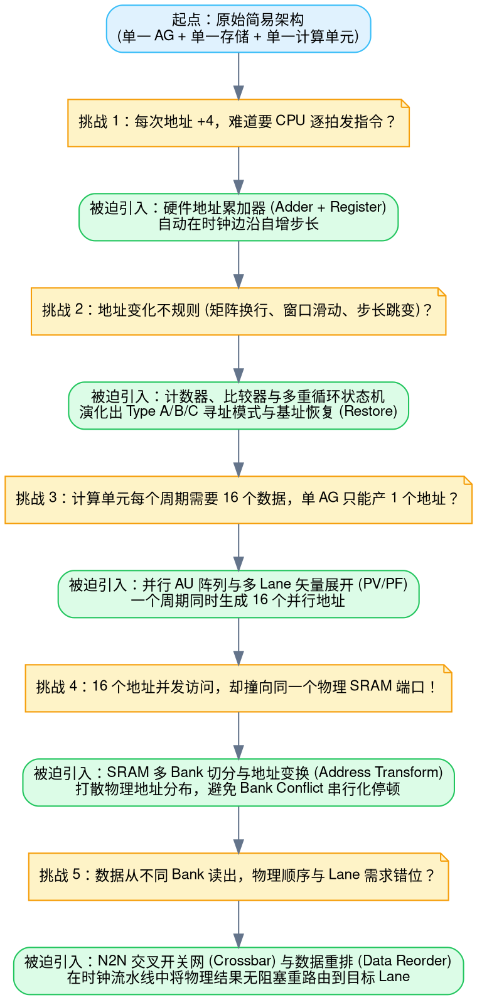
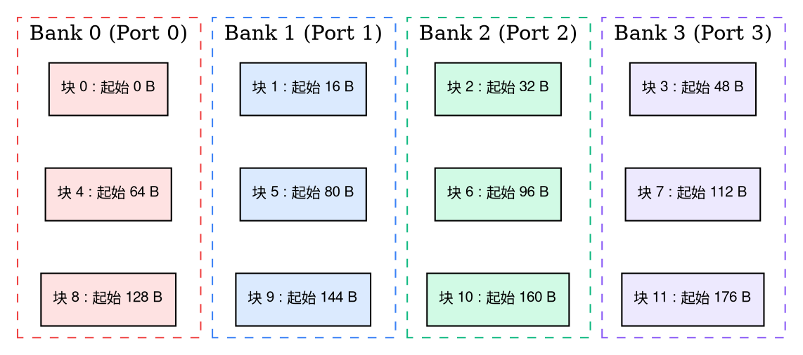
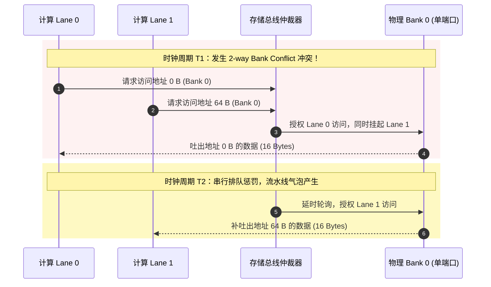
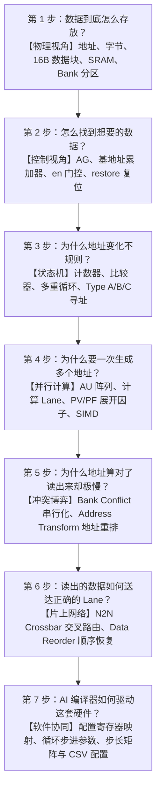
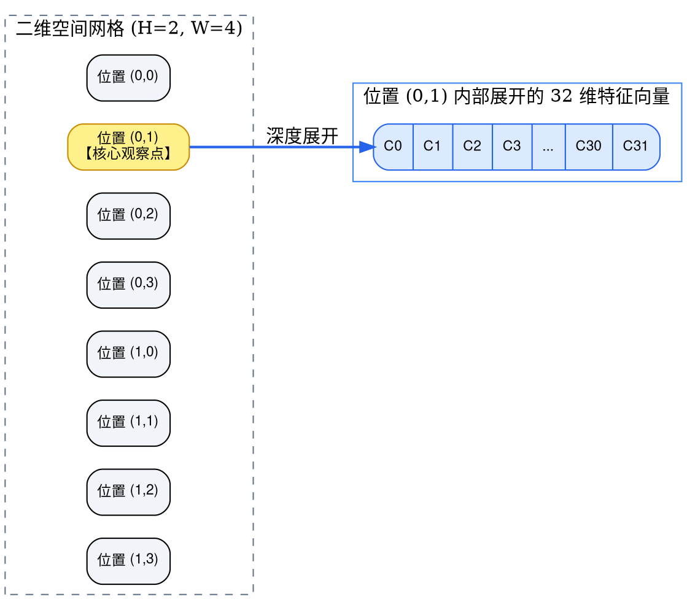
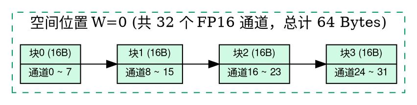
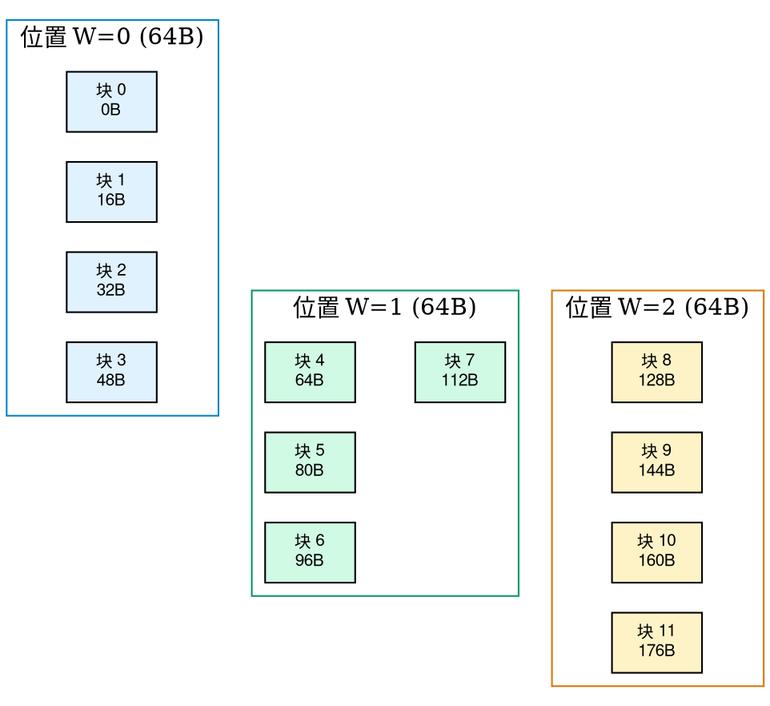
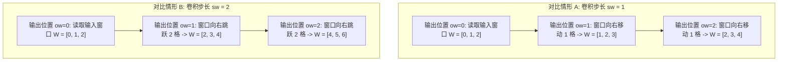
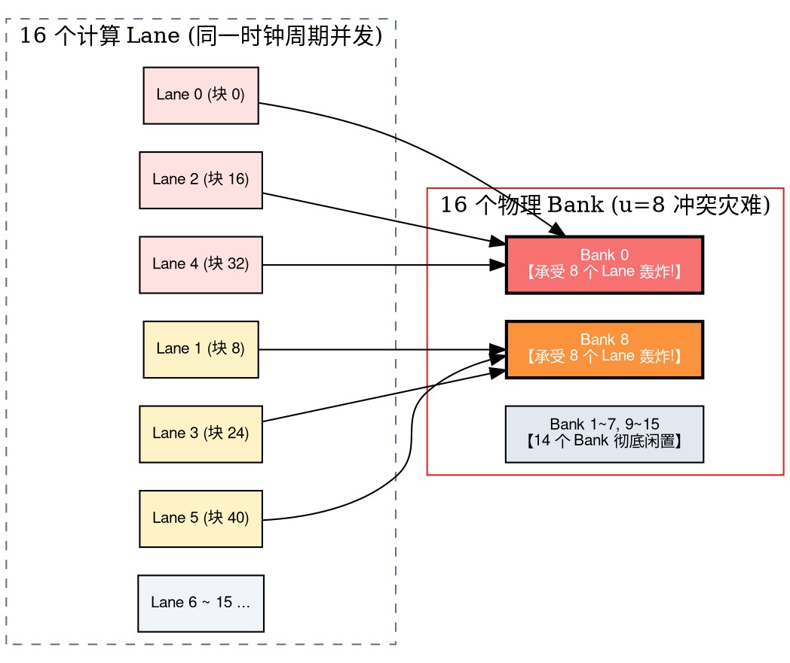

在接触神经网络处理器（NPU）底层算子优化与 AI 编译器下沉时，许多开发者与架构初学者都会经历一段极其痛苦的“术语过载期”：

- 你刚弄懂什么是 **AG（地址生成器）**，芯片文档迎面砸来 `AU`、`inc_cnt`、`inc_full` 和 `restore`；
- 你刚理解简单的线性地址累加，立刻出现了嵌套滑动窗口与余数传递；
- 你刚把窗口循环对齐，硬件又引入了 `PV`、`PF` 以及 16 个并发 AU 的矢量展开；
- 紧接着，`Bank`、`RAM Group`、`Bank Conflict`、`N2N Crossbar`、`Transpose`、`Border Fix` 纷至沓来；
- 最后，文档直接甩出复杂的硬件配置寄存器，里面充斥着 `u`、`ratio`、`osize` 和掩码位编码……

这些概念分属于不同的硬件抽象层级（计算、控制、存储物理结构、片上互连），但当它们被无差别地堆砌在一起、用“公式套公式”的方式讲解时，学习者就会彻底迷失：**到底哪些是最根本的第一性原理？哪些是为了解决后续问题而被迫增加的硬件补丁？**

本文将推倒全部抽象迷雾，从最简的物理职责出发，重构一条清晰坚固的心智地图。

---

## 一、初学者前置核心名词词典

在正式推演前，我们先用最通俗易懂的物理语言，为后续出现的所有关键硬件术语建立统一的心智基准：

> [!NOTE] 核心术语索引
> - **NPU (Neural Processing Unit, 神经网络处理器)**：专用于加速深度学习张量运算的专用硬件芯片（ASIC），核心由海量并行计算单元（如矩阵乘阵列、矢量处理单元）和高速片上存储构成。
> - **SMEM (Shared Memory / Scratchpad Memory, 片上共享存储器)**：NPU 芯片内部的高速 SRAM 静态存储器。它的访问延迟极低（通常只需 1 至几个时钟周期），由软件/编译器显式管理绝对地址，而不是像 CPU Cache 那样依靠硬件透明缓存。
> - **Compute Unit (计算单元 / MAC / ALU)**：芯片中真正负责干乘加法（$A \times B + C$）的物理电路核心。
> - **AG (Address Generator, 地址生成器)**：负责按照某种规律（如步进、循环、回退）持续产生访存物理地址的专用硬件控制器。没有它，CPU 就必须在每个时钟周期下发指令告诉存储器读哪个地址。
> - **AU (Address Unit, 地址计算单元)**：AG 内部的最小硬件算术单元。AG 可以由多个并行的 AU 组成，每个 AU 负责为一个计算通道独立算地址。
> - **Lane (计算通道 / 矢量槽位)**：SIMD（单指令多数据）或矢量处理器中并行运算的最小独立物理通道。例如 16-Lane 架构表示 1 个周期能同时喂入并计算 16 组数据。
> - **Bank (存储体 / 物理分区)**：将一整块大 SRAM 物理切割成的独立子存储模块。每个 Bank 拥有独立的读写硬件端口（Port）。
> - **Bank Conflict (存储体冲突)**：物理硬件铁律是**单端口 Bank 在同一时钟周期只能响应一次访问请求**。当多个 Lane 在同一时刻试图访问同一个 Bank 的不同数据行时，硬件端口发生争用，访问被迫串行化排队，吞吐量断崖式暴跌。
> - **PV (Parallel Vector, 并行矢量度)**：硬件在一个时钟周期内能够并发读取或计算的数据元素数量（例如 $PV=16$）。
> - **HWC 布局**：张量在内存中的扁平排列顺序，即按照 `Height(高) -> Width(宽) -> Channel(通道)` 依次排布，同一个空间像素点的所有通道数据在物理内存中是连续存放的。
> - **PC (Packed Channels, 通道打包数)**：SRAM 的一个最小读写物理数据块（如 $16\text{ 字节}$）所能容纳的通道数值个数。例如对于 16 位浮点数（FP16，每个数值占 2 字节），一个 $16\text{B}$ 数据块可容纳 $16 \div 2 = 8$ 个通道值，即 $PC = 8$。
> - **$sw$ (Stride Width, 宽度卷积步长)**：卷积核沿输入特征图宽度方向移动时，每次滑动跨越的空间像素格子数量。
> - **$u$ (Block Stride, 块跨度步长)**：卷积核沿宽度滑动一个步长时，输入张量起始地址在片上存储中跨越的**物理数据块数量**。
> - **Address Transform (地址重排 / 地址变换)**：在逻辑地址与物理 Bank 映射之间插入的非线性硬件置换逻辑（如异或哈希、仿射置换），用于将容易聚集在同一个 Bank 的规律性访存打散到不同的 Bank。
> - **N2N (Node-to-Node Interconnect / Crossbar, 交叉开关网络)**：连接多个存储 Bank 与多个计算 Lane 之间的片上高速交换网，负责将物理 Bank 读出的打散数据准确无误地分发给对应的计算 Lane。

---

## 二、第一性原理：把所有内容压缩成一件事

在讨论任何复杂的寄存器之前，请记住这句话：

> **NPU 要做计算，就必须把数据从存储器送到计算单元。仅此而已。**

考虑最简单的标量加法：

```c
result = A[0] + A[1];
```

物理计算单元需要拿到 `A[0]` 和 `A[1]` 两个数值。问题来了：**计算单元自己并没有长眼睛，它怎么知道这两个数据在存储器的哪个位置？**

我们设计一个专门的硬件模块，负责告诉存储器要读取哪个地址。这个硬件就是 **AG（地址生成器）**。

假设数据在内存中连续存放：

```text
A[0] 放在地址 0
A[1] 放在地址 4
A[2] 放在地址 8
A[3] 放在地址 12
```

AG 要做的事情极其纯粹：

- 第 1 个周期：告诉存储器访问地址 `0`；
- 第 2 个周期：告诉存储器访问地址 `4`；
- 第 3 个周期：告诉存储器访问地址 `8`；
- 第 4 个周期：告诉存储器访问地址 `12`。


你先不要去想 Type A、Type B，更不要去想余数寄存器。此时你只需要建立第一个牢不可破的概念：

> **AG 是一个按照某种数学规律，在每个周期不断产生物理地址的专用硬件控制器。**

---

## 三、现实的逼迫：硬件架构为何逐步走向复杂？

如果我们从零开始造一颗 NPU，上述简易结构立刻就会在工程现实面前撞墙。所有的复杂硬件结构，都是在解决具体瓶颈时**被迫增加的解决手段**：



看清这张演进树后，你就会恍然大悟：

1. **第一个问题**：每次地址增加 4，难道要 CPU 每次发一条指令？——不需要，给 AG 塞一个加法器和寄存器，自动 `addr += 4`，这就是**硬件地址累加器**；
2. **第二个问题**：如果遇到矩阵转置或二维张量遍历，地址有时保持不变，有时跳跃一个大步长呢？——增加计数器和阈值比较器，当内层循环达到上限时触发外层大跳变，这引出了 **Type A / Type B 寻址模式**；
3. **第三个问题**：现代算力要求一拍完成 16 个乘加，单 AG 吞吐量不够怎么办？——硬件复制 16 份算地址电路，这就是**并行 AU、矢量通道 Lane 与 PV/PF**；
4. **第四个问题**：16 个 AU 算出的地址，如果恰好都指向同一块物理 SRAM 芯片，硬件读口瞬间堵死怎么办？——将大内存切成 16 个独立的 **Bank**，并引入 **Address Transform** 进行地址混淆打散；
5. **第五个问题**：为了避开冲突，物理数据被打散在不同 Bank 中，读出来后顺序全乱了，计算 Lane 怎么用？——引入 **N2N 交叉总线与 Data Reorder 硬件**，在传输中自动恢复张量顺序。

你看，所有你曾经畏惧的高深概念，其实都是工程师在不同时期为了“消除物理堵塞”而不得不打上的精妙补丁，而不是凭空捏造的抽象数学游戏。

---

## 四、极简实例：彻底厘清 AG 与 Bank 的本质区别

很多人在初学 NPU 时，常常把 AG 算错地址与存储体冲突（Bank Conflict）混为一谈。

我们用一个仅包含 4 个 Bank 的微型 SRAM 存储器来做实验。假设每个 Bank 的一个最小数据块（Block/Cell）为 $16\text{ 字节}$。

连续物理地址在物理 Bank 上的交错分布如下表：

| 块序号 | 字节地址范围 | 物理落点 Bank 0 | 物理落点 Bank 1 | 物理落点 Bank 2 | 物理落点 Bank 3 |
| :---: | :---: | :---: | :---: | :---: | :---: |
| **Row 0** | $0 \sim 63\text{ B}$ | **块 0 ($0\text{ B}$)** | **块 1 ($16\text{ B}$)** | **块 2 ($32\text{ B}$)** | **块 3 ($48\text{ B}$)** |
| **Row 1** | $64 \sim 127\text{ B}$ | **块 4 ($64\text{ B}$)** | **块 5 ($80\text{ B}$)** | **块 6 ($96\text{ B}$)** | **块 7 ($112\text{ B}$)** |
| **Row 2** | $128 \sim 191\text{ B}$ | **块 8 ($128\text{ B}$)** | **块 9 ($144\text{ B}$)** | **块 10 ($160\text{ B}$)** | **块 11 ($176\text{ B}$)** |

物理布局结构可视化呈现如下：



现在，假设双通道计算单元需要在一个时钟周期内读取两笔数据。AG 忠实地在同一拍生成了两个读地址：

- 地址 A：$0\text{ B}$；
- 地址 B：$64\text{ B}$。

我们来查表：

- 地址 $0\text{ B}$ 属于块 0，映射在 **Bank 0** 的 Row 0；
- 地址 $64\text{ B}$ 属于块 4，映射在 **Bank 0** 的 Row 1。

灾难发生了：**两个地址完全不同，但它们同时落在了同一个物理 Bank 0 上！**

因为物理单端口 Bank 在同一周期只能读一行，硬件仲裁器只能让其中一个先读，另一个在总线上挂起等待。



> [!IMPORTANT] 认知重塑要点
> **AG 没有算错地址！** 它正确地生成了 $0$ 和 $64$。
> 冲突的根本根源在于：**物理存储体系的组织边界限制了并发性**。
> - **AG** 解决的是“算子在数学逻辑上需要读哪个地址”；
> - **Bank** 是片上静态存储器在硅片上的“物理多路划分”；
> - **Bank Conflict** 是多个独立访存请求在同一周期内抢占同一硬件端口而引发的“交通大堵塞”；
> - **Address Transform** 则是在不改变数据逻辑值的前提下，改变数据在物理 Bank 间的排布规则，让 $0$ 和 $64$ 分布到不同 Bank，从而根除冲突。

---

## 五、建立 NPU 学习的七步心智路线图

为了避免再次陷入知识碎片堆叠的泥潭，建议将所有概念放回下面这条从微观物理到宏观编译的逻辑流水线中：



遵循一个统一的认知闭环：
$$\text{提出具体计算痛点} \longrightarrow \text{数字模拟暴露硬件瓶颈} \longrightarrow \text{被迫增加硬件补丁} \longrightarrow \text{抽象出数学公式与配置寄存器}$$

---

## 六、卷积核心谜题：为何移动一格要跳多个块？为何计算 $u$？

在 NPU 算子开发中，最常让初学者卡壳的正是卷积算子的访存映射。很多人看着文档里的公式：

$$u = sw \times \left(\frac{C}{PC}\right)$$

完全不明白：为什么沿 $W$ 方向滑动一下，要跨过好几个数据块？这里的 $u$ 到底是个什么东西？为什么芯片非要算它？

我们将张量维度、物理存储与硬件并发彻底拆开来看。

### 1. 空间位置与通道维度：从 RGB 到深度特征图

考虑一张高 $H=2$、宽 $W=4$ 的普通彩色图片。对于某一个像素点（例如第 0 行第 1 列 $(h=0, w=1)$），计算机并非只存一个数字，而是存储红（R）、绿（G）、蓝（B）三个颜色强度数值。

这三个数值，称为三个 **通道（Channel）**。此时张量形状为：$H=2,\ W=4,\ C=3$。

用 C++ 多维数组表达：

```cpp
float image[2][4][3];
// image[0][1][0] 代表 (h=0, w=1) 的 R 通道
// image[0][1][1] 代表 (h=0, w=1) 的 G 通道
// image[0][1][2] 代表 (h=0, w=1) 的 B 通道
```

但在深度神经网络中，经过前置卷积层提取特征后，输出通道数通常会急剧膨胀（如 16、32、64、128 或更高）：

```python
# 拥有 32 个卷积核的卷积层，输出特征图通道为 32
nn.Conv2d(in_channels=3, out_channels=32, kernel_size=3)
```

此时的特征图形状变成了：$H=2,\ W=4,\ C=32$。

空间位置 $(h=0, w=1)$ 处不再是小小的 RGB，而是包含整整 32 个高维抽象特征值（$C_0 \sim C_{31}$）。



> [!TIP] 关键概念锚定
> 空间位置由坐标 $(H, W)$ 唯一定位；通道数 $C$ 表示**同一个空间位置上挂载了多少个特征数值**。
> $W=4,\ C=32$ 绝不代表一行有 32 个空间点，而是代表**一行有 4 个空间点，每个点各自拥有 32 个通道**！

---

### 2. 物理内存排布：HWC 布局与通道打包（PC）

现在考虑硬件物理层：数据在 SRAM 中到底是怎么摆放的？

假设输入特征图为 1 行 10 列、每个空间点有 32 个通道，采用工业界最常见的 **HWC 连续布局** 与 **FP16 精度（每个数值 2 字节）**：

```cpp
uint16_t input[1][10][32]; // 1行, 10个W点, 每个点32通道
```

#### ① 计算一个空间点占多少内存？

以位置 $W=0$ 为例，它内部包含 32 个 FP16 通道：

$$\text{单空间点内存大小} = 32 \times 2\text{ Bytes} = 64\text{ Bytes}$$

#### ② 硬件数据块与通道打包数（PC）

假设 NPU 片上存储（SMEM）的最小读写数据块大小为 $16\text{ 字节}$。

一个 $16\text{B}$ 的数据块，能塞下多少个 FP16 通道值？

$$\text{打包通道数 } PC = \frac{16\text{ Bytes}}{2\text{ Bytes/数值}} = 8$$

这就揭示了文档中经常出现的 **$PC$（Packed Channels）** 的物理含义：**每个物理存储块能打包容纳 8 个通道值**。

#### ③ 空间点装箱：为什么需要 $C/PC$ 块？

将位置 $W=0$ 的 32 个通道打包进 $16\text{B}$ 的存储块中：

- **块 0（$16\text{B}$）**：存放通道 $C_0 \sim C_7$；
- **块 1（$16\text{B}$）**：存放通道 $C_8 \sim C_{15}$；
- **块 2（$16\text{B}$）**：存放通道 $C_{16} \sim C_{23}$；
- **块 3（$16\text{B}$）**：存放通道 $C_{24} \sim C_{31}$。

一共需要：

$$\frac{C}{PC} = \frac{32}{8} = 4\text{ 个物理块}$$

总容量为：$4 \text{ 块} \times 16\text{ B/块} = 64\text{ 字节}$。



> **公式 $C/PC$ 的物理本质**：它不是在算有多少空间像素，也不是在算卷积核尺寸，它只是在回答：**装下一个空间位置的所有通道，物理上必须切成几个 $16\text{B}$ 的小方块？**

---

### 3. 相邻空间位置在物理地址上的跨越

在 HWC 连续内存排列下，先放满 $W=0$ 的所有通道块，紧接着存放 $W=1$ 的所有通道块，再存放 $W=2$……

整行数据的物理内存连续排布如下：



现在，假设硬件要依次读取每个空间点的第一组通道（通道 $0 \sim 7$）：

- 读取 $W=0$ 的首组通道 $\longrightarrow$ 访问 **块 0（地址 $0\text{B}$）**；
- 读取 $W=1$ 的首组通道 $\longrightarrow$ 访问 **块 4（地址 $64\text{B}$）**；
- 读取 $W=2$ 的首组通道 $\longrightarrow$ 访问 **块 8（地址 $128\text{B}$）**。

从 $W=0$ 移动到 $W=1$，起始块序号为什么直接从 0 变成了 4？

**因为块 1、块 2、块 3 里面存的是 $W=0$ 的其余 24 个通道！** 硬件必须跨越这 3 个块，才能抵达属于 $W=1$ 的第一组通道数据。

这就是为什么**在空间维度上沿 $W$ 仅仅移动 1 格，在存储块维度上就必须跳过 4 个块（即 $C/PC$ 块）**。

---

### 4. 卷积步长 $sw$：窗口的物理跳跃

卷积计算并不是每次都只挪动 1 格。参数 **$sw$（Stride Width，宽度步长）** 决定了输出特征图在下一个位置计算时，输入采样窗口要向前跨过几个空间位置。



关键区分三个量：
- **$ow$**：输出特征图的第几个宽度点；
- **$sw$**：每计算下一个 $ow$，输入窗口的起点要向右跨越多少个输入空间点；
- **$W$**：输入特征图的实际空间物理坐标。

当 $sw=2$ 时，输出位置从 $ow=0$ 变到 $ow=1$，输入端起点直接从 $W=0$ 跃迁到 $W=2$。

---

### 5. 核心公式的物理诞生：为何 $u = sw \times (C/PC)$？

将前面推导出的两个物理事实结合：

1. **事实一**：每移动 1 个空间位置（$W$），内存中必须跨越 $C/PC = 4$ 个物理数据块；
2. **事实二**：每计算下一个输出位置（$ow$），输入空间起点需要移动 $sw$ 个空间位置。

假设卷积步长 $sw = 2$：

- $ow=0$ 对应的输入窗口起点为 $W=0$ $\longrightarrow$ 对应内存中的 **块 0**；
- $ow=1$ 对应的输入窗口起点为 $W=2$ $\longrightarrow$ 对应内存中的 **块 8**。

相邻两个输出窗口起点在内存中所跨越的物理块数量差为：

$$\Delta \text{Block} = 8 - 0 = 8\text{ 块}$$

这就是 **$u$** 的由来！

$$\boxed{u = sw \times \left(\frac{C}{PC}\right)}$$

代入数值：

$$u = 2 \times \left(\frac{32}{8}\right) = 2 \times 4 = 8\text{ 块}$$

换算为绝对物理字节跨度：

$$\text{字节步进} = u \times 16\text{ Bytes} = 8 \times 16 = 128\text{ Bytes}$$

> **$u$ 的物理意义通俗概括**：
> $$\text{需要跨越的空间点数 } (sw) \times \text{每个空间点占用的数据块数 } \left(\frac{C}{PC}\right) = \text{存储器中真实跨越的块步长 } (u)$$

不同卷积步长与通道配置下的对照关系如下：

| 卷积步长 $sw$ | 通道数 $C$ | 打包数 $PC$ | 单空间点块数 $C/PC$ | 块跨度 $u$ (Blocks) | 字节跨度 (Bytes) |
| :---: | :---: | :---: | :---: | :---: | :---: |
| **$sw = 1$** | 32 | 8 | 4 | **4 块** | $64\text{ B}$ |
| **$sw = 2$** | 32 | 8 | 4 | **8 块** | $128\text{ B}$ |
| **$sw = 3$** | 32 | 8 | 4 | **12 块** | $192\text{ B}$ |
| **$sw = 1$** | 64 | 8 | 8 | **8 块** | $128\text{ B}$ |
| **$sw = 2$** | 64 | 8 | 8 | **16 块** | $256\text{ B}$ |

---

## 七、为什么非要算 $u$？多 Lane 并发与物理 Bank 冲突大撞车

普通 C++ 程序运行在 CPU 上时，程序员只需写 `input[h][w * sw][c]`，底层由硬件 Cache 和 MMU 负责搬运，根本不需要知道 $u$ 是多少。

但 NPU 是极致追求吞吐量的矢量流水线。假设硬件配置了 **$PV=16$ 个计算 Lane**，为了让 16 个乘加单元一拍全跑满，硬件需要在同一个时钟周期内，同时读出 16 个不同输出位置（$ow_0 \sim ow_{15}$）所需的输入起始块数据！

- Lane 0 负责 $ow=0$ $\longrightarrow$ 读取 **块 0**；
- Lane 1 负责 $ow=1$ $\longrightarrow$ 读取 **块 $1 \times u$**；
- Lane 2 负责 $ow=2$ $\longrightarrow$ 读取 **块 $2 \times u$**；
- ……
- Lane $k$ 负责 $ow=k$ $\longrightarrow$ 读取 **块 $k \times u$**。

现在我们拥有一个经典的 **16-Bank SRAM**（块序号模 16 映射到 Bank 0 ~ Bank 15）。

#### 场景 A：当 $sw=1$ 时，$u=4$

16 个 Lane 并发请求的块编号与 Bank 映射如下：

- Lane 0 $\longrightarrow$ 块 0 $\longrightarrow$ **Bank 0**
- Lane 1 $\longrightarrow$ 块 4 $\longrightarrow$ **Bank 4**
- Lane 2 $\longrightarrow$ 块 8 $\longrightarrow$ **Bank 8**
- Lane 3 $\longrightarrow$ 块 12 $\longrightarrow$ **Bank 12**
- Lane 4 $\longrightarrow$ 块 16 $\longrightarrow$ **Bank 0（与 Lane 0 剧烈冲突！）**
- Lane 5 $\longrightarrow$ 块 20 $\longrightarrow$ **Bank 4（与 Lane 1 剧烈冲突！）**
- Lane 6 $\longrightarrow$ 块 24 $\longrightarrow$ **Bank 8（与 Lane 2 剧烈冲突！）**
- Lane 7 $\longrightarrow$ 块 28 $\longrightarrow$ **Bank 12（与 Lane 3 剧烈冲突！）**
- ……

整整 16 个 Lane 的请求，全部死死挤在 **Bank 0、4、8、12** 这 4 个 Bank 上！其余 12 个 Bank 全程空闲吃灰。

原本希望 1 个时钟周期完成的访存，被迫在硬件上串行排队 4 拍，**有效内存带宽直接蒸发 75%**！

#### 场景 B：当 $sw=2$ 时，$u=8$

- Lane 0 $\longrightarrow$ 块 0 $\longrightarrow$ **Bank 0**
- Lane 1 $\longrightarrow$ 块 8 $\longrightarrow$ **Bank 8**
- Lane 2 $\longrightarrow$ 块 16 $\longrightarrow$ **Bank 0（与 Lane 0 冲突！）**
- Lane 3 $\longrightarrow$ 块 24 $\longrightarrow$ **Bank 8（与 Lane 1 冲突！）**
- Lane 4 $\longrightarrow$ 块 32 $\longrightarrow$ **Bank 0（三叠冲突！）**
- ……

全部 16 个 Lane 仅仅抢占 **Bank 0 和 Bank 8** 两个端口！8-way 冲突降临，**硬件性能暴跌为原先的 1/8**！



现在你终于明白为什么芯片架构师和 AI 编译器必须精准计算 $u$ 了：

> **$u$ 决定了多通道并行访存的步进周期。只要已知 $u$ 与物理 Bank 总数 $M$，编译器立刻就能通过最大公约数 $\gcd(u, M)$ 量化出 Bank 冲突的严重程度，并据此在硬件寄存器中激活精准的“地址重排变换（Address Transform）”算法，重塑物理写入拓扑，彻底消灭冲突！**

---

## 八、全真知识检验与推导自测

### 试着自己推导回答以下三个问题：

#### 问题 1：通道扩展下的数据块计算
> **问题**：假设输入特征图通道数 $C = 64$，每个数值采用 FP16 存储（占 $2\text{ Bytes}$），片上存储的数据块尺寸依然是 $16\text{ Bytes}$（即 $PC = 8$）。那么一个空间位置 $W$ 需要占用多少个物理数据块？
>
> **解答**：
> 单个空间位置所包含的总字节数：
> $$\text{Size} = 64 \times 2\text{ Bytes} = 128\text{ Bytes}$$
> 占用的物理数据块数量：
> $$\text{Blocks} = \frac{C}{PC} = \frac{64}{8} = 8\text{ 个数据块}$$

#### 问题 2：非齐步长下的块跨度计算
> **问题**：在上述 $C=64, PC=8$ 的条件下，如果卷积层配置为步长 $sw = 2$。计算相邻输出窗口起点在内存中相隔的物理数据块跨度 $u$ 为多少？对应多少物理字节？
>
> **解答**：
> 根据物理跨度公式：
> $$u = sw \times \left(\frac{C}{PC}\right) = 2 \times 8 = 16\text{ 个数据块}$$
> 对应的物理字节跨度：
> $$\text{Byte Stride} = 16\text{ 块} \times 16\text{ Bytes/块} = 256\text{ 字节}$$

#### 问题 3：物理 Bank 冲突诊断
> **问题**：硬件包含 16 个 SRAM Bank，连续 4 个计算 Lane 的块访问索引分别是 $0$、$8$、$16$、$24$。它们分别落入哪些 Bank？是否存在冲突？
>
> **解答**：
> 计算每个块物理落入的 Bank 编号（$\text{Bank} = \text{Block Index} \pmod{16}$）：
> - Lane 0（块 0）：$0 \pmod{16} = \mathbf{Bank\ 0}$；
> - Lane 1（块 8）：$8 \pmod{16} = \mathbf{Bank\ 8}$；
> - Lane 2（块 16）：$16 \pmod{16} = \mathbf{Bank\ 0}$；
> - Lane 3（块 24）：$24 \pmod{16} = \mathbf{Bank\ 8}$。
>
> **结论**：
> 存在严重的 **2-way Bank Conflict**！Lane 0 和 Lane 2 发生冲突争用 Bank 0；Lane 1 和 Lane 3 发生冲突争用 Bank 8。硬件必须分两个拍子串行完成读取。

---

## 九、总结与编译器工程心法

回顾整个推导体系，我们可以用一张简明透彻的思维映射矩阵收束全文：

| 核心符号 | 物理本质 | 解决什么问题 / 现实意义 | 常见工程陷阱 |
| :---: | :---: | :---: | :---: |
| **$W$** | 一维空间几何坐标 | 定位特征图的列索引 | 误以为 $W$ 越小内存越小（忽略了深度 $C$） |
| **$C$** | 空间点携带的特征深度 | 表达当前像素点的高维语义特征向量 | 误以为通道是不同空间位置（混淆了 $W$ 与 $C$） |
| **$PC$** | 存储块通道打包上限 | 一个物理块（如 16B）能吞吐多少个数值 | 忽略了数据精度变化（FP16 为 8，FP32 为 4，INT8 为 16） |
| **$C/PC$** | 空间点物理装箱比 | 一个空间点在内存中被物理切分为几个数据块 | 误以为跨一个空间点地址只加 1 |
| **$sw$** | 卷积窗口滑移步长 | 确定每次输出计算在输入特征图上的几何采样跨度 | 误把 $sw$ 当成内存字节偏移 |
| **$u$** | 窗口物理块跨度 | 连接算法步长 $sw$ 与存储布局 $C/PC$ 的核心物理桥梁 | 未计算 $u$ 便设计寻址，导致灾难性 Bank Conflict |
| **AG** | 地址生成器电路 | 解放 CPU，硬件自主高速生成访存地址 | 以为 AG 会处理物理 Bank 冲突（实际只管逻辑地址） |
| **Transform** | 地址变换重排逻辑 | 打散容易引发 $\gcd(u, M) > 1$ 冲突的规律性寻址 | 读端重排了但写端没有对应重排，导致数据读取错乱 |

在 NPU 与 AI 编译器系统开发中，千万不要将自己孤立在纯粹的数学推导或纯粹的寄存器比特位中。

真正的高性能算子优化，永远是**算法张量几何（$sw, W, C$）**、**片上存储物理约束（$16\text{B}, PC, Bank$）** 与 **矢量计算并发（$PV, Lane, AU$）** 之间达成的精妙平衡。彻底建立起这套立体的软硬协同心智体系，无论面对多么复杂的芯片架构与配置文档，你都能一眼洞穿底层脉络，游刃有余。
