在接触神经网络处理器（NPU）与通用 AI 加速芯片底层算子优化时，许多开发者与架构初学者都会经历一段极其痛苦的“术语过载期”：

- 你刚弄懂什么是 **AG（地址生成器）**，芯片文档迎面砸来 `AU`、`inc_cnt`、`inc_full` 和 `restore`；
- 你刚理解简单的线性地址累加，立刻出现了嵌套滑动窗口与余数传递；
- 你刚把窗口循环对齐，硬件又引入了 `PV`、`PF` 以及 16 个并发 AU 的矢量展开；
- 紧接着，`Bank`、`RAM Group`、`Bank Conflict`、`N2N Crossbar`、`Transpose`、`Border Fix` 纷至沓来；
- 最后，文档直接甩出复杂的硬件配置寄存器，里面充斥着 `u`、`2^d * n`、`gcd`、`ratio`、`osize` 和掩码位编码……

这些概念分属于不同的硬件抽象层级（计算、控制、存储物理结构、片上互连），但当它们被无差别地堆砌在一起、用“公式套公式”的方式讲解时，学习者就会彻底迷失：**到底哪些是最根本的第一性原理？哪些是为了解决后续问题而被迫增加的硬件补丁？为什么固定步长访问会产生严重冲突？为什么步长中的 2 的因数会主宰硬件性能？**

本文将推倒全部抽象迷雾，从最简的物理职责出发，为你重构一条清晰坚固、直击硅片底层的软硬件协同心智地图。

---

## 一、初学者前置核心名词词典

在正式推演前，我们先用最通俗易懂的物理语言，为全文涉及的所有关键硬件术语建立统一的心智基准：

> [!NOTE] 核心术语索引
> - **NPU (Neural Processing Unit, 神经网络处理器)**：专用于加速深度学习张量运算的专用硬件芯片（ASIC/加速器），核心由海量并行计算单元（如矩阵乘阵列、矢量处理单元）和高速片上存储构成。
> - **SMEM (Shared Memory / Scratchpad Memory, 片上共享存储器)**：加速芯片内部的高速 SRAM 静态存储器。它的访问延迟极低（通常只需 1 至几个时钟周期），由软件/编译器显式管理绝对地址，而不是像传统 CPU Cache 那样依靠硬件透明缓存。
> - **Compute Unit (计算单元 / MAC / ALU)**：芯片中真正负责干乘加法（$A \times B + C$）的物理电路核心。
> - **AG (Address Generator, 地址生成器)**：负责按照某种规律（如步进、循环、回退）持续产生访存物理地址的专用硬件控制器。没有它，CPU 就必须在每个时钟周期下发指令告诉存储器读哪个地址。
> - **AU (Address Unit, 地址计算单元)**：AG 内部的最小硬件算术逻辑单元。AG 可以由多个并行的 AU 组成，每个 AU 负责为一个计算通道独立算地址。
> - **Lane (计算通道 / 矢量槽位)**：SIMD（单指令多数据）或矢量处理器中并行运算的最小独立物理通道。例如 16-Lane 架构表示 1 个周期能同时喂入并计算 16 组数据。
> - **Bank (存储体 / 物理分区)**：将一整块大 SRAM 物理切割成的独立子存储模块。每个 Bank 拥有独立的读写硬件端口（Port）。
> - **Bank 宽度 ($W_b$)**：单个 Bank 每次读写操作所能吐出的数据位宽（例如 $W_b = 16\text{ 字节} = 128\text{ bit}$）。
> - **Bank 深度 ($D_b$)**：单个 Bank 内部包含的物理行数（Row 数，例如 $D_b = 1024\text{ 行}$）。
> - **RAM Group (存储体组)**：由若干个 Bank 组成的完整片上存储阵列。例如 16 个 Bank 构成一个 RAM Group。
> - **Bank Conflict (存储体冲突)**：物理硬件铁律是**单端口 Bank 在同一时钟周期只能选通一行物理字线**。当多个 Lane 在同一时刻试图访问同一个 Bank 的**不同数据行**时，硬件端口发生争用，访问被迫串行化排队，吞吐量断崖式暴跌。
> - **同址广播 (Broadcast)**：当多个 Lane 在同一时钟周期访问同一个 Bank 的**同一行（同一数据）**时，硬件总线可以一次读出并分发给所有请求者，**不发生冲突**。
> - **PV (Parallel Vector, 并行矢量度)**：硬件在一个时钟周期内能够并发读取或计算的数据元素数量（例如 $PV=16$）。
> - **HWC 布局**：张量在物理内存中的扁平排列顺序，即按照 `Height(高) -> Width(宽) -> Channel(通道)` 依次排布，同一个空间像素点的所有通道数据在内存中连续存放。
> - **PC (Packed Channels, 通道打包数)**：SRAM 的一个最小读写物理数据块（如 $16\text{ 字节}$）所能容纳的通道数值个数。例如对于 16 位浮点数（FP16，每个数值占 2 字节），一个 $16\text{B}$ 数据块可容纳 $16 \div 2 = 8$ 个通道值，即 $PC = 8$。
> - **$sw$ (Stride Width, 宽度卷积步长)**：卷积核沿输入特征图宽度方向移动时，每次滑动跨越的空间像素格子数量。
> - **$u$ (Block Stride, 块跨度步长)**：卷积核沿宽度滑动一个步长时，输入张量起始地址在片上存储中跨越的**物理数据块数量**。
> - **$2^d \times n$ (步长因数分解)**：将步长 $u$ 分解为偶数因子 $2^d$ 与奇数部分 $n$。在 2 的幂次 Bank 架构中，$d$ 直接主宰了 Bank 冲突的烈度。
> - **Address Transform (地址重排 / 地址变换)**：在逻辑地址与物理 Bank 映射之间插入的非线性硬件置换逻辑（如异或哈希、仿射置换），用于将容易聚集在同一个 Bank 的规律性访存打散到不同的 Bank。
> - **N2N (Node-to-Node Interconnect / Crossbar, 交叉开关网络)**：连接多个存储 Bank 与多个计算 Lane 之间的片上高速交换网，负责将物理 Bank 读出的打散数据准确无误地分发给对应的计算 Lane。

---

## 二、第一性原理：把所有内容压缩成一件事

在讨论任何复杂的寄存器之前，请记住这句话：

> **NPU 要做计算，就必须把数据从存储器送到计算单元。仅此而已。**

考虑最简单的标量加法：

```c
result = A[0] + A[1];
```

物理计算单元需要拿到 `A[0]` 和 `A[1]` 两个数值。问题来了：**计算单元自己并没有长眼睛，它怎么知道这两个数据在存储器的哪个位置？**

我们设计一个专门的硬件模块，负责告诉存储器要读取哪个地址。这个硬件就是 **AG（地址生成器）**。

假设数据在内存中连续存放：

```text
A[0] 放在地址 0
A[1] 放在地址 4
A[2] 放在地址 8
A[3] 放在地址 12
```

AG 要做的事情极其纯粹：

- 第 1 个周期：告诉存储器访问地址 `0`；
- 第 2 个周期：告诉存储器访问地址 `4`；
- 第 3 个周期：告诉存储器访问地址 `8`；
- 第 4 个周期：告诉存储器访问地址 `12`。


你先不要去想 Type A、Type B，更不要去想余数寄存器。此时你只需要建立第一个牢不可破的概念：

> **AG 是一个按照某种数学规律，在每个周期不断产生物理地址的专用硬件控制器。**

---

## 三、现实的逼迫：硬件架构为何逐步走向复杂？

如果我们从零开始造一颗专用加速芯片，上述简易结构立刻就会在工程现实面前撞墙。所有的复杂硬件结构，都是在解决具体计算瓶颈时**被迫增加的解决手段**：

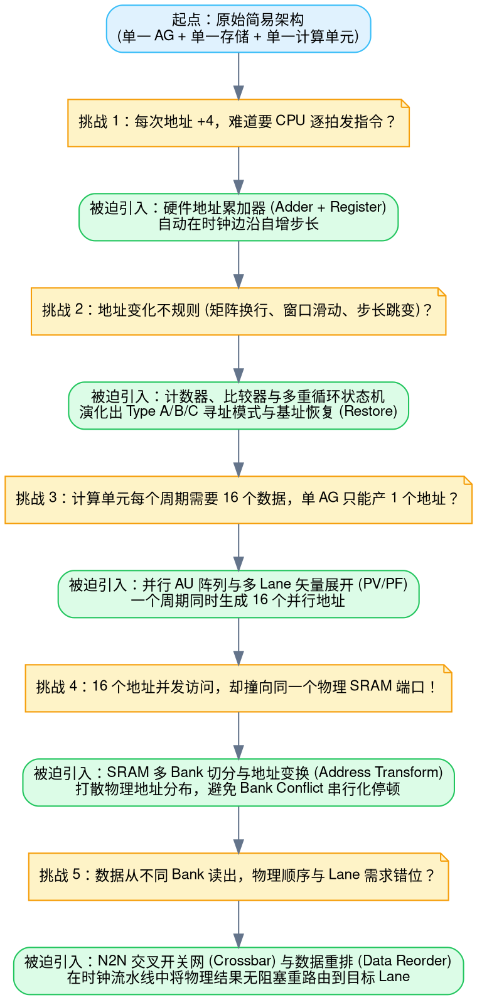

看清这张演进树后，你就会恍然大悟：

1. **第一个问题**：每次地址增加 4，难道要 CPU 每次发一条指令？——不需要，给 AG 塞一个加法器和寄存器，自动 `addr += 4`，这就是**硬件地址累加器**；
2. **第二个问题**：如果遇到矩阵转置或二维张量遍历，地址有时保持不变，有时跳跃一个大步长呢？——增加计数器和阈值比较器，当内层循环达到上限时触发外层大跳变，这引出了 **Type A / Type B 寻址模式**；
3. **第三个问题**：现代算力要求一拍完成 16 个乘加，单 AG 吞吐量不够怎么办？——硬件复制 16 份算地址电路，这就是**并行 AU、矢量通道 Lane 与 PV/PF**；
4. **第四个问题**：16 个 AU 算出的地址，如果恰好都指向同一块物理 SRAM 芯片，硬件读口瞬间堵死怎么办？——将大内存切成 16 个独立的 **Bank**，并引入 **Address Transform** 进行地址混淆打散；
5. **第五个问题**：为了避开冲突，物理数据被打散在不同 Bank 中，读出来后顺序全乱了，计算 Lane 怎么用？——引入 **N2N 交叉总线与 Data Reorder 硬件**，在传输中自动恢复张量顺序。

---

## 四、Banked SRAM 物理结构与全能地址映射公式

现在我们正式进入底层硬件存储体系的核心：**Banked SRAM（多体并行存储器）**。

在通用加速器芯片内部，存储器绝不是一个平坦的大蓄水池，而是由多个独立的物理子模块（Bank）横向拼接而成。

### 1. 物理参数与容量推算

设一个典型的片上存储单元（RAM Group）具有如下硬件物理规格：

- **Bank 数量 ($B$)**：$B = 16$ 个独立的存储体（相当于 16 个并行的收银窗口）；
- **Bank 宽度 ($W_b$)**：$W_b = 16\text{ 字节} = 128\text{ bit}$（每个收银窗口一拍能吞吐的数据块宽度）；
- **Bank 深度 ($D_b$)**：$D_b = 1024\text{ 行}$（每个收银窗口内部纵向堆叠的行数 / 字线数）。

基于上述参数，我们可以推导出两组关键容量数据：

$$\text{单 Bank 容量} = D_b \times W_b = 1024\text{ 行} \times 16\text{ B/行} = 16\text{ KB}$$

$$\text{RAM Group 总容量} = B \times \text{单 Bank 容量} = 16 \times 16\text{ KB} = 256\text{ KB}$$

更重要的是它的**并发突发读写位宽（Burst Width）**：

> **同一深度行突发宽度**：
> $$\text{Row Width} = B \times W_b = 16 \times 16\text{ B} = 256\text{ 字节}$$
> 如果这 16 个 Bank 在同一个时钟周期内全部选通各自的第 0 行，一拍之内就能向数据总线喷涌出整整 $256\text{ 字节}$ 的数据！这就是硬件高吞吐并行的物理基石。

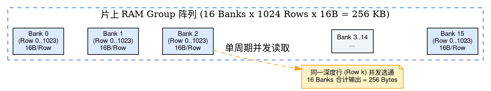

---

### 2. 最通用的三维物理地址映射公式

当软件或编译器给出一个线性的扁平字节地址 `addr`（例如 `addr = 300`）时，硬件电路究竟是如何在一瞬间把这个数字翻译成物理落点的？

硬件执行的是一个**分层剥离**算法，将一维线性地址投影到三维物理坐标空间：

$$\text{一维地址 } addr \longrightarrow \text{三维物理坐标 } (Bank,\ Row,\ Offset)$$

通用映射公式如下：

#### ① 计算数据块索引 ($block$)
$$block(addr) = \left\lfloor \frac{addr}{W_b} \right\rfloor$$
- **物理含义**：因为每个 Bank 的基本读写位宽是 $W_b = 16\text{ 字节}$，将地址除以 16 向下取整，得到它是全局第几个 $16\text{B}$ 的数据块。
- **通俗比喻**：仓库一箱装 16 个零件，给定零件编号，除以 16 就能知道它装在第几箱。

#### ② 计算块内字节偏移 ($offset$)
$$offset(addr) = addr \bmod W_b$$
- **物理含义**：该地址在所属 $16\text{B}$ 数据块内部的具体字节偏置（$0 \sim 15$）。

#### ③ 计算物理存储体编号 ($bank$)
$$bank(addr) = block(addr) \bmod B$$
- **物理含义**：数据块以交错方式（Interleaved）轮询分配给各个 Bank。第 0 块给 Bank 0，第 1 块给 Bank 1……第 15 块给 Bank 15，第 16 块又回到 Bank 0。**取模操作直接锁定了横向目标 Bank**。

#### ④ 计算 Bank 内部物理行号 ($row$)
$$row(addr) = \left\lfloor \frac{block(addr)}{B} \right\rfloor = \left\lfloor \frac{addr}{B \times W_b} \right\rfloor$$
- **物理含义**：由于 16 个 Bank 轮流发完一整轮数据块后，刚好装满物理存储器的一整行（$B \times W_b = 16 \times 16\text{ B} = 256\text{ B}$）。因此，块号除以 16（或者字节地址除以 256）向下取整，**直接锁定了纵向深度行号 Row**。

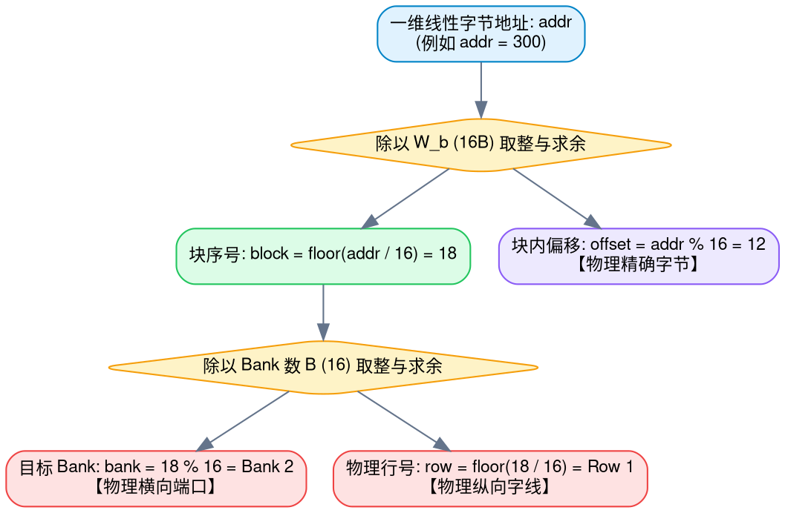

---

### 3. 具体数值实战代入

假设我们要寻址 `addr = 300`：

1. **算块号与偏移**：
   $$300 \div 16 = 18\ \text{（余 } 12\text{）} \implies block = 18,\ offset = 12$$
2. **算 Bank 编号**：
   $$18 \bmod 16 = 2 \implies bank = \mathbf{Bank\ 2}$$
3. **算物理行号 Row**：
   $$\left\lfloor \frac{18}{16} \right\rfloor = 1 \implies row = \mathbf{Row\ 1}\ \text{（从 0 计数，属于物理第 2 行）}$$

硬件控制总线在收到 `addr = 300` 时，内部解码器会立即选通 **Bank 2**，在第 **1** 行字线上施加读取电压，把该行的 $16\text{ 字节}$ 吐给读出放大器，最后截取第 **12** 个字节送上数据总线。

---

## 五、极简实例：彻底厘清 AG 与 Bank 的物理区别

很多人在初学加速芯片时，常常把 AG 算错地址与存储体冲突（Bank Conflict）混为一谈。

我们用一个仅包含 4 个 Bank 的微型存储器来做实验。假设每个 Bank 的一个最小数据块（Block）为 $16\text{ 字节}$。

连续物理地址在物理 Bank 上的交错分布如下表：

| 块序号 | 字节地址范围 | 物理落点 Bank 0 | 物理落点 Bank 1 | 物理落点 Bank 2 | 物理落点 Bank 3 |
| :---: | :---: | :---: | :---: | :---: | :---: |
| **Row 0** | $0 \sim 63\text{ B}$ | **块 0 ($0\text{ B}$)** | **块 1 ($16\text{ B}$)** | **块 2 ($32\text{ B}$)** | **块 3 ($48\text{ B}$)** |
| **Row 1** | $64 \sim 127\text{ B}$ | **块 4 ($64\text{ B}$)** | **块 5 ($80\text{ B}$)** | **块 6 ($96\text{ B}$)** | **块 7 ($112\text{ B}$)** |
| **Row 2** | $128 \sim 191\text{ B}$ | **块 8 ($128\text{ B}$)** | **块 9 ($144\text{ B}$)** | **块 10 ($160\text{ B}$)** | **块 11 ($176\text{ B}$)** |

现在，假设双通道计算单元需要在一个时钟周期内并发读取两笔数据。AG 忠实地在同一拍生成了两个读地址：

- 地址 A：$0\text{ B}$；
- 地址 B：$64\text{ B}$。

我们通过映射公式计算：

- 地址 $0\text{ B}$ 属于块 0：$bank = 0 \bmod 4 = 0,\ row = \lfloor 0 / 4 \rfloor = 0$ $\longrightarrow$ **Bank 0, Row 0**；
- 地址 $64\text{ B}$ 属于块 4：$bank = 4 \bmod 4 = 0,\ row = \lfloor 4 / 4 \rfloor = 1$ $\longrightarrow$ **Bank 0, Row 1**。

灾难发生了：**两个地址完全不同，但它们同时落在了同一个物理 Bank 0 上，且分别请求不同的行（Row 0 和 Row 1）！**

因为物理单端口 Bank 在同一周期只能有一根字线导通，硬件仲裁器只能让其中一个先读，另一个在总线上挂起等待。

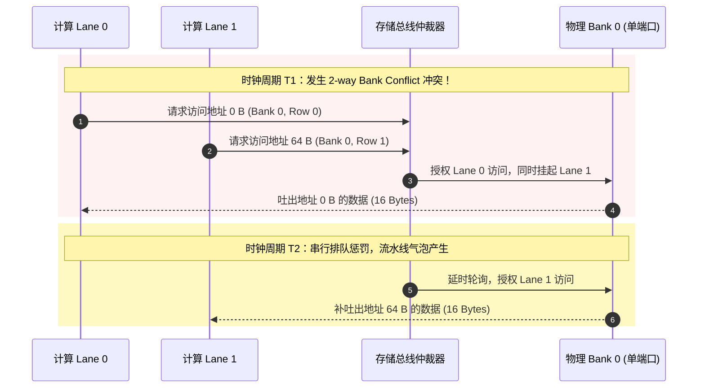

> [!IMPORTANT] 认知重塑要点
> **AG 没有算错地址！** 它正确地生成了 $0$ 和 $64$。
> 冲突的根本根源在于：**物理存储体系的组织边界限制了并发性**。
> - **AG** 解决的是“算子在数学逻辑上需要读哪个地址”；
> - **Bank** 是片上静态存储器在硅片上的“物理多路划分”；
> - **Bank Conflict** 是多个独立访存请求在同一周期内抢占同一硬件端口而引发的“交通大堵塞”；
> - **Address Transform** 则是在不改变数据逻辑值的前提下，改变数据在物理 Bank 间的排布规则，让 $0$ 和 $64$ 分布到不同 Bank，从而根除冲突。

---

## 六、建立加速器学习的七步心智路线图

为了避免再次陷入知识碎片堆叠的泥潭，建议将所有概念放回下面这条从微观物理到宏观编译的逻辑流水线中：

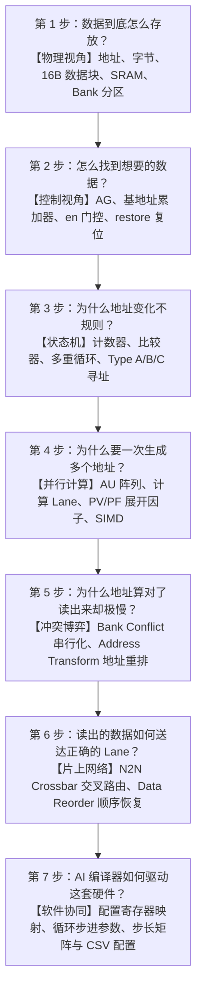

遵循一个统一的认知闭环：
$$\text{提出具体计算痛点} \longrightarrow \text{数字模拟暴露硬件瓶颈} \longrightarrow \text{被迫增加硬件补丁} \longrightarrow \text{抽象出数学公式与配置寄存器}$$

---

## 七、卷积核心谜题：为何移动一格要跳多个块？为何计算 $u$？

在卷积算子优化中，最常让初学者卡壳的正是卷积算子的访存映射。很多人看着文档里的公式：

$$u = sw \times \left(\frac{C}{PC}\right)$$

完全不明白：为什么沿 $W$ 方向滑动一下，要跨过好几个数据块？这里的 $u$ 到底是个什么东西？

我们将张量维度、物理存储与硬件并发彻底拆开来看。

### 1. 空间位置与通道维度：从 RGB 到深度特征图

考虑一张高 $H=2$、宽 $W=4$ 的普通彩色图片。对于某一个像素点（例如第 0 行第 1 列 $(h=0, w=1)$），计算机存储红（R）、绿（G）、蓝（B）三个颜色数值。

这三个数值，称为三个 **通道（Channel）**。此时张量形状为：$H=2,\ W=4,\ C=3$。

但在深度神经网络中，经过前置卷积层提取特征后，输出通道数通常会急剧膨胀（如 16、32、64、128 或更高）：

```python
# 拥有 32 个输出通道的卷积层
nn.Conv2d(in_channels=3, out_channels=32, kernel_size=3)
```

此时的特征图形状变成了：$H=2,\ W=4,\ C=32$。空间位置 $(h=0, w=1)$ 处包含整整 32 个高维抽象特征值（$C_0 \sim C_{31}$）。

读者可点击下方代码右上角，直接在浏览器端运行以下纯 Python 代码，观察多通道特征在 Bank 中的连续映射分布：

```python file="conv_bank_stride_sim.py"
# 💡 浏览器端纯本地算力运行：模拟多通道特征在 16-Bank 内存中的并行排布
banks = 16
channels = 32
spatial_points = 4  # 模拟 4 个空间位置点 (h, w)

print(f"=== 模拟 {channels} 通道特征在 {banks}-Bank 内存中的映射排布 ===")
for point in range(spatial_points):
    # 模拟 NHWC 连续排布时的 Bank 索引分布
    hit_banks = [(point * channels + c) % banks for c in range(channels)]
    unique_banks = len(set(hit_banks))
    print(f"空间位置点 P{point}: 访问 32 通道数据 -> 均匀覆盖不同 Bank 数: {unique_banks}/{banks} (全负载并发)")

print("\n结论: 在 NHWC 格式下连续并发抓取通道向量，刚好能打满所有物理 Bank，避免单 Bank 冲突堵塞！")
```

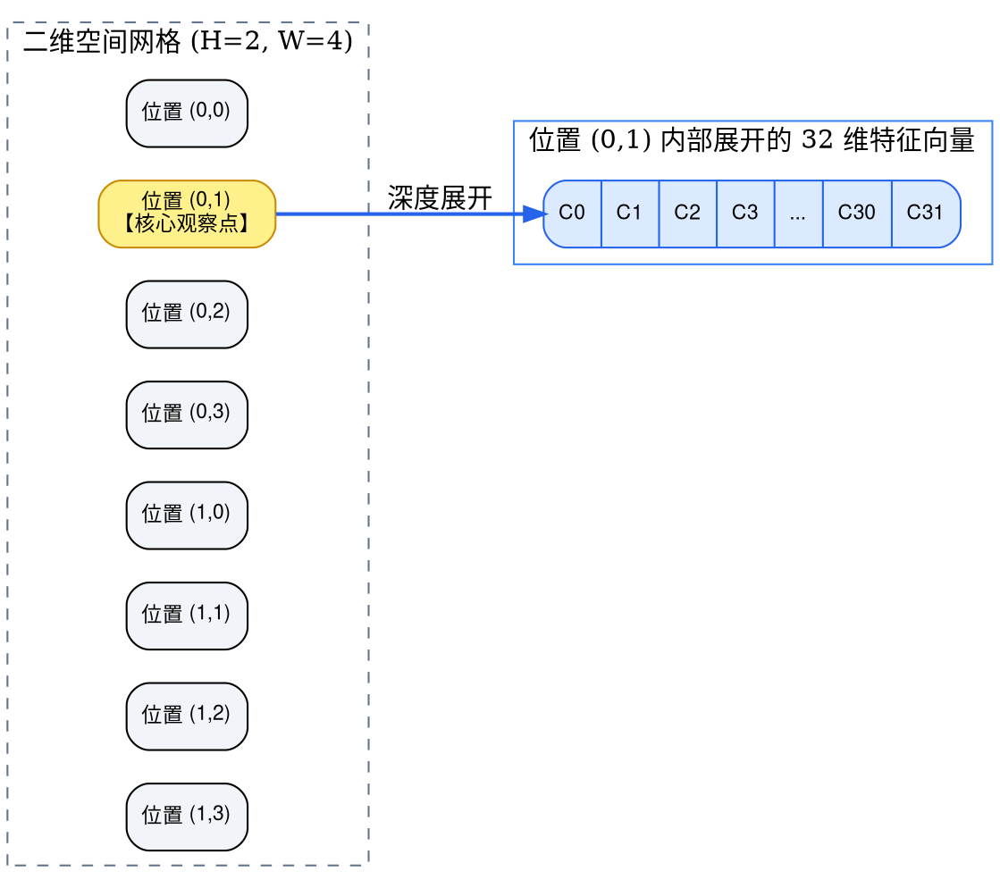

> [!TIP] 关键概念锚定
> 空间位置由坐标 $(H, W)$ 唯一定位；通道数 $C$ 表示**同一个空间位置上挂载了多少个特征数值**。
> $W=4,\ C=32$ 绝不代表一行有 32 个空间点，而是代表**一行有 4 个空间点，每个点各自拥有 32 个通道**！

---

### 2. 物理内存排布：HWC 布局与通道打包（PC）

假设输入特征图为 1 行 10 列、每个空间点有 32 个通道，采用工业界最常见的 **HWC 连续布局** 与 **FP16 精度（每个数值 2 字节）**：

#### ① 计算一个空间点占多少内存？
$$\text{单空间点内存大小} = 32 \times 2\text{ Bytes} = 64\text{ Bytes}$$

#### ② 硬件数据块与通道打包数（PC）
假设片上存储（SMEM）的最小读写数据块大小为 $16\text{ 字节}$。一个 $16\text{B}$ 的数据块能塞下多少个 FP16 通道值？
$$\text{打包通道数 } PC = \frac{16\text{ Bytes}}{2\text{ Bytes/数值}} = 8$$

#### ③ 空间点装箱：为什么需要 $C/PC$ 块？
将位置 $W=0$ 的 32 个通道打包进 $16\text{B}$ 的存储块中：
- **块 0（$16\text{B}$）**：存放通道 $C_0 \sim C_7$；
- **块 1（$16\text{B}$）**：存放通道 $C_8 \sim C_{15}$；
- **块 2（$16\text{B}$）**：存放通道 $C_{16} \sim C_{23}$；
- **块 3（$16\text{B}$）**：存放通道 $C_{24} \sim C_{31}$。

一共需要：
$$\frac{C}{PC} = \frac{32}{8} = 4\text{ 个物理块}$$

总容量为：$4 \text{ 块} \times 16\text{ B/块} = 64\text{ 字节}$。

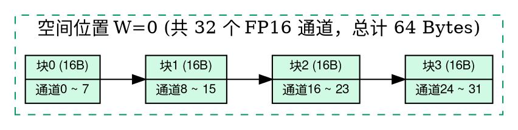

> **公式 $C/PC$ 的物理本质**：它不是在算有多少空间像素，也不是在算卷积核尺寸，它只是在回答：**装下一个空间位置的所有通道，物理上必须切成几个 $16\text{B}$ 的小方块？**

---

### 3. 相邻空间位置在物理地址上的跨越

在 HWC 连续内存排列下，先放满 $W=0$ 的所有通道块，紧接着存放 $W=1$ 的所有通道块，再存放 $W=2$……

整行数据的物理内存连续排布如下：

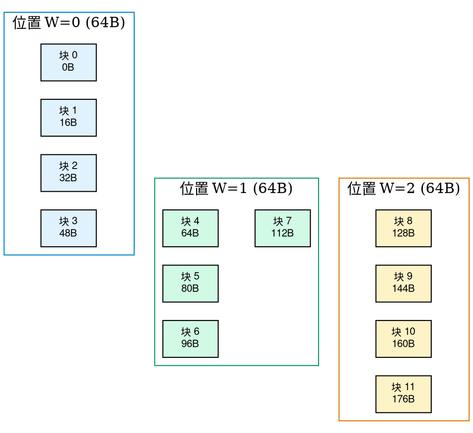

现在，假设硬件要依次读取每个空间点的第一组通道（通道 $0 \sim 7$）：
- 读取 $W=0$ 的首组通道 $\longrightarrow$ 访问 **块 0（地址 $0\text{B}$）**；
- 读取 $W=1$ 的首组通道 $\longrightarrow$ 访问 **块 4（地址 $64\text{B}$）**；
- 读取 $W=2$ 的首组通道 $\longrightarrow$ 访问 **块 8（地址 $128\text{B}$）**。

从 $W=0$ 移动到 $W=1$，起始块序号为什么直接从 0 变成了 4？

**因为块 1、块 2、块 3 里面存的是 $W=0$ 的其余 24 个通道！** 硬件必须跨越这 3 个块，才能抵达属于 $W=1$ 的第一组通道数据。

这就是为什么**在空间维度上沿 $W$ 仅仅移动 1 格，在存储块维度上就必须跳过 4 个块（即 $C/PC$ 块）**。

---

### 4. 卷积步长 $sw$ 与核心公式推导

参数 **$sw$（Stride Width，宽度步长）** 决定了输出特征图在下一个位置计算时，输入采样窗口要向前跨过几个空间位置。

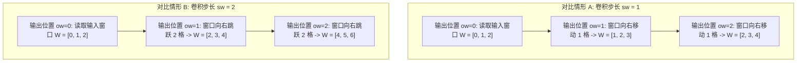

将两个物理事实结合：
1. **事实一**：每移动 1 个空间位置（$W$），内存中必须跨越 $C/PC = 4$ 个物理数据块；
2. **事实二**：每计算下一个输出位置（$ow$），输入空间起点需要移动 $sw$ 个空间位置。

假设卷积步长 $sw = 2$：
- $ow=0$ 对应的输入窗口起点为 $W=0$ $\longrightarrow$ 对应内存中的 **块 0**；
- $ow=1$ 对应的输入窗口起点为 $W=2$ $\longrightarrow$ 对应内存中的 **块 8**。

相邻两个输出窗口起点在内存中所跨越的物理块数量差为：
$$\Delta \text{Block} = 8 - 0 = 8\text{ 块}$$

这就是 **$u$** 的由来！

$$\boxed{u = sw \times \left(\frac{C}{PC}\right)}$$

代入数值：
$$u = 2 \times \left(\frac{32}{8}\right) = 2 \times 4 = 8\text{ 块}$$

换算为绝对物理字节跨度：
$$\text{字节步进} = u \times 16\text{ Bytes} = 8 \times 16 = 128\text{ Bytes}$$

---

## 八、什么是 $n$-way Bank Conflict？数学严格定义与广播机制

在多 Lane 并行执行时，我们如何精准量化硬件到底堵成了什么样？

### 1. 形式化数学定义

设在一个硬件时钟周期内，同时存在 $L$ 个并发 Lane 请求，其中第 $l$ 个 Lane 请求的物理目标坐标为：

$$(bank_l,\ row_l)$$

#### ① 统计每个 Bank 面临的去重行压力 ($count_b$)
对任意一个特定的 Bank $b$（$b \in [0, B-1]$），统计访问该 Bank 的**不同物理行（Row）的数量**：

$$count_b = \#\left\{ row_l \mid bank_l = b \right\}$$

公式中的每一个符号都有着极其深刻的物理内涵：
- $bank_l = b$：在当前时钟周期的所有 $L$ 个并发顾客中，把要去找 Bank $b$ 的请求筛选出来；
- $row_l \mid \dots$：列出这些请求所要读取的物理行号；
- $\#\{\dots\}$：集合的**势（Cardinality，元素去重后的个数）**。

> [!IMPORTANT] 硬件广播机制（Broadcast）：去重为什么至关重要？
> 为什么公式不是直接统计请求个数，而是统计集合元素的个数？
> **因为硬件支持同址广播！**
> 如果 Lane 0 和 Lane 3 在同一周期同时访问 **Bank 0 的 Row 1**（甚至同一个 16B 块）：
> 物理 Bank 0 只需要激活一次第 1 行字线，读出放大器吐出这 16B 数据后，片上总线网络可以像大喇叭广播一样，**同时把这一份数据复印抄送给 Lane 0 和 Lane 3**！
> **这不消耗额外的时钟周期，绝对不发生 Bank Conflict！**
> 只有当多个 Lane 请求同一个 Bank 的**不同 Row** 时，由于单端口存储体同一拍只能激活一根物理字线，硬件才无法同时读出，必须串行排队！

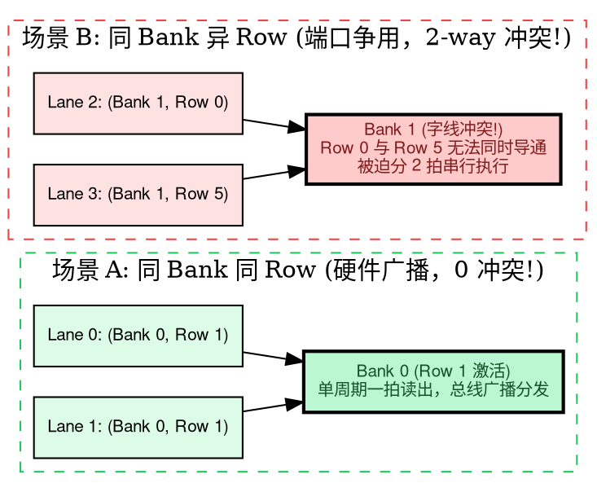

#### ② 求解系统冲突度 ($conflictDegree$)
系统的整体流水线性能受限于最慢的那个瓶颈点，因此冲突度由**最拥挤的那个 Bank** 决定：

$$conflictDegree = \max_{b}(count_b)$$

- **$1$（无冲突，1-way）**：最忙的 Bank 也只请求了 1 个 Row，所有请求完美单拍完成；
- **$2$（2-way conflict）**：最忙的 Bank 被要求读取 2 个不同的 Row，硬件耗费 2 个时钟周期；
- **$4$（4-way conflict）**：最忙的 Bank 被 4 个不同 Row 堵死，耗费 4 拍，有效吞吐骤降至 25%；
- **$16$（16-way conflict）**：极端灾难！16 个请求全部死磕同一个 Bank 的 16 个不同 Row，15 个 Bank 全程空转，有效算力暴跌至 1/16。

---

### 2. 算法走查实例

假设硬件拥有 4 个 Bank（编号 0, 1, 2, 3），某一拍同时到来 4 个并发 Lane 请求（$L=4$）：
- 请求 A：$(Bank\ \mathbf{0},\ Row\ 1)$
- 请求 B：$(Bank\ \mathbf{0},\ Row\ 2)$ —— *和 A 同 Bank，但请求不同 Row*
- 请求 C：$(Bank\ \mathbf{2},\ Row\ 1)$
- 请求 D：$(Bank\ \mathbf{0},\ Row\ 1)$ —— *和 A 完全相同，同 Bank 同 Row*

**执行步骤 1：统计各 Bank 去重行数 $count_b$**
- **Bank 0**：收到了 Row 1, Row 2, Row 1。去重集合为 $\{1, 2\}$，包含 2 个不同 Row，故 $count_0 = \mathbf{2}$；
- **Bank 1**：无请求，去重集合为空，故 $count_1 = \mathbf{0}$；
- **Bank 2**：收到了 Row 1，去重集合为 $\{1\}$，故 $count_2 = \mathbf{1}$；
- **Bank 3**：无请求，去重集合为空，故 $count_3 = \mathbf{0}$。

**执行步骤 2：求取最大值**
$$conflictDegree = \max(2,\ 0,\ 1,\ 0) = \mathbf{2}$$

结论：系统当前处于 **2-way Bank Conflict** 状态。Bank 0 耗费 2 拍完成（其中 Row 1 广播给请求 A 和 D，Row 2 单独读给请求 B），整体流水线停顿 1 拍。

---

## 九、固定步长访问的通用数学规律与 GCD 定理

如果算法对数据的读取步伐是固定步长递增的，是否存在一个通用的数学解析式，直接预测冲突度？

答案是肯定的，且它完全由初等数论中的**最大公约数（$\gcd$）**所主宰。

### 1. 通用数学推导

设并发请求的 Lane 索引为 $i$（$i \in [0, L-1]$），每个 Lane 访问的数据块索引服从固定步长 $u$：

$$block(i) = block_0 + i \times u$$

根据地址映射公式，Lane $i$ 所落入的 Bank 编号为：

$$bank(i) = (block_0 + i \times u) \bmod B$$

在 AI 加速器最典型的设计场景中，并发 Lane 数与硬件 Bank 数完全对齐（即 $L = B$）。

根据模算术循环群理论，$i \times u \pmod B$ 的取值将以 $\frac{B}{\gcd(u, B)}$ 为周期产生循环。因此：

#### ① 实际命中的不同 Bank 数量 ($uniqueBanks$)
$$uniqueBanks = \frac{B}{\gcd(u, B)}$$

#### ② 硬件冲突度 ($conflictDegree$)
因为总共有 $B$ 个并发请求，它们平均分摊到 $uniqueBanks$ 个被踩中的 Bank 上：

$$conflictDegree = \frac{B}{uniqueBanks} = \frac{B}{\frac{B}{\gcd(u, B)}} = \mathbf{\gcd(u, B)}$$

$$\boxed{conflictDegree = \gcd(u, B)}$$

> [!NOTE] 极简的数学真理
> 当 $L = B$ 时，**冲突度不偏不倚，恰好等于步长 $u$ 与硬件 Bank 总数 $B$ 的最大公约数！**
> 要想彻底避免冲突（$conflictDegree = 1$），唯一的充要条件就是：
> $$\gcd(u, B) = 1 \iff u \text{ 与 } B \text{ 严格互质}$$

---

### 2. 经典 16-Bank 架构全景穷举分析

以工业界最标准的 16-Bank（$B = 16$）加速器架构为例，我们观察不同步长 $u$ 时的硬件行为：

| 步长 $u$ | 访问的 Bank 循环序列 | 最大公约数 $\gcd(u, 16)$ | 有效踩中的 Bank 数 | 冲突度 | 硬件真实状态 |
| :---: | :---: | :---: | :---: | :---: | :---: |
| **$u = 1$** | $0, 1, 2, 3, \dots, 15$ | $\gcd(1, 16) = 1$ | 16 | **1-way** | **完美单拍全覆盖，0 冲突** |
| **$u = 2$** | $0, 2, 4, 6, \dots, 14, 0, 2, \dots$ | $\gcd(2, 16) = 2$ | 8 | **2-way** | 仅踩偶数 Bank，耗费 2 拍 |
| **$u = 3$** | $0, 3, 6, 9, 12, 15, 2, 5, 8, \dots$ | $\gcd(3, 16) = 1$ | 16 | **1-way** | **互质奇迹！乱序全覆盖，0 冲突** |
| **$u = 4$** | $0, 4, 8, 12, 0, 4, 8, 12, \dots$ | $\gcd(4, 16) = 4$ | 4 | **4-way** | 仅踩 4 个 Bank，耗费 4 拍，吞吐跌落 75% |
| **$u = 5$** | $0, 5, 10, 15, 4, 9, \dots$ | $\gcd(5, 16) = 1$ | 16 | **1-way** | **全覆盖，0 冲突** |
| **$u = 8$** | $0, 8, 0, 8, 0, 8, \dots$ | $\gcd(8, 16) = 8$ | 2 | **8-way** | 仅踩 Bank 0 和 8，耗费 8 拍，吞吐跌落 87.5% |
| **$u = 16$** | $0, 0, 0, 0, 0, 0, \dots$ | $\gcd(16, 16) = 16$ | 1 | **16-way** | **毁灭性灾难！所有 Lane 堵死 Bank 0，跌落 16 倍** |

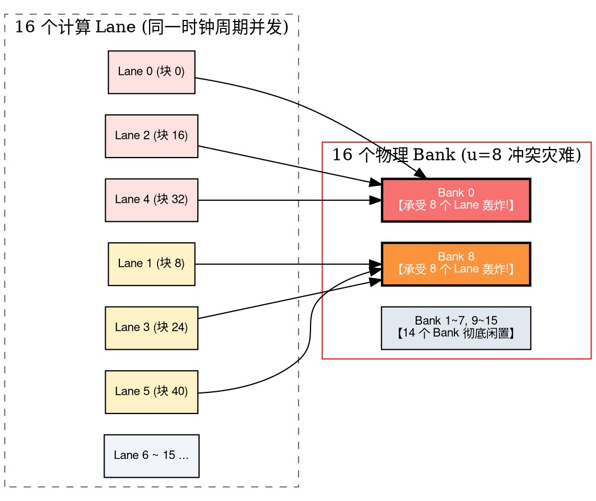

---

## 十、解密步长 $u$ 的本质：谁定义了 $u$？能否靠改 $n$ 改变 $d$？

这是软硬件协同设计中最核心的哲学命题：

### 1. $u$ 是自己定义的，还是硬件要求的？

直接给出明确结论：

> **$u$ 是由软件（程序员编写的算法、张量排布、编译器循环变换策略）定义的；而 $B$（Bank 数量）是硬件出厂时就物理固化死（如 $B=16$）的。**

- 当你按行连续读取张量时，相邻线程读取的地址连续，步长为 $u = 1$；
- 当你为了实现矩阵转置或大步长卷积，跳行读取数据时，相邻线程的地址跨越整整一行，步长可能变成 $u = 12$；
- **软件完全可以随意定义 $u$；但一旦定义的 $u$ 与硬件的物理结构 $B$ 产生不良交集，硬件就会立刻施加严重的冲突停顿惩罚。**

---

### 2. 为什么要把 $u$ 拆成 $2^d \times n$？

在几乎所有现代计算芯片中，硬件 Bank 数都是 **2 的幂次方**（例如 $B = 16 = 2^4$）。

当硬件本身全是因数 2 的倍数时，我们只要把软件定义的步长 $u$ 分解：

$$u = 2^d \times n \quad (n \text{ 为奇数})$$

- $d$：代表步长 $u$ 里面包含多少个因数 2，也就是 $u$ 在二进制表达下**末尾连续 0 的个数**（2-adic 赋值）；
- $n$：抽走所有的 2 之后，剩余的奇数部分。

代入最大公约数公式：
$$\gcd(u, 16) = \gcd(2^d \times n,\ 2^4) = 2^{\min(d, 4)}$$

> **结论**：
> 奇数部分 $n$ 与 16 毫无关系（因为任何奇数与 16 的最大公约数永远是 1）！
> **硬件冲突度完全且唯一地由 $d$ 决定：**
> $$conflictDegree = 2^d \quad (d \le 4)$$

例如步长 $u = 12$：
$$12 = 2^2 \times 3 \implies d = 2,\ n = 3$$
$$\gcd(12, 16) = 2^d = 2^2 = \mathbf{4}\quad \text{(4-way conflict!)}$$

---

### 3. $u$ 不变，可以靠改变 $n$ 来改变 $d$ 吗？

这是一个初学者极其容易陷入的严重认知误区。

答案是：**绝不可能！**

> [!CAUTION] 算术基本定理（唯一分解定理）的铁律
> 任何一个确定的正整数 $u$，其质因数分解在数学上是**全宇宙唯一**的！
> 假若 $u = 12$，它只能被唯一分解为 $2^2 \times 3$。
> 此时 $d$ 只能是 2，$n$ 只能是 3。
> 你绝不能幻想“保持 $u = 12$ 不变，我把 $n$ 改成 1，让 $d$ 变成 $\log_2(12)$”——这在离散整数物理体系中根本不成立！
> **$u$ 一旦固定，$d$ 和 $n$ 就被物理锁死，它们是不可分割的孪生体。**

---

### 4. 工程破解之道：如何消灭 Bank Conflict？

既然不能通过改动 $n$ 来改动 $d$，那我们在工程实战中到底如何打破 $2^d$ 的诅咒？

#### 策略 A：软件端内存填充（Memory Padding / 用空间换时间）
如果算法天然产生 $u = 12$（$d=2$，4-way 冲突），我们可以在每一行数据末尾人为插入一个没用的无意义数据块（Padding）：
- 原步长：$u = 12 = 2^2 \times 3 \longrightarrow conflictDegree = 4$
- 插入 1 块 Padding 后的新步长：$u' = 13 = 2^0 \times 13 \longrightarrow d = 0$
- 新冲突度：$conflictDegree = 2^0 = \mathbf{1}$！

只需浪费微不足道的存储碎片，就让整个算子的访存吞吐量**暴增 400%**！

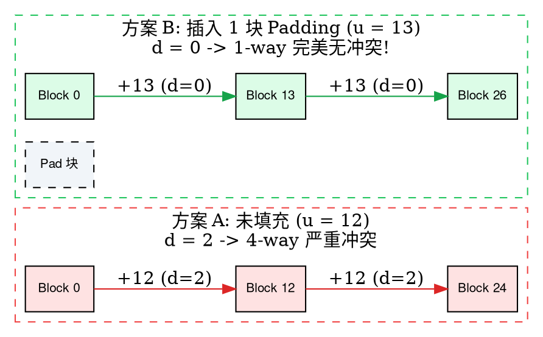

#### 策略 B：硬件/编译器协同：地址重排（Address Transform / XOR Swizzle）
如果不能改变张量内存尺寸，编译器可以在地址生成器与 Bank 译码器之间激活 **XOR Swizzle 硬件电路**：
$$bank = \left( block \oplus \left\lfloor \frac{block}{ratio} \right\rfloor \right) \bmod B$$
通过高位地址对低位地址进行异或扰动，在不增加任何额外内存的前提下，打碎原本整齐划一的周期性冲突。

#### 策略 C：硬件架构设计：奇数 / 质数 Bank 划分
部分前沿高并发处理器会故意打破 $B=16$ 的传统，将芯片物理 Bank 数量设计为奇数（如 $B=15$ 或质数 $B=17$）。此时对于几乎所有偶数步长 $u$，$\gcd(u, B)$ 都能自然保持为 1，彻底终结 $2^d$ 的天然缺陷。

---

## 十一、全真知识检验与推导自测

### 试着自己推导回答以下四个问题：

#### 问题 1：通道扩展下的数据块计算
> **问题**：假设输入特征图通道数 $C = 64$，每个数值采用 FP16 存储（占 $2\text{ Bytes}$），片上存储的数据块尺寸依然是 $16\text{ Bytes}$（即 $PC = 8$）。那么一个空间位置 $W$ 需要占用多少个物理数据块？
>
> **解答**：
> 单个空间位置所包含的总字节数：
> $$\text{Size} = 64 \times 2\text{ Bytes} = 128\text{ Bytes}$$
> 占用的物理数据块数量：
> $$\text{Blocks} = \frac{C}{PC} = \frac{64}{8} = 8\text{ 个数据块}$$

#### 问题 2：非齐步长下的块跨度计算
> **问题**：在上述 $C=64, PC=8$ 的条件下，如果卷积层配置为步长 $sw = 2$。计算相邻输出窗口起点在内存中相隔的物理数据块跨度 $u$ 为多少？对应多少物理字节？
>
> **解答**：
> 根据物理跨度公式：
> $$u = sw \times \left(\frac{C}{PC}\right) = 2 \times 8 = 16\text{ 个数据块}$$
> 对应的物理字节跨度：
> $$\text{Byte Stride} = 16\text{ 块} \times 16\text{ Bytes/块} = 256\text{ 字节}$$

#### 问题 3：物理 Bank 冲突诊断与广播识别
> **问题**：硬件包含 16 个 SRAM Bank，同一拍 4 个 Lane 的请求分别是：
> - Lane 0: 访问 $addr = 0$
> - Lane 1: 访问 $addr = 8$
> - Lane 2: 访问 $addr = 256$
> - Lane 3: 访问 $addr = 512$
>
> 请计算每个请求的 $(Bank, Row)$，分析是否存在广播，并求最终的冲突度。
>
> **解答**：
> $W_b = 16\text{ B}, B = 16$。整行跨越 $16 \times 16 = 256\text{ B}$。
> - Lane 0: $block = 0 \implies bank = 0,\ row = \lfloor 0 / 256 \rfloor = \mathbf{Row\ 0}$；
> - Lane 1: $block = 0 \implies bank = 0,\ row = \lfloor 8 / 256 \rfloor = \mathbf{Row\ 0}$（偏移为 8）；
> - Lane 2: $block = 16 \implies bank = 16 \bmod 16 = 0,\ row = \lfloor 256 / 256 \rfloor = \mathbf{Row\ 1}$；
> - Lane 3: $block = 32 \implies bank = 32 \bmod 16 = 0,\ row = \lfloor 512 / 256 \rfloor = \mathbf{Row\ 2}$。
>
> 分析：
> 1. 所有 4 个 Lane 均请求 **Bank 0**；
> 2. 但 Lane 0 和 Lane 1 共同请求 **Row 0**，触发**硬件同址广播**，去重后该行只算 1 次！
> 3. 去重后的行集合为 $\{Row\ 0, Row\ 1, Row\ 2\}$，共有 3 个不同的行；
> 4. 故 $count_0 = 3$，系统的最终冲突度为 **3-way conflict**。硬件需要分 3 拍完成。

#### 问题 4：固定步长的因子与 Padding 优化
> **问题**：在 16-Bank 存储器中，某算子的固定访问步长为 $u = 24$。请计算其因子分解 $2^d \times n$、冲突度，并提出最优的 Padding 修正方案。
>
> **解答**：
> 1. 分解 $u = 24$：$24 = 2^3 \times 3 \implies d = 3,\ n = 3$；
> 2. 冲突度为：$conflictDegree = 2^{\min(3, 4)} = 2^3 = \mathbf{8}\quad \text{(8-way 严重冲突)}$；
> 3. 优化方案：插入 1 块填充，将步长变为 $u' = 25 = 2^0 \times 25$（$d=0$）。此时 $\gcd(25, 16) = 1$，冲突度骤降为 **1-way（零冲突）**！

---

## 十二、总结与编译器工程心法

回顾整个推导体系，我们可以用一张简明透彻的思维映射矩阵收束全文：

| 核心概念 / 符号 | 物理本质 | 核心决定因素 | 优化与破局手段 |
| :---: | :---: | :---: | :---: |
| **$W_b, D_b, B$** | 片上 Banked SRAM 物理几何维度 | 芯片硅片微结构（硬件出厂固化） | 硬件设计奇数 Bank 或加宽读写端口 |
| **$(Bank, Row, Offset)$** | 三维物理落点坐标 | 逻辑地址 $addr$ 经过 $W_b$ 与 $B$ 逐层解算 | 软件避免跨行散乱跳跃 |
| **$W, C, sw$** | 卷积张量几何与窗口滑动 | 算法网络结构定义 | 算子切块（Tiling）对齐硬件 |
| **$PC, C/PC$** | 空间点数据在物理存储中的装箱比 | 存储块位宽 $W_b$ 与数据精度（FP16/INT8） | 选用高效精度，保证通道对齐 $PC$ |
| **$u = sw \times (C/PC)$** | 连续采样起点跨越的物理数据块数 | 连接算法几何与存储物理的纽带 | 作为冲突度量化的核心输入参量 |
| **$conflictDegree$** | 最拥挤 Bank 被请求的不同 Row 数 | $\max_b(count_b)$，固定步长下为 $\gcd(u, B)$ | 确保 $\gcd(u, B) = 1$ |
| **$u = 2^d \times n$** | 步长的 2 进制质因数分解 | 算术基本定理唯一决定（不可单改 $n$） | **Memory Padding 填充**改变 $u$，使 $d=0$ |
| **Address Transform** | 硬件异或/模置换打散逻辑 | 编译器根据 $u$ 动态配置寄存器 | 读端与写端统一重排，消除冲突且保持语义 |

在加速芯片底层算子与 AI 编译器下沉的征途上，没有凭空出现的魔法，每一个看似晦涩的寄存器参数与数学公式，背后都是**硅片物理特性的刚性约束**与**算法极致吞吐需求**之间的精妙权衡。

彻底建立起这套直击物理本质的立体认知体系，任何复杂的芯片手册在你眼中都将变得通透清晰、脉络分明。
