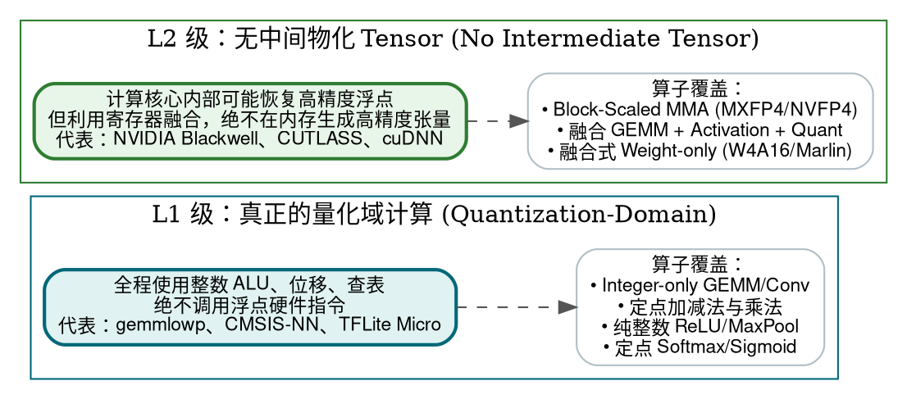
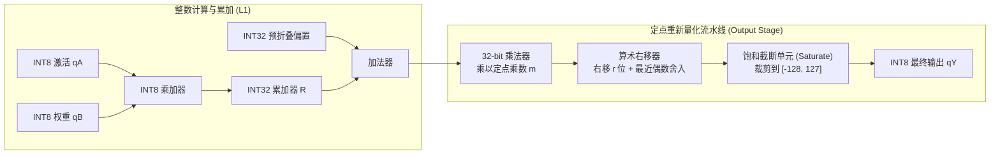
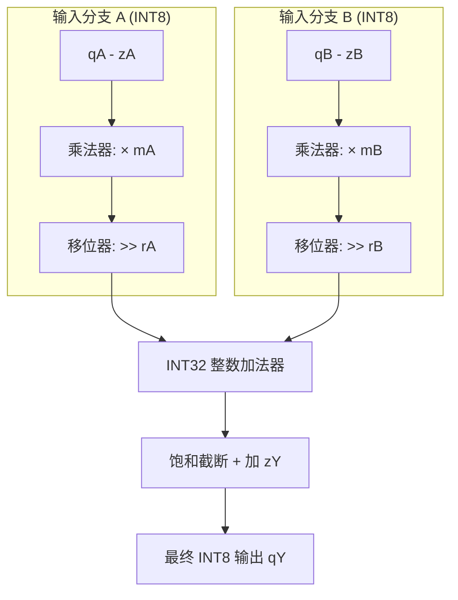
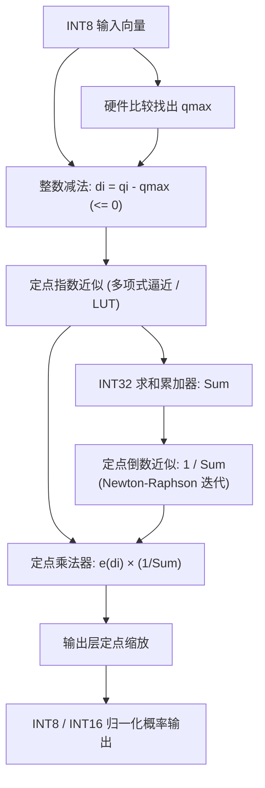
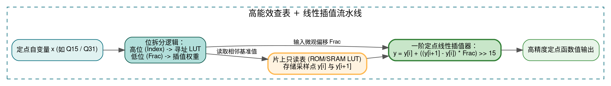
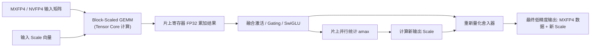

> **导读**：在上一篇文章《[低精度计算是否必须反量化？MXFP4/NVFP4 数学本质、全算子路径与 AI 芯片硬件微架构全景指南](file:///home/ubuntu/git/blog/src/content/posts/low-precision-computing-and-dequantization-mxfp4-nvfp4-deep-dive.md)》中，我们从第一性原理推导了为什么矩阵乘法可以直接消费带 Scale 的低精度数据，并剖析了非线性算子对 Scale 的数学约束。
>
> 很多深入钻研系统优化的工程师在理解了理论之后，往往会提出更进一步的实践质问：
>
> - **“在工业界真实的生产级推理引擎（如 Google gemmlowp/TFLite、Arm CMSIS-NN、Intel oneDNN、NVIDIA CUTLASS、vLLM）中，究竟有哪些已经稳定落地的‘无中间反量化’算法？”**
> - **“为什么像加法、ReLU、甚至连包含指数和除法的 Softmax 都能完全在整数/定点域算完，而不需要任何浮点指令？”**
> - **“定点乘法与移位（Multiplier & Shift）在数学上是如何精准等价于浮点除法并完成重新量化（Requantization）的？”**
> - **“如果我们要为自定义 NPU 或 AI 编译器（如 MLIR）编写算子代码生成，哪些算法应该被列为 P0 优先级首先实现？哪些目前还只是学术论文中的玩具？”**
>
> 本文将系统梳理工业界两大核心流派：**保持量化表示的计算（Quantization-Preserving Computation）** 与 **融合量化计算内核（Fused Quantized Kernels）**，通过严密数学推导、微架构电路逻辑、工业开源实现源码分析与全景架构图，为你彻底揭开工业界“无中间反量化”计算的神秘面纱。

---

## 一、初学者必读：核心概念通俗速查词典

为了帮助跨领域与初学者轻松阅读本文，我们首先对文中核心出现的专业术语进行生活化比喻与物理本质界定：

> [!NOTE] 核心术语通俗解析字典
>
> - **保持量化表示的计算（Quantization-Preserving Computation）**：
>   算子的输入是低比特整数或定点数，计算过程全程由整数 ALU、移位器和查找表驱动，**输出直接也是低比特量化格式**，整个算子图在数据流上始终维持在量化域内。
> - **定点数（Fixed-Point Number）与 Q 格式**：
>   用纯整数模拟小数的古老而高效的工业技术。人为约定将整数的低 $n$ 位作为小数部分（例如 Q15 格式表示用 16 位整数存储，其中最高 1 位是符号位，低 15 位是小数，最小分辨率为 $2^{-15}$）。
> - **乘数与移位（Fixed-point Multiplier & Shift）**：
>   任何形如 $x \times S$ 的浮点缩放比例（其中 $S \in (0, 1)$），在定点数学中都可以精准近似表示为 $\frac{m}{2^r}$，从而将昂贵的浮点乘除法降解为**一次 32 位整数乘法加上一次算术右移指令**（$(x \times m) \gg r$）。
> - **零点偏移（Zero Point / Offset，即 $z$）**：
>   非对称量化中的“原点偏移量”。由于许多神经网络激活值（如经过 ReLU 后）分布在非负区间，引入 Zero Point 可以将物理实数 $0.0$ 精确对齐到整数离散刻度上，避免量化零值带来的系统性误差。
> - **查找表（LUT, Look-Up Table）与插值（Interpolation）**：
>   针对复杂的非线性数学函数（如 Sigmoid、Sin），预先把输入区间的计算结果离散采样保存在片上只读内存（ROM/SRAM）中。运行时用输入的整数值作为数组下标直接读出近似结果；如果落在两点之间，通过连线斜率进行一阶插值平滑。
> - **范围归约（Range Reduction）**：
>   三角函数（如 Sin、Cos）具有周期性（$2\pi$），任何角度都可以通过取模转化为 $[-\pi, \pi]$ 或 $[0, \frac{\pi}{2}]$ 区间。将无限的输入范围压缩到极小的有限区间，以便用极小容量的查找表覆盖全部输入。
> - **Weight-only 量化（仅权重压缩）**：
>   针对大语言模型（LLM）解码阶段访存带宽吃紧的瓶颈，权重（Weight）压缩为 4-bit（INT4/FP4）存储以节省 HBM 读取量；激活值（Activation）保持 FP16/BF16。在计算时由寄存器即时解码，但不将反量化后的权重写回显存。

---

## 二、两大技术等级划分：L1 vs L2

在分析工业界算法之前，必须首先建立极其严密的等级认知，否则极易将技术路线混为一谈：



| 级别分类 | 核心定义与物理本质 | 核心计算部件 | 工业界代表性框架与落地实现 |
| :--- | :--- | :--- | :--- |
| **L1：真正的量化域计算** | 通过整数算术、定点数、二进制移位或查找表完成计算，**硬件全程不调用浮点单元，内存与寄存器皆无浮点表示** | 整数乘加器（MAC）、位移器、比较器、SRAM 查表 | Google `gemmlowp`、Arm `CMSIS-NN`、Google `TFLite / LiteRT`、Arm `CMSIS-DSP` |
| **L2：无中间反量化 Tensor** | 计算核心内部可能临时恢复为更宽的定点或浮点表示，但**通过指令级或 Kernel 级融合，绝不在 DDR/HBM/SRAM 中物化出完整的高精度输入张量** | 张量核心（Tensor Core）、宽累加器（FP32 Accumulator）、向量单元 | NVIDIA Blackwell（`tcgen05.mma`）、NVIDIA `CUTLASS`、Intel `oneDNN`、`vLLM`（Marlin/AWQ） |

- **L1** 是移动端、IoT 边缘嵌入式处理器（如 Cortex-M、端侧 NPU）在没有浮点单元或追求极限能效时的神级方案；
- **L2** 则是当前云端旗舰 GPU/NPU（如 Blackwell、CDNA4、Trainium3）实现 FP4/FP8 吞吐狂飙的核心技术依托。

---

## 三、工业界 11 大已落地算法全景总览

以下整理全部来源于经过工业维护的官方开源库、生产级 Kernel 或硬件正式指令集，绝非纸上谈兵的学术设想：

| 算法编号 | 核心算法与技术名称 | 典型覆盖算子 | 等级 | 官方开源库 / 硬件指令实现出处 |
| :---: | :--- | :--- | :---: | :--- |
| **1** | 整数乘加 + 宽精度累加（Integer GEMM） | GEMM、Conv2d | **L1** | Google `gemmlowp`、Arm `CMSIS-NN`、Intel `oneDNN` |
| **2** | 定点乘法 + 移位重新量化（RoundShift） | 输出层 Requantization | **L1** | Google `gemmlowp`、Arm `CMSIS-NN`、`XNNPACK` |
| **3** | 不同 Scale 的尺度对齐与整数加法 | Add、Residual Add（残差连接） | **L1** | Google `TFLite`、Arm `CMSIS-NN` |
| **4** | 编码域直接激活处理 | ReLU、ReLU6、Clamp | **L1** | Arm `CMSIS-NN`、Google `TFLite` |
| **5** | 整数域极值比较与池化 | Max、MaxPool2d | **L1** | Arm `CMSIS-NN`、`XNNPACK` |
| **6** | 整数规约与均值池化 | AveragePool2d、GlobalAvgPool | **L1** | Arm `CMSIS-NN`、Google `TFLite` |
| **7** | 定点指数近似 + 整数 Softmax | Softmax（注意力/分类输出） | **L1** | Arm `CMSIS-NN`（`arm_softmax_s8/s16`） |
| **8** | 查找表（LUT）与多项式插值近似 | Sigmoid、Tanh、Sin、Cos | **L1** | Arm `CMSIS-NN/DSP`、`TFLite Micro`、`gemmlowp` |
| **9** | 原生块缩放矩阵乘（Block-Scaled MMA） | MXFP4、MXFP8、NVFP4 GEMM | **L2** | NVIDIA Blackwell（PTX `tcgen05`）、AMD CDNA4 |
| **10** | 融合 GEMM + 激活 + 动态输出量化 | GEMM + Activation + Requant | **L2** | NVIDIA `cuDNN`、`CUTLASS`、Intel `oneDNN` |
| **11** | 融合式 Weight-only 解码计算 | INT4/FP4 权重矩阵乘（W4A16） | **L2** | `vLLM`（Marlin/AWQ/GPTQ）、TensorRT-LLM |

---

## 四、L1 级基石算法：Integer-only GEMM 与定点重新量化

这是工业界应用时间最长、数学证明最为完整的路线，其经典实现由 Google 的 [`gemmlowp`](https://github.com/google/gemmlowp) 规范奠定。

### 1. 经典整数乘加的完整数学展开

考虑非对称 INT8 量化张量 $A$ 与 $B$：

$$A = s_A (q_A - z_A), \qquad B = s_B (q_B - z_B)$$

将其代入矩阵乘法内积公式：

$$C = \sum_{i=1}^K A_i B_i = \sum_{i=1}^K \left[ s_A (q_{A,i} - z_A) \right] \left[ s_B (q_{B,i} - z_B) \right] = (s_A s_B) \sum_{i=1}^K (q_{A,i} - z_A)(q_{B,i} - z_B)$$

我们把纯整数部分记为 $R$（采用 **INT32 硬件累加器** 计算以绝对防止溢出）：

$$R = \sum_{i=1}^K (q_{A,i} - z_A)(q_{B,i} - z_B) = \sum_{i=1}^K q_{A,i} q_{B,i} - z_B \sum_{i=1}^K q_{A,i} - z_A \sum_{i=1}^K q_{B,i} + K z_A z_B$$

> [!TIP] 离线预计算的巨大优势
> 注意观察上式：后三项中的权重求和项 $\sum q_{B,i}$ 与常量项 $K z_A z_B$ 在模型离线量化后都是**完全固定不变的标量**！
> 编译器可以在离线编译期直接将它们折叠到偏置（Bias）中，运行时硬件只需要计算纯整数内积 $\sum q_{A,i} q_{B,i}$ 和一行激活值累加，开销极小。

### 2. 核心神技：用整数乘法与算术移位消灭浮点除法

最终输出 $Y$ 的物理真实值应满足 $Y = s_Y (q_Y - z_Y) \approx (s_A s_B) R$。

求输出量化代码 $q_Y$：

$$q_Y = z_Y + \operatorname{round}\left( R \times \frac{s_A s_B}{s_Y} \right)$$

传统朴素解法会在这里执行一次浮点数乘法与除法：先算 $R \times (s_A s_B / s_Y)$，再强制类型转换转回 INT8。这要求芯片必须配备昂贵的高精度浮点 ALU。

`gemmlowp` 的绝妙创造在于：**将实数比例 $M = \frac{s_A s_B}{s_Y}$ 转化为一个 32 位整数乘数与二进制右移位！**

因为在合理的神经网络量化设计中，输入尺度相乘往往小于输出尺度，即 $M \in (0, 1)$。我们可以唯一分解为：

$$M = \frac{s_A s_B}{s_Y} \approx \frac{m}{2^r}$$

其中：
- $m$ 是一个规格化的 **32 位非负定点整数**（通常位于区间 $[2^{30}, 2^{31}-1]$ 中，充分榨干 32-bit 寄存器的每一位有效精度）；
- $r$ 是一个非负的 **整数右移位数（Shift Count）**。

最终公式被彻底纯整数化：

$$\boxed{q_Y = z_Y + \operatorname{RoundShift}\left( R \cdot m,\ r \right)}$$



在 `gemmlowp` 的官方代码实现中，`OutputStageQuantizeDownInt32ByFixedPoint` 原生支持将整数乘加、定点缩放、ReLU 激活截断全部融合为单条紧凑的流水线，全程 **0 浮点指令，0 内存中间物化**。

---

## 五、Elementwise 算子量化域计算：加减乘与尺度对齐

在 Transformer 与 ResNet 等现代深度网络中，残差连接（Residual Add）和逐元素乘法无处不在。

### 1. 算法 2：Quantized Add（不同 Scale 的尺度对齐）

对于残差连接：

$$Y = A + B$$

由于两条分支走过了不同的网络层，$A$ 与 $B$ 的 Scale 往往截然不同（$s_A \ne s_B$），输出 Scale 更是预先校准好的 $s_Y$。

真实数学关系为：

$$s_Y (q_Y - z_Y) = s_A (q_A - z_A) + s_B (q_B - z_B)$$

解出 $q_Y$：

$$q_Y - z_Y = \operatorname{round}\left( \frac{s_A}{s_Y} (q_A - z_A) + \frac{s_B}{s_Y} (q_B - z_B) \right)$$

利用上一节的乘数移位原理，我们将两个比值分别转换为两套独立的定点参数 $(m_A, r_A)$ 和 $(m_B, r_B)$：

$$\boxed{q_Y - z_Y \approx \operatorname{RoundShift}\left( m_A (q_A - z_A),\ r_A \right) + \operatorname{RoundShift}\left( m_B (q_B - z_B),\ r_B \right)}$$



> [!TIP] 工业界落地证据：Arm CMSIS-NN
> Arm 官方为 Cortex-M 处理器量身打造的神经网络库 CMSIS-NN 中，函数 [`arm_elementwise_add_s8`](https://arm-software.github.io/CMSIS-NN/latest/group__basicmath.html) 的函数签名直接暴露了这套参数：
> ```c
> arm_status arm_elementwise_add_s8(
>     const int8_t *input_1_vect,
>     const int8_t *input_2_vect,
>     const int32_t input_1_offset,
>     const int32_t input_1_mult,    // mA
>     const int32_t input_1_shift,   // rA
>     const int32_t input_2_offset,
>     const int32_t input_2_mult,    // mB
>     const int32_t input_2_shift,   // rB
>     const int32_t left_shift,
>     int8_t *output,
>     const int32_t out_offset,
>     const int32_t out_mult,
>     const int32_t out_shift,
>     const int32_t out_activation_min,
>     const int32_t out_activation_max,
>     const int32_t block_size);
> ```
> 两个不同尺度的张量在 Arm 芯片内通过整数加法与移位直接算出结果，连中间变量都无需离开寄存器！

### 2. 算法 3：Quantized Mul（逐元素乘法）

逐元素乘法则更为直接：

$$q_Y - z_Y = \operatorname{round}\left( (q_A - z_A)(q_B - z_B) \times \frac{s_A s_B}{s_Y} \right)$$

在 Arm CMSIS-NN 的 `arm_elementwise_mul_s8` 中：
1. 先计算两个 8 位有符号整数的相乘，得到 16/32 位整数乘积；
2. 直接调用定点缩放函数处理 $\frac{s_A s_B}{s_Y}$ 对应的 `multiplier` 与 `shift`；
3. 加上 $z_Y$ 并通过饱和指令裁剪到 $[-128, 127]$。

---

## 六、零算术运算：ReLU、MaxPool 与 AveragePool 的量化域捷径

某些算子甚至不需要任何乘法器，只需通过**极值比较与符号位检测**即可在量化域瞬间完成。

### 1. 算法 4：纯整数 ReLU / ReLU6 / Clamp

对于对称量化（$z = 0, s > 0$）：

$$y = \max(0, x) = \max(0, s \cdot q) = s \times \max(0, q)$$

- **ReLU**：输出直接等于 $\max(0, q)$，Scale 保持原封不动。硬件只需要一条 `BMAX`（有符号最大值）或一条比较指令即可；
- **ReLU6**：因为上限是实数 $6.0$，编译器在离线期将 $6.0$ 转换为量化标尺刻度 $q_{\text{clip}} = \operatorname{round}(6.0 / s)$，运行时执行：
  $$q_Y = \operatorname{clamp}(q_X,\ 0,\ q_{\text{clip}})$$

### 2. 算法 5：纯整数 MaxPool（最大值池化）

由于在同一个滑动窗口内部，所有候选元素共享同一个正 Scale $s$：

$$\max(s q_1,\ s q_2,\ \ldots,\ s q_k) = s \times \max(q_1,\ q_2,\ \ldots,\ q_k)$$

- **结论**：直接对 INT8 数据执行整数求最大值！
- **落实现状**：Arm CMSIS-NN 的 `arm_max_pool_s8` 完全由 SIMD 整数比较指令驱动。

### 3. 算法 6：纯整数 AveragePool（均值池化）

$$y = \frac{1}{N} \sum_{i=1}^N s (q_i - z) = s \left( \frac{\sum_{i=1}^N q_i}{N} - z \right)$$

在片上用 INT32 寄存器把窗口内所有 INT8 数据求和，除以 $N$（可转为乘除法定点移位），最后减去 $z$。全程零浮点参与。

---

## 七、皇冠上的明珠：完全整数化的 Softmax 算法

Softmax 包含复杂的指数函数、跨序列归约累加和除法。在嵌入式与端侧场景下，**Arm CMSIS-NN 竟实现了完全不调用任何浮点指令的纯定点 Softmax！**

### 1. 算法 7：Fixed-point Softmax 详尽推演

标准定义为：

$$p_i = \frac{e^{x_i}}{\sum_{j=1}^N e^{x_j}}$$

#### 第一步：平移不变性消除 Zero Point

Softmax 具有平移不变性，分子分母同除以 $e^{x_{\max}}$（其中 $x_{\max} = \max_j x_j$）：

$$p_i = \frac{e^{x_i - x_{\max}}}{\sum_{j=1}^N e^{x_j - x_{\max}}}$$

将量化公式 $x_i = s(q_i - z)$ 代入差值：

$$d_i = x_i - x_{\max} = s(q_i - z) - s(q_{\max} - z) = \mathbf{s(q_i - q_{\max})}$$

> [!IMPORTANT] 关键消除
> **Zero Point $z$ 在减去最大值的过程中被彻底消除了！**
> 并且由于 $q_i \le q_{\max}$，差值 $d_i$ 必定恒小于等于 0，这保证了 $e^{d_i} \in (0, 1]$，为后续在有限位宽定点数内无溢出计算提供了坚实数学保障。

#### 第二步：定点指数逼近（Fixed-point Exp）

当输入为负数时，$e^x$ 可以通过切比雪夫多项式或泰勒展开在定点域内高精度逼近：

$$\hat{e}(d_i) \approx \text{Polynomial\_Approx}(d_i \times \text{scale\_fixed})$$

在 Arm CMSIS-NN 的 `arm_softmax_s8` 中，该部分采用纯 32 位定点饱和多项式实现；而在针对高精度的 `arm_softmax_s16` 中，官方配备了带有两张高分辨率查找表（LUT）的直接查表与一阶插值实现。

#### 第三步：INT32 累加与定点倒数逼近

将所有元素的定点指数值求和，保存在 INT32 累加器中：

$$S_{\text{sum}} = \sum_{j=1}^N \hat{e}(d_j)$$

除法 $\frac{1}{S_{\text{sum}}}$ 是微处理器中最昂贵的算术之一。CMSIS-NN 采用了经典牛顿-拉夫逊（Newton-Raphson）迭代法或查找表，快速求出高精度的定点倒数近似：

$$\text{InvSum} \approx \frac{2^{31}}{S_{\text{sum}}}$$

最后，通过一次定点乘法与右移：

$$p_i = \operatorname{RoundShift}\left( \hat{e}(d_i) \times \text{InvSum},\ 31 \right)$$



#### 形式化误差边界（Error Budget）

纯整数 Softmax 的总误差可以严格界定为四个阶段的累积：

$$E_{\text{total}} \le E_{\text{input\_quant}} + E_{\text{exp\_approx}} + E_{\text{reciprocal}} + E_{\text{output\_quant}}$$

在 Arm 的官方工程实测中，对于常规分类网络，INT8 定点 Softmax 与标准 FP32 版本的输出概率最大绝对偏差通常控制在 $10^{-3}$ 量级以内，对 Top-1 / Top-5 准确率几乎无任何可感知的损失。

---

## 八、超越函数：Sigmoid、Tanh、Sin、Cos 的查表与插值体系

对于无法通过代数分离 Scale 的非线性超越函数，工业界形成了两套成熟的软硬件解法：



### 1. 算法 8：查找表（LUT）与一阶线性插值

- **原理**：将函数在定义域 $[x_{\min}, x_{\max}]$ 内等间距采样（例如 512 个点），存储在连续的片上 Buffer 中；
- **计算逻辑**：对于任意输入的定点数 $x$，将其分为高位整数索引 $\text{idx}$ 与低位小数偏移量 $\text{frac}$：
  $$y \approx \text{LUT}[\text{idx}] + \frac{(\text{LUT}[\text{idx}+1] - \text{LUT}[\text{idx}]) \times \text{frac}}{2^{\text{shift}}}$$
- **Sigmoid / Tanh 工业实现**：
  - Arm CMSIS-NN 的 `arm_nn_activation_s16` 对 Sigmoid 和 Tanh 提供直接查表实现，与 TensorFlow Lite Micro 保持二进制级别的一致性；
  - Google `gemmlowp/fixedpoint/fixedpoint.h` 提供了 `logistic()` 与 `tanh()` 的定点牛顿迭代逼近。
- **Sin / Cos 工业实现（CMSIS-DSP）**：
  Arm 在 CMSIS-DSP 库中正式发布了定点三角函数库：
  - `arm_sin_q15` / `arm_sin_q31`
  - `arm_cos_q15` / `arm_cos_q31`
  其底层固定挂载 512 项的正弦查表，配合角度范围归约（$[0, 2\pi) \to [0, 512)$ 索引映射）与一阶线性插值，能够以微秒级的速度在单片机上输出高精度三角函数值。

---

## 九、L2 级现代演进：块缩放 MMA 与深度融合 Kernel

当目光转向最新的数据中心级低精度标准（MXFP4、NVFP4、MXFP8）时，工业界的核心突破集中在 **GPU/NPU 计算核心的片上深度融合**。

### 1. 算法 9：NVIDIA CUTLASS 原生 Block-Scaled MMA

在 NVIDIA Blackwell 架构与 CUTLASS 3.x 中，低精度 GEMM 的计算规范为：

$$D = (S_A A)(S_B B) + C = \sum_k (S_{A,k} S_{B,k}) P_k + C$$

- **微架构物理机制**：硬件直接读取 4-bit 权重/激活与 8-bit Scale，在 Tensor Core 内部的微小 ALU 中完成乘法，随后通过专门的缩放管线将部分和缩放后**汇入 FP32 累加器**；
- **核心收益**：相比方案 A，HBM 访存读取量直降 75%，并且不需要任何中间显存作为反量化缓冲区。

### 2. 算法 10：融合 GEMM + 激活 + 动态输出量化（cuDNN 一体化）

针对大模型中最耗时的 MoE（Mixture of Experts）结构与 MLP 层，NVIDIA 在 cuDNN 中公开了实验性的全融合接口：



该 Kernel 实现了终极梦想：从低精度输入进去，在片上完成乘加、激活与动态 Scale 生成，最终直接输出低精度格式，**全程没有任何一次高精度数据写入全局显存**！

### 3. 算法 11：融合式 Weight-only 解码计算（W4A16 / Marlin）

在以 vLLM 为代表的现代 LLM 推理框架中，面对显存受限但算力充裕的 Batch Size 较小场景，业界广泛采用 Weight-only 量化（如 AWQ、GPTQ、Marlin 内核）：
- 权重以 4 位紧凑压缩在显存中；
- 激活值保持 16 位浮点；
- 矩阵乘法 Kernel 在将权重从显存搬入 SMEM/寄存器的飞速过程中，利用 SIMD 移位与解包指令即时将其还原为 FP16，并立即送入 Tensor Core 计算；
- **本质**：用微乎其微的片上算力开销，打破了显存带宽的沉重桎梏。

---

## 十、技术辨析：哪些前沿设想目前尚未在工业界普遍落地？

在进行 NPU 架构定义或编译器技术选型时，必须极其清醒地区分“学术论文可行”与“工业生产稳定落地”的界限：

| 前沿技术设想 | 当前工业界落地评估 | 现实工程瓶颈与客观障碍 |
| :--- | :--- | :--- |
| **MXFP4 逐元素加减乘并自动生成最优输出 Scale** | **尚未落地**（仅论文探讨） | 逐元素运算无法平摊计算最大值（amax）并做第二趟重标定的硬件缓冲成本 |
| **MXFP4 原生 Sin / Cos / Exp 硬件指令** | **尚未落地** | 极低位宽超越函数通常由向量核转为宽精度多项式拟合，芯片厂商未专门开辟 FP4 特殊函数硬件指令 |
| **大模型全整数化的 LayerNorm / RMSNorm** | **处于研究探索阶段** | 隐藏层跨度极大（如 8192 维），全定点归约极易在累加和与除以标准差时发生不可控的精度漂移 |
| **全程闭环纯 FP4 计算（无宽累加器）** | **绝对不会落地**（不可行） | 纯 4-bit 连续乘加的量化噪声呈指数级雪崩，深层模型在前向传播第 2 层就会彻底乱码崩溃 |
| **输出端每个 Block 实时运行 MSE 最优 Scale 搜索** | **仅离线量化使用，推理未落地** | 穷举搜索或梯度迭代求最小均方误差（MSE）的计算开销，远远超过了矩阵乘法本身的算力开销 |

---

## 十一、AI 编译器（MLIR）落地实战：六大 Lowering 机制与优先级规划

对于正在研发 NPU 编译器的团队，切忌按照“每个算子都插一个 Dequantize 节点”的原始方式去设计前端图优化。工业界最推崇的做法是将量化优化归纳为 **6 大正交编译机制**：

```graphviz
digraph CompilerLowering {
    rankdir=TB;
    node [fontname="Helvetica,Arial,sans-serif", fontsize=11, shape=rect, style="rounded,filled", fillcolor="#f0f4f8", color="#b0c4de"];
    edge [fontname="Helvetica,Arial,sans-serif", fontsize=10, color="#555555"];

    input_node [label="输入：包含 Quantized Tensor 与 Scale 的高层计算图", fillcolor="#e0f2f1", color="#006878", penwidth=2];
    
    decide [label="编译期算子代数性质与目标硬件架构决策", shape=diamond, fillcolor="#fff3e0", color="#ff9800"];
    
    input_node -> decide;

    m1 [label="机制 1：纯编码域透传 (Code-Domain Processing)\n适用：ReLU, Abs, Neg\n行为：符号位处理，Scale 严格原样传递", fillcolor="#e8f5e9", color="#43a047"];
    m2 [label="机制 2：Scale 代数传播 (Scale Propagation)\n适用：Mul, Div\n行为：将 Scale 乘除转换为定点参数合并", fillcolor="#e8f5e9", color="#43a047"];
    m3 [label="机制 3：定点尺度对齐 (Scale Alignment)\n适用：Add, Sub, Residual\n行为：将多输入分支通过移位对阶到统一尺度", fillcolor="#e8f5e9", color="#43a047"];
    m4 [label="机制 4：查表与多项式逼近 (LUT / Polynomial)\n适用：Sigmoid, Tanh, Sin\n行为：映射为定点查表与一阶插值微码", fillcolor="#c8e6c9", color="#2e7d32"];
    m5 [label="机制 5：原生块缩放 MMA (Block-Scaled MMA)\n适用：GEMM, Conv\n行为：直接绑定低精度数据与 Scale 硬件微码", fillcolor="#c8e6c9", color="#2e7d32", penwidth=2];
    m6 [label="机制 6：片上融合动态量化 (Fused Epilogue)\n适用：GEMM + Activation + Requant\n行为：插入片上 Buffer，归约 amax 并生成新 Scale", fillcolor="#a5d6a7", color="#1b5e20", penwidth=2];

    decide -> m1;
    decide -> m2;
    decide -> m3;
    decide -> m4;
    decide -> m5;
    decide -> m6;
}
```



### NPU 编译器功能研发优先级排序表

| 优先级 | 核心算法与机制 | 团队技术收获与物理收益 | 推荐首先精读的工业源码 |
| :---: | :--- | :--- | :--- |
| **P0** | **Fixed-point Requantization** | 彻底搞懂如何用纯定点乘加移位干掉昂贵浮点数 | Google `gemmlowp/doc/quantization.md` |
| **P0** | **Quantized Add / Mul** | 攻克深度网络残差连接中多分支不同 Scale 的对阶难题 | Arm CMSIS-NN `arm_elementwise_add_s8.c` |
| **P0** | **Block-Scaled MMA** | 掌握如何向底层张量芯片下发带块 Scale 的矩阵乘指令 | NVIDIA `cutlass/media/docs/operators/` |
| **P0** | **ReLU / MaxPool 编码域运算** | 掌握零开销算子融合，消除多余指令开销 | Arm CMSIS-NN `arm_max_pool_s8.c` |
| **P1** | **Fixed-point Softmax** | 彻底理解非线性注意力层如何以纯整数实现高精度归约 | Arm CMSIS-NN `arm_softmax_s8.c` |
| **P1** | **Sigmoid / Tanh 查表插值** | 掌握片上 SRAM 查找表组织、定点插值与误差分析 | Google `gemmlowp/fixedpoint/fixedpoint.h` |
| **P1** | **Fused GEMM + Requant** | 掌握片上动态统计 amax 与双趟扫描代码生成 | NVIDIA `cuDNN` Grouped GEMM Fusions |
| **P2** | **Q15 / Q31 定点 Sin/Cos** | 掌握极端嵌入式环境下的复杂几何与超越函数逼近 | Arm CMSIS-DSP `arm_sin_q31.c` |
| **P2** | **Weight-only 融合内核** | 掌握大模型 LLM 解码阶段显存带宽极限压缩与解包技巧 | `vLLM` Marlin / AWQ CUDA Kernels |

---

## 十二、总结：走向现代高效计算的终极范式

通过对工业界从嵌入式（Cortex-M、TFLite Micro）到超算中心（Blackwell、CDNA4）跨越几十年的工程实践解构，我们得出了一个无比清晰的技术结论：

> [!IMPORTANT] 工业界无中间反量化优化的终极共识
> **业界真正成熟的落地技术，绝不是机械地强求“每个运算都必须用 4-bit 算完”，而是将 Scale 对齐、定点近似、整数累加、查表插值、块级微缩放与片上融合量化解耦为可自由编排的微操作。**
> 
> 在编译器与硬件的紧密协同下，让每一处算术运算都运行在其“能够容忍的最低位宽与最少内存搬运”的甜点位上。

对于有志于深耕 AI 芯片、异构计算与编译器优化的开发者而言，**深入吃透 `gemmlowp` 的定点重新量化、Arm CMSIS-NN 的整数 Softmax 以及 NVIDIA Blackwell 的块缩放 MMA**，便拿到了通往下一代万亿级大模型能效计算大门的金钥匙。
