> **前言**：在 AI 芯片（NPU/DSA）或现代 SoC 固件开发中，让一颗全新流片或仿真的 RISC-V 控制核在**没有 Linux、没有操作系统（Bare-metal 裸机）**的环境下，从上电复位开始跑通第一个 C++ 应用程序，是验证硬件与软件执行契约的“第一道龙门”。
> 
> 本文以典型的 RISC-V 64 位控制核冒烟测试程序 `riscv_bringup_smoke.elf` 的反汇编为蓝本，从最底层的汇编指令与特权 CSR 寄存器展开，结合清晰直观的 **Mermaid 交互图** 与 **Graphviz 内存拓扑图**，系统复盘从 `_start` 复位入口、Trap 现场保护、C/C++ Runtime 启动、平台阶段分步初始化、堆内存分配，到 Andes 厂商扩展与 `menvcfg` 实战踩坑的完整底层技术内幕。

---

## 目录导览

- [新手前置：核心术语生动心智模型速查](#新手前置核心术语生动心智模型速查)
- [一、宏观全景：这个 ELF 在验证什么契约？](#一宏观全景这个-elf-在验证什么契约)
  - [1.1 冒烟测试（Smoke Test）的五大天问](#11-冒烟测试smoke-test的五大天问)
  - [1.2 控制流全景与阶段分工（Mermaid 图解）](#12-控制流全景与阶段分工mermaid-图解)
  - [1.3 核心发现：桩函数（Stub）与真实硬件的边界](#13-核心发现桩函数stub与真实硬件的边界)
- [二、第一阶段：`_start` 复位入口——构筑 CPU 物理世界观](#二第一阶段_start-复位入口构筑-cpu-物理世界观)
  - [2.1 关闭中断与清理挂起：为什么关了 `mie` 还要清 `mip`？](#21-关闭中断与清理挂起为什么关了-mie-还要清-mip)
  - [2.2 确立内存世界坐标：`gp`、`tp`、`sp` 的建立与 PC 相对寻址](#22-确立内存世界坐标gptpsp-的建立与-pc-相对寻址)
  - [2.3 机器模式特权配置与 PMP 内存防火墙](#23-机器模式特权配置与-pmp-内存防火墙)
  - [2.4 实战惊魂：`0x30a`（`menvcfg`）非法指令异常（Trap）的复盘与防范](#24-实战惊魂0x30amenvcfg非法指令异常trap的复盘与防范)
  - [2.5 裸机异常处理的精髓：`mscratch` 与通用寄存器的“乾坤大挪移”](#25-裸机异常处理的精髓mscratch-与通用寄存器的乾坤大挪移)
  - [2.6 引导参数交接：从 `a0` 到 `BM_bootIf`](#26-引导参数交接从-a0-到-bm_bootif)
- [三、第二阶段：`BM_runtimeInit`——唤醒 C/C++ 运行时](#三第二阶段bm_runtimeinit唤醒-cc-运行时)
  - [3.1 C++ 全局对象初始化秘密：`.init_array` 与 `__libc_init_array`](#31-c-全局对象初始化秘密init_array-与-__libc_init_array)
  - [3.2 析构处理：`atexit(__libc_fini_array)` 及其在裸机中的现实约束](#32-析构处理atexit__libc_fini_array-及其在裸机中的现实约束)
  - [3.3 为什么标准输出必须设置 `_IONBF`（无缓冲）？](#33-为什么标准输出必须设置-_ionbf无缓冲)
- [四、第三阶段：`BM_bringup`——分阶段有限状态机（FSM）](#四第三阶段bm_bringup分阶段有限状态机fsm)
  - [4.1 硬件初始化的 11 个依赖阶段](#41-硬件初始化的-11-个依赖阶段)
  - [4.2 状态追踪与进度编码机制（`BM_writeCode`）](#42-状态追踪与进度编码机制bm_writecode)
- [五、第四阶段：`BM_main`——真正的冒烟验证实战](#五第四阶段bm_main真正的冒烟验证实战)
  - [5.1 内存段真伪自检：`.data`、`.bss` 与魔数校验](#51-内存段真伪自检databss-与魔数校验)
  - [5.2 没有操作系统时，`malloc` 是如何工作的？（`_sbrk` 与 4KB 堆空间）](#52-没有操作系统时malloc-是如何工作的_sbrk-与-4kb-堆空间)
  - [5.3 物理内存拓扑与地址布局（Graphviz 全景图）](#53-物理内存拓扑与地址布局graphviz-全景图)
  - [5.4 标准 C 库与硬件 MMIO 字符输出链路](#54-标准-c-库与硬件-mmio-字符输出链路)
- [六、第五阶段：异常处理、现场取证与安全停机](#六第五阶段异常处理现场取证与安全停机)
  - [6.1 `BM_trapVector`：全寄存器现场封存](#61-bm_trapvector全寄存器现场封存)
  - [6.2 切换独立 Trap 栈：防范第二次灾难](#62-切换独立-trap-栈防范第二次灾难)
  - [6.3 防嵌套崩溃机制与 `wfi` 终极休眠](#63-防嵌套崩溃机制与-wfi-终极休眠)
- [七、深度扩展：指令集双剑合璧——RVC 压缩指令与 Andes 扩展](#七深度扩展指令集双剑合璧rvc-压缩指令与-andes-扩展)
  - [7.1 RVC（16 位压缩指令 `c.*`）的解码转换](#71-rvc16-位压缩指令-c-的解码转换)
  - [7.2 Andes 厂商扩展指令（`nds.*`）速查与解析](#72-andes-厂商扩展指令-nds-速查与解析)
- [八、排错工程矩阵与调试方法论](#八排错工程矩阵与调试方法论)
- [九、总结：四层软件执行契约](#九总结四层软件执行契约)

---

## 新手前置：核心术语生动心智模型速查

在进入反汇编与底层启动细节前，我们先为可能产生困惑的概念建立直观的“心智模型”：

| 术语名称 | 英文全称 | 核心概念解释 | 生活形象比喻 |
| :--- | :--- | :--- | :--- |
| **Bare-metal（裸机）** | Bare-metal | 程序直接运行在物理处理器硬件上，**没有任何操作系统（如 Linux）**提供虚拟内存、进程调度、文件系统等支持。 | 荒岛求生。没有现成的自来水管和电网，喝水要自己挖井，生火要自己钻木。 |
| **Bring-up** | Hardware / Board Bring-up | 让一套全新的、处于半开发状态的芯片、电路板或固件，从零开始启动并进入正常工作状态的过程。 | 新生儿的“第一声啼哭”，证明心脏（时钟）、神经（总线）和肺部（核）已经贯通。 |
| **Smoke Test（冒烟测试）** | Smoke Test | 上电后执行的最基础验证。先确认板子没有“冒烟短路”，核心功能没有明显致命故障，再谈复杂计算。 | 新装好的电脑主机第一次通电，先看电源风扇转不转、屏幕亮不亮，而不是先跑 3A 游戏。 |
| **Runtime（运行时）** | Runtime | 应用程序执行时背后的支撑基础设施，包含内存分配器（`malloc`）、异常捕获、C++ 全局构造执行、标准输入输出流等。 | 舞台背后的灯光师、音响师和道具组。演员（`main` 函数）登台前，后台必须各就各位。 |
| **CSR** | Control and Status Register | RISC-V CPU 内部专用的**控制与状态寄存器**，独立于通用内存地址空间，用专门的 `csrr`/`csrw` 指令读写。 | 汽车仪表盘与中控台上的控制拨钮（机油温度表、ABS 开关、大灯总闸），专门调校发动机状态。 |
| **PMP** | Physical Memory Protection | RISC-V 的物理内存保护机制，由硬件对物理地址区域设定读（R）、写（W）、执行（X）权限。 | 门禁系统。根据工牌权限，决定某块地址是开放工位、机密机房还是完全只读的档案室。 |
| **Trap / Exception** | Trap / Exception / Interrupt | CPU 遇到突发事件（如非法指令、地址越界、硬件中断）时，打断当前执行流，强制跳转到指定处理程序的硬件机制。 | 火警警报。一旦拉响，所有人立刻停止当前会议，按照紧急疏散通道撤离到指定避难区。 |
| **newlib** | Embedded C Library | 一款专为嵌入式与裸机环境量身定制的精简 C 标准库，将系统调用抽象为几个底层的桩函数（如 `_write`, `_sbrk`）。 | 便携式露营折叠工具箱，小巧紧凑，只要给它两颗螺丝固定，就能在野外提供标准扳手和剪刀。 |
| **`_sbrk`** | Set Break (Syscall) | C 库底层用来向操作系统或裸机环境申请扩展堆空间（Heap）的接口函数，通过移动“堆顶游标”来划定可用内存。 | 农田圈地。手头有块荒地，只要把边界木桩向外拔动几米，里面空出的土地就能用来建仓库。 |

---

## 一、宏观全景：这个 ELF 在验证什么契约？

我们面对的目标是一份 64 位 RISC-V ELF 文件：`riscv_bringup_smoke.elf`。它来自神经网络处理器（NPU）中的**控制核（Control Core）**，采用 Andes 扩展架构。

### 1.1 冒烟测试（Smoke Test）的五大天问

这颗控制核的主要任务在当前阶段**不是跑 AI 算子推理**，而是验证软件与硬件能否达成最基础的执行契约。测试程序通过自检回答以下 5 个关键问题：


### 1.2 控制流全景与阶段分工（Mermaid 图解）

整个 ELF 从复位到最终休眠的执行流水线如下：

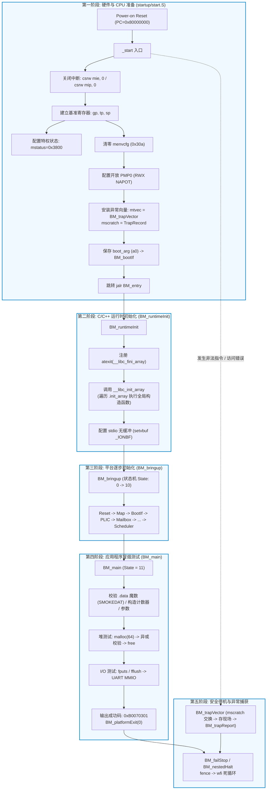

### 1.3 核心发现：桩函数（Stub）与真实硬件的边界

在反汇编审计中，我们发现了一个至关重要的事实：

```asm
00000000800003fa <BM_platformCtrl>:
  800003fa: 1141          c.addi sp,-16
  800003fc: e022          c.sdsp s0,0(sp)
  800003fe: e406          c.sdsp ra,8(sp)
  80000400: 0800          c.addi4spn s0,sp,16
  80000402: 6402          c.ldsp s0,0(sp)
  80000404: 60a2          c.ldsp ra,8(sp)
  80000406: 4501          c.li   a0,0            # 关键：直接将返回值 a0 置 0！
  80000408: 0141          c.addi sp,16
  8000040a: 8082          c.jr   ra              # 直接返回
```

包括 `BM_platformPlic`、`BM_platformMailbox`、`BM_platformCmdRing`、`BM_platformEngine` 在内的大部分底层接口，反汇编后**除了调整栈帧与返回 0 外，没有做任何真实的硬件寄存器配置**。

> [!NOTE] 结论
> 这个测试固件的核心目的是验证**软件调用链、状态机推进逻辑、C 运行时支撑库与异常体系的连通性**，而不是验证 NPU 真实硬件单元（如卷积引擎、中断控制器）的硬件功能。这是 Bring-up 早期标准的软件工程解耦策略。

---

## 二、第一阶段：`_start` 复位入口——构筑 CPU 物理世界观

指令从复位地址 `0x80000000` 开始。此时硬件刚脱离 Reset 状态，处理器内的大多数通用寄存器处于未定义或随机状态，内存没有栈，也没有页表。

```asm
0000000080000000 <_start>:
  80000000: 30401073          csrw    mie,zero
  80000004: 34401073          csrw    mip,zero
  80000008: 000f0197          auipc   gp,0xf0
  8000000c: 7f818193          addi    gp,gp,2040    # 0x800f0800 <__global_pointer$>
  80000010: 00003217          auipc   tp,0x3
  80000014: 02820213          addi    tp,tp,40      # 0x80003038 <__tp_init>
  80000018: 000fd117          auipc   sp,0xfd
  8000001c: 76810113          addi    sp,sp,1896    # 0x800fd780 <__stack_top>
  80000020: 6291              c.lui   t0,0x4
  80000022: 8002829b          addiw   t0,t0,-2048   # t0 = 0x3800
  80000026: 30029073          csrw    mstatus,t0
  8000002a: 4281              c.li    t0,0
  8000002c: 30a29073          csrw    0x30a,t0      # menvcfg
  80000030: 7a00128b          nds.addigp t0,1952    # t0 = 0x800f0fa0 <__trap_record_base>
  80000034: 34029073          csrw    mscratch,t0
  80000038: 00000297          auipc   t0,0x0
  8000003c: 4b028293          addi    t0,t0,1200    # 0x800004e8 <BM_trapVector>
  80000040: 30529073          csrw    mtvec,t0
  80000044: 52fd              c.li    t0,-1
  80000046: 0012d293          srli    t0,t0,0x1     # t0 = 0x7fffffffffffffff
  8000004a: 3b029073          csrw    pmpaddr0,t0
  8000004e: 42fd              c.li    t0,31         # 0x1f
  80000050: 3a029073          csrw    pmpcfg0,t0
  80000054: 7380128b          nds.addigp t0,1848    # t0 = 0x800f0f38 <BM_bootIf>
  80000058: 00a2b023          sd      a0,0(t0)      # 保存 boot arg
  8000005c: 00000097          auipc   ra,0x0
  80000060: 2dc080e7          jalr    732(ra)       # 跳转 BM_entry (0x80000338)
  80000064: 10500073          wfi                   # 若返回则休眠
  80000068: bff5              c.j     0x80000064
```

### 2.1 关闭中断与清理挂起：为什么关了 `mie` 还要清 `mip`？

在启动前两行代码中：
```asm
csrw mie, zero      # 关中断使能
csrw mip, zero      # 清除挂起中断
```

许多初学者会疑惑：**既然已经把 `mie`（使能开关）彻底关死了，外部中断绝对不会响应，为什么还要多此一举清空 `mip`（挂起状态）？**

这是裸机启动中最经典的安全设计细节之一。在 RISC-V 体系中，一个中断要最终打断 CPU 执行，必须满足**三者与运算（AND）**：


- `mie` 是**门铃的声音开关**（开/关）；
- `mip` 是**门铃按钮是否被按住**（有人按铃=1 / 没人按铃=0）；
- `mstatus.MIE` 是**主人的耳朵（全局总使能）**。

执行 `csrw mie, zero` 只是把门铃静音，**但门外有人按铃的历史事实依然记录在 `mip` 寄存器中**。

> [!CAUTION] 隐藏的踩坑雷区
> 芯片复位时，硬件并不保证 `mip` 的初始值一定是 0（外部外设、定时器、仿真器环境可能早已拉高了中断信号线）。
> 
> 如果此时**不清空 `mip`**，当程序完成 Bring-up，并在后续某个时刻执行 `csrs mstatus, MIE` 打开全局中断时，**先前遗留的历史中断会瞬间爆发，CPU 会在一个不可预知的位置立即强行跳转进 Trap**。而此时你的驱动或上下文环境可能根本未准备好，系统将直接崩溃。
> 
> 因此，启动时对 `mip` 进行清零是确立“初始确定态”的必要防护。（注：硬件驱动的只读中断位写 0 会被硬件忽略，需要后续平台驱动清外设源）。

---

### 2.2 确立内存世界坐标：`gp`、`tp`、`sp` 的建立与 PC 相对寻址

RISC-V 采用精简指令集，没有一条 32 位机器指令能把一个 64 位立即数直接塞进寄存器。这里使用了经典的 **`auipc + addi` 组合拳**：

```text
auipc rd, imm20   -->  rd = PC + (imm20 << 12)
addi  rd, rd, imm12 --> rd = rd + sign_extend(imm12)
```

以初始化全局指针 `gp` 为例：
- `80000008: auipc gp, 0xf0`：当前 PC 为 `0x80000008`，立即数 `0xf0 << 12 = 0xf0000`。
  `gp = 0x80000008 + 0xf0000 = 0x800f0008`。
- `8000000c: addi gp, gp, 2040`：`2040 = 0x7f8`。
  `gp = 0x800f0008 + 0x7f8 = 0x800f0800`（精确指向链接脚本定义的符号 `__global_pointer$`）。

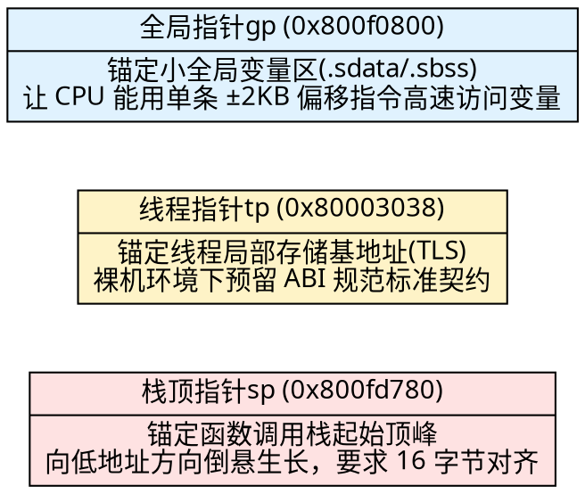

只有当 `sp = 0x800fd780` 执行完毕后，CPU 才真正具备了调用 C/C++ 函数的物理条件！

---

### 2.3 机器模式特权配置与 PMP 内存防火墙

```asm
80000020: 6291        c.lui   t0,0x4        # t0 = 0x4000
80000022: 8002829b    addiw   t0,t0,-2048   # t0 = 0x4000 - 0x800 = 0x3800
80000026: 30029073    csrw    mstatus,t0
```

`mstatus`（Machine Status）被写入 `0x3800`：
- `0x3800` 的二进制为 `0011 1000 0000 0000b`。
- 其 bit 12:11 为 `MPP[1:0] = 11b`，代表 **Previous Privilege 为 Machine 模式（最高权限态）**。
- bit 3 为 `MIE = 0`，确保全局机器中断此时仍处于关闭状态。

随后配置 PMP（Physical Memory Protection）：
```asm
80000044: c.li t0,-1
80000046: srli t0,t0,0x1      # t0 = 0x7fffffffffffffff
8000004a: csrw pmpaddr0,t0
8000004e: c.li t0,31          # 0x1f
80000050: csrw pmpcfg0,t0
```
- `0x1f = 0001 1111b`：低 3 位 `R/W/X = 111b`（允许读、写、执行），匹配模式 `A = 11b`（NAPOT，自然对齐的 2 的幂次方区域）。
- 这是在启动初期为物理内存设置的一张**全开放通行证**，确保后续取指和读写数据不会触发 PMP 权限故障。

---

### 2.4 实战惊魂：`0x30a`（`menvcfg`）非法指令异常（Trap）的复盘与防范

在启动代码第 0x8000002c 处，有一条极易引发血案的指令：
```asm
8000002a: c.li t0,0
8000002c: 30a29073    csrw 0x30a,t0
```

> [!WARNING] 真实踩坑案例
> 曾经有工程师在将固件迁移到某款老版本 Andes 核或通用 QEMU 模拟器运行时，CPU 刚跑两行就在 `0x8000002c` 突然触发 **非法指令异常（Illegal Instruction Exception, mcause = 2）**，直接猝死。
> 
> 初学者常犯的误区是：“我只是往寄存器写了个 0，0 怎么会有毒？”

#### 真相大白：什么是 `0x30a`？
很多初学者以为以 `0x30a` 这种怪异地址开头的 CSR 是芯片厂商私自魔改的私有寄存器。**其实不然**：
- `0x30a` 是 RISC-V 官方标准特权架构引入的 **`menvcfg`（Machine Environment Configuration Register，机器环境配置寄存器）**。
- 它用于控制扩展特权能力（如缓存块清除使能 `CBIE`、指针掩码 `PM`、S 模式时间比较使能 `STCE` 等）。

#### 为什么会猝死？特权架构规范的版本鸿沟！
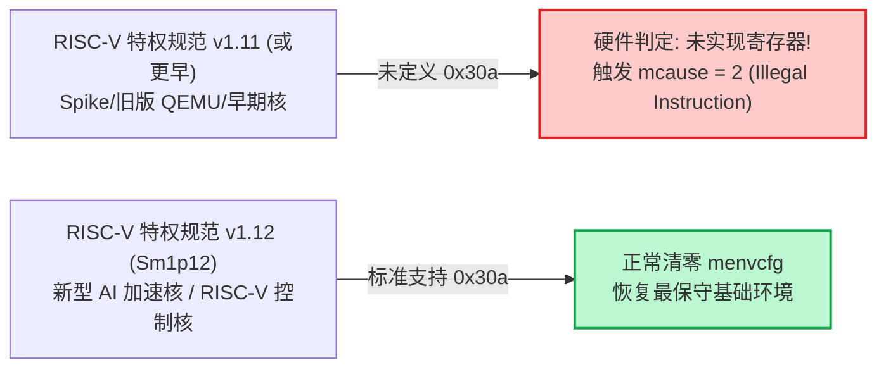

#### 工程防御策略
一个健壮的跨平台启动代码不应该“盲写”高级 CSR：
1. **特性检测与探针机制**：在执行前读取架构版本（如 `misa`），或利用 Trap 恢复机制嗅探 `menvcfg` 是否存在（类似 OpenSBI 的 probe 做法）；
2. **条件编译/裁剪**：如果目标硬件明确是基础裸机且不需要 `menvcfg` 高级特性，可在编译选项中直接剔除此行。

---

### 2.5 裸机异常处理的精髓：`mscratch` 与通用寄存器的“乾坤大挪移”

在没有任何操作系统的裸机下，如果 CPU 执行遇到 Bug，它是怎么做到**不破坏任何一个寄存器原貌，把犯罪现场完美打包**的？

这就是 RISC-V 体系架构中最精彩的软硬件协同设计：**`mscratch` 寄存器原子交换**。

在 `_start` 中：
```asm
80000030: nds.addigp t0,1952   # t0 = 0x800f0fa0 = __trap_record_base (TrapRecord 区域)
80000034: csrw mscratch,t0     # mscratch 提前存好这个备份区指针
```

一旦发生 Trap，CPU 硬件将 PC 强行指向 `mtvec`（即 `BM_trapVector`）：
```asm
00000000800004e8 <BM_trapVector>:
  800004e8: csrrw t0,mscratch,t0  # 【灵魂指令】瞬间互换 t0 与 mscratch !
  800004ec: sd    zero,0(t0)      # 保存 x0
  800004f0: sd    ra,8(t0)        # 保存 ra
  800004f4: sd    sp,16(t0)       # 保存 sp
  ...
  80000568: csrr  t1,mscratch     # 取出暂存在 mscratch 里的被打断前的原始 t0
  8000056c: sd    t1,40(t0)       # 完美补存原始 t0 !
```

我们用时序图还原这个“魔术”：

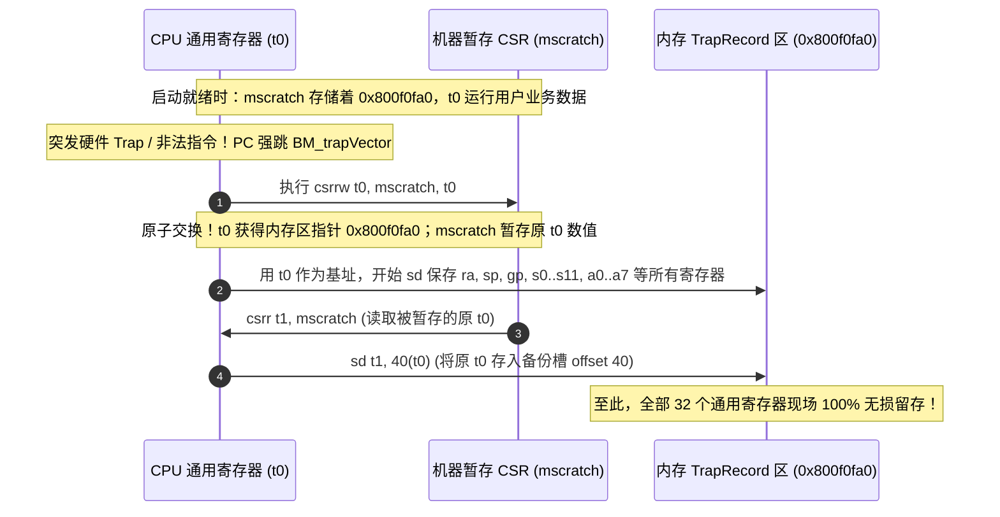

这种不依赖任何可用栈空间、在空手套白狼的状态下实现无损现场保护的手法，是所有裸机系统程序员必须掌握的经典绝技。

---

### 2.6 引导参数交接：从 `a0` 到 `BM_bootIf`

```asm
80000054: nds.addigp t0,1848   # t0 = &BM_bootIf
80000058: sd a0,0(t0)          # 将外部固件/加载器传入的 a0 存入内存
8000005c: auipc ra,0x0
80000060: jalr 732(ra)         # 进入 BM_entry (0x80000338)
```
在 RISC-V 调用约定中，外部环境（如仿真器 testbench、上一级 bootloader）在唤醒 CPU 时，通常会在 `a0` 寄存器里放入一个指向硬件接口结构体的指针。启动代码必须在 `a0` 被后续函数破坏之前，将其固化到全局变量 `BM_bootIf` 中。

---

## 三、第二阶段：`BM_runtimeInit`——唤醒 C/C++ 运行时

CPU 从汇编世界跳入了 C 语言函数 `BM_entry`，进而调用 `BM_runtimeInit`（0x80000454）。

很多人误以为“既然有 C 编译器，写出来的 C++ 程序就能直接跑”。这是完全错误的。**C++ 代码中各种全局对象、标准输入输出流，必须由运行时代码主动催熟唤醒。**

### 3.1 C++ 全局对象初始化秘密：`.init_array` 与 `__libc_init_array`

假设在源码中有这样一个 C++ 类：
```cpp
struct SmokeInitializer {
    SmokeInitializer() {
        ++smokeConstructorCount; // 构造函数：给全局计数器加 1
    }
};

SmokeInitializer globalInstance; // 全局对象！
```

CPU 的硬件取指译码电路根本不认识什么是构造函数。编译器与链接器是怎么配合完成这一魔法的？

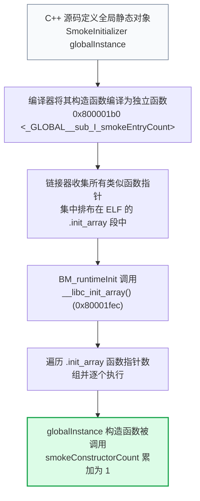

在反汇编中，我们清晰地看到了由编译器生成的构造包装器：
```asm
00000000800001b0 <_GLOBAL__sub_I_smokeEntryCount>:
  800001b8: 7200170b    nds.addigp a4,1824   # smokeConstructorCount 的地址
  800001bc: 631c        c.ld a5,0(a4)        # 读出原值
  800001c0: 0785        c.addi a5,1          # 累加 1
  800001c2: e31c        c.sd a5,0(a4)        # 写回
  800001c8: 8082        c.jr ra
```
这就是为什么后续冒烟测试 `BM_main` 会检查 `smokeConstructorCount == 1`：**它在肉身验证编译器的 `.init_array` 链路有没有真正通电运转！**

---

### 3.2 析构处理：`atexit(__libc_fini_array)` 及其在裸机中的现实约束

`BM_runtimeInit` 还会将析构函数数组注册进 libc：
```asm
80000488: auipc a0,0x2
8000048c: addi  a0,a0,-1072    # __libc_fini_array
80000492: jal   0x800009f4 <atexit>
```
然而在裸机开发中必须清醒认知：**注册了析构函数，并不代表最后一定会被执行**。当前系统的 `BM_platformExit` 最终直接跳往 `BM_failStop` 死循环停机，而非标准的 OS 进程正常退出流程，因此很多资源清理代码在裸机下其实是“终身不调用”的。

---

### 3.3 为什么标准输出必须设置 `_IONBF`（无缓冲）？

反汇编中有一组关键调用：
```asm
800004aa: c.li  a2,2           # _IONBF (无缓冲模式编码)
800004ac: c.li  a1,0           # buf = NULL
800004ae: jal   0x800019f8 <setvbuf>
```
它连续对两个标准流执行了 `setvbuf(stream, NULL, _IONBF, 0)`。

> [!IMPORTANT] 为什么必须无缓冲？
> 普通 Linux 程序中的 `printf("hello\n")` 或 `fputs`，为了性能考虑，C 库通常采用行缓冲或全缓冲，数据先堆在内存缓冲区里，只有遇到换行符或缓冲区满才真正调用 `write` 写硬件。
> 
> 但在**裸机 Bring-up 阶段**：系统随时可能因为偶发异常（如时钟错误、总线挂死、访问越界）直接 Hard-Fault 停机。如果此时日志被积压在缓冲区里，**调试终端上将一片死寂，开发者完全看不到崩溃前最后打印出的“救命线索”**。
> 
> 设置为 `_IONBF` 后，任何一个字符的打印都将**立即穿透 C 库直达 MMIO 硬件寄存器**，这对于硬件早期故障定位是生死攸关的。

---

## 四、第三阶段：`BM_bringup`——分阶段有限状态机（FSM）

在进入用户测试代码前，系统调用了 `BM_bringup`（0x80000264）。它设计了一个严密的状态机流水线：

### 4.1 硬件初始化的 11 个依赖阶段

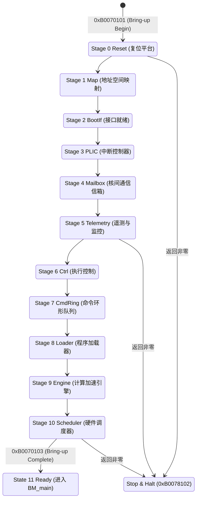

每个阶段的代码遵循标准模式：
```c
result = BM_platformModule();
if (result != 0) {
    stop(currentState, 0xB0078102, result); // 失败立即阻断并上报错误码
}
currentState = currentStage;
BM_writeCode(0xB0070102);                  // 向调试口通知进度码
```

---

## 五、第四阶段：`BM_main`——真正的冒烟验证实战

进入 `BM_main`（0x80000070），真正的硬件与软件协同大考正式拉开帷幕。

### 5.1 内存段真伪自检：`.data`、`.bss` 与魔数校验

测试代码首先读取并核验了一批关键变量：
```asm
800000d8: lui  a5,0x534d5
800000e0: addi a5,a5,-181     # a5 = 0x534d4f4b ("SMOK")
800000dc: lui  a4,0x45444
800000e4: addi a4,a4,340      # a4 = 0x45444154 ("EDAT")
800000e8: c.slli a5,32
800000ea: c.add a5,a4         # 拼接得到 64 位魔数: 0x534d4f4b45444154 ("SMOKEDAT")
800000ec: nds.ldgp a3,384     # 从 .data 段加载 smokeData 的值
800000f0: bne  a3,a5, fail    # 若不相等，直接判死刑！
```

这一连串检查的意图极为深奥：
1. **`.bss` 校验**：`smokeEntryCount == 0` 和 `smokeResult == 0`，确认未显式初始化的全局变量确实被正确清零；
2. **`.data` 校验**：`smokeData == "SMOKEDAT"`，确认有初值的全局变量其镜像是否被完整加载到了 RAM 中；
3. **构造器校验**：`smokeConstructorCount == 1`；
4. **状态校验**：`BM_state() == 11`（系统处于 Ready 态）；
5. **参数校验**：`smokeObservedArg != nullptr`。

---

### 5.2 没有操作系统时，`malloc` 是如何工作的？（`_sbrk` 与 4KB 堆空间）

在 Linux 下，`malloc` 最终通过 `brk` 或 `mmap` 系统调用向内核索取虚拟内存页。**在裸机下，根本没有内核，`malloc` 到底是如何申请内存的？**

答案就在 newlib 提供的底层桥梁：`_sbrk`（0x8000099a）。

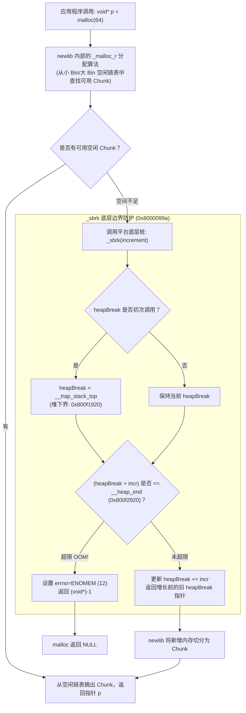

在反汇编中，我们清晰地抓到了固件为动态堆划定的生命红线：
- 堆底起始指针（Heap Minimum）：`0x800f1920`（紧贴着 Trap 栈顶）；
- 堆顶最大上限（Heap Maximum）：`0x800f2920`（符号 `__heap_end`）；
- **总可用堆空间**：`0x800f2920 - 0x800f1920 = 0x1000`，即**精确的 4 KiB（4096 字节）**。

冒烟测试随后执行了严苛的读写自检：
```cpp
unsigned char* p = (unsigned char*)malloc(64);
for (int i = 0; i < 64; ++i) {
    p[i] = (unsigned char)(i ^ 0x5A); // 写入特定的异或扰乱特征码
}
for (int i = 0; i < 64; ++i) {
    if (p[i] != (unsigned char)(i ^ 0x5A)) { // 逐字节读回验证！
        fail(); // 内存读写失真，硬件总线或 RAM 异常
    }
}
free(p); // 释放内存
```
这不仅测试了 `malloc/free` 链表管理算法，更是直接对**片上物理 RAM 的数据保持能力**进行了一次微型质检。

---

### 5.3 物理内存拓扑与地址布局（Graphviz 全景图）

根据反汇编解析出的所有关键符号与绝对物理地址，我们绘制出这份固件完整的内存分布全貌：

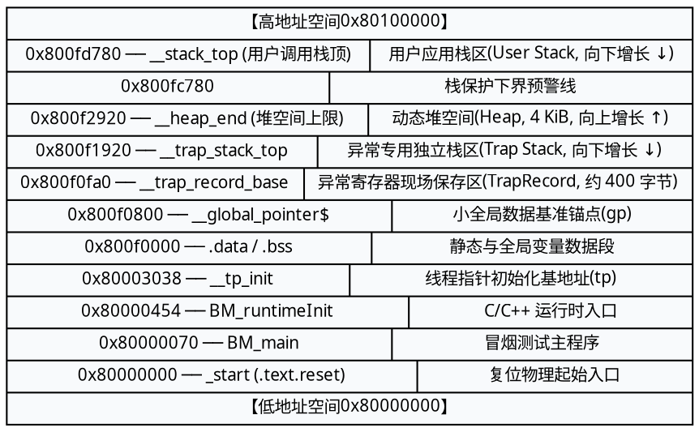

---

### 5.4 标准 C 库与硬件 MMIO 字符输出链路

在没有操作系统 `write(2)` 系统调用的情况下，`fputs("Smoke Test\n", stdout)` 最终是如何从硬件串口吐出字符的？

整个调用链条如下：

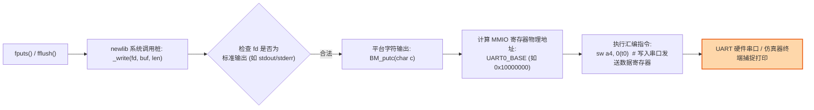

---

## 六、第五阶段：异常处理、现场取证与安全停机

### 6.1 `BM_trapVector`：全寄存器现场封存

当不可预知的异常发生时，`BM_trapVector`（0x800004e8）依次封存系统全景：
1. 32 个通用寄存器（`x0` 至 `x31`）；
2. 4 大核心机器状态 CSR：
   - `mepc`（偏移 +256）：故障发生时光标指向的那条**受害者指令地址**；
   - `mcause`（偏移 +264）：引发灾难的具体原因（如 2=非法指令，5=加载访问错误，12=指令页错误）；
   - `mtval`（偏移 +272）：异常附加值（如导致崩溃的那个非法内存地址，或未译码成功的指令机器码）；
   - `mstatus`（偏移 +280）：崩溃时的特权与中断状态。

### 6.2 切换独立 Trap 栈：防范第二次灾难

在常规程序中，异常处理代码往往会下意识地使用当前 `sp` 指针压栈。
但在裸机设计中，这是极度危险的：**很多 Trap 本身就是由于用户栈溢出（Stack Overflow）或 `sp` 变成了野指针触发的！**

如果继续用脏污的 `sp` 压栈，会立即引发双重错误（Double Fault）死锁。

`BM_trapVector` 展现了教科书级的防御性编程：
```asm
800005e0: auipc sp,0
800005e4: ld    sp,168(sp)    # sp 强行重置为 0x800f1920 (__trap_stack_top)
```
**彻底抛弃可能已粉身碎骨的用户栈，立即强切到专用的独立 Trap 栈空间！**

### 6.3 防嵌套崩溃机制与 `wfi` 终极休眠

在调用 C 语言报告函数 `BM_trapReport` 之前，汇编代码还做了一道精巧的防线：
```asm
800005bc: auipc t1,0
800005c0: addi  t1,t1,56      # t1 = BM_nestedHalt
800005c4: csrw  mtvec,t1      # 将 mtvec 临时重定向到紧急停止桩！
```
如果 `BM_trapReport` 自身的打印逻辑存在 Bug 再次引发异常，CPU 将不再递归回到复杂的处理流，而是直接坠入 `BM_nestedHalt` 执行 `fence`、关中断，并进入 `wfi`（Wait For Interrupt）永久等待。

---

## 七、深度扩展：指令集双剑合璧——RVC 压缩指令与 Andes 扩展

阅读这份反汇编时，初学者会被大量以 `c.*` 和 `nds.*` 开头的指令所困扰。

### 7.1 RVC（16 位压缩指令 `c.*`）的解码转换

RISC-V 的 **C 扩展（Compressed Extension）** 采用等长 16 位紧凑编码，它**不是另一套微架构**，只是经典 32 位指令的高频缩写宏，在硬件译码器阶段会被透明解压缩为标准 32 位操作：

| 压缩指令反汇编 | 标准 RV64 等价伪代码 | 作用与功能 |
| :--- | :--- | :--- |
| `c.li a0, 0` | `addi a0, x0, 0` | 极快地将寄存器清零或赋小常数 |
| `c.mv s1, a0` | `addi s1, a0, 0` | 寄存器之间高速数据传递 |
| `c.sdsp ra, 8(sp)` | `sd ra, 8(sp)` | 利用当前栈指针高效备份关键寄存器 |
| `c.ldsp s0, 0(sp)` | `ld s0, 0(sp)` | 从当前栈槽迅速恢复调用者保存的寄存器 |
| `c.j label` | `jal x0, label` | 16 位短跳转，不保存返回地址 |
| `c.jr ra` | `jalr x0, ra, 0` | 极其优雅的 16 位子函数返回指令（`ret`） |

---

### 7.2 Andes 厂商扩展指令（`nds.*`）速查与解析

这份固件运行在晶心科技（Andes Technology）的 RISC-V 核上，大量引入了专有的 **AndeStar V5 扩展指令集**。它们在标准 RISC-V 规范中是查不到的：

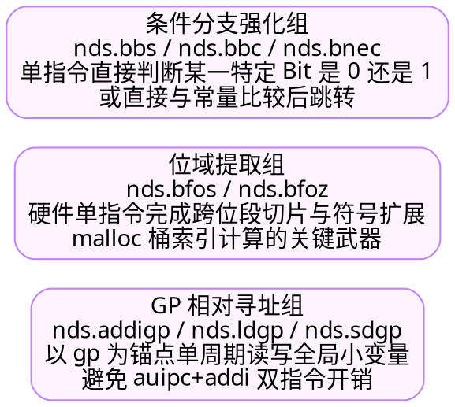

- **`nds.addigp rd, imm`**：`rd = gp + imm`，单周期直出符号物理地址；
- **`nds.ldgp rd, imm`**：`rd = *(gp + imm)`，单周期直接从全局变量区装载 64 位数值；
- **`nds.bnec rs, imm, label`**：`if (rs != imm) goto label`，免去了先用一个临时寄存器加载立即数再调 `bne` 的繁琐过程。

> [!WARNING] 仿真器选型警告
> 如果你在日常开发中尝试拿原汁原味的开源 QEMU（如 `qemu-system-riscv64 -cpu rv64`）直接加载执行这个 ELF，系统会在第一条 `nds.addigp` 处直接暴毙（报非法指令错误）。必须使用 Andes 官方定制的 QEMU 或硬件仿真器（ISS）方可正常运行。

---

## 八、排错工程矩阵与调试方法论

为了帮助后续在开发新平台或调试控制核固件的读者少走弯路，我们将本次 Bring-up 经验整理为经典问题排错矩阵：

| 故障现象 | 根本原因推断 | 首要检查点与验证动作 |
| :--- | :--- | :--- |
| **一上电 PC 就飞出太空** | `sp` 栈未对齐或 `mtvec` 低 2 位模式配置错误 | 单步跟踪 `_start` 的 `auipc+addi`，确保 `mtvec` 满足 Direct 模式（低 2 位为 0），`sp` 严格 16 字节对齐。 |
| **进入第一个 C 函数就崩** | 栈空间与其他只读代码段产生重叠碰撞 | 检查链接脚本（`.ld`）中 `__stack_top` 与 `__heap_end`，确保栈区拥有至少几 KiB 的专属下行空间。 |
| **写 CSR 时突发非法指令** | 目标硬件微架构不支持该特权规范版本的 CSR | 检查 `mcause` 是否为 2。重点怀疑 `0x30a`（`menvcfg`）或私有 CSR，核对芯片硬件手册是否支持 Privileged Spec 1.12。 |
| **全局变量值全是一团乱码** | 引导程序未从存储介质向 RAM 搬运 `.data`，或未清零 `.bss` | 查看 Program Header 的 `p_memsz` 与 `p_filesz`，确认由 Loader 自动灌入还是需要在汇编中写搬运循环。 |
| **构造函数逻辑未执行** | 链接脚本漏掉了 `.init_array`，或漏调了 `__libc_init_array` | 在 `_GLOBAL__sub_I_*` 下硬件断点，确认初始化函数指针数组是否被正确遍历。 |
| **Trap 发生后看不到任何寄存器** | 异常处理入口第一条指令就误改了 `sp` 或 `t0` | 严格贯彻 `csrrw t0, mscratch, t0` 原语，坚决不允许在保护完成前破坏任何通用寄存器。 |
| **`malloc` 返回 NULL** | `_sbrk` 划定的堆边界过窄（如仅 4KB）或算法切片溢出 | 打印并监控 `heapBreak` 的演进轨迹，确认请求字节数是否超出了 `__heap_end` 的阈值。 |
| **串口看不到任何终端输出** | C 库内部标准流被全缓冲拦截，或 MMIO 物理地址映射偏差 | 必须在启动初期显式调用 `setvbuf(stdout, NULL, _IONBF, 0)` 取消缓冲，并用逻辑分析仪核验串口基地址。 |

---

## 九、总结：四层软件执行契约

回顾这场从零构筑的 RISC-V 探索之旅，我们可以将整个裸机系统的分工精炼为四个层级：

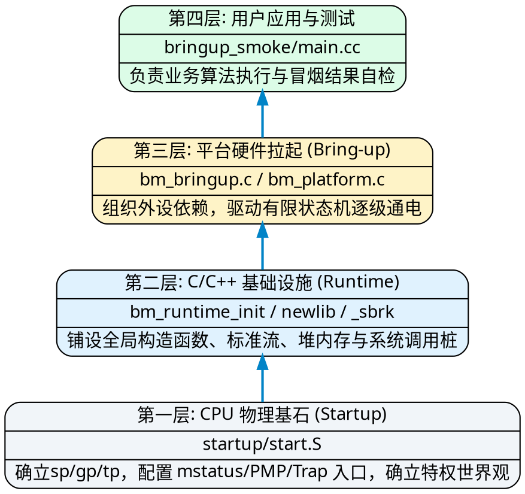

对每一位从事底层系统开发、AI 编译器后端或芯片固件开发的工程师而言，**机器指令本身从来不是孤立存在的**。你的编译器生成再精妙的算子汇编，也必须建立在这套稳固的四层执行契约之上。

透彻理解了 `_start` 的每一步拓荒历程，你就真正掌握了从硅片到可执行代码之间，那座最核心的系统桥梁。
