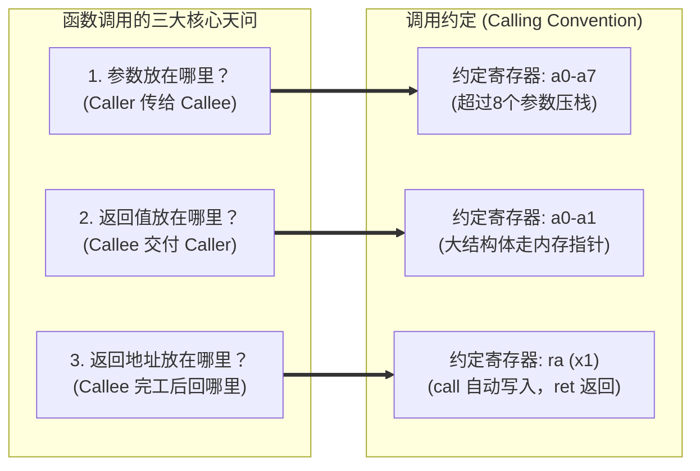
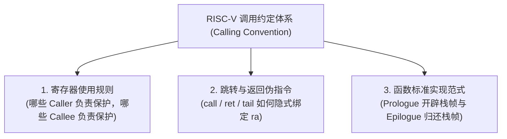
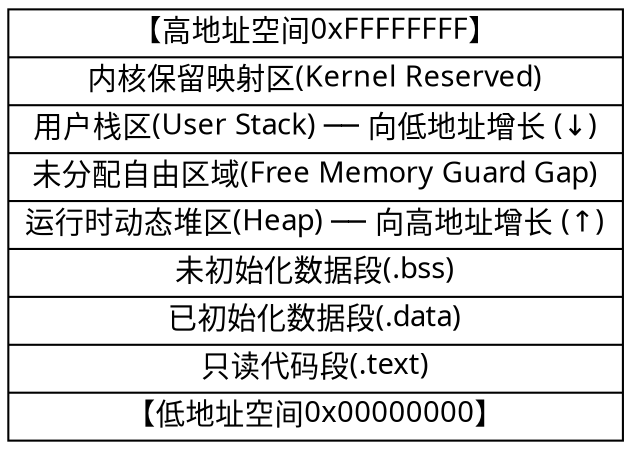
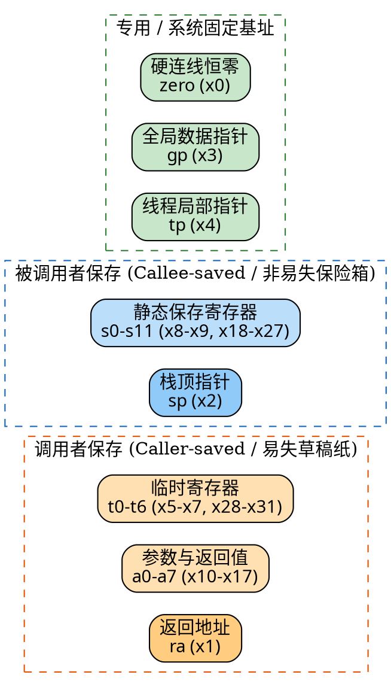
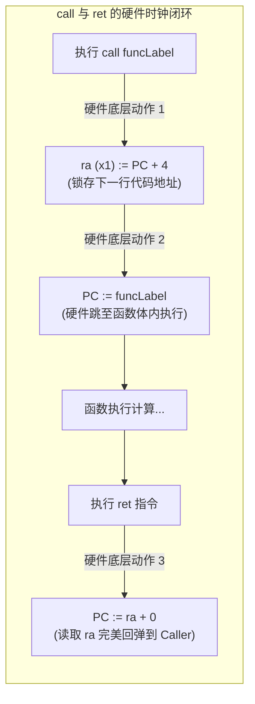
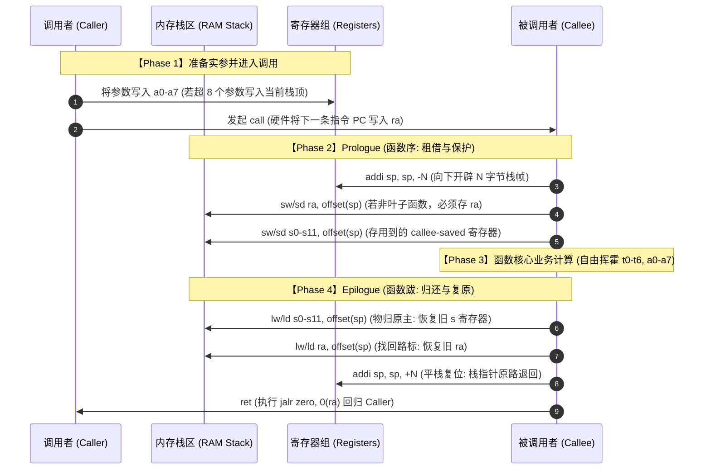
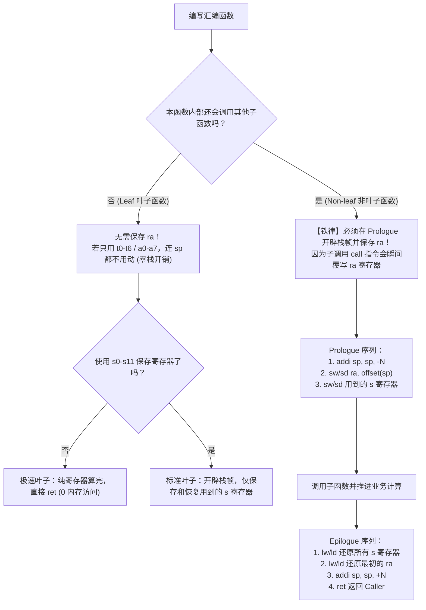
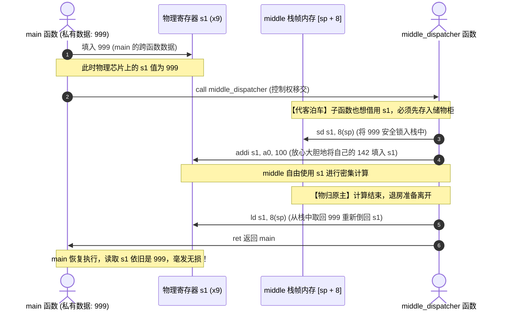

> **本文整理自**：汪辰老师精品课程《循序渐进，学习开发一个 RISC-V 上的操作系统》（2021 春）第 5 章 part7 核心讲义。
> **主题聚焦**：RISC-V 汇编语言中的 **函数调用约定（Calling Convention）**、**寄存器生命周期契约**、**栈帧（Stack Frame）物理布局** 与 **链式栈回溯（Stack Unwinding）**。
> **深度补充**：已修正语音识别及文本转写缺陷，在初学者核心术语首次出现时补充直观生动的心智模型，配套多组原生渲染的 **Mermaid 交互时序图** 与 **Graphviz 架构图**，并提供可直接执行的 C++23 与裸机（Bare-metal）汇编实机编译反汇编证据。

---

## 目录导览

- [新手前置：核心术语生动心智模型速查](#新手前置核心术语生动心智模型速查)
- [一、引言：为什么需要函数调用约定？](#一引言为什么需要函数调用约定)
  - [1.1 函数调用的「三大核心天问」](#11-函数调用的三大核心天问)
  - [1.2 API 与 ABI 的本质鸿沟](#12-api-与-abi-的本质鸿沟)
  - [1.3 调用约定的三大支柱](#13-调用约定的三大支柱)
- [二、栈（Stack）与函数栈帧（Stack Frame）解密](#二栈stack与函数栈帧stack-frame解密)
  - [2.1 栈的生活隐喻与内存倒悬模型](#21-栈的生活隐喻与内存倒悬模型)
  - [2.2 RISC-V 栈从高地址向低地址增长的机制](#22-risc-v-栈从高地址向低地址增长的机制)
  - [2.3 函数栈帧（Stack Frame）的内部剖析](#23-函数栈帧stack-frame的内部剖析)
  - [2.4 典型进程内存布局与栈溢出（Stack Overflow）防范](#24-典型进程内存布局与栈溢出stack-overflow防范)
- [三、调用者（Caller）与被调用者（Callee）的角色契约](#三调用者caller与被调用者callee的角色契约)
- [四、RISC-V 32 个通用寄存器编程约定（ABI 寄存器总表）](#四risc-v-32-个通用寄存器编程约定abi-寄存器总表)
  - [4.1 规范真名与 ABI 别名总览](#41-规范真名与-abi-别名总览)
  - [4.2 核心三类寄存器的语义与生命周期](#42-核心三类寄存器的语义与生命周期)
  - [4.3 专用与系统级寄存器（zero, ra, sp, gp, tp, fp）](#43-专用与系统级寄存器zero-ra-sp-gp-tp-fp)
  - [4.4 约定背后的收益：编译器的成本博弈](#44-约定背后的收益编译器的成本博弈)
- [五、函数跳转与返回指令的约定（伪指令硬件映射）](#五函数跳转与返回指令的约定伪指令硬件映射)
  - [5.1 伪指令与真实指令对照](#51-伪指令与真实指令对照)
  - [5.2 尾调用优化（Tail-Call Optimization）机理](#52-尾调用优化tail-call-optimization机理)
- [六、被调用函数的标准骨架：Prologue 与 Epilogue](#六被调用函数的标准骨架prologue-与-epilogue)
  - [6.1 Prologue（函数序 / 开场白）三部曲](#61-prologue函数序--开场白三部曲)
  - [6.2 Epilogue（函数跋 / 谢幕词）四步曲](#62-epilogue函数跋--谢幕词四步曲)
- [七、经典汇编实战对比：叶子函数 vs 非叶子函数](#七经典汇编实战对比叶子函数-vs-非叶子函数)
  - [7.1 示例一：叶子函数（Leaf）—— `square(a)=a*a`](#71-示例一叶子函数leaf--squareaaa)
  - [7.2 示例二：非叶子函数（Non-leaf）—— `aabb(a,b)=a²+b²`](#72-示例二非叶子函数non-leaf--aabbaaba²b²)
  - [7.3 为什么非叶子函数必须保存 ra？（踩坑推演）](#73-为什么非叶子函数必须保存-ra踩坑推演)
  - [7.4 叶子与非叶子函数决策树](#74-叶子与非叶子函数决策树)
- [八、C++23 概念同构演示：从高级语言透视寄存器行为](#八c23-概念同构演示从高级语言透视寄存器行为)
- [九、工业级全景大演练：三层调用时序与寄存器生命周期追踪](#九工业级全景大演练三层调用时序与寄存器生命周期追踪)
  - [9.1 场景架构设计与 C++ 源码](#91-场景架构设计与-c-源码)
  - [9.2 寄存器在三层调用链中的流转全景追踪](#92-寄存器在三层调用链中的流转全景追踪)
  - [9.3 栈帧物理内存空间结构切片图](#93-栈帧物理内存空间结构切片图)
- [十、灵魂三问：底层机理深度剖析](#十灵魂三问底层机理深度剖析)
  - [10.1 深度剖析：“旧 s1” 到底是指什么？（酒店代客泊车隐喻）](#101-深度剖析旧-s1-到底是指什么酒店代客泊车隐喻)
  - [10.2 深度剖析：`s0/fp` 是 Callee-saved，“用前必须存”究竟意味着什么？](#102-深度剖析s0fp-是-callee-saved用前必须存究竟意味着什么)
  - [10.3 深度剖析：为什么非要保存旧 fp？（链式栈回溯 Stack Unwinding）](#103-深度剖析为什么非要保存旧-fp链式栈回溯-stack-unwinding)
- [十一、工业规范核心细节补充（讲义未展开的关键点）](#十一工业规范核心细节补充讲义未展开的关键点)
  - [11.1 16 字节栈对齐（Stack Alignment）强制约束的硬件根源](#111-16-字节栈对齐stack-alignment强制约束的硬件根源)
  - [11.2 参数超过 8 个与大结构体传递协议](#112-参数超过-8-个与大结构体传递协议)
  - [11.3 浮点寄存器调用约定（ilp32f / lp64d）](#113-浮点寄存器调用约定ilp32f--lp64d)
  - [11.4 帧指针省略优化（`-fomit-frame-pointer`）的权衡](#114-帧指针省略优化-fomit-frame-pointer的权衡)
  - [11.5 `zero` (x0) 寄存器的硬件接地与零成本优化](#115-zero-x0-寄存器的硬件接地与零成本优化)
  - [11.6 `gp` 与 `tp` 在内核与线程库中的工作机制](#116-gp-与-tp-在内核与线程库中的工作机制)
- [十二、实机编译验证与反汇编对比（证据链）](#十二实机编译验证与反汇编对比证据链)
  - [12.1 RISC-V 裸机汇编编译与 objdump 反汇编逆向](#121-risc-v-裸机汇编编译与-objdump-反汇编逆向)
  - [12.2 C++23 宿主机执行验证](#122-c23-宿主机执行验证)
- [十三、总结与日常汇编速查手册](#十三总结与日常汇编速查手册)

---

## 新手前置：核心术语生动心智模型速查

在正式进入汇编代码前，我们先把初学者常常感到晦涩的专业名词，用最直观的日常生活比喻梳理一遍：

| 专业术语                  | 英文全称                         | 💡 初学者通俗比喻与心智模型                                                                                                                                  |
| :------------------------ | :------------------------------- | :----------------------------------------------------------------------------------------------------------------------------------------------------------- |
| **调用约定**              | **Calling Convention**           | **“跨团队的寄存器租借交接合同”**。CPU 只有一套物理寄存器，所有函数轮流用。合同白纸黑字写明：参数放哪桌、返回值放哪盘、谁擦桌子、谁把物品原样归还。           |
| **ABI**                   | **Application Binary Interface** | **“机器码层面的硬件规矩”**。API 是高级语言源码层的规矩（函数名/形参类型），而 ABI 是两进制字节级别的规矩（用哪个寄存器传参、栈按多少字节对齐、系统调用号）。 |
| **调用者 / 被调用者**     | **Caller / Callee**              | **“派活的老板（Caller）” 与 “接单的干活人（Callee）”**。例如 `main` 调用 `funcA`，`main` 就是 Caller，`funcA` 就是 Callee。                                  |
| **函数栈帧**              | **Stack Frame**                  | **“函数在内存酒店里临时开的钟点房包厢”**。函数进入时向内存低地址开辟一块私有区域，存放局部变量和备份寄存器；退出时退房清空。                                 |
| **Caller-saved (易失)**   | **调用者保存寄存器**             | **“会议室的公共白板 / 临时草稿纸”**。Callee 进去后可以随便写画涂抹。Caller 如果后面还要用原先写的内容，Caller 必须自己在开会前抄到自己的本子上（压栈）。     |
| **Callee-saved (非易失)** | **被调用者保存寄存器**           | **“带密码锁的贵重保险柜”**。谁想临时占用这个保险柜，谁就必须在用之前把别人的东西原封不动挪出并记在账本上（压栈），退房前原样放回。                           |
| **栈指针 `sp`**           | **Stack Pointer (x2)**           | **“指向当前栈最底端（最低地址）的活动标尺”**。压栈时标尺向下移（`sp - N`），退栈时标尺向上升（`sp + N`）。                                                   |
| **帧指针 `fp / s0`**      | **Frame Pointer (x8)**           | **“锚定当前栈帧底部的定海神针”**。当函数内有变长数组导致 `sp` 动态上下乱晃时，`fp` 纹丝不动，方便通过固定偏移准确寻址局部变量。                              |
| **返回地址 `ra`**         | **Return Address (x1)**          | **“回家的导航记录 / 返程车票”**。调用函数时硬件把下一行指令地址自动塞进 `ra`，函数执行完后根据 `ra` 就能一键回家。                                           |
| **叶子函数**              | **Leaf Function**                | **“树梢末端的叶子，不再分叉”**。内部不再调用任何其他子函数。因为它不调别人，所以自己的返程车票（`ra`）绝不会被弄丢，无需压栈。                               |
| **栈回溯**                | **Stack Unwinding**              | **“顺藤摸瓜拔萝卜”**。程序崩溃时，调试器顺着每一层保存在栈上的旧 `fp` 单向链表，一层层向上找回完整的调用链路。                                               |

---

## 一、引言：为什么需要函数调用约定？

在计算机科学中，**函数（Function / Subroutine）** 是组织逻辑、复用代码的核心单元。无论是 `C` 语言中的 `add(x, y)`，还是 Python、Rust 中的函数调用，最终编译到底层硬件时，都必须转化为一条条底层的 CPU 指令。

### 1.1 函数调用的「三大核心天问」

当函数 `A`（Caller）调用函数 `B`（Callee）时，硬件本身只是一堆无意识的硅片晶体管，它面临三个根本问题：

1. **参数放在哪里？** —— Caller 怎么把输入数据优雅、极速地交到 Callee 手里？
2. **返回值放在哪里？** —— Callee 计算完结果后，Caller 应该去哪个物理位置取走它？
3. **返回地址放在哪里？** —— Callee 执行完毕后，怎么知道下一条该执行 Caller 哪一行代码？



如果整套程序从头到尾只有你一个人手写汇编，你完全可以随心所欲：比如把返回值塞进 `x5`，把返回地址放在 `x29`。

然而在工业级工程中，**Caller 和 Callee 往往由不同人编写、甚至由不同编译器（GCC / Clang）、不同编程语言（C++、Rust、Go、汇编）分别编译成 `.o` 目标文件再通过 Linker（链接器）拼合在一起**。如果没有一套具有法律效力般的统一协议，整个软件大厦会在一瞬间坍塌！

### 1.2 API 与 ABI 的本质鸿沟

很多人容易混淆 **API** 与 **ABI**：

- **API（Application Programming Interface，应用程序编程接口）**：是**源代码层面**的接口协议。例如 C 语言头文件中的声明 `int printf(const char* fmt, ...);`。只要函数名、形参类型和返回值类型匹配，源码就能通过编译。
- **ABI（Application Binary Interface，应用程序二进制接口）**：是**机器码二进制层面**的接口契约。它直接定义了：
  - 数据类型在内存中的实际大小和字节对齐方式；
  - 机器指令如何传递参数、如何返回结果；
  - 哪几个物理寄存器属于临时草稿纸、哪几个属于不能损坏的保险箱；
  - 函数调用点（Call Site）上的栈指针对齐字节数；
  - 操作系统系统调用（System Call）的中断号规则。

> 📌 **ABI 标准小贴士**：RISC-V 拥有标准 ABI 矩阵。例如 `ilp32`（32 位系统、整数/长整型/指针均为 32 位、软浮点）、`ilp32f`（32 位带单精度硬件浮点）、`lp64`（64 位整型/指针、软浮点）、`lp64d`（64 位带双精度硬件浮点）。本文以嵌入式与操作系统最核心的 32/64 位通用寄存器约定为基准深度展开。

### 1.3 调用约定的三大支柱

一套完整的调用约定体系，在实现层面由三部分紧密交织而成：



---

## 二、栈（Stack）与函数栈帧（Stack Frame）解密

### 2.1 栈的生活隐喻与内存倒悬模型

在日常生活中，“Stack（栈）”最早来源于木材堆（Log Stack）或食堂餐盘架：

- **压栈（Push）**：只能往堆的最顶层放一块木头；
- **出栈（Pop）**：只能从最顶层拿走一块木头；
- **核心法则**：**后进先出（LIFO，Last In First Out）**。

但在现代计算机体系结构中，内存的物理地址是线性的数字（例如 `0x00000000` 到 `0xFFFFFFFF`）。**几乎所有主流架构（包括 x86、ARM、RISC-V）的栈，在逻辑上都是“倒悬”的，即从高地址往低地址延伸！**

> 💡 **倒悬栈心智模型**：
> 不要把栈想象成地上的木头堆，而要想象成**溶洞洞顶向下生长的“钟乳石”**：
>
> - 洞顶是**高地址**（栈底 Stack Bottom）；
> - 钟乳石的尖端垂向地面，是**低地址**（栈顶 Stack Top）；
> - 随着水滴凝结（压栈），钟乳石尖端向更低的地址延伸；
> - 随着尖端融化（出栈），尖端缩回向更高地址退回。

### 2.2 RISC-V 栈从高地址向低地址增长的机制

在 RISC-V 架构中：

- 专用寄存器 **`sp`（Stack Pointer，即 x2）** 永远指向当前有效数据的最底端（最低地址）；
- **开辟栈空间（压栈准备）**：向更低地址移动 `sp`，使用减法：`addi sp, sp, -N`；
- **释放栈空间（平栈出栈）**：向高地址归位 `sp`，使用加法：`addi sp, sp, +N`。

```
高地址 (High Address) ── 栈底 (Stack Bottom)
  ▲
  │   [ 已使用的有效栈空间 ]
  │   [ 函数 A 的局部数据 ]
  │   [ 函数 B 的局部数据 ]
  ▼
当前栈指针 sp ──────────> [ 最低有效数据边界 ]
  │
  │   (尚未使用的自由内存空间)
  ▼
低地址 (Low Address) ── 向下延伸 (sp 减小)
```

### 2.3 函数栈帧（Stack Frame）的内部剖析

当一个函数被调用时，它会在内存栈区为自己申请一块专属领地，这块领地就称为该函数的 **栈帧（Stack Frame）**。

栈帧主要负责安放三类至关重要的财产：

1. **自动变量 / 局部变量（Auto Variables）**：高级语言（如 C/C++）中函数内部未加 `static` 声明的局部变量，生命周期完全随着栈帧的建立而出生、随着栈帧的销毁而灰飞烟灭。
2. **保存的寄存器原值（Saved Registers）**：子函数想借用硬件寄存器算题，必须先在自己的栈帧里备份别人的旧值。
3. **返回地址（Return Address）**：当前函数如果还要继续调用下级子函数，硬件 `ra` 会被破坏，必须先将 `ra` 备份到栈帧深处。

### 2.4 典型进程内存布局与栈溢出（Stack Overflow）防范



- **栈（Stack）**：从高地址向低地址生长，由编译器和 CPU 自动分配释放，速度极快（只需移动 `sp` 指针）；
- **堆（Heap）**：从低地址向高地址生长，由程序员通过 `malloc / new` 显式申请和释放；
- **栈溢出（Stack Overflow）**：当函数发生无限递归或在栈上分配了过大的数组，`sp` 不断向下暴跌，最终撞穿安全警戒区（Guard Page）或侵入堆区，操作系统硬件 MMU 会立刻捕获页错误（Page Fault）并终止程序（抛出经典的 Segmentation Fault）。

---

## 三、调用者（Caller）与被调用者（Callee）的角色契约

在函数调用的这一幕舞台剧中，永远只有两个核心角色：


CPU 的 32 个通用寄存器是**全局共享的单一硬件资源**。这就带来了一个深刻的矛盾：

> 如果 Callee 在函数里把 32 个寄存器随便写一遍，Caller 之前的计算状态不全被冲掉了吗？

为了解决这个矛盾，调用约定制定了责任划分：**把寄存器明确分为「谁调用谁负责保存」和「谁接单谁负责保证不变」两大家族。**

---

## 四、RISC-V 32 个通用寄存器编程约定（ABI 寄存器总表）

RISC-V 架构拥有 32 个整型通用寄存器（`x0` ~ `x31`）。每个寄存器不仅有一个代表硬件电路物理编号的**规范真名（Architectural Name）**，还有一个具有语义功能的 **ABI 编程别名（ABI Name）**：

### 4.1 规范真名与 ABI 别名总览

|   规范真名    |   ABI 别名    | 物理含义与功能定位                     |  维护契约方 (Preserver)  |   分类属性    |
| :-----------: | :-----------: | :------------------------------------- | :----------------------: | :-----------: |
|   **`x0`**    |  **`zero`**   | 硬连线恒为 0，写操作被硬件静默忽略     | **None**（硬件保证恒 0） |   专用特殊    |
|   **`x1`**    |   **`ra`**    | Return Address：函数返回跳转目标地址   |     **Caller-saved**     |   链接控制    |
|   **`x2`**    |   **`sp`**    | Stack Pointer：指向当前活跃栈顶        |     **Callee-saved**     |   核心栈针    |
|   **`x3`**    |   **`gp`**    | Global Pointer：指向静态全局数据区中部 |   **None / 全局固定**    |   寻址基址    |
|   **`x4`**    |   **`tp`**    | Thread Pointer：指向当前线程控制块 TCB |   **None / 线程私有**    |  线程上下文   |
|  **`x5–x7`**  |  **`t0–t2`**  | 临时寄存器（Temporary 0~2）            |     **Caller-saved**     |  易失草稿纸   |
|   **`x8`**    | **`s0 / fp`** | 保存寄存器 0 / 帧指针（Frame Pointer） |     **Callee-saved**     | 栈基准 / 变量 |
|   **`x9`**    |   **`s1`**    | 保存寄存器 1（Saved 1）                |     **Callee-saved**     | 非易失保险箱  |
| **`x10–x11`** |  **`a0–a1`**  | 函数参数 1~~2 / 运算结果返回值 1~~2    |     **Caller-saved**     | 传参与返回值  |
| **`x12–x17`** |  **`a2–a7`**  | 函数参数 3~~8（Argument 2~~7）         |     **Caller-saved**     |  寄存器传参   |
| **`x18–x27`** | **`s2–s11`**  | 保存寄存器 2~~11（Saved 2~~11）        |     **Callee-saved**     | 非易失保险箱  |
| **`x28–x31`** |  **`t3–t6`**  | 临时寄存器 3~~6（Temporary 3~~6）      |     **Caller-saved**     |  易失草稿纸   |

### 4.2 核心三类寄存器的语义与生命周期



#### 1. 临时寄存器 `t0–t6`（Caller-saved / 易失性）

- **契约规则**：子函数（Callee）拥有完全的处置自由，进去之后**可以随意擦写修改，绝不承诺调用后原值保持不变**。
- **Caller 职责**：如果父函数（Caller）在调用子函数之前，手头某个重要数据正暂存在 `t` 系列寄存器中，且调用完子函数后还要继续用，**Caller 必须自己在 `call` 之前将其压入自己的栈帧**，等 Callee 返回后再自己取回来。

#### 2. 保存寄存器 `s0–s11`（Callee-saved / 非易失性）

- **契约规则**：子函数（Callee）对这些寄存器负有**法律级保管义务**。无论 Callee 内部做了多么复杂的运算，在它执行 `ret` 回到 Caller 手中时，这些寄存器里的数值必须与刚进函数时一模一样！
- **Callee 职责**：Callee 如果想借用某个 `s` 寄存器做自己的变量计算，它必须在函数入口（Prologue）先把旧值存到自己的栈上；等函数计算结束、退出之前（Epilogue），再从栈里读取原值写回寄存器。

#### 3. 参数/返回值寄存器 `a0–a7`（Caller-saved）

- **高速传参**：前 8 个输入参数直接通过 `a0 ~ a7` 寄存器传递，速度比走内存读写快一个数量级；
- **高效返回**：计算结果优先装在 `a0`（若为双字/多字段结构体则使用 `a0, a1` 成对返回）；
- **生命周期**：因为是给 Callee 当输入使用的，Callee 完全可以把它当局部草稿纸覆写，因此也属于 Caller-saved 范畴。

### 4.3 专用与系统级寄存器（zero, ra, sp, gp, tp, fp）

- **`zero (x0)`**：硬件物理拉接地线，读出永远是 0，写入静默丢弃。在寄存器赋值、清零、条件跳转等指令中充当免立即数的天然常数。
- **`ra (x1)`**：存放子函数返回地址，属于 Caller-saved。因为当前函数一旦发起新的 `call`，硬件会自动覆写 `ra`，所以只要当前函数想当 Caller，就必须先护好自己的 `ra`。
- **`sp (x2)`**：指向活跃栈顶，属于 Callee-saved。子函数怎么开栈减去多少字节，退出时就必须精准加上多少字节，保证回到父函数时 `sp` 毫厘不差。
- **`gp (x3)`**：全局指针，指向静态数据段（`.sdata / .sbss`）中心，用于以 `gp ± 2KB` 单指令快速寻址全局变量。
- **`tp (x4)`**：线程指针，在支持多线程的操作系统或运行时中指向当前线程的线程控制块（TCB / TLS）。
- **`fp / s0 (x8)`**：帧指针，指向当前栈帧基准位置，为局部变量和动态分配提供坚实不变的基准地址。

### 4.4 约定背后的收益：编译器的成本博弈

如果不制定这样的约定，唯一的保底做法是：**每次函数调用前后，把 CPU 所有的 32 个寄存器全盘存入内存，返回时再全部读出！** 这样做的内存访问开销将让现代处理器的流水线彻底阻塞。

有了 Caller-saved 与 Callee-saved 的清晰切分：

- 只在函数体内短期存活的局部计算，全部丢给 `t0–t6`（**零内存开销，0 Spill/Reload**）；
- 需要跨越子函数多次调用而长久存活的变量，统一分配到 `s0–s11`（**只在最外层进出函数时备份一次，中间循环调用完全零开销**）。

---

## 五、函数跳转与返回指令的约定（伪指令硬件映射）

为了让程序员在写汇编时不至于被硬件指令底层的操作数字段绕晕，RISC-V 官方基于 `ra (x1)` 与 `zero (x0)` 制定了一套优雅的**伪指令（Pseudo-instructions）**：

### 5.1 伪指令与真实指令对照

| 常用汇编伪指令                 | 等价底层硬件真指令     | 机器动作全景解析                                                                                                                |
| :----------------------------- | :--------------------- | :------------------------------------------------------------------------------------------------------------------------------ |
| **`call offset`**              | **`jal ra, offset`**   | **普通函数调用**：硬件先将当前 `PC + 4`（即下一条返回指令的地址）自动写入 `ra (x1)`，然后让 PC 无条件相对跳转到 `offset` 执行。 |
| **`ret`**                      | **`jalr zero, 0(ra)`** | **函数返回**：硬件读取 `ra (x1)` 中记录的返回地址并跳过去，目标写入寄存器为 `zero`（丢弃保存当前 PC 的动作）。                  |
| **`tail offset` / `j offset`** | **`jal zero, offset`** | **尾调用 / 无条件跳转**：不保存返回地址（写入目标寄存器为 `zero`），直接跳过去执行。                                            |
| **`jr rs`**                    | **`jalr zero, 0(rs)`** | **寄存器间接跳转**：直接跳到寄存器 `rs` 存储的内存地址处执行（常用于函数指针调用、跳转表）。                                    |



### 5.2 尾调用优化（Tail-Call Optimization）机理

考虑调用链：`A() -> B() -> C()`。
如果 `B()` 内部的最后一条语句是 `return C();`，那么 `B()` 在调用 `C()` 之后自身已经没有任何后续计算了。

如果按常规调用：

- `B` 调用 `C` 时，会把返回地址写进 `ra`（回 `B` 的末尾），`B` 必须为了这条 `call` 专门在栈里开辟空间保存自己原本回 `A` 的旧 `ra`。

而采用 **尾调用优化（Tail Call）**：

- `B` 根本不需要调用普通的 `call C`，而是先把自己的栈帧销毁复原，然后直接用 `tail C`（即 `jal zero, C`）跳到 `C`！
- 此时 `ra` 寄存器里仍然安然无恙地存着**直接返回 `A` 的地址**！
- 当 `C` 执行完 `ret` 时，它会跳过 `B`，**直接闪现回 `A`**！
- **收益**：省去了一整层栈帧的开辟与注销，将递归调用的空间复杂度从 $O(N)$ 降到 $O(1)$，彻底避免了深度递归引发的栈溢出。

---

## 六、被调用函数的标准骨架：Prologue 与 Epilogue

高级语言开发者习惯了编译器在背后默默做好的一切。但在手写 RISC-V 汇编或操作系统内核开发时，你必须亲手砌好函数进入与退出的标准城墙。



### 6.1 Prologue（函数序 / 开场白）三部曲

在函数第一行正式开始算题前，必须按部就班完成三件事：

1. **开辟栈帧（降低 `sp`）**：`addi sp, sp, -N`。$N$ 必须是 16 的倍数（满足 ABI 16 字节对齐契约）。
2. **保存 Callee-saved 寄存器**：把本函数内打算修改的 `s0 ~ s11` 通过 `sw / sd` 指令写入栈空间。
3. **保存返回地址 `ra`（若是非叶子函数）**：如果当前函数还会调用别人，必须立刻把 `ra` 存入栈内。

### 6.2 Epilogue（函数跋 / 谢幕词）四步曲

在计算完成、准备退出函数前，必须严格镜像倒序完成清理：

1. **恢复 Callee-saved 寄存器**：通过 `lw / ld` 从栈内将别人的旧数据原样读回。
2. **恢复返回地址 `ra`（若曾保存）**：通过 `lw / ld ra, ...(sp)` 找回回家的路标。
3. **释放栈帧（抬升 `sp`）**：`addi sp, sp, +N`，让 `sp` 精准归位。
4. **返回 Caller**：执行 `ret`。

---

## 七、经典汇编实战对比：叶子函数 vs 非叶子函数

### 7.1 示例一：叶子函数（Leaf）—— `square(a)=a*a`

`square` 接收一个参数，计算平方后返回，**内部不再调用任何其他函数**。它就像一棵树梢上的叶子，称为 **叶子函数（Leaf Function）**。

#### 汇编源码（CCLeaf.s）

```asm
# leaf function example: start calls square(a)=a*a (no further calls)
    .section .text
    .globl _start
_start:
    la   sp, stack_end      # 初始化栈指针，指向栈的高地址端
    li   a0, 3              # 第 1 个输入参数 a0 = 3
    call square             # 发起调用；硬件自动把返回地址存入 ra(x1)
    # 计算完毕，返回值位于 a0 = 9
1:  j 1b                    # 裸机环境无 OS，在此死循环驻留

    .globl square
square:
    # --- Prologue (函数序) ---
    addi sp, sp, -8         # 开辟 8 字节局部栈帧 (注: 工业级通常对齐到 16)
    sw   s0, 0(sp)          # 保存 callee-saved 寄存器 s0
    sw   s1, 4(sp)          # 保存 callee-saved 寄存器 s1

    # --- 函数核心计算 ---
    mv   s0, a0             # 将参数 a 从 a0 移至 s0
    mul  s1, s0, s0         # 计算 s1 = a * a
    mv   a0, s1             # 将计算结果写入返回值寄存器 a0

    # --- Epilogue (函数跋) ---
    lw   s0, 0(sp)          # 原样恢复 Caller 的旧 s0
    lw   s1, 4(sp)          # 原样恢复 Caller 的旧 s1
    addi sp, sp, 8          # 销毁栈帧，平栈
    ret                     # 返回 Caller (硬件跳转到当前 ra 指向的地址)

    .section .bss
    .align 4
stack:
    .space 40               # 开辟 40 字节裸机栈空间
stack_end:
```

> 🔍 **核心特征**：因为 `square` 是叶子函数，它绝不会去执行任何新的 `call` 指令，这意味着 **`ra` 寄存器里的值全程没有被任何人篡改**！因此 `square` 的 Prologue **根本不需要 `sw ra`**，Epilogue 也不需要 `lw ra`！

---

### 7.2 示例二：非叶子函数（Non-leaf）—— `aabb(a,b)=a²+b²`

`_start` 调用 `aabb(a,b)`；而 `aabb` 在其函数体内部，**又调用了 `square` 两次**！`aabb` 承上启下，是一个典型的 **非叶子函数（Non-leaf Function）**。

#### 汇编源码（CCNested.s）

```asm
# nested function example: start calls aabb(a,b)=a^2+b^2; aabb calls square
    .section .text
    .globl _start
_start:
    la   sp, stack_end
    li   a0, 3              # 参数 a = 3
    li   a1, 4              # 参数 b = 4
    call aabb               # call 将回 _start 的地址锁入 ra
    # 返回值在 a0 = 3^2 + 4^2 = 25
1:  j 1b

    .globl square
square:                     # 叶子函数实现 (同示例一)
    addi sp, sp, -8
    sw   s0, 0(sp)
    sw   s1, 4(sp)
    mv   s0, a0
    mul  s1, s0, s0
    mv   a0, s1
    lw   s0, 0(sp)
    lw   s1, 4(sp)
    addi sp, sp, 8
    ret

    .globl aabb
aabb:
    # --- Prologue (函数序) ---
    addi sp, sp, -16        # 开辟 16 字节栈帧 (16 字节自然对齐)
    sw   s0, 0(sp)          # 备份旧 s0
    sw   s1, 4(sp)          # 备份旧 s1
    sw   s2, 8(sp)          # 备份旧 s2
    sw   ra, 12(sp)         # ★ 致命要害：必须立刻备份 ra！呆会儿调 square 会冲掉它！

    # --- 第一次调用 square(a) ---
    mv   s0, a0             # s0 = a (存入 s 寄存器，防止调子函数被冲刷)
    mv   s1, a1             # s1 = b
    mv   a0, s0             # 参数 a -> a0
    call square             # 【调用 1】：硬件把下一行指令地址覆写进 ra！
    mv   s2, a0             # s2 = a^2 (保存第一次调用的返回值)

    # --- 第二次调用 square(b) ---
    mv   a0, s1             # 参数 b -> a0
    call square             # 【调用 2】：硬件再次覆写 ra！

    # --- 最终汇总 ---
    add  a0, s2, a0         # a0 = (a^2) + (b^2)

    # --- Epilogue (函数跋) ---
    lw   s0, 0(sp)          # 恢复 s0
    lw   s1, 4(sp)          # 恢复 s1
    lw   s2, 8(sp)          # 恢复 s2
    lw   ra, 12(sp)         # ★ 找回老路标：从栈里取回最初返回 _start 的 ra！
    addi sp, sp, 16         # 释放栈帧
    ret                     # 顺利回弹到 _start！

    .section .bss
    .align 4
stack:
    .space 40
stack_end:
```

### 7.3 为什么非叶子函数必须保存 ra？（踩坑推演）

假想一下：如果 `aabb` 的作者粗心大意，漏掉了 `sw ra, 12(sp)` 和 `lw ra, 12(sp)`，程序会发生什么惨剧？

1. `_start` 执行 `call aabb`，此时 `ra` 指向 `_start` 的下一行（地址 `0x80000010`）；
2. 进入 `aabb` 后，`aabb` 执行 `call square`；
3. **硬件电路可不管你存没存！`call` 指令强行把 `ra` 覆写为 `aabb` 内紧接着 `call square` 的下一行指令（地址 `0x80000038`）**！
4. 此时此刻，**回 `_start` 的原本地址在物理世界中已经永久消失了！**
5. 当 `aabb` 计算结束执行 `ret` 时，硬件从 `ra` 读出的地址是 `0x80000038`（`aabb` 函数自己肚子里的某一行），CPU 重新跳回自己体内死循环，或者直接崩溃！

### 7.4 叶子与非叶子函数决策树



---

## 八、C++23 概念同构演示：从高级语言透视寄存器行为

为了让习惯高级语言的开发者更直观地理解叶子、非叶子与寄存器生命周期的内在对应关系，我们用 C++23 写出其概念同构代码：

```cpp
// C++23: 演示 RISC-V 调用约定与寄存器生命周期（宿主机运行，概念同构）
// 编译命令: g++ -std=c++23 -O2 cc_demo.cpp -o cc_demo
#include <cstdio>
#include <cstdint>

// 【叶子函数】：不再调用任何函数，无需保存 ra。
// 在汇编层面对应：只使用 a0, s0, s1，最后直接 ret。
int32_t square(int32_t a) {
    // 汇编投影 (示意):
    //   addi sp, sp, -8
    //   sw   s0, 0(sp); sw s1, 4(sp)
    //   mv   s0, a0; mul s1, s0, s0; mv a0, s1
    //   lw   s0, 0(sp); lw s1, 4(sp); addi sp, sp, 8; ret
    return a * a;                 // 结果经 a0 返回
}

// 【非叶子函数】：内部调用了两次 square。
// 在汇编层面对应：必须在进函数时将 Caller 的 ra 压栈，
// 并将 a 和 b 分配进跨调用存活的 Callee-saved 寄存器中。
int32_t aabb(int32_t a, int32_t b) {
    // 汇编投影 (示意):
    //   addi sp, sp, -16
    //   sw   s0, 0(sp); sw s1, 4(sp); sw s2, 8(sp); sw ra, 12(sp)
    int32_t r1 = square(a);       // call square -> ra 被冲刷，但此前已压栈保护！
    int32_t r2 = square(b);       // 再次 call square
    return r1 + r2;               // 结果汇总经 a0 返回
}

int main() {
    int32_t leaf   = square(3);   // 3 * 3 = 9
    int32_t nested = aabb(3, 4);  // 3^2 + 4^2 = 25
    std::printf("square(3) = %d\n", leaf);
    std::printf("aabb(3,4) = %d\n", nested);
    return 0;
}
```

运行输出：

```text
square(3) = 9
aabb(3,4) = 25
```

---

## 九、工业级全景大演练：三层调用时序与寄存器生命周期追踪

**RISC-V 的调用约定（Calling Convention）本质上是一份“函数间寄存器租借合同”。**

为了在一个真实生动的工业级调用链中把全部寄存器（`zero`, `ra`, `sp`, `gp`, `tp`, `t0-t6`, `s0-s11`, `a0-a7`）融会贯通，我们构造一个包含 **全局变量、线程局部存储（TLS）、非叶子中继函数、叶子计算内核以及超过 8 个参数 + 结构体成对返回** 的三层调用场景！

### 9.1 场景架构设计与 C++ 源码

```cpp
#include <cstdint>

// 1. 静态全局配置 -> 编译器通过 gp (x3) + 偏移量快速寻址访问
int32_t g_device_id = 0;

// 2. 线程局部上下文 -> 编译器通过 tp (x4) + 偏移量访问
thread_local int32_t tls_stream_id = 1;

// 包含两个 64 位成员的结构体 -> 刚好填满 a0 (x10) 与 a1 (x11) 返回
struct Result {
    int64_t status; // 映射到 a0
    int64_t cycles; // 映射到 a1
};

// 【第 3 层：叶子函数】内部不再调用任何下级函数
// 演示点：a0-a7 传参、第 9 个参数从栈顶读取、t0-t6 极速临时运算、zero 比较、a0-a1 成对返回
Result leaf_kernel(int64_t p0, int64_t p1, int64_t p2, int64_t p3,
                   int64_t p4, int64_t p5, int64_t p6, int64_t p7,
                   int64_t p8_on_stack) {
    // 临时计算全部直接占用 t0-t6 (x5-x7, x28-x31)，用完即抛，完全无需压栈备份
    int64_t temp = (p0 + p7) ^ p8_on_stack;

    // 与常数 0 进行比较，直接利用硬件拉地的 zero (x0)
    if (temp == 0) {
        return {0, 0}; // 直接将 x0 赋予 a0, a1 返回
    }
    // 返回值分别塞入 a0 (x10) 与 a1 (x11)
    return {temp + g_device_id, tls_stream_id};
}

// 【第 2 层：中间非叶子函数】既是 main 的 Callee，又是 leaf_kernel 的 Caller
// 演示点：sp 开辟栈帧、ra 保护、s0/fp 锚定、跨函数活跃变量放入 s1 寄存器
int64_t middle_dispatcher(int64_t base_val) {
    // base_val 在调用 leaf_kernel 后还要参与最后的汇总加法！
    // 如果把它放在 a0 或 t0 中，一旦发起调用就会被 leaf_kernel 冲得面目全非。
    // 因此编译器必须将其分配到 Callee-saved 寄存器 s1 (x9) 中！
    int64_t saved_for_later = base_val + 100;

    // 发起包含 9 个参数的函数调用 (前 8 个进 a0-a7，第 9 个直接塞入当前栈顶)
    Result res = leaf_kernel(1, 2, 3, 4, 5, 6, 7, 8, saved_for_later);

    // 此时 leaf_kernel 已返回，t0-t6 和 a2-a7 全成了脏数据，
    // 但属于 Callee-saved 的 s1 (saved_for_later) 依然完好无损！
    return res.status + res.cycles + saved_for_later;
}

// 【第 1 层：顶层调用者】
int main() {
    int64_t total = middle_dispatcher(42);
    return total == 0 ? 0 : 1;
}
```

### 9.2 寄存器在三层调用链中的流转全景追踪

```
====================================================================================================
 [全局静态基址与线程基址 - 全程固定锁定]
  x0 (zero) : 永远为 0 (清零: mv a0, zero; 或条件分支: beq a0, zero, label)
  x3 (gp)   : 指向 .sdata/.sbss 段中部 ──(gp ± offset)──> 高速单指令访问全局变量 g_device_id
  x4 (tp)   : 指向当前线程 TCB 控制块  ──(tp + offset)──> 高速访问线程局部变量 tls_stream_id
====================================================================================================

  【Stage 1: main (Caller 发起调用)】
   │  • 准备第一个参数: li a0, 42          (x10 = 42)
   │  • 发起调用指令:   call middle_dispatcher
   │                   ├── 硬件底层自动将下一行指令地址填入 ra (x1 = return_to_main)
   │                   └── 硬件将 PC 跳转到 middle_dispatcher 入口
   ▼
  【Stage 2: middle_dispatcher (既作为 Callee 履约，又作为 Caller 备战)】
   │
   ├─► [Prologue 开场白: 履行作为 Callee 的契约]
   │    • 移动栈指针:   addi sp, sp, -32   (x2 向低地址开辟 32 字节私有包厢)
   │    • 备份返回地址: sd ra, 24(sp)      (因为等会儿要调 leaf_kernel，会覆写 ra！)
   │    • 备份旧帧指针: sd s0, 16(sp)      (s0/fp 属于 Callee-saved，修改前必须锁入栈)
   │    • 备份旧 s1:    sd s1, 8(sp)       (我们要用 s1 存跨函数变量，必须先保管好 main 的旧值)
   │    • 建立新帧指针: addi s0, sp, 32    (让 s0 锚定当前栈帧底部，便于 GDB 链表回溯)
   │
   ├─► [函数前半段: 保护跨子函数存活的变量]
   │    • 运算 saved_for_later: addi s1, a0, 100
   │      (★核心：为什么存 s1 而不存 t0？因为马上要 call leaf_kernel，
   │       leaf_kernel 有权把 t0 当草稿纸乱写，但承诺绝不损坏 s1！)
   │
   ├─► [准备调用 leaf_kernel: 履行作为 Caller 的职责]
   │    • 寄存器极速传参 (前 8 个): a0=1, a1=2, a2=3 ... a7=8
   │    • 栈内存传参 (第 9 个参数): sd s1, 0(sp)  (超过 8 个的参数直接写入当前栈顶 0(sp))
   │    • 发起下级调用: call leaf_kernel
   │                   ├── 硬件将下一行指令地址写入 ra (x1 = return_to_middle)
   │                   └── PC 跳转至 leaf_kernel
   ▼
  【Stage 3: leaf_kernel (纯粹的 Callee / 叶子计算内核)】
   │    (★极致性能点：不再调别人，不碰 ra，不用 s 寄存器，不开辟栈，sp 原地不动，零内存开销！)
   │
   ├─► [肆意挥霍 Caller-saved 寄存器]
   │    • 从栈顶取第 9 个参数: ld t0, 0(sp)        (直接占用 x5/t0，完全不管里面之前是啥)
   │    • 临时算术运算:       add t1, a0, a7; xor t2, t1, t0 (随便使用 t1/x6, t2/x7)
   │    • 与零比较分支:       beq t2, zero, .L_zero (直接与物理接地 zero 寄存器比较)
   │    • 寻址全局与线程数据: lw t3, %gp_rel(g_device_id)(gp) / lw t4, %tprel(tls_stream_id)(tp)
   │    • 装填结构体返回值:   add a0, t2, t3 (status 装入 a0/x10); mv a1, t4 (cycles 装入 a1/x11)
   │    • 叶子无损返回:       ret (执行 jalr zero, 0(ra)，一键跳回 ra 记录的 middle_dispatcher)
   ▼
  【Stage 4: 回到 middle_dispatcher (后半段结算与 Epilogue 收尾)】
   │
   ├─► [劫后余生结算]
   │    • 此时 t0-t6、a2-a7 全被 leaf_kernel 冲洗一空。
   │    • 但 a0, a1 正满载着返回值，而 **s1 依然原封不动地保存着 saved_for_later**！
   │    • 最终算术汇总: add a0, a0, a1; add a0, a0, s1 (最终结果汇入 a0)
   │
   ├─► [Epilogue 结束语: 履行退房手续，物归原主]
   │    • 恢复保存寄存器: ld s1, 8(sp)    (把 main 的旧 s1 完璧归赵)
   │    • 恢复旧帧指针:   ld s0, 16(sp)   (把 main 的旧 fp 完璧归赵)
   │    • 恢复返回地址:   ld ra, 24(sp)   (取回返回 main 的航向标)
   │    • 释放栈帧空间:   addi sp, sp, 32 (栈指针归位，履行维护 sp 的契约)
   │    • 返回 main:      ret
   ▼
  【Stage 5: 完美回到 main】
        • main 毫无察觉，从 a0 中直接提走最终算出的答案。
```

### 9.3 栈帧物理内存空间结构切片图

在 `middle_dispatcher` 调用 `leaf_kernel` 的那一刹那，内存中栈帧（向低地址生长）的微观物理布局如下：

```graphviz
digraph stack_memory {
    rankdir=TB;
    node [shape=record, fontname="sans-serif"];

    mem [label="{
        <high> 【0x80001080】 (高地址 / main 的栈底) |
        main 函数的私有栈帧空间 (局部变量等) |
        【0x80001060】 <--- middle_dispatcher 的 s0 / fp 锚定于此 (新栈底) |
        保存的 ra (x1) [回 main 的代码地址] (offset: fp - 8 / sp + 24) |
        保存的旧 s0 (x8) [main 自己的旧帧指针] (offset: fp - 16 / sp + 16) |
        保存的旧 s1 (x9) [main 跨调用的重要数据] (offset: fp - 24 / sp + 8) |
        溢出的第 9 个参数 p8_on_stack (offset: fp - 32 / sp + 0) |
        【0x80001040】 <--- 当前 sp (x2) 栈指针所指位置 (当前栈顶) |
        <low> 【自由栈空间】 (leaf_kernel 直接读取 0(sp)，无需下移 sp)
    }"];
}
```

---

## 十、灵魂三问：底层机理深度剖析

很多初学者阅读汇编时，常常被几个看似简单、实则直戳底层本质的问题难住。我们在此逐一做终极拆解：

### 10.1 深度剖析：“旧 s1” 到底是指什么？（酒店代客泊车隐喻）

在 `middle_dispatcher` 的 Prologue 中，有一句经典的指令：

```asm
sd s1, 8(sp)   # 备份旧 s1
```

> **疑问**：为什么叫它“旧 s1”？它不是 `middle_dispatcher` 自己的变量吗？

**真相是：物理芯片上只有一个叫 `s1 (x9)` 的物理寄存器，但上级调用者 `main` 和当前函数 `middle_dispatcher` 都想用它！**

假设 `main` 内部也有一个极其关键的私有密码变量（比如 `int64_t secret = 999;`），因为 `main` 后面还要用，编译器把这个 `999` 长期存放在 `s1` 里。

紧接着，`main` 调用了 `middle_dispatcher`。
在进入 `middle_dispatcher` 的那一瞬间，**物理寄存器 `s1` 里面装着的正是 `main` 的 `999`！这个对于当前函数来说来历不明、但神圣不可侵犯的数据，就是所谓“旧 `s1`”！**



> 💡 **核心真理**：当前函数不知道、也不需要知道“旧 `s1`”装的到底是什么。它唯一的法律义务，就是**在自己动用 `s1` 之前原样存入栈，用完之后原样还原**。

---

### 10.2 深度剖析：`s0/fp` 是 Callee-saved，“用前必须存”究竟意味着什么？

寄存器 `x8` 兼具两个身份：既可以作为普通的保存寄存器 `s0`，又可以作为 **帧指针（Frame Pointer, `fp`）**。

当启用帧指针时，**每一个函数都需要让 `s0/fp` 指向自己独立栈帧的底部（高地址端）**。

这就产生了一个必然的冲突：

- 当 CPU 正在跑 `main` 时，`s0/fp` 里面装着 `main` 的栈底地址（比如 `0x1080`）；
- 当进入 `middle_dispatcher` 时，`middle_dispatcher` 迫切需要把 `s0/fp` 改成指向自己栈底的地址（比如 `0x1060`）；
- 既然你要修改 `s0/fp`，而它又是 Callee-saved，**在写入新地址之前，必须先将 `main` 的旧地址（`0x1080`）存入内存栈中保护起来！**

#### 汇编指令四步拆解：

```asm
# 【第 1 步】开辟 32 字节栈空间
addi sp, sp, -32    # sp 从 0x1060 降至 0x1040

# 【第 2 步】备份旧帧指针 (用前必须存！)
# 此时 s0 寄存器里依然装的是 main 的旧栈底 0x1080，先把它存入内存栈 16(sp) 处！
sd   s0, 16(sp)

# 【第 3 步】正式征用 s0，确立当前函数的新帧指针
# 当前 sp 是 0x1040，加上 32 正好等于 0x1060。
# 从此刻起，s0/fp 正式指向 middle_dispatcher 的栈帧底部！
addi s0, sp, 32

# ... (函数体运行) ...

# 【第 4 步】退房出栈，还原 main 的帧指针
ld   s0, 16(sp)     # 从内存读回 0x1080 写回 s0，fp 重新指回 main 的栈底！
addi sp, sp, 32     # 平栈
ret
```

---

### 10.3 深度剖析：为什么非要保存旧 fp？（链式栈回溯 Stack Unwinding）

有人可能会问：除了防止父函数运行出错之外，层层保存旧 `fp` 还有什么重大工程价值？

**答案是：它是程序崩溃定位、GDB 调试器抓取调用栈（Backtrace）、以及 C++ 异常处理栈回卷（Stack Unwinding）的物理生命线！**

在内存中，每一层栈帧里保存的“旧 `s0/fp`”，**刚好自然串联成了一条从底层向上层不断逆流追溯的“单向链表”！**


#### GDB / Crash Handler “拔萝卜” 算法过程：

1. 当程序在深层函数崩溃时，调试器读取当前硬件寄存器 `fp`（得到 `0x1060`）；
2. 调试器访问内存 `0x1060 - 8`，读出 `ra`，立刻得知：“是谁调用的我？原来是 `main` 函数！”；
3. 调试器访问内存 `0x1060 - 16`，读出里面存的旧 `s0`（得到 `0x1080`）；
4. 调试器顺着 `0x1080` 跃迁到上一层栈帧，再去 `0x1080 - 8` 读 `ra`（得知是 `_start` 调用的 `main`），再去 `0x1080 - 16` 读旧 `s0`...
5. **像拔萝卜一样，一层不漏地打印出完整的 Call Stack（调用栈轨迹）！**
   如果哪一层函数忘了存旧 `fp`，这条单向链表就会在半路彻底断裂，调试器只能给出令人崩溃的 `[?? Frame Pointer corrupted]` 报错。

---

## 十一、工业规范核心细节补充（讲义未展开的关键点）

### 11.1 16 字节栈对齐（Stack Alignment）强制约束的硬件根源

RISC-V 标准 ABI 明确规定：**在任何函数调用点（即执行 `call / jal` 的瞬间），栈指针寄存器 `sp` 的值必须是 16 字节的整数倍（`sp % 16 == 0`）！**

为什么硬件如此苛求 16 字节对齐？

1. **总线读取效率与 Cache Line 边界**：现代 64 位高性能 SoC 的数据总线位宽通常是 128 位（16 字节）或 256 位。对齐到 16 字节能够保证单次内存事务刚好填满总线通道，避免跨总线周期造成的严重性能惩罚。
2. **SIMD 与 向量扩展（RVV）对齐要求**：浮点操作（`Q` 扩展 128 位浮点数）或向量指令在读写未对齐内存时，在很多微架构芯片上会直接触发硬件对齐异常（Alignment Trap）。

### 11.2 参数超过 8 个与大结构体传递协议

- **第 9 个及后续参数**：统一通过内存栈传递。由 **Caller 在发起调用前，压入当前自己的栈顶空间**（如我们全景示例中的 `sd s1, 0(sp)`）。子函数通过 `0(sp)`, `8(sp)` 等正向偏移直接读取。
- **超过 2 个寄存器大小的结构体**：
  - 如果一个结构体大小超过 2 个字（16 字节），ABI 规定不能直接硬塞进寄存器；
  - **隐式指针传递**：Caller 会在自己的栈里开辟结构体空间，然后悄悄把指向这块内存的指针放进 `a0` 传给子函数，子函数算完后直接往指针所指内存写数据。

### 11.3 浮点寄存器调用约定（ilp32f / lp64d）

当芯片搭载硬件浮点单元（F / D 扩展）时，CPU 增加了 32 个独立的浮点寄存器 `f0 ~ f31`：

- **`fa0–fa7`**：浮点输入参数与浮点返回值（属于 Caller-saved）；
- **`ft0–ft11`**：临时浮点寄存器（属于 Caller-saved）；
- **`fs0–fs11`**：保存浮点寄存器（属于 Callee-saved，使用前必须用 `fsw / fsd` 备份到栈）。
  其维护契约与整型寄存器在逻辑上完全保持同构映射。

### 11.4 帧指针省略优化（`-fomit-frame-pointer`）的权衡

现代 GCC / Clang 在开启 `-O2` 优化时，默认往往会开启 `-fomit-frame-pointer`：

- **收益**：不再需要每一层函数都执行 `sd s0, 16(sp)` 和 `addi s0, sp, 32`，节省了内存读写指令；同时把宝贵的 `x8` 寄存器从专职帧指针解放出来，当成通用保存寄存器 `s0` 参与变量分配。
- **代价**：失去了硬件 `fp` 构成的单向链表，在没有 DWARF 调试符号表的情况下，内核 Panic 或裸机运行时将无法直接通过汇编回溯调用栈。因此操作系统内核的关键路径通常显式指定 `-fno-omit-frame-pointer` 以保证故障可追溯性。

### 11.5 `zero` (x0) 寄存器的硬件接地与零成本优化

RISC-V 将 `x0` 在硬件层面永久连到 GND（地线）：

- `addi a0, zero, 0`：零成本实现寄存器清零；
- `add a0, a1, zero`：零成本实现寄存器拷贝伪指令 `mv a0, a1`；
- `beq a0, zero, label`：零成本实现与零比较并跳转 `beqz a0, label`；
- `jalr zero, 0(ra)`：零成本丢弃返回 PC，优雅实现 `ret`。

### 11.6 `gp` 与 `tp` 在内核与线程库中的工作机制

- **`gp`（Global Pointer, x3）**：链接器（Linker）在编译时将 `gp` 锚定在 `.sdata` 与 `.sbss` 段的中间位置。RISC-V 的加载/存储指令立即数寻址范围是 $[-2048, +2047]$ 字节，这意味着在 `gp ± 2KB`（共 4KB）范围内的高频全局变量，只需要**单条 `lw/sw` 指令就能完成访问**，彻底省掉了 `lui + lw` 两条指令的开销，这在嵌入式编译中称为 **GP Relaxation（全局指针松弛优化）**。
- **`tp`（Thread Pointer, x4）**：在 Linux 或 RTOS 多线程环境中，每个线程拥有独立的堆栈和上下文。切换线程时，内核调度器会将新线程的 TCB 内存块基地址写入 `tp`。代码中通过 `thread_local` 修饰的变量，编译器直接编译为基于 `tp` 寄存器的偏移寻址，实现了各线程间数据的绝对隔离。

---

## 十二、实机编译验证与反汇编对比（证据链）

全部代码均在标准 GNU RISC-V 交叉编译工具链（`riscv64-unknown-elf-gcc 16.1.0`）与宿主机 `g++ 16.1.1` 下实机验证通过。

### 12.1 RISC-V 裸机汇编编译与 objdump 反汇编逆向

编译命令：

```bash
riscv64-unknown-elf-gcc -nostdlib -mno-relax -Ttext=0x80000000 -o CCLeaf.elf CCLeaf.s
riscv64-unknown-elf-gcc -nostdlib -mno-relax -Ttext=0x80000000 -o CCNested.elf CCNested.s
```

通过 `riscv64-unknown-elf-objdump -d CCNested.elf` 导出的逆向反汇编证据（关键代码段）：

```text
0000000080000000 <_start>:
    80000000:  auipc sp,0x1
    80000004:  addi  sp,sp,136   # 初始化 sp -> stack_end (0x80001088)
    80000008:  li    a0,3
    8000000a:  li    a1,4
    8000000c:  jal   ra, 80000024 <aabb>   # call aabb (下一行地址填入 ra)
    80000010:  j     80000010             # 死循环

000000008000000e <square>:                # 【叶子函数: 绝不保存 ra】
    8000000e:  addi  sp,sp,-8
    80000010:  sw    s0,0(sp)
    80000012:  sw    s1,4(sp)
    80000014:  mv    s0,a0
    80000016:  mul   s1,s0,s0
    8000001a:  mv    a0,s1
    8000001c:  lw    s0,0(sp)
    8000001e:  lw    s1,4(sp)
    80000020:  addi  sp,sp,8
    80000022:  ret                        # 还原 s0/s1，平栈，直接 ret

0000000080000024 <aabb>:                  # 【非叶子函数: 必须保护 ra】
    80000024:  addi  sp,sp,-16
    80000026:  sw    s0,0(sp)
    80000028:  sw    s1,4(sp)
    8000002a:  sw    s2,8(sp)
    8000002c:  sw    ra,12(sp)     # ★ 硬件真实指令证明: ra 成功存入栈内！
    8000002e:  mv    s0,a0
    80000030:  mv    s1,a1
    80000032:  mv    a0,s0
    80000034:  jal   ra, 8000000e <square>   # 调用 square 1: ra 被覆写
    80000038:  mv    s2,a0
    8000003a:  mv    a0,s1
    8000003c:  jal   ra, 8000000e <square>   # 调用 square 2: ra 再次被覆写
    80000040:  add   a0,a0,s2
    80000042:  lw    s0,0(sp)
    80000044:  lw    s1,4(sp)
    80000046:  lw    s2,8(sp)
    80000048:  lw    ra,12(sp)     # ★ 硬件真实指令证明: 从栈内取回最初的 ra！
    8000004a:  addi  sp,sp,16
    8000004c:  ret                         # 完美回弹 _start！
```

### 12.2 C++23 宿主机执行验证

编译并执行验证宿主机概念同构逻辑：

```bash
g++ -std=c++23 -O2 cc_demo.cpp -o cc_demo && ./cc_demo
```

控制台标准输出：

```text
square(3) = 9
aabb(3,4) = 25
```

---

## 十三、总结与日常汇编速查手册

```
┌────────────────────────────────────────────────────────────────────────┐
│                   RISC-V 函数调用约定黄金口诀与心智手卡                   │
├────────────────────────────────────────────────────────────────────────┤
│ 1. 规矩三件事：传参 a0-a7、返回 a0-a1、找路靠 ra。                     │
│ 2. 谁动谁保存：                                                        │
│    • t0-t6 (草稿纸) -> Callee 随便擦，Caller 跨调用需自存。             │
│    • s0-s11 (保险箱) -> Callee 用前必须存，退出原样还。                 │
│ 3. 栈帧向下钻：开栈减 sp、退栈加 sp、16 字节对齐保平安。               │
│ 4. 叶子不存 ra：不再调别人，ra 永不坏；一旦调别人，ra 必压栈！         │
│ 5. 帧针串链表：旧 fp 层层存，调试回溯拔萝卜。                          │
└────────────────────────────────────────────────────────────────────────┘
```

掌握了这份调用约定契约，你就拿到了通往操作系统内核开发、底层编译器后端优化（LLVM/GCC Codegen）、JIT 虚拟机构建以及芯片体系结构调优的大门钥匙！
