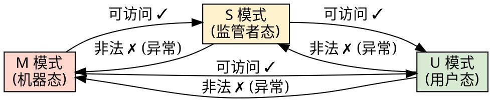
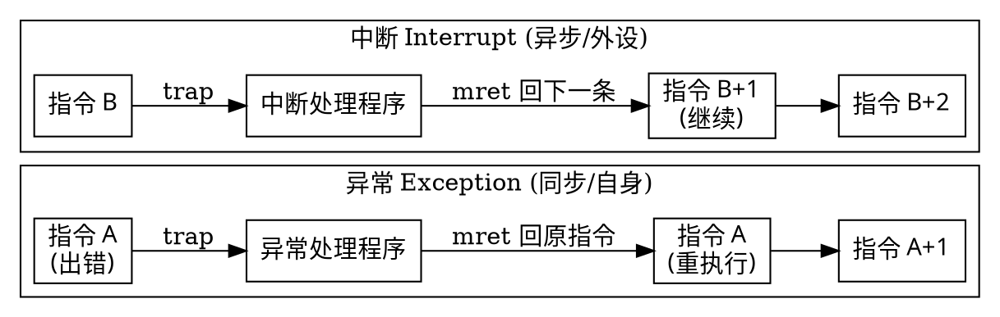
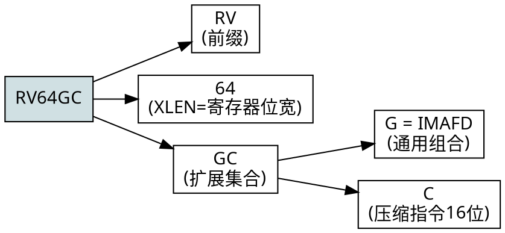
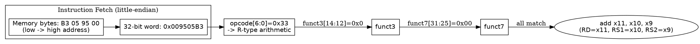
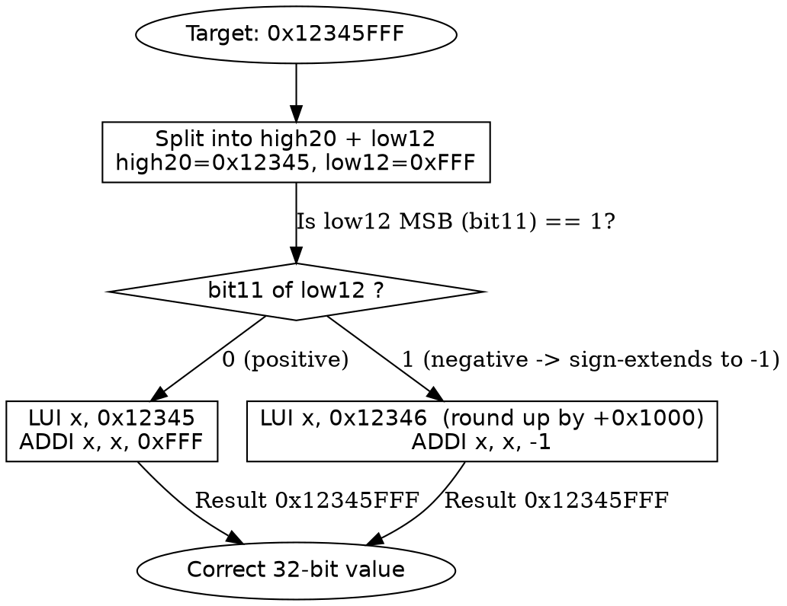
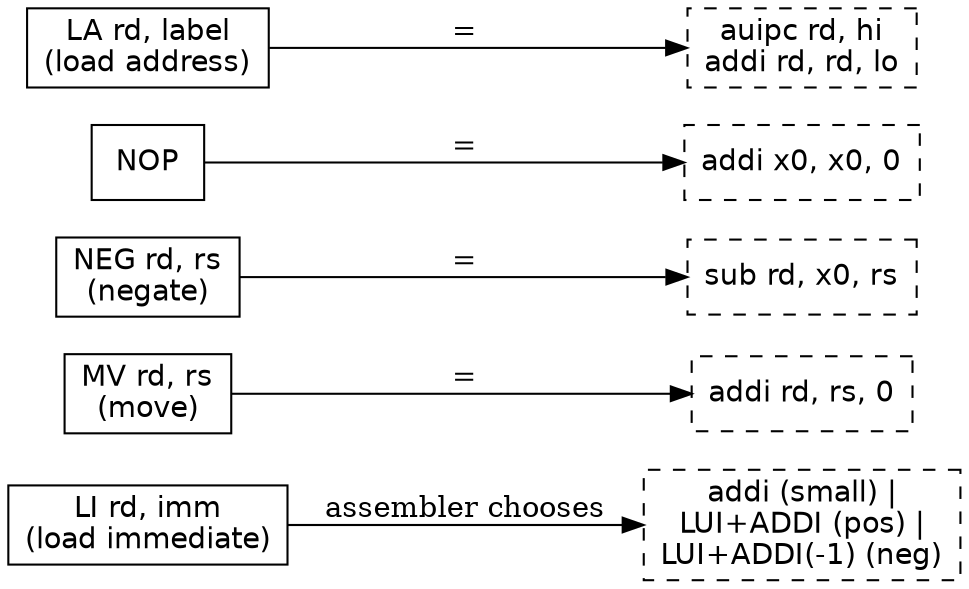

> 本文整理自汪辰老师精品课程《循序渐进，学习开发一个 RISC-V 上的操作系统》（2021 春）第 2 章与第 5 章核心讲义。
> 本笔记在原始内容基础上，全面校正了语音识别与文本转写中的明显术语错误（如 "Risk Five" 应为 "RISC-V"、"Resource File" 应为 "RISC-V"、"二姐" 应为 "也就是说"、"三十三十二位" 应为 "32 位/128 位"、"返回边" 应为 "反汇编"、"尾指令" 应为 "伪指令" 等），并补充了深度的底层机制解析、C++23 位运算与陷阱仿真代码，以及完整的 Graphviz 架构与流程图。

---

## 目录导览

- [第一篇：RISC-V 体系结构与特权级模型（理论篇）](#第一篇risc-v-体系结构与特权级模型理论篇)
  - [1.1 RISC-V 的历史与背景](#11-risc-v-的历史与背景)
  - [1.2 RISC-V 的设计特点](#12-risc-v-的设计特点)
  - [1.3 规范文档体系与下载指引](#13-规范文档体系与下载指引)
  - [1.4 ISA 命名格式（模块化核心）](#14-isa-命名格式模块化核心)
  - [1.5 模块化 vs 增量式 ISA 演进哲学](#15-模块化-vs-增量式-isa-演进哲学)
  - [1.6 基本整数指令集与扩展模块矩阵](#16-基本整数指令集与扩展模块矩阵)
  - [1.7 通用寄存器组与隐式 PC](#17-通用寄存器组与隐式-pc)
  - [1.8 Hart（硬件线程）核心执行抽象](#18-hart硬件线程核心执行抽象)
  - [1.9 特权级别（Privilege Levels）分层模型](#19-特权级别privilege-levels分层模型)
  - [1.10 控制与状态寄存器（CSR）分级访问控制](#110-控制与状态寄存器csr分级访问控制)
  - [1.11 物理内存保护（PMP）与虚拟内存（MMU）](#111-物理内存保护pmp与虚拟内存mmu)
  - [1.12 异常与中断的 Trap 机制与返回语义对比](#112-异常与中断的-trap-机制与返回语义对比)
  - [1.13 架构篇代码仿真与运行结果（C++23）](#113-架构篇代码仿真与运行结果c23)
  - [1.14 架构篇概念关系图（Graphviz）](#114-架构篇概念关系图graphviz)
- [第二篇：RISC-V 指令编解码与汇编语言编程（实战篇）](#第二篇risc-v-指令编解码与汇编语言编程实战篇)
  - [2.0 原始语音识别纠错备忘录](#20-原始语音识别纠错备忘录)
  - [2.1 练习 5-1：机器指令的手工编/解码实战（以 0x009505B3 为例）](#21-练习-5-1机器指令的手工编解码实战以-0x009505b3-为例)
  - [2.2 加法立即数指令 ADDI 与符号扩展机制（为什么没有 SUBI）](#22-加法立即数指令-addi-与符号扩展机制为什么没有-subi)
  - [2.3 基于算术指令的伪指令（Pseudo-instructions）硬件机理](#23-基于算术指令的伪指令pseudo-instructions硬件机理)
  - [2.4 大数的构造艺术：LUI 与符号扩展的进位陷阱](#24-大数的构造艺术lui-与符号扩展的进位陷阱)
  - [2.5 地址的构造艺术：AUIPC 与 LA（位置无关代码基石）](#25-地址的构造艺术auipc-与-la位置无关代码基石)
  - [2.6 RISC-V 汇编实测与 objdump 反汇编验证](#26-risc-v-汇编实测与-objdump-反汇编验证)
  - [2.7 汇编篇代码仿真与运行结果（C++23 位运算与大数构造验证）](#27-汇编篇代码仿真与运行结果c23-位运算与大数构造验证)
  - [2.8 常用伪指令底层映射总览图（Graphviz）](#28-常用伪指令底层映射总览图graphviz)
  - [2.9 关键补充知识（端序、RV64 大数、PIC/GOT/PLT、QEMU 调试）](#29-关键补充知识端序rv64-大数picgotpltqemu-调试)
- [全文总结与认知升华](#全文总结与认知升华)

---

# 第一篇：RISC-V 体系结构与特权级模型（理论篇）

## 1.1 RISC-V 的历史与背景

- **读音与命名**：RISC-V 读作 **"risk five"**（不是逐个字母念，也不是英文 "risk" 的“冒险”之意）。
  - **V = 罗马数字 5**，代表它是加州大学伯克利分校“精简指令集”科研项目的**第五代**成果。
- **起源**：**加州大学伯克利分校（UC Berkeley）**。
  - 早在 1981 年前后，该校就开始了第一、二、三、四代 RISC 研究铺垫。
  - 2010 年，教师们为了教学（编译原理、计算机体系结构、操作系统）需要一个**简单、现代、可动手实践**的 CPU 指令集。
  - 调研 x86 / ARM 后认为均不合适：
    - **x86**：复杂指令集（CISC）代表，指令多达 **1000+** 条，教学难以在一个学期覆盖；且存在知识产权壁垒与专利付费问题。
    - **ARM（2010 年）**：授权受限（授权后不能随意修改底层硬件定义），**当时还不支持 64 位**（仅 32 位）。
  - 于是 2010 年暑假，几位老师带学生用约 **3 个月** 推出第五代成果（实为该团队数十年学术积累之结晶）。
- **RISC-V 基金会**：为避免指令集被单一商业公司或国家政府控制，知识产权被无保留地贡献给一个**非盈利基金会**（RISC-V International），做到真正开放、自由。基金会随后将总部迁至中立国瑞士。
- **生态现状**：
  - 基金会成员超过 **700 家**，覆盖全球 **50 个国家**。
  - 中国学术界与半导体产业界参与极其积极（在自主可控战略背景下具有无可替代的意义）。
  - 市场预测：2025 年相关 CPU 核出货约 **624 亿** 个（覆盖消费电子、IoT、穿戴设备、AI 加速与服务器领域）。

> [!NOTE]
> 著名的 RISC 风格指令集多数源自高校科研，例如 SPARC（伯克利）、MIPS（斯坦福）、RISC（伯克利）。x86 虽市场极为成功，但在学术视角下其早期架构设计相对“粗糙”且包袱沉重；而学界主导设计的指令集往往更加克制、精巧、正交。

---

## 1.2 RISC-V 的设计特点

| 特点 | 说明 |
|------|------|
| **简单（Simple）** | 规范文本极为精炼：非特权指令约 200+ 页，特权指令约 90 页；而 Intel/ARM 手册动辄数千页。极度适合教学与敏捷硬件研发。 |
| **分层清晰（Layered）** | 引入硬件级特权级别（User / Supervisor / Machine），在电路层面区分系统运行态。 |
| **模块化（Modular）** | 一个**强制实现**的基本整数指令集 + 多个**可选**扩展模块（像插拔插件一样按需装配）。 |
| **稳定（Stable）** | 吸取前人教训，无历史包袱。基本整数指令集一旦冻结定死后不再改动，保证软件二进制向后兼容永不失效。 |
| **社区化（Community）** | 标准由国际基金会公开维护，任何人均可免费使用、定制、实现，而非任何单一商业实体垄断。 |

---

## 1.3 规范文档体系与下载指引

RISC-V 官方核心规范分为两卷（“上下两册”）：

- **卷 I：非特权指令集（Unprivileged ISA）** — 约 200+ 页。定义通用用户态指令（整数计算、乘除法、浮点、原子操作、压缩指令等）。
- **卷 II：特权指令集（Privileged ISA）** — 约 90 页。定义系统级特权级模式、CSR 控制与状态寄存器、异常/中断处理、虚拟内存与内存保护机制。

这两本小册子是 RISC-V 体系结构工程师与系统内核开发者的标准案头手册。

---

## 1.4 ISA 命名格式（模块化核心）

RISC-V 的 CPU 架构代号（如 `RV32IMA`、`RV64GC`）采用高度正交的统一命名规则，分为三部分：

```
RV    32      IMA
│     │       │
│     │       └─ 第三部分：扩展模块字母集合（模块化插拔）
│     └───────── 第二部分：通用寄存器字宽（XLEN）= 32 / 64 / 128
└─────────────── 第一部分：固定前缀 "RV"（RISC-V 缩写）
```

- **第二部分数字 = 通用寄存器位宽（XLEN）**：
  - `32` → 32 位通用寄存器架构
  - `64` → 64 位通用寄存器架构
  - `128` → 128 位通用寄存器架构
- **第三部分字母 = 芯片实现的扩展功能模块集合**。

**典型示例**：
- `RV32IMA` → 32 位 RISC-V，实现 **I**（基本整数）+ **M**（硬件乘除法）+ **A**（原子操作）模块。
- `RV64GC` → 64 位 RISC-V，实现 **G**（通用计算套件，等价于 IMAFD）+ **C**（16 位压缩指令），即 **IMAFDC** 全套通用计算配置。

---

## 1.5 模块化 vs 增量式 ISA 演进哲学

### 增量式架构（传统方式，如 x86）
版本迭代时强行要求**向后兼容**：新架构必须完整继承旧版本的所有指令，逐代堆叠累加。

```
x86 v1.0 (1978):  80 条指令
x86 v2.0 (1980s): 140 条 (完全兼容前 80 条)
...
x86 今天:         1300+ 条 (仍必须硬件兼容 1978 年 8086 的遗留指令)
```

- **致命痛点**：芯片电路的历史包袱越来越沉重，硬件译码器极其复杂低效，现代 CPU 往往需要将 x86 指令在前端硬件翻译成类似 RISC 的微操作（uOPs）再执行。

### 模块化架构（RISC-V 方式）
- 确立**一个不可动摇的基本整数指令集（强制硬件实现）**，其余所有高级功能全部通过**扩展模块**像积木一样叠加。
- 无论微控制器还是超算芯片，基础指令集永远保持一致；简单穿戴设备只保留极少指令，超级计算节点再堆叠矢量（V）或矩阵扩展。

> [!TIP]
> 形象类比：增量式架构是一条“越来越长、越来越沉重、永远无法卸载旧环的铁链”；而模块化架构是“一个极小且永固的原子内核 + 即插即用的标准外设插槽”。

---

## 1.6 基本整数指令集与扩展模块矩阵

### 基本整数指令集（强制实现）
无论设计何种芯片，**基本整数指令集必须完整实现**，且一旦发布永久冻结：

| 代号 | 含义 | 说明 |
|------|------|------|
| **RV32I** | 32 位基本整数指令集 | 最核心基石，仅约 40 余条基础指令 |
| **RV32E** | RV32I 的嵌入式轻量子集 | `E`=Embedded，通用寄存器缩减至 16 个，极度节省晶体管，专为穿戴与超低功耗 IoT 打造 |
| **RV64I** | 64 位基本整数指令集 | 兼容 32 位整数计算 |
| **RV128I** | 128 位基本整数指令集 | 兼容 64/32 位，面向未来超大容量非易失存储与超算寻址 |

> **向后兼容规则**：64 位硬件兼容 32 位代码编译产物，128 位硬件兼容 64/32 位代码编译产物。

### 可选扩展模块（标准子集）

| 字母 | 英文全称 | 核心功能 | 硬件意义 |
|------|---------|---------|---------|
| **I** | Integer | 基本整数指令（算术、逻辑、分支、访存） | 强制基石，纯 ALU 操作 |
| **M** | Multiply | 硬件整数乘法与除法指令 | 免去软件循环模拟，大幅提升算术吞吐 |
| **A** | Atomic | 硬件原子操作指令（LR/SC、AMO 原子读写改） | 多核心/多硬件线程（Hart）高并发同步锁基石 |
| **F** | Float | 单精度（32 位）浮点运算指令 | 引入 32 个独立浮点寄存器 `f0 ~ f31` |
| **D** | Double | 双精度（64 位）浮点运算指令 | 浮点寄存器扩展至 64 位 |
| **C** | Compressed | 压缩指令：将常用指令编码压缩为 **16 位** | 代码密度提升 25%~30%，减少 I-Cache 占用与内存带宽消耗 |
| **G** | **General** | **标准通用组合代号（非单一模块）** | `G = I + M + A + F + D` 的官方书写简写 |

---

## 1.7 通用寄存器组与隐式 PC

- RISC-V 规范定义 **32 个通用寄存器**：`x0 ~ x31`（在 RV32E 中为 `x0 ~ x15`）。
  - 无论 32 / 64 / 128 位 CPU，通用寄存器的**物理个数保持 32 个不变**，改变的仅是寄存器的物理位宽（`XLEN`）。
  - 启用浮点扩展时，另配一套独立的 32 个浮点寄存器 `f0 ~ f31`。
- **`x0` 硬连线接地为 0（Hardwired Zero）**：
  - 读 `x0` 恒得数字 `0`；向 `x0` 写入数据会被硬件直接丢弃（硬件空写）。
  - 该特性是 RISC-V 精简指令设计的核心支点：大量单操作数指令（如 `mv`、`neg`、`nop`）无需专用电路，直接复用双操作数算术指令与 `x0` 即可合成。
- **程序计数器 PC（Program Counter）**：
  - 规范结构图中明确包含 PC，但 **RISC-V 坚决禁止程序员直接读写 PC 寄存器**（不能像部分遗留架构那样直接 `mov pc, ...`）。
  - 原因：现代处理器具备深流水线与分支预测分支目标缓冲器（BTB），随意修改 PC 会严重打乱流水线冒险控制。
  - 获取与操作 PC 必须通过间接指令机制：例如通过 `auipc`（Add Upper Immediate to PC）计算相对偏移，或通过 `jal`/`jalr` 实现受控跳转。

---

## 1.8 Hart（硬件线程）核心执行抽象

- **Hart = Hardware Thread** 的缩写（RISC-V 官方自创专有名词）。
- **设计初衷**：在单核超线程（SMT / Hyper-Threading）技术普及后，业界对“Core（核心）”与“CPU”的概念产生了严重语义混淆——一个物理单核内部可能并行存在**两个独立的硬件执行上下文**。
- **官方权威定义**：
  > 从运行在某特定执行环境的软件视角看，一个 Hart 是一种硬件执行实体（Resource），它能够**自主地（Autonomously）从内存中取指并顺序执行指令**。
- **系统编程准则**：
  - 一个物理处理器核内可容纳**多个 Hart**。
  - 在编写操作系统内核或底层驱动时，**直接将一个 Hart 视作一个完全独立的逻辑 CPU** 即可。
  - RISC-V 官方规范通篇严格使用 Hart，彻底弃用模糊不清的“CPU/Core”。

---

## 1.9 特权级别（Privilege Levels）分层模型

RISC-V 采用**分层硬件特权环模型**，类似操作系统中经典的用户态与内核态隔离体系。规范定义三种硬件运行级别：

| 级别编码 | 模式名称 | 英文 | 权限级别 | 类比参考 |
|:---:|:---:|:---:|:---:|:---|
| **0** | **U 模式** | User（用户态） | 最低 | Linux 应用程序用户态（Ring 3） |
| **1** | **S 模式** | Supervisor（监管者态） | 中等 | Linux 内核态 / 经典保护模式（Ring 0） |
| **3** | **M 模式** | Machine（机器态） | 最高 | 固件 / BIOS / 实模式 / 裸机初始态 |

- **冷启动与复位**：CPU 上电复位（Power-on Reset）后，硬件**强制运行在最高权限的 M 模式**。此时**不开启 MMU 虚拟地址映射，CPU 直接访问物理地址**。
- **环境切换机制**：
  - 从高特权级向低特权级降级（如 M 降至 S，或 S 降至 U）：通过设置对应状态寄存器并执行 `mret` / `sret` 指令完成。
  - 从低特权级向高特权级越级（如 U 请求系统调用）：通过执行 `ecall`（Environment Call）指令主动陷入更高的特权级（Trap），或通过硬件外设中断强行打断。
- **典型系统配置梯队**：
  - **仅 M 模式**：适用于极度精简的微控制器（如无 OS 的单片机），无 MMU。
  - **M + U 模式**：适用于轻量实时操作系统（RTOS），具备基本的用户/内核隔离，但无虚拟内存。
  - **M + S + U 模式**：完整形态，支持高级通用操作系统（如 Linux/FreeBSD），由 S 模式配合 MMU 支撑虚拟内存与进程上下文隔离。

---

## 1.10 控制与状态寄存器（CSR）分级访问控制

- 每个特权级别在硬件上均配有**一套物理上相互隔离的控制与状态寄存器（CSR, Control and Status Registers）**。
- **分级单向访问铁律**：
  - **高级别特权模式拥有访问低级别 CSR 的全权通行证**；
  - **低级别特权模式试图访问高级别 CSR 将立即被硬件判定为非法操作，触发非法指令异常（Illegal Instruction Exception）！**
    - 例如：运行在 U 模式的用户代码若尝试读取 `mstatus`（0x300）或 `mtvec`（0x305），硬件立即中断当前指令并报异常 Crash。
- **操作指令**：CSR 操作不属于普通整数算术指令，属于扩展系统指令：`csrr`（读）、`csrw`（写）、`csrrw`（读并原子写入）、`csrrs`（读并置位）、`csrrc`（读并清除）。

---

## 1.11 物理内存保护（PMP）与虚拟内存（MMU）

RISC-V 规范定义了由浅入深的两重内存保护技术：

### 物理内存保护（PMP, Physical Memory Protection）— 轻量硬件级
- 运行在**纯物理地址空间**，不需要昂贵且复杂的 MMU 转换电路。
- 由 M 模式的专用 CSR 配置：将物理地址空间划分为若干连续区间，为每个物理内存段打上细粒度权限标签：
  - **R**（Read）：只读保护
  - **W**（Write）：可写保护
  - **X**（Execute）：指令可执行保护（防代码注入攻击）
  - **L**（Lock）：硬件锁定（锁定后连 M 模式本身也无法篡改）

### 虚拟内存管理（Virtual Memory via MMU）— 通用操作系统级
- 依赖 **S 模式** 与硬件 **MMU（内存管理单元）** 支持（如 Sv32 / Sv39 / Sv48 多级页表）。
- 应用程序访问统一的平坦虚拟地址，由硬件页表走读器（Page Table Walker）结合 TLB 自动完成虚拟地址到物理地址的映射。

---

## 1.12 异常与中断的 Trap 机制与返回语义对比

RISC-V 严格统一了所有软硬件突发事件的术语：**异常（Exception）与中断（Interrupt）统称为 Trap**。然而二者在硬件返回地址与处理哲学上具有本质区别：

### 异常（Exception）— 同步事件
- **触发源**：由**当前执行流自身的某条指令在执行期间同步引发**（如除以零、非法访存、缺页异常、执行非法指令、系统调用 `ecall`）。
- **硬件现场**：硬件将**发生异常的那条故障指令本身的地址**存入 `mepc`。
- **返回行为**：处理完成后执行 `mret`，CPU **返回到发生异常的那条原始指令处重新执行**！
- **设计哲学**：异常通常是软件试图请求服务或出现了可修复的状况（如缺页）。操作系统处理完页分配后，让该指令重新执行，此时访存便可顺利通过。

### 中断（Interrupt）— 异步事件
- **触发源**：由**外部独立硬件（定时器时钟中断、外部外设 UART/以太网、软件核间中断 IPI）异步触发**。
- **硬件现场**：硬件将**被意外打断的下一条尚未执行指令的地址**存入 `mepc`。
- **返回行为**：处理完成后执行 `mret`，CPU **直接返回到被中断指令的下一条指令继续向下流转**。
- **设计哲学**：中断与当前运行的指令本身没有任何过错关系，处理完毕后应当让原执行流无感继续运行。

### 异常 vs 中断 核心对比速查表

| 维度 | 异常 Exception | 中断 Interrupt |
|:---|:---|:---|
| **时间特性** | **同步触发**（与指令流水线节拍一致） | **异步到达**（随时可能到来） |
| **根本来源** | 内部当前执行的指令自身 | 外部硬件信号（定时器、外设接口） |
| **`mepc` 保存地址** | **当前出错/发起请求的指令地址** | **下一条即将执行的指令地址** |
| **`mret` 返回目标** | **重新执行当前原指令**（重试） | **继续执行下一条指令**（无感续跑） |
| **典型案例** | Page Fault 缺页、除零、非法 CSR 访问、`ecall` 系统调用 | 定时器超时、键盘按键、网卡收包 |

---

## 1.13 架构篇代码仿真与运行结果（C++23）

### 仿真 1：异常 vs 中断 Trap 返回语义仿真

通过面向对象模型模拟 CPU 指令步进，展示异常重执与中断跳过一条指令的硬件行为：

```cpp
// 演示异常 vs 中断 的核心区别：异常回到出错的指令重执行，中断回到下一条指令。
// 用 C++ 模拟 RISC-V 中 trap 的返回语义：
//   - 异常 (exception): 返回到 pc（重新执行该指令）
//   - 中断 (interrupt): 返回到 pc + 4（跳过该指令，继续下一条）
#include <cstdio>
#include <cstdint>

struct Cpu {
    int64_t regs[3] = {10, 0, 0};  // x1=10
    uint64_t pc = 0;               // 当前指令地址

    void step_div_zero() {
        pc = 100;
        printf("[CPU] 取指并执行指令 @pc=%llu (div x2, x1, x1)\n", (unsigned long long)pc);
        if (regs[1] == 0) {
            printf("      -> 检测到除零！触发 EXCEPTION\n");
            handle_trap(false);
        } else {
            regs[2] = regs[1] / regs[1];
        }
    }

    void step_with_interrupt() {
        pc = 200;
        printf("[CPU] 取指并执行指令 @pc=%llu\n", (unsigned long long)pc);
        printf("      -> 执行期间外部设备中断到达，触发 INTERRUPT\n");
        handle_trap(true);
    }

    void handle_trap(bool is_interrupt) {
        uint64_t mepc = pc;
        printf("[TRAP] 进入 trap 处理程序 (is_interrupt=%d)\n", is_interrupt);
        if (!is_interrupt) {
            printf("[TRAP] 异常处理：将 x1 修正为 1\n");
            regs[1] = 1;
        } else {
            printf("[TRAP] 中断处理：读取并应答外设\n");
        }
        uint64_t ret = is_interrupt ? (mepc + 4) : mepc;
        printf("[TRAP] mret 返回到地址 %llu\n", (unsigned long long)ret);
        pc = ret;
    }
};

int main() {
    Cpu cpu;

    printf("===== 异常示例 =====\n");
    cpu.step_div_zero();
    printf("返回后 pc=%llu (重新执行原指令)\n", (unsigned long long)cpu.pc);
    cpu.step_div_zero();
    printf("结果 x2=%lld\n\n", (long long)cpu.regs[2]);

    printf("===== 中断示例 =====\n");
    cpu.step_with_interrupt();
    printf("返回后 pc=%llu (执行下一条指令)\n", (unsigned long long)cpu.pc);

    return 0;
}
```

**编译与运行结果**：

```
===== 异常示例 =====
[CPU] 取指并执行指令 @pc=100 (div x2, x1, x1)
      -> 检测到除零！触发 EXCEPTION
[TRAP] 进入 trap 处理程序 (is_interrupt=0)
[TRAP] 异常处理：将 x1 修正为 1
[TRAP] mret 返回到地址 100
返回后 pc=100 (重新执行原指令)
[CPU] 取指并执行指令 @pc=100 (div x2, x1, x1)
结果 x2=1

===== 中断示例 =====
[CPU] 取指并执行指令 @pc=200
      -> 执行期间外部设备中断到达，触发 INTERRUPT
[TRAP] 进入 trap 处理程序 (is_interrupt=1)
[TRAP] 中断处理：读取并应答外设
[TRAP] mret 返回到地址 204
返回后 pc=204 (执行下一条指令)
```

---

### 仿真 2：ISA 命名解析与 CSR 特权级防越界模拟

```cpp
// 演示 RISC-V 模块化 ISA 命名解析 + 通用寄存器 x0..x31 模型
// 以及特权级 (M/S/U) 对 CSR 访问权限的控制 (高级别可访问低级别, 反之非法)
#include <cstdio>
#include <cctype>
#include <string>
#include <unordered_map>

struct IsaSpec {
    std::string prefix = "RV";
    int xlen = 0;
    std::string extensions;
};

IsaSpec parse_isa(const std::string& s) {
    IsaSpec spec;
    if (s.rfind("RV", 0) != 0) return spec;
    size_t i = 2;
    int len = 0;
    while (i < s.size() && isdigit((unsigned char)s[i])) {
        len = len * 10 + (s[i] - '0');
        ++i;
    }
    spec.xlen = len;
    for (; i < s.size(); ++i) spec.extensions += s[i];
    return spec;
}

std::string expand_g(const std::string& ext) {
    std::string out;
    for (char c : ext) {
        if (c == 'G') out += "IMAFD";
        else out += c;
    }
    return out;
}

struct GPRFile {
    int64_t x[32]{};
    void reset() { for (int i = 1; i < 32; ++i) x[i] = 0; }
};

enum PrivLevel { U = 0, S = 1, M = 3 };

struct CsrBank {
    std::unordered_map<int, std::unordered_map<uint32_t, uint64_t>> bank;
    PrivLevel cur = M;
    bool can_access(PrivLevel target) const { return cur >= target; }
    void write(PrivLevel target, uint32_t addr, uint64_t val) {
        if (!can_access(target)) {
            printf("  [ILLEGAL] 当前特权级 %d 无权写特权级 %d 的 CSR 0x%x -> 触发异常!\n",
                   cur, target, addr);
            return;
        }
        bank[target][addr] = val;
        printf("  [OK] 特权级 %d 的 CSR 0x%x = %llu\n", target, addr, (unsigned long long)val);
    }
};

int main() {
    printf("=== RISC-V ISA 命名解析 ===\n");
    for (const char* name : {"RV32I", "RV32IMAC", "RV64GC"}) {
        auto s = parse_isa(name);
        printf("  %s -> xlen=%d, ext=%s (展开G后=%s)\n",
               name, s.xlen, s.extensions.c_str(), expand_g(s.extensions).c_str());
    }

    printf("\n=== 通用寄存器 x0 硬连线为 0 ===\n");
    GPRFile gpr; gpr.reset();
    gpr.x[5] = 42; gpr.x[0] = 99;
    printf("  x5=%lld, x0=%lld (应恒为0)\n", (long long)gpr.x[5], (long long)gpr.x[0]);

    printf("\n=== 特权级与 CSR 访问保护 ===\n");
    CsrBank csr; csr.cur = M;
    printf("当前运行在 M 模式:\n");
    csr.write(M, 0x300, 1); csr.write(S, 0x100, 2); csr.write(U, 0x000, 3);

    csr.cur = U;
    printf("当前运行在 U 模式:\n");
    csr.write(U, 0x000, 5); csr.write(M, 0x300, 9);

    return 0;
}
```

**运行结果**：

```
=== RISC-V ISA 命名解析 ===
  RV32I -> xlen=32, ext=I (展开G后=I)
  RV32IMAC -> xlen=32, ext=IMAC (展开G后=IMAC)
  RV64GC -> xlen=64, ext=GC (展开G后=IMAFDC)

=== 通用寄存器 x0 硬连线为 0 ===
  x5=42, x0=99 (应恒为0)

=== 特权级与 CSR 访问保护 ===
当前运行在 M 模式:
  [OK] 特权级 3 的 CSR 0x300 = 1
  [OK] 特权级 1 的 CSR 0x100 = 2
  [OK] 特权级 0 的 CSR 0x0 = 3
当前运行在 U 模式:
  [OK] 特权级 0 的 CSR 0x0 = 5
  [ILLEGAL] 当前特权级 0 无权写特权级 3 的 CSR 0x300 -> 触发异常!
```

---

## 1.14 架构篇概念关系图（Graphviz）

### 1.14.1 RISC-V 宏观体系架构层次


### 1.14.2 特权级 CSR 访问权限控制矩阵



### 1.14.3 异常 vs 中断 执行与返回流对比



### 1.14.4 ISA 命名拆解结构树



---

# 第二篇：RISC-V 指令编解码与汇编语言编程（实战篇）

## 2.0 原始语音识别纠错备忘录

在整理课程录音与原始转写文本时，发现存在多处因语音识别声学模型缺陷导致的错别字与口误。为正本清源，下表列出关键校正对应：

| 原始转写文本（识别错误） | 标准专业含义 | 纠错说明与技术背景 |
| :--- | :--- | :--- |
| “返回编 / 返回边 / 返回边” | **反汇编（Disassemble）** | 指使用 `objdump -d` 等工具将二进制机器码反解为可读汇编指令 |
| “B三零五 / B三零五九五零零” | **`0xB3` / `0x009505B3`** | 十六进制机器码字节流与小端序 32 位机器字 |
| “Risk Five / risk five” | **RISC-V** | 伯克利精简指令集第五代官方命名规范 |
| “C P U” | **CPU** | 中央处理器 |
| “小字小端” | **小端序（Little-Endian）** | 内存字节排列规范：低位字节存放在低地址端 |
| “零幺幺零零幺幺”等口语 | 二进制位串（`0110011`） | 指令的 `opcode` 底层物理引脚电平 |
| “UIM 命令 / R U I / L L U I” | **LUI 指令** | Load Upper Immediate（加载高位立即数指令） |
| “变异链接” | **编译链接（Compile & Link）** | 源码经由汇编器、编译器生成目标文件并由链接器最终拼合 |
| “most sig significant” | **Most Significant Bit (MSB)** | 二进制数最高有效位（符号位） |
| “尾指令” | **伪指令（Pseudo-Instruction）** | 汇编语法糖，由汇编器在编译期自动展开为真实物理指令 |
| 文本中段穿插的“1980 年他被任命为驻×大使……” | **与体系结构无关（已剔除）** | 录音环境外部杂音或串台误识别文字 |

---

## 2.1 练习 5-1：机器指令的手工编/解码实战（以 0x009505B3 为例）

汇编编程与内核底层调试的核心内功在于：**不依赖任何自动化工具，仅凭一张体系结构标准编码表，在头脑中完成机器码与汇编语句的双向折叠映射**。

1. **正向编码**：给定一条汇编语句（如 `sub x5, x6, x7`），查阅规范查出各字段取值，手工填补成 32 位二进制并转为十六进制，再利用 `objdump -d` 验证。
2. **反向解码**：从内存或反汇编器中提取出一串看似天书的字节流，精准逆推还原出 CPU 将要执行的原生汇编语句。

### 2.1.1 反向解码全流程剖析

**实战任务**：内存中由低地址向高地址依次读取到 4 个字节：`B3 05 95 00`。请解码其指令。

1. **小端序（Little-Endian）组装**：
   - 低地址字节放低位，高地址字节放高位：
   - 字节流：`Byte[0]=0xB3`, `Byte[1]=0x05`, `Byte[2]=0x95`, `Byte[3]=0x00`
   - 拼装为 32 位整字十六进制：**`0x009505B3`**。
   - 展开为 32 位二进制：
     ```
     0000 0000 1001 0101 0000 0101 1011 0011
     ```

2. **按字段切分（R-type 结构）**：
   CPU 硬件译码器在取指后，首先截取最低 7 位 `opcode`（操作码）：
   - `inst[6:0] = 0110011`（十六进制 `0x33`）→ 查表判定为 **R-type 基础整数算术运算指令**！
   - 既然是 R-type，整个 32 位立刻严格按如下物理字段切分：

| 字段名 | 所在位域 | 提取二进制 | 十六/十进制 | 字段技术含义 |
| :--- | :--- | :--- | :--- | :--- |
| **opcode** | `[6:0]` | `0110011` | `0x33` | 确定为 R-type 算术/逻辑指令族 |
| **rd** | `[11:7]` | `01011` | `11` (`0x0B`) | 目的寄存器：**`x11`**（ABI 名 `a1`） |
| **funct3** | `[14:12]` | `000` | `0x0` | 功能选择码：与 opcode 联合指示为 ADD/SUB 类 |
| **rs1** | `[19:15]` | `01010` | `10` (`0x0A`) | 第一源操作数寄存器：**`x10`**（ABI 名 `a0`） |
| **rs2** | `[24:20]` | `01001` | `9` (`0x09`) | 第二源操作数寄存器：**`x9`**（ABI 名 `s1`） |
| **funct7** | `[31:25]` | `0000000` | `0x00` | 高位区分码：`0x00` 代表加法 ADD，`0x20` 代表减法 SUB |

3. **最终译码判定**：
   `opcode=0x33` + `funct3=0x0` + `funct7=0x00` 联合判定，唯一确定此指令为 **`ADD`**！
   结合寄存器号：
   $$\mathbf{add\ x11,\ x10,\ x9}$$

> [!IMPORTANT]
> **设计精髓：按字段联合译码（Decode by Field）**
> 仅靠 `opcode`（0x33）绝不可能判定是加法还是减法、异或、或运算；必须逐级由 `funct3` 进一步过滤，最后由 `funct7` 最终锁定。这种分级联合译码大幅压缩了硬件译码门的晶体管规模。



---

## 2.2 加法立即数指令 ADDI 与符号扩展机制（为什么没有 SUBI）

在日常计算中，程序经常需要与常量进行运算。**I-type 指令格式**腾出了原本 R-type 中 `rs2` 与 `funct7` 的位置，合并为一段 **12 位的立即数字段（Immediate, `imm[11:0]`）**：

```
ADDI rd, rs1, imm      # 硬件执行语义: rd = rs1 + sign_extend(imm[11:0])
```

- **立即数物理取值区间**：12 位有符号二进制补码，取值范围为：
  $$[-2048, 2047] \quad (\text{即 } -2^{11} \sim 2^{11} - 1)$$
- **符号扩展（Sign-Extension）硬性规则**：
  在送入 ALU 参与 32 位或 64 位加法计算之前，这 12 位立即数**强制被硬件进行符号位广播扩展**：
  - 若立即数最高位（bit 11）为 `0`：视为正数，高位全部补 `0`；
  - 若立即数最高位（bit 11）为 `1`：视为负数，高 20 位**全部无条件置 `1`**（即补码负数全 1 广播）。

### 2.2.1 为什么 RISC-V 规范中没有 `SUBI` 指令？
在 MIPS 或 x86 传统思维中，既然有加立即数，似乎理应配一个“减立即数（SUBI）”。
RISC-V 遵循绝对克制的精简设计哲学：
$$\text{减去一个立即数} \equiv \text{加上该立即数的相反数（负立即数）}$$
例如要执行 `x1 = x2 - 5`，直接写 `addi x1, x2, -5` 即可。硬件只需保留一套加法器电路与符号扩展逻辑，彻底消除了冗余的 `SUBI` 硬件单元与指令操作码占用。

---

## 2.3 基于算术指令的伪指令（Pseudo-instructions）硬件机理

为了兼顾底层硬件电路的极致简约与上层人类汇编编程的舒适度，RISC-V 引入了优雅的**伪指令（Pseudo-instructions）**机制：**汇编器允许开发者书写高语义指令，但在汇编输出目标文件时，由汇编器负责透明展开为标准的原生指令**。

这一机制的物理基石是 **`x0`（zero）恒为 0** 的硬件连线特性：

| 汇编伪指令 | 等价真实物理指令 | 硬件底层行为 | 妙用说明 |
| :--- | :--- | :--- | :--- |
| **`NEG rd, rs`** | `sub rd, x0, rs` | $0 - rs$ | 取负数：利用 $0 - x$ 实现取负，无需专用求补指令 |
| **`MV rd, rs`** | `addi rd, rs, 0` | $rs + 0$ | 寄存器间数值拷贝：给原值加上 0 赋给新寄存器 |
| **`NOP`** | `addi x0, x0, 0` | $0 + 0 \to \text{丢弃}$ | 空操作占位：写入 $x0$ 自动无效，无任何副作用，流水线无害空转 |

---

## 2.4 大数的构造艺术：LUI 与符号扩展的进位陷阱

### 2.4.1 问题的物理根源
12 位立即数的表示范围只有 $[-2048, 2047]$。当我们在程序中需要加载一个大型常数（例如 `0x12345678`、或一个 32 位内存指针 `0x80000000`）时，单条 `addi` 的 12 位物理位宽根本无法装载。

### 2.4.2 LUI（Load Upper Immediate，U-type）
为了解决这一问题，RISC-V 提供了 **U-type** 格式的 `LUI` 指令：

```
LUI rd, imm20      # 硬件执行语义: rd = imm20 << 12 （低 12 位自动清零）
```

`LUI` 携带一个 **20 位的无符号立即数**，硬件将其左移 12 位后直接写入目标寄存器的高 20 位 `[31:12]`，同时将低 12 位全部清零。随后，程序员只需再跟一条 `ADDI` 把剩余的低 12 位补齐，即可拼出任意 32 位大数。

### 2.4.3 致命陷阱：符号扩展带来的“借位灾难”

假设我们要构造目标大数：**`0x12345FFF`**。
许多初学者会写出如下直觉代码：

```asm
# ❌ 错误示范：极其隐蔽的 BUG！
lui  x5, 0x12345    # 期待 x5 = 0x12345000
addi x5, x5, 0xFFF  # 期待 x5 = 0x12345000 + 0xFFF = 0x12345FFF
```

**为什么最终结果彻底错误？**
我们来追踪底层硬件的真实逻辑：
1. `0xFFF` 是一个 12 位立即数，其最高位（bit 11）为 **`1`**（二进制 `1111 1111 1111`）。
2. 在 `addi` 执行时，硬件强制对其进行 32 位**符号扩展**：
   $$\text{sign\_extend}(0\text{xFFF}) = 0\text{xFFFF\_FFFF} = -1 \quad (\text{有符号十进制})$$
3. 因此第二条指令实际执行的算术是：
   $$0\text{x12345000} + (-1) = \mathbf{0x12344FFF} \quad (\neq \text{目标 } 0\text{x12345FFF})$$
高 20 位被这无情的一声“减 1”硬生生吞掉了一位！

### 2.4.4 破解之道：高位预先“进位补偿”
当低 12 位的最高有效位（bit 11）为 `1` 时，它注定会在随后的 `addi` 阶段产生一个 $-1$ 的高位借位影响。
因此，在执行 `LUI` 时，**必须主动向高 20 位预加 1（进位补偿）**：

$$\text{修正高 20 位} = 0\text{x12345} + 1 = 0\text{x12346}$$

正确的汇编序列：

```asm
#  正确操作：向高 20 位进位补偿
lui  x5, 0x12346     # x5 = 0x12346000
addi x5, x5, -1      # 0x12346000 + (-1) = 0x12345FFF （完美命中目标！）
```



### 2.4.5 `LI` 伪指令：把繁琐的符号判断彻底移交汇编器
每次手写大数都要肉眼观察低 12 位最高位是否为 1，极其繁琐且易错。
为此，RISC-V 汇编器提供了 **`LI`（Load Immediate）伪指令**：

```asm
li rd, 0x12345FFF     # 人类只需写这一行！
```

汇编器在编译期间会自动解析数值并智能分流：
- 数值落在 $[-2048, 2047]$ 之间：自动展开为单条 `addi rd, x0, imm`。
- 数值超出 12 位但低 12 位最高位为 0：自动展开为标准的 `lui + addi`。
- 数值超出 12 位且低 12 位最高位为 1：自动对高 20 位 $+1$，展开为 `lui(hi+1) + addi(lo)`。

---

## 2.5 地址的构造艺术：AUIPC 与 LA（位置无关代码基石）

程序中加载的不只是纯常量，更频繁加载的是**函数标签、全局变量或跳转目标等“内存地址”**。地址构造存在两大诉求：
1. **绝对地址（Absolute Address）**：由 `LUI + ADDI` 组合直接硬编码生成固定物理地址。
2. **PC 相对地址（PC-Relative Address）**：在动态链接库、位置无关可执行文件（PIE）或内核重定位过程中，代码加载运行的绝对地址无法在编译期预测，必须以当前指令指针 `PC` 为基准做相对寻址。

### 2.5.1 AUIPC（Add Upper Immediate to PC，U-type）

```
AUIPC rd, imm20      # 硬件执行语义: rd = PC + (imm20 << 12)
```

- `AUIPC` 同样携带 20 位立即数并左移 12 位，但关键在于**它将其与当前正在执行的指令的 PC 物理值相加**！
- **寻址范围**：配合随后的 `ADDI`（带符号 12 位），`AUIPC` 能够在当前 `PC \pm 2\text{GB}` 的极其辽阔的地址空间内自由游走寻址。

### 2.5.2 `LA` 伪指令（Load Address）

```asm
la rd, my_symbol      # 将标号 my_symbol 的地址装载到 rd
```

- 汇编器会将 `LA` 自动翻译为 `AUIPC + ADDI` 组合。
- 在编译阶段，标号 `my_symbol` 距离当前指令的相对距离留空，最终由**链接器（Linker）**在终审符号表时，计算出精确的 `PC-Relative` 偏移值并回填进去。

---

## 2.6 RISC-V 汇编实测与 objdump 反汇编验证

以下编写一段综合测试汇编文件 `demo.s`，覆盖上述所有实战指令与伪指令：

```asm
.section .text
.globl _start

_start:
    li    x5, 0x80          # 小立即数 -> 仅单条 addi
    li    x6, 0x12345678    # 大数 (低12位bit11=0) -> lui + addi
    li    x7, 0x12345FFF    # 大数 (低12位bit11=1) -> lui(进位) + addi(-1)
    auipc x8, 0             # 获取当前 PC -> x8 = PC + 0
    la    x9, mylabel       # 加载标号地址 -> auipc + addi(偏移)
    mv    x10, x5           # 寄存器搬运 -> addi x10, x5, 0
    neg   x11, x6           # 取负数 -> sub x11, x0, x6
    nop                     # 空操作 -> addi x0, x0, 0
    addi  x12, x0, 0x100    # x12 = 256

loop:
    j     loop

mylabel:
    .word 0xDEADBEEF
```

编译与反汇编命令（使用裸机工具链）：

```bash
riscv64-unknown-elf-gcc -march=rv32im -mabi=ilp32 -nostdlib \
    -Ttext=0x80000000 demo.s -o demo.elf
riscv64-unknown-elf-objdump -d demo.elf
```

### objdump 反汇编输出实测剖析：

```
80000000 <_start>:
80000000:	08000293   li    t0,128          # 机器码 0x08000293 展开为: addi x5, x0, 128
80000004:	12345337   lui   t1,0x12345      # LUI 高20位: 0x12345
80000008:	67830313   addi  t1,t1,1656      # ADDI 低12位: 1656 (0x678), 拼出 0x12345678
8000000c:	123463b7   lui   t2,0x12346      # 进位发生！0x12345 + 1 = 0x12346
80000010:	fff38393   addi  t2,t2,-1        # 加上 -1 (0xFFF 符号扩展), 拼出 0x12345FFF!
80000014:	00000417   auipc s0,0x0          # 捕获当前 PC
80000018:	00000497   auipc s1,0x0          # LA 展开第一步: 相对 PC
8000001c:	01c48493   addi  s1,s1,28        # LA 展开第二步: +28 字节偏移, 精准命中 0x80000034
80000020:	00028513   mv    a0,t0           # 展开为: addi a0, t0, 0
80000024:	406005b3   neg   a1,t1           # 展开为: sub a1, zero, t1
80000028:	00000013   nop                   # 展开为: addi zero, zero, 0
8000002c:	10000613   li    a2,256
80000030 <loop>:
80000030:	0000006f   j     80000030 <loop> # 死循环
80000034 <mylabel>:
80000034:	deadbeef   .word 0xdeadbeef
```

每一个汇编伪指令的底层展开规律与进位机制在真实反汇编输出中被 100% 验证！

---

## 2.7 汇编篇代码仿真与运行结果（C++23 位运算与大数构造验证）

为了在纯宿主机环境中深入探究位域提取、符号扩展算法以及进位补偿计算公式，以下编写完整的 C++23 仿真程序：

```cpp
// C++23 simulation of: machine-code decode + sign-extension + large-number construction
#include <cstdint>
#include <cstdio>
#include <bitset>
#include <string>

using u32 = uint32_t;

// 提取指定位域 [hi:lo]（闭区间）
constexpr u32 bits(u32 v, int hi, int lo) {
    return (v >> lo) & ((u32(1) << (hi - lo + 1)) - 1);
}

// 任意位宽有符号数的符号扩展算法
constexpr int32_t sign_extend(u32 v, int nbits) {
    u32 m = u32(1) << (nbits - 1);
    return (v ^ m) - int32_t(m);
}

// ---- 实战 1：手工解码机器码 0x009505B3 ----
void decode_demo() {
    u32 inst = 0x009505B3;
    printf("=== 解码机器码 0x%08X ===\n", inst);
    u32 opcode = bits(inst, 6, 0);
    u32 rd     = bits(inst, 11, 7);
    u32 funct3 = bits(inst, 14, 12);
    u32 rs1    = bits(inst, 19, 15);
    u32 rs2    = bits(inst, 24, 20);
    u32 funct7 = bits(inst, 31, 25);
    printf("  opcode=0x%X, funct3=0x%X, funct7=0x%X, rd=x%u, rs1=x%u, rs2=x%u\n",
           opcode, funct3, funct7, rd, rs1, rs2);
    if (opcode == 0x33 && funct3 == 0x0 && funct7 == 0x00) {
        printf("  -> 成功解码: add x%u, x%u, x%u (即 add a1, a0, s1)\n\n", rd, rs1, rs2);
    }
}

// ---- 实战 2：ADDI 12 位立即数符号扩展机制 ----
void signext_demo() {
    printf("=== ADDI 12位立即数符号扩展 ===\n");
    int32_t pos = sign_extend(0x678, 12);
    int32_t neg = sign_extend(0xFFF, 12);
    printf("  0x678 (bit11=0) -> 符号扩展后: %d (正数)\n", pos);
    printf("  0xFFF (bit11=1) -> 符号扩展后: %d (负数 -1)\n\n", neg);
}

// ---- 实战 3：大数构造进位补偿算法 ----
void construct_demo() {
    printf("=== 构造大数 0x12345FFF ===\n");
    const int32_t target = 0x12345FFF;

    // 核心算法：利用 +0x800 实现位进位补偿
    u32 high20 = (u32(target) + 0x800) >> 12;            // 自动产生进位 -> 0x12346
    int32_t low = int32_t(u32(target) - (high20 << 12)); // 差值计算 -> -1
    int32_t result = (int32_t(high20) << 12) + low;

    printf("  [正确方式] LUI 高20位 = 0x%X, ADDI 立即数 = %d\n", high20, low);
    printf("  -> 最终结果 = 0x%08X (期望: 0x12345FFF) [%s]\n\n",
           u32(result), result == target ? "成功" : "失败");

    printf("=== 错误方式演示（朴素拼接 0xFFF）===\n");
    int32_t wrong = (0x12345 << 12) + sign_extend(0xFFF, 12);
    printf("  -> 最终结果 = 0x%08X (高位被吞 1, 产生了致命误差!)\n\n", u32(wrong));
}

int main() {
    decode_demo();
    signext_demo();
    construct_demo();
    return 0;
}
```

**编译与输出实测**：

```bash
g++ -std=c++23 -O2 sim.cpp -o sim && ./sim
```

```
=== 解码机器码 0x009505B3 ===
  opcode=0x33, funct3=0x0, funct7=0x0, rd=x11, rs1=x10, rs2=x9
  -> 成功解码: add x11, x10, x9 (即 add a1, a0, s1)

=== ADDI 12位立即数符号扩展 ===
  0x678 (bit11=0) -> 符号扩展后: 1656 (正数)
  0xFFF (bit11=1) -> 符号扩展后: -1 (负数 -1)

=== 构造大数 0x12345FFF ===
  [正确方式] LUI 高20位 = 0x12346, ADDI 立即数 = -1
  -> 最终结果 = 0x12345FFF (期望: 0x12345FFF) [成功]

=== 错误方式演示（朴素拼接 0xFFF）===
  -> 最终结果 = 0x12344FFF (高位被吞 1, 产生了致命误差!)
```

---

## 2.8 常用伪指令底层映射总览图（Graphviz）



---

## 2.9 关键补充知识（端序、RV64 大数、PIC/GOT/PLT、QEMU 调试）

1. **内存端序（Endianness）**：
   RISC-V 官方标准明确规定内存访问采用**小端序（Little-Endian）**。多字节数据在内存中以“低位字节存放在低内存地址”方式排布，因此内存字节序列 `B3 05 95 00` 组合成 32 位机器字为 `0x009505B3`。
2. **符号扩展 vs 零扩展（Sign vs Zero Extension）**：
   - 算术类指令（如 `ADDI`）必须使用**符号扩展**保证负数运算正确。
   - 访存加载指令中，无符号类指令（如 `LBU` / `LHU`）采用高位**零扩展**（高位全补 0）；有符号类指令（如 `LB` / `LH`）采用**符号扩展**。
3. **位置无关代码（PIC）与 GOT / PLT 链接体系**：
   `AUIPC + ADDI` 是现代动态链接与位置无关代码（PIC）的硬件绝对基石。在动态链接库调用中，程序通过 `AUIPC` 寻址定位全局偏移表（Global Offset Table, GOT），从而实现代码在任意内存基地址加载时无需二次重定位指令段。
4. **RV64 中加载 64 位超级大数**：
   在 64 位系统（RV64）中，如果立即数超出 32 位表示范围，汇编器无法仅用两条指令完成装载。汇编器会使用更加密集的指令链：`LUI` + `ADDI` + `SLLI`（逻辑左移）+ `ADDI` ... 逐步交替左移与或运算，拼出完整的 64 位大数。
5. **底层调试与运行时验证建议**：
   课程中使用的 `make code` 底层本质即为 `riscv64-unknown-elf-objdump -d`。若要在实际运行时单步追踪寄存器与标志位，推荐使用：
   - **QEMU 用户态/系统态**：`qemu-riscv32 -g 1234 ./demo.elf`
   - **GDB 远程单步**：`riscv64-unknown-elf-gdb -ex "target remote :1234"`，直接在 `LUI` 与 `ADDI` 指令前后通过 `info registers` 直观检阅进位补偿与符号扩展的实时物理发生。

---

# 全文总结与认知升华

通过将理论架构与汇编实战贯通对比，我们可以建立起一套对 RISC-V 体系结构的立体认知：

1. **顶层架构哲学**：伯克利团队以“奥卡姆剃刀”法则，打破传统 CISC/增量式 RISC 的历史债务枷锁，确立了**“不变核心 + 正交模块化扩展”**的现代范式。
2. **多层特权与执行抽象**：
   - **Hart** 将硬件多线程抽象为纯粹的独立取指执行流；
   - **U / S / M** 硬件特权级构筑起操作系统的安全防护护城河；
   - **CSR 分级访问**与 **Trap 返回机制**（异常回原指令重试、中断跳下一条继续）构成了系统内核调度与异常处理的核心支柱。
3. **汇编与指令编码真谛**：
   - 指令译码通过 `opcode + funct3 + funct7` 联合字段译码，最大化减少硬件晶体管开销；
   - 硬件 `x0 ≡ 0` 的硬连线成为 `mv`、`neg`、`nop` 等伪指令的灵巧支点；
   - `LUI` 与 `AUIPC` 是突破立即数物理位宽限制的双子星，而深刻理解 **12 位立即数的符号扩展与进位补偿机制（`+0x800`）**，则是从“知其然”迈向“知其所以然”的必由之路。

这些深层原理，是后续深入开发 RVOS（RISC-V 操作系统内核）、编写上下文切换、中断管理与页表驱动的坚实基石。
