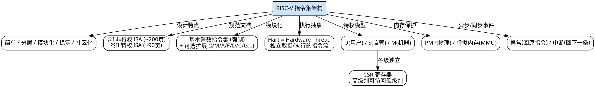
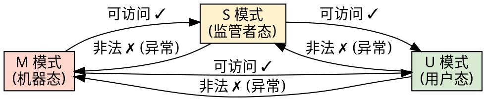
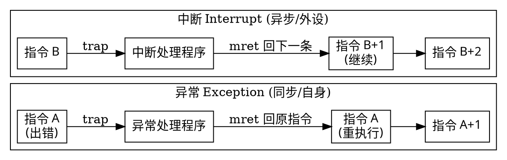
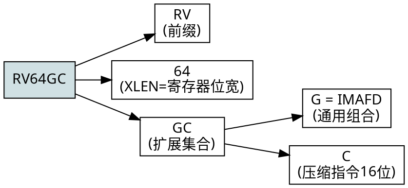

> 整理自《循序渐进，学习开发一个 RISC-V 上的操作系统》（汪辰，2021 春）P04。
> 本笔记在原始内容基础上，修正了语音识别中的明显错误（如 "Risk Five" 应为 "RISC-V"、"Resource File" 应为 "RISC-V"、"二姐" 应为 "也就是说"、"三十三十二位" 应为 "32 位/128 位" 等），并补充了背景知识与可运行示例。

---

## 目录

1. [RISC-V 的历史与背景](#1-risc-v-的历史与背景)
2. [RISC-V 的设计特点](#2-risc-v-的设计特点)
3. [规范文档与下载](#3-规范文档与下载)
4. [ISA 命名格式（模块化核心）](#4-isa-命名格式模块化核心)
5. [模块化 vs 增量式 ISA](#5-模块化-vs-增量式-isa)
6. [基本整数指令集与扩展模块](#6-基本整数指令集与扩展模块)
7. [通用寄存器](#7-通用寄存器)
8. [Hart（硬件线程）概念](#8-hart硬件线程概念)
9. [特权级别（Privilege Levels）](#9-特权级别privilege-levels)
10. [控制与状态寄存器（CSR）](#10-控制与状态寄存器csr)
11. [内存管理与保护](#11-内存管理与保护)
12. [异常与中断](#12-异常与中断)
13. [补充知识](#13-补充知识)
14. [示例代码与运行结果](#14-示例代码与运行结果)
15. [概念关系图（Graphviz）](#15-概念关系图graphviz)

---

## 1. RISC-V 的历史与背景

- RISC-V 读作 **"risk five"**（不是逐个字母念，也不是英文 "risk" 的"冒险"之意）。
  - **V = 罗马数字 5**，代表它是伯克利大学"精简指令集"研究的**第五代**成果。
- 起源：**加州大学伯克利分校（UC Berkeley）**。
  - 早在 1981 年前后，该校就开始了第一、二、三、四代 RISC 研究铺垫。
  - 2010 年，教师们为了教学（编译原理、计算机组成原理）需要一个**简单、可动手实践**的 CPU 指令集。
  - 调研 x86 / ARM 后认为均不合适：
    - **x86**：复杂指令集（CISC）代表，指令多达 **1000+** 条，教学难以在一个学期覆盖；且存在知识产权/付费问题。
    - **ARM（2010 年）**：授权受限（授权后不能随意修改），**当时还不支持 64 位**（仅 32 位）。
  - 于是 2010 年暑假，几位老师带学生用约 **3 个月** 推出第五代成果（实为多年积累结晶）。
- **RISC-V 基金会**：为避免被单一公司/政府控制，知识产权被贡献给一个**非盈利基金会**，做到真正开放、自由。基金会后将总部迁至中立国。
- **生态现状**：
  - 基金会成员超过 **700 家**，覆盖全球 **50 个国家**。
  - 中国市场参与非常积极（"卡脖子"背景下的战略意义）。
  - 市场预测：2025 年相关 CPU 核出货约 **624 亿** 个（消费电子、IoT、穿戴设备量巨大）。

> **补充**：著名的 RISC 风格指令集多数源自高校科研，例如 SPARC、MIPS、RISC（伯克利）。x86 虽市场成功，但在学术视角下其早期架构设计相对"粗糙"；而学界设计的指令集往往更精巧。

---

## 2. RISC-V 的设计特点

| 特点 | 说明 |
|------|------|
| **简单（Simple）** | 规范文本很小：非特权指令约 200+ 页，特权指令约 90 页；而 Intel/ARM 手册动辄数千页。适合教学。 |
| **分层清晰（Layered）** | 引入特权级别（User / Supervisor / Machine），硬件上区分运行态。 |
| **模块化（Modular）** | 一个**强制实现**的基本整数指令集 + 多个**可选**扩展模块（像插件一样叠加）。 |
| **稳定（Stable）** | 因吸取前人教训、无历史包袱，基本指令集定死后不再改动，软件向后兼容性好。 |
| **社区化（Community）** | 标准由基金会维护、公开，任何人可免费使用、修改，而非某公司说了算。 |

---

## 3. 规范文档与下载

RISC-V 规范分为两卷（"上下两册"）：

- **卷 I：非特权指令集（Unprivileged ISA）** — 约 200+ 页。定义通用指令（整数、乘除法、浮点、原子、压缩等）。
- **卷 II：特权指令集（Privileged ISA）** — 约 90 页。定义特权级、CSR、异常/中断、内存保护等。

> 课程采用固定版本（规范已多年未大改）。这两本小册子会在后续课程中反复引用。

---

## 4. ISA 命名格式（模块化核心）

RISC-V 的 CPU 代号（如 `RV32IMA`、`RV64GC`）采用统一命名格式，可分为三部分：

```
RV    32      IMA
│     │       │
│     │       └─ 第三部分：扩展模块字母集合（模块化）
│     └───────── 第二部分：字宽（XLEN）= 32 / 64 / 128
└─────────────── 第一部分：固定前缀 "RV"（RISC-V 缩写）
```

- **第二部分数字 = 通用寄存器位宽**：
  - `32` → 32 位寄存器
  - `64` → 64 位寄存器
  - `128` → 128 位寄存器
- **第三部分字母 = 所实现的模块集合**（见下节）。

**示例**：
- `RV32IMA` → 32 位 RISC-V，实现 **I + M + A** 模块。
- `RV64GC` → 64 位 RISC-V，实现 **G + C**（G 展开为 IMAFD，故即 IMAFDC）。

---

## 5. 模块化 vs 增量式 ISA

### 增量式（传统方式，如 x86）
版本迭代时**向后兼容**：新版本必须保留旧版本的全部指令，逐代累加。

```
x86 v1.0 (1978):  80 条指令
x86 v2.0 (1980s): 140 条 (兼容前 80 条)
...
x86 今天:         1300+ 条 (仍兼容 1978 年指令)
```

- 问题：历史包袱沉重，学习成本越来越高，新设计必须背负旧设计。

### 模块化（RISC-V 方式）
- 只定义**一个不变的基本整数指令集（强制实现）**，新功能通过**扩展模块**像"插件"一样叠加。
- 主程序（基本集）不变，新 CPU 堆模块即可；简单 CPU 可只保留少量指令。

> 图示概念：增量式是"一条越来越长的锁链"；模块化是"一个稳定内核 + 可插拔外设"。

---

## 6. 基本整数指令集与扩展模块

### 基本整数指令集（强制实现）
无论设计何种 CPU，**整数指令集必须实现**。定死后不再扩展。

| 代号 | 含义 | 说明 |
|------|------|------|
| **RV32I** | 32 位基本整数指令集 | 最基础，约几十条指令 |
| **RV32E** | RV32I 的嵌入式子集 | `E`=Embedded，寄存器数量减少，适合小型穿戴/嵌入式设备 |
| **RV64I** | 64 位基本整数指令集 | 兼容 32 位 |
| **RV128I** | 128 位基本整数指令集 | 兼容 64/32 位 |

> **兼容规则**：64 位兼容 32 位，128 位兼容 64/32 位。即用 32 位编译的程序可在 64 位 CPU 上运行。

### 可选扩展模块（部分）

| 字母 | 全称 | 含义 |
|------|------|------|
| **I** | Integer | 基本整数指令（加减、与或等），强制 |
| **M** | Multiply | 整数乘法 / 除法指令 |
| **A** | Atomic | 原子操作指令（用于多 hart 同步） |
| **F** | Float | 单精度（32 位）浮点指令 |
| **D** | Double | 双精度（64 位）浮点指令 |
| **C** | Compressed | 压缩指令：每条指令 **16 位**（标准 32 位的一半），节省内存 |
| **G** | **通称（非独立模块）** | `G = IMAFD`，即"通用"组合，书写简写 |

**示例解析**：
- `RV32I` → 仅 32 位整数指令集（最基础实验用）。
- `RV32IMAC` → 32 位 + 整数 + 乘除法 + 原子 + 压缩。
- `RV64GC` → 64 位 + G(IMAFD) + C = **IMAFDC**（通用 64 位配置）。

---

## 7. 通用寄存器

- RISC-V 规范定义 **32 个通用寄存器**：`x0 ~ x31`。
  - 无论 32 / 64 / 128 位 CPU，通用寄存器数量均为 32 个。
  - 浮点运算另有独立的浮点寄存器（f 系列）。
- **x0 硬连线为 0**：读 `x0` 永远得 0，向其写入无效。
- **PC（Program Counter，程序计数器）**：
  - 规范图中画出 PC，但 **RISC-V 不把 PC 暴露给程序员**（不能像 x86 那样直接读写 PC）。
  - 原因涉及现代 CPU 流水线设计。
  - 若需获取 PC 值，有特殊的间接方式（后续课程介绍，例如 `auipc` 指令）。

> 规范图（非特权文档 §2.1）同时列出 32 个 GPR 与 PC，但仅 GPR 可编程访问。

---

## 8. Hart（硬件线程）概念

- **Hart = Hardware Thread** 的缩写（规范自造词，英文词典查不到）。
- 中文：**硬件线程**。
- 背景：传统 "CPU / Core" 概念在引入**超线程（Hyper-Thread）**后产生混淆——一个物理 core 内可能同时跑**两个执行流**。
- RISC-V 为消除歧义，抽象出 **Hart**：一个 Hart 就是一个**独立的指令执行流**。
- 规范定义（译）：
  > 从运行在某执行环境的软件视角看，一个 hart 是一种资源（resource），它能够**自主地（autonomously）取指并执行指令**。

- 要点：
  - 一个物理处理器内部可能含**多个 hart**，各自独立取指/执行。
  - 编程时把"一个 hart"想象成"一个独立运行的 CPU"即可。
  - 规范通篇只提 hart，不再提"处理器"，避免混淆。

---

## 9. 特权级别（Privilege Levels）

RISC-V 采用**分层特权模型**，类似 Linux 的用户态/内核态。规范定义三种特权级（由硬件"开关"切换）：

| 级别 | 名称 | 权限 | 类比 |
|------|------|------|------|
| **U** (0) | User（用户态） | 最低 | Linux 用户态 |
| **S** (1) | Supervisor（监管者态） | 中 | Linux 内核态 / x86 保护模式 |
| **M** (3) | Machine（机器态） | 最高 | x86 实模式（上电初始态） |

- **上电复位**后 CPU 运行在 **M 模式**（最高级，必须实现），此时**不使用虚拟地址，直接访问物理地址**。
- 通过特定机制可切换到 S 模式（开启 MMU / 虚拟地址）。
- **Debug 级**：用于调试 CPU，权限更高，普通编程用不到。
- **典型配置**：
  - 仅 **M**：只能访问物理地址，无 MMU。
  - **M + U**：无 MMU，但有级别划分。
  - **M + S + U**：最完整，需 MMU 支持，才能实现"进程"等概念。
- 本课程（RVOS 示例）**只用到 M + U 两级**（不涉及虚拟地址）。

> 特权级切换通过专用指令实现：`ecall`（从低特权级陷入更高特权级，用于系统调用）、`ebreak`（断点）、以及 `mret`/`sret`（从 trap 返回）。

---

## 10. 控制与状态寄存器（CSR）

- 不同特权级各有**一套独立的 CSR（Control and Status Registers）**。
- 关键点（分级保护的核心）：
  - **高级别可访问低级别的 CSR**；**低级别访问高级别 CSR 会触发异常（程序 crash）**。
    - 例如：运行在 U 模式时，写 M 模式的 CSR → 非法 → 异常。
  - M 模式可访问 U / S / M 全部 CSR；U 模式只能访问 U 的 CSR。
- 操作 CSR 有**专门的指令**（属于扩展指令集提供的模块），不属于普通整数指令。
- 编写**普通用户态程序**不会用到 CSR；编写**操作系统内核**会大量使用 CSR。
- 示例 CSR 地址：M 模式 `0x300`（mstatus）、`0x305`（mtvec）等；S 模式 `0x100`（sstatus）等。

---

## 11. 内存管理与保护

RISC-V 规范定义两种内存保护方式：

### 物理内存保护（PMP, Physical Memory Protection）— 低级别
- 不启用虚拟地址，仍在物理地址空间。
- 将物理内存分段，为每段设置权限：
  - **X**（execute）：可执行（放指令）
  - **W**（write）：可写
  - **R**（read）：可读
  - **L**（lock）：锁定/不可用
- 适合简单场景（无 MMU 的 CPU），仍可做到只读/可读可写等保护。

### 虚拟内存（Virtual Memory）— 高级别
- 需 CPU 支持 **S 模式** + **MMU** 硬件。
- 程序访问的是**虚拟地址**，由 **MMU** 硬件自动完成虚拟→物理地址转换。
- 高级 OS（如 Linux）必用；本课程不涉及。

> 若成本敏感可去掉 MMU，则 CPU 不需支持 S 模式，仅用 PMP 做保护。

---

## 12. 异常与中断

RISC-V 规范明确区分二者（后续课程详述，此处建立概念）：

### 异常（Exception）
- 由**当前执行流自身**触发（程序出错），如访问只读内存、除零。
- CPU 暂停当前流 → 跳到**异常处理程序**（由用户/OS 编写）。
- 处理完后返回到**发生异常的那条指令**，重新执行。
  - 理由：给程序"改过自新"的机会。例如缺页异常（Page Fault）处理完后，该指令再执行即合法。

### 中断（Interrupt）
- 由**外部设备**异步通知触发（如键盘、定时器）。
- CPU 暂停当前流 → 跳到**中断处理程序**。
- 处理完后返回到**被中断指令的下一条指令**继续执行。
  - 效果：就像中断从未发生过一样。

### 对比速记

| 维度 | 异常 Exception | 中断 Interrupt |
|------|----------------|----------------|
| 来源 | 指令自身（同步） | 外设（异步） |
| 返回地址 | 出错的指令（重执行） | 下一条指令 |
| 典型例子 | 除零、缺页、非法地址访问 | 定时器、键盘按键 |

> 规范会严格定义：异常/中断发生时，CPU 做什么、程序（trap 处理）应做什么。这将在后续"Trap 和 Exception"章节展开。

---

## 13. 补充知识

1. **RISC-V 指令长度**：标准指令为 **32 位固定长**（这也是 RISC 特性之一）；启用 C 扩展后为 16 位（压缩）。
2. **x0 的妙用**：因 `x0 ≡ 0`，很多指令可复用（如 `add rd, rs, x0` 实现 `mv`，`sub rd, x0, rs` 实现取负）。
3. **为什么 stable 重要**：基本整数指令集冻结，意味着今天学的汇编十年后仍可用，软件生态成本极低。
4. **Hyper-Thread 与 Hart 的关系**：Intel 超线程让一个 core 暴露两个逻辑执行流，对应 RISC-V 中"一个 core 含多个 hart"。
5. **G 组合的意义**：`RV64GC` 是当前最常见的 Linux 通用配置（通用计算 + 压缩以省内存）。
6. **CSR 指令**：`csrr`（读）、`csrw`（写）、`csrrw`（读并写）等，是 M 模式内核编程的基础。
7. **Trap 的统称**：异常 + 中断在 RISC-V 中统称 **trap**，进入 trap 由硬件保存 `mepc`（返回地址）等 CSR，执行 `mret` 返回。

---

## 14. 示例代码与运行结果

### 示例 1：异常 vs 中断 的返回语义（C++23 模拟）

模拟 RISC-V trap 返回：异常回到 `mepc`（原指令），中断回到 `mepc + 4`（下一条指令）。

```cpp
// 演示异常 vs 中断 的核心区别：异常回到出错的指令重执行，中断回到下一条指令。
// 用 C++ 模拟 RISC-V 中 trap 的返回语义：
//   - 异常 (exception): 返回到 pc（重新执行该指令）
//   - 中断 (interrupt): 返回到 pc + 4（跳过该指令，继续下一条）
#include <cstdio>
#include <cstdint>

struct Cpu {
    int64_t regs[3] = {10, 0, 0};  // x1=10
    uint64_t pc = 0;               // 当前指令地址

    void step_div_zero() {
        pc = 100;
        printf("[CPU] 取指并执行指令 @pc=%llu (div x2, x1, x1)\n", (unsigned long long)pc);
        if (regs[1] == 0) {
            printf("      -> 检测到除零！触发 EXCEPTION\n");
            handle_trap(false);
        } else {
            regs[2] = regs[1] / regs[1];
        }
    }

    void step_with_interrupt() {
        pc = 200;
        printf("[CPU] 取指并执行指令 @pc=%llu\n", (unsigned long long)pc);
        printf("      -> 执行期间外部设备中断到达，触发 INTERRUPT\n");
        handle_trap(true);
    }

    void handle_trap(bool is_interrupt) {
        uint64_t mepc = pc;
        printf("[TRAP] 进入 trap 处理程序 (is_interrupt=%d)\n", is_interrupt);
        if (!is_interrupt) {
            printf("[TRAP] 异常处理：将 x1 修正为 1\n");
            regs[1] = 1;
        } else {
            printf("[TRAP] 中断处理：读取并应答外设\n");
        }
        uint64_t ret = is_interrupt ? (mepc + 4) : mepc;
        printf("[TRAP] mret 返回到地址 %llu\n", (unsigned long long)ret);
        pc = ret;
    }
};

int main() {
    Cpu cpu;

    printf("===== 异常示例 =====\n");
    cpu.step_div_zero();
    printf("返回后 pc=%llu (重新执行原指令)\n", (unsigned long long)cpu.pc);
    cpu.step_div_zero();
    printf("结果 x2=%lld\n\n", (long long)cpu.regs[2]);

    printf("===== 中断示例 =====\n");
    cpu.step_with_interrupt();
    printf("返回后 pc=%llu (执行下一条指令)\n", (unsigned long long)cpu.pc);

    return 0;
}
```

**编译与运行**（C++23，GCC）：

```bash
g++ -std=c++23 -O2 -o trap_demo trap_demo.cpp
./trap_demo
```

**运行结果**：

```
===== 异常示例 =====
[CPU] 取指并执行指令 @pc=100 (div x2, x1, x1)
      -> 检测到除零！触发 EXCEPTION
[TRAP] 进入 trap 处理程序 (is_interrupt=0)
[TRAP] 异常处理：将 x1 修正为 1
[TRAP] mret 返回到地址 100
返回后 pc=100 (重新执行原指令)
[CPU] 取指并执行指令 @pc=100 (div x2, x1, x1)
结果 x2=1

===== 中断示例 =====
[CPU] 取指并执行指令 @pc=200
      -> 执行期间外部设备中断到达，触发 INTERRUPT
[TRAP] 进入 trap 处理程序 (is_interrupt=1)
[TRAP] 中断处理：读取并应答外设
[TRAP] mret 返回到地址 204
返回后 pc=204 (执行下一条指令)
```

---

### 示例 2：ISA 命名解析 + 通用寄存器 + 特权级 CSR 保护（C++23）

```cpp
// 演示 RISC-V 模块化 ISA 命名解析 + 通用寄存器 x0..x31 模型
// 以及特权级 (M/S/U) 对 CSR 访问权限的控制 (高级别可访问低级别, 反之非法)
#include <cstdio>
#include <cctype>
#include <string>
#include <unordered_map>

struct IsaSpec {
    std::string prefix = "RV";
    int xlen = 0;
    std::string extensions;
};

IsaSpec parse_isa(const std::string& s) {
    IsaSpec spec;
    if (s.rfind("RV", 0) != 0) return spec;
    size_t i = 2;
    int len = 0;
    while (i < s.size() && isdigit((unsigned char)s[i])) {
        len = len * 10 + (s[i] - '0');
        ++i;
    }
    spec.xlen = len;
    for (; i < s.size(); ++i) spec.extensions += s[i];
    return spec;
}

std::string expand_g(const std::string& ext) {
    std::string out;
    for (char c : ext) {
        if (c == 'G') out += "IMAFD";
        else out += c;
    }
    return out;
}

struct GPRFile {
    int64_t x[32]{};
    void reset() { for (int i = 1; i < 32; ++i) x[i] = 0; }
};

enum PrivLevel { U = 0, S = 1, M = 3 };

struct CsrBank {
    std::unordered_map<int, std::unordered_map<uint32_t, uint64_t>> bank;
    PrivLevel cur = M;
    bool can_access(PrivLevel target) const { return cur >= target; }
    void write(PrivLevel target, uint32_t addr, uint64_t val) {
        if (!can_access(target)) {
            printf("  [ILLEGAL] 当前特权级 %d 无权写特权级 %d 的 CSR 0x%x -> 触发异常!\n",
                   cur, target, addr);
            return;
        }
        bank[target][addr] = val;
        printf("  [OK] 特权级 %d 的 CSR 0x%x = %llu\n", target, addr, (unsigned long long)val);
    }
};

int main() {
    printf("=== RISC-V ISA 命名解析 ===\n");
    for (const char* name : {"RV32I", "RV32IMAC", "RV64GC"}) {
        auto s = parse_isa(name);
        printf("  %s -> xlen=%d, ext=%s (展开G后=%s)\n",
               name, s.xlen, s.extensions.c_str(), expand_g(s.extensions).c_str());
    }

    printf("\n=== 通用寄存器 x0 硬连线为 0 ===\n");
    GPRFile gpr; gpr.reset();
    gpr.x[5] = 42; gpr.x[0] = 99;
    printf("  x5=%lld, x0=%lld (应恒为0)\n", (long long)gpr.x[5], (long long)gpr.x[0]);

    printf("\n=== 特权级与 CSR 访问保护 ===\n");
    CsrBank csr; csr.cur = M;
    printf("当前运行在 M 模式:\n");
    csr.write(M, 0x300, 1); csr.write(S, 0x100, 2); csr.write(U, 0x000, 3);

    csr.cur = U;
    printf("当前运行在 U 模式:\n");
    csr.write(U, 0x000, 5); csr.write(M, 0x300, 9);

    return 0;
}
```

**编译与运行**：

```bash
g++ -std=c++23 -O2 -o isa_priv_demo isa_priv_demo.cpp
./isa_priv_demo
```

**运行结果**：

```
=== RISC-V ISA 命名解析 ===
  RV32I -> xlen=32, ext=I (展开G后=I)
  RV32IMAC -> xlen=32, ext=IMAC (展开G后=IMAC)
  RV64GC -> xlen=64, ext=GC (展开G后=IMAFDC)

=== 通用寄存器 x0 硬连线为 0 ===
  x5=42, x0=99 (应恒为0)

=== 特权级与 CSR 访问保护 ===
当前运行在 M 模式:
  [OK] 特权级 3 的 CSR 0x300 = 1
  [OK] 特权级 1 的 CSR 0x100 = 2
  [OK] 特权级 0 的 CSR 0x0 = 3
当前运行在 U 模式:
  [OK] 特权级 0 的 CSR 0x0 = 5
  [ILLEGAL] 当前特权级 0 无权写特权级 3 的 CSR 0x300 -> 触发异常!
```

---

### 示例 3：RISC-V 汇编片段（整数指令 + 压缩指令示意）

> 环境无 RISC-V 交叉编译器，以下为说明性汇编，展示基本整数指令与 `x0` 惯用法。

```asm
# RV32I 基本整数指令示例
# 计算:  y = (a + b) * 2  ,  并演示 x0 惯用法

    addi x1, x0, 10      # x1 = 10      (x0 恒 0, addi 实现加载立即数)
    addi x2, x0, 20      # x2 = 20
    add  x3, x1, x2      # x3 = x1 + x2 = 30
    slli x4, x3, 1       # x4 = x3 << 1 = 60  (乘 2)

    sub  x5, x0, x4      # x5 = -x4       (x0 - x4 实现取负)
    mv   x6, x5          # x6 = x5        (伪指令, 实际 addi x6, x5, 0)

# 启用 C 扩展后, 上述 addi 可压缩为 16 位:
#    c.addi x1, 10
#    c.mv   x6, x5
```

---

## 15. 概念关系图（Graphviz）

### 15.1 RISC-V 整体概念层次



### 15.2 特权级与 CSR 访问权限矩阵



### 15.3 异常 vs 中断 执行流对比



### 15.4 ISA 命名解析结构



---

## 小结

本讲建立了 RISC-V 的全景认知：

1. **历史**：伯克利 2010 年第五代成果，基金会托管，开放自由。
2. **特点**：简单、分层、模块化、稳定、社区化。
3. **模块化**：`RV<XLEN><扩展>` 命名；基本整数集强制 + 可选扩展（I/M/A/F/D/C/G）。
4. **寄存器**：32 个 GPR（x0≡0），PC 不可直接访问。
5. **Hart**：硬件线程 = 独立执行流，避免 core/CPU 概念混淆。
6. **特权级**：U/S/M 三级，高级别可访问低级别 CSR，构成分级保护。
7. **内存保护**：PMP（物理）/ 虚拟内存（MMU）。
8. **异常 vs 中断**：异常回原指令，中断回下一条。

这些概念是后续"RISC-V 汇编编程"与"RVOS 操作系统实现"的基础。
