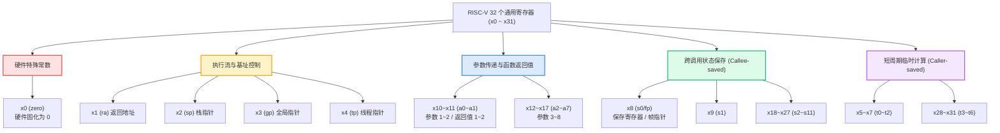
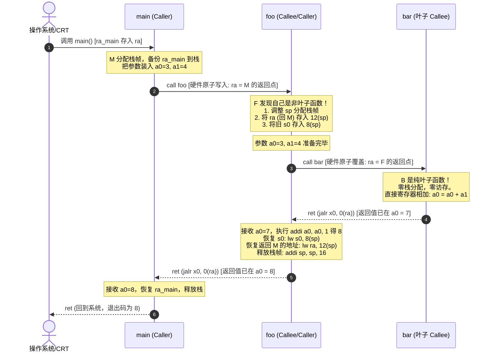
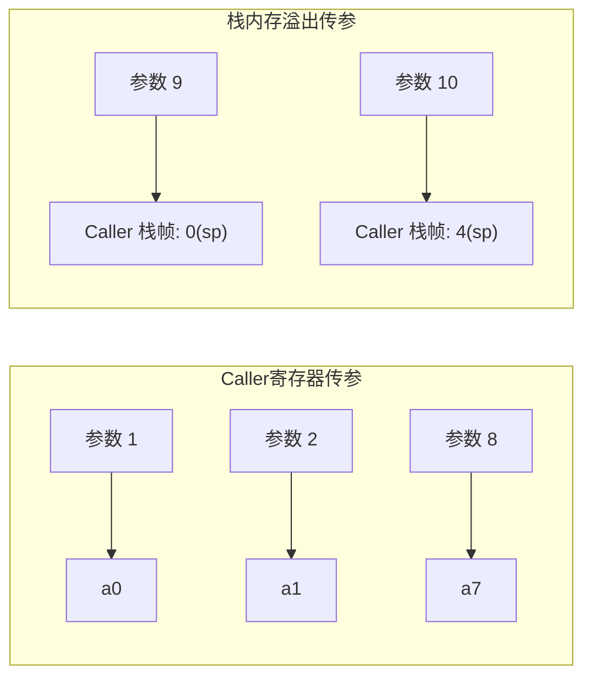
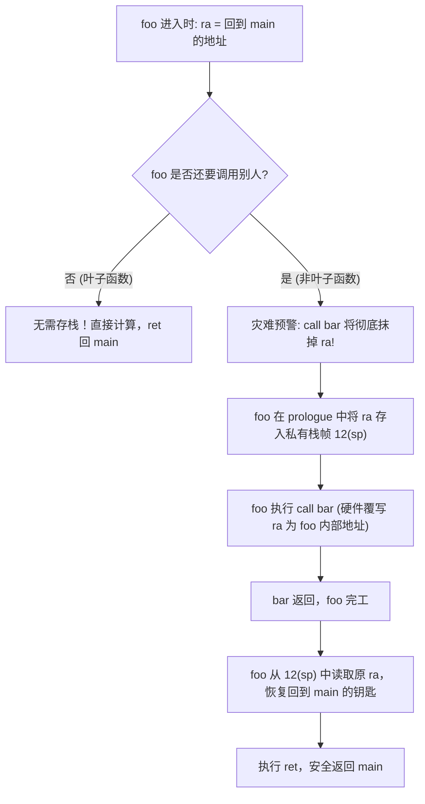
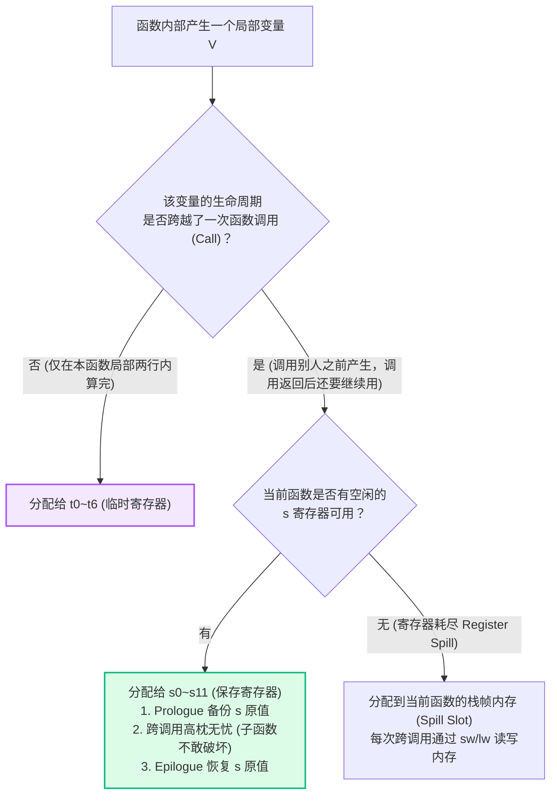
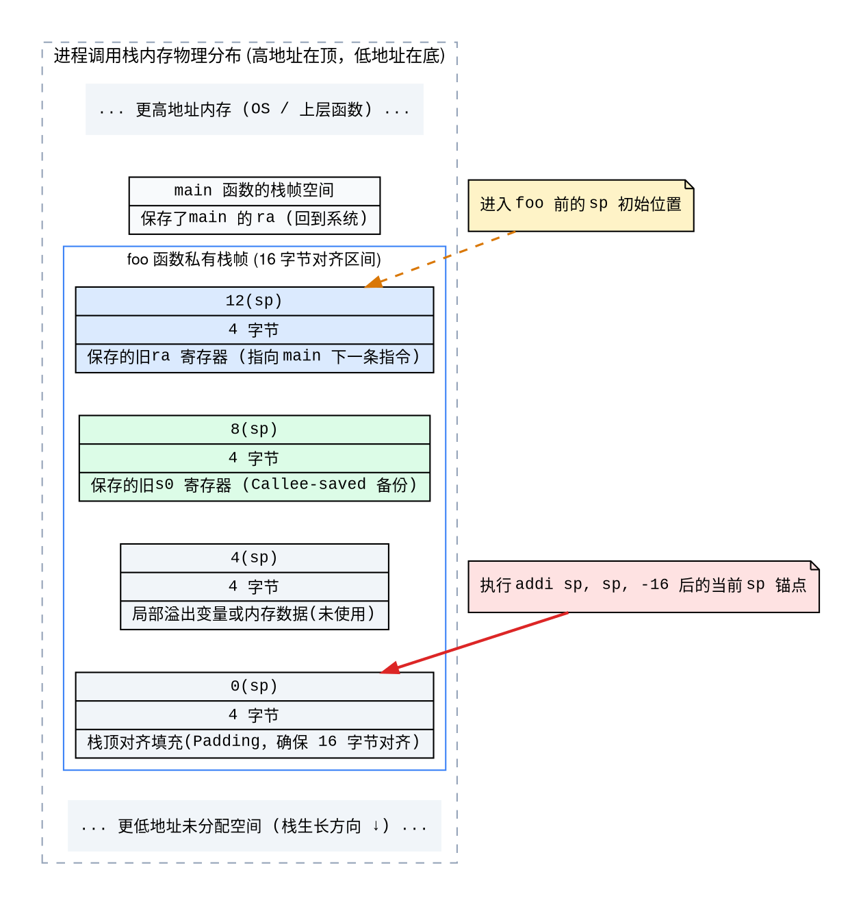
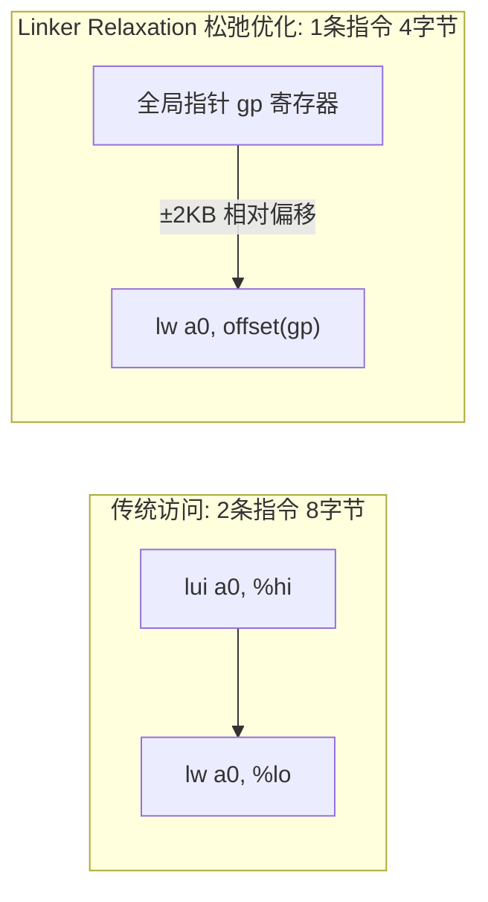
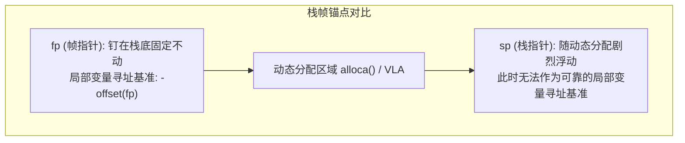
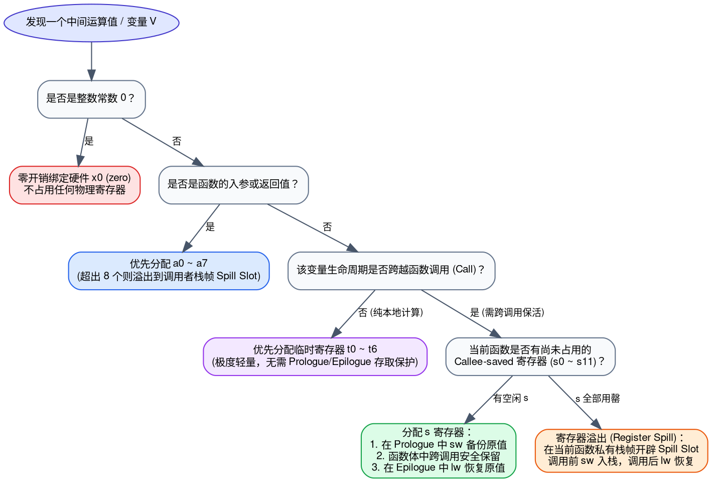

> **导读**：在编写 C++ 代码时，我们习惯将函数调用视作自然而然的高级抽象：`int result = foo(a, b);` 传参、执行、获取返回值，一切行云流水。然而在底层硬件 CPU 眼中，**根本不存在“函数”这一高级语法实体，也没有所谓的形参列表和返回值黑盒**。CPU 面对的只有 32 个物理通用的硬件寄存器（Register）以及一块平坦的物理内存。
>
> 硬件是如何仅凭区区 32 个寄存器，支撑起成百上千层错综复杂的函数嵌套与递归调用的？
> - 为什么寄存器要人为分为 `t`（临时）和 `s`（保存）？
> - 为什么官方规范表格中将返回地址寄存器 `ra` 归为 Caller 维护，但实际反汇编代码中却总能看到 Callee 在入栈保存？
> - 多个嵌套函数如果都在使用同一个寄存器，它们凭什么能够做到“井水不犯河水”？
>
> 本文将从**系统级编程第一性原理**出发，以经典的 `main -> foo -> bar` 多层调用链为具象载体，结合详尽的 C++ 源码、RISC-V 汇编对照、Mermaid 动态协作时序图与 Graphviz 栈帧拓扑图，为读者彻底建立起一套清晰、立体、无可动摇的底层认知模型。

---

## 零、初学者核心名词生动速查表 (Primer)

为了帮助零基础或初次接触底层体系结构的读者扫清阅读障碍，下表对本文首次出现的关键硬件与编译器术语做出一对一的物理世界映射与直观定义：

| 术语名称 | 英文全称 | 核心本质与通俗物理比喻 |
| :--- | :--- | :--- |
| **ABI** | Application Binary Interface | **应用程序二进制接口**。相当于多方协作的“法律合同”。高级语言代码编译成机器指令后，规定参数必须放哪几个寄存器、返回值放哪、哪些寄存器借用后必须完璧归赵的行业公约。 |
| **Caller** | Caller | **调用者（主调函数）**。发起调用动作的一方。例如在 `main()` 内部执行 `foo()` 时，`main` 就是 Caller。 |
| **Callee** | Callee | **被调用者（被调函数）**。接受调用动作并执行的一方。在上述例子中，`foo` 就是 Callee。在多层调用中，角色会动态转换。 |
| **Caller-saved** | Caller-saved Registers | **调用者保存（易失性寄存器）**。相当于会议室公共白板。Callee 随时可以擦写覆盖；Caller 如果里面存了重要数据且跨越调用后还要用，**Caller 必须自己在出门前掏出笔记本记下来（存入栈内存）**。 |
| **Callee-saved** | Callee-saved Registers | **被调用者保存（非易失性寄存器）**。相当于借用了房东的私密卧室。Callee 可以使用，但**走之前必须物归原主、恢复如初**；Caller 信任它在调用返回后完好无损。 |
| **Leaf Function** | 叶子函数 | **树枝末梢函数**。内部**不再调用任何其他函数**的纯计算函数。它永远不需要担心自己发出的 `call` 指令覆盖返回地址。 |
| **Non-leaf Function** | 非叶子函数 | **中间节点函数**。自身被调用，同时内部**还要继续调用下层函数**。它必须扮演“既是被调者又是调用者”的双重角色。 |
| **Stack Frame** | 栈帧 | **函数的私有行李箱**。当一个函数需要保存返回地址、备份寄存器或存放过多局部变量时，在内存调用栈（Stack）上开辟的一块专属连续空间。 |
| **Stack Pointer (`sp`)** | Stack Pointer | **栈指针寄存器（x2）**。始终精确指向当前函数私有行李箱（栈帧）最底部的游标。 |
| **Prologue / Epilogue** | 序言 / 尾声 | **函数的开场与谢幕仪式**。Prologue 负责开辟栈帧、备份寄存器；Epilogue 负责恢复寄存器、销毁栈帧并跳回调用者。 |
| **Return Address (`ra`)** | Return Address | **返回地址寄存器（x1）**。相当于旅途中的“面包屑导航”。记录了当前函数执行完毕后，CPU 应该回到调用者的哪一条指令继续往下执行。 |
| **Frame Pointer (`fp` / `s0`)** | Frame Pointer | **帧指针寄存器（x8）**。栈帧顶部的稳定基准锚点。当局部栈帧大小动态浮动（如使用 `alloca`）导致 `sp` 乱跑时，`fp` 为局部变量寻址提供坚不可摧的静止坐标。 |
| **Linker Relaxation** | 链接器松弛优化 | **指令精简黑魔法**。利用全局指针寄存器 `gp`，将原本需要两指令（`lui` + `addi`）的全局寻址精简为单条指令（`lw ..., 0(gp)`）。 |
| **TLS** | Thread Local Storage | **线程局部存储**。多线程环境下每个线程私有的独立数据段。RISC-V 通过线程指针寄存器 `tp`（x4）进行硬件级基址寻址。 |

---

## 一、RISC-V 32 个通用寄存器全景透视

在标准的 32 位或 64 位 RISC-V 整数架构（RV32I / RV64I）中，CPU 提供了编号为 `x0` 至 `x31` 的 32 个物理通用寄存器。为了让编译器、汇编器、操作系统与手写汇编工程师能够顺畅协作，RISC-V 官方制定了标准 ABI（应用程序二进制接口）命名与职责规范。

### 1.1 标准寄存器 ABI 分工总表

```text
规范名     ABI 名    全称与核心功能                  保存责任归属 (Preserved Across Call)
--------------------------------------------------------------------------------------
x0        zero      只读常数 0，写操作被硬件静默忽略  无（硬件常量，不可破坏）
x1        ra        Return Address 返回地址        Caller-saved（严格定义：由 call 指令改写）
x2        sp        Stack Pointer 栈指针           Callee-saved（函数返回前后必须保持平衡）
x3        gp        Global Pointer 全局指针        固化基址（全局不变，不参与函数传参）
x4        tp        Thread Pointer 线程指针        线程基址（线程内固定，不参与函数传参）
x5–x7     t0–t2     Temporary 临时寄存器           Caller-saved（子函数可任意覆盖）
x8        s0/fp     Saved Register 0 / 帧指针      Callee-saved（若修改，函数返回前必须恢复）
x9        s1        Saved Register 1 保存寄存器    Callee-saved（若修改，函数返回前必须恢复）
x10–x11   a0–a1     Argument/Return 传参与返回值    Caller-saved（既是入参，又是首要返回值）
x12–x17   a2–a7     Argument 寄存器 (第 3~8 个参数) Caller-saved（函数调用后值不保证存活）
x18–x27   s2–s11    Saved Registers 2~11 保存寄存器 Callee-saved（若修改，函数返回前必须恢复）
x28–x31   t3–t6     Temporary 临时寄存器 3~6       Caller-saved（子函数可任意覆盖）
```

### 1.2 寄存器职能分布架构图

为了直观展现这 32 个寄存器在 CPU 内部的职能版图，我们绘制了如下的拓扑结构：



---

## 二、经典三层调用链模型（main → foo → bar）

抽象的概念必须落地到真实的程序流中。我们设计一段最简单但涵盖了所有核心场景的 C++ 三层函数调用代码：

```cpp
// 1. 叶子函数 (Leaf Function)：纯计算，不再调用任何下游函数
int bar(int x, int y) {
    return x + y;
}

// 2. 非叶子函数 (Non-leaf Function)：既是被调用者，又是调用者
int foo(int a, int b) {
    int s = bar(a, b); // 发起嵌套调用，发生寄存器冲突考验
    return s + 1;      // 接收返回值并完成最终计算
}

// 3. 顶层驱动函数
int main() {
    return foo(3, 4);
}
```

在这段调用链中：
- `main` 调用 `foo`：`main` 是 Caller，`foo` 是 Callee。
- `foo` 调用 `bar`：此时 `foo` 摇身一变成了 Caller，`bar` 成为 Callee。
- `bar` 计算完毕后返回 `foo`，`foo` 再计算完毕后返回 `main`。

下面是 GCC / Clang 在未开启全程序内联优化（O0 / 调试级构建）时生成的 RISC-V 标准真实汇编对应代码：

```asm
# ==========================================
# 顶层 Caller: main 函数
# ==========================================
main:
    addi    sp, sp, -16         # Prologue: 开辟 16 字节栈帧 (16 字节对齐)
    sw      ra, 12(sp)          # 保存 main 的返回地址到栈中 (因为 main 也要调用 foo)

    li      a0, 3               # 将第 1 个入参 3 写入参数寄存器 a0
    li      a1, 4               # 将第 2 个入参 4 写入参数寄存器 a1
    call    foo                 # 核心跳转指令: jal ra, foo (硬件写入 ra = 下一条指令地址)

    # foo 执行完毕返回到这里，计算结果已经在 a0 中
    lw      ra, 12(sp)          # Epilogue: 从栈中恢复 main 的返回地址
    addi    sp, sp, 16          # 销毁 main 的栈帧，归还 sp
    ret                         # 返回 OS / 运行时环境 (jalr x0, 0(ra))

# ==========================================
# 承上启下的枢纽: foo 函数 (非叶子函数)
# ==========================================
foo:
    # --- Prologue (序言) ---
    addi    sp, sp, -16         # 为 foo 建立 16 字节私有栈帧
    sw      ra, 12(sp)          # 【关键】因为 foo 马上要 call bar，硬件 ra 将被覆盖！必须先备份
    sw      s0, 8(sp)           # 假设 foo 选用 s0 暂存重要数据，必须备份原有的 s0

    # 进入 foo 时：a0=3, a1=4
    # foo 需要调用 bar(a, b)，恰好参数已经在 a0, a1 中，直接透传
    call    bar                 # 执行跳转：覆盖了硬件 ra，且 bar 可能会随意擦写所有 t* 寄存器

    # --- 从 bar 返回到 foo ---
    # 此时 bar 的计算返回值 (x + y = 7) 已经躺在 a0 中
    addi    a0, a0, 1           # 计算 s + 1: a0 = 7 + 1 = 8

    # --- Epilogue (尾声) ---
    lw      s0, 8(sp)           # 恢复进入 foo 前借用的 s0 寄存器
    lw      ra, 12(sp)          # 恢复能够跳回 main 的原始返回地址
    addi    sp, sp, 16          # 销毁 foo 的栈帧，指针归位
    ret                         # 跳回 main 执行 (jalr x0, 0(ra))

# ==========================================
# 树梢末端: bar 函数 (极致轻量的叶子函数)
# ==========================================
bar:
    # 观察：bar 没有任何 addi sp, sp, -16，也不碰内存栈！
    add     a0, a0, a1          # 直接将 a0 (3) 和 a1 (4) 相加，结果 7 写入返回值寄存器 a0
    ret                         # 直接利用当前 ra 返回 foo，零内存访存开销！
```

---

## 三、多层调用中的寄存器流转时序与接力

为了让读者直观感受数据、控制权与寄存器在时间维度上的转移，我们用 Mermaid 时序图展现全过程：



---

## 四、核心寄存器分类的底层契约与疑难辨析

### 4.1 参数与返回值寄存器（`a0 ~ a7`）

RISC-V 规定了 8 个参数寄存器 `a0 ~ a7`（对应 `x10 ~ x17`），以及 2 个主要返回值寄存器 `a0 ~ a1`。

#### 为什么是 8 个寄存器？
根据贝尔实验室与 UC Berkeley 对数十万行 C/C++ 工业级代码的统计，超过 **85%** 的函数参数个数小于等于 4 个，超过 **98%** 的函数参数个数小于等于 8 个。
- **寄存器传参**：执行速度为 1 个 CPU 时钟周期（Sub-nanosecond 级）。
- **内存栈传参**：哪怕命中 L1 Data Cache，也至少需要 4~5 个时钟周期；若 Cache Miss，则高达数十上百周期。
因此，8 个寄存器在“硅片面积/功耗”与“函数调用吞吐量”之间达到了数学上的黄金平衡点。

> [!NOTE]
> **初学者疑惑：如果 C++ 函数有 10 个参数，超出 8 个的部分怎么办？**
> 这在体系结构中被称为 **参数溢出（Argument Spill）**。
> 前 8 个参数按顺序放入 `a0 ~ a7`，第 9 个和第 10 个参数由调用者（Caller）压入自己的栈帧底部（靠近 Callee 栈顶的位置）。Callee 通过正偏移量（如 `lw t0, 0(sp)`，在进入 Callee 尚未调整 sp 前）直接从内存中读取。



#### 返回值如何流动？
- 标量值（如 `int`, `char`, 指针）直接存入 `a0`。
- 64 位整数（在 32 位系统 RV32 上）拆分为高低 32 位，分别放入 `a1`（高位）和 `a0`（低位）。
- **大型 C++ `struct` 或 `class` 对象**：若对象大小超过 2 个寄存器容纳上限，C++ 编译器会实施 **隐式首参数转换（Hidden Pointer / sret）**。Caller 在自己的栈上预先开辟好受体内存空间，将该内存的地址作为隐藏的第 1 个参数塞入 `a0`，Callee 直接将结果写入该地址。

---

### 4.2 返回地址寄存器（`ra`）：覆盖危机与自我救赎

`ra`（Return Address，`x1`）是整个函数调用流转中最为精妙的一环。

#### 硬件跳转指令背后的原子秘密
当汇编中出现伪指令 `call symbol` 时，汇编器会将其展开为标准的 RISC-V 绝对/相对跳转链接指令：
$$\text{jal ra, symbol} \quad \text{或} \quad \text{auipc ra, offset} + \text{jalr ra, ra, offset}$$

以 `jal ra, foo` 为例，CPU 硬件在同一个时钟周期内原子完成两件事：
1. **记录归途**：将当前指令的下一条指令地址（`PC + 4`）强制写入寄存器 `ra`。
2. **奔赴异乡**：将程序计数器 `PC` 更新为目标函数 `foo` 的入口地址。

当函数执行结束时，`ret` 伪指令实际上被展开为：
$$\text{jalr x0, 0(ra)}$$
即跳转到 `ra` 所保存的地址，并将新的返回地址写入 `x0`（由于 `x0` 恒为 0，相当于不记录任何返回地址，实现纯跳转）。

#### 终极破解：为什么规范表写 `ra` 归 Caller 维护，但代码里却是 Callee 在存栈？
许多初学者研读官方文档时，在这里产生了极大的困惑：
> “表里写着 `ra` 是 Caller-saved（由调用者维护）。但在汇编代码里，明明是 `foo`（被调用者）在开头执行了 `sw ra, 12(sp)`，这难道不是 Callee 在保存吗？”

**深度答案**：
1. **身份的双重性**：
   在 `main -> foo -> bar` 链条中，`foo` 具有双重人格。站在 `main` 的角度，`foo` 是 Callee；**但站在 `bar` 的角度，`foo` 是原汁原味的 Caller！**
2. **调用指令的破坏性**：
   `foo` 之所以要保存 `ra`，并不是为了 `main`，而是因为 `foo` 即将执行 `call bar`。一旦 `call bar` 执行，**硬件会毫不留情地用（`foo` 调用 `bar` 的下一行地址）冲掉原来的 `ra`（即返回 `main` 的钥匙）**！
3. **责任定义的真谛**：
   所谓 **Caller-saved**，本质含义是：“**谁发起 call 操作，谁就承担因 call 导致的 ra 被冲掉的风险**”。如果发起调用的那个函数（此时作为 Caller）后续还需要用到原先的返回地址，它就必须在发起 `call` 之前，把手头的 `ra` 妥善保存好。



---

### 4.3 临时寄存器（`t0~t6`）vs 保存寄存器（`s0~s11`）

为什么 CPU 不将所有寄存器都统一规定为同一种类型？为什么要繁琐地区分 Caller-saved（`t`）和 Callee-saved（`s`）？

这是编译器代码生成中最具艺术感的权衡：



#### 典型场景对比
假设 `foo` 中有代码：
```cpp
int foo(int a, int b) {
    int local_temp = a * 2; // 生命周期在 call bar 之前就彻底结束了
    int s = bar(a, b);
    return s + local_temp;  // 糟糕！local_temp 需要跨越 call bar 存活！
}
```
- 如果编译器将 `local_temp` 放在 `t0`：
  当 `foo` 执行 `call bar` 时，`bar` 拥有合法权利随意改写 `t0`。当 `bar` 执行完毕返回 `foo` 时，`t0` 里的数据可能已经变成了垃圾值！
- 编译器聪明的应对方式：
  1. **方案 1（优先）**：将 `local_temp` 分配到 `s0`。`foo` 在进入时把旧 `s0` 压入栈帧备份。虽然 `bar` 可能会被执行，但 ABI 契约保证：**如果 `bar` 要用 `s0`，`bar` 必须负责备份和还原**。因此从 `bar` 返回后，`foo` 坚信 `s0` 依然是完好无损的 `local_temp`。
  2. **方案 2（兜底）**：如果所有 `s` 寄存器都被占满了，编译器在 `call bar` 前将 `t0` 写入内存栈，返回后再从栈中读出。

> [!TIP]
> **关键认知纠偏**：
> “Caller-saved” 并不意味着调用者每次调用任何函数前，都必须傻傻地把 `t0 ~ t6` 全部存一遍！
> 只有**当前正在使用、且在函数调用返回后依然需要使用（Live Across Call）**的寄存器，编译器才会生成保存指令。如果一个临时变量用完即弃，其保存成本为零。

---

### 4.4 栈指针寄存器（`sp`）与函数栈帧（Stack Frame）物理布局

`sp`（Stack Pointer，`x2`）是维护程序运行时内存空间秩序的“定海神针”。

#### RISC-V 栈的核心几何法则：
1. **倒悬生长（Downwards Growth）**：高地址在上方，低地址在下方。申请空间是减法（`addi sp, sp, -16`），释放空间是加法（`addi sp, sp, 16`）。
2. **16 字节硬性对齐（16-byte Alignment Rule）**：
   RISC-V 官方 ABI 强制规定：在任何函数调用边界（即执行 `call` 的瞬间），`sp` 的数值必须是 16 的整数倍（即最低 4 位二进制必须全为 0）。
   - **原因**：极大简化超标量流水线、现代总线对齐检查逻辑，并为 SIMD/RVV 128 位向量扩展内存高效加载提供硬件保障。

我们使用 Graphviz 渲染 `foo` 函数在执行过程中的完整栈帧物理拓扑结构：



---

## 五、特殊与全局寄存器的底层角色

### 5.1 `x0 (zero)`：硬件恒零的设计哲学
在 RISC-V 架构中，`x0` 是一个被硬件线路永久接地（Grounded）的特殊寄存器：
- 无论对它读多少次，输出的值永远是二进制 `0`。
- 任何试图向它写入数据的指令都会被 CPU 默默丢弃，不会引发硬件异常。

这一极简设计直接消除了大量复杂的专用机器指令，让基础算术指令能够“多态化”：
1. **实现寄存器赋值（`mv rd, rs`）**：
   底层转换为：`addi rd, rs, 0`（加上零即原值）。
2. **实现变量清零**：
   底层转换为：`addi rd, zero, 0`。
3. **实现无条件子程序返回（`ret`）**：
   底层转换为：`jalr zero, 0(ra)`（跳回 `ra`，硬件原本要存下一条地址，但塞给 `zero` 丢弃，化身为纯跳转）。
4. **实现条件跳转中的非零/等于零比较**：
   `beqz rs, label` 底层转换为 `beq rs, zero, label`。

---

### 5.2 全局指针 `x3 (gp)` 与链接器松弛（Linker Relaxation）

在大型 C/C++ 程序中，全局变量和静态变量通常被放置在 `.data` 或 `.bss` 段。
由于 RISC-V 指令长度固定为 32 位，无法在一组指令内塞入完整的 32 位绝对内存地址。常规访问一个全局变量需要两条指令：
```asm
lui   a0, %hi(my_global)     # 1. 加载高 20 位基地址
lw    a0, %lo(my_global)(a0) # 2. 加上低 12 位偏移量完成访存
```
两条指令不仅浪费指令 Cache（I-Cache），更拖慢了执行吞吐。

**全局指针 `gp` 的破局方案**：
操作系统的运行时链接器在初始化进程时，选定所有小型全局变量（Small Data）汇聚的中心点，将其绝对地址写入 `gp` 寄存器。
由于一个寄存器配合 12 位有符号立即数可以覆盖上下 $4\text{KB}$（共计 $8\text{KB}$）的寻址空间：

编译器与链接器联手将两条指令**就地松弛（Relax）为单条 `lw a0, offset(gp)`**，既省了一半指令体积，又使关键全局访问速度提升一倍！

---

### 5.3 线程指针 `x4 (tp)` 与 C++ `thread_local`

在现代多线程编程中，C++11 引入了 `thread_local` 关键字，确保每个线程拥有变量的独立副本：
```cpp
thread_local int g_thread_counter = 0;
```
底层的多线程库（如 `pthread`）在创建新线程时，会为其分配专属的 **线程控制块（TCB，Thread Control Block）** 与线程局部存储区（TLS）。
RISC-V 的 `tp` 寄存器在上下文切换时由操作系统内核负责换入换出，专职指向当前正在运行的那个物理线程的 TLS 基地址。
访问 `thread_local` 变量时，编译器直接生成相对于 `tp` 的偏移寻址：
```asm
lw    a0, %tprel_lo(g_thread_counter)(tp)
```
整个寻址完全在用户态零系统调用（Zero-syscall）完成，极速且天然线程安全。

---

### 5.4 帧指针 `x8 (s0/fp)`：何时启用？

在现代高度优化的生产环境中，默认都会开启 `-fomit-frame-pointer`，此时 `x8` 仅作为普通 Callee-saved 寄存器 `s0` 使用，以争取多一个寄存器给寄存器分配器（Register Allocator）。

但以下场景必须将 `s0` 激活为 `fp`（帧指针）：
1. **动态变长栈分配（VLA 或 `alloca()`）**：
   当 C++ 函数内部使用动态尺寸分配：
   ```cpp
   void process_dynamic(int n) {
       int buf[n]; // 栈大小在编译期无法预测！
   }
   ```
   此时 `sp` 会随着 `n` 的大小在函数体中间大幅向低地址跳跃滑动。如果编译器仅靠 `sp` 相对寻址访问局部参数，偏移量就会全部乱套！
   引入 `fp` 后，`fp` 始终在 Prologue 阶段牢牢钉在栈帧的最顶端。无论 `sp` 如何剧烈浮动，局部变量通过稳定的负偏移 `offset(fp)` 即可精准定位。
2. **调试与异常链式栈回溯（Stack Unwinding）**：
   C++ 的 `throw / catch` 异常机制以及 Linux `perf` 性能剖析工具，依赖 `fp` 形成的内存单向链表，在毫秒级内逐层回溯调用栈。



---

## 六、编译器眼中的寄存器生存法则与决策树

当 GCC 或 Clang 的后端指令选择器（Instruction Selector）和寄存器分配器（如 LLVM Greedy Register Allocator）扫描我们编写的 C++ 代码时，它是如何做出决策的？

我们构建了如下的编译器寄存器分配决策树：



---

## 七、总结与架构精要心法

通过上面的推演，我们可以将 RISC-V 寄存器在 C++ 多层函数调用中的流转法则凝练为以下四句话心法：

> 1. **常数零借 `x0`，返回归途系 `ra`；栈顶游标认准 `sp`，全局基准看 `gp`。**
> 2. **参数八个 `a0` 起，超额压栈由主调；结果首推 `a0/a1`，大体结构隐指针。**
> 3. **短命临时扔 `t` 组，调用归来休怪空；跨调保活托付 `s`，被调离场必还公。**
> 4. **叶子函数免开栈，直进直出性能巅；嵌套非叶必防冲，序言备份尾声终。**

理解了这些运行在底层芯片中的冰冷契约，当我们在现代 C++ 中书写每一行 Lambda 表达式、虚函数调用或是协程挂起时，眼前浮现的将不再是抽象的语法糖，而是数十个物理硬件寄存器在 CPU 内部如同精密钟表齿轮般严丝合缝、高速运转的壮丽图景。
