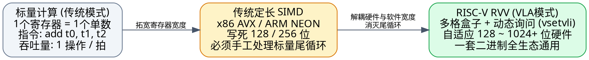
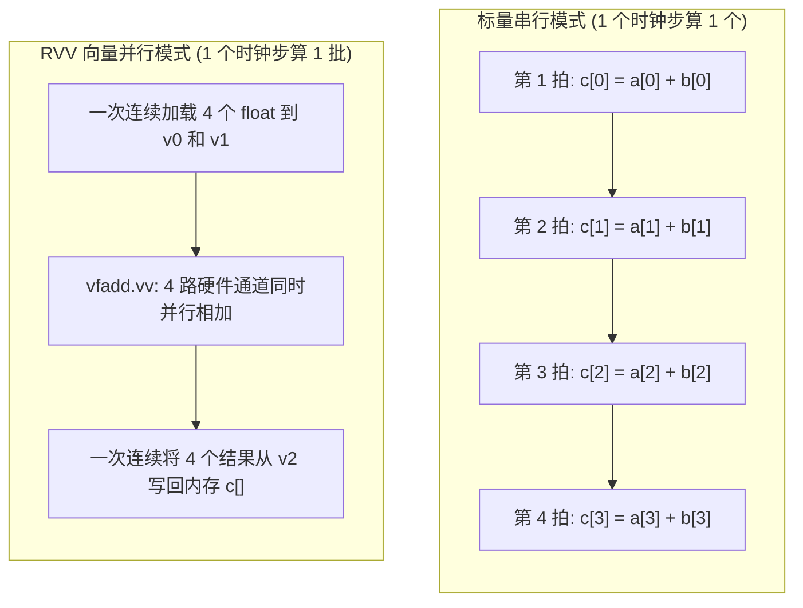
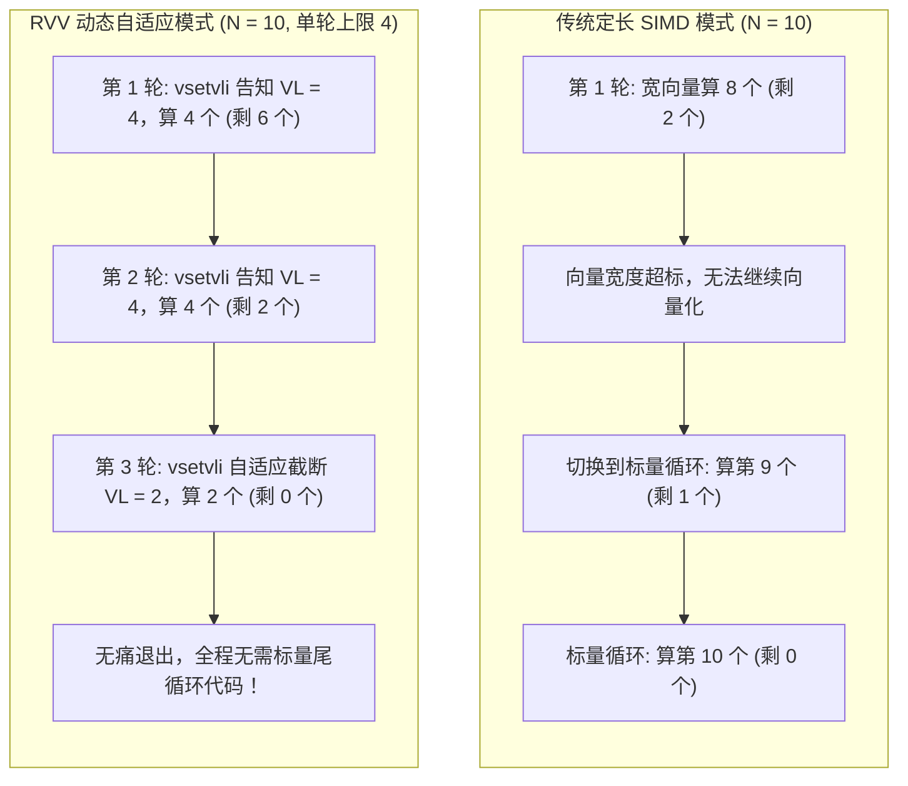
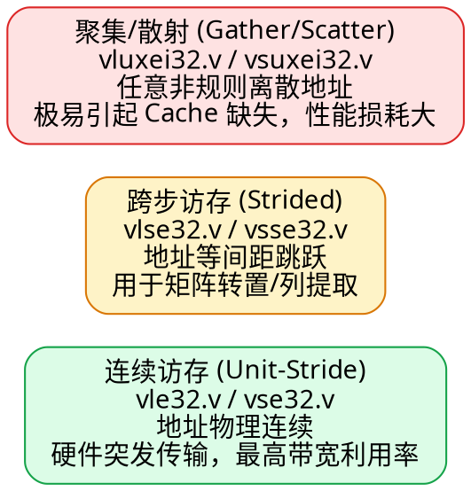
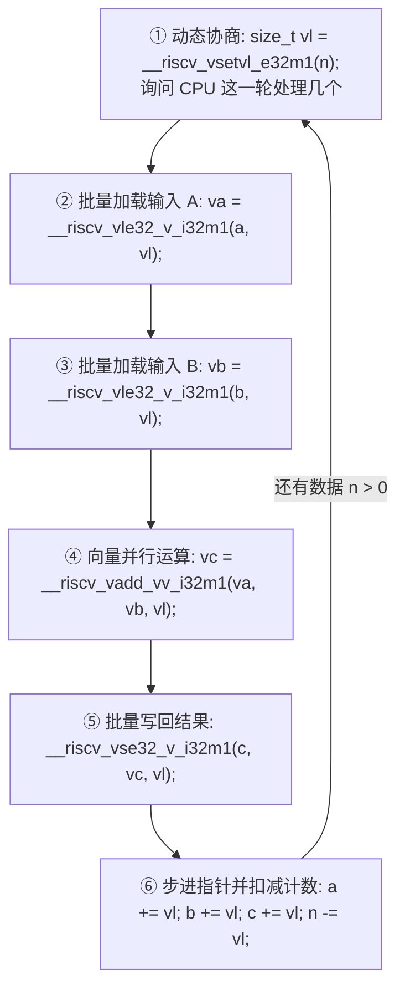
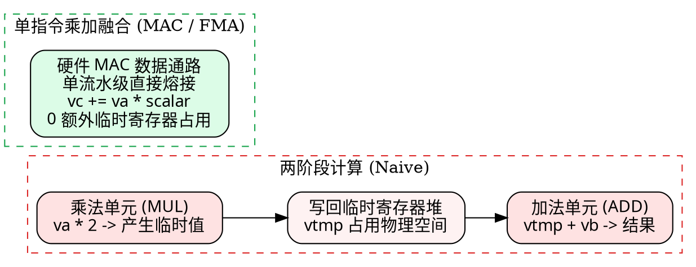
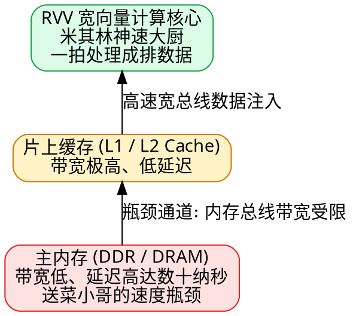
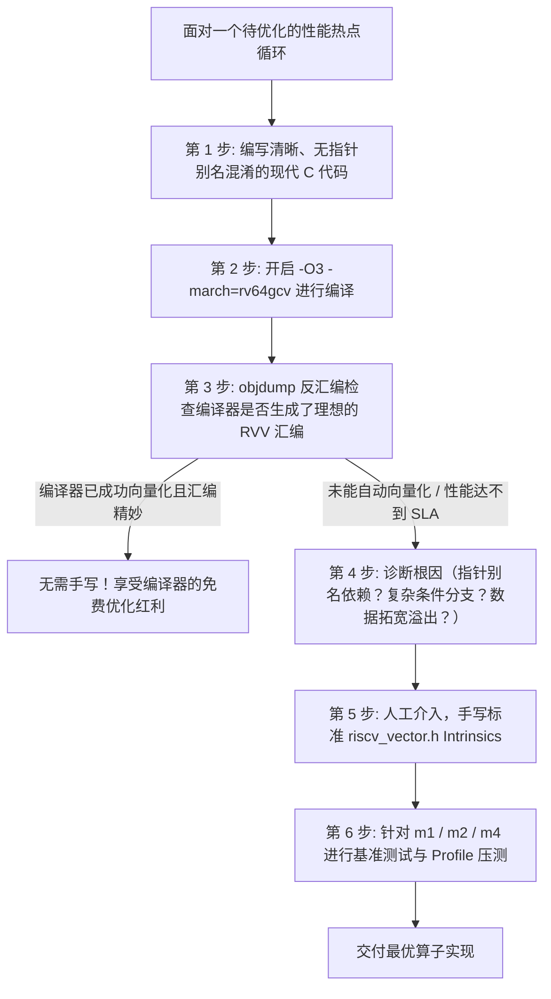

> **前言**：在 AI 大模型推理、计算机视觉、数字信号处理（DSP）以及高性能科学计算的浪潮下，“向量化计算（Vector Computing）”已成为现代处理器的绝对核心能力。然而，长期以来，x86 的 AVX-256 / AVX-512 以及 ARM 的 NEON 往往让初学者陷入痛苦：**“为什么换一颗 CPU，我就得重写一套针对 128、256 或 512 位宽度的汇编代码？为什么主循环算完后，还得专门写一堆丑陋的标量尾循环（Scalar Tail Loop）来处理剩余的数据？”**
>
> RISC-V 向量扩展（**RVV，RISC-V Vector Extension**）带着革命性的设计哲学彻底颠覆了这种传统思维——**Vector-Length Agnostic（VLA，向量长度无关）**。在 RVV 的世界里，程序无需写死底层的硬件寄存器宽度，同一份二进制指令既可以在 128 位的嵌入式轻量核上平稳运行，也可以在 512 位的超算数据中心芯片上自动释放四倍算力。
>
> 本文专为**零基础初学者与底层系统/AI 编译器开发者**打造。我们彻底摒弃晦涩的学术黑话，以“大盒子装小格子”的生动心智模型贯穿始终，从最基础的加法循环出发，手把手推导到生产级 C 语言 Intrinsics（`<riscv_vector.h>`）代码，并深入拆解乘加融合、内存带宽瓶颈与调优陷阱，配合丰富的 **Mermaid 流程图** 与 **Graphviz 硬件拓扑图**，带你一次性通透理解 RVV 的前世今生与实战精髓。

---

## 目录导览

- [新手前置：核心硬件术语生动词典（心智模型速查）](#新手前置核心硬件术语生动词典心智模型速查)
- [一、为什么需要向量优化？从“单件工人”到“整排并进”](#一为什么需要向量优化从单件工人到整排并进)
  - [1.1 标量处理器的“搬砖困境”](#11-标量处理器的搬砖困境)
  - [1.2 向量寄存器：把小盒子升级为“多格大收纳箱”](#12-向量寄存器把小盒子升级为多格大收纳箱)
  - [1.3 标量执行 vs 向量执行全景图解](#13-标量执行-vs-向量执行全景图解)
- [二、RVV 革命性灵魂：什么是“不定长向量”（VLA）？](#二rvv-革命性灵魂什么是不定长向量vla)
  - [2.1 传统 SIMD（x86 AVX / ARM NEON）的历史包袱](#21-传统-simdx86-avx--arm-neon的历史包袱)
  - [2.2 RVV 的第一性原理：Vector-Length Agnostic](#22-rvv-的第一性原理vector-length-agnostic)
  - [2.3 “不定长”的双重含义：跨硬件兼容与动态尾数自适应](#23-不定长的双重含义跨硬件兼容与动态尾数自适应)
- [三、通透解密四大核心参数：VLEN、SEW、VL 与 LMUL](#三通透解密四大核心参数vlensewvl-与-lmul)
  - [3.1 VLEN：硬件盒子的物理底色](#31-vlen硬件盒子的物理底色)
  - [3.2 SEW：格子大小的划分（e8 / e16 / e32 / e64）](#32-sew格子大小的划分e8--e16--e32--e64)
  - [3.3 VL 与灵魂指令 vsetvli：“这一轮究竟能干几个？”](#33-vl-与灵魂指令-vsetvli这一轮究竟能干几个)
  - [3.4 LMUL 盒子拼装艺术：m1, m2, m4, m8 与分数值 mf2, mf4, mf8](#34-lmul-盒子拼装艺术m1-m2-m4-m8-与分数值-mf2-mf4-mf8)
  - [3.5 核心算力公式推导：VLMAX 的几何意义](#35-核心算力公式推导vlmax-的几何意义)
  - [3.6 灵魂拷问：为什么不能无脑选 m8？寄存器数量与溢出权衡](#36-灵魂拷问为什么不能无脑选-m8寄存器数量与溢出权衡)
- [四、RVV 指令体系与命名规律拆解](#四rvv-指令体系与命名规律拆解)
  - [4.1 汇编后缀密码本：.vv, .vx, .vi, .vf](#41-汇编后缀密码本vv-vx-vi-vf)
  - [4.2 访存指令：连续加载/存储（vle / vse）与非连续访存](#42-访存指令连续加载存储vle--vse与非连续访存)
  - [4.3 整数运算与位操作指令群](#43-整数运算与位操作指令群)
  - [4.4 浮点运算与 AI 核心：FMA 乘加融合（vfmacc）](#44-浮点运算与-ai-核心fma-乘加融合vfmacc)
  - [4.5 掩码（Mask）机制：用 v0 消除分支发散](#45-掩码mask机制用-v0-消除分支发散)
  - [4.6 精度扩展（Widening）与压缩（Narrowing）](#46-精度扩展widening与压缩narrowing)
  - [4.7 向量归约（Reduction）：一排数字浓缩为标量](#47-向量归约reduction一排数字浓缩为标量)
- [五、从普通 C 循环手写 RVV Intrinsics 实战](#五从普通-c-循环手写-rvv-intrinsics-实战)
  - [5.1 原始标量基准实现](#51-原始标量基准实现)
  - [5.2 手工改造六步心智模型](#52-手工改造六步心智模型)
  - [5.3 生产级 RVV C 完整代码（包含 `<riscv_vector.h>`）](#53-生产级-rvv-c-完整代码包含-riscv_vectorh)
  - [5.4 消除函数名恐惧：Intrinsics 的命名解密](#54-消除函数名恐惧intrinsics-的命名解密)
  - [5.5 脑内全真模拟：N=10 数据集的推进轨迹](#55-脑内全真模拟n10-数据集的推进轨迹)
  - [5.6 编译、反汇编与实际机器码验证](#56-编译反汇编与实际机器码验证)
- [六、进阶实战：乘累加融合（MAC / FMA）优化](#六进阶实战乘累加融合mac--fma优化)
  - [6.1 典型场景：数组线性变换计算](#61-典型场景数组线性变换计算)
  - [6.2 引入 vmacc.vx：单周期搞定两件事](#62-引入-vmaccvx单周期搞定两件事)
  - [6.3 硬件流水线收益与中间精度保护](#63-硬件流水线收益与中间精度保护)
- [七、性能真相：为什么快？什么时候反而变慢？](#七性能真相为什么快什么时候反而变慢)
  - [7.1 加速的核心动力源](#71-加速的核心动力源)
  - [7.2 误区剖析：“处理 8 个数据就能快 8 倍吗？”](#72-误区剖析处理-8-个数据就能快-8-倍吗)
  - [7.3 陷阱一：内存带宽瓶颈（Memory Bound）——“大厨在等送菜小哥”](#73-陷阱一内存带宽瓶颈memory-bound大厨在等送菜小哥)
  - [7.4 陷阱二：短向量惩罚（Short Vector Overhead）](#74-陷阱二短向量惩罚short-vector-overhead)
  - [7.5 陷阱三：循环数据依赖（Loop-Carried Dependency）](#75-陷阱三循环数据依赖loop-carried-dependency)
  - [7.6 陷阱四：非连续跨步与稀疏访存（Gather / Scatter）](#76-陷阱四非连续跨步与稀疏访存gather--scatter)
  - [7.7 编译器自动向量化 vs 手写 Intrinsics：工程决策树](#77-编译器自动向量化-vs-手写-intrinsics工程决策树)
- [八、总结：向量化思维五步自查法则](#八总结向量化思维五步自查法则)

---

## 新手前置：核心硬件术语生动词典（心智模型速查）

为了确保没有任何底层知识背景的同学也能无障碍通读，当这些术语在下文中第一次出现时，请随时回到本词典对照心智模型。我们不堆砌学术定义，只讲**直白的比喻**：

> [!NOTE] 核心术语直白通俗解析
> - **ALU (Arithmetic Logic Unit，算术逻辑单元)**：
>   芯片上的“计算工人”，专门负责做加法、减法、乘除法或位运算。标量处理器里通常只有 1~2 个工人同时干活。
> - **SIMD (Single Instruction, Multiple Data，单指令多数据)**：
>   **“军训教官指挥一排士兵做同一个动作”**。CPU 只需要下达一次指令（比如“举手”），并排排列的多个计算单元就在同一个时钟节拍里对各自手中的数据执行相同的计算。
> - **标量（Scalar） vs 向量（Vector）**：
>   - **标量**：孤独的单个数，比如一个普通的 `int a = 5;`。
>   - **向量**：排成一列的一批数，比如 `int a[4] = {1, 2, 3, 4};`。
> - **RVV (RISC-V Vector Extension)**：
>   RISC-V 开源指令集架构官方制定的向量计算扩展规范，用于为 RISC-V 芯片赋予极高吞吐的并行数据处理能力。
> - **VLEN (Vector Register Length，向量寄存器物理位宽)**：
>   **“物理盒子的总长度”**。芯片硬件工程师在画电路图时固化在晶体管里的寄存器物理大小（例如 128 bit、256 bit、512 bit）。不同 CPU 的 VLEN 可以完全不同。
> - **SEW (Selected Element Width，选定元素位宽)**：
>   **“把盒子划分成的单个格子宽度”**。程序在运行期间告诉 CPU：“我现在装的每个数是 8 位（`e8`）、16 位（`e16`）、32 位（`e32`）还是 64 位（`e64`）”。
> - **VL (Vector Length，当前向量长度)**：
>   **“这一轮循环真正有效干活的格子数量”**。比如盒子里最多装 4 个数，但整个数组只剩 2 个数需要算，那么本轮 `VL = 2`，CPU 只计算前 2 个，后 2 个不破坏。
> - **LMUL (Vector Length Multiplier，向量长度倍率)**：
>   **“把几个物理盒子拼成一个大收纳箱”**。RVV 允许将 2、4、8 个物理寄存器动态捆绑在一起使用（`m2`、`m4`、`m8`），一次处理成倍的数据；也可以只用半个或更小（`mf2`、`mf4`、`mf8`）。
> - **VLA (Vector-Length Agnostic，向量长度无关)**：
>   RVV 最伟大的设计——**“软件不写死硬件宽度”**。你的 C 代码或汇编程序不需要写“每次固定算 4 个或 8 个”，而是每次动态向硬件询问“你能算几个”，从而无缝兼容任何宽度的 RISC-V 芯片。
> - **Scalar Tail Loop (标量尾循环 / 剥离循环)**：
>   传统固定宽度向量程序处理剩余零头数据的无奈手段。比如数组有 10 个元素，硬件每次算 4 个，算完前两轮（8 个）后，剩下 2 个不能用向量指令算，必须手动用一个普通的标量 `for` 循环逐一扫尾。**RVV 彻底消灭了标量尾循环！**
> - **Intrinsics (内建函数)**：
>   编译器（如 GCC/Clang）提供的一套特殊的 C 语言函数接口（定义在 `<riscv_vector.h>`）。它们在形式上像普通的 C 函数，但在编译时会被直接一对一替换成对应的底层硬件汇编指令，既保留了 C 语言的类型安全与寄存器自动分配，又拥有手写汇编的极致性能。
> - **FMA / MAC (Fused Multiply-Add / Multiply-Accumulate，乘加融合)**：
>   执行 $d = a \times b + c$ 的硬件指令。传统做法是先算一次乘法生成临时结果，再算一次加法；而 FMA 由专门的硬件乘加器在一个流水步内搞定，不仅速度翻倍，而且不损失中间精度。



---

## 一、为什么需要向量优化？从“单件工人”到“整排并进”

### 1.1 标量处理器的“搬砖困境”

在刚接触编程时，我们写的数组相加函数几乎都长这个样子：

```c
void add(const float *a, const float *b, float *c, int n) {
    for (int i = 0; i < n; i++) {
        c[i] = a[i] + b[i];
    }
}
```

假设有两个数组，各自包含 8 个单精度浮点数：

```text
a = [ 1.0,  2.0,  3.0,  4.0,  5.0,  6.0,  7.0,  8.0 ]
b = [10.0, 20.0, 30.0, 40.0, 50.0, 60.0, 70.0, 80.0 ]
```

如果让普通的标量 CPU 来执行，它的内部操作就像一个**单件计件工人**：

```text
第 1 次循环：从内存搬出 a[0] 和 b[0]，做 1.0 + 10.0 = 11.0，写回 c[0]
第 2 次循环：从内存搬出 a[1] 和 b[1]，做 2.0 + 20.0 = 22.0，写回 c[1]
第 3 次循环：从内存搬出 a[2] 和 b[2]，做 3.0 + 30.0 = 33.0，写回 c[2]
...
第 8 次循环：从内存搬出 a[7] 和 b[7]，做 8.0 + 80.0 = 88.0，写回 c[7]
```

每一个循环步，CPU 都得重复经历：
1. 计算数组元素的内存地址偏移。
2. 发起两次内存读取请求（Load）。
3. 送入标量 ALU 算一次加法（Add）。
4. 发起一次内存写回请求（Store）。
5. 循环计数器自增 `i++`。
6. 判断是否越界 `i < n` 并执行分支跳转（Branch）。

如果数组有 100 万个元素，CPU 就必须机械地重复执行这套流程 100 万次！哪怕现代 CPU 具备分支预测与超标量乱序执行能力，这种串行吞吐模式也早已无法满足海量矩阵计算的需求。

### 1.2 向量寄存器：把小盒子升级为“多格大收纳箱”

在普通标量 RISC-V 处理器中，我们使用的是通用寄存器（如 `a0`、`a1`、`t0`、`t1`）。

你可以把标量寄存器想象成一个**只能放一个数字的小抽屉**：

```text
标量寄存器 a0:
┌────────────────────────────┐
│         42.0 (单数)         │
└────────────────────────────┘
```

而 RVV 为 CPU 额外引入了 32 个专门的**向量寄存器（Vector Registers）**，名字叫：

```text
v0, v1, v2, v3, ..., v31
```

把向量寄存器想象成一个**内部带有多个独立格子的宽收纳箱**：

```text
向量寄存器 v0:
┌───────────┬───────────┬───────────┬───────────┐
│   1.0     │   2.0     │   3.0     │   4.0     │  <-- 同时并排存放 4 个单精度浮点数
└───────────┴───────────┴───────────┴───────────┘
```

此时，CPU 只需发射一条**向量加法指令**：

```asm
vfadd.vv v2, v0, v1
```

硬件底层并排的 4 个浮点计算通道（Lanes）就会在同一个时钟周期内，同时对每一格执行加法：

```text
v0 盒子:    [  1.0 ]   [  2.0 ]   [  3.0 ]   [  4.0 ]
               +          +          +          +
v1 盒子:    [ 10.0 ]   [ 20.0 ]   [ 30.0 ]   [ 40.0 ]
               ↓          ↓          ↓          ↓
v2 盒子:    [ 11.0 ]   [ 22.0 ]   [ 33.0 ]   [ 44.0 ]
```

原本需要 4 次取指、4 次译码、4 次标量加法的繁琐过程，现在**压缩到了单条指令内完成**！这就是向量优化最质朴的核心原理。

### 1.3 标量执行 vs 向量执行全景图解



---

## 二、RVV 革命性灵魂：什么是“不定长向量”（VLA）？

在学习 RVV 时，最常听到的专业名词莫过于 **Vector-Length Agnostic（VLA，向量长度无关 / 不定长向量）**。初学者往往会被这个词吓退，以为硬件的向量寄存器在运行时会“像橡皮筋一样忽长忽短”。

事实绝非如此。

### 2.1 传统 SIMD（x86 AVX / ARM NEON）的历史包袱

在 x86 或旧款 ARM 体系下，向量指令是**固定硬件位宽（Fixed-Length SIMD）**的：
- **ARM NEON**：固定 128 位宽（每次处理 4 个 32-bit float）。
- **x86 AVX2**：固定 256 位宽（每次处理 8 个 32-bit float）。
- **x86 AVX-512**：固定 512 位宽（每次处理 16 个 32-bit float）。

这种固定长度设计带来了极其沉重的软件工程噩梦：
1. **指令集碎片化**：当 Intel 从 AVX2 升级到 AVX-512 时，增加了全新的指令前缀和内建函数。程序员必须写好几套代码，并在运行时调用 `cpuid` 探测当前机器支持哪套指令，否则程序就会直接崩溃（Illegal Instruction）。
2. **丑陋的标量尾循环（Scalar Tail Loop）**：
   假设你要处理 $N = 10$ 个浮点数，使用 AVX2（一次处理 8 个）：
   - 第一轮：处理 8 个（索引 0~7）。
   - 此时还剩下 2 个（索引 8, 9）。因为 AVX2 每次强制读写 8 个，如果硬读就会发生**内存非法越界访问（Segmentation Fault）**！
   - 开发者被迫写一个平行的标量循环来单件处理最后 2 个。

```c
// 传统定长 SIMD 痛苦的编程心智：主向量循环 + 标量尾循环
void add_fixed_simd(float *a, float *b, float *c, int n) {
    int i = 0;
    // 1. 主向量循环：强制步长为 8
    for (; i <= n - 8; i += 8) {
        __m256 va = _mm256_loadu_ps(&a[i]);
        __m256 vb = _mm256_loadu_ps(&b[i]);
        __m256 vc = _mm256_add_ps(va, vb);
        _mm256_storeu_ps(&c[i], vc);
    }
    // 2. 丑陋的标量尾循环：逐个啃剩下的 1~7 个零头
    for (; i < n; i++) {
        c[i] = a[i] + b[i];
    }
}
```

### 2.2 RVV 的第一性原理：Vector-Length Agnostic

RISC-V 的设计大师们反思了数十年来定长 SIMD 的沉痛教训，确立了第一性原理：

> **“写程序的人，绝不应该在代码里把‘每次必须处理几个数据’写死！程序应该向硬件询问‘这一轮你能处理几个’，由硬件在运行时给出最佳答案。”**

这就叫 **Vector-Length Agnostic（VLA，向量长度无关）**。

在 RVV 的设计下，同一份编译生成的二进制程序文件：
- 跑在低功耗 IoT 芯片（物理寄存器宽 128 位）上：自动每次处理 4 个数。
- 跑在手机/PC 芯片（物理寄存器宽 256 位）上：自动每次处理 8 个数。
- 跑在数据中心 AI 算力卡（物理寄存器宽 512 位乃至 1024 位）上：自动每次处理 16 或 32 个数。

**无需重新编译，无需在代码里写 `if (cpu == avx512)`，真正做到了一次编写，全生态自然加速！**

### 2.3 “不定长”的双重含义：跨硬件兼容与动态尾数自适应

很多同学会好奇：“那如果数组长度不能被整除，RVV 怎么处理尾巴？”

这正是 RVV 最精妙的第二层“不定长”特性：**动态尾数自适应收敛**。

假设一台 RISC-V 机器单次最多处理 4 个数，你要处理 $N = 10$ 个数：
1. **第 1 轮**：还剩 10 个。代码问 CPU：“我还有 10 个数，你这轮算几个？” CPU 回复：“我最多能算 4 个，这轮算 4 个。” -> 处理 0, 1, 2, 3，剩余 6 个。
2. **第 2 轮**：还剩 6 个。代码问 CPU。CPU 回复：“这轮再算 4 个。” -> 处理 4, 5, 6, 7，剩余 2 个。
3. **第 3 轮**：还剩 2 个。代码问 CPU。CPU 发现剩余数据不足 4 个，主动回复：**“那我这一轮只激活前 2 个计算通道，算 2 个！”** -> 处理 8, 9，剩余 0 个。
4. 退出循环。



在最后一轮中，RVV 硬件依靠内部的硬件掩码机制，自动保护了数组越界的内存，既不会触发非法地址访问，也不需要程序员编写任何标量尾循环分支。

---

## 三、通透解密四大核心参数：VLEN、SEW、VL 与 LMUL

在初读 RVV 规范时，四个缩写词出现的频率最高：`VLEN`、`SEW`、`VL`、`LMUL`。让我们用**“大盒子切格子”**的模型把它们彻底钉死在脑海中。

```text
┌─────────────────────────────────────────────────────────────┐
│                 VLEN (物理盒子的总位宽，如 128 bit)            │
└─────────────────────────────────────────────────────────────┘
  │                                                         │
  ▼ 分割成若干个格子 (SEW)                                      ▼
┌───────────────┬───────────────┬───────────────┬───────────────┐
│  SEW = 32 bit │  SEW = 32 bit │  SEW = 32 bit │  SEW = 32 bit │
│  (int32/float)│  (int32/float)│  (int32/float)│  (int32/float)│
└───────────────┴───────────────┴───────────────┴───────────────┘
  <---------------------- VLMAX = 4 个格子 -------------------->
  <------ 实际干活 VL = 2 个格子 ------> [ 空闲屏蔽 ] [ 空闲屏蔽 ]
```

### 3.1 VLEN：硬件盒子的物理底色

- **中文名**：向量寄存器物理位宽（Vector Register Length）。
- **含义**：CPU 芯片制造出来时，单个 `v` 寄存器里到底铺设了多少根物理铜线 / 触发器。
- **常见取值**：
  - 嵌入式 MCU / 轻量核：`VLEN = 128 bit`（16 字节）。
  - 高性能应用处理器：`VLEN = 256 bit`（32 字节）或 `512 bit`（64 字节）。
- **核心心智**：这是硬件客观存在的物理属性，程序无法改变它。

### 3.2 SEW：格子大小的划分（e8 / e16 / e32 / e64）

- **中文名**：选定元素位宽（Selected Element Width）。
- **含义**：程序告诉 CPU，我们当前准备处理的数据类型到底有多大。
- **常见对应关系**：

| SEW 标记 | 对应数据类型 | 单元素占用位宽 | 单元素占用字节 |
| :--- | :--- | :--- | :--- |
| `e8` | `int8_t`, `uint8_t`, 字符/图像像素 | 8 bit | 1 Byte |
| `e16` | `int16_t`, `half`, `bfloat16`（AI权重） | 16 bit | 2 Bytes |
| `e32` | `int32_t`, `float`（单精度浮点） | 32 bit | 4 Bytes |
| `e64` | `int64_t`, `double`（双精度浮点） | 64 bit | 8 Bytes |

- **白话理解**：如果盒子总长是 128 位（`VLEN=128`），你设置 `e8`，盒子就被切成 $128 / 8 = 16$ 个小格子；你设置 `e32`，盒子就被切成 $128 / 32 = 4$ 个大格子。

### 3.3 VL 与灵魂指令 vsetvli：“这一轮究竟能干几个？”

- **中文名**：向量长度（Vector Length）。
- **含义**：在当前这一轮计算中，真正有有效数据装入、需要硬件执行计算的元素个数。
- **灵魂指令 `vsetvli`**：
  这是 RVV 汇编中最重要的一条指令，没有之一！它的语法形式如下：

```asm
vsetvli t0, a0, e32, m1
```

把这条汇编直译成人话，就是一段优雅的人机对话：

> **开发者**：“报告 CPU！我现在手上还有 `a0` 个未处理的数据，每个数据大小是 32 位（`e32`），我申请使用单个寄存器大小的容量（`m1`）。请你看一下你自己的物理电路，告诉我这一轮你最多能帮我算几个？”
>
> **CPU 硬件**：“收到！我看了下我的物理盒子（假设 128 位），装满能装 4 个；对比你剩下的数量 `a0`，我取两者的较小值：`min(a0, 4)`。我把这一轮决定的数量存入标量寄存器 `t0`，同时将内部硬件状态寄存器 `vl` 设为 `t0`！”

在 C 语言中，对应的 Intrinsics 调用为：

```c
size_t vl = __riscv_vsetvl_e32m1(n);
```

### 3.4 LMUL 盒子拼装艺术：m1, m2, m4, m8 与分数值 mf2, mf4, mf8

如果仅仅依靠单个物理寄存器，计算能力依然有限。RVV 提出了极为震撼的 **LMUL（Length Multiplier，长度倍率）** 机制。

它允许我们将多个物理向量寄存器“像积木一样拼装”成一个超大逻辑寄存器：
- **`m1`**：普通模式，1 个逻辑变量占 1 个物理寄存器。
- **`m2`**：双拼模式，将 2 个连续的物理寄存器拼成 1 个逻辑变量（容量 $\times 2$）。
- **`m4`**：四拼模式，将 4 个连续的物理寄存器拼成 1 个逻辑变量（容量 $\times 4$）。
- **`m8`**：八拼模式，将 8 个连续的物理寄存器拼成 1 个逻辑变量（容量 $\times 8$）。

除了向上拼接，RVV 还支持向下划分（Fractional LMUL，小数倍率）：
- **`mf2`**：半盒模式，只使用相当于半个物理寄存器的容量（$\frac{1}{2}$）。
- **`mf4`**：四分之一盒模式（$\frac{1}{4}$）。
- **`mf8`**：八分之一盒模式（$\frac{1}{8}$）。

```graphviz
digraph LMULGrouping {
    rankdir=TB;
    node [shape=record, fontname="sans-serif", fontsize=10];

    subgraph cluster_m1 {
        label = "LMUL = m1 (各占 1 个物理寄存器)";
        style = dashed;
        color = "#0284c7";
        reg_m1 [label="{v0}|{v1}|{v2}|{v3}|{...}|{v31}"];
    }

    subgraph cluster_m2 {
        label = "LMUL = m2 (两两拼装成更大盒子)";
        style = dashed;
        color = "#16a34a";
        reg_m2 [label="{ 逻辑变量 A (v0 + v1) }|{ 逻辑变量 B (v2 + v3) }|{ 逻辑变量 C (v4 + v5) }|{ ... }"];
    }

    subgraph cluster_m4 {
        label = "LMUL = m4 (四四拼装成超大盒子)";
        style = dashed;
        color = "#d97706";
        reg_m4 [label="{ 逻辑变量 Group 0 (v0..v3) }|{ 逻辑变量 Group 1 (v4..v7) }|{ Group 2 (v8..v11) }|{ ... }"];
    }

    subgraph cluster_m8 {
        label = "LMUL = m8 (八八拼装，极限吞吐)";
        style = dashed;
        color = "#dc2626";
        reg_m8 [label="{ 逻辑 Group 0 (v0..v7) }|{ 逻辑 Group 1 (v8..v15) }|{ Group 2 (v16..v23) }|{ Group 3 (v24..v31) }"];
    }
}
```



### 3.5 核心算力公式推导：VLMAX 的几何意义

在芯片体系结构官方手册中，单轮最大计算能力被定义为 `VLMAX`，公式为：

$$\text{VLMAX} = \frac{\text{LMUL} \times \text{VLEN}}{\text{SEW}}$$

把公式翻译成几何大白话：

> **“一轮最多能处理的数字个数 = （拼接的盒子倍数 $\times$ 单个物理盒子的总位宽） $\div$ 单个数字占用的位宽”**

让我们做一个全景数值速查表（假设基准物理硬件 `VLEN = 128 bit`）：

| 设置组合 | 参与计算的总容量 (bit) | 单元素大小 (bit) | 一轮最多计算几个数 (`VLMAX`) |
| :--- | :--- | :--- | :--- |
| `e32, m1` | $128 \times 1 = 128$ | 32 (`int32` / `float`) | $128 / 32 = \mathbf{4}$ |
| `e32, m2` | $128 \times 2 = 256$ | 32 (`int32` / `float`) | $256 / 32 = \mathbf{8}$ |
| `e32, m4` | $128 \times 4 = 512$ | 32 (`int32` / `float`) | $512 / 32 = \mathbf{16}$ |
| `e32, m8` | $128 \times 8 = 1024$ | 32 (`int32` / `float`) | $1024 / 32 = \mathbf{32}$ |
| `e16, m1` | $128 \times 1 = 128$ | 16 (`int16` / `fp16`) | $128 / 16 = \mathbf{8}$ |
| `e16, m4` | $128 \times 4 = 512$ | 16 (`int16` / `fp16`) | $512 / 16 = \mathbf{32}$ |
| `e64, m1` | $128 \times 1 = 128$ | 64 (`int64` / `double`) | $128 / 64 = \mathbf{2}$ |
| `e64, m8` | $128 \times 8 = 1024$ | 64 (`int64` / `double`) | $1024 / 64 = \mathbf{16}$ |

> [!TIP] 快速记忆技巧
> 1. `e`（SEW）控制**单个数字有多粗**。
> 2. `m`（LMUL）控制**收纳箱有多宽**。
> 3. 两者完全正交解耦，绝不会因为选了 `m2` 就让数据类型从 32 位变成 64 位！

### 3.6 灵魂拷问：为什么不能无脑选 m8？寄存器数量与溢出权衡

初学者看到这里往往会产生一个冲动想法：
> “既然 `m8` 一轮能算 32 个数，比 `m1` 多出 8 倍吞吐，那我们在写所有代码时全部写死 `m8` 不就天下无敌了？”

**答案是：绝对不行！性能甚至可能不升反降！**

原因在于体系结构最残酷的物理约束：**CPU 内总共只有 32 个物理向量寄存器（`v0` ~ `v31`）！**

让我们算一笔账：
1. 在 `m1` 模式下：
   - 每个变量只占用 1 个物理寄存器。
   - 32 个寄存器可以同时存放 32 个不同的中间变量（`va, vb, vc, vd, ...`）。
2. 在 `m8` 模式下：
   - 每一个变量都要独吞 8 个物理寄存器（比如 `va` 霸占 `v0~v7`，`vb` 霸占 `v8~v15`，`vc` 霸占 `v16~v23`，`vd` 霸占 `v24~v31`）。
   - **整个 CPU 只能同时容纳 4 个逻辑变量！**

如果你的算子比较复杂（例如深度学习中的 LayerNorm 或带有残差连接的卷积），计算过程中需要 8 个中间临时张量，此时使用 `m8` 会发生灾难性的**寄存器溢出（Register Spilling）**：

```text
寄存器不够用了！
   ↓
编译器被迫生成大量的内存读写指令：把 v0~v7 暂存到栈内存（RAM）中
   ↓
腾出物理寄存器计算下一组
   ↓
算完后再从栈内存把之前的数据 Load 回来
   ↓
原本想靠宽向量加速，结果全卡在缓慢的内存搬运上，性能雪崩！
```

> [!IMPORTANT] 工业界工程落地选型黄金准则
> 1. **首选 `m1` 建立基准**：逻辑简单，寄存器资源极度充裕，优先保证功能正确性。
> 2. **简单流式计算尝试 `m2` 或 `m4`**：对于像 $C = A + B$ 这种只需要 3 个向量变量的纯流式算子，`m2` / `m4` 往往能取得极致的性能收益。
> 3. **谨慎使用 `m8`**：只有在临时变量极少、访存极其连续、并且在真实硬件或仿真器上 Profiling 证明确实更快的场景下，才考虑开启 `m8`。

---

## 四、RVV 指令体系与命名规律拆解

### 4.1 汇编后缀密码本：.vv, .vx, .vi, .vf

很多同学在翻看 RVV 反汇编代码时，经常被一长串带点号的助记符搞晕。其实，RVV 的指令命名有一套高度规整的语法树：

```text
指令助记符 . 操作数类型1 操作数类型2
  (如 vadd)       (如 .vv, .vx)
```

常见的操作数后缀如下表所示：

| 后缀 | 英文原意 | 白话含义 | 典型示例 | 执行语义 |
| :--- | :--- | :--- | :--- | :--- |
| **`.vv`** | Vector-Vector | 两个输入都是**向量寄存器** | `vadd.vv v3, v1, v2` | $v3[i] = v1[i] + v2[i]$ |
| **`.vx`** | Vector-Scalar X | 一个输入是向量，另一个是**通用标量寄存器（X寄存器）** | `vadd.vx v3, v1, a0` | $v3[i] = v1[i] + a0$ |
| **`.vi`** | Vector-Immediate | 一个输入是向量，另一个是**立即数（常数）** | `vadd.vi v3, v1, 5` | $v3[i] = v1[i] + 5$ |
| **`.vf`** | Vector-Float | 一个输入是向量，另一个是**浮点标量寄存器（F寄存器）** | `vfadd.vf v3, v1, fa0` | $v3[i] = v1[i] + fa0$ |

### 4.2 访存指令：连续加载/存储（vle / vse）与非连续访存

数据在进行向量计算之前，必须先从主内存搬运到片上的向量寄存器中。RVV 提供了三类核心访存模式：

#### 1. 连续单步访存（Unit-Stride Load / Store）
最常见、硬件吞吐最高的模式。要求内存中的数据是物理连续存放的数组：
- `vle8.v / vse8.v`：连续加载 / 存储 8-bit 数据。
- `vle16.v / vse16.v`：连续加载 / 存储 16-bit 数据。
- `vle32.v / vse32.v`：连续加载 / 存储 32-bit 数据（如 `float` 或 `int32`）。
- `vle64.v / vse64.v`：连续加载 / 存储 64-bit 数据。

```asm
vle32.v v0, (a0)   # 从内存地址 a0 开始，连续取 VL 个 32位元素装进 v0
vse32.v v2, (a2)   # 把 v2 里的 VL 个 32位计算结果，连续写入内存地址 a2
```

#### 2. 跨步访存（Strided Load / Store）
用于读取矩阵的某一列，或者结构体中的特定字段（比如跨 4 个字节跳着读）：
- `vlse32.v v0, (a0), a1`：从 `a0` 开始读，每次地址跳跃步长为寄存器 `a1` 中的字节数。

#### 3. 索引散射与聚集访存（Indexed Gather / Scatter）
用于处理稀疏矩阵、图神经网络或指针数组间接寻址 $c[i] = a[index[i]]$：
- `vluxei32.v v0, (a0), v1`：根据向量寄存器 `v1` 中存储的离散偏移量列表，把内存中不同位置的数据“收集（Gather）”到连续的 `v0` 中。
- `vsuxei32.v v0, (a0), v1`：把 `v0` 里的数据根据索引“离散写入（Scatter）”到不同的内存地址。



### 4.3 整数运算与位操作指令群

RVV 支持极其丰富的整数 SIMD 操作：
- **基础四则运算**：`vadd.vv`, `vsub.vv`, `vmul.vv`, `vdiv.vv`, `vrem.vv`。
- **位操作**：`vand.vv`（按位与）, `vor.vv`（按位或）, `vxor.vv`（异或）, `vsll.vv`（逻辑左移）, `vsrl.vv`（逻辑右移）, `vsra.vv`（算术右移）。
- **极值比较**：`vmin.vv`（取有符号最小值）, `vmax.vv`（取有符号最大值）, `vminu.vv`（取无符号最小值）。

### 4.4 浮点运算与 AI 核心：FMA 乘加融合（vfmacc）

当指令前缀带 `vf` 时，表示浮点向量指令（如 `vfadd.vv`, `vfsub.vv`, `vfmul.vv`）。而在大模型 GEMM 矩阵乘法和卷积神经网络中，最关键的王牌指令是 **乘加融合（Fused Multiply-Accumulate）**：

```asm
vfmacc.vv vd, vs1, vs2
```

其硬件执行逻辑为：

$$vd[i] \leftarrow vd[i] + (vs1[i] \times vs2[i])$$

**它在一个流水级内直接完成乘法和累加，避免了传统模式下将乘法结果写回寄存器堆再读出来做加法的两阶段延迟，且只产生一次最终舍入，有效防止了浮点精度的双重损失！**

### 4.5 掩码（Mask）机制：用 v0 消除分支发散

在日常代码中，我们经常遇到带 `if-else` 条件的循环：

```c
for (int i = 0; i < n; i++) {
    if (a[i] > b[i]) {
        c[i] = a[i] + 10;
    }
}
```

在没有条件跳转指令的向量硬件里，RVV 如何实现这种分支？**答案是通过 Mask（掩码）寄存器**。

在 RVV 规定中，**`v0` 寄存器常被用作默认的掩码寄存器**。它的每一位（bit）对应一个向量通道：如果是 `1` 则允许写入，如果是 `0` 则保持原值或置空。

```asm
# 1. 比较 a 和 b，将比较结果 (布尔值 1/0) 存入掩码寄存器 v0
vmslt.vv v0, v2, v1      # 若 v2[i] < v1[i]，则 v0 的第 i 位为 1

# 2. 带有 .t (True) 后缀的向量加法，仅对 v0 中为 1 的通道生效！
vadd.vi  v3, v1, 10, v0.t # 仅当 v0 对应位为 1 时，执行 v3[i] = v1[i] + 10
```

```text
v1 数组:      [  5  ]   [ 12  ]   [  3  ]   [ 20  ]
v2 数组:      [  2  ]   [ 15  ]   [  1  ]   [ 25  ]
                ↓         ↓         ↓         ↓
vmslt (v2 < v1) 生成 v0 掩码:
v0.mask:      [  1  ]   [  0  ]   [  1  ]   [  0  ]
                │         │         │         │
                ▼         ▼         ▼         ▼
vadd ..., v0.t: 执行计算  保持原样   执行计算  保持原样
```

### 4.6 精度扩展（Widening）与压缩（Narrowing）

在 AI 量化推理（如 INT8 量化）和数字音频处理中，两个 16 位整数相乘，结果往往会超出 16 位的表示范围，溢出变成垃圾值：

$$\text{int16} \times \text{int16} \to \text{int32}$$

如果用传统指令，你得先写代码把两个数组从 16 位逐个转成 32 位，再做 32 位乘法。而 RVV 提供了专属的 **Widening（拓宽）指令**：

```asm
vwmul.vv v2, v0, v1
```

- 助记符中的字母 `w` 代表 Widening。
- 输入寄存器 `v0` 和 `v1` 中放的是 16-bit 整数。
- 硬件在乘法的同时，**直接输出 32-bit 的结果到双倍宽度的 `v2` 逻辑寄存器组中！**
- 极大节省了数据类型转换指令，是量化计算的加速利器。

### 4.7 向量归约（Reduction）：一排数字浓缩为标量

如果我们要算一个数组所有元素的总和（如 $sum = \sum a[i]$），此时输入是向量，输出却是一个单标量。

RVV 提供了 **归约指令（Reduction）**：

```asm
vredsum.vs v2, v0, v1
```

- `.vs` 表示 Vector-Scalar。
- 把向量 `v0` 内部所有的有效元素，累加到标量基底 `v1[0]` 上，最终结果存放在 `v2[0]`。
- 硬件内部通常采用树状加法网络（Tree Adder）以 $O(\log N)$ 的极高速度折叠累加，远比写标量 `for` 循环累加密集得多。

---

## 五、从普通 C 循环手写 RVV Intrinsics 实战

现在，我们彻底走出理论与汇编，使用现代 GCC / Clang 官方标准的 `<riscv_vector.h>`，把一个完全普通的 C 循环，一步一步亲手重构为生产级 RVV C 语言程序。

### 5.1 原始标量基准实现

先看最原始的标量实现：

```c
#include <stddef.h>
#include <stdint.h>

void add_normal(const int32_t *a, const int32_t *b, int32_t *c, size_t n) {
    for (size_t i = 0; i < n; i++) {
        c[i] = a[i] + b[i];
    }
}
```

我们的优化目标：**消灭逐个处理，改造成批量吞吐。**

### 5.2 手工改造六步心智模型

每次编写 RVV 向量代码，脑子里严格执行以下标准六步走心智：



### 5.3 生产级 RVV C 完整代码（包含 `<riscv_vector.h>`）

```c
#include <stddef.h>
#include <stdint.h>
#include <riscv_vector.h>

void add_rvv(const int32_t *a, const int32_t *b, int32_t *c, size_t n) {
    while (n > 0) {
        // ① 问 CPU：剩余 n 个 32位数据，当前硬件这一轮最多算几个？
        size_t vl = __riscv_vsetvl_e32m1(n);

        // ② 从内存 a 开始，连续读入 vl 个 32 位整数
        vint32m1_t va = __riscv_vle32_v_i32m1(a, vl);

        // ③ 从内存 b 开始，连续读入 vl 个 32 位整数
        vint32m1_t vb = __riscv_vle32_v_i32m1(b, vl);

        // ④ 对应通道在单周期内同时执行向量加法
        vint32m1_t vc = __riscv_vadd_vv_i32m1(va, vb, vl);

        // ⑤ 将计算出的 vl 个结果连续写入内存目标地址 c
        __riscv_vse32_v_i32m1(c, vc, vl);

        // ⑥ 内存指针向前推移 vl 个元素（注意：C 语言指针加法自动处理 4 字节步长！）
        a += vl;
        b += vl;
        c += vl;

        // ⑦ 扣除本轮已处理的数量，进入下一轮迭代
        n -= vl;
    }
}
```

### 5.4 消除函数名恐惧：Intrinsics 的命名解密

很多同学初见 `__riscv_vadd_vv_i32m1` 感觉像一串火星文。别慌，让我们把它做解剖式拆解：

```text
__riscv_  vadd  _  vv  _  i32  m1
  ▲         ▲      ▲       ▲   ▲
  │         │      │       │   └── LMUL 倍率: 使用 m1 (单个寄存器容量)
  │         │      │       └────── 数据类型: 32位有符号整数 (int32)
  │         │      └────────────── 操作数形态: Vector-Vector (两边都是向量)
  │         └───────────────────── 核心操作名: 向量加法 (Vector Add)
  └─────────────────────────────── 厂商命名前缀
```

同理：
- `vint32m1_t`：表示一个类型，内部封装了占用 `m1` 容量的一批 `int32_t` 元素集合。
- `__riscv_vle32_v_i32m1`：`vle32`（Vector Load Element 32-bit）的 Unit-Stride 访存函数。

你不需要去背这些长名字，现代 IDE（如 VSCode + Clangd）都有完善的代码补全，你只需要在脑海中清楚地知道自己在调用**哪个算子、什么类型、多大倍率**即可！

### 5.5 脑内全真模拟：N=10 数据集的推进轨迹

为了彻底看清数据在物理机上的流动，让我们以物理硬件 `VLEN=128 bit`、待计算数组长度 $N = 10$ 为例，进行全真脑内模拟：

#### 初始状态
- 待处理数据：$n = 10$。
- 指针 `a, b, c` 分别指向三个数组的第 0 个元素首地址。

#### 第一轮迭代
1. 执行 `size_t vl = __riscv_vsetvl_e32m1(10);`
   - CPU 硬件检查：$VLEN = 128 \text{ bit}$，处理 32 位整数，单寄存器物理上限容量为 $128 / 32 = 4$ 个。
   - 剩余总量 $n = 10 > 4$，硬件返回 `vl = 4`。
2. 读取：`va = [ a[0], a[1], a[2], a[3] ]`，`vb = [ b[0], b[1], b[2], b[3] ]`。
3. 加法：`vc = va + vb`，并行算出 4 个和。
4. 存储：写回 `c[0] ~ c[3]`。
5. 指针更新：`a += 4; b += 4; c += 4;`。
6. 剩余量更新：`n = 10 - 4 = 6`。

#### 第二轮迭代
1. 执行 `size_t vl = __riscv_vsetvl_e32m1(6);`
   - 剩余总量 $n = 6 > 4$，硬件返回 `vl = 4`。
2. 读取：从当前偏移地址读入 `a[4] ~ a[7]` 与 `b[4] ~ b[7]`。
3. 加法与存储：计算并写回 `c[4] ~ c[7]`。
4. 指针与计数更新：`a += 4; b += 4; c += 4; n = 6 - 4 = 2;`。

#### 第三轮迭代（自适应尾数收敛）
1. 执行 `size_t vl = __riscv_vsetvl_e32m1(2);`
   - 剩余总量 $n = 2 < 4$，硬件发现剩余数量不足一个完整的寄存器宽度！
   - **硬件动态将本轮有效长度截断为 `vl = 2`！**
2. 读取：仅安全读取 `a[8], a[9]` 与 `b[8], b[9]`（绝不越界触碰后续非法地址）。
3. 加法与存储：仅对前两格通道使能写入，更新 `c[8], c[9]`。
4. 计数更新：`n = 2 - 2 = 0;`。
5. 退出 `while` 循环，大功告成！

整个计算过程被压缩在仅仅 **3 轮优雅的循环**中完成，没有任何标量扫尾代码！

### 5.6 编译、反汇编与实际机器码验证

在支持 RVV 的 Linux 环境下，我们使用针对 RISC-V 64 位的交叉编译器：

```bash
riscv64-unknown-linux-gnu-gcc \
    -O3 \
    -march=rv64gcv \
    -mabi=lp64d \
    -S add_rvv.c \
    -o add_rvv.s
```

> [!NOTE] 编译选项深度解析
> - `-march=rv64gcv`：
>   - `rv64`：64 位基础整数指令集。
>   - `g`：包含基础通用扩展（`IMAFD` 与 `Zicsr`）。
>   - `c`：压缩指令扩展（Compressed）。
>   - **`v`**：启用 RISC-V 向量扩展（Vector Extension）支持！
> - `-mabi=lp64d`：使用双精度浮点标准 ABI（调用约定）。

打开生成的汇编文件 `add_rvv.s`，你会看到编译器生成的核心循环极其精炼：

```asm
.L3:
    vsetvli a5, a3, e32, m1, ta, ma   # 动态协商当前轮次 vl，存入 a5
    vle32.v v8, (a0)                  # 向量加载 a 数组
    vle32.v v9, (a1)                  # 向量加载 b 数组
    sub     a3, a3, a5                # 剩余元素数量减少 vl
    slli    a4, a5, 2                 # a4 = vl * 4 (计算字节偏移)
    vadd.vv v8, v8, v9                # 核心向量加法！
    vse32.v v8, (a2)                  # 向量写回 c 数组
    add     a0, a0, a4                # 指针 a 前进
    add     a1, a1, a4                # 指针 b 前进
    add     a2, a2, a4                # 指针 c 前进
    bnez    a3, .L3                   # 若 a3 != 0，继续循环
```

---

## 六、进阶实战：乘累加融合（MAC / FMA）优化

学完了纯加法，我们来看一个在深度学习与信号处理中更加典型的场景。

### 6.1 典型场景：数组线性变换计算

假设我们要执行常见的线性变换操作：

```c
for (size_t i = 0; i < n; i++) {
    c[i] = a[i] * 2 + b[i];
}
```

初学者往往会下意识地将其翻译为“先做一个向量乘法，再做一个向量加法”：

```c
// 初学者朴素思路：两阶段两组指令
vint32m1_t va = __riscv_vle32_v_i32m1(a, vl);
vint32m1_t vb = __riscv_vle32_v_i32m1(b, vl);

// 第 1 步: 向量乘以常数 2
vint32m1_t vtmp = __riscv_vmul_vx_i32m1(va, 2, vl);

// 第 2 步: 临时变量与 vb 相加
vint32m1_t vc = __riscv_vadd_vv_i32m1(vtmp, vb, vl);

__riscv_vse32_v_i32m1(c, vc, vl);
```

这段代码功能完全正确，但在体系结构视角下存在两大隐性浪费：
1. **多产生了一个临时向量变量 `vtmp`**，白白消耗了寄存器堆配额。
2. **发射了两条算术指令**（先 `vmul` 再 `vadd`），占用了两条执行流水线周期。

### 6.2 引入 vmacc.vx：单周期搞定两件事

RVV 拥有强大的 **乘加累积指令（Multiply-Accumulate）**。我们可以把代码优雅地重构为：

```c
#include <riscv_vector.h>

void fma_optimized(const int32_t *a, const int32_t *b, int32_t *c, size_t n) {
    while (n > 0) {
        size_t vl = __riscv_vsetvl_e32m1(n);

        // 1. 先读入 b 到 vc (将其作为累加基底)
        vint32m1_t vc = __riscv_vle32_v_i32m1(b, vl);

        // 2. 读入 a
        vint32m1_t va = __riscv_vle32_v_i32m1(a, vl);

        // 3. 执行单条乘加融合: vc = vc + (va * 2)
        // 对应底层汇编 vmacc.vx vc, 2, va
        vc = __riscv_vmacc_vx_i32m1(vc, 2, va, vl);

        // 4. 写回内存
        __riscv_vse32_v_i32m1(c, vc, vl);

        a += vl;
        b += vl;
        c += vl;
        n -= vl;
    }
}
```

### 6.3 硬件流水线收益与中间精度保护



从图解可以清晰看到：
- **指令吞吐翻倍**：两条运算指令合并为一条硬件指令。
- **寄存器零浪费**：直接就地累加到目标寄存器，降低寄存器溢出风险。
- **浮点场景精度更高**：若是浮点 `vfmacc`，中间不经历乘法后的二次截断舍入，数值鲁棒性极强。

---

## 七、性能真相：为什么快？什么时候反而变慢？

在性能工程领域，有一句至理名言：**“没有免费的午餐，硬件的任何加速都有其物理边界。”** 许多开发者在手写向量代码后，往往会陷入“为什么我加了 RVV 代码，速度反而比原来更慢了”的困惑中。

### 7.1 加速的核心动力源

RVV 加速的本质来源于两方面：
1. **数据级并行（Data-Level Parallelism）**：硬件并排的 ALU 阵列替代了标量的单工人作业。
2. **控制流指令骤降**：分支判断、跳转、地址递增等“无用管理开销指令”在总指令数中的占比被大幅稀释（原本每 1 个加法都要做一次分支，现在每 16 个加法才做一次分支）。

### 7.2 误区剖析：“处理 8 个数据就能快 8 倍吗？”

初学者最容易犯的错误就是做简单的线性乘除法：
> “我的物理寄存器每次算 8 个数，我的程序性能就一定会提升 8 倍。”

**在现实工程中，这几乎是不可能的！** 程序的实际运行速度往往受制于阿姆达尔定律（Amdahl's law）以及更残酷的物理客观瓶颈——**内存墙（Memory Wall）**。

### 7.3 陷阱一：内存带宽瓶颈（Memory Bound）——“大厨在等送菜小哥”

让我们看最简单的向量加法：

$$C[i] = A[i] + B[i]$$

- **计算量**：算 1 次加法，仅仅消耗 1 个运算操作（FLOP）。
- **访存量**：为了算这一次加法，CPU 必须从内存读取 $A[i]$（4 字节）、读取 $B[i]$（4 字节），算完后再写回 $C[i]$（4 字节），总共产生 **12 字节的内存数据搬运**！

计算与访存比例（Operational Intensity，算力密度）：

$$\text{算力密度} = \frac{1 \text{ FLOP}}{12 \text{ Bytes}} \approx 0.083 \text{ FLOP/Byte}$$

这是一个极度典型的**访存密集型（Memory-Bound）**算子！

我们可以用一个形象生动的比喻：
- CPU 里的 RVV 向量单元就像一个**米其林顶级大厨**，刀法如神，切一根黄瓜只需要 0.001 秒（计算能力极强）。
- 外部内存（DDR / LPDDR）就像**送菜小哥**，骑着电动车每秒钟只能送来 1 根黄瓜（带宽瓶颈）。

无论你把厨师的技术升级到多高（哪怕换成能一瞬间切 100 根黄瓜的超级厨师），**整个后厨的出菜速度依然死死受限于送菜小哥的速度！** 绝大部分时间，强大的向量计算单元都在原地“空转挂起”，苦苦等待数据从内存送入 L1/L2 Cache。



> [!TIP] 什么时候 RVV 能真正发挥 100% 的毁天灭地威力？
> 答案是**计算密集型（Compute-Bound）算子**！比如矩阵乘法（GEMM）或多项式插值。在矩阵乘法中，数据一旦被 Load 进向量寄存器，就会在寄存器内部被反复复用成百上千次（高算力密度），此时内存不再是瓶颈，RVV 的并行计算吞吐将彻底爆发，带来数十倍乃至百倍的真实加速！

### 7.4 陷阱二：短向量惩罚（Short Vector Overhead）

如果待处理的数据量极小（比如每次只算 $N = 2$ 或 $N = 4$）：
- 标量代码只需要执行 2 次加法就结束了。
- 向量代码却需要先执行 `vsetvli` 配置硬件寄存器状态，再计算地址步长，再维护向量状态。
- **管理向量环境的开销，反而远远超过了向量并行带来的微小收益！** 此时手写向量反而变慢。

### 7.5 陷阱三：循环数据依赖（Loop-Carried Dependency）

并不是所有循环都能向量化！看看下面这个累加迭代：

```c
for (int i = 1; i < n; i++) {
    a[i] = a[i - 1] + x[i];  // 灾难: 计算 a[i] 必须先等 a[i-1] 算出来！
}
```

这种循环具有强烈的**迭代间前后依赖（Loop-Carried Dependency）**：
- 计算 $a[1]$ 必须依赖 $a[0]$。
- 计算 $a[2]$ 必须依赖 $a[1]$。
- 这就像一列排队报数的人，第二个人必须听见第一个人报完才能开口，**根本不可能让 16 个人在同一瞬间同时报数！**

如果强行用常规向量指令去算，只会得到全错的脏数据。这类算法必须重构数学逻辑（例如改用并行前缀和 Parallel Prefix Sum / Scan 算法）才能向量化。

### 7.6 陷阱四：非连续跨步与稀疏访存（Gather / Scatter）

如前所述，向量单元最喜欢的内存形态是**“连续无间断的直线物理地址”**（Unit-Stride）。

如果你写出类似下面的代码：

```c
for (int i = 0; i < n; i++) {
    c[i] = a[index[i]];  // 离散随机内存访问
}
```

硬件底层只能退化成多次非合并的离散访存（Gather），每一个元素的读取都会在不同的 Cache Line 里乱窜，导致硬件高速缓存（Cache）命中率彻底雪崩，性能往往比标量单循环还要慢好几倍！

### 7.7 编译器自动向量化 vs 手写 Intrinsics：工程决策树

在现代编译技术极其发达的今天，GCC 和 Clang 的 `-O3` 优化器已经拥有了极强的**自动向量化（Auto-Vectorization）能力**。对于像 $c[i] = a[i] + b[i]$ 这种教科书般的简单循环，现代编译器甚至能自动推导并生成最合理的 RVV 汇编。

那么，作为工程师，我们什么时候该相信编译器，什么时候必须亲自手写 Intrinsics？



---

## 八、总结：向量化思维五步自查法则

恭喜你！读到这里，你已经彻底脱离了“靠死记硬背汇编指令学向量化”的低级阶段，真正建立了**体系结构第一性原理的向量化直觉**。

最后，让我们把整套 RVV 向量优化的心智模型，凝练为**“五步自查法则”**。未来当你面对任何一个耗时循环时，只要按顺序自问以下五个问题，就能立刻胸有成竹：

```text
┌────────────────────────────────────────────────────────────────────────┐
│                      RVV 向量优化五步自查法则                          │
├────────────────────────────────────────────────────────────────────────┤
│ 1. [依赖性] 前后两次循环之间有没有强数据依赖？                          │
│    --> 若无，天然适合向量并行；若有，需先重构数学模型。                  │
│                                                                        │
│ 2. [连续性] 数据在内存中的地址排列是否物理连续？                        │
│    --> 优先使用 Unit-Stride 访存，规避非对齐与离散 Gather 陷阱。       │
│                                                                        │
│ 3. [同构性] 这一批数据所做的是不是完全相同的计算动作？                  │
│    --> 若存在 if-else，思考能否利用 v0.mask 掩码进行条件分支平铺。     │
│                                                                        │
│ 4. [资源度] 算法需要同时保存多少个中间张量？                            │
│    --> 从 m1 起步验证，根据 32 个物理寄存器配额，合理尝试 m2 / m4。     │
│                                                                        │
│ 5. [瓶颈度] 这个算法是卡在计算（算加乘）还是卡在内存（搬数据）？        │
│    --> 若是访存密集型，多在数据复用和 Cache 命中率上下功夫；            │
│    --> 若是计算密集型，全力压榨 vmacc / vfmacc 乘加融合单指令吞吐！     │
└────────────────────────────────────────────────────────────────────────┘
```

> **后记**：RISC-V 向量扩展（RVV）的 Vector-Length Agnostic 哲学，不仅为硬件工程师赋予了无限的微架构自由度，更将软件开发者从固定位宽的历史泥潭中彻底解救出来。随着各大芯片巨头与开源社区对 RVV 1.0 规范的全面落地支持，掌握 RVV 向量化思维，已经成为通往未来十年高性能计算与底层 AI 系统核心殿堂的必备钥匙。
