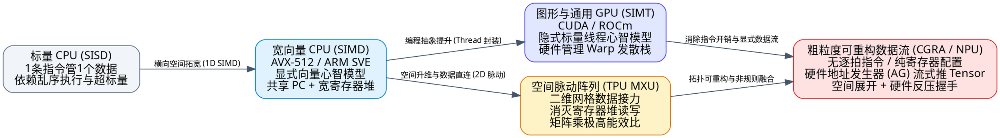
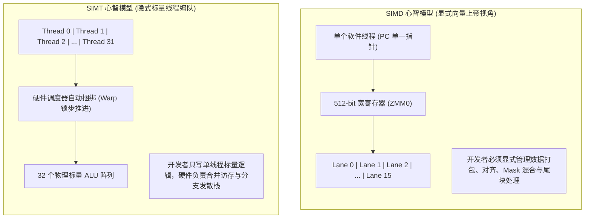
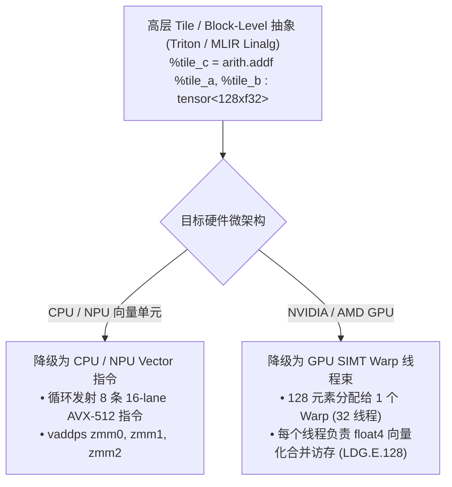
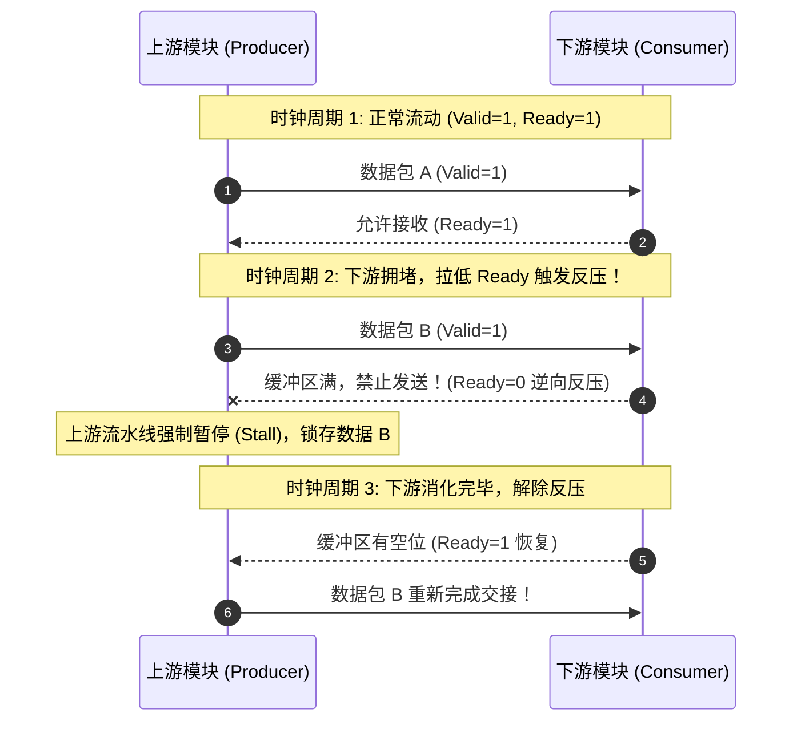
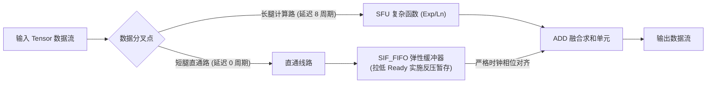

在高性能计算（HPC）与深度学习算力芯片的演进长河中，“如何用有限的晶体管与功耗预算榨取极致的并行吞吐量”，是所有体系结构学者与工程师共同追求的圣杯。

从传统的 CPU 宽向量指令集（如 x86 AVX-512、ARM NEON/SVE），到横扫深度学习训练领域的 GPU（NVIDIA CUDA / SIMT），再到 Google TPU 的脉动阵列（Systolic Array），以及当下一线自研芯片团队探索的“无指令、纯寄存器配置、直接按 Tensor 流式驱动”的粗粒度可重构数据流架构（CGRA / Streaming Dataflow），硬件的物理形态发生了翻天覆地的变化。

许多初学者乃至有一定经验的底层开发者，在面对这些形态各异的架构时常常产生困惑：
- **“既然都是一条指令或一个控制信号驱动多个数据，SIMD 和 SIMT 的底层思维到底差在哪？”**
- **“TPU 的脉动阵列到底能不能算作一种 SIMD？它的‘反压（Backpressure）’究竟是个什么物理信号？”**
- **“如果一颗自研 NPU 已经提前用配置寄存器铺好了完整的数据流路径，为什么数据不能‘无脑向前冲’，仍然会遇到反压？”**
- **“我们在讨论数据流架构时常说的‘时间维度（Temporal）’和‘空间横截面（Spatial Cross-section）’到底对应芯片上的什么部件？”**

本文将以一线体系结构研发与 AI 编译器的视角，结合清晰的白话比喻、硬核的 C++/CUDA/Tile 代码实操、以及丰富的架构全景图，为你彻底解开这些微架构谜团。

---

## 序章：初学者必读——核心硬件术语通俗词典

在深入讨论芯片内部的微架构之前，我们先通过通俗生动的比喻，统一认知语言。如果你第一次接触这些词汇，无需畏惧，它们本质上是硬件为了**“搬运数据更快、算得更猛、功耗更低”**而设计的精妙解法。

> [!NOTE] 核心术语直白通俗解析
> - **ALU (Arithmetic Logic Unit，算术逻辑单元)**：
>   芯片上的“计算车间工人”，专门负责做加减乘除、位运算或逻辑判断。
> - **SIMD (Single Instruction, Multiple Data，单指令多数据)**：
>   **“军训教官与并排标兵”**。芯片里只有一个指令发射器（教官），手里握着极宽的寄存器（如 512 位），一声令下（一条向量指令），指挥并排的 16 个 ALU（标兵）在同一个时钟周期对各自的数据做完全相同的动作。
> - **Lane (物理通道 / 向量泳道)**：
>   宽向量流水线里的“单条车道”。如果一个 512-bit 的寄存器同时处理 16 个 32-bit 的浮点数，那么每一个 32-bit 计算通路就是一个 Lane。
> - **SIMT (Single Instruction, Multiple Threads，单指令多线程)**：
>   **“工厂流水线排班制”**。程序员不再以“宽向量”的上帝视角写代码，而是以“单个流水线工人（单个标量线程）”的第一人称视角写普通标量代码；GPU 硬件在运行时自动把 32 个（NVIDIA Warp）或 64 个（AMD Wavefront）邻居工人捆绑成一个编队，由同一个控制单元发射指令推进。
> - **Warp Divergence (分支发散)**：
>   Warp 内的 32 个工人遇到了 `if-else` 岔路口，有的满足条件要走 `if`，有的走 `else`。因为他们共用同一个指令发射器，硬件只能先让满足 `if` 的人干活、其余人原地歇息（Active Mask 屏蔽），再反过来让走 `else` 的人干活。这导致两个分支串行执行，执行时间翻倍。
> - **AoS (Array of Structs) vs. SoA (Struct of Arrays)**：
>   - **AoS（结构体数组）**：内存里按照 `[RGB][RGB][RGB]...` 交叉排列。这对向量化很不友好，因为把连续内存读进宽寄存器后，里面红绿蓝混在一起，无法直接对所有 R 通道做批量运算。
>   - **SoA（数组的结构体）**：内存里按照 `[RRR...][GGG...][BBB...]` 分块排列。宽向量指令可以一口气将连续的 16 个 R 加载进寄存器直接运算。
> - **Memory Coalescing (内存合并访问)**：
>   GPU 访存黄金法则。当同一个 Warp 内的 32 个相邻线程在同一拍去访问全局内存中物理上连续紧邻的地址（`base + tid`）时，硬件内存控制器能将这 32 次零碎的标量读请求合并为一次 128 字节的宽总线事务，极大提升显存带宽利用率。
> - **Bank Conflict (存储块冲突)**：
>   片上高速共享内存（Shared Memory / Scratchpad）通常切分成 32 个独立的物理存储块（Bank）。如果多个线程在同一拍恰好去访问同一个 Bank 内的不同地址，硬件只能串行排队依次读取，产生冲突延迟。
> - **Reduction (归约)**：
>   将一个向量或数组中的多个元素，通过某种二元结合律算子（如求和、求最大值）浓缩为一个标量结果的过程（如 Softmax 里的累加求和）。
> - **Systolic Array (脉动阵列)**：
>   **“二维人体心血管网络”**。由大量处理单元（PE）在二维平面上规则网状互联。数据像血液在心脏节拍的驱动下从阵列边缘泵入，在相邻 PE 之间接力滑动传递，每流动一步就完成一次乘累加（MAC），在芯片内部实现了极高的数据复用，代表作就是 Google TPU 的核心矩阵乘单元（MXU）。
> - **Backpressure (反压) 与 Valid/Ready 握手**：
>   在流式流水线中，当下游模块（Consumer）处理速度慢、内部缓冲区快要溢出时，逆向向上游模块（Producer）发送一个“紧急踩刹车”的流控信号，迫使上游暂停发送，以防数据被覆盖丢失。
> - **CGRA (Coarse-Grained Reconfigurable Architecture，粗粒度可重构架构)**：
>   消灭了传统 CPU/GPU 每拍取指令、译码指令的巨大开销。通过配置寄存器在算子运行前将片上的各个计算模块（乘法、加法、超越函数）通过多路选择器（MUX）连接成定制的数据流动拓扑，由硬件地址发生器（AG）直接从内存把整个 Tensor 像水流一样灌入管道。



---

## 一、心智模型大碰撞：SIMD 与 SIMT 的思考方式范式转移

**SIMD（单指令多数据）** 与 **SIMT（单指令多线程）** 在底层硬件物理执行上非常相似（都是一个控制单元驱动多个 ALU 锁步执行），但它们暴露给开发者和编译器的抽象层级与编程心智模型（Mental Model）截然不同：

- **SIMD 是“显式向量视角”（Array-of-Lanes 思维）：** 你站在**单个线程**的上帝视角，手里拿着宽寄存器（如 `128-bit` / `512-bit`），需要思考如何把标量循环“打包（Pack）”成定长向量操作。
- **SIMT 是“隐式标量线程视角”（Thread-of-Scalars 思维）：** 你站在单个数据元素（单个线程）的第一人称视角编写标量逻辑，由硬件在运行时把 32 或 64 个标量线程动态“捆绑”成 Warp/Wavefront 锁步执行。

### 核心心智模型对比矩阵

| 思考维度 | SIMD（CPU AVX-512 / ARM NEON / NPU Vector 单元） | SIMT（GPU CUDA / ROCm / Triton 底层） |
| :--- | :--- | :--- |
| **第一人称视角** | **我是发射官**：我有 1 个线程，操控一条包含 $N$ 个通道（Lanes）的宽流水线。 | **我是流水线工人**：我只是成千上万个标量线程中的第 `tid` 号，只管处理好我手头的这 1 个元素。 |
| **控制流（if-else）** | **显式谓词与掩码（Predication / Masking）**：无法对单个通道执行跳转，必须把两个分支都算出来（或用 Mask 寄存器屏蔽写入），最后用 `blend` / `select` 合并。 | **自然标量分支（Branch Divergence）**：直接写 `if (x > 0)`。硬件自动管理活跃掩码（Active Mask）和重收敛栈（Reconvergence Stack），开发者需关注分支发散带来的性能惩罚。 |
| **内存访问思考** | **对齐与连续块（Contiguous & Aligned）**：优先思考如何凑齐一段连续内存做 Vector Load/Store；非连续访问必须显式调用昂贵的 `gather` / `scatter` 指令。 | **合并访问（Memory Coalescing）**：每个线程算自己的标量地址 `ptr + tid`。思考重点是：相邻 `tid` 算出的地址是否刚好落在同一个 Cache Line 里。 |
| **向量宽度耦合** | **强耦合于指令集**：代码逻辑往往绑定 VLEN（如 AVX2 写 8 个 float，AVX-512 写 16 个；除 RISC-V RVV / ARM SVE 外），循环尾部必须手动写 Remainder 剥离逻辑。 | **硬件宽度解耦**：逻辑上写 `if (tid < N)` 即可处理任意边界，哪怕最后一组 Warp 只有 3 个有效线程，硬件也会自动掩码掉其余 29 个通道。 |
| **延迟隐藏策略** | **靠乱序执行（OoO）与软件流水（Software Pipelining）**：寄存器数量有限（如 32 个 ZMM），需精打细算避免 Register Spilling，手动展开循环来掩盖指令延迟。 | **靠海量寄存器与零开销上下文切换**：当一个 Warp 等待访存时，硬件在单周期内切到另一个就绪 Warp。但需警惕单线程占用过多寄存器导致 Occupancy（占用率） 下降。 |



---

## 二、四大关键场景代码实操与底层硬件行为对比

为了让初学者建立扎实的硬件直觉，我们将并行计算中最关键的四大场景，逐一转化为 **C++ / Intrinsics（SIMD）** 与 **CUDA C++ / Tile IR（SIMT）** 的代码实现，并配以时钟周期与硬件数据流图解。

### 1. 面对条件分支：从“手动算掩码”到“警惕 Warp 发散”

假设我们的计算逻辑极其朴素：**数组元素大于 0 时乘 2，否则加 1。**

#### 代码实现对比

```cpp
// ============================================================================
// [SIMD 思考方式]：控制流 -> 数据流（以 AVX-512 16xfloat 为例）
// 程序员必须显式生成 k-mask 寄存器，把两个分支都算出来（或掩码执行）再混合
// ============================================================================
#include <immintrin.h>

void branch_simd_avx512(const float* in, float* out, int N) {
    __m512 v_zero = _mm512_setzero_ps();
    __m512 v_two  = _mm512_set1_ps(2.0f);
    __m512 v_one  = _mm512_set1_ps(1.0f);

    for (int i = 0; i < N; i += 16) {
        __m512 vec = _mm512_loadu_ps(&in[i]);

        // Step 1: 向量比较，生成 16-bit 硬件掩码 k1 (vec > 0)
        __mmask16 mask = _mm512_cmp_ps_mask(vec, v_zero, _CMP_GT_OQ);

        // Step 2 & 3: 计算两个分支的数据流
        __m512 res_true  = _mm512_mul_ps(vec, v_two); // 分支 A: vec * 2
        __m512 res_false = _mm512_add_ps(vec, v_one); // 分支 B: vec + 1

        // Step 4: 按掩码混合 (mask bit=1 选 res_true, bit=0 选 res_false)
        __m512 result = _mm512_mask_blend_ps(mask, res_false, res_true);

        _mm512_storeu_ps(&out[i], result);
    }
}

// ============================================================================
// [SIMT 思考方式]：标量控制流 + 数据重排避免 Warp Divergence (CUDA C++)
// 代码直接写 if-else，思考重点在于让相邻 threadIdx.x 走相同分支
// ============================================================================
__global__ void branch_simt_cuda(const float* in, float* out, int N) {
    int tid = blockIdx.x * blockDim.x + threadIdx.x;
    if (tid < N) {
        float val = in[tid];
        // 硬件自动生成 Active Mask 并压入重收敛栈 (Reconvergence Stack)
        // 若奇偶线程正负交替，同一 Warp 内 32 线程发散，硬件串行走两遍！
        if (val > 0.0f) {
            val *= 2.0f;  // Pass 1: Active Mask 激活正数线程，负数线程挂起闲置
        } else {
            val += 1.0f;  // Pass 2: Active Mask 翻转，激活负数线程，正数线程挂起闲置
        }
        out[tid] = val;   // Reconverge (POP 栈，恢复全掩码 0xFFFFFFFF 统一写回)
    }
}
```

#### 数据流与时钟周期时序可视化（以 4 通道为例，输入 `[-2, 5, 3, -1]`）

```
【SIMD 数据流化（无分支跳转，纯算术流水推进）】
输入向量 vec : [ -2 |  5 |  3 | -1 ]
                 ↓ cmp_gt(vec, 0)
掩码 mask k1 : [  0 |  1 |  1 |  0 ]
res_true     : [ -4 | 10 |  6 | -2 ]  <-- 全通道统一算 vec * 2
res_false    : [ -1 |  6 |  4 |  0 ]  <-- 全通道统一算 vec + 1
                 ↓ blend(mask, res_false, res_true)
最终 result  : [ -1 | 10 |  6 |  0 ]  (通道选择: F, T, T, F)
耗时：无任何管线冲刷（Pipeline Flush），固定吞吐周期。

【SIMT 硬件分支发散（单 PC 串行回放 + 活跃掩码栈控制）】
Cycle 1 (分支判定) : 硬件计算条件表达式，检测到 Warp 内部状态不一致，将收敛 PC 压入栈
Cycle 2 (True 分支): [ ⏸️闲置 | 5*2=10 | 3*2=6 | ⏸️闲置 ] (Active Mask: 0110, 50% 算力浪费)
Cycle 3 (False分支): [ -2+1=-1 | ⏸️闲置 | ⏸️闲置 | -1+1=0 ] (Active Mask: 1001, 50% 算力浪费)
Cycle 4 (PC 重收敛): [   -1    |   10   |   6   |    0   ] (Active Mask: 1111 恢复全部激活)
耗时：经历两次指令发射周期，分支发散导致吞吐量腰斩。
```

---

### 2. 面对矩阵/张量访存：从“水平/垂直布局”到“相邻线程协同”

在多维张量或结构体数组的读取上，两者的访存直觉截然不同：

- **SIMD 极度厌恶 AoS（Array of Structs）：** 如果内存中是 `RGBRGBRGB...`，一条指令加载进来的是单个像素的不同通道，无法对多个像素直接做向量化运算，必须做极昂贵的转置或 `gather`。
- **SIMT 极度厌恶 Strided Access（跨步访问）与 Bank Conflict：** SIMT 线程拥有独立的地址计算能力。每个线程的寄存器计算自己的目标地址，思考核心在于**相邻的线程是否访问相邻的内存地址**。

#### 代码实现对比

```cpp
struct Pixel { float r, g, b, a; }; // AoS 结构体 (16 Bytes)
struct PixelSoA { float *r, *g, *b, *a; }; // SoA 结构体数组

// ============================================================================
// [SIMD 思考方式]：重排内存为 SoA，或承受 Shuffle/Gather 的性能重罚
// ============================================================================
void memory_simd_soa(const PixelSoA& soa, float* out_lum, int N) {
    // 理想情况 (SoA)：内存中同色通道紧密连续排列，单条指令满带宽加载
    for (int i = 0; i < N; i += 8) {
        __m256 v_r = _mm256_loadu_ps(&soa.r[i]); // [R0, R1, R2, R3, R4, R5, R6, R7]
        __m256 v_g = _mm256_loadu_ps(&soa.g[i]); // [G0, G1, G2, G3, G4, G5, G6, G7]
        // 垂直通道直接并行 FMA 乘加运算，零数据重排开销
    }
}

// ============================================================================
// [SIMT 思考方式]：关注相邻 tid 是否合并访存，以及规避片上 Bank Conflict
// ============================================================================
__global__ void memory_simt_patterns(const float* matrix, float* out, int width) {
    int tid = threadIdx.x; // 0..31 (同一 Warp 内部线程)

    // ❌ 错误示范 (跨步访问 Strided Access)：相邻线程读取同一列的不同行
    // 地址相差 width * 4 字节，导致 32 个线程分裂成 32 次独立的 Cache Line 事务！
    float bad_val = matrix[tid * width + blockIdx.x];

    // ✅ 正确示范 (合并访问 Coalesced Access)：相邻线程读取同一行的相邻列
    // 硬件内存接口将 32 个 4 字节请求，合并为 1 次连续的 128 字节总线突发传输！
    float good_val = matrix[blockIdx.x * width + tid];

    // --- 片上高速共享内存（Shared Memory）Bank Conflict 思考 ---
    __shared__ float smem_bad[32][32];
    __shared__ float smem_good[32][32 + 1]; // +1 Padding 错开相位！

    // ❌ 当 32 个线程按列访问 smem_bad[tid][0] 时：
    // 步长为 32，(tid * 32) % 32 全部映射至 Bank 0！引发 32-Way Bank Conflict（串行化 32 周期）
    float s1 = smem_bad[tid][0];

    // ✅ 加入 1 列 Padding 后，跨行地址偏移为 tid * 33
    // (tid * 33) % 32 == tid % 32，32 个线程完美均摊到 32 个独立 Bank，1 拍无冲突读取！
    float s2 = smem_good[tid][0];
}
```

```
【SIMT 内存合并访问 vs. 跨步访问图解】

合并访问 (addr = base + tid) —— 1 次 128 字节物理内存事务：
  Thread 0   Thread 1   Thread 2   Thread 3 ... Thread 31
     │          │          │          │            │
     ▼          ▼          ▼          ▼            ▼
  ┌──────┬──────┬──────┬──────┬─────────────────┬──────┐
  │ M[0] │ M[1] │ M[2] │ M[3] │     ......      │M[31] │  <== Global Memory (128B Cache Line)
  └──────┴──────┴──────┴──────┴─────────────────┴──────┘

跨步访问 (addr = base + tid * stride) —— 分裂为 32 次独立事务：
  Thread 0          Thread 1          Thread 2
     │                 │                 │
     ▼                 ▼                 ▼
  [Cache Line 0]    [Cache Line 4]    [Cache Line 8] ... (有效带宽暴跌至 1/32)
```

---

### 3. 面对归约（Reduction）：保持垂直累加 vs. 线程间 Shuffle 通信

当需要把一个向量内部的数据累加成标量时（如 LayerNorm、Softmax），两者的计算拓扑大相径庭：

- **SIMD 抵触“水平操作（Horizontal Ops）”：** SIMD 原生设计为各通道垂直独立。一旦跨通道求和，必须反复做向量提取与 Shuffle 折半。因此 SIMD 优化铁律是：**循环内死守垂直累加，循环外最后一步才做折半归约。**
- **SIMT 视为“线程间通信”：** 每个数据存放在不同线程的私有寄存器中。跨通道归约通过 Warp 级原语 `__shfl_down_sync` 在寄存器硬件交叉开关（Crossbar）内部直接窃取邻居数据。

```cpp
// ============================================================================
// [SIMD 思考方式]：循环内死守垂直累加，循环外最后一次水平折半
// ============================================================================
float reduce_simd_avx2(const float* data, int N) {
    __m256 v_sum = _mm256_setzero_ps(); // [s0, s1, s2, s3, s4, s5, s6, s7]
    
    // 1. 循环内部：纯垂直独立累加，吞吐拉满，零通道间通信
    for (int i = 0; i < N; i += 8) {
        __m256 v_in = _mm256_loadu_ps(&data[i]);
        v_sum = _mm256_add_ps(v_sum, v_in);
    }

    // 2. 循环结束后：在单寄存器内折半折叠 (256 -> 128 -> 64 -> 32)
    __m128 v_low  = _mm256_castps256_ps128(v_sum);       // 取低 128 位
    __m128 v_high = _mm256_extractf128_ps(v_sum, 1);     // 提取高 128 位
    __m128 v_128  = _mm_add_ps(v_low, v_high);           // 折半相加

    __m128 v_shuf = _mm_movehdup_ps(v_128);
    __m128 v_sums = _mm_add_ps(v_128, v_shuf);
    v_shuf        = _mm_movehl_ps(v_shuf, v_sums);
    v_sums        = _mm_add_ss(v_sums, v_shuf);
    return _mm_cvtss_f32(v_sums);
}

// ============================================================================
// [SIMT 思考方式]：将归约抽象为线程间 Crossbar 交换通信
// ============================================================================
__device__ float warp_reduce_sum(float val) {
    // 线程无需访问共享内存，直接通过寄存器网络对折拉取邻居数据
    #pragma unroll
    for (int offset = 16; offset > 0; offset /= 2) {
        val += __shfl_down_sync(0xffffffff, val, offset);
    }
    return val; // 仅需 5 拍，Thread 0 的 val 即可获得 Warp 32 个线程的完整累加和
}
```

```
【SIMT 32 线程 Warp Shuffle 树状对折归约拓扑】
Thread:    T0       T1       T2       T3  ...  T16      T17
Reg val:  [v0]     [v1]     [v2]     [v3] ... [v16]    [v17]
           ▲        ▲                           │        │
           └───+────┴───+───────────────────────┘        │ (offset=16)
               │        │                                │
            [v0+v16] [v1+v17] ...
           ▲
           └───+ (offset=8, 4, 2, 1 逐级折叠)
               │
            [总和 Σv] (落入 T0 寄存器)
```

---

### 4. 编译器与 IR 视角的演进：从 SIMT 回归 Tile/Block 级 SIMD

如果你从现代 AI 编译器（如 OpenAI Triton、MLIR `linalg` / `vector` 方言）的视角审视，会发现一个戏剧性的技术轮回：

- **传统 CUDA/HIP（SIMT）：** 暴露的是细碎的 `threadIdx.x` 标量语义。由于过早把张量打碎成标量线程，编译器后端在进行算子融合或调用底层 Tensor Core（WMMA/WGMMA）时，必须费尽心机做 **Uniformity Analysis（一致性分析）** 和 **Thread Coarsening**，试图从数以千计的标量代码中重新识别出向量和矩阵块。
- **Triton / MLIR Tile-based IR：** 彻底摒弃了程序员层面的 `threadIdx.x`，直接将 **Tile（块级张量片段，如 128 元素）** 视为一等公民。开发者以超宽的 1D/2D 向量视角编写逻辑，再由编译器 Pass 自动降级为底层的 SIMT 线程束或专用 NPU 向量单元。

```cpp
// ============================================================================
// [传统 SIMT (CUDA)]：碎片化的标量线程视角
// ============================================================================
__global__ void add_cuda(const float* A, const float* B, float* C, int N) {
    int tid = blockIdx.x * blockDim.x + threadIdx.x; // 满脑子都是 threadIdx 偏移
    if (tid < N) {
        C[tid] = A[tid] + B[tid];
    }
}

// ============================================================================
// [现代 Tile IR (类 Triton / MLIR Vector 抽象)]：块级向量一等公民
// ============================================================================
template <int BLOCK_SIZE = 128>
__tile_kernel__ void add_tile_ir(const float* A, const float* B, float* C, int N) {
    int pid = get_program_id(0); // 只关心当前处理第几个 Block/Tile

    // 1. 显式构造块级向量偏移 (1D Range Tile: [0, 1, ..., 127])
    Tile<int, BLOCK_SIZE> offsets = pid * BLOCK_SIZE + arange<0, BLOCK_SIZE>();

    // 2. 块级掩码生成 (天然融合 SIMD 掩码思想)
    Tile<bool, BLOCK_SIZE> mask = (offsets < N);

    // 3. 块级加载与运算（由编译器 Pass 决定切分给 SIMT Warp 还是 NPU 向量阵列）
    Tile<float, BLOCK_SIZE> va = tile_load(A + offsets, mask, 0.0f);
    Tile<float, BLOCK_SIZE> vb = tile_load(B + offsets, mask, 0.0f);
    tile_store(C + offsets, va + vb, mask);
}
```



---

## 三、从指令驱动迈向数据流计算：TPU 脉动阵列与反压机制解密

在专用 AI 加速芯片（NPU/TPU）的语境下，硬件架构发生了一次关键维度的跃迁：**从“指令驱动”走向“数据驱动”**。

### 1. 什么是数据流计算中的“反压”（Backpressure）？

在数据流（Dataflow）架构或深度流水线中，各个计算单元（PE）、片上缓存（Scratchpad/VMEM）与 DMA 搬运引擎之间通过 FIFO 队列或片上网络（NoC）直接连通。

> [!IMPORTANT] 反压的本质定义
> **反压（Backpressure）是指当下游模块（Consumer）处理不过来、导致其输入缓冲区满时，向上游模块（Producer）逆向传递的“暂停/减速”控制信号，迫使上游停止发送新数据，从而彻底杜绝缓冲区溢出（Buffer Overflow）和数据被静默覆盖。**

在硬件 RTL 级，反压最经典的物理实现就是 **Valid / Ready 双向握手机制**（广泛应用于 AXI-Stream 协议与 Chisel `DecoupledIO`）：

- **`Valid`（上游 $\rightarrow$ 下游）**：上游发出通知，“我现在总线上放置的数据是真实有效的”。
- **`Ready`（下游 $\rightarrow$ 上游，即反压信号线）**：下游发出反馈，“我的接收 FIFO 还有空位，本时钟周期可以接纳数据”。
- **成功握手**：只有在同一个时钟上升沿检测到 `Valid == 1 && Ready == 1` 时，数据才完成物理移交。一旦下游忙碌将 `Ready` 拉低（De-assert），上游就必须锁存（Stall）当前状态，哪怕它已经算出了新数据也不能外推，停顿信号便沿着流水线像多米诺骨牌一样逐级逆向传导。



### 2. 静态脉动阵列 vs. 动态数据流：流控哲学的分野

这里存在一个极具智慧的架构取舍：**动态数据流依赖芯片内部密集的硬件反压握手，而 Google TPU 这类静态脉动阵列（Systolic Array）内部则极力消除硬件反压。**

- **边界处保留硬件反压（HBM $\leftrightarrow$ VMEM $\leftrightarrow$ 输入 FIFO）**：片外内存访问存在不确定的延迟抖动（DRAM 刷新、总线仲裁）。因此，在 DMA 引擎、FIFO 与脉动阵列的交界处，设置硬件 Valid/Ready 弹性握手。
- **阵列内部靠编译器静态时序调度消灭反压（Systolic Lockstep）**：在 TPU $128 \times 128$ 的矩阵乘单元（MXU）内部，如果给每个 PE（共 16,384 个）都配备反压握手逻辑与 FIFO，硅片面积和功耗将不可承受。因此，阵列内部采用**完全严格的锁步推进（Lockstep）**：数据每拍必须向右、向下移动一格。**流控的责任被完全转移给了编译器（如 XLA）**——编译器在编译期精准排定好每个 Tile 的发射周期与 Ping-Pong 切换时机，在软件层面杜绝流水线冲突。

### 3. TPU 能否算作 SIMD 结构？

从经典的 Flynn 分类法来看，TPU 确实是“一条指令控制海量数据计算”；但在微架构实现上，必须将 TPU 拆解剖析：

| 比较维度 | 传统 SIMD / SIMT（CPU AVX-512、GPU Core） | TPU 矩阵乘单元 MXU（2D 脉动阵列） |
| :--- | :--- | :--- |
| **驱动与寻址方式** | **指令驱动 + 显式寄存器寻址**：每个周期从寄存器堆读操作数，计算后再写回。 | **数据驱动 + 邻居直连**：仅阵列边缘接触缓存，内部 PE 直接从左侧/上方邻居接力获取数据。 |
| **能耗与面积瓶颈** | 高带宽多端口寄存器堆（Register File）占据巨大面积与功耗（冯·诺依曼访存墙微缩版）。 | **省去内部海量寄存器堆**，数据在阵列中滑动时被复用上百次，计算能效比（TOPS/W）极高。 |
| **空间执行时序** | 同一周期内，所有 Lane 同时计算同一批数据（空间纯同步）。 | **波前（Wavefront）斜向推进**，不同物理坐标的 PE 在错开的周期被依次激活（时空耦合并行）。 |
| **通用灵活性** | 极高，支持任意标量控制、Scatter/Gather、分支掩码。 | 极低，拓扑硬化，专精 GEMM（矩阵乘）与规整卷积。 |

> **TPU 中真正的 SIMD 在哪里？——VPU（向量处理单元）**
> 脉动阵列专精矩阵乘累加（MAC），但对 Softmax、LayerNorm、GELU 等逐元素激活与归一化操作无能为力。因此，TPU 在 MXU 下游紧密级联了 **VPU（Vector Processing Unit）**：
> - VPU 是标准的**二维 SIMD 结构**（如 TPU v4 具备 $128 \times 8$ 的向量寄存器组和 2D ALU 阵列）。
> - TPU 标量控制核通过发射 **VLIW Bundle（超长指令字）**，在单周期内同时打包 DMA 搬运、MXU 矩阵乘与 VPU 的 SIMD 指令，实现高效协同。

---

## 四、工业级硬核实战：自研数据流 NPU 微架构与反压之谜

当前工业界许多领先的自研 NPU（如大模型专用推理解速芯片）走了一条更为激进的路线：**无逐拍指令流、纯寄存器配置、硬件地址发生器（AG）全自动按 Tensor 推流**。

下图展示了一颗典型工业级自研数据流 NPU 的顶层架构全景：

```graphviz
digraph NPU_Top_Architecture {
    rankdir=LR;
    node [shape=box, style="rounded,filled", fillcolor="#f8fafc", fontname="sans-serif", color="#475569", margin="0.2,0.1"];
    edge [fontname="sans-serif", fontsize=10, color="#64748b"];

    subgraph cluster_control {
        label = "控制面 (Control Plane)";
        style = "dashed";
        color = "#94a3b8";
        RVV [label="RISC-V 标量/向量核\n(带 32@RVV 向量扩展)\n负责异常处理与兜底算子", fillcolor="#f1f5f9"];
        ECtrl [label="ECtrl (Engine Controller)\n下发配置寄存器字 (CSRs)\n路由 MUX 选通控制", fillcolor="#e0f2fe", color="#0284c7"];
        RVV -> ECtrl [label="配置写入"];
    }

    subgraph cluster_data {
        label = "数据面 (Data Plane - 2048-bit 宽总线数据流)";
        style = "solid";
        color = "#cbd5e1";
        
        SMEM [label="片上共享存储 (SMEM)\n16 个独立 RAM Groups\n多通道硬件地址发生器 (AG)\n自动读/写步长嵌套循环", fillcolor="#fef3c7", color="#d97706"];
        
        TCore [label="Tensor Core (TCore)\n支持 MXFP8 / MXFP4 / NVFP4\n高密度脉动矩阵乘累加\n吐出 64×FP32 (2048-bit)", fillcolor="#fee2e2", color="#dc2626"];
        
        SCore [label="Streaming Core (SCore)\n64-Lane 宽向量数据通路\n内部级联 MUL → ADD → SFU(Exp/Ln)\nSIF_FIFO 弹性对齐", fillcolor="#e0e7ff", color="#4f46e5"];

        SMEM -> TCore [label="读通道 R0/R1\n(按 Tensor 流式吐数据)", penwidth=2];
        TCore -> SCore [label="psel 直通路径\n(无需落盘写回 SMEM!)", color="#dc2626", penwidth=2];
        SCore -> SMEM [label="写通道 W1\n(最终计算结果归档)", penwidth=2];
    }

    ECtrl -> SMEM [label="配置 AG 参数\n(Shape, Stride, Pad)", style=dotted];
    ECtrl -> SCore [label="配置 MUX 开关\n(拓扑硬线连通)", style=dotted];
}
```



### 1. 架构本质定性

这颗芯片在学术界与工业界被精准定性为：**基于配置寄存器的粗粒度可重构数据流架构（CGRA-like Streaming Dataflow Architecture）**。

- **它不是传统 SIMD**：没有程序计数器（PC），没有逐拍的“取指-译码-执行”指令循环。软件配置完寄存器后，硬件根据数据到来的 `Valid` 信号自动点火开算。
- **它包含 SIMD 的物理本质**：在空间横截面上，它那根 2048-bit 宽的数据总线内部，整整齐齐排列着 **64 个 FP32 物理算术通道（64 Lanes）**，在同一套配置字的锁步控制下进行并行运算。

### 2. 核心追问：既然已经配置好了数据流拓扑，为什么仍然躲不开反压？

初学者很容易产生一个直觉：*“既然所有计算单元的 MUX 开关都已经提前配置好了，数据像水一样无脑向前淌不就行了吗，为什么还需要反压信号和 FIFO？”*

在真实的芯片物理实现中，即便配置好了通路，依然存在**四大客观物理限制**，导致各环节步调不一，必须由反压机制介入流控：

#### 限制 1：分叉再汇合时的“长短腿效应”（Reconvergent Latency Skew）
在 `Streaming Core` 中执行复杂融合算子（如 $y = a \times b + c$ 或 $y = x + \exp(x)$）时：
- 输入数据在空间上分流：一路直接直通至加法器 `ADD`（延迟为 **0 拍**）；另一路分流至乘法器 `MUL`（流水线深度为 **3 拍**）或超越函数 `Exp` 单元（流水线深度高达 **12 拍**）。
- **严重冲突**：如果让数据无脑前冲，直通路的数据在第 0 拍就撞上了 `ADD` 端口，而乘法路的数据还在半路上！此时若直接相加，数据相位完全错乱，导致计算灾难。
- **反压化解**：`ADD` 单元通过拉低对应通道的 `Ready` 反压信号，迫使快路径的数据暂存在 **`SIF_FIFO`** 中排队，严格等待慢路径的数据算完到达后，才完成相位对齐并消费。



#### 限制 2：多主存通道争抢 SRAM Bank（SMEM Bank Conflict）
片上共享主存 `SMEM` 通常被切分为多个物理 RAM Group（例如 16 个 Bank）。然而芯片通常具备 **4 个并发写通道** 与 **6 个并发读通道**：
- 当 `Tensor Core` 在通过通道 $R_0, R_1$ 读取特征图时，`Streaming Core` 正在通过通道 $R_2$ 读取 Bias 权重，而片外 DMA 正在通过 $W_0$ 写入下一批数据。
- 物理 SRAM 的同一个端口在同一时钟周期只能响应一次访问。当两个通道同时访问同一个 RAM Group 时，交叉开关仲裁器必须对其中一个通道发出**反压挂起（Stall）**，迫使其内部地址发生器（AG）停顿一拍。

#### 限制 3：算术部件的非单位吞吐率（Non-unit Throughput）
芯片内部的算术单元并非都能做到“每拍吃进一个数、吐出一个数”（即 $II=1$）：
- **Top-K 与排序模块**：包含复杂的二叉比较树或串行流水网络，可能需要多拍才能消化一组数据。
- **超越函数单元（SFU）**：出于晶体管面积考虑，除法倒数 `1/x`、指数 `Exp` 常常采用通道复用设计，吞吐率低于常规加法器。一旦上游全速推流，SFU 必须拉高反压阻止上游冲垮自己。

#### 限制 4：片外总线与动态压缩的不确定性（DRAM Jitter）
片外 DDR/HBM 存在访问延迟抖动；同时现代 NPU 片内集成的实时数据压缩/解压缩引擎，其处理吞吐量取决于具体张量的稀疏度与熵值，数据到达速率具有天然的动态随机性，必须依靠反压弹性吸收。

---

## 五、概念终极破壁：什么是“时间维度”与“空间横截面”？

我们常常用一句话来概括这颗 NPU 的架构本质：
> **“在时间维度（Temporal）上，它是无指令的粗粒度流式可重构数据流（CGRA）；但在空间横截面（Spatial Cross-section）上，那根 2048-bit 的管道内部是 64-Lane 锁步并行的 SIMD 向量阵列。”**

为了彻底具象化这个抽象定义，请建立这样一个心智模型：

### 具象化模型：64 车道高速公路与 100 排车队

假设我们要对一个包含 **$6400$ 个 FP32 浮点元素** 的张量执行融合计算：$(A \times B) + C$。
因为数据通路宽度为 2048 位（$64 \times 32\text{-bit} = 2048\text{-bit}$），硬件一次能并排容纳 64 个数。因此整个 Tensor 被自然切分为 **100 排车队**，以每拍一排的节奏连续驶入数据通路。

```
                    【空间横截面 (同一时刻切一刀)】
                      Lane 0   Lane 1   Lane 2  ...  Lane 63
                     ┌───────┬────────┬────────┬───┬────────┐
     车队 1 (Cycle 1)│ A[0]  │  A[1]  │  A[2]  │...│  A[63] │ (64 个 ALU 在同一时刻
     车队 2 (Cycle 2)│ A[64] │  A[65] │  A[66] │...│ A[127] │  锁步执行完全相同的运算)
     车队 3 (Cycle 3)│ A[128]│  A[129]│  A[130]│...│ A[191] │
           :         │  ...  │   ...  │   ...  │...│   ...  │
           ▼
【时间维度 (顺着流动方向展开)】
车队推进: SMEM ──> MUL 车间 ──> ADD 车间 ──> SFU 车间 ──> SMEM
(硬件提前配置固定拓扑连线，连续 100 拍内无需发射任何新指令，无通用寄存器文件读写)
```

#### 1. 空间横截面视角（Spatial Cross-section）
在第 1 个时钟周期按下暂停键，横向切开这根 2048-bit 的总线：
- 0 号车道正在算 `A[0] * B[0]`；
- 1 号车道正在算 `A[1] * B[1]`；
- ……63 号车道正在算 `A[63] * B[63]`。
- **微架构本质**：这 64 个物理 ALU 共享同一个配置控制信号，步调完全一致。这就是最纯粹的 **64-Lane SIMD** 物理结构。

#### 2. 时间维度视角（Temporal Dimension）
松开暂停键，观察这 100 排车队顺着流水线推进的全过程：
- **如果是传统 CPU/GPU**：硬件里只有一套 ALU。第 1 拍发射取指读寄存器，第 2 拍执行乘法写回寄存器，第 3 拍再发射加法指令读寄存器……在**时间轴上先后复用同一个物理 ALU**。
- **而在这颗数据流 NPU 上**：硬件在芯片物理空间上依次展开了 `MUL`、`ADD`、`Exp` 独立车间。在这连续的 100 个周期里，控制核**不需要发射一条新指令**，数据像水一样在前后车间接力流淌。消灭了一切指令取指译码能耗与中间寄存器读写瓶颈。

| 观察维度 | 物理实体映射 | 架构本质 | 核心工程价值 |
| :--- | :--- | :--- | :--- |
| **空间横截面 (Bit-width)** | 2048-bit 宽总线，内部集成 64 个并行的 FP32 ALU 通道。 | **64-Lane 锁步 SIMD** | 极度摊薄控制面面积——1 套配置寄存器管死全部 64 路数据。 |
| **时间流动维度 (Pipeline)** | AG 自动遍历多维 Tensor，数据流经串联的 TCore $\rightarrow$ MUL $\rightarrow$ ADD。 | **粗粒度流式可重构数据流 (CGRA)** | 彻底消灭指令取指/译码开销，消灭算子间寄存器文件往返访存墙。 |

---

## 六、对 AI 编译器（MLIR）架构设计的深远影响

理解了无指令数据流微架构，编译器团队在设计基于 MLIR 的软件栈时，降级策略（Lowering Strategy）就会发生本质转向：

### 1. 算子融合新范式：从循环合并到“空间路由同构拼图”
在通用 CPU/GPU 上，算子融合（Operator Fusion）是把两个 `for` 循环合并为一个，减少内存读写。而在数据流架构上，算子融合是**在编译期求解一张有向无环图（DAG）到芯片固定 MUX 拓扑的子图同构匹配（Subgraph Isomorphism）**。
- 编译器必须识别出计算图中的 `Dequant -> Mul -> Add -> Exp` 算子链能否无缝塞入硬件流水线。
- 自动为所有选择器生成静态寄存器配置字（如 `cfg_sc_sel_ai0 = 2'b01`），一拍贯通整条路径。

### 2. 算子降级抽象：粗粒度 Region 与 Context 切换
在 MLIR 中，你无法将这种算子降级为 `vector.fma` 这种细粒度的指令级 Dialect，而应该设计粗粒度的 **Hardware Execution Dialect**：
- 一个 MLIR Op 直接代表一整套通道与计算配置（如 `npu.stream_pipeline`），内部封装多维步长、边界 Mask 以及路由拓扑表。

### 3. 内存规划与尾块处理（Tail Handling）
由于硬件一旦点火就会按照 AG 配置流完整个 Tensor，软件无法在计算中途任意打断。当 Tensor 的维度不能被 64 整除时，编译器必须精准配置硬件读写通道中的 **`mask` 与 `channel align` 掩码模块**，在边缘处自动屏蔽多余通道，防止污染归约结果或引发内存越界。

---

## 七、行业大势与工程师护城河：可重构数据流的未来与职业发展

在大模型（LLM）与超大规模神经网络落地的深水区，计算机体系结构行业全面撞上了两堵物理高墙：**内存墙（Memory Wall）与通用寄存器堆墙（Register File Wall）**。

传统的 SIMT/SIMD 架构为了追求灵活性，付出了极其昂贵的芯片面积和功耗用于维护庞大的多端口寄存器堆与动态指令调度器。而在现代 Transformer 架构中，极致的 Attention 融合与连续激活函数计算，迫切需要**“数据流动起来、全程不落盘、算子在流水线上一次性消融”**的高能效计算范式。

工业界头部阵营中：
- **Google TPU** 持续迭代脉动阵列与大位宽 VPU；
- **NVIDIA Hopper/Blackwell** 架构大力引入 TMA（Tensor Memory Accelerator，本质即硬件 AG）与异步事务管线；
- **Tenstorrent、SambaNova、Cerebras** 等顶尖初创与自研芯片大厂，无一不在向“解耦数据搬运与流式空间计算”演进。

> [!TIP] 体系结构与编译器工程师的破局心法
> 业界常有一句警醒之言：**“数据流架构的坟墓里，埋葬的全是写不出来的编译器。”**
>
> 硬件架构师将 MUX 和 AG 连通固然精妙，但如果编译器无法将千变万化的 PyTorch 模型自动映射到这套流式硬件上，芯片就只是一堆废铁。
>
> 如果你正从事此类架构的软硬件开发，**切忌成为对着手册手动填写 `0x1000_0004` 寄存器宏的“人肉配置工具人”**。你真正具有高溢价的核心壁垒在于：
> 1. **抽象建模能力**：利用 **MLIR / TableGen** 将复杂的硬件连线拓扑抽象为正交、严谨的编译 Dialect。
> 2. **空间多维调度算法**：精通多面体编译理论、无冲突 Bank 存储映射、以及针对异步流水线的模调度（Software Pipelining）无死锁证明。
> 3. **通用技术迁移力**：一旦你在底层攻克了“无指令数据流架构”的极端边界与流控难题，再去理解 NVIDIA TMA/CuTe、Triton 后端、或是通用 GPU/CPU 向量化优化，都将拥有居高临下的通透感与掌控力。
