> **导读**：在现代人工智能与深度学习计算系统的技术栈中，初学者经常会在“上层算法”与“底层硬件”之间产生巨大的认知断层——
>
> 1. 上层深度学习框架（如 PyTorch、JAX）中看到的明明是数学上的多维数组（张量，Tensor），为什么底层内存里只有一维的物理线性字节条？
> 2. 编译器在将一个矩阵乘法或卷积算子翻译为底层指令时，究竟是如何区分哪些循环可以“横向多核并行”，哪些循环必须“累加归约”的？
> 3. 为什么编译器不能直接把 Python 翻译成汇编，而要引入像 MLIR 这样的多层中间表示（IR）、SSA 静态单赋值、仿射表达式以及规范化（Normalize）Pass？
> 4. 到了专用 AI 芯片（如 NPU、TPU 或专用加速器）上，为什么连最基础的指针自增寻址都要被专用硬件——**地址生成器（AG/AU）**接管？异步 DMA、数据流（Dataflow）流水线与死锁又是怎么发生的？
>
> 本文面向刚接触 AI 编译器、体系结构、张量算子开发与硬件数据流执行的初学者。全篇严格按照**“多维数组与线性存储 → 循环语义与并行归约 → 编译器多层表示与 SSA → 等价改写与规范化 → 硬件地址生成与资源映射 → 异步数据流执行与二进制”**的逻辑认知链条展开。
>
> **阅读约定**：每个初学者可能陌生的专业名词在**第一次出现时均给出生动的直觉类比与精准技术定义**；文中的尺寸、结构与代码均为通用教学范式；关键概念穿插 **Graphviz** 与 **Mermaid** 高清架构图帮助具象化理解；各小节末尾配备启发式自测题与折叠解答。

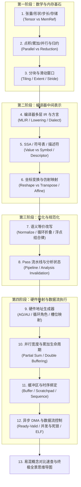

---

## 1. 张量、形状、索引与存储

### 1.1 什么是张量？从多维数学数组到物理线性内存

对于刚从上层数学或基础编程转过来的初学者来说，“张量（Tensor）”听起来往往带有高深莫测的物理学色彩。但在计算机科学与 AI 编译器的语境下：

> **初学者名词精解**：
>
> - **张量（Tensor）**：**带形状（Shape）的多维数组（Multidimensional Array）**。本质上就是一组按某种规则排列的数字集合。
> - **标量（Scalar）**：零维张量（Rank = 0），就是一个孤立的单值，例如温度 `36.5` 或数字 `42`。
> - **向量（Vector）**：一维张量（Rank = 1），排成一行的数组，例如 `[10, 20, 30]`。
> - **矩阵（Matrix）**：二维张量（Rank = 2），带有行与列的平面表格，例如 `[[10, 20, 30], [40, 50, 60]]`。
> - **秩（Rank / 维数）**：张量具有的维度数量。比如向量的 Rank 是 1，矩阵的 Rank 是 2，三维图像张量的 Rank 是 3。
> - **形状（Shape）**：每个维度上元素的具体数量。例如 `[2, 3]` 代表 2 行、每行 3 列。
> - **索引（Index / 坐标）**：多维网格中用于唯一定位某个元素的多维坐标。例如下标从 0 开始时，`[1, 2]` 代表访问第 2 行、第 3 列的元素。
> - **元素数据类型（Dtype）**：张量中每个基础数值的底层比特表示格式，如 `f32`（32 位 IEEE-754 浮点数，占 4 字节）、`i8`（8 位有符号整数，占 1 字节）等。

```python
# 教学示例：理解不同维度的张量形态
scalar = 42                             # Rank: 0, Shape: []
vector = [10, 20, 30]                  # Rank: 1, Shape: [3]
matrix = [[10, 20, 30], [40, 50, 60]]  # Rank: 2, Shape: [2, 3]

# 通过多维索引访问元素
assert matrix[1][2] == 60
```

### 1.2 逻辑坐标与物理地址是两回事：内存步长（Stride）的本质

初学者最容易犯的一个直觉错误，是以为计算机物理内存里真的存在一个“二维表格”或“四维立方体”。

**计算机的物理物理内存（RAM/SRAM）在底层只是一根一维的、连续的字节长条（Byte Array）**，从物理地址 `0x00000000` 线性递增到 `0xFFFFFFFF`。任何高维张量要存入内存，都必须被**“压扁（Flatten）”**成一维序列。

在最常见的**行优先（Row-Major，C 语言风格）**布局中，矩阵是“一行挨着一行连续排布”的：

```python
rows, cols = 2, 3
h, w = 1, 2
base_address = 1000   # 假设张量在物理内存中的起始字节地址
element_bytes = 4     # 假设每个元素为 f32，占 4 字节

# 1. 逻辑坐标 (h, w) 计算相对逻辑元素偏移（Element Offset）
element_offset = h * cols + w

# 2. 元素偏移转化为硬件物理字节地址（Byte Address）
byte_address = base_address + element_offset * element_bytes

assert element_offset == 5
assert byte_address == 1020
```

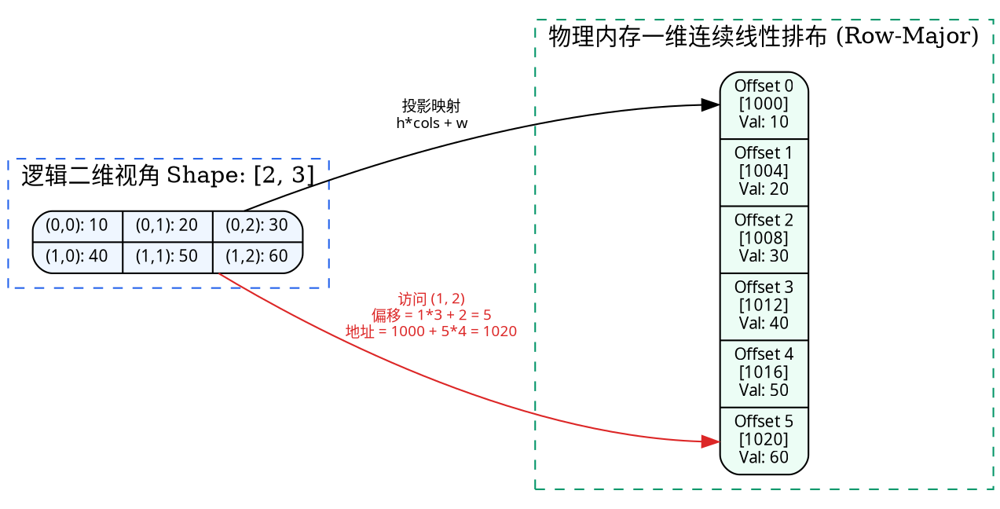

> **核心概念澄清：存储步长（Stride）**
>
> - **元素步长（Element Stride）**：某一维度的坐标数值加 1 时，在一维展平数组中跳过的**元素个数**。对于 Shape 为 `[2, 3]` 的行优先张量，第 0 维（行）每移动 1，跨过 3 个元素；第 1 维（列）每移动 1，跨过 1 个元素。因此元素步长为 `[3, 1]`。
> - **字节步长（Byte Stride）**：坐标数值加 1 时，物理地址实际跳过的**物理字节数**。对于每个元素 4 字节的张量，字节步长即 `[3*4, 1*4] = [12, 4]`。
> - **切记**：阅读编译器 IR、底层驱动或硬件地址生成器文档时，必须第一时间确认该接口使用的步长是**“以元素为单位”还是“以字节为单位”**！

### 1.3 MLIR 的类型分水岭：tensor 与 memref

现代编译器框架（如 MLIR，Multi-Level Intermediate Representation）通常使用两种截然不同的类型来描述数组：

```mlir
tensor<2x3xf32>
memref<2x3xf32>
```

| 维度 | `tensor`（张量类型） | `memref`（内存引用类型） |
| :--- | :--- | :--- |
| **所属语义** | **纯数学值语义（Value Semantics）** | **物理存储引用语义（Buffer / Reference Semantics）** |
| **物理对应** | 不对应任何具体的物理内存或硬件寄存器 | 对应一块已分配（或待分配）的物理内存地址空间 |
| **可变性** | **不可修改（Immutable）**，如同数学公式中的 $y = f(x)$ | **内容可变（Mutable）**，可通过指针写入更新内存数据 |
| **编译阶段** | 处于编译的高层（High-Level），专注于数学逻辑与算子图优化 | 处于编译的中低层（Mid/Low-Level），专注于内存分配、复用与寻址 |

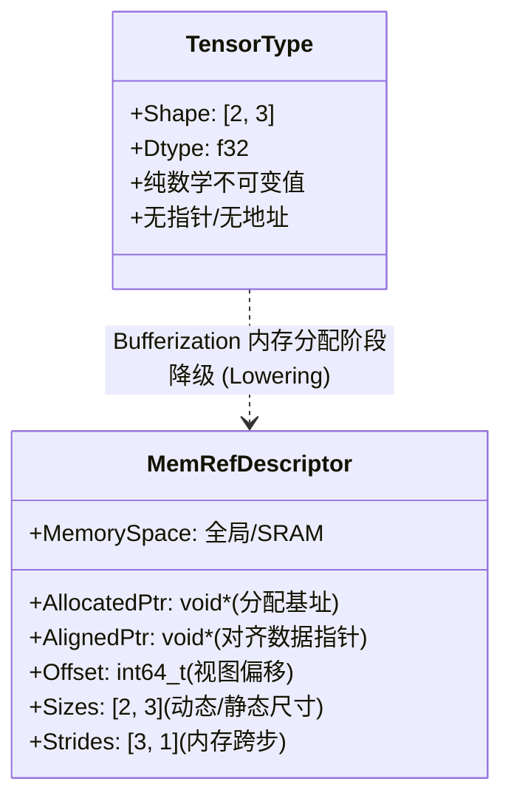

> **自测思考题 1**：
> Shape 为 `[3, 4]` 的行优先浮点矩阵（每个元素 4 字节），共有多少个元素？逻辑坐标 `A[2, 1]` 对应的相对元素偏移是多少？若将元素类型改为 64 位双精度浮点数 `f64`（每个元素 8 字节），Shape、逻辑索引、元素偏移、字节地址分别有哪些会发生改变？
>
> <details>
> <summary>查看参考答案</summary>
>
> 1. 总元素数：$3 \times 4 = 12$ 个。
> 2. 元素偏移（行优先公式为 $row \times cols + col$）：$2 \times 4 + 1 = 9$。
> 3. 改为 8 字节后：
>    - **保持不变**：Shape 依然是 `[3, 4]`，逻辑坐标依然是 `[2, 1]`，相对元素偏移依然是 $9$；
>    - **发生改变**：相对字节偏移从 $9 \times 4 = 36$ 字节变为 $9 \times 8 = 72$ 字节；张量总占用的物理内存容量从 48 字节扩大为 96 字节。
> </details>

---

## 2. 点积、累加、归约与输出维度

### 2.1 点积：逐项相乘与累加器（Accumulator）

深度学习中超过 90% 的计算量（无论是全连接 Linear、卷积 Conv，还是 Transformer 中的注意力 Attention 与 MLP）本质上都是大量点积运算的组合。

```python
a = [1, 2, 3]
b = [10, 20, 30]

result = 0
for k in range(3):
    result += a[k] * b[k]

assert result == 140
```

> **初学者名词精解**：
>
> - **累加器（Accumulator）**：在循环中用来持续保留“中间求和状态”的变量或专用硬件寄存器。如上述代码中的 `result`。每次循环执行乘法后，新乘积立即累加到旧值之上。
> - **归约（Reduction）**：将高维或多个数据通过某种结合操作（求和、求最大值 Max、求最小值 Min 等）合并压缩为较少数据（甚至单个标量）的过程。
> - **归约维（Reduction Dimension）**：在循环中，**循环变量变化时，数据持续写入并更新同一个累加器位置**的维度。例如上述代码中的 `k`，它遍历了输入数组，但并没有在输出中开辟新的槽位，因此 `k` 是典型的归约维。

### 2.2 输出维度（Parallel Dimension）：独立写回与潜在并行

我们再来看带有多输出的计算（例如一维向量乘以矩阵权重）：

```python
a = [1, 2, 3]
weights = [[10, 20, 30], [1, 1, 1]]
out = [0, 0]

for n in range(2):         # 循环 1: n
    for k in range(3):     # 循环 2: k
        out[n] += a[k] * weights[n][k]

assert out == [140, 6]
```

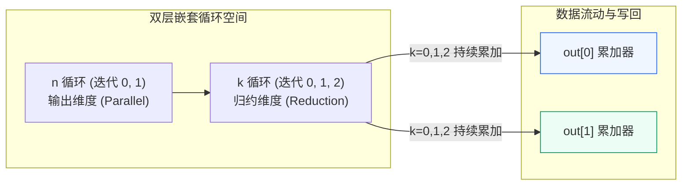

> **初学者名词精解：输出维度（Parallel / Output Dimension）**
>
> - **输出维度（Parallel Dimension）**：当该维度的循环变量（如 `n`）改变时，**计算结果写入的是不同的输出内存位置**（`out[0]` 与 `out[1]`）。
> - **并行语义**：在编译器中，声明一个维度为 `parallel`（并行）类型，意味着**这些不同的迭代之间不存在“写冲突”或“读写前后依赖”**，它们在数学逻辑上是彼此正交独立的。
> - **避免误区**：编译器标记一个循环为 `parallel`，**并不等于硬件在物理上一定会同时启动多个线程去执行它**！它只是向优化器声明：“这一维没有数据依赖，你可以安全地将它拆分到多核、多线程、或者向量化（Vectorize）执行”。

### 2.3 显式循环域（Domain）与访问映射（Indexing Map）

在现代 AI 编译器（如 MLIR 的 `linalg` 方言）中，算子不是被写死成硬编码的 C 语言循环，而是被抽象为**多面体模型（Polyhedral Model）**下的结构化元数据：

1. **循环域（Iteration Domain）**：定义各个循环变量的上下界范围（Extents）；
2. **迭代器类型（Iterator Types）**：明确标记每一个循环变量究竟是 `parallel`（输出维）还是 `reduction`（归约维）；
3. **访问映射（Indexing Map）**：使用数学仿射方程，精确描述循环变量如何组合映射为每个输入和输出张量的下标。

```text
# 编译器内部的结构化算子元数据定义示例
loops = [u, g, lane, k]
extents = [1, 3, 5, 4]
iterator_types = [reduction, parallel, parallel, reduction]

left_index   = (u, g, lane, k) -> (0, u, k)
right_index  = (u, g, lane, k) -> (g, lane, k)
output_index = (u, g, lane, k) -> (g, lane)
```

这段结构化元数据在语义上严格等价于下面的 4 重嵌套 Python 循环：

```python
left = [[[1, 2, 3, 4]]]
right = [[[1, 1, 1, 1] for lane in range(5)] for g in range(3)]
acc = [[0 for lane in range(5)] for g in range(3)]

# 四重嵌套循环：u(1), g(3), lane(5), k(4)
for u in range(1):              # reduction: 归约循环（此处长度为1）
    for g in range(3):          # parallel:  输出维 1
        for lane in range(5):   # parallel:  输出维 2
            for k in range(4):  # reduction: 归约维（长度为4的点积）
                acc[g][lane] += left[0][u][k] * right[g][lane][k]

assert acc == [[10] * 5 for g in range(3)]
```

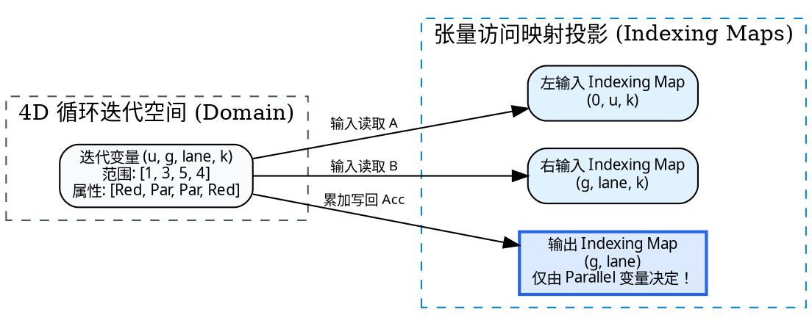

> **自测思考题 2**：
> 在上述四重循环中，固定 `g=1, lane=2`，循环变量 `u` 和 `k` 无论如何递增遍历，更新的都是张量中的哪一个具体元素？如果将 `lane` 变量的值从 2 变为 3，更新的目标位置又会变成哪里？这揭示了输出维与归约维在访问公式上的什么本质区别？
>
> <details>
> <summary>查看参考答案</summary>
>
> 1. 固定 `g=1, lane=2` 时，`u` 和 `k` 都不出现在输出坐标公式 `output_index = [g, lane]` 中，因此它们的全部迭代计算结果都会持续累加流入同一个元素 `acc[1][2]`。
> 2. `lane` 变为 3 时，写入位置立即切换到 `acc[1][3]`。
> 3. **本质区别**：只有**输出维（Parallel）**变量才会出现在输出张量的下标公式中，决定写入的物理槽位；而**归约维（Reduction）**变量绝对不会出现在输出张量的最终坐标中，它们只在求和过程中起循环折叠作用。
> </details>

---

## 3. 分块、窗口与访问规格

### 3.1 为什么需要分块（Tiling）？

在真实的现代计算机硬件体系结构中，处理器的运算速度（算力）与从外部主存（DDR / HBM）搬运数据的速度（访存带宽）之间存在极其悬殊的鸿沟，这被称为著名的**“内存墙（Memory Wall）”**。

为了缓解这一矛盾，芯片中设计了小而极其高速的片上存储——**Cache（高速缓存）**或 **SRAM（静态随机存储器 / 便签内存 Scratchpad）**。然而，片上 SRAM 的容量通常非常有限（几百 KB 至几十 MB），根本塞不下一个完整的大模型权重或高分辨率图像。

> **初学者名词精解：分块（Tiling）**
>
> - **分块（Tiling / 切片）**：**把大张量和外层大循环拆解成一系列较小的数据块（Tile）和内层小循环的编译变换技术**。其目的是让每一个小块能够完全驻留在高速片上 SRAM 中，使得数据在 SRAM 中被反复复用计算，从而最大程度减少昂贵的外部主存访问。
> - **Tile（数据分块）**：切分出来的一个紧凑数据子集。
> - **Grid（网格空间）**：外层遍历各个分块的离散迭代空间。

```python
# 教学示例：将长度为 12 的一维数据切分为每个 Tile 覆盖 4 个元素的子块
data = list(range(12))
tile_size = 4
tiles = [data[t * tile_size : (t + 1) * tile_size] for t in range(3)]

assert tiles == [[0, 1, 2, 3], [4, 5, 6, 7], [8, 9, 10, 11]]
```

一个完整的 Tiling 规格需要由一组参数精确刻画：
- `grid_extent = 3`：外层一共遍历 3 个 Tile；
- `tile_index(t) = t`：外层循环变量 $t$ 与分块编号的对应函数；
- `tile_extent = 4`：每个 Tile 覆盖的数据长度为 4；
- `tile_step = 4`：相邻 Tile 之间的起始位置跳跃跨度为 4（此处无重叠）。

### 3.2 滑动窗口（Sliding Window）与边界填充（Padding）

在卷积网络（CNN）或信号处理中，分块往往伴随着**重叠采样**，这就形成了**滑动窗口**：

```python
data = [0, 1, 2, 3, 4]
window_extent = 3    # 每个窗口覆盖 3 个元素
window_step = 1      # 窗口每次向右滑动 1 个元素
windows = [data[start : start + window_extent] for start in range(3)]

assert windows == [[0, 1, 2], [1, 2, 3], [2, 3, 4]]
```

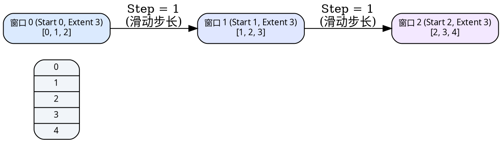

> **初学者名词精解：边界填充（Padding）**
> 当滑动窗口移动到张量边界时，如果剩下的元素不足以凑满一个完整的 `window_extent`，计算就会面临“越界（Out-of-Bound）”。此时人为地在张量边界外围补齐额外的值（最常见的是补 0，称为 Zero Padding），使得卷积或滤波能够均匀覆盖边界。

### 3.3 彻底辨析三种最容易混淆的“步长（Step / Stride）”

这是编译器和体系结构领域最常令初学者抓狂的名词混淆点：

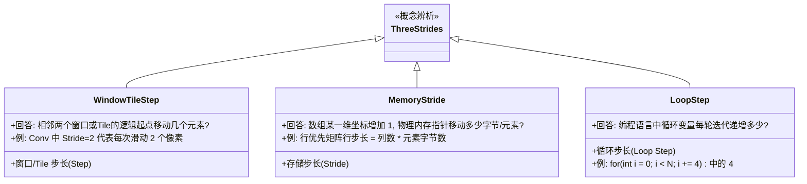

| 步长名称 | 英文术语 | 回答的核心问题 | 典型场景 |
| :--- | :--- | :--- | :--- |
| **窗口／Tile 步长** | Window / Tile Step | 相邻窗口或分块的**逻辑起点相差多少**？ | 卷积算子参数 `stride=2`，代表下一个卷积核中心移动 2 格 |
| **内存存储步长** | Memory Stride | 某个多维坐标增加 1，**物理内存地址跳跃多少**？ | 硬件寻址指令，连续行之间的物理地址偏移 |
| **循环自增步长** | Loop Induction Step | 嵌套循环中的**循环变量单次递增多少**？ | `for i in range(0, 10, 2)`，循环计数器每次加 2 |

> **自测思考题 3**：
> 一个一维数组 `[0, 1, 2, 3, 4, 5, 6]`，如果窗口覆盖范围 `window_extent = 3`，滑动步长 `window_step = 2`，在完全不越界访问的前提下，一共可以截取取出几个有效窗口？它们的起始坐标和内容分别是什么？
>
> <details>
> <summary>查看参考答案</summary>
>
> 一共可以截取 3 个有效窗口：
> 1. 起点 0：`[0, 1, 2]`
> 2. 起点 2：`[2, 3, 4]`
> 3. 起点 4：`[4, 5, 6]`
>
> 若下一个起点为 6，窗口范围 `[6, 7, 8]` 会产生越界，故不可用。窗口大小（3）与滑动跨度（2）是两个完全独立正交的物理量。
> </details>

---

## 4. 编译器、IR、dialect 与构建依赖

### 4.1 编译器为什么要采用多层中间表示（Multi-Level IR）？

传统的经典编译器（如 GCC、LLVM）通常采用单一抽象层次的 IR（如 LLVM IR）。LLVM IR 擅长指令级的控制流分析、寄存器分配以及标量算术优化，但**一旦面对张量层面的高级概念（如多维数组分块、多重循环并行变换、算子融合与硬件专用 DMA 搬运），LLVM IR 就会显得捉襟见肘**——因为张量的高级结构信息在过早降级为扁平指针和标量指令时已经全部丢失了！

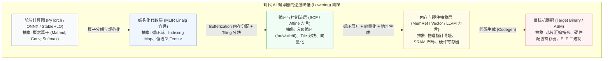

> **初学者名词精解**：
>
> - **中间表示（Intermediate Representation，IR）**：编译过程中连接源代码与底层目标机器码的数据结构中介。
> - **Lowering（逐层降级 / 抽象降低）**：编译器将高级抽象语义（如“把两个矩阵相乘”）逐步拆解替换为低级具体细节（如“遍历三重循环”、“计算指针内存偏移”、“发射 FMA 硬件指令”）的递进过程。
> - **Backend（后端）**：编译器中面向具体硬件目标（如 x86、ARM、RISC-V、专用 NPU）生成最终机器码的末端组件。

### 4.2 MLIR 的核心组件：Dialect、Operation、Attribute 与 Verifier

MLIR（多层中间表示框架）彻底颠覆了以往编译器单一 IR 的设计理念，它允许开发者像搭建乐高积木一样，自由定义并扩展不同抽象层级的**方言（Dialect）**。

看一个最标准的 MLIR 示例：

```mlir
func.func @increment(%x: i32) -> i32 {
  %one = arith.constant 1 : i32
  %y = arith.addi %x, %one : i32
  return %y : i32
}
```

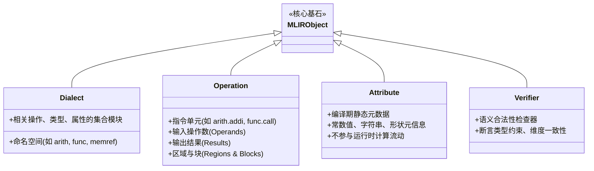

> **初学者名词精解：TableGen**
> TableGen 是 LLVM / MLIR 采用的**声明式元编程代码生成工具**（文件后缀为 `.td`）。开发者只需在 `.td` 文件中声明“这个算子叫什么、有哪些输入参数、有哪些属性约束”，TableGen 就会在编译期间自动生成上万行枯燥、易出错且高度模板化的 C++ 类定义、解析器（Parser）、打印器（Printer）和验证器（Verifier）桩代码。

### 4.3 构建依赖哲学：“两个库互不依赖”不等于“没有任何依赖”

在模块化编译器工程架构（如 CMake 构建系统）中，模块之间的解耦设计是一门至关重要的系统设计艺术：

```cmake
# 教学 CMake 配置
target_link_libraries(ComputeIR PUBLIC CommonIR)
target_link_libraries(ControlIR PUBLIC CommonIR)

if(ENABLE_TARGET_BACKEND)
  target_link_libraries(CompilerTool PRIVATE TargetBackend)
endif()
```

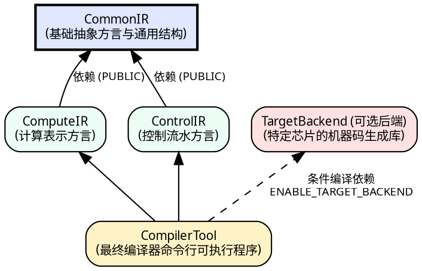

- `ComputeIR`（负责计算语义）与 `ControlIR`（负责时序控制）之间**完全没有相互链接关系**，两者实现了横向物理隔离；
- 但它们都依赖纵向基础库 `CommonIR`；
- 如果关闭了可选后端 `TargetBackend`，编译器工具仍然可以完全正常地解析、打印、验证 IR，甚至执行高层算子优化；
- **核心启示**：**能在编译器中解析一个自定义算子，绝不等于能够为它生成底层可执行机器码！**

---

## 5. SSA、函数、符号引用与描述符

### 5.1 SSA 静态单赋值：值（Value）与符号（Symbol）的本质边界

> **初学者名词精解：SSA（Static Single Assignment，静态单赋值）**
> SSA 是现代编译原理中最伟大、最重要的基石之一。它的核心铁律是：**在程序代码中，每一个变量（SSA Value，前缀为 `%`）在静态文本层面只能被定义赋值一次！**
>
> 为什么要有这种限制？在传统的 C 语言中，一个变量 `x` 可以被多次赋值修改，编译器要想知道第 100 行的 `x` 到底是哪一行赋值的，必须遍历复杂的控制流路径分析。而在 SSA 形式下，每个值都有唯一的“生产者（Def）”和确定的“使用者（Use）”，形成清晰的 **Def-Use 链**，使得死代码消除、常量传播等优化算法的时间复杂度大幅下降。

```mlir
// 教学示例：SSA 数据值与全局符号的区分
func.func private @double(%x: i32) -> i32 {
  %y = arith.addi %x, %x : i32
  return %y : i32
}

func.func @caller(%x: i32) -> i32 {
  // %result 是运行期动态产生的 SSA 数据值
  // @double 是可通过静态符号表（Symbol Table）查找的函数全局符号名称
  %result = func.call @double(%x) : (i32) -> i32
  return %result : i32
}
```

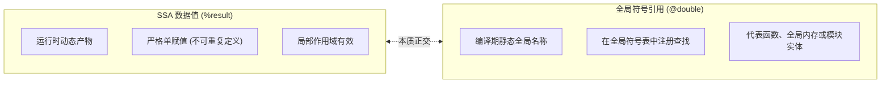

> **打破直觉误区：SSA 值的“不可变”不代表内存绝对不可写！**
> 初学者常问：“既然 `%mem` 只能赋值一次，那我还怎么修改内存数组里的数据？”
> 答：**`%mem` 变量本身代表的是‘指向某块内存的指针句柄’，句柄本身不能重新赋值，但底层指令可以通过该句柄向它指向的物理存储连续写入成千上万次！**

### 5.2 符号查找与微内核（Microkernel）检查

在为 NPU 或向量协处理器生成高效代码时，编译器往往会为高频计算片段（如一个 $4 \times 4$ 的点积 Tile）准备专用的**微内核（Microkernel）**：

```text
# 编译器在 Pass 中静态检查微内核的伪代码逻辑
function = symbol_table.lookup(descriptor.function_name)
require function exists                     # 1. 确保符号存在于模块中
require parameter types match contract      # 2. 验证参数签名契约严格匹配
inspect function.body                       # 3. 深入探测函数指令主体
verify supported operations                 # 4. 确保只包含目标加速单元支持的指令
transform supported operations              # 5. 替换或绑定到专用执行流水
```

### 5.3 静态描述符（Descriptor）与动态调用的分离

在优秀的系统软件设计中，**静态元数据规格（Descriptor）与具体的运行时调用实例（Invocation）永远是解耦拆分的**：

```python
# 教学伪代码：Descriptor 与 Invocation 的解耦
# 1. 静态描述符：在编译期或离线阶段固化，只描述“算什么”
matmul_descriptor = describe_computation(
    m=64, n=64, k=128,
    tile_shape=[16, 16],
    kernel_symbol="@gemm_microkernel_16x16"
)

# 2. 动态调用：在运行期反复调用，每次传入不同的实际物理存储缓冲区（Buffer）
invoke(matmul_descriptor, input_a_buf, input_b_buf, output_c_buf)
invoke(matmul_descriptor, input_a2_buf, input_b2_buf, output_c2_buf)
```

这种模式使得编译器或驱动可以只生成一份静态可复用的控制参数结构体，极大降低每次推理启动时的 CPU 开销。

---

## 6. reshape、坐标换算与仿射表达式

### 6.1 reshape（形状重解释）的数学本质

> **初学者名词精解**：
>
> - **Reshape（形状重解释）**：**在不改变数组底层元素物理存储顺序（一维线性流）的前提下，仅仅改变上层多维坐标视角的换算规则**。
> - **切记：Reshape $\neq$ Transpose（转置）！**
>   - Reshape 只是改变维度的打包和拆分方式（如将 6 个元素从 `[6]` 视为 `[2, 3]`）；
>   - Transpose 则是交换坐标轴的实际对应顺序（如将 `[2, 3]` 转置为 `[3, 2]`），如果不做特殊布局优化，转置通常会导致内存物理读取次序的彻底颠倒。

```python
# 验证 Reshape 的坐标换算映射方程
flat = [10, 20, 30, 40, 50, 60]
view = [flat[0:3], flat[3:6]]  # 逻辑 reshape 为 [2, 3]

for i in range(2):
    for j in range(3):
        # 二维坐标 (i, j) 映射到一维下标 t 的数学公式
        t = i * 3 + j
        assert view[i][j] == flat[t]

        # 反向推导：从一维下标 t 还原二维坐标 (i, j)
        assert i == t // 3   # 整数整除
        assert j == t % 3    # 取模取余
```

```mlir
// MLIR 中通过 expand_shape 将 1D Tensor 展开为 2D Tensor
func.func @expand(%arg: tensor<6xf32>) -> tensor<2x3xf32> {
  // [[0, 1]] 表示结果的第 0 维和第 1 维合并对应输入的第 0 维 (Reassociation 维度关联映射)
  %view = tensor.expand_shape %arg [[0, 1]] output_shape [2, 3]
      : tensor<6xf32> into tensor<2x3xf32>
  return %view : tensor<2x3xf32>
}
```

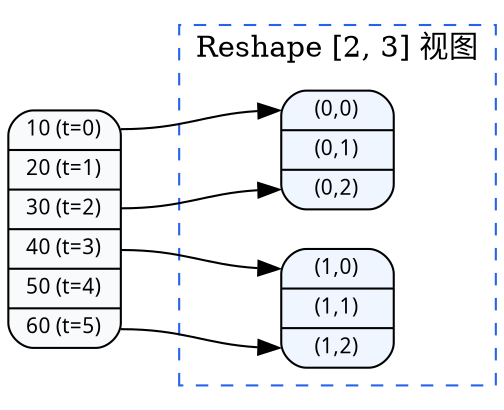

### 6.2 仿射映射（Affine Map）：编译器中受约束的高等代数

> **初学者名词精解：仿射映射（Affine Map）**
> 在编译优化中，**仿射表达式（Affine Expression）是指由循环变量与常数的乘加线性组合构成的数学公式**，支持受约束的整数除法（`floordiv`）与取模（`mod`）。
>
> 为什么编译器如此偏爱仿射映射？因为如果下标公式是纯仿射的（例如 `i * 3 + j`），优化器就可以使用强大的**整型线性规划（Integer Linear Programming）**数学工具，严密证明是否存在跨循环数据冲突、是否能无损分块、多核并行是否安全。一旦下标中出现任意运行期变量相乘（非线性），编译器的静态推导就会瞬间失效。

---

## 7. Normalize：为什么可以改写程序

### 7.1 规范化（Normalize / Canonicalization）的真谛

> **初学者名词精解**：
>
> - **规范化（Normalize / Canonicalization）**：在编译器领域，规范化是指**“把用各种不同语法糖或迂回方式书写的程序代码，整理简化为统一的、唯一的、标准的最简规范形式”**。它与机器学习中“将特征缩放到 0~1”的数值归一化没有任何关系！
> - **语义等价性（Semantic Equivalence）**：编译器任何优化改写的第一天条——**改写后的程序在任何合法的输入下，所产生的可观察结果（计算值、内存写入、副作用）必须与改写前完全一致！**

### 7.2 规范化改写的典型场景：折叠与代换

#### 场景 1：Reshape 坐标替换（消除中间 View）

若已知 `view[i, j] = source[i * 3 + j]`，下游如果访问了 `view[i, j]`，编译器可以直接代入，将访问直接重写为 `source[i * 3 + j]`，从而抹去不必要的中间张量分配：

```python
source = [10, 20, 30, 40, 50, 60]
view = [source[:3], source[3:]]

# 改写前：通过中间 view 间接访问
before = [view[i][j] for i in range(2) for j in range(3)]

# 改写后：直接通过复合仿射坐标换算直连访问底层 source
after = [source[i * 3 + j] for i in range(2) for j in range(3)]

assert before == after
```

#### 场景 2：合并相邻归约循环（Loop Coalescing）

```python
# 改写前：双层嵌套归约循环 [2, 3]
acc_before = 0
for outer in range(2):
    for inner in range(3):
        acc_before += a[outer * 3 + inner] * b[outer * 3 + inner]

# 改写后：单层紧凑归约循环 [6]
acc_after = 0
for t in range(6):
    acc_after += a[t] * b[t]

assert acc_before == acc_after
```

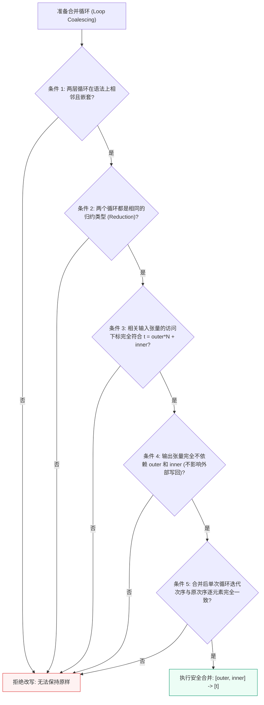

#### 场景 3：折叠单次单位循环（Unit-trip-count loop elimination）

如果某个循环只执行 1 次（例如 `for u in range(1)`），编译器可以直接将循环结构连根拔起，直接将 `u=0` 静态代入函数体，消除无谓的跳转指令开销：

```python
a = [[1, 2, 3]]

# 改写前：包含无意义的 1 次迭代循环壳
before = 0
for u in range(1):
    for k in range(3):
        before += a[u][k]

# 改写后：将 u=0 静态特化代入，剥离外层循环
after = 0
for k in range(3):
    after += a[0][k]

assert before == after == 6
```

### 7.3 警惕深水区：浮点数加法并不满足结合律！

很多算法工程师误以为加法总是可以任意交换顺序的，但**在计算机浮点世界中，浮点数加法不满足结合律（Non-associativity）**！

$$(a + b) + c \neq a + (b + c)$$

```python
# 真实的 Python 浮点数结合律失效案例（浮点数精度截断引发的灾难）
a = 1e16
b = -1e16
c = 1.0

# 顺序 1：先算大数抵消，再加上小数
order1 = (a + b) + c   # (1e16 - 1e16) + 1.0 = 0.0 + 1.0 = 1.0

# 顺序 2：先算大数加小数，发生严重的低位有效数字丢弃截断！
order2 = a + (b + c)   # 1e16 + (-1e16 + 1.0) = 1e16 - 1e16 = 0.0

assert order1 == 1.0
assert order2 == 0.0
assert order1 != order2
```

> **编译器的底线**：在默认遵循严格浮点标准（如 IEEE-754）的场景下，**编译器改写循环必须保持累加的求和顺序严格一致**！除非用户显式开启了宽松数学标志（如 `-ffast-math` 或 MLIR 的 `reassoc_fp_math`），编译器才被允许改变浮点归约顺序。

---

## 8. pass、分析结果与规范化顺序

### 8.1 什么是 Pass 与 Pipeline？

> **初学者名词精解**：
>
> - **Pass（编译遍）**：编译器中一段功能单一、高度模块化的代码处理程序。每个 Pass 接收当前的 IR，对其进行检查、分析或修改，然后输出更新后的 IR。例如“常量折叠 Pass”、“死代码消除 Pass”、“循环分块 Pass”。
> - **Pipeline（Pass 流水线）**：按照精心设计的先后次序，串联执行的一系列 Pass 的有序链条。
> - **静态分析（Analysis）**：**只读（Read-Only）**探测程序特征（如计算循环嵌套深度、活跃变量分析、别名分析），**绝不修改 IR**。
> - **代码变换（Transformation）**：根据优化目标或分析结果，**真实修改（Mutate）** IR 结构（插入指令、删除无用循环、替换算子）。

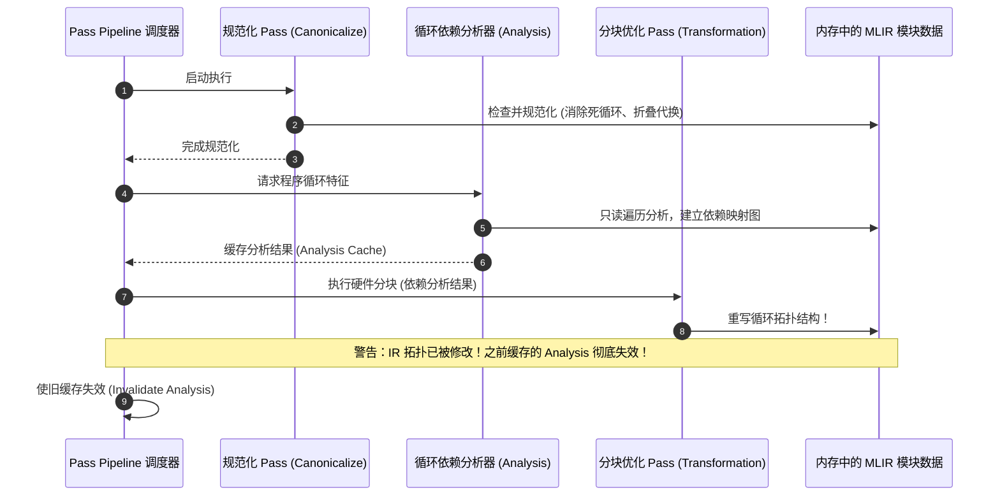

### 8.2 规范化顺序为什么极其致命？

为什么必须严格遵循**“先规范化（Normalize），再执行复杂硬件分析（Analyze）”**？

请看下面的伪代码案例：

```text
# 理想且正确的 Pipeline 顺序
verify(program)                             # 1. 语法约束检查
normalized_program = normalize(program)     # 2. 规范化：消除多余嵌套、清洗单位维度、简化坐标
mapping = analyze_loops(normalized_program) # 3. 核心分析器在一个干净、规范的 IR 上提取硬件槽位
lower(normalized_program, mapping)          # 4. 执行可靠降级
```

如果颠倒顺序：先在包含复杂冗余单位循环的原始代码上建立硬件槽位映射，随后另一个 Pass 突然顺手把单位循环删除了，那么**之前分析得到的“第 3 层循环对应某个硬件计数器”的结论就会产生严重错位，导致生成出完全荒谬甚至让芯片硬件跑飞的错误指令**！

---

## 9. 地址生成、循环角色与资源槽位

### 9.1 地址生成器（AG/AU）：加速计算的幕后功臣

在通用的 CPU 架构中，每执行一次数组访问 `A[i]`，CPU 都要发射指令计算指针地址（基址 + 索引 $\times$ 步长），这会白白占用 ALU 的算力。

而在专用的高吞吐 AI 芯片（NPU、TPU、DSP）中，为了让矩阵乘加单元（MAC）每一周期都能 100% 满负荷打满，架构师会在芯片里专门集成独立的硬件加速部件——**地址生成器（Address Generator，AG）**与**地址单元（Address Unit，AU）**。

> **初学者名词精解：地址生成器（AG）与地址单元（AU）**
>
> - **地址生成器（AG）**：硬件中专职负责为访存流连续、自动计算物理内存地址的硬件控制器。计算核心只需告诉它“基址是多少、按什么步长自增、计数器上限是多少”，AG 就会在后台流水线中自动产生地址，将数据送到计算单元嘴边。
> - **地址单元（AU）**：AG 内部的一个硬件级联子部件，通常包含专门的硬件加法器和步长寄存器。

```python
# 教学地址生成公式：模拟一个硬件 AG 的内部行为
base_address = 1000
row, col = 2, 1
row_stride, col_stride = 4, 1

# 硬件 AG 内部自动计算地址偏移
element_address = base_address + (row * row_stride) + (col * col_stride)
assert element_address == 1009
```

### 9.2 必须彻底厘清的“四个抽象层次”

编译器的核心使命，就是跨越软件算法与芯片硬件之间的四重抽象代沟：

```graphviz
digraph abstraction_levels {
    rankdir=LR;
    node [shape=box, style="rounded,filled", fontname="sans-serif", fontsize=10];
    edge [fontname="sans-serif", fontsize=9];

    subgraph cluster_algo {
        label = "层次 1: 数学算法变量 (Software)";
        style = dashed;
        color = "#2563eb";
        a_var [label="循环变量: out_x, kernel_x\n纯代数坐标", fillcolor="#eff6ff"];
    }

    subgraph cluster_role {
        label = "层次 2: 编译器循环角色 (Compiler IR)";
        style = dashed;
        color = "#059669";
        c_role [label="循环用途分类:\n[窗口位置] (Parallel)\n[窗口归约] (Reduction)", fillcolor="#ecfdf5"];
    }

    subgraph cluster_slot {
        label = "层次 3: 硬件资源槽位 (Hardware Slot)";
        style = dashed;
        color = "#d97706";
        h_slot [label="芯片逻辑槽位:\nAG_Slot_Outer (外层计数器)\nAG_Slot_Inner (内层计数器)", fillcolor="#fef3c7"];
    }

    subgraph cluster_hw {
        label = "层次 4: 物理寄存器配置 (Physical Silicon)";
        style = dashed;
        color = "#dc2626";
        p_cfg [label="物理硬件参数:\nCounter_Reg = 0x02\nStride_Reg  = 0x10\nLimit_Reg   = 0x20", fillcolor="#fee2e2"];
    }

    a_var -> c_role [label="语义分类"];
    c_role -> h_slot [label="槽位绑定映射"];
    h_slot -> p_cfg [label="生成配置二进制"];
}
```

### 9.3 软件循环深度 $\neq$ 物理硬件计数器编号！

看一个非常典型的三层循环：

```python
for batch in range(2):       # 软件逻辑循环深度 1 (最外层)
    for tile in range(3):    # 软件逻辑循环深度 2 (中间层)
        for k in range(4):   # 软件逻辑循环深度 3 (最内层)
            pass
```

- **软件习惯**：从外向内编号，最外层 `batch` 深度为 1，最内层 `k` 深度为 3；
- **某些硬件体系结构（如某些 NPU 的 AG）**：物理计数器是**从内向外**级联编号的！最内层的紧凑自增计数器被命名为 `AU_Counter_0`，最外层的慢速递增计数器被命名为 `AU_Counter_2`。
- **初学者切记**：在编写编译后端映射 Pass 时，**千万不能直接把软件循环的嵌套深度（Loop Depth）无脑赋值给硬件寄存器编号**，必须通过明确的架构规则表做映射转换！

---

## 10. 并行宽度、累加生命周期与偏置

### 10.1 宏观计算的三个并行维度

在通用张量处理单元中，一次微内核计算通常会从三个正交方向切分并行度：

- **$R$（输出行并行宽度，Row Parallel）**：单次处理的输出行数；
- **$S$（输出列并行宽度，Col Parallel）**：单次处理的输出列数；
- **$Q$（点积归约片段长度，Reduction Chunk Width）**：单次点积处理中同时推进的相乘求和元素对数。

```text
左输入矩阵分片: [R, Q]
右输入矩阵分片: [Q, S]
硬件累加矩阵块: [R, S]
```

如果 $R=2, S=3, Q=4$，那么该单元每一轮原子计算就会消费 $2 \times 4$ 个左矩阵元素和 $4 \times 3$ 个右矩阵元素，并同时更新 $2 \times 3 = 6$ 个输出位置的内部部分和。

### 10.2 累加器生命周期（Accumulator Lifecycle）与部分和（Partial Sum）

> **初学者名词精解：部分和（Partial Sum）**
> 当一个归约维度很长（例如总长度 $K = 12$），而芯片由于寄存器数量或数据通路位宽限制，每次只能计算 $Q = 4$ 个元素的乘加时，计算必须分片进行。**每一片计算结束时产生的中间累计数值，就被称为部分和（Partial Sum）**。它不是最终结果，绝对不能被提前当作算子结果写回内存！

```python
# 教学示例：分片累加计算生命周期
a = list(range(1, 13))  # 长度为 12
b = [1] * 12
chunk_width = 4
value = 0
partial_results = []

for chunk in range(3):  # 一共拆分成 3 个分片
    for lane in range(chunk_width):
        k = chunk * chunk_width + lane
        value += a[k] * b[k]
    # 记录每个分片结束时的内部部分和
    partial_results.append(value)

assert partial_results == [10, 36, 78]
# 最终正确结果是 78，中间的 10 和 36 只是阶段性产物
```

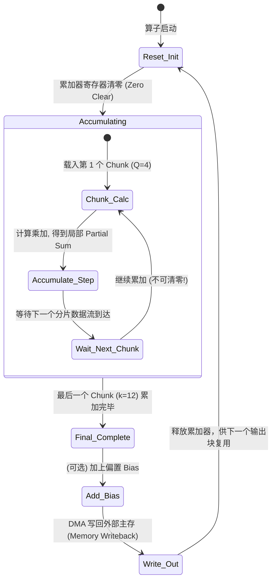

### 10.3 偏置（Bias）注入与双缓冲（Ping-Pong Buffer）切换

在神经网络算子中，矩阵乘法后往往紧跟偏置加法：

$$Y[m, n] = \sum_{k} (A[m, k] \times B[k, n]) + \text{bias}[n]$$

> **初学者名词精解：双缓冲（Ping-Pong / Double Buffering）**
> 为了隐藏片外数据搬运的超长延迟，架构师在片上设计了两块相同大小的缓存（Buffer 0 与 Buffer 1）。当计算核心正在满负荷消费 Buffer 0 的数据时，后台 DMA 已经在悄悄向 Buffer 1 搬运下一轮计算所需的偏置或输入权重；下一轮两者角色对调。这就像打乒乓球一样来回切换，从而让计算单元永远不需要停下来干等访存！

---

## 11. buffer、scratch、绑定与 sequence

### 11.1 buffer、scratchpad 与参数绑定

在异构计算和 AI 芯片中，关于“内存”的名词极为繁杂：

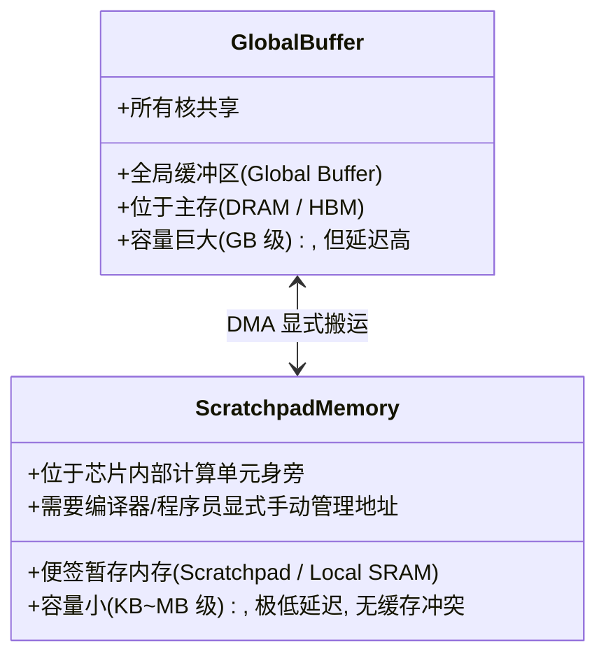

> **初学者名词精解**：
>
> - **Buffer（缓冲区）**：用于存放数据的任何通用内存块。
> - **Scratch / Scratchpad（便签内存）**：**芯片片上的专用超低延迟 SRAM 区域**。与 CPU 中由硬件自动管理替换策略的 Cache 不同，Scratchpad **必须由软件（编译器或程序员）显式负责在何时分配、向何处搬入数据、何时释放**。
> - **绑定（Binding）**：在调用一个计算任务时，明确把特定的内存地址（Buffer）指派给算子内部声明的形式参数的过程。

```python
# 教学伪代码：显式分配 Scratchpad 并完成绑定
scratch_memory = allocate_local_sram(size_in_bytes=4096)

# 将本地 Scratchpad 绑定给任务作为暂存计算区
run_task(
    descriptor=conv_desc,
    input_buf=dram_in,
    output_buf=dram_out,
    scratch=scratch_memory  # 绑定操作
)
```

### 11.2 Sequence（时序操作块）与 Region（嵌套区域）

为了精确约束算子在芯片执行阶段的指令时序，编译器会使用结构化语法块：

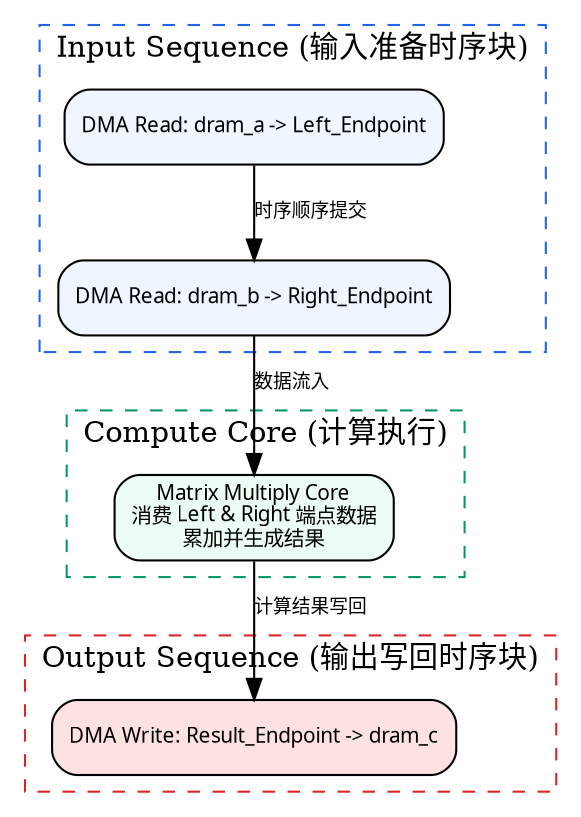

- **逻辑端点（Endpoint）**：数据流的逻辑起点或终点，代表硬件数据队列或寄存器接口，解耦了具体的物理端口编号；
- **Region（区域）**：在 MLIR 中，Operation 内部可以包含一个或多个子控制块（Region），用来限定某些特定操作（例如规定某个 Region 内只允许发生读操作，绝对禁止发生写回）。

---

## 12. 数据搬运、异步执行与二进制数据

### 12.1 DMA 与纯数据流（Dataflow）驱动执行

> **初学者名词精解**：
>
> - **DMA（Direct Memory Access，直接内存访问）**：**由专门的硬件搬运控制器独立完成片外内存与片上内存之间的大批量数据搬迁**，无需 CPU/主核插手逐个字节搬运。
> - **数据流执行（Dataflow Execution）**：区别于传统依靠“指令程序计数器（PC 指针）一条一条按顺序抓取指令”的冯·诺依曼控制流架构，**数据流架构的核心法则是：计算何时启动，完全取决于其输入数据是否准备就绪（Data Ready）以及下游是否有空间接收（Buffer Valid）**。
> - **Ready / Valid 握手协议**：硬件总线间最常见的流控协议——生产者发出 `Valid` 信号（表示数据有效且稳定），消费者发出 `Ready` 信号（表示自己已准备好接收）。当且仅当两个信号在同一时钟周期同时为高电平时，数据才真正成功交接。

### 12.2 彻底分清三种动作：配置、启动与等待

初学者在编写异步驱动或编译器调度 Pass 时，最容易犯的大忌就是分不清以下三者的时空界限：

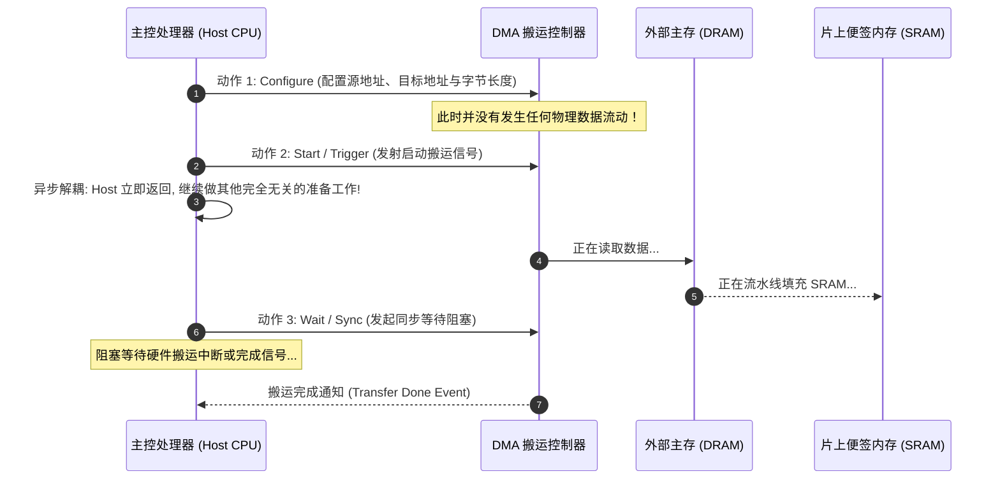

| 动作 | 含义 | 是否耗时 | 误区警告 |
| :--- | :--- | :--- | :--- |
| **Configure（配置）** | 向控制寄存器写入源地址、目的地址、长度与步长 | 极短（几纳秒） | 配置完成**不等于**数据已经开始流动！ |
| **Start（启动）** | 发射触发脉冲，让硬件状态机开始工作 | 瞬间 | 启动动作返回**绝不代表**数据已经搬运完毕！ |
| **Wait（等待）** | 阻塞或轮询直到硬件置起完成标志位 | 视数据量而定 | 如果过早 Wait，异步重叠隐藏延迟的效果将彻底归零！ |

### 12.3 为什么会发生死锁（Deadlock）？

在数据流驱动的硬件执行中，若调度不当，极易陷入死锁沼泽：

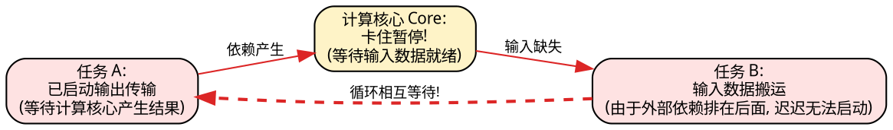

> **死锁本质**：计算核心在等待输入就绪；而输入搬运代码由于调度被排在输出写回等待的后面；输出写回又在死等计算核心吐出数据——**形成了致命的“循环相互等待（Circular Wait）”链条**。因此，编译器在排布异步 DMA 和算子启动指令时，必须构建精密的有向无环依赖图（DAG），并严格保证保序与资源分配。

### 12.4 配置寄存器、位域（Bit Field）与小端序（Little-Endian）

编译器的底层后端最终要将所有的循环参数打包为目标硬件芯片能够看懂的十六进制二进制包：

```python
# 教学示例：通过位运算构造一个 8 位的控制配置寄存器
# 假设寄存器结构定义：
# Bits [0]: 启动使能 (Enable)
# Bits [1:3]: 工作模式模式编号 (Mode, 3 bits)
# Bits [4:7]: 预留保留位
word = 0b00000000
mode_offset = 1
mode_width = 3
new_mode = 5     # 二进制 101

# 1. 构造掩码清除目标位域
field_mask = ((1 << mode_width) - 1) << mode_offset  # 0b00001110
cleared = word & ~field_mask

# 2. 将新模式值左移并拼入寄存器字
updated = cleared | (new_mode << mode_offset)
# 3. 置起使能位 (Bit 0)
final_reg = updated | 0b00000001

assert final_reg == 0b00001011
```

```python
# 字节序（Endianness）辨析：将一个 32 位数值转为小端序字节数组
# 小端序（Little-Endian）：低位字节存在低内存地址（绝大多数现代处理器如 ARM/x86/RISC-V 的默认行为）
value = 0x12345678
payload = value.to_bytes(4, byteorder="little")
assert list(payload) == [0x78, 0x56, 0x34, 0x12]
```

### 12.5 ELF 格式、Section（节区）与链接器（Linker）的真实职责

当后端生成了机器码和常量权重后，需要将其打包进标准的**可执行与可链接格式（ELF，Executable and Linkable Format）**文件中：

- `.text` 节区：存放纯代码指令；
- `.rodata` 节区：存放不可修改的只读常量数据与描述符配置表；
- `.data` / `.bss` 节区：存放带初值或未初始化的全局变量；
- **初学者切记**：编译器在 IR 中给某个张量标记了 `offset = 0x1000` 属性，**并不意味着它会自动落到内存对应的物理位置**！必须依靠**链接器（Linker）**根据链接脚本（Linker Script，`.ld`）将各个节区重定位拼接，才能生成最终正确的物理加载镜像。

---

## 13. 易混术语速查与终极认知图谱

为了让大家在今后的 AI 编译器、高性能算子研发或体系结构工作中不再被各种概念名词绕晕，特将本文涉及的最关键易混术语整理为全景对比速查表：

### 13.1 核心易混术语深度辨析矩阵

| 概念对 | 维度 A 核心本质 | 维度 B 核心本质 | 典型场景与初学者误区警示 |
| :--- | :--- | :--- | :--- |
| **shape / rank** | 各维度的元素大小元组（如 `[2, 3]`） | 维度的个数（秩，如 Rank = 2） | Shape 是向量；Rank 是标量整数。 |
| **逻辑坐标 / 物理地址** | 张量高维网格中的定位（如 `[1, 2]`） | 物理内存总线上的字节编号（如 `0x1020`） | 逻辑坐标相同，改变内存步长（Stride）后物理地址截然不同。 |
| **extent / step / stride** | 窗口/分块单次**覆盖的跨度范围** | 窗口/分块**起点的推进位移量** | **存储步长**则是坐标加 1 时物理内存跳过的距离，三者必须严格分开！ |
| **输出维 / 归约维** | 循环迭代更新**不同的输出槽位** | 循环迭代持续更新**同一个累加器** | 输出维具备天然可并行性；归约维存在迭代间数据读写依赖。 |
| **parallel 属性 / 物理并发** | 编译器 IR 中的**无依赖数学语义声明** | 硅片硬件上**多个物理核心真实同时运转** | 声明了 `parallel` 绝不等于芯片必须开多线程跑。 |
| **tensor / memref** | **纯数学值语义**（不可变，无内存指针） | **物理内存引用**（包含基址、步长、空间） | 前端图优化用 `tensor`，后端生成机器码必须降低为 `memref`。 |
| **reshape / transpose** | 保持内存顺序不变，**改变维度的重组换算** | 颠倒维度映射关系，**改变物理访问次序** | Reshape 不会引发物理内存重排；转置通常需要重排。 |
| **Normalize / 数据归一化** | **编译器将程序代码整理为标准规范形式** | 算法将数值矩阵缩放到 0~1 区间 | 编译器 Pass 中的 Canonicalize 与数学缩放完全无关！ |
| **analysis / transformation** | **只读**分析探测程序特征（不碰 IR 拓扑） | **写入/重写**并修改 IR 结构 | Transformation 会导致先前缓存的 Analysis 彻底失效。 |
| **descriptor / invocation** | 静态描述**“算什么”**的元数据结构体 | 运行时传入具体内存的**“某一次调用”** | 分离二者可以实现静态配置的极致复用。 |
| **资源槽位 / 算法变量** | 硬件加速单元内部物理组件的逻辑代号 | 数学公式中的循环计数符号（如 $i, j$） | 循环变量名哪怕叫 `row`，也不意味着它只能绑定到硬件的行槽位。 |
| **scratch / 普通 buffer** | 芯片内部**极低延迟、无 Cache 冲突的 SRAM** | 位于片外主存、高延迟的全局通用内存 | Scratchpad 必须由软件/编译器显式管理搬运时机。 |
| **Submit（提交） / Complete（完成）**| 仅仅是把指令任务**丢进硬件执行队列** | 硬件物理流水线**彻底算完并写回数据** | 提交成功绝不等于任务完成！不可过早消费输出。 |
| **SSA 不变性 / 内存内容可变** | SSA 变量名 `%ptr` **不可重新定义** | 指针 `%ptr` **所指向的物理存储可反复写入** | 切记不要把“变量不可重新赋值”与“内存只读”混为一谈。 |
| **能解析 / 能生成目标码** | 编译前端**认得语法和类型** | 编译后端**具备完整的降级与硬件匹配链路** | 能打印出 MLIR Dialect，距离生成芯片可执行 ELF 差着十万八千里。 |

### 13.2 终极全景思维导图

```graphviz
digraph panoramic_architecture {
    rankdir=TB;
    compound=true;
    node [shape=box, style="rounded,filled", fontname="sans-serif", fontsize=10];
    edge [fontname="sans-serif", fontsize=9];

    subgraph cluster_math {
        label = "1. 数学抽象层 (Tensor & Operators)";
        style = filled;
        fillcolor = "#f8fafc";
        color = "#94a3b8";

        tensor_concept [label="张量 (Tensor) [Shape, Dtype]\n值语义 / 不可变", fillcolor="#e2e8f0"];
        loop_types [label="循环域与属性\nParallel (输出) vs Reduction (归约)", fillcolor="#e2e8f0"];
        tiling [label="切片与分块 (Tiling)\n解决内存墙，适应片上 SRAM 容量", fillcolor="#e2e8f0"];
        
        tensor_concept -> loop_types;
        loop_types -> tiling;
    }

    subgraph cluster_compiler {
        label = "2. 编译器表示与优化层 (MLIR & Pass)";
        style = filled;
        fillcolor = "#f0fdf4";
        color = "#86efac";

        mlir_dialect [label="多层方言 (Dialect)\nLinalg -> SCF / Affine -> MemRef / LLVM", fillcolor="#dcfce7"];
        ssa_form [label="SSA 形式与符号表\n唯一单赋值 + 全局符号解耦", fillcolor="#dcfce7"];
        normalize [label="规范化 Pass (Normalize)\n循环折叠 + 单位维度清理 (严守浮点结合律)", fillcolor="#dcfce7"];

        mlir_dialect -> ssa_form;
        ssa_form -> normalize;
    }

    subgraph cluster_hw_mapping {
        label = "3. 硬件映射与控制流 (Hardware Mapping)";
        style = filled;
        fillcolor = "#fefce8";
        color = "#fde047";

        ag_au [label="硬件地址生成器 (AG / AU)\n四层解耦: 算法变量 -> 角色 -> 槽位 -> 寄存器", fillcolor="#fef9c3"];
        acc_life [label="累加器生命周期 (Accumulator Lifecycle)\nClear -> Partial Sums 递推 -> 结果完成", fillcolor="#fef9c3"];
        scratch_bind [label="SRAM 便签内存 (Scratchpad)\n参数绑定 (Binding) + 时序操作块 (Sequence)", fillcolor="#fef9c3"];

        ag_au -> acc_life;
        acc_life -> scratch_bind;
    }

    subgraph cluster_runtime {
        label = "4. 物理芯片与数据流执行 (Execution & Binary)";
        style = filled;
        fillcolor = "#eff6ff";
        color = "#bfdbfe";

        async_dma [label="异步 DMA 搬运 (Configure -> Start -> Wait)\nReady/Valid 握手 + 双缓冲 (Double Buffering)", fillcolor="#dbeafe"];
        deadlock_free [label="依赖保序与死锁防范\n有向无环图 (DAG) 严格调度", fillcolor="#dbeafe"];
        binary_pack [label="二进制产物 (ELF / Section)\n小端序编排 + 配置寄存器位域下发", fillcolor="#dbeafe"];

        async_dma -> deadlock_free;
        deadlock_free -> binary_pack;
    }

    tiling -> mlir_dialect [lhead=cluster_compiler, ltail=cluster_math, label="抽象降低 (Lowering)"];
    normalize -> ag_au [lhead=cluster_hw_mapping, ltail=cluster_compiler, label="代码生成 (Codegen)"];
    scratch_bind -> async_dma [lhead=cluster_runtime, ltail=cluster_hw_mapping, label="固件下发与执行 (Runtime)"];
}
```

---

## 结语：建立坚固的系统级认知直觉

学习 AI 编译器与张量计算体系结构，最难的往往不是某一行复杂的 C++ 模板语法，也不是某一个具体的数学公式，而是**在脑海中建立起跨越“算法、编译器、驱动、硬件”四层抽象的立体透视能力**：

1. 当看到一个数学公式 $Y = A \times B$ 时，脑海中要能映射出多维数组在一维内存空间中的**存储步长（Stride）**与**行优先排布**；
2. 当在 MLIR 中看到嵌套循环时，要能本能地拆解出哪些轴是产生独立输出的 **`parallel` 维**，哪些轴是持续往累加器注入中间状态的 **`reduction` 维**；
3. 当执行编译规范化改写时，时刻警惕**浮点数加法结合律失效**与**中间分析结果（Analysis）的失效时机**；
4. 当算子下发到专用 AI 硬件执行时，清晰区分**异步 DMA 的配置、启动与等待**，借助**双缓冲（Ping-Pong）与数据流握手**消除瓶颈，避免死锁。

希望这份全景指南能够成为你踏入 AI 编译优化与芯片体系结构大门时的一张清晰、扎实的知识地图！
