> **导读**：在学习计算机体系结构（Computer Architecture）与 AI 芯片设计时，初学者经常会被几个看似“自相矛盾”的问题卡住：
>
> 1. 教科书说现代计算机遵循**冯·诺依曼架构**，所以存在**“冯·诺依曼瓶颈”**；但现代 CPU 早把指令缓存和数据缓存分开了，GPU 和 NPU 也用上了超宽内存，为什么大家依然天天喊着卡在瓶颈上？这到底还是不是冯·诺依曼的锅？
> 2. 在内存条和操作系统眼里，程序代码和普通数据明明都是**一模一样的 `0` 和 `1` 二进制字节流**，主流 CPU 的一级缓存（L1 Cache）拆成“指令缓存（I-Cache）”和“数据缓存（D-Cache）”后，硬件究竟是怎么认出谁是谁的？
> 3. 如今市面上真正卖出去的**“存算一体”芯片**到底是什么？号称大算力的**全数字 SRAM-CIM** 和 **DRAM-PIM** 表面上都是把计算放在 RAM 旁边，为什么本质完全不同？
> 4. 既然**数据流架构（Dataflow）**砍掉了逐条取指译码，为什么依然撞上存储墙，且商用芯片大多不做“完全固化”？**Google TPU** 和同样拥有专用矩阵核（Tensor Core）的 **NVIDIA GPU** 相比，为什么能效比差异依然巨大？而把静态编译和纯片上 SRAM 推向极限的 **Groq LPU** 又站在整个架构谱系的哪个位置？
>
> 为了让**零基础初学者**顺畅读懂全篇并建立系统的硬件直觉，本教程坚持三条原则：
>
> - **名词首次出现即破冰**：任何缩写、硬件单元或物理概念在第一次登场时，都会立刻给出英文全称与生活化的白话类比；
> - **图解驱动认知**：全篇穿插 **26 张 Graphviz 与 Mermaid 可视化图解**，把总线争抢、流水线分流、存算微电路、四种数据流、GPU SM 与 TPU 对比以及 Groq LPU 正交切片画出来；
> - **剥开营销看工程本质**：不堆砌空泛概念，直接从物理定律、晶圆制造工艺和软硬件协同出发讲透底层原因。

---

## 零、初学者核心名词破冰速查表

在进入正文之前，我们先准备一张“术语破冰地图”。正文里首次遇到这些名词时，也会结合具体场景再次拆解。

| 术语 / 缩写              | 英文全称                                              | 一句话通俗解释                                                                                                                                                               |
| :----------------------- | :---------------------------------------------------- | :--------------------------------------------------------------------------------------------------------------------------------------------------------------------------- |
| **ISA（指令集架构）**    | Instruction Set Architecture                          | 软件（编译器/程序员）与硬件（CPU 芯片）之间签的**“行为契约”**——规定了有哪些指令、有哪些寄存器、每条指令按什么逻辑改变状态。                                                  |
| **微体系结构**           | Microarchitecture                                     | 芯片工程师为了兑现 ISA 契约而设计的**具体内部电路实现**（例如流水线级数、缓存大小、乱序执行引擎）。                                                                          |
| **PC / IR / ALU**        | Program Counter / Instruction Register / ALU          | **PC** 是指向“下一条指令地址”的书签寄存器；**IR** 暂存刚取出来的指令；**ALU** 是真正做加减乘除与逻辑运算的“计算器电路”。                                                     |
| **SRAM / DRAM**          | Static / Dynamic RAM                                  | **SRAM**（静态随机存储器）速度快、无需刷新但面积大造价贵，用来做片上高速缓存；**DRAM**（动态随机存储器）靠小电容存电荷，容量大价格便宜但速度慢且需定时刷新，用来做主内存条。 |
| **Cache 与 Cache Line**  | Cache & Cache Line                                    | **Cache** 是计算核旁的高速 SRAM 小仓库；**Cache Line（缓存行）**是它和主存之间搬运数据的最小固定包裹单位（通常为 **64 字节**）。                                             |
| **结构冒险**             | Structural Hazard                                     | 流水线里两个不同的操作（如“取指令”和“读写数据”）**在同一瞬间争抢同一块硬件资源**，被迫有一方排队等待（Stall）。                                                              |
| **MMU 与 iTLB/dTLB**     | Memory Management Unit & TLB                          | **MMU** 负责把虚拟地址翻译成物理地址并校验权限；**TLB** 是缓存翻译结果的超高速小本本（分为指令侧 **iTLB** 和数据侧 **dTLB**）。                                              |
| **JIT 编译**             | Just-In-Time Compilation                              | **即时编译**：程序在**运行过程中**现场把代码生成机器码写入内存并立即执行（如 JVM、V8）。                                                                                     |
| **CIM / PIM**            | Computing-in-Memory / Processing-in-Memory            | **存内计算 / 近存计算**：前者直接在存储单元内部利用物理规律或微型逻辑门算完再输出；后者把小型计算核焊在存储体旁边，缩短搬运距离。                                            |
| **数据流 / CGRA**        | Dataflow / Coarse-Grained Reconfigurable Architecture | **数据流**靠“数据一到就触发算术”而非 PC 逐条取指；**CGRA** 是把大量计算小单元（PE）通过可编程开关网拼成数据流图的芯片架构。                                                  |
| **脉动阵列**             | Systolic Array                                        | 像心脏泵血一样让数据按时钟节拍在二维计算网格间逐格接力传递、边走边算的固化矩阵乘法硬件阵列（Google TPU 核心）。                                                              |
| **VLIW（超长指令字）**   | Very Long Instruction Word                            | 把“标量、向量、矩阵、DMA 搬运”等多条指令打包塞进同一条超宽指令里，由编译器静态排好，硬件一拍多发执行。                                                                       |
| **Scratchpad（暂存器）** | Software-Managed Scratchpad Memory                    | 与硬件全自动管理的 Cache 相对，容量确定、**完全由软件/编译器显式用 DMA 指令调度读写**的片上高速 SRAM（如 TPU 的 VMEM）。                                                     |
| **SM 与 Warp**           | Streaming Multiprocessor & Warp                       | **SM（流多处理器）**是 NVIDIA GPU 的核心计算大模块；**Warp（线程束）**是 GPU 调度执行的最小部队（把 32 个线程绑在一起同走同停）。                                            |
| **通用性税**             | Generality Tax                                        | 芯片为了兼容任意分支、高精度算术和图形渲染等通用任务，不得不塞进大量控制/缓存/寄存器电路而付出的额外面积与功耗代价。                                                         |
| **TSP / LPU**            | Tensor Streaming Processor / Language Processing Unit | Groq 提出的流式处理器架构：把芯片按功能切成纵向切片（如 `MXM`/`MEM`/`VXM`），全片纯 SRAM 且编译期定死每个时钟周期的数据流向。                                                |

下面这张全景路线图展示了本教程的知识演进脉络：

```mermaid
flowchart TD
    Root["计算机存储、数据流与 AI 芯片架构全景"] --> S1["一、原点：经典冯·诺依曼模型"]
    Root --> S2["二、辨析：狭义瓶颈 vs 广义存储墙"]
    Root --> S3["三、妥协：L1 改进型哈佛架构"]
    Root --> S4["四、揭秘：相同二进制如何区分身份"]
    Root --> S5["五、真相：商用“存算一体”三大路线"]
    Root --> S6["六、穿透：Digital SRAM-CIM vs DRAM-PIM"]
    Root --> S7["七、数据流边界：为何仍撞墙且不完全固化"]
    Root --> S8["八、数据流的四种演化形态"]
    Root --> S9["九、Google TPU：VLIW + 脉动阵列"]
    Root --> S10["十、GPU vs TPU 能效深水区：通用性税"]
    Root --> S11["十一、Groq LPU：正交单核流式 + 纯 SRAM"]

    style Root fill:#eff6ff,stroke:#2563eb,stroke-width:2px
    style S1 fill:#f0fdf4,stroke:#16a34a
    style S2 fill:#fefce8,stroke:#ca8a04
    style S3 fill:#fff7ed,stroke:#ea580c
    style S4 fill:#ecfeff,stroke:#0891b2
    style S5 fill:#f3e8ff,stroke:#9333ea
    style S6 fill:#fef2f2,stroke:#dc2626
    style S7 fill:#e0f2fe,stroke:#0284c7
    style S8 fill:#fae8ff,stroke:#a21caf
    style S9 fill:#dcfce7,stroke:#15803d
    style S10 fill:#fff1f2,stroke:#e11d48
    style S11 fill:#eef2ff,stroke:#4f46e5
```

---

## 一、计算机的原点：经典冯·诺依曼模型（Von Neumann Model）

要理解后世几十年的芯片架构演化，我们必须先回到 1945 年约翰·冯·诺依曼等人提出的经典计算机组织模型。

### 1.1 五个核心组成部分

如果把一台计算机比作一间**现代化厨房**：

1. **存储器（Memory）**：保存程序（菜谱）和数据（食材、半成品、做好的菜）的**大储藏室**。
2. **处理单元（Processing Unit）**：包含**寄存器文件（Register File，厨师手边紧挨着的几个小料碟，容量极小但伸手就拿）**和 **ALU（算术逻辑单元，真正切菜炒菜的锅灶刀具）**，负责执行算术和逻辑操作。
3. **控制单元（Control Unit）**：相当于**主厨的大脑与调度台**，内部有 **PC（程序计数器）**、**IR（指令寄存器）**、**译码器（Decoder，把二进制机器码翻译成硬件动作开关的电路）**和**有限状态机（FSM，控制先取指再译码再执行的状态切换器）**，决定每条指令的执行顺序和发往各个部件的控制信号。
4. **输入单元（Input Unit）**：把外部信息送入系统的“进货通道”（如键盘、鼠标、网卡、磁盘控制器）。
5. **输出单元（Output Unit）**：把系统计算结果送出的“出菜窗口”（如显示器、声卡、网络发送口）。

下面这张结构图清晰地展示了五大部件之间的数据流与控制流关系：

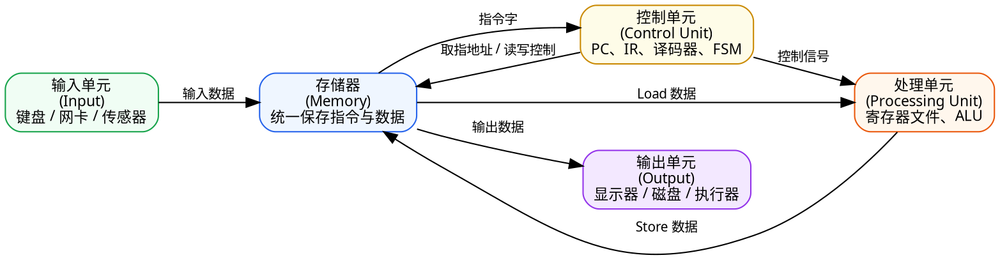

### 1.2 两大灵魂特征：“存储程序”与“顺序指令处理”

经典冯·诺依曼模型之所以能统治通用计算机近八十年，全靠两个极具天才色彩的设计特征：

1. **存储程序（Stored Program）**：
   早期的计算机靠人工插拔电线改电路来换程序；而冯·诺依曼提出，**把“指令（程序本身）”编码成二进制数字，和“数据”一视同仁地存放在同一块内存里**。于是计算机只需要读取不同的内存文件，就能瞬间变身成文字处理器、计算器或游戏机。

   > [!IMPORTANT] 核心推论
   > 内存里的某个比特模式（例如 `0x00100093`）本身并没有写着“我是指令”还是“我是数字 `1048723`”。**它究竟被解释为指令还是数据，完全取决于控制流程和使用它的操作。**（这一点我们会在第四章详细追踪硬件是如何区分的！）

2. **顺序指令处理（Sequential Instruction Processing）**：
   默认按程序书写的顺序“一次处理一条指令”：
   - 控制单元根据 **PC（程序计数器）** 里的地址，去内存取出一条指令放入 **IR（指令寄存器）**；
   - 默认让 **PC 自动递增**（比如 32 位定长指令下 `PC = PC + 4`），指向紧挨着的下一条指令；
   - 遇到分支（`if/else`）或跳转（函数调用 `call` / 循环 `jump`）指令时，直接改写 PC 的值，从而改变程序的控制流。

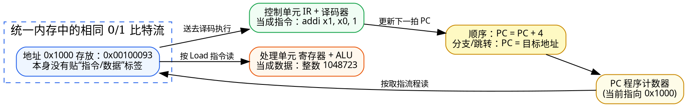

### 1.3 关键认知跃迁：“顺序语义” vs “微体系结构实现”

初学者在对比教材和现代 CPU 时，常常会迷糊：书上说计算机“一次处理一条指令”，可我听说现代 CPU 都有几十级**流水线（Pipeline，像工厂装配线一样把一条指令拆成取指、译码、执行、写回等阶段，多条指令重叠推进）**、**乱序执行（Out-of-Order Execution，后面的指令如果操作数准备好了，可以插队提前算）**、**推测执行（Speculative Execution，遇到 `if` 先猜一边往下算，猜错了再作废回滚）**，还有多核并行。这不是违背了顺序处理吗？

这里必须区分计算机体系结构中最重要的两个层次：

- **ISA 的可观察语义（Sequential Semantics）**：这是芯片承诺给软件的“契约”。无论芯片内部怎么狂飙突进、乱序插队，**最终写入寄存器和内存的结果，以及异常发生时的精确现场，必须表现得和“严格按程序顺序一条条执行”一模一样**。
- **微体系结构实现（Microarchitecture Implementation）**：这是芯片内部为了跑得快而采用的工程手段（流水线、乱序发射、分支预测、缓存预取等）。只要对外呈现的架构状态一致，内部物理上完全不必“等上一条彻底做完才启动下一条”。

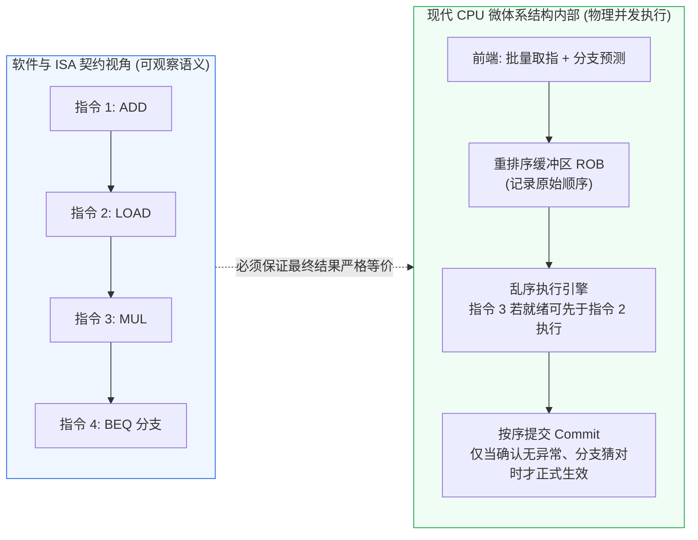

---

## 二、拨开迷雾：辨析“狭义冯·诺依曼瓶颈”与“广义存储墙（Memory Wall）”

理解了经典模型，我们就可以回答第一个核心疑惑：**所谓的“冯·诺依曼瓶颈”，到底是不是冯·诺依曼架构带来的？**

严谨的答案是：**狭义上是，但现代芯片语境里大家挂在嘴边的“冯·诺依曼瓶颈”，已经演变成了另一种不限于冯·诺依曼架构的物理难题。** 这个词在不同场合，其实指代两件深度耦合、但成因完全不同的事。

### 2.1 狭义层面：确实是经典冯·诺依曼架构直接带来的

1977 年，图灵奖得主 **John Backus**（Fortran 语言发明人、BNF 范式提出者）在他的著名图灵奖演讲 _《Can Programming Be Liberated from the von Neumann Style?》_ 中，正式提出了**“冯·诺依曼瓶颈（von Neumann Bottleneck）”**这个概念。他当时直指该架构最核心的两个设计特征：

1. **指令与数据共享存储和总线**：
   在经典模型里，CPU 和存储器之间只有**同一套共享总线通道**。这意味着“去内存取下一条指令（Fetch）”和“去内存读写操作数（Load / Store）”必须争抢同一条道路，无法在同一个时钟周期里并行完成。
2. **“逐字搬运（Word-at-a-Time）”的执行范式**：
   Backus 本人当时更痛批的是这种架构绑定的命令式编程模型——CPU 像一只不停衔泥的蚂蚁，把大量宝贵的时钟周期消耗在“通过一条窄窄的管子，把单个字（Word，例如 32 bit 或 64 bit）从内存拉进寄存器、算完一个小小步骤再推回内存”的往返循环里，真正用于逻辑变换的时间占比很低。

这一部分瓶颈，**确实是经典冯·诺依曼架构本身直接引入的**。下面这张对照图展示了“单共享总线排队”与“逐字搬运”究竟把时间浪费在了哪里：

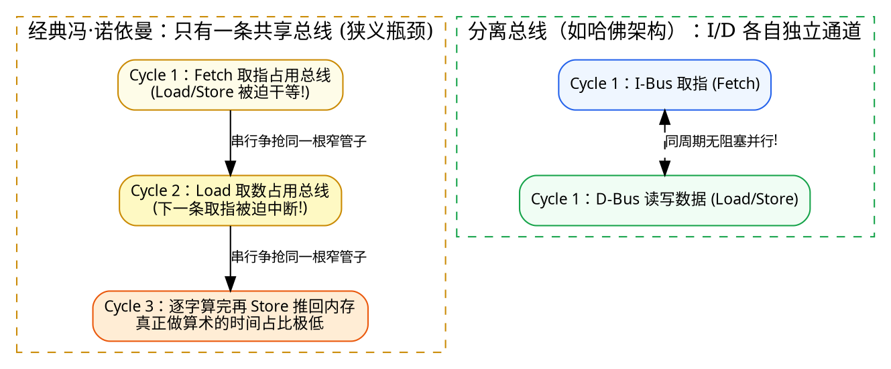

### 2.2 广义层面：本质是物理规律导致的“存储墙（Memory Wall）”

如果你把目光放到今天的芯片上，会发现现代处理器早已不是纯粹的经典冯·诺依曼架构了：

- 主流 CPU 的一级缓存（L1 Cache）早已改用**改进型哈佛架构**（指令缓存与数据缓存物理分离，下文第三章详述）；
- 现代 GPU（图形处理器）和 AI NPU（神经网络处理器）更是引入了拥有数千位超宽位宽的 **HBM（High Bandwidth Memory，高带宽内存）**、多级片上高速 SRAM，甚至出现了彻底去掉逐条取指的**数据流（Dataflow，把计算图直接映射成数据在计算阵列间流淌）架构**。

然而，哪怕已经拆分了指令和数据总线，哪怕不用冯·诺依曼取指模型，现代 AI 大芯片依然天天卡在“瓶颈”上。这是因为**只要计算单元（Logic）和主存储器（Memory）在物理上是分离的两块区域/两颗芯片**，不管是不是冯·诺依曼架构，都会一头撞上半导体物理演进带来的**存储墙（Memory Wall）**。

存储墙由两把越来越夸张的“剪刀差”构成：

1. **性能剪刀差（速度差越来越大）**：
   受益于晶体管微缩（摩尔定律），**CMOS 逻辑算力**几十年来呈指数级暴增；但片外 **DRAM 主存的访问延迟**和**芯片封装金属引脚（I/O Pin）的传输带宽**提升却极其缓慢。算力越狂暴，“数据喂不饱算力”的饥饿问题就越致命。
2. **能耗剪刀差（搬数据比算数据贵几百倍）**：
   在如今的先进制程（如 5nm / 7nm）下，算一次低精度乘加运算（MAC）消耗的能量**不到 1 pJ（皮焦，$10^{-12}$ 焦耳）**；但把同一个数据从片外 DRAM 内存条通过主板/封装走线搬运进芯片内部，消耗的能量往往是它的**数百倍甚至上千倍**！芯片大量的电费和发热，其实都花在了“运水”而不是“烧水”上。

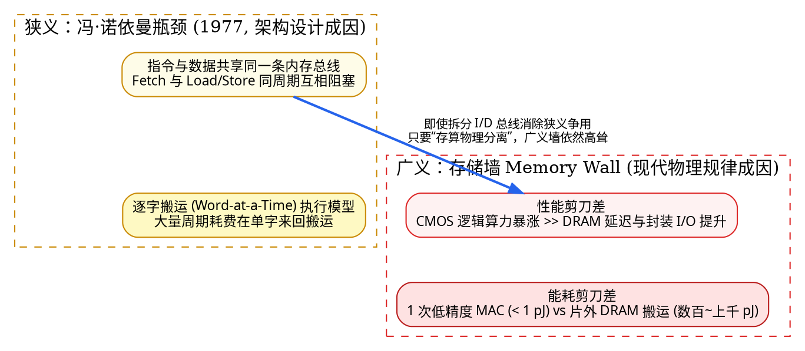

### 2.3 三大架构在两类瓶颈下的真实处境

| 架构类型                          | 指令与数据总线冲突（狭义瓶颈）                                   | 存算分离导致的存储墙（广义瓶颈）                             |
| :-------------------------------- | :--------------------------------------------------------------- | :----------------------------------------------------------- |
| **经典冯·诺依曼架构**             | **存在**（指令与数据共享总线与存储空间）                         | **存在**                                                     |
| **哈佛架构 / 现代 CPU、GPU、NPU** | **已大幅缓解或消除**（I/D 通路物理分离，或采用静态配置流式执行） | **依然存在**（受限于片外 DRAM 访存带宽与搬运功耗）           |
| **存算一体（CIM / PIM）**         | **不存在**                                                       | **试图从物理上打破**（直接在存储阵列内部或紧邻外围完成乘加） |

> [!TIP] 辨析金句：不要被口头禅误导
> 如果有人说“哈佛架构解决了冯·诺依曼瓶颈”，这句话**只在“消除指令与数据总线争用”的狭义定义下成立**。但在今天高性能计算和 AI 芯片的行业语境里，大家习惯把**所有“存算分离架构”面临的访存带宽上限与数据搬运功耗**，统称为“冯·诺依曼瓶颈”或“存储墙”。
>
> 要缓解这一层面的瓶颈，靠的不是简单把总线拆成两条，而是**系统与软硬件协同**：例如用 **HBM / 3D 硅通孔堆叠（近存计算）**、用编译器主导的**算子融合（Kernel Fusion）**与**片上 SRAM 分块极致复用（Tiling / Dataflow）**压低去片外 DRAM 的次数，或者走向更激进的**存算一体路线**。

---

## 三、CPU 的优雅妥协：L1 Cache 改进型哈佛架构如何实现性能提升？

既然经典冯·诺依曼有总线争抢问题，而纯**哈佛架构（Harvard Architecture，从物理内存到缓存彻底把指令存储器和数据存储器完全隔离成两套独立世界）**虽然没有总线冲突，却很难跑通用操作系统（我们马上解释原因），现代主流 CPU 便采用了一种极其聪明的折中方案——**改进型哈佛架构（Modified Harvard Architecture）**。

### 3.1 核心拓扑：“对内分离（哈佛），对外统一（冯·诺依曼）”

它的结构非常清晰：

- **对内（靠近执行流水线的 L1 一级缓存）**：物理上彻底拆分成 **L1 I-Cache（Instruction Cache，指令缓存）** 和 **L1 D-Cache（Data Cache，数据缓存）**，各自拥有独立的总线端口和电路。
- **对外（L2 / L3 二三级缓存及主存 DRAM）**：重新合并为**统一的地址空间和统一缓存**，指令和数据在其中一视同仁地存放。

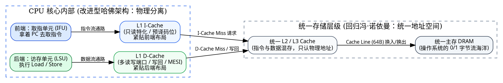

### 3.2 性能飞跃的四大微架构机制

把 L1 拆成 I-Cache 和 D-Cache，带来的收益绝不只是“带宽变成两倍”这么简单，而是触发了四个层面的深度微架构优化：

#### 机制一：消除流水线结构冒险（Structural Hazard），避免天价的多端口 SRAM

现代**超标量处理器（Superscalar CPU，每个时钟周期能同时发射并执行多条指令的处理器）**就像一条高速运转的流水线：

- **前端（Front-end）** 每个时钟周期都要从缓存里抓取多条指令；
- **后端（Back-end）** 几乎在同一个时钟周期里也在疯狂执行 `LOAD` / `STORE` 数据读写。

如果 L1 是统一的一整块内存，取指单元和访存单元就会在每个周期迎面相撞，引发**结构冒险（Structural Hazard）**，流水线只能停顿（Stall）让其中一方干等。
有人可能会问：“那我直接给那块统一的 L1 SRAM 多焊几组读写口（做成 **Multi-ported SRAM，多端口静态存储器**）不行吗？”
**物理代价极高！** 在 SRAM 电路里，每增加一个读写端口，每个存储比特单元就需要额外增加好几个晶体管和成倍的金属字线/位线，导致**硅片面积呈平方级膨胀、静态漏电功耗飙升、访问延迟大幅变慢**。拆成独立的 L1I 和 L1D 后，两块小而美的单/双端口 SRAM 各自独占一条物理高速公路，既不用造昂贵的多端口巨无霸，又实现了取指与访存的**零阻塞同周期并行**。

#### 机制二：针对指令与数据特征做极致硬件特化（Specialization）

指令流和数据流的性格截然不同。以前合在一个 L1 里只能互相将就，拆开后芯片设计师可以为它们量身定制两套完全不同的电路：

| 对比维度           | L1 I-Cache（指令缓存）                                                                                                                     | L1 D-Cache（数据缓存）                                                                                                             |
| :----------------- | :----------------------------------------------------------------------------------------------------------------------------------------- | :--------------------------------------------------------------------------------------------------------------------------------- |
| **读写属性**       | **几乎只读**：运行期不需要写端口，不需要记录是否被改写过的**脏位（Dirty Bit）**，也无需写回状态机，电路极其精简省电。                      | **高频读写**：必须支持多个并发 Load/Store 端口、**写回（Write-back）**策略，以及用于加速写后读的**写缓冲区（Store Buffer）**转发。 |
| **缓存一致性**     | **逻辑极简**：多核环境下大部分时间根本不用响应其他核心的“写失效嗅探（Snooping）”。                                                         | **极其复杂**：必须完整实现 **MESI / MOESI** 等多核缓存一致性协议，防止多核同时改同一份数据出错。                                   |
| **微架构附带功能** | 可顺便附带存储**预译码位（Pre-decode bits）**（如帮 x86 提前标出变长指令的边界），并与**分支预测器（Branch Predictor）**联动做跨跳转预取。 | 需支持**非对齐访存**、**Bank 冲突规避（把内存切分成多个独立小块 Bank 并行读写）**以及基于固定步长（Stride）的复杂数据预取。        |
| **访问粒度**       | 总是按**宽取指块**（如每周期连续读 16B~64B）顺序拉取。                                                                                     | 访问粒度**高度碎片化**（从 1 字节的 `char` 到 64 字节的 SIMD 向量寄存器不等）。                                                    |

#### 机制三：隔离工作集，防止缓存互相污染（Cache Thrashing）

一段程序的**热点循环代码（Hot Loop）**往往体积很小（比如几 KB），会在几百万次循环里被反复执行，具有极强的**时间局部性**；但与此同时，这段循环可能正在扫描一个 100MB 的大数组或做矩阵运算（**流式大数据**）。
如果指令和数据挤在同一个 L1 里，海量涌入的数组数据会像洪水一样瞬间把原本稳稳待在 L1 里的循环代码冲刷踢出（**Cache Thrashing，缓存抖动/污染**），导致 CPU 前端突然触发 **I-Cache Miss（指令缓存未命中）** 而直接断流！物理分离之后，哪怕数据侧在疯狂“洗劫” L1 D-Cache，核心循环代码依然安如磐石地躺在 L1 I-Cache 里。

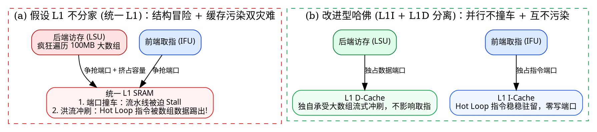

#### 机制四：缩短芯片物理走线延迟（Floorplan 物理布局优化）

在今天几 GHz 主频的先进制程下，电信号在芯片内部**细如发丝的铜互连线（Metal Wire）**上跑的时间，往往比逻辑门开关本身还慢！
拆成两块小缓存后，芯片后端工程师在画版图（Floorplan）时，可以直接把 **L1 I-Cache 贴着前端（取指、译码、分支预测器）**摆，把 **L1 D-Cache 贴着后端（访存单元 LSU、地址生成单元与计算执行阵列）**摆。最大限度缩短关键路径的物理线长，才能死死保住 L1 仅仅 **3~5 个时钟周期**的极致命中延迟。

### 3.3 为什么不在 L2/L3 也分到底？合并的权衡与代价

既然分离这么好，为什么主内存和 L2/L3 Cache 又合回冯·诺依曼的统一地址空间呢？
因为现代通用软件生态完全建立在**“代码本身就是数据”**的基石之上：

- 操作系统把硬盘上的 `.exe` / `ELF` 可执行文件加载到内存时，本质上是在**“写入数据”**；
- 动态链接库加载、以及 Java / JavaScript / Python / AI 编译器里的 **JIT（即时编译）**，都是在运行期像生成普通数据一样，往内存里拼出一段新的二进制机器码，紧接着就跳过去当指令执行。
- 此外，有些程序代码很大、数据很少，有些则代码很少、数据海量；L2/L3 保持统一，可以让指令和数据**按需动态共享大容量空间**，避免“指令区空着、数据区挤爆”的浪费。

> [!WARNING] “改进型”留下的经典副作用：I/D 缓存一致性难题
> “L1 分离、L2 统一”虽然兼顾了性能和通用性，却留下了一个经典的软硬件边界坑——**自修改代码（Self-Modifying Code, SMC）或 JIT 编译时的 I/D 缓存不同步**。
>
> 当程序动态生成新机器码时，数据是先写进 **L1 D-Cache** 的；如果此时 **L1 I-Cache** 里还残留着同一物理地址的“旧指令副本”，CPU 跳转过去就会执行到过期指令！
>
> - **x86 架构**：为了兼容历史包袱，用极其复杂的**硬件嗅探电路**在后端写入命中 I-Cache 地址时自动作废旧指令缓存，对程序员透明；
> - **ARM 与 RISC-V 架构**：把电路做简做省，将同步责任交给操作系统和编译器——写入新代码后，软件必须先刷出 D-Cache，再显式执行同步指令（例如 RISC-V 的 **`fence.i`**，或 ARM 的 **`IC IVAU` + `ISB`**）来通知 I-Cache 刷新指令流。

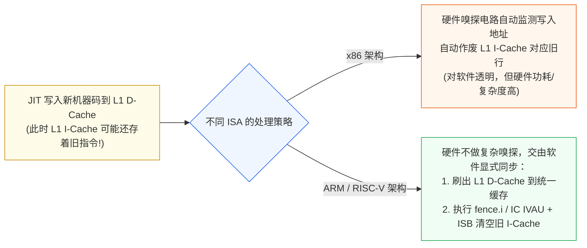

---

## 四、底层大揭秘：OS 层全是一样的二进制，CPU 凭什么分清指令与数据？

顺着上一章自然会引出一个极其本质的问题：**既然在操作系统和内存条眼里，指令和数据全都是长相一模一样的 `0` 和 `1` 二进制，甚至同一个十六进制数 `0x00100093` 既可以是 RISC-V 指令 `addi x1, x0, 1`，也可以是一个普通的整数 `1048723`——那么改进型哈佛架构的 L1 Cache 到底是怎么分出谁该进 I-Cache、谁该进 D-Cache 的？**

答案可能会打破很多初学者的第一直觉：**CPU 根本不是通过“解析二进制内容长什么样”来区分的，而是通过“物理上是谁发起了这次访存请求”来硬区分的！**

进入 CPU 内部后，硬件与操作系统通过**三层机制**严密配合，完成了这条分流流水线：

### 4.1 第一层（核心机制）：硬件通路硬连线——只看“谁发的请求”

在 CPU 硅片内部，有两套**完全独立、物理走线绝不交叉**的引擎负责向内存伸手：

1. **发往 L1 I-Cache 的唯一主人：取指单元（IFU, Instruction Fetch Unit）**
   位于流水线最前端的 IFU 只干一件事——拿着 **PC（程序计数器）** 里的地址，去拉取下一批要执行的机器码。这条请求的物理铜线**在电路设计之初就焊死直通 L1 I-Cache**，它压根不知道 L1 D-Cache 在哪。
2. **发往 L1 D-Cache 的唯一主人：访存单元（LSU, Load-Store Unit）**
   位于流水线后端的 LSU 负责执行 `LOAD` / `STORE` 类指令，根据寄存器基址加上偏移量算出有效地址去读写操作数。这条请求的物理走线**焊死直通 L1 D-Cache**，永远不会去查 L1 I-Cache。

> [!NOTE] 一个极反直觉的事实：同一份二进制可以同时躺在 I-Cache 和 D-Cache 里！
> 正因为硬件区分的依据是**“发起请求的部件”**而非**“二进制内容本身”**，同一个物理地址对应的同一份 64 字节二进制，**完全允许同时存在于 L1 I-Cache 和 L1 D-Cache 中**！
> 比如：当程序用 `memcpy` 复制一段函数代码、调试器（如 GDB）读取某条指令的机器码字节以打断点、或者 CPU 读取编译器悄悄塞在 `.text` 代码段里的常量池（Literal Pool）时——IFU 会把这段字节拉进 L1 I-Cache 当指令，LSU 也会把同一地址的这段字节拉进 L1 D-Cache 当数据！

### 4.2 第二层：操作系统与 MMU 的配合——页表权限检查（W^X 与 iTLB/dTLB）

虽然操作系统不会在内存条里给每个字节贴“指令/数据”标签，但它在加载可执行文件（如 Linux 的 `ELF` 或 Windows 的 `PE`）时，会在 **MMU（内存管理单元）** 所依赖的**页表项（PTE, Page Table Entry）**里，按内存页（通常 4KB 一页）设置严格的**访问权限位（R / W / X）**，现代系统普遍遵循 **W^X（Write XOR Execute，可写与可执行互斥）** 安全原则：

- **代码段（`.text`）**：标记为 **`R + X`（可读、可执行，不可写）**；
- **数据段 / 堆（Heap）/ 栈（Stack）**：标记为 **`R + W`（可读、可写，不可执行**，如 x86 上的 **NX/XD** 不可执行位）。

并且，为了不让前端和后端在查地址翻译时撞车，CPU 内部连 **TLB（页表缓存）** 也是分成 **iTLB（指令 TLB）** 和 **dTLB（数据 TLB）** 两份的，权限校验直接焊在各自的硬件通路上：

| 对比维度            | 指令通路（IFU $\rightarrow$ L1 I-Cache）                                                                                    | 数据通路（LSU $\rightarrow$ L1 D-Cache）                                                                        |
| :------------------ | :-------------------------------------------------------------------------------------------------------------------------- | :-------------------------------------------------------------------------------------------------------------- |
| **地址来源**        | PC 寄存器 / 分支预测器                                                                                                      | `LOAD` / `STORE` 指令计算出的有效地址                                                                           |
| **地址翻译与校验**  | 查 **iTLB**，硬件强制校验页表的 **`X`（可执行）** 权限位                                                                    | 查 **dTLB**，硬件校验页表的 **`R`（读）/ `W`（写）** 权限位                                                     |
| **越权拦截后果**    | 若 PC 跳到了只有 `R+W` 而没有 `X` 权限的栈区/数据区，**MMU 直接触发页错误（Page Fault）异常**，请求被拦截在 L1 I-Cache 门外 | 若程序试图往只有 `R+X` 而没有 `W` 权限的代码段写入数据，MMU 同样触发 **Page Fault** 拦截（引发段错误 Segfault） |
| **L1 未命中后行为** | 把物理地址发给统一的 L2 Cache 请求拉回 64B 内存行                                                                           | 把物理地址发给统一的 L2 Cache 请求拉回 64B 内存行                                                               |

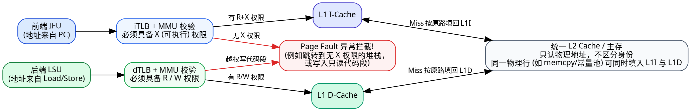

### 4.3 第三层：L2 Cache 与主存的视角——只认物理地址，不认身份

当 L1 I-Cache 或 L1 D-Cache 发生未命中（Miss）时，它们都会把翻译好的**物理地址**发给下游**统一的 L2 Cache**。
L2 Cache 和主存 DRAM **完全不在乎**这 64 字节里装的究竟是 RISC-V 指令、浮点数还是 UTF-8 字符串，它们只负责根据物理地址把原封不动的二进制搬回来——**请求当初是从哪根总线发过来的，返回的数据就填回哪边的 L1 Cache！**

下面这张时序图完整演示了 **JIT 编译器或操作系统加载器** 如何让同一串二进制完成“先作为数据写入 $\rightarrow$ 再作为指令执行”的身份切换：

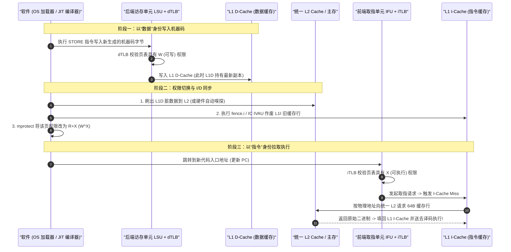

---

## 五、扒开营销外衣：市面上真正量产售卖的“存算一体”芯片到底是什么？

前面我们看到，无论是改进型哈佛架构，还是多级缓存和超宽 HBM，本质上都还在“计算单元和存储单元物理分离”的圈子里打转。为了彻底打破第二章提到的**“广义存储墙”**，产业界把目光投向了**存算一体（CIM / PIM）**。

但很多初学者受科普文章影响，以为市面上卖的“存算一体芯片”就是那种“用新型忆阻器造出来、彻底取代 CPU/GPU 和内存条的类脑万能芯片”。**事实完全不是这样。**

“存算一体”在如今的半导体商业宣传中，其实是一个很宽泛的大筐。如果扒开宣传外壳看底层电路和微架构，目前市面上**真正量产并商业售卖**的产品，本质上分属**三条截然不同的技术路线**，而且每条路线都做了极其务实的工程妥协：

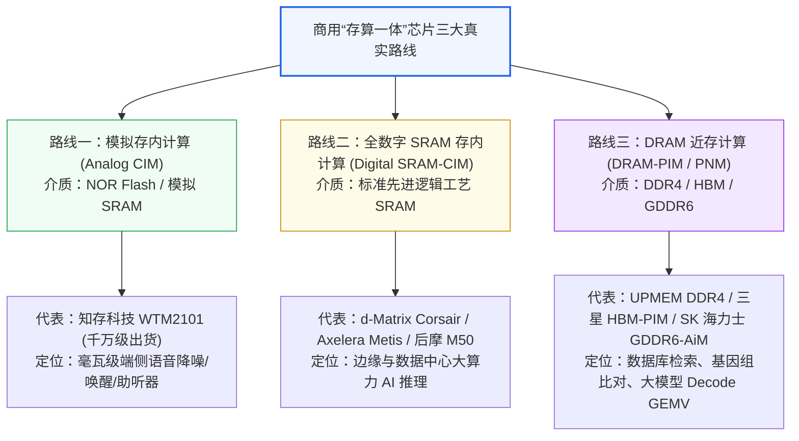

### 5.1 路线一：模拟存内计算（Analog CIM）——最像教科书定义，但只活在超低功耗端侧

这是物理原理上最纯粹的“存算融合”。目前真正大规模商用出货的，主要基于极其成熟的 **NOR Flash（或非闪存）** 或定制模拟 SRAM 阵列：

- **底层物理原理**：
  神经网络的**权重**以**电导（电阻倒数 / 晶体管阈值电压）**的形式，直接静态存在存储阵列交叉点上；输入特征通过 **DAC（数模转换器）** 变成模拟电压打在横着的**字线（Wordline）**上。
  接下来完全不需要任何数字乘法器和加法器——直接利用初中物理的**欧姆定律（电流 = 电压 $\times$ 电导，$I_i = V_i \cdot G_i$）**做乘法，再利用**基尔霍夫电流定律（多条支路汇入同一根线，电流自动相加，$I_{\text{sum}} = \sum V_i G_i$）**，竖着的**位线（Bitline）**上自然汇集出来的电流总和，就是一次完整的**矩阵乘加（MAC）**结果！最后再由 **ADC（模数转换器）** 把模拟电流转回数字信号即可。

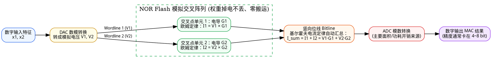

- **市面上真正卖出去的产品**：
  最典型的是国内**知存科技的 WTM2101**（基于 NOR Flash），累计出货量已超过千万颗，广泛用在 TWS 蓝牙耳机的 AI 语音降噪、语音唤醒、智能助听器等**毫瓦级（mW）**超低功耗端侧设备中；其后续的 WTM-8 系列也开始向端侧视觉场景延伸。
- **工程真相与边界**：
  - **优势**：**极致的能效比**（Flash 权重掉电不丢，计算时权重纹丝不动、零搬运，且不依赖台积电 3nm/5nm 等昂贵先进制程）。
  - **硬伤**：模拟电路天生脆弱，极易受芯片制造的**工艺偏差（Process）、供电电压波动（Voltage）和环境温度变化（Temperature）**——合称 **PVT 漂移**——以及热噪声干扰，导致有效计算精度普遍卡在 **4~8 bit**；更致命的是，**外围 ADC/DAC 转换器占用的芯片面积和功耗开销往往比存储阵列本身还大**，且 Flash 擦写极慢、寿命有限。因此它几乎只能跑“权重固定不变、参数规模很小”的端侧小模型，很难直接扩展到通用大算力大模型场景。

### 5.2 路线二：全数字 SRAM 存内计算（Digital SRAM-CIM / DIMC）——大算力 AI 推理的商用主力

如果你在新闻里看到某家公司宣称“存算一体芯片能跑大语言模型、算力上百 TOPS（每秒万亿次运算）、已经出货给边缘计算盒或数据中心”，**十有八九都是这一类**。

- **底层物理原理**：
  彻底放弃脆弱的模拟电流计算，老老实实用台积电等主流晶圆厂的**标准先进逻辑工艺**，在 **SRAM 存储单元内部或紧邻外围，直接集成数字逻辑门（例如与门 AND / 或非门 NOR + 数字加法树 Adder Tree）**，通常配合**比特串行（Bit-serial，把一个 8-bit 输入拆成 8 个时钟周期，逐位送入做逻辑乘并移位累加）**的方式完成高精度乘加。
- **市面上真正卖出去的产品**：
  - **d-Matrix（Corsair）**：海外数据中心级数字存内计算推理卡代表，2026 年已全面量产并向云厂商交付集群，主打大模型推理（尤其是极度吃内存带宽的 **Decode 逐词生成阶段**）。
  - **Axelera AI（Metis / Europa）**：欧洲明星 AI 芯片厂商，基于数字存内计算（D-IMC），已拥有超过 600 家商业客户落地，覆盖边缘加速卡与服务器板卡。
  - **后摩智能（鸿途系列 / M50）**：国内大算力 SRAM 数字存算代表，其 M50 芯片于 2026 年初量产，主打 10W 级功耗下 160 TOPS 算力的端侧/边缘大模型推理。
- **工程真相与边界**：
  - **优势**：完全没有 ADC/DAC 拖累，**数字域计算精度无损**（原汁原味支持 INT4 / INT8 / FP8 / BF16 等标准格式），抗干扰能力极强，编译工具链也更容易复用现有 AI 编译器栈。
  - **最大现实瓶颈——SRAM 的容量与造价**：SRAM 单元由 6~12 个晶体管构成，单位面积极大、造价极贵。单颗芯片的片上 SRAM 撑死也就几十到几百 MB，根本塞不下几十上百 B（百亿级）参数的大模型。所以厂商要么像 d-Matrix 那样靠多芯粒（Chiplet）/多卡集群把权重平铺在海量片上 SRAM 里，要么还是得在芯片外挂 LPDDR / DRAM 分层倒腾权重——**一旦数据仍需频繁从片外 DRAM 搬进片上，片外的“存储墙”其实依然存在**，只是芯片内部的权重搬运功耗被压到了极低。
  - 在芯片架构圈内一直有个清醒的认知：**全数字 SRAM-CIM** 与 **“把片上 SRAM 极度切碎、紧贴脉动阵列（Systolic Array）摆放的传统近存 NPU”** 之间，物理界限其实已经非常模糊。

### 5.3 路线三：DRAM 近存计算（DRAM-PIM / PNM）——内存厂在内存条/颗粒里“塞算核”

严格来说，这一类在学术和工程上叫**近存计算（Processing-Near-Memory, PNM）**，不是在存储电容内部算，而是内存厂商直接在 DRAM 颗粒内部每一个**存储库（Bank，DRAM 芯片内部彼此独立的二维存储子阵列）**旁边焊上极简的计算单元，绕开内存颗粒到 CPU/GPU 之间那条窄窄的外部 I/O 引脚。

- **市面上真正卖出去/交付的产品**：
  - **UPMEM**（2025 年已被高通收购）：全球最早真正商用售卖的 DRAM-PIM 产品，直接做成标准的 DDR4 内存条插在普通服务器主板上。每 64MB 的 DRAM Bank 旁边放一个 32-bit 精简 RISC 处理器（称为 DPU），专门加速数据库检索、基因组比对、图计算等“几乎不怎么算、光在海量数据里翻找”的纯访存密集型任务。
  - **三星（HBM-PIM / Aquabolt-XL）与 SK 海力士（GDDR6-AiM）**：直接在 HBM 或 GDDR6 内存颗粒的 Bank 旁塞入支持 FP16/BF16 的乘加单元，专门加速大模型推理中访存极重、算力极轻的**矩阵向量乘（GEMV）**。不过这两家目前更多停留在与大客户定制验证和特定原型加速卡阶段，尚未成为大规模通用零售品。
- **工程真相与边界**：
  - **算力极弱**：DRAM 制造工艺是为了做高密度电容优化的，用这种工艺顺便造出来的逻辑晶体管速度很慢、金属连线层极少，绝对干不了重度计算。
  - **软件与编译生态极痛苦**：不同 Bank 之间在物理上几乎没法直接高速通信，数据在内存里的排布（Memory Layout）必须死死对齐硬件 Bank 结构；稍微换个非标准算子或者遇到动态变化的张量形状（Dynamic Shape），性能就会断崖式下跌。

### 5.4 三大商用路线全景总结表与两个隐藏事实

| 商业路线          | 存储介质              | 核心计算方式                            | 典型商用代表                              | 真实工程定位与局限                                                                         |
| :---------------- | :-------------------- | :-------------------------------------- | :---------------------------------------- | :----------------------------------------------------------------------------------------- |
| **模拟存内计算**  | NOR Flash / 模拟 SRAM | 欧姆定律 + 基尔霍夫电流定律（模拟电流） | 知存科技 WTM2101                          | 最“纯正”的存算，千万级出货；但受限于 PVT 精度与 ADC，局限于毫瓦级端侧小模型。              |
| **数字存内计算**  | 标准逻辑工艺 SRAM     | 单元内/旁数字逻辑门 + 加法树            | d-Matrix Corsair、Axelera Metis、后摩 M50 | 大算力商用主力，数字精度无损、易量产；但片上 SRAM 贵且小，大模型仍受制于容量墙或片外带宽。 |
| **DRAM 近存计算** | DDR4 / HBM / GDDR6    | Bank 旁放小型 SIMD ALU 或精简 RISC 核   | UPMEM、三星 HBM-PIM、SK 海力士 AiM        | 专治极度访存受限（Memory-bound）算子（如 GEMV/检索）；但算力弱、编程与编译生态痛苦。       |

> [!IMPORTANT] 读懂“存算一体”新闻时最容易被忽略的两个事实
>
> 1. **没有任何一颗商用芯片是“全芯片存算一体”的**：芯片里只有最核心的矩阵乘加引擎（CIM Macro）采用了存算一体电路；像 **Softmax、LayerNorm、激活函数（GELU/SiLU）、控制流调度、片上互连网络（NoC）以及数据搬运引擎（DMA）**，依然是百分百传统的数字 CMOS 逻辑电路。
> 2. **学术界最火的新型非易失存储器尚未成为大算力商用主角**：例如 **RRAM（阻变存储器）**、**MRAM（磁性随机存储器）**、**PCM（相变存储器）** 虽然论文满天飞，但目前仍在攻克良率、器件一致性、擦写寿命和代工厂工艺成熟度问题。市面上真正能大规模买来直接跑业务的商用芯片，几乎都绕开了它们，选择了更务实的 **NOR Flash（端侧小算力）** 与 **数字 SRAM（大算力）**。

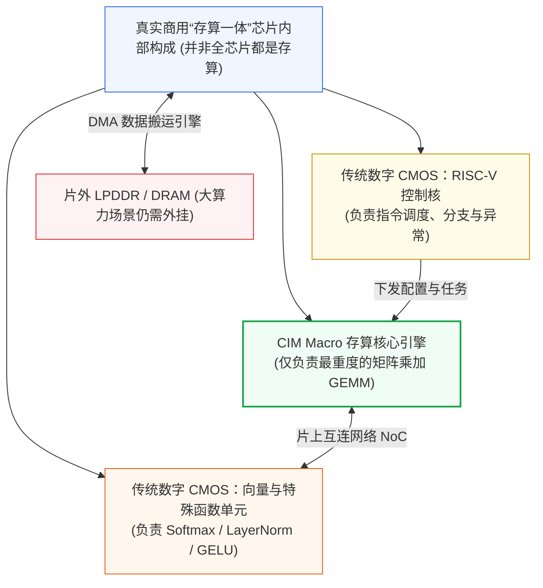

---

## 六、终极追问：数字 SRAM-CIM 和 DRAM-PIM 不都是把计算放 RAM 旁吗，本质区别在哪？

很多聪明的初学者看到第五章时，都会产生一个非常犀利的追问：

> _“全数字 SRAM-CIM 是在 SRAM 阵列单元内部或紧邻外围放数字逻辑门；DRAM-PIM 是在 DRAM 的 Bank 旁边放小型 ALU 或 RISC 核。它们不都是把逻辑电路放在 RAM 旁边吗？到底有什么本质区别？”_

答案是：**在物理耦合粒度、芯片制造工艺、解决的瓶颈层级，以及最终的硬件物种定位上，这两者根本不是同一个东西！**

我们可以先通过下面这张微架构对比图，直观俯瞰两者在硅片电路上的巨大差异：

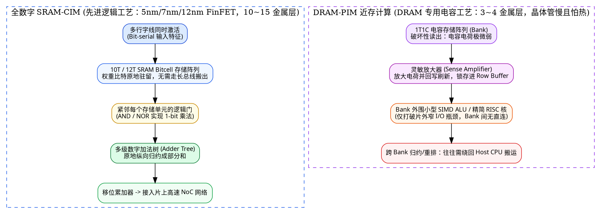

结合这张微架构解剖图，两者的本质鸿沟体现在以下**四个维度**：

### 6.1 耦合粒度与读出机制：比特单元级“原地归约” vs Bank 级“读出再算”

这是架构上最根本的差异：

- **数字 SRAM-CIM（细粒度，Bitcell / Sub-array 级）**：
  传统 SRAM 每次读操作只能激活一行字线，通过读出放大器和多路选择器把数据一路送到阵列外。数字 SRAM-CIM 直接改造了存储单元电路（例如把标准 6 晶体管 `6T` 改成 `10T` 或 `12T`），在每个或每组存储单元紧邻位置直接嵌入与门/或非门，并允许**多行字线同时激活**。权重比特根本不需要沿着数据总线搬出阵列，在本地做完 1-bit 逻辑乘后，立刻进入紧挨着的加法树归约成部分和。**它打破的是“存储阵列内部按行串行读取的带宽限制”。**
- **DRAM-PIM（粗粒度，Bank 级）**：
  DRAM 的每个比特单元是 **1T1C（1 个晶体管 + 1 个小电容）**，物理上属于**破坏性读出（Destructive Read）**——小电容里存的电荷极其微弱，一旦接通读出，电容里的电荷瞬间就漏光了！因此它**必须**先由灵敏放大器（Sense Amplifier）把微弱电荷放大并锁存到**行缓冲器（Row Buffer）**里，同时反手把电荷回写进电容以防数据丢失。
  正因这一物理铁律，根本不可能在 DRAM 电容单元内部嵌逻辑门，只能在 **Bank 最外围的 Row Buffer 之后**挂一个小型 SIMD ALU 或精简核。数据依然老老实实走传统的行/列读出流程，**它打破的是“芯片内部几十个 Bank 必须排队挤通过几根窄窄的片外 I/O 引脚”的外部带宽墙。**

### 6.2 制造工艺的物理鸿沟：先进逻辑工艺 vs DRAM 电容工艺

“在 SRAM 旁放逻辑门”和“在 DRAM 旁放 ALU”在晶圆厂里属于两个几乎完全不兼容的物理世界：

- **数字 SRAM-CIM 跑在标准先进逻辑工艺上（如台积电 5nm / 7nm / 12nm FinFET）**：
  逻辑晶体管开关速度极快、金属互连布线层多达 **10~15 层**，立体布线极其自由。芯片架构师可以毫无顾忌地在阵列旁堆叠高频、深层数的加法树，并且把 CIM 阵列和片上高速互连网络（NoC）、DMA、控制核无缝集成在同一颗芯片（Die）上。
- **DRAM-PIM 必须跑在 DRAM 专用工艺上**：
  DRAM 产线是为了把深沟槽/堆叠电容做得极密、漏电做得极低而高度特化的。在这种工艺下顺手造出来的逻辑晶体管**开关速度很慢**，而且金属布线层通常只有 **3~4 层**，根本布不出复杂的算术树和全局片内网络！更麻烦的是，DRAM 对温度极其敏感——**高温会成倍加速电容漏电，导致内存必须更频繁地停下来刷新保命，可用带宽反而暴跌**。因此塞进 DRAM 里的计算单元必须极其精简、低频、低功耗。

### 6.3 解决的瓶颈层级与容量量级：片内算力密度 vs 片外大容量聚合带宽

我们先引入一个重要指标——**算术强度（Arithmetic Intensity, AI）**，也就是“平均每从内存搬运 1 字节数据，芯片能做多少次算术运算（FLOPs/Byte）”：

- **GEMM（通用矩阵乘法，矩阵 $\times$ 矩阵）**：算术强度极高，同一个数据拿进来会被反复复用几十上百次（如大模型推理的 **Prefill 提示词首字处理阶段**）。
- **GEMV（矩阵向量乘，矩阵 $\times$ 向量）**：算术强度极低，整个庞大矩阵里的权重读进来**只用一次**就扔掉了（如大模型推理的 **Decode 逐词生成阶段**），属于极度受限于访存带宽的 **Memory-bound** 任务。

看清这个区分后，两者的定位一目了然：

- **数字 SRAM-CIM**：容量极小（MB 级），造价极贵。它的真实定位是**替代传统 NPU 里的脉动阵列**，拼的是极致的**算力密度（TOPS/mm²）**和片内计算能效比（TOPS/W），擅长高算术强度的矩阵乘。一旦模型大于片上 SRAM，片外访存墙依然存在。
- **DRAM-PIM**：天生自带 **GB 级超大存储容量**，可以直接把整个百亿参数模型装在内存芯片里。它不追求很高的绝对算力，而是通过让内部几十上百个 Bank **同时就近开算**，把颗粒内部的聚合带宽放大数倍到十倍，专治算术强度极低的 **GEMV、向量检索、图遍历**等纯访存型苦力活。

### 6.4 互连拓扑与编译模型：片上计算宏 vs 分布式孤岛内存

- **数字 SRAM-CIM**：对编译器和运行时来说，它本质上就是一个**高度特化的片上矩阵乘加引擎（CIM Macro）**。芯片上有高速片上互连网络（NoC），依然可以流畅套用成熟的**权重驻留（Weight Stationary）**、**分块切分（Tiling）**和片上数据流调度。
- **DRAM-PIM**：由于布线层少、面积寸土寸金，**不同 Bank 之间几乎没有直接的高速互连通路**。每个 Bank 旁的算核更像是一座座孤岛。一旦遇到需要跨 Bank 汇总归约（Reduce）或改变张量排布（Layout Transpose）的操作，往往必须绕回宿主机 CPU 搬运，代价极高；且数据的物理排布必须死死对齐硬件 Bank 与 Row 的映射关系，编程和编译约束极其苛刻。

### 6.5 四维终极对比表

| 对比维度         | 数字 SRAM-CIM（存内计算）                             | DRAM-PIM（近存计算）                                 |
| :--------------- | :---------------------------------------------------- | :--------------------------------------------------- |
| **物理耦合层级** | **Bitcell / Sub-array 级**（单元内嵌逻辑门 + 加法树） | **Bank 级**（Row Buffer 外围挂小型 ALU / 精简核）    |
| **打破的瓶颈**   | 片内存储阵列读出带宽 & 权重搬运能耗                   | 内存颗粒/堆栈到主芯片之间的片外 I/O 引脚带宽         |
| **晶圆制造工艺** | 先进逻辑工艺（晶体管快、10~15 金属层）                | DRAM 专用工艺（晶体管慢、3~4 金属层、怕热）          |
| **存储容量量级** | **MB 级**（造价极贵、容量小）                         | **GB 级**（造价便宜、容量大）                        |
| **算力特征**     | 极高算力密度，适合高算术强度 **GEMM**                 | 算力弱但聚合带宽极高，适合低算术强度 **GEMV / 检索** |
| **硬件真实本质** | **把片上存储改造成高能效 NPU 计算阵列**               | **在内存条 / HBM 颗粒里塞入微型协处理器**            |

> [!TIP] 一句话剥离营销话术，穿透硬件本质
>
> - **数字 SRAM-CIM 本质上是“长得像存储器的计算芯片”**：它是在算力芯片（Compute Die）内部做极致的微架构能效优化；
> - **DRAM-PIM 本质上是“长了一点算力的内存芯片”**：它是在主存侧（Memory Die）做近场数据过滤和带宽卸载。
>
> 两者解决的压根不是同一层的问题，在未来的异构计算系统里，它们非但不是竞争死敌，反而可能是**上下游互补的黄金搭档**（例如 DRAM-PIM 负责近场过滤/Decode GEMV，数字 SRAM-CIM 负责高密度 Prefill GEMM）。

---

## 七、数据流架构的边界：消灭了狭义瓶颈，为何仍撞存储墙且不“完全固化”？

前面几章我们把视角从冯·诺依曼拉到了哈佛缓存和存算一体。在 AI 与专用加速芯片领域，还有一条极其重要的赛道叫**数据流架构（Dataflow Architecture）**——比如很多前沿的 **CGRA（Coarse-Grained Reconfigurable Architecture，粗粒度可重构架构）** 和数据流 NPU。

很多初学者看到“数据流彻底去掉了 PC 指针逐条取指”时，会产生两个美好幻想：

1. “既然不取指、算子之间直连传递，那数据流架构是不是彻底消灭了冯·诺依曼瓶颈？”
2. “既然把计算图直接映射成硬件连线，为什么不干脆把整个神经网络在芯片上完全焊死固化？”

现实工程告诉我们：**数据流架构确实消灭了“狭义的冯·诺依曼瓶颈”（逐条取指译码、指令与数据争抢总线、中间结果频繁往返寄存器堆和主存），但它依然逃不开广义的“存储墙”；同时，现实中几乎所有商用数据流芯片都不是“完全固化计算”，而是可重构数据流（空间映射 + 粗粒度时分复用）。**

### 7.1 为什么数据流架构依然存在广义的“存储墙”？

数据流架构的核心思想是把**“指令驱动”**改成了**“数据驱动”**：一旦通路配置好，数据就像工厂流水线上的工件一样，在一个个 **PE（Processing Element，片上基本计算单元）** 之间通过直连网线逐站流过，中间结果不需要写回主存，彻底省掉了每周期取指的控制开销。

但它依然没有改变**计算逻辑与大容量主存（DRAM / HBM）在物理上分离**的铁律，因此在以下三个关口依然会撞上存储墙：

1. **片上 SRAM 容量墙与数据溢出（Spilling）**：
   现代数据流芯片的片上 SRAM 通常在几十 MB 到几百 MB 量级，装不下动辄几十 GB 的大语言模型权重或超高分辨率特征图。只要权重、输入数据或片上放不下的中间激活值需要发生 **Spilling（溢出回写，即暂存回外部内存）**，通过 **DMA（Direct Memory Access，直接内存访问，不经 CPU 插手、专门负责成批搬运数据的硬件搬运工）** 从片外 DRAM/HBM 往里搬，片外引脚带宽和搬运能耗就依然是硬天花板。
2. **低算术强度任务下的流水线“断流”与反压**：
   数据流架构靠“数据一到就触发计算”维持高利用率。可一旦遇到极度访存受限（Memory-bound）的算子（例如大模型 Decode 逐词生成阶段的矩阵向量乘 GEMV，每搬一个权重只做一次乘加），片外内存“喂数据”的速度远跟不上片上 PE 阵列的消化速度——整条数据流管线要么因上游断供而“饿死”，要么因下游写回拥堵触发硬件**反压（Backpressure，下游来不及接收数据时，向上游发出暂停发送信号）**，导致大片 PE 空转。
3. **跨层融合的物理上限**：
   数据流最理想的状态是把整个模型融合成一条永不落盘的片上流水线。但在实际网络拓扑中，一旦遇到超长距离的**残差连接（Residual Skip Connection，把很多层之前的原始特征保留下来和后面相加）**或超大尺寸中间张量，片上缓冲区直接被撑爆，数据就必须退回片外 DRAM 中转，广义访存瓶颈立刻卷土重来。

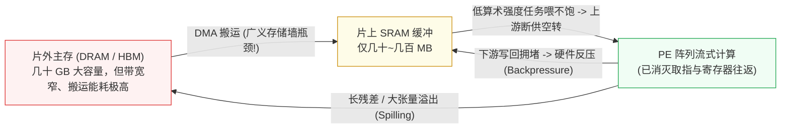

### 7.2 为什么数据流架构没有做成“完全的计算固化”？

把计算逻辑**完全固化**在硅片晶体管连线上，在硬件界叫 **Fixed-Function ASIC（固定功能专用电路）**——典型代表是手机里的 H.264/HEVC 视频硬解码器，或者纯粹只算单一哈希算法的比特币矿机。它确实零指令开销、能效比登峰造极，但商用数据流芯片刻意没有走到那一步，原因有三个冷酷的现实约束：

1. **硅片面积装不下整张计算图（必须时分复用）**：
   现代神经网络动辄几百层、上千个算子，不可能在芯片面积里为每一层都单独焊死一套物理电路。因此商用数据流芯片只能采用**粗粒度时分复用（Time-Division Multiplexing，让同一批硬件在不同时间段轮流扮演不同计算层）**：由编译器把大计算图切分成多个子图（Layer Group），先通过写配置寄存器把片上 PE 阵列和互连网络“拼装”成子图 A 的硬件拓扑；流式跑完一批数据后，再加载下一套配置，把同一批 PE 原地变形成子图 B。
2. **算法迭代极快，完全固化等于“出厂即报废”**：
   只有十年不变的底层工业标准（如视频编解码、AES 加解密）才敢做成完全固化的 ASIC。AI 与通用计算领域从 CNN、Transformer 一路狂奔到 **MoE（Mixture of Experts，混合专家模型，每次只动态激活一小部分子网络）** 和 **SSM（State Space Model，如 Mamba 等状态空间模型）**，算法半年一变。芯片流片动辄一年以上，若把算子拓扑焊死在硅片里，产品回来那天就已经过时了。保留**可重构性**，本质是在“ASIC 的极致能效”与“GPU 的软件灵活性”之间寻找生存平衡点。
3. **动态控制流与不规则负载的硬伤**：
   纯静态固化的空间流水线最擅长形状固定、路径确定的规则计算；一旦遇到动态输入尺寸（Dynamic Shape）、条件分支（如 MoE 的动态路由选择）或高度稀疏的不规则访存，纯固化电路极难表达，强行铺开所有可能分支会造成灾难性的面积浪费。因此现代数据流芯片旁边往往还要搭配传统的标量控制核（例如嵌入几颗 **RISC-V** 核），专门负责运行时发号施令、切换配置和处理动态分支。

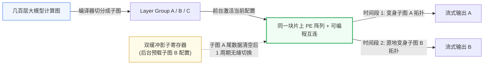

### 7.3 三种计算控制范式的本质对比

| 架构形态                                | 计算与控制方式                   | 狭义冯·诺依曼瓶颈（取指/逐字搬运）     | 广义存储墙（片外访存带宽与能耗）               | 硬件灵活性                         |
| :-------------------------------------- | :------------------------------- | :------------------------------------- | :--------------------------------------------- | :--------------------------------- |
| **指令驱动架构**（CPU / GPU）           | 逐周期取指、译码、发射           | 靠乱序执行、宽 SIMD 和多级 Cache 掩盖  | **存在**                                       | **极高**（图灵完备通用编程）       |
| **可重构数据流**（CGRA / 数据流 NPU）   | 按子图配置硬件通路，数据流式直传 | **基本消除**（配置一次，长时流式运行） | **依然存在**（受制于片上 SRAM 容量与片外带宽） | **中等**（依赖编译器切图与重配置） |
| **完全固化电路**（Fixed-Function ASIC） | 晶体管连线直接等价于固定算法     | **完全不存在**                         | 仅在输入/输出超过片上缓冲时存在                | **极低**（只能跑单一固定功能）     |

> [!TIP] 数据流架构的真正工程价值
> 数据流架构并不是靠“把电路焊死”来幻想一劳永逸地消灭存储墙；它的真正威力在于**保留可编程与可重构能力的前提下，彻底砍掉指令流水线的控制能耗**，并把优化的主动权交给编译器——通过极致算子融合、片上 SRAM 规划和复用，把必须穿透“存储墙”的片外访存次数压到物理极限。

---

## 八、数据流不止一种：四种演化形态与商业工程收敛

很多初学者一提到数据流架构，大脑里浮现的就是上一章说的“配置子图 A $\rightarrow$ 跑完一批数据 $\rightarrow$ 切换配置子图 B”。那么：**所有数据流架构都是这样工作的吗？**

**不是！** 这只是现代商用 AI 芯片里最主流的一派。在计算机体系结构历史上，“数据流”只定义了**执行模型**（数据到位即触发计算，而非靠 PC 指针逐条取指），并没有规定硬件必须多久换一次配置。按**配置切换粒度**和**数据路由机制**，数据流实际演化出了四种截然不同的实现形态：

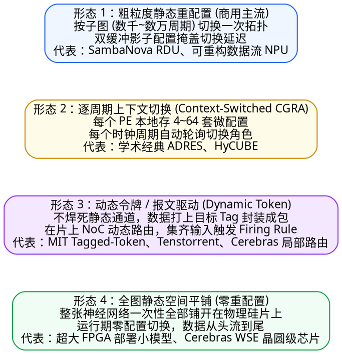

### 8.1 四种实现形态深度解析

1. **粗粒度静态重配置（Coarse-Grained Static Reconfiguration）**：
   编译器把计算图切成多个子图（Layer Group），通过配置寄存器把 PE 阵列和片上开关拼成子图 A 的拓扑，流式跑完一整批数据后，再重新加载子图 B 的配置。
   - **关键工程优化——双缓冲影子配置（Shadow Config / Ping-Pong）**：为了避免“停下来重配”导致算力空窗，成熟芯片会在前台跑子图 A 时，后台悄悄把子图 B 的配置写进**影子寄存器**；子图 A 尾部数据一清空，**单时钟周期内瞬间切换生效**。
   - **代表芯片**：SambaNova RDU、各类商用可重构数据流 NPU。
2. **逐周期上下文切换（Context-Switched CGRA）**：
   不必等一整批数据跑完才换配置。每个 PE 和片上路由器本地都带有一小块**配置存储器（Context Memory）**，提前存好 4～64 套配置。运行期间硬件**每个时钟周期**都在这几套配置间轮询切换（例如第 1 拍 PE 做乘法送给东边，第 2 拍同一颗 PE 变成加法器送给南边），相当于把空间映射与“周期级时分复用”揉在了一起。
   - **代表架构**：学术界经典的细粒度 CGRA（如 ADRES、HyCUBE）。
3. **动态令牌 / 报文驱动（Dynamic Token / Packet-Driven）**：
   这是数据流最古老、最正统的血脉（源于 1970-80 年代 MIT 提出的 Tagged-Token Dataflow）。它**根本不预先把 PE 之间的物理电路连死**！
   每个数据被封装成带有目标节点地址与上下文标签（Tag）的**令牌数据包（Token / Packet）**，在片上二维网格（2D Mesh）互连网络里动态路由寻找目的地；每个 PE 本地带有轻量级微码和硬件匹配队列，只要某个计算节点所需的全部输入数据包凑齐（满足 **Firing Rule，触发规则**），硬件就立刻点火计算，并把结果打包发往下一跳。它不需要全局停顿和重载拓扑，天生支持动态分支、稀疏计算和乱序并发。
   - **代表架构**：早期 WaveScalar/TRIPS，以及现代把“数据流包路由 + 轻量化众核”结合的 **Tenstorrent** 与 **Cerebras WSE**（片上局部控制机制）。
4. **全图静态空间平铺（Full-Graph Static Spatial Tiling）**：
   只要物理芯片足够大（或者模型足够小），干脆把整个计算图的所有算子**一次性全部展开**铺在硅片上。配置只在部署时写一次，运行期零重配置，数据像工厂总装线一样一气呵成从头流到尾。
   - **代表架构**：在超大规模 FPGA 上部署固定轻量化模型，或 **Cerebras WSE** 这类直接用整张晶圆造出来、拥有数十万核的晶圆级芯片。

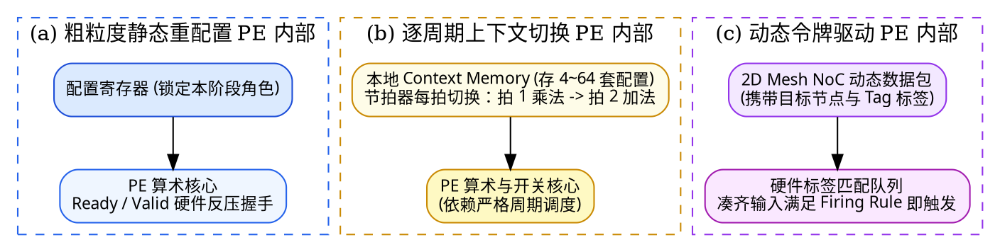

### 8.2 四种数据流形态对比与商业收敛逻辑

| 架构形态                | 配置切换粒度                 | 路由与触发机制                         | 核心痛点与代价                                                   |
| :---------------------- | :--------------------------- | :------------------------------------- | :--------------------------------------------------------------- |
| **粗粒度静态重配置**    | 子图层级（数千～数万周期）   | 静态配置通道 + 硬件反压（Ready/Valid） | 子图切分、片上 SRAM 规划和重配置隐藏高度依赖编译器               |
| **逐周期上下文切换**    | 单时钟周期（1 Cycle）        | 本地配置表按固定节拍轮询切换           | 编译器时空调度（Modulo Scheduling）极难，无法容忍访存延迟抖动    |
| **动态令牌 / 报文驱动** | 无需重配拓扑（按包动态触发） | 片上 NoC 动态路由 + 标签匹配队列       | 硬件包头、路由仲裁与匹配电路面积功耗大，把省下的控制功耗又吃回去 |
| **全图静态空间平铺**    | 部署时一次（运行期零重配）   | 物理拓扑永久固定                       | 极度消耗芯片面积，模型规模受死于物理硅片面积上限                 |

> [!NOTE] 为什么商用 AI 数据流芯片最终大多收敛到“第一种”？
> 这本质上是一道非常清醒的工程性价比选择题：**全图平铺**太烧硅片面积；**动态令牌驱动**的包头路由与匹配队列硬件开销太大，会把数据流好不容易省下的控制功耗又吃回去；**逐周期切换**则对访存确定性要求过于苛刻（片外访存一旦抖动一拍，全阵列节拍就乱了）。唯有**粗粒度按子图重配置**刚好落在甜点区——既能用有限面积跑超大模型，又能把重配置开销摊薄到成千上万个周期的连续数据流里。

---

## 九、解剖 Google TPU：宏观 VLIW + 微观固化脉动阵列的混合哲学

聊完了通用 CPU、GPU、存算一体和可重构数据流，初学者一定会问起 AI 芯片史上最著名的标杆——**Google TPU（Tensor Processing Unit）**到底属于哪一派？

令人意外的是：**TPU 走的既不是 GPU 的多线程指令流，也不是可重构数据流那种“把 PE 阵列动态拼装成任意子图”的路线，而是一种极其务实的混合架构——“宏观 VLIW 指令驱动 + 微观固化脉动阵列（Systolic Array）数据流”。**

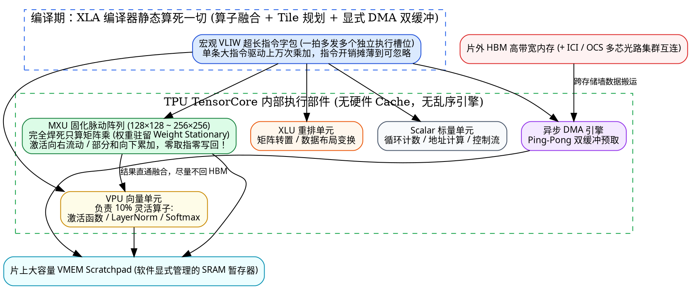

TPU 没有试图把整颗芯片都做成能任意变形的数据流图，而是极其聪明地把计算拆成了**宏观**与**微观**两层来处理：

### 9.1 微观层（MXU）：物理焊死的脉动阵列，只算矩阵乘

TPU 的绝对算力心脏是 **MXU（Matrix Multiply Unit，矩阵乘法单元）**，本质上是一个规模庞大的二维**脉动阵列（Systolic Array，得名于人体心脏“脉动泵血”——数据按统一时钟节拍在二维计算网格间逐格接力传递）**，规模从早期的 $128 \times 128$ 一路扩至最新代的 $256 \times 256$（单阵列一次坐拥 65,536 个乘加器！）：

- **拓扑完全不重配置**：与可重构数据流 NPU 需要用配置开关把 PE 重新连成卷积或 LayerNorm 不同，MXU 内部所有乘加单元（MAC）的金属连线是**永久焊死**的，一辈子只干一件事——矩阵乘加。
- **局部纯数据流执行**：MXU 经典采用**权重驻留（Weight Stationary）**模式。权重提前移位灌入阵列并固定在各个节点内；左侧输入激活值按时钟节拍**水平向右**逐格接力传递，每个节点完成乘加后，将部分和（Partial Sums）**垂直向下**传递给相邻节点，最终在底部累加器汇总输出。
- **彻底消灭局部狭义瓶颈**：一旦数据泵入阵列，成千上万个 MAC 单元每个周期都在仅靠相邻短线接力计算，**中间没有任何逐条取指开销，部分和也完全不读写寄存器堆或 SRAM**！为了掩盖下一批权重的加载空窗，每个节点里还内置了影子缓冲，允许后台一边偷偷移入新权重、前台一边继续算当前批次。

```graphviz
digraph TPU_MXU_Systolic_Flow {
  rankdir=LR;
  node [shape=box, style="filled,rounded", fontname="sans-serif", fontsize=11];
  edge [fontname="sans-serif", fontsize=10];

  X0 [label="激活行 0 (t0 先入)", fillcolor="#eff6ff", color="#2563eb"];
  X1 [label="激活行 1 (t1 错拍入)", fillcolor="#eff6ff", color="#2563eb"];

  subgraph cluster_mxu {
    label="MXU 权重驻留 (Weight Stationary) 脉动阵列局部 2×2 示意";
    style=dashed;
    color="#16a34a";

    MAC00 [label="MAC (0,0)
固定权重 W00", fillcolor="#dcfce7", color="#15803d"];
    MAC01 [label="MAC (0,1)
固定权重 W01", fillcolor="#dcfce7", color="#15803d"];
    MAC10 [label="MAC (1,0)
固定权重 W10", fillcolor="#dcfce7", color="#15803d"];
    MAC11 [label="MAC (1,1)
固定权重 W11", fillcolor="#dcfce7", color="#15803d"];

    MAC00 -> MAC01 [label="激活向右传"];
    MAC10 -> MAC11 [label="激活向右传"];
    MAC00 -> MAC10 [label="部分和向下传"];
    MAC01 -> MAC11 [label="部分和向下传"];
  }

  ACC0 [label="底部累加器 0
汇总输出列 0", fillcolor="#fefce8", color="#ca8a04"];
  ACC1 [label="底部累加器 1
汇总输出列 1", fillcolor="#fefce8", color="#ca8a04"];

  X0 -> MAC00;
  X1 -> MAC10;
  MAC10 -> ACC0;
  MAC11 -> ACC1;
}
```

### 9.2 宏观层（TensorCore）：VLIW 超长指令字驱动异构部件

因为 MXU 只会算矩阵乘，模型里剩下的激活函数（ReLU/GELU/SiLU）、LayerNorm、Softmax、矩阵转置与数据搬运就必须靠其他部件接手。早期 TPU v1 靠宿主机 CPU 通过 PCIe 总线发粗粒度指令遥控；从 **TPU v2 到 v5 / v6**，每个核心演化成了完全独立自主运行的 **VLIW（Very Long Instruction Word，超长指令字）** 架构：

- **一拍多发**：一条极宽的 VLIW 指令包里同时切分出多个独立槽位，同一个时钟周期可以同时向 **Scalar 标量单元**、**VPU 向量处理单元**（处理逐元素与规约算子）、**MXU 矩阵单元**、**XLU 转置/重排单元**以及 **DMA 引擎**下发动作。
- **粗粒度彻底摊薄取指开销**：VLIW 表面上虽然依然需要取指，但因为**一条矩阵/向量指令就能驱动上万次算术运算**，指令带宽与译码能耗被彻底摊薄到几乎可以忽略不计。
- **彻底砍掉硬件 Cache 与乱序引擎**：TPU 把 CPU/GPU 上耗面积又耗电的多级硬件自动 Cache、分支预测、乱序重排序电路全砍了！它的片上大容量 SRAM（称为 **VMEM**）完全作为**软件显式管理的暂存器（Scratchpad）**使用——哪块数据什么时候进、什么时候覆盖，全听编译器指挥，硬件零猜测、零功耗浪费。

### 9.3 调度核心：把复杂性全部推给 XLA 编译器

硬件做得越极简，软件编译器就越得承担起“最强大脑”的重任。TPU 把全部并行编排、数据流规划和抗存储墙重担，统统压给了自家的 **XLA（Accelerated Linear Algebra）编译器**：

1. **算子融合抗存储墙**：XLA 尽量把 MXU 算完的矩阵乘结果直接送进 VPU 的向量寄存器或片上 VMEM，紧接着一口气把偏置加、激活函数、归一化全部融合算完，再一次性写回片外 HBM，把穿透存储墙的次数压到最低。
2. **显式 DMA 双缓冲**：编译器在编译期就能精确推算出每个分块（Tile）的算术耗时与搬运延迟，提前插入异步 DMA 指令在片外 HBM 与片上 VMEM 之间做 **Ping-Pong 双缓冲预取**，用 MXU 的计算时间完美盖住访存延迟。
3. **多芯片高速直连（ICI + OCS）**：单颗芯片的片上 SRAM 和 HBM 装不下千亿大模型时，TPU 直接依赖芯片自带的**片间高速互连（ICI, Inter-Chip Interconnect）**和机柜级的**光路交换机（OCS, Optical Circuit Switch）**，把数千颗 TPU 直接绕过传统以太网卡连成超大三维环面网（3D Torus），由 XLA 自动切分张量并行（Tensor Parallelism），把权重直接平摊在海量集群 HBM 中高速流转。

### 9.4 三大主流 AI 芯片架构路线终极对比

| 对比维度           | Google TPU（VLIW + 脉动阵列）                 | 可重构数据流 NPU（CGRA / RDU）                 | GPU（SIMT + Tensor Core）                      |
| :----------------- | :-------------------------------------------- | :--------------------------------------------- | :--------------------------------------------- |
| **宏观控制方式**   | 静态编译的 **VLIW 超长指令字**                | 按子图写配置寄存器，静态拓扑流式运行           | 硬件线程束（Warp）动态调度指令流               |
| **核心计算阵列**   | **完全固化**的超大脉动阵列（只算矩阵乘）      | **可重构** PE 阵列与片上互连（拼装任意子图）   | 分散在各 SM 内部的小尺寸 Tensor Core           |
| **非矩阵算子处理** | 交给旁边的 **VPU 向量单元**协同流水           | 尽量直接映射进同一子图的 PE 流水线里           | 由 SM 内的通用 CUDA Core 执行                  |
| **片上存储管理**   | 软件显式管理（VMEM Scratchpad + DMA）         | 软件显式规划片上 SRAM 缓冲与数据流             | 硬件自动 Cache + 软件可配 Shared Memory        |
| **核心取舍逻辑**   | **极简硬件 + 极强编译器**换取确定性与极致能效 | 省去非矩阵算子落回缓冲的开销，高度依赖子图切分 | 保留极高通用性与动态负载容忍度，控制硬件开销大 |

> [!IMPORTANT] TPU 的极简实用主义哲学
> TPU 的成功密码在于它看透了一个工程事实：**既然深度学习 90% 以上的算力都耗在矩阵乘上，就完全没必要花高昂的布线面积和编译代价把整颗芯片做成“可任意变形的通用数据流阵列”。** 直接把矩阵乘焊死成一块效率最高的纯脉动数据流硬核（MXU），再用一套极简的 VLIW + VPU + 显式 DMA 接管剩下 10% 的灵活算子，最后让 XLA 编译器把它们严丝合缝地缝成一条确定性流水线——这就是极致的软硬件协同。

---

## 十、能效比深水区：为什么带 Tensor Core 的 GPU 依然拼不过 TPU？（通用性税剖析）

学完第九章后，初学者很容易产生一个尖锐的疑问：

> _“既然 NVIDIA GPU 从 Volta 到 Hopper / Blackwell 也早就配备了专门算矩阵乘法的 **Tensor Core（张量核心）**，为什么业界在跑大模型时，还是常说 TPU 的每瓦能效比（Performance/Watt）比同代 GPU 更高？都是算矩阵乘，差距究竟花在哪了？”_

这里藏着先进制程芯片最违反直觉的物理真相：**在 4nm / 5nm 工艺下，做一次低精度矩阵乘加（MAC）本身的算术功耗只占整颗芯片耗电的一小部分；真正的能耗大头全在“数据搬运、控制调度和通用配套电路”上！**

Tensor Core 确实把单次 MAC 运算的算术能耗压到了和 TPU 几乎同一水平线，但 GPU 依然必须为整个通用计算生态支付高昂的**“通用性税（Generality Tax）”**。看一眼 NVIDIA H100 的单个 **SM（Streaming Multiprocessor，流多处理器，GPU 内部最核心的并行计算大单元）** 内部结构就会明白：绿色高亮的 **Tensor Core** 实际上只占据整个 SM 版图的很小一隅，周围密密麻麻包裹着 `L0/L1 Instruction Cache`（指令缓存）、`Warp Scheduler`（线程束调度器）、`Dispatch Unit`（指令分发器）、极其庞大的通用 `Register File`（寄存器文件）、成排的 `INT32 / FP32 / FP64` 标量核、**`SFU`（Special Function Unit，专门算三角函数和指数对数的特殊函数单元）**、`LD/ST` 访存单元以及图形渲染用的 `Tex` 纹理单元。

下面这张对比图直观展示了 GPU SM 的“通用大杂烩与寄存器过路费”与 TPU MXU 的“巨型阵列直连”之间的能耗差异：

```graphviz
digraph GPU_vs_TPU_Efficiency {
  rankdir=TB;
  node [shape=box, style="filled,rounded", fontname="sans-serif", fontsize=11];
  edge [fontname="sans-serif", fontsize=10];

  subgraph cluster_gpu {
    label="NVIDIA GPU 单个 SM 内部 (高“通用性税”与寄存器过路费)";
    style=dashed;
    color="#e11d48";

    G_CTRL [label="L0/L1 指令缓存 + Warp 调度器 + 记分板\n+ 硬件 L1 Cache/Tag 匹配 (动态与静态漏电开销)", fillcolor="#fff1f2", color="#e11d48"];
    G_MISC [label="INT32 / FP32 / FP64 标量核 + SFU + Tex 纹理单元\n(即使只跑稠密矩阵乘，也占用面积并漏电)", fillcolor="#ffe4e6", color="#be123c"];
    G_SMEM [label="Shared Memory (片上共享内存)", fillcolor="#fefce8", color="#ca8a04"];
    G_RF [label="超大高端口 Register File (256 KB / SM)\n维持几十个 Warp 零切换开销，但读写极其耗电！", fillcolor="#ffedd5", color="#ea580c"];
    G_TC [label="碎片化小规模 Tensor Core\n(边界访存/计算比偏高，传统 mma.sync 频繁进出 RF)", fillcolor="#dcfce7", color="#15803d"];
    G_NEW [label="Hopper / Blackwell 进化：\n引入 TMA + wgmma + 剥离出的 TMEM (疯狂“TPU 化”)", fillcolor="#ecfeff", color="#0891b2"];

    G_CTRL -> G_TC [label="动态调度功耗"];
    G_SMEM -> G_RF [label="搬运过路费"];
    G_RF -> G_TC [label="反复读写 RF"];
    G_NEW -> G_TC [style=dashed, label="绕过通用 RF 降耗"];
  }

  subgraph cluster_tpu {
    label="Google TPU TensorCore (极致去冗：只留算矩阵与向量所需电路)";
    style=dashed;
    color="#16a34a";

    T_VLIW [label="静态 VLIW 控制 (XLA 编译期算死)\n零硬件 Cache、零 Warp 调度、零记分板", fillcolor="#eff6ff", color="#2563eb"];
    T_VMEM [label="VMEM Scratchpad (显式暂存器) + 专用累加器\n极短直连通路，砍掉巨型通用 Register File", fillcolor="#ecfeff", color="#0891b2"];
    T_MXU [label="巨型集中式 MXU 脉动阵列 (128×128 / 256×256)\n面积周长比 O(N)：泵入一次，相邻金属线接力复用上百次！", fillcolor="#dcfce7", color="#15803d"];

    T_VLIW -> T_MXU [label="一拍驱动上万次乘加"];
    T_VMEM -> T_MXU [label="流式直连喂送"];
  }
}
```

把两套架构拆开对比，GPU 能效比在稠密矩阵乘上输给 TPU，主要体现在以下**四个具体层面**：

### 10.1 阵列粒度与数据复用率：巨型脉动阵列 vs 碎片化小阵列

矩阵乘法的能效极其依赖几何学上的**面积周长比**：一个 $N \times N$ 的二维脉动阵列，内部每个周期能同时执行 $N^2$ 次乘加，但从边界喂进来的数据量只正比于正方形的周长 $2N$，**数据复用率高达 $O(N)$**！

- **TPU（MXU）**：直接把算力高度集中成几块巨型二维脉动阵列（$128 \times 128$ 甚至 $256 \times 256$）。一个权重或激活值从边界泵入后，可以在阵列内部沿着极短的相邻金属线接力复用上百次，中间产生的部分和完全不碰 SRAM 或寄存器堆。
- **GPU（Tensor Core）**：为了配合百余个并发 SM 的细粒度多线程调度，算力被打散塞进了上百个 SM 的数百个子分区（Sub-partition）里，每个物理 Tensor Core 的单拍矩阵规模远小于 TPU 的 MXU。阵列越碎，边界访存与内部计算的比值就越高，数据越频繁地进出局部存储层级，搬运能耗随之攀升。

### 10.2 数据通路的“过路费”：通用 Register File vs 直连 VMEM

在先进制程下，**访问一次大容量通用寄存器堆（Register File）所消耗的能量，远远高于做一次 FP8/BF16 乘加本身！**

- **GPU**：为了同时养活几十个 Warp（线程束）实现“遇延迟零开销瞬间切换线程上下文”，每个 SM 必须配备极其庞大且多读写端口的通用 **Register File**（例如 H100 每个子分区配 $16,384 \times 32\text{-bit}$，整个 SM 高达 **256 KB**）。在传统 Tensor Core 指令（如 `mma.sync`）下，矩阵块必须先从 Shared Memory 搬进 Register File，喂给 Tensor Core 算完再写回 Register File——不仅每次读写都在烧电，多 Bank 冲突仲裁和跨区长走线全都是“过路费”。
- **TPU**：彻底砍掉了面向几十路线程并发切换的超大通用寄存器堆。MXU 直接对接软件显式管理的片上暂存器（**VMEM**）和专用累加器缓冲，数据通路极短，且没有硬件多 Bank 动态仲裁开销。

```graphviz
digraph GPU_RF_vs_TMEM_Evolution {
  rankdir=LR;
  node [shape=box, style="filled,rounded", fontname="sans-serif", fontsize=11];
  edge [fontname="sans-serif", fontsize=10];

  subgraph cluster_amp {
    label="Ampere (mma.sync)：通用寄存器堆双重过路费";
    style=dashed;
    color="#e11d48";
    A_SMEM [label="Shared Memory", fillcolor="#fefce8", color="#ca8a04"];
    A_RF [label="256KB 通用 Register File
(高功耗读写 + Bank 仲裁)", fillcolor="#ffedd5", color="#ea580c"];
    A_TC [label="Tensor Core", fillcolor="#dcfce7", color="#15803d"];
    A_SMEM -> A_RF -> A_TC -> A_RF;
  }

  subgraph cluster_hop {
    label="Hopper (TMA + wgmma)：绕过输入端 RF 读";
    style=dashed;
    color="#2563eb";
    H_SMEM [label="Shared Memory
(由 TMA 异步搬入)", fillcolor="#fefce8", color="#ca8a04"];
    H_TC [label="Tensor Core (wgmma)
直接从 SMEM 读矩阵!", fillcolor="#dcfce7", color="#15803d"];
    H_RF [label="Register File (仅存输出累加)", fillcolor="#ffedd5", color="#ea580c"];
    H_SMEM -> H_TC -> H_RF;
  }

  subgraph cluster_blk {
    label="Blackwell (tcgen05 + TMEM)：彻底“TPU 化”";
    style=dashed;
    color="#16a34a";
    B_SMEM [label="Shared Memory", fillcolor="#fefce8", color="#ca8a04"];
    B_TC [label="Tensor Core (tcgen05)
支持双 SM 跨 CTA 协作", fillcolor="#dcfce7", color="#15803d"];
    B_TMEM [label="专用 TMEM 张量内存
剥离通用寄存器堆!", fillcolor="#ecfeff", color="#0891b2"];
    B_SMEM -> B_TC;
    B_TC -> B_TMEM [dir=both];
  }
}
```

### 10.3 控制面与面积的静态开销：硬件动态调度 vs 静态编译

- **GPU**：为了兜底任意 `if-else` 分支、不规则稀疏访存、科学计算双精度（FP64）以及图形渲染，芯片必须在每个 SM 里塞满全套硬件动态控制逻辑——指令缓存、Warp 调度器、**记分板（Scoreboard，实时追踪寄存器数据依赖防冲突的硬件表格）**、硬件自动管理的 L1/L2 Cache（含 Tag 标签比对与多核一致性协议）以及访存合并单元。即使此时只跑纯稠密矩阵乘，这些电路依然消耗动态调度功耗；更要命的是，它们霸占了大量硅片面积，直接推高了静态漏电功耗，并拉长了信号走线长度（电容充放电功耗增大）。
- **TPU**：走极致极简路线，砍掉硬件 Cache、乱序执行与动态线程调度，把并行编排和依赖分析全部推给 **XLA 编译器**在编译期通过 VLIW 静态定死。宝贵的硅片面积几乎全留给了 MXU、VPU 和大容量 SRAM，控制面能耗占比极低。

### 10.4 电压频率甜点与系统级策略

芯片动态功耗遵循物理公式 $P \propto C \cdot V^2 \cdot f$（功耗与电容 $C$、电压 $V$ 的平方、频率 $f$ 成正比）。越往高频极限冲刺，电压 $V$ 就得拉得越高，而功耗会按 $V^2$ 呈陡峭二次方暴涨！

- **GPU**：为了压榨单卡、单机箱的极致峰值算力和售卖卖点，旗舰 GPU 往往会把核心电压和频率推到能效曲线的陡峭耗电区（单卡 **TDP 热设计功耗**从 H100 的 700W 一路拉到 B200 的 1000W+）。
- **TPU**：Google 作为自建自用超大规模云厂商，更在意整个数据中心机房的 **Performance/Watt（每瓦性能）** 和 **TCO（Total Cost of Ownership，总拥有成本，含购置费与几年电费散热费）**。因此 TPU 传统上倾向于把芯片跑在更温和、能效更高的**电压频率甜点区**，再通过“稳健频率 + 专用光路交换（OCS）/ 片间直连（ICI）”在集群尺度下以规模换取更高的整体能效。

| 对比维度         | GPU（SIMT + Tensor Core）                               | TPU（VLIW + MXU 脉动阵列）                    |
| :--------------- | :------------------------------------------------------ | :-------------------------------------------- |
| **矩阵阵列形态** | 分散在百余个 SM 内的中小规模阵列                        | 极少数集中式巨型脉动阵列（128×128 / 256×256） |
| **数据喂送路径** | 经过多级硬件 Cache / Shared Memory / 大型 Register File | VMEM 与专用累加器直接流式喂送，路径极短       |
| **控制与调度**   | 硬件 Warp 调度、记分板、Cache Tag 匹配与一致性          | VLIW 静态编译调度，无硬件 Cache 与动态仲裁    |
| **非矩阵包袱**   | 含 FP64 双精度、图形纹理单元、通用标量/分支电路         | 仅保留精简标量核与 VPU 向量单元               |
| **能效取向**     | 兼顾极高通用性与单卡极限峰值算力                        | 牺牲通用性，换取大稠密矩阵下的极致每瓦算力    |

> [!IMPORTANT] 客观视角：正在收窄的差距与负载依赖
> 看待 GPU 与 TPU 的能效之争，必须保持两点客观认知：
>
> 1. **NVIDIA 正在疯狂把 Tensor Core 通路“TPU 化”**：NVIDIA 自己比谁都清楚 Register File 过路费和小粒度瓶颈。从 Hopper 架构引入 **TMA（张量内存加速器，异步整块搬运引擎）** 与允许 Tensor Core 直接从 Shared Memory 读数而绕开通用寄存器的 **`wgmma`** 指令，到 Blackwell 架构专门新增彻底剥离出通用寄存器堆的专用 **TMEM（Tensor Memory，张量内存）** 以及支持双 SM/跨 CTA 协作的 **`tcgen05`**——本质上就是在补齐与 TPU 之间的通路能效差距，两者在纯稠密 GEMM 上的底层硬件差距已大幅收窄。
> 2. **脱离负载谈能效毫无意义**：一旦模型遇到大量动态条件分支、不规则稀疏计算或者极小的 Batch/Shape，TPU 巨型脉动阵列根本填不满、静态 VLIW 大面积空转；此时反而是 GPU 凭借细粒度 SM 和灵活的动态调度拿到更高的**实际有效能效**！

---

## 十一、把静态编译与纯 SRAM 推向极致：Groq LPU（TSP）正交单核流式架构

顺着上面几代架构的演进脉络再往前走一步，你就会立刻看懂最近在大模型超低延迟推理领域大放异彩的 **Groq LPU（Language Processing Unit，底层论文架构名为 TSP，Tensor Streaming Processor）**。

它既不是 GPU 的众核 SIMT，也不是常规意义上的“无指令数据流芯片”。**Groq LPU 本质上是把 Google TPU 的“静态编译 + VLIW + 确定性流式执行”哲学推向物理极限的产物**——一种**“软件定义、周期级确定性的超级单核流式架构 + 纯片上 SRAM”**。

下面这张结构对比图直接揭示了 Groq 与传统多核芯片在芯片物理版图上的“翻转”设计：

```graphviz
digraph Groq_LPU_Orthogonal {
  rankdir=TB;
  node [shape=box, style="filled,rounded", fontname="sans-serif", fontsize=11];
  edge [fontname="sans-serif", fontsize=10];

  subgraph cluster_trad {
    label="(a) 传统多核芯片 (CPU / GPU SM)：计算、存储、控制打包成对称小核平铺";
    style=dashed;
    color="#64748b";
    C1 [label="Core 0\n(ALU+SRAM+Ctrl)", fillcolor="#f1f5f9", color="#475569"];
    C2 [label="Core 1\n(ALU+SRAM+Ctrl)", fillcolor="#f1f5f9", color="#475569"];
    C3 [label="Core 2\n(ALU+SRAM+Ctrl)", fillcolor="#f1f5f9", color="#475569"];
    C1 -> C2 -> C3 [dir=both, label="NoC / Cache 一致性"];
  }

  subgraph cluster_groq {
    label="(b) Groq LPU (TSP) 翻转正交设计：纵向功能切片，指令自下而上，数据水平穿行！";
    style=dashed;
    color="#4f46e5";

    MXM_L [label="MXM 矩阵切片\n(西侧矩阵乘)", fillcolor="#dcfce7", color="#15803d"];
    SXM_L [label="SXM 移位/重排切片\n(数据跨道切换)", fillcolor="#fff7ed", color="#ea580c"];
    MEM_C [label="MEM 共享 SRAM 切片\n(全片纯 SRAM ~230MB，无 HBM!)", fillcolor="#ecfeff", color="#0891b2"];
    VXM_C [label="VXM 向量切片\n(激活 / Norm)", fillcolor="#fefce8", color="#ca8a04"];
    MXM_R [label="MXM 矩阵切片\n(东侧矩阵乘)", fillcolor="#dcfce7", color="#15803d"];

    ICU [label="底部指令控制单元 ICU (广义 VLIW)\n指令流 (instruction flow) 自下而上逐拍传递，精确算死每一拍！", fillcolor="#eef2ff", color="#4f46e5"];

    MXM_L -> SXM_L -> MEM_C -> VXM_C -> MXM_R [dir=both, label="水平数据流 (data flow) 东/西直传", color="#2563eb", style=bold];
    ICU -> MXM_L [label="指令流↑"];
    ICU -> SXM_L [label="指令流↑"];
    ICU -> MEM_C [label="指令流↑"];
    ICU -> VXM_C [label="指令流↑"];
    ICU -> MXM_R [label="指令流↑"];
  }
}
```

拆开来看，Groq LPU 靠四个极其激进的设计决策，同时正面回应了“冯·诺依曼瓶颈”与“数据流控制开销”两个难题：

### 11.1 硬件形态：不是“多核”，而是正交编排的“超级单核流式管线”

- **按功能纵向切片（Functional Slice）**：传统芯片把算力、存储、控制打包成一个个全能小核（Core）到处复制；而 Groq 彻底拆散了这些组件，把整颗芯片排成对称的竖向功能长条——两侧是矩阵乘单元（**`MXM`**），中间夹着片上移位/重排网络（**`SXM`**）、全局共享 SRAM 访存单元（**`MEM`**）以及向量计算单元（**`VXM`**）。
- **数据水平流式接力**：从 `MEM` 读出的张量会被贴上流编号（Stream ID）并指定行进方向（向东或向西），像传送带一样**水平穿过**沿途所有的功能切片。每个切片在数据路过时直接做“生产者-消费者”式原地处理并立刻推入下一跳，中间结果根本不需要反复写回全局存储。

### 11.2 控制方式：依然是指令驱动，但砍光了所有硬件动态调度

很多人误以为 Groq 是无指令数据流，其实它**依然是标准的指令驱动架构（广义 VLIW）**——每个功能切片最底部都有独立的**指令控制与分发单元（ICU, Instruction Control Unit）**，指令流（Instruction Flow）自下而上逐拍向上推进！

- **彻底消灭一切不确定性**：Groq 比 TPU 走得更绝——它不仅砍掉了硬件 Cache、分支预测、乱序执行和硬件线程调度，**甚至连硬件动态总线仲裁和复杂的反压握手电路都一并剔除**。
- **时空二维静态编译**：它的 ISA 把每一条指令的精确执行延迟和流传输拍数完全透明地暴露给编译器。编译器就像钟表匠装配精密齿轮一样，在编译期把**“第 $T$ 个时钟周期，第 $N$ 条数据流刚好抵达第 $K$ 列切片的哪一行”**全部静态算死！运行期间没有任何调度抖动（Jitter），性能 100% 可预测。

### 11.3 破除存储墙的终极暴力解法：砍掉 HBM/DRAM，全片纯 SRAM

这才是 Groq LPU 在大模型推理（尤其是极度吃内存带宽的 Decode 阶段）跑出惊人 Token 生成速度的真正杀手锏：

- **用片内带宽降维打击**：初代 Groq LPU 干脆**不外挂任何 HBM 和 DRAM**，所有模型权重、激活值和 KV-Cache 全部塞进片上约 **230 MB 的纯 SRAM** 里，直接换来了高达 **~80 TB/s** 的惊人片内带宽（比同期 H100 的 HBM 带宽高出一个数量级）。
- **多芯片确定性直连（C2C, Chip-to-Chip）**：单颗芯片 230 MB 的 SRAM 肯定装不下大模型，于是 Groq 直接用无交换机的确定性片间直连（C2C）把成百上千颗 LPU 焊成一个逻辑上的“超级大单核”。跨芯片通信走哪条线、第几个时钟周期到达，同样全部由编译器静态排好，从而用海量芯片的 SRAM 聚合容量与带宽，物理绕开了单芯片的片外存储墙。

```mermaid
flowchart LR
    subgraph LPU_Cluster ["Groq 纯 SRAM 超级单核集群 (无 HBM / 无动态交换机)"]
        L1["LPU 0<br/>~230MB 纯 SRAM<br/>~80 TB/s 片内带宽"] <-->|"确定性 C2C 直连<br/>(编译器算死精确拍数)"| L2["LPU 1<br/>~230MB 纯 SRAM"]
        L2 <-->|"确定性 C2C 直连"| LN["LPU N<br/>(多卡聚合容纳大模型权重)"]
    end

    subgraph Hetero_2026 ["2026 异构协同演进 (如 Groq 3 LPX 平台)"]
        LPU_Cluster -->|"极低延迟高速吐出<br/>Draft / Agent Token"| GPU_G["Vera Rubin GPU 集群<br/>(超大 HBM 显存做批量校验与重计算)"]
    end

    style LPU_Cluster fill:#eef2ff,stroke:#4f46e5
    style Hetero_2026 fill:#ecfeff,stroke:#0891b2
    style GPU_G fill:#fff1f2,stroke:#e11d48
```

### 11.4 激进设计的硬伤与 2026 年的异构协同路线

纯 SRAM + 极致静态编译是一把极其锋利的双刃剑：

- **容量与成本硬伤**：SRAM 面积大、单比特造价极贵。想纯靠片上 SRAM 装下一个 70B（700 亿参数）级别的模型，需要堆叠几十上百张卡才能凑齐权重空间；面对超长上下文（Long Context）或超大 MoE 模型时，硬件采购成本和大 Batch 吞吐性价比往往不如高容量 HBM 方案。
- **定位收敛与异构融合**：LPU 天生只适合极致低延迟、确定性的推理，不适合需要海量显存容纳激活梯度与动态图训练的场景。正因如此，业界开始走向强强联合的**异构协同**——例如 NVIDIA 在 2026 年推出的 **Groq 3 LPX** 平台，就是把 LPU 极其恐怖的片上 SRAM 带宽（机架级可达数十 PB/s 片内带宽）与 Vera Rubin GPU 的超大 HBM 显存及高算力吞吐结合起来，让 LPU 专攻超低延迟 Token 生成（例如**投机解码 Speculative Decoding 中的高速草稿生成**或实时 Agent 推理循环），GPU 负责大批量校验与重计算。

### 11.5 把四条主流 AI 芯片路线放在同一张坐标图里

| 对比维度         | Groq LPU (TSP)                                          | Google TPU                                | 可重构数据流 NPU (CGRA / RDU)              | GPU (SIMT + Tensor Core)                    |
| :--------------- | :------------------------------------------------------ | :---------------------------------------- | :----------------------------------------- | :------------------------------------------ |
| **执行控制模型** | **周期级确定性流式 VLIW**（指令自下而上，数据水平穿行） | **宏观 VLIW + 微观固化脉动阵列**          | **粗粒度静态配置寄存器**（按子图拼装拓扑） | **硬件动态调度 SIMT**（Warp 调度 + 记分板） |
| **存储层级策略** | **纯片上 SRAM**（无 HBM/Cache，靠多卡 C2C 扩容量）      | **HBM + 片上 VMEM**（软件显式 DMA 搬运）  | **HBM/DRAM + 片上 SRAM**（算子融合降访存） | **HBM + 多级硬件 Cache + Shared Memory**    |
| **核心工程优势** | 极致低延迟、零抖动，Decode 带宽降维打击                 | 训推兼顾，大稠密矩阵的集群级高能效        | 消除取指开销，跨算子片上流式直连           | 通用性最强，动态负载与大 Batch 吞吐占优     |
| **最大工程代价** | 单片容量极小、堆卡成本高，编译器时空排布极复杂          | 动态分支与小 Shape 利用率下降，强绑定 XLA | 子图切分、SRAM 规划与重配置高度依赖编译器  | 控制面与数据通路的“通用性税”功耗高          |

> [!TIP] 一句话点透四条 AI 芯片路线
>
> - **GPU**：靠堆强大的硬件动态调度与多级 Cache 来掩盖存储墙、兜底全场景通用性；
> - **可重构数据流 NPU**：靠在片上动态拼装数据通路来砍掉取指开销与部分片外访存；
> - **Google TPU**：用极简 VLIW 指挥一块物理焊死的巨型脉动阵列，把调度复杂性全交给 XLA；
> - **Groq LPU**：把“静态编译”做到单时钟周期精度，并用纯 SRAM 集群直接把片外 HBM 这堵墙从芯片物理架构里整个拆掉了。

---

## 十二、全景串联与初学者自测清单

最后，我们用一张全景演化图，把从 1945 年至今的整个计算与存储架构逻辑串成一条完整的因果脉络：

```mermaid
flowchart LR
    VN["1945 经典冯·诺依曼<br/>五大部件 + 存储程序 + 顺序语义"] -->|"产生狭义瓶颈<br/>(I/D 共享总线争用)"| MH["改进型哈佛架构<br/>L1 I-Cache 与 D-Cache 分离<br/>+ IFU/LSU 硬连线与 iTLB/dTLB"]
    MH -->|"撞上广义存储墙<br/>CMOS 算力暴增 >> DRAM 带宽<br/>搬运能耗百倍于计算"| SPLIT{"三大破局与权衡方向"}

    SPLIT -->|"方向 A: 存储侧就近/原地计算"| CIMPIM["DRAM-PIM 近存 (GB 级 GEMV)<br/>模拟/数字 CIM 存内 (NOR Flash / SRAM)"]
    SPLIT -->|"方向 B: 硬件动态调度掩盖"| GPU["GPU (SIMT + Tensor Core)<br/>支付“通用性税”，向 TMA/TMEM 演进"]
    SPLIT -->|"方向 C: 砍掉动态控制 + 极致编译"| SCDF["可重构数据流 NPU (4 种形态)<br/>Google TPU (VLIW + 固化 MXU)<br/>Groq LPU (周期确定性 + 纯片上 SRAM)"]

    style VN fill:#eff6ff,stroke:#2563eb
    style MH fill:#f0fdf4,stroke:#16a34a
    style SPLIT fill:#fef2f2,stroke:#dc2626
    style CIMPIM fill:#f3e8ff,stroke:#9333ea
    style GPU fill:#fff1f2,stroke:#e11d48
    style SCDF fill:#e0f2fe,stroke:#0284c7
```

### 初学者自测 10 问（检验你是否真正打通脉络）

1. **为什么现代 CPU 内部都在做乱序执行和推测执行，却依然被称为遵循冯·诺依曼的“顺序指令处理”模型？**
   - _提示_：区分“ISA 对外暴露的可观察顺序语义”与“微体系结构内部物理并行实现”。
2. **“哈佛架构彻底解决了冯·诺依曼瓶颈”——这句话哪里对、哪里错了？**
   - _提示_：在狭义“指令与数据总线争用”层面对了；在广义“存算分离导致的物理性能与能耗剪刀差（存储墙）”层面错了。
3. **同一物理地址的 64 字节二进制数据，有可能同时存在于 L1 I-Cache 和 L1 D-Cache 中吗？为什么？**
   - _提示_：可以！硬件区分依据不是二进制内容，而是“发起请求的是前端 IFU 还是后端 LSU”。例如 `memcpy` 复制代码段或读取 `.text` 常量池。
4. **为什么全数字 SRAM-CIM 芯片运行千亿参数大模型时，仍然可能撞上片外存储墙？**
   - _提示_：SRAM 单位面积大、成本极高，单芯片通常仅数十到数百 MB；若模型权重放不下而频繁从外挂 DRAM 搬入，片外 I/O 带宽和搬运功耗依然是瓶颈。
5. **为什么不能像数字 SRAM-CIM 那样，直接把逻辑门塞进 DRAM 的 1T1C 存储单元内部实现“原地运算”？**
   - _提示_：两个硬物理原因——1T1C 破坏性读出必须先经灵敏放大器放大并回写锁存到 Row Buffer；且 DRAM 专用电容工艺晶体管慢、只有 3~4 层金属线、怕高温漏电。
6. **数据流架构去掉了逐条取指和寄存器往返，为什么还可能被片外内存拖垮（且不做成完全固化的 ASIC）？**
   - _提示_：计算单元和主存依然物理分离（大模型权重 Spilling、Decode 低算术强度断流反压、长残差溢出）；不完全固化是因为硅片面积装不下几百层网络、AI 算法演进极快以及无法灵活处理动态路由分支。
7. **同样叫“数据流”，为什么商用 AI 芯片几乎都收敛到了“粗粒度静态重配置”而不是“动态令牌（Tagged-Token）”？**
   - _提示_：动态令牌的包头、路由仲裁与硬件匹配队列面积功耗开销太大，容易吃掉省下来的控制能效；全图平铺面积不够；逐周期切换对访存确定性太苛刻。按子图粗粒度重配置（配合影子双缓冲）是性价比最佳的甜点区。
8. **Google TPU 既要取指（VLIW）又在算矩阵时像纯数据流（MXU），它是怎么兼顾效率和通用性的？**
   - _提示_：用固化脉动阵列（Weight Stationary）吃掉 90% 的矩阵算力（局部纯数据流、零取指零写回）；用 VLIW 驱动 VPU 处理剩下 10% 的激活/归一化算子，靠 XLA 编译器静态算死算子融合与 DMA 双缓冲，一条 VLIW 指令摊薄成千上万次计算开销。
9. **既然 GPU 也有 Tensor Core，为什么在稠密矩阵乘上还要支付比 TPU 更高的“通用性税”？NVIDIA 又如何自救？**
   - _提示_：主要税在四处——碎片化阵列降低 $O(N)$ 面积周长复用率、通用 Register File 读写过路费、SM 内大量硬件调度/Cache/FP64/Tex 静态面积与动态功耗、以及高频高电压曲线；NVIDIA 正通过 Hopper 的 `TMA/wgmma` 与 Blackwell 的 `TMEM/tcgen05` 绕开通用寄存器堆，将通路“TPU 化”。
10. **Groq LPU 属于“无指令数据流芯片”吗？它为什么能在大模型 Decode 阶段跑出惊人的低延迟？**
    - _提示_：不属于！它依然是指令驱动（每个纵向功能切片底部都有 ICU 下发广义 VLIW 指令流，自下而上控制，数据水平穿行）；它靠“周期级确定性零调度抖动编译”+“彻底砍掉 HBM、全片纯 SRAM（~80 TB/s 片内带宽）+ 多卡确定性 C2C 直连”在带宽上对传统架构形成降维打击。
