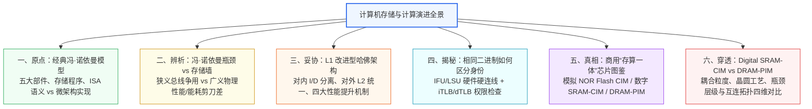
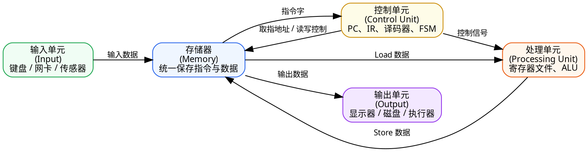
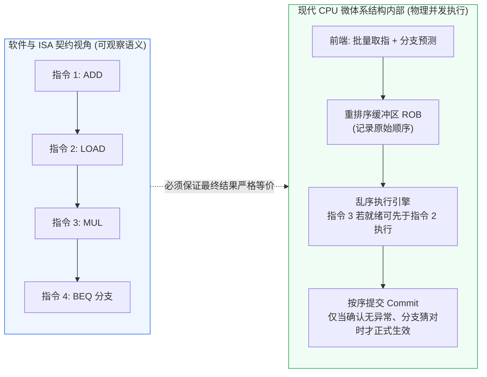
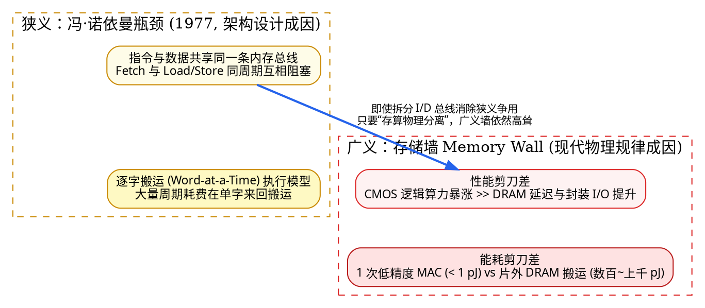
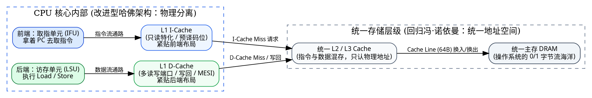
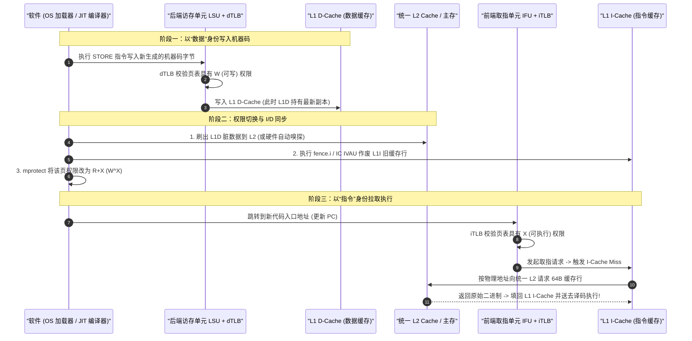
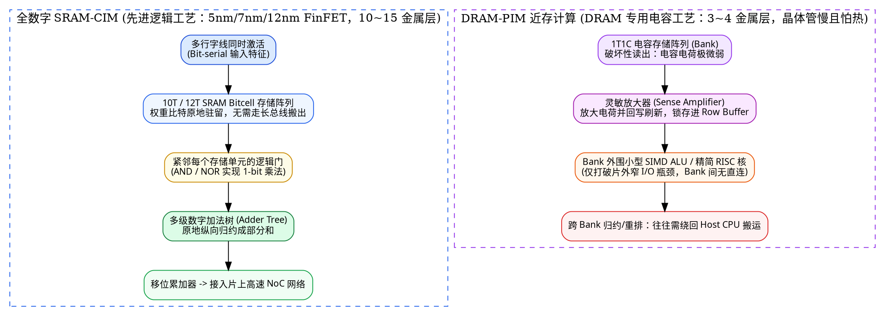
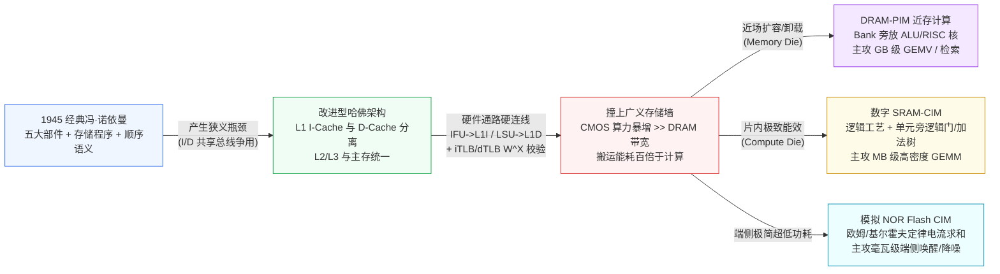

> **导读**：在学习计算机体系结构（Computer Architecture）与 AI 芯片设计时，初学者经常会被几个看似“自相矛盾”的问题卡住：
>
> 1. 教科书说现代计算机遵循**冯·诺依曼架构**，所以存在**“冯·诺依曼瓶颈”**；但现代 CPU 早把指令缓存和数据缓存分开了，GPU 和 NPU 也用上了超宽内存，为什么大家依然天天喊着卡在瓶颈上？这到底还是不是冯·诺依曼的锅？
> 2. 在内存条和操作系统眼里，程序代码和普通数据明明都是**一模一样的 `0` 和 `1` 二进制字节流**，主流 CPU 的一级缓存（L1 Cache）拆成“指令缓存（I-Cache）”和“数据缓存（D-Cache）”后，硬件究竟是怎么认出谁是谁的？
> 3. 现在新闻里铺天盖地都在宣传**“存算一体芯片”**，市面上真正卖出去的商用存算一体芯片到底长什么样？是教科书里说的那种“用新型忆阻器彻底干掉内存条的类脑芯片”吗？
> 4. 号称大算力的**全数字 SRAM 存内计算（Digital SRAM-CIM）**和内存厂推出的 **DRAM 近存计算（DRAM-PIM）**，表面上看都是“把计算电路放在存储旁边”，为什么业界说它们根本是两个完全不同的物种？
>
> 为了让**零基础初学者**顺畅读懂全篇并建立系统的硬件直觉，本教程坚持三条原则：
>
> - **名词首次出现即破冰**：任何缩写、硬件单元或物理概念在第一次登场时，都会立刻给出英文全称与生活化的白话类比；
> - **图解驱动认知**：全篇穿插 **9 张 Graphviz 与 Mermaid 可视化图解**，把抽象的总线争抢、流水线访存分流和晶体管级耦合画出来；
> - **剥开营销看工程本质**：不堆砌空泛概念，直接从物理定律、晶圆制造工艺和微架构电路出发讲透底层原因。

---

## 零、初学者核心名词破冰速查表

在进入正文之前，我们先准备一张“术语破冰地图”。正文里首次遇到这些名词时，也会结合具体场景再次拆解。

| 术语 / 缩写              | 英文全称                                              | 一句话通俗解释                                                                                                                                                                                 |
| :----------------------- | :---------------------------------------------------- | :--------------------------------------------------------------------------------------------------------------------------------------------------------------------------------------------- |
| **ISA（指令集架构）**    | Instruction Set Architecture                          | 软件（编译器/程序员）与硬件（CPU 芯片）之间签的**“行为契约”**——规定了有哪些指令、有哪些寄存器、每条指令按什么逻辑改变状态。                                                                    |
| **微体系结构**           | Microarchitecture                                     | 芯片工程师为了兑现 ISA 契约而设计的**具体内部电路实现**（例如流水线级数、缓存大小、乱序执行引擎）。                                                                                            |
| **PC（程序计数器）**     | Program Counter                                       | CPU 内部一个极其关键的小寄存器，相当于“书签”，永远指着**下一条要执行的指令在内存里的地址**。                                                                                                   |
| **IR（指令寄存器）**     | Instruction Register                                  | 用来临时存放“刚刚从内存里取出来的当前那条指令”的小寄存器。                                                                                                                                     |
| **ALU（算术逻辑单元）**  | Arithmetic Logic Unit                                 | 真正负责干体力活的“计算器电路”，专门做加减乘除和逻辑与/或/非运算。                                                                                                                             |
| **总线（Bus）**          | System / Memory Bus                                   | 芯片内部或芯片之间用来传输地址、数据和控制信号的“电子高速公路”。                                                                                                                               |
| **带宽与延迟**           | Bandwidth & Latency                                   | **带宽**好比高速公路有多少条车道（单位时间最多运多少字节，如 GB/s）；**延迟**好比一辆车从起点开到终点需要多久（单次请求耗时，如 ns）。                                                         |
| **SRAM / DRAM**          | Static / Dynamic RAM                                  | **SRAM**（静态随机存储器）速度快、无需刷新但面积大造价贵，用来做 CPU 片上高速缓存（Cache）；**DRAM**（动态随机存储器）靠小电容存电荷，容量大价格便宜但速度慢且需定时刷新，用来做电脑主内存条。 |
| **Cache（高速缓存）**    | Cache                                                 | 放在计算核心旁边、容量小但速度极快的 **SRAM 小仓库**，用来把常用的指令和数据提前囤在手边，减少跑去远方主内存（DRAM）拿东西的次数。                                                             |
| **Cache Line（缓存行）** | Cache Line                                            | Cache 和主存之间搬运数据的**最小固定包裹单位**（现代 CPU 通常为 **64 字节**）。就算只读 1 个字节，硬件也会把相邻的 64 字节整包拉进缓存。                                                       |
| **MAC（乘加运算）**      | Multiply-Accumulate                                   | 计算 $a \times b + c$ 的基本动作，是矩阵乘法和神经网络最核心、最密集的基础运算。                                                                                                               |
| **CMOS**                 | Complementary Metal-Oxide-Semiconductor               | 现代绝大多数数字芯片（CPU、GPU、NPU）所采用的主流晶体管制造工艺。                                                                                                                              |
| **结构冒险**             | Structural Hazard                                     | 流水线里两个不同的操作（如“取指令”和“读写数据”）**在同一瞬间争抢同一块硬件资源**，被迫有一方排队等待（Stall）。                                                                                |
| **MMU 与 TLB**           | Memory Management Unit & Translation Lookaside Buffer | **MMU** 是负责把程序用的“虚拟地址”翻译成真实物理内存地址并检查权限的硬件管家；**TLB** 是专门缓存近期翻译结果的超高速小本本（拆分为 **iTLB** 和 **dTLB**）。                                    |
| **JIT 编译**             | Just-In-Time Compilation                              | **即时编译**：像 Java（JVM）、JavaScript（V8）这类语言在程序**运行过程中**，现场把字节码翻译成 CPU 可直接执行的机器码并写入内存执行。                                                          |
| **CIM / PIM**            | Computing-in-Memory / Processing-in-Memory            | **存内计算 / 近存计算**：前者直接在存储单元内部利用物理规律或微型逻辑门算完再输出；后者把小型计算核焊在存储体旁边，缩短搬运距离。                                                              |
| **ADC / DAC**            | Analog-to-Digital / Digital-to-Analog Converter       | **模数 / 数模转换器**：负责在数字域（`0`/`1` 离散比特）和模拟域（连续电压/电流）之间做“翻译官”的电路模块。                                                                                     |

下面这张全景路线图展示了本教程的知识演进脉络：

---

## 一、计算机的原点：经典冯·诺依曼模型（Von Neumann Model）

要理解后世几十年的芯片架构演化，我们必须先回到 1945 年约翰·冯·诺依曼等人提出的经典计算机组织模型。

### 1.1 五个核心组成部分

如果把一台计算机比作一间**现代化厨房**：

1. **存储器（Memory）**：保存程序（菜谱）和数据（食材、半成品、做好的菜）的**大储藏室**。
2. **处理单元（Processing Unit）**：包含**寄存器文件（Register File，厨师手边紧挨着的几个小料碟，容量极小但伸手就拿）**和 **ALU（算术逻辑单元，真正切菜炒菜的锅灶刀具）**，负责执行算术和逻辑操作。
3. **控制单元（Control Unit）**：相当于**主厨的大脑与调度台**，内部有 **PC（程序计数器）**、**IR（指令寄存器）**、**译码器（Decoder，把二进制机器码翻译成硬件动作开关的电路）**和**有限状态机（FSM，控制先取指再译码再执行的状态切换器）**，决定每条指令的执行顺序和发往各个部件的控制信号。
4. **输入单元（Input Unit）**：把外部信息送入系统的“进货通道”（如键盘、鼠标、网卡、磁盘控制器）。
5. **输出单元（Output Unit）**：把系统计算结果送出的“出菜窗口”（如显示器、声卡、网络发送口）。

下面这张结构图清晰地展示了五大部件之间的数据流与控制流关系：

### 1.2 两大灵魂特征：“存储程序”与“顺序指令处理”

经典冯·诺依曼模型之所以能统治通用计算机近八十年，全靠两个极具天才色彩的设计特征：

1. **存储程序（Stored Program）**：
   早期的计算机靠人工插拔电线改电路来换程序；而冯·诺依曼提出，**把“指令（程序本身）”编码成二进制数字，和“数据”一视同仁地存放在同一块内存里**。于是计算机只需要读取不同的内存文件，就能瞬间变身成文字处理器、计算器或游戏机。

   > [!IMPORTANT] 核心推论
   > 内存里的某个比特模式（例如 `0x00100093`）本身并没有写着“我是指令”还是“我是数字 `1048723`”。**它究竟被解释为指令还是数据，完全取决于控制流程和使用它的操作。**（这一点我们会在第四章详细追踪硬件是如何区分的！）

2. **顺序指令处理（Sequential Instruction Processing）**：
   默认按程序书写的顺序“一次处理一条指令”：
   - 控制单元根据 **PC（程序计数器）** 里的地址，去内存取出一条指令放入 **IR（指令寄存器）**；
   - 默认让 **PC 自动递增**（比如 32 位定长指令下 `PC = PC + 4`），指向紧挨着的下一条指令；
   - 遇到分支（`if/else`）或跳转（函数调用 `call` / 循环 `jump`）指令时，直接改写 PC 的值，从而改变程序的控制流。

### 1.3 关键认知跃迁：“顺序语义” vs “微体系结构实现”

初学者在对比教材和现代 CPU 时，常常会迷糊：书上说计算机“一次处理一条指令”，可我听说现代 CPU 都有几十级**流水线（Pipeline，像工厂装配线一样把一条指令拆成取指、译码、执行、写回等阶段，多条指令重叠推进）**、**乱序执行（Out-of-Order Execution，后面的指令如果操作数准备好了，可以插队提前算）**、**推测执行（Speculative Execution，遇到 `if` 先猜一边往下算，猜错了再作废回滚）**，还有多核并行。这不是违背了顺序处理吗？

这里必须区分计算机体系结构中最重要的两个层次：

- **ISA 的可观察语义（Sequential Semantics）**：这是芯片承诺给软件的“契约”。无论芯片内部怎么狂飙突进、乱序插队，**最终写入寄存器和内存的结果，以及异常发生时的精确现场，必须表现得和“严格按程序顺序一条条执行”一模一样**。
- **微体系结构实现（Microarchitecture Implementation）**：这是芯片内部为了跑得快而采用的工程手段（流水线、乱序发射、分支预测、缓存预取等）。只要对外呈现的架构状态一致，内部物理上完全不必“等上一条彻底做完才启动下一条”。

---

## 二、拨开迷雾：辨析“狭义冯·诺依曼瓶颈”与“广义存储墙（Memory Wall）”

理解了经典模型，我们就可以回答第一个核心疑惑：**所谓的“冯·诺依曼瓶颈”，到底是不是冯·诺依曼架构带来的？**

严谨的答案是：**狭义上是，但现代芯片语境里大家挂在嘴边的“冯·诺依曼瓶颈”，已经演变成了另一种不限于冯·诺依曼架构的物理难题。** 这个词在不同场合，其实指代两件深度耦合、但成因完全不同的事。

### 2.1 狭义层面：确实是经典冯·诺依曼架构直接带来的

1977 年，图灵奖得主 **John Backus**（Fortran 语言发明人、BNF 范式提出者）在他的著名图灵奖演讲 _《Can Programming Be Liberated from the von Neumann Style?》_ 中，正式提出了**“冯·诺依曼瓶颈（von Neumann Bottleneck）”**这个概念。他当时直指该架构最核心的两个设计特征：

1. **指令与数据共享存储和总线**：
   在经典模型里，CPU 和存储器之间只有**同一套共享总线通道**。这意味着“去内存取下一条指令（Fetch）”和“去内存读写操作数（Load / Store）”必须争抢同一条道路，无法在同一个时钟周期里并行完成。
2. **“逐字搬运（Word-at-a-Time）”的执行范式**：
   Backus 本人当时更痛批的是这种架构绑定的命令式编程模型——CPU 像一只不停衔泥的蚂蚁，把大量宝贵的时钟周期消耗在“通过一条窄窄的管子，把单个字（Word，例如 32 bit 或 64 bit）从内存拉进寄存器、算完一个小小步骤再推回内存”的往返循环里，真正用于逻辑变换的时间占比很低。

这一部分瓶颈，**确实是经典冯·诺依曼架构本身直接引入的**。

### 2.2 广义层面：本质是物理规律导致的“存储墙（Memory Wall）”

如果你把目光放到今天的芯片上，会发现现代处理器早已不是纯粹的经典冯·诺依曼架构了：

- 主流 CPU 的一级缓存（L1 Cache）早已改用**改进型哈佛架构**（指令缓存与数据缓存物理分离，下文第三章详述）；
- 现代 GPU（图形处理器）和 AI NPU（神经网络处理器）更是引入了拥有数千位超宽位宽的 **HBM（High Bandwidth Memory，高带宽内存）**、多级片上高速 SRAM，甚至出现了彻底去掉逐条取指的**数据流（Dataflow，把计算图直接映射成数据在计算阵列间流淌）架构**。

然而，哪怕已经拆分了指令和数据总线，哪怕不用冯·诺依曼取指模型，现代 AI 大芯片依然天天卡在“瓶颈”上。这是因为**只要计算单元（Logic）和主存储器（Memory）在物理上是分离的两块区域/两颗芯片**，不管是不是冯·诺依曼架构，都会一头撞上半导体物理演进带来的**存储墙（Memory Wall）**。

存储墙由两把越来越夸张的“剪刀差”构成：

1. **性能剪刀差（速度差越来越大）**：
   受益于晶体管微缩（摩尔定律），**CMOS 逻辑算力**几十年来呈指数级暴增；但片外 **DRAM 主存的访问延迟**和**芯片封装金属引脚（I/O Pin）的传输带宽**提升却极其缓慢。算力越狂暴，“数据喂不饱算力”的饥饿问题就越致命。
2. **能耗剪刀差（搬数据比算数据贵几百倍）**：
   在如今的先进制程（如 5nm / 7nm）下，算一次低精度乘加运算（MAC）消耗的能量**不到 1 pJ（皮焦，$10^{-12}$ 焦耳）**；但把同一个数据从片外 DRAM 内存条通过主板/封装走线搬运进芯片内部，消耗的能量往往是它的**数百倍甚至上千倍**！芯片大量的电费和发热，其实都花在了“运水”而不是“烧水”上。

### 2.3 三大架构在两类瓶颈下的真实处境

| 架构类型                          | 指令与数据总线冲突（狭义瓶颈）                                   | 存算分离导致的存储墙（广义瓶颈）                             |
| :-------------------------------- | :--------------------------------------------------------------- | :----------------------------------------------------------- |
| **经典冯·诺依曼架构**             | **存在**（指令与数据共享总线与存储空间）                         | **存在**                                                     |
| **哈佛架构 / 现代 CPU、GPU、NPU** | **已大幅缓解或消除**（I/D 通路物理分离，或采用静态配置流式执行） | **依然存在**（受限于片外 DRAM 访存带宽与搬运功耗）           |
| **存算一体（CIM / PIM）**         | **不存在**                                                       | **试图从物理上打破**（直接在存储阵列内部或紧邻外围完成乘加） |

> [!TIP] 辨析金句：不要被口头禅误导
> 如果有人说“哈佛架构解决了冯·诺依曼瓶颈”，这句话**只在“消除指令与数据总线争用”的狭义定义下成立**。但在今天高性能计算和 AI 芯片的行业语境里，大家习惯把**所有“存算分离架构”面临的访存带宽上限与数据搬运功耗**，统称为“冯·诺依曼瓶颈”或“存储墙”。
>
> 要缓解这一层面的瓶颈，靠的不是简单把总线拆成两条，而是**系统与软硬件协同**：例如用 **HBM / 3D 硅通孔堆叠（近存计算）**、用编译器主导的**算子融合（Kernel Fusion）**与**片上 SRAM 分块极致复用（Tiling / Dataflow）**压低去片外 DRAM 的次数，或者走向更激进的**存算一体路线**。

---

## 三、CPU 的优雅妥协：L1 Cache 改进型哈佛架构如何实现性能提升？

既然经典冯·诺依曼有总线争抢问题，而纯**哈佛架构（Harvard Architecture，从物理内存到缓存彻底把指令存储器和数据存储器完全隔离成两套独立世界）**虽然没有总线冲突，却很难跑通用操作系统（我们马上解释原因），现代主流 CPU 便采用了一种极其聪明的折中方案——**改进型哈佛架构（Modified Harvard Architecture）**。

### 3.1 核心拓扑：“对内分离（哈佛），对外统一（冯·诺依曼）”

它的结构非常清晰：

- **对内（靠近执行流水线的 L1 一级缓存）**：物理上彻底拆分成 **L1 I-Cache（Instruction Cache，指令缓存）** 和 **L1 D-Cache（Data Cache，数据缓存）**，各自拥有独立的总线端口和电路。
- **对外（L2 / L3 二三级缓存及主存 DRAM）**：重新合并为**统一的地址空间和统一缓存**，指令和数据在其中一视同仁地存放。

### 3.2 性能飞跃的四大微架构机制

把 L1 拆成 I-Cache 和 D-Cache，带来的收益绝不只是“带宽变成两倍”这么简单，而是触发了四个层面的深度微架构优化：

#### 机制一：消除流水线结构冒险（Structural Hazard），避免天价的多端口 SRAM

现代**超标量处理器（Superscalar CPU，每个时钟周期能同时发射并执行多条指令的处理器）**就像一条高速运转的流水线：

- **前端（Front-end）** 每个时钟周期都要从缓存里抓取多条指令；
- **后端（Back-end）** 几乎在同一个时钟周期里也在疯狂执行 `LOAD` / `STORE` 数据读写。

如果 L1 是统一的一整块内存，取指单元和访存单元就会在每个周期迎面相撞，引发**结构冒险（Structural Hazard）**，流水线只能停顿（Stall）让其中一方干等。
有人可能会问：“那我直接给那块统一的 L1 SRAM 多焊几组读写口（做成 **Multi-ported SRAM，多端口静态存储器**）不行吗？”
**物理代价极高！** 在 SRAM 电路里，每增加一个读写端口，每个存储比特单元就需要额外增加好几个晶体管和成倍的金属字线/位线，导致**硅片面积呈平方级膨胀、静态漏电功耗飙升、访问延迟大幅变慢**。拆成独立的 L1I 和 L1D 后，两块小而美的单/双端口 SRAM 各自独占一条物理高速公路，既不用造昂贵的多端口巨无霸，又实现了取指与访存的**零阻塞同周期并行**。

#### 机制二：针对指令与数据特征做极致硬件特化（Specialization）

指令流和数据流的性格截然不同。以前合在一个 L1 里只能互相将就，拆开后芯片设计师可以为它们量身定制两套完全不同的电路：

| 对比维度           | L1 I-Cache（指令缓存）                                                                                                                     | L1 D-Cache（数据缓存）                                                                                                             |
| :----------------- | :----------------------------------------------------------------------------------------------------------------------------------------- | :--------------------------------------------------------------------------------------------------------------------------------- |
| **读写属性**       | **几乎只读**：运行期不需要写端口，不需要记录是否被改写过的**脏位（Dirty Bit）**，也无需写回状态机，电路极其精简省电。                      | **高频读写**：必须支持多个并发 Load/Store 端口、**写回（Write-back）**策略，以及用于加速写后读的**写缓冲区（Store Buffer）**转发。 |
| **缓存一致性**     | **逻辑极简**：多核环境下大部分时间根本不用响应其他核心的“写失效嗅探（Snooping）”。                                                         | **极其复杂**：必须完整实现 **MESI / MOESI** 等多核缓存一致性协议，防止多核同时改同一份数据出错。                                   |
| **微架构附带功能** | 可顺便附带存储**预译码位（Pre-decode bits）**（如帮 x86 提前标出变长指令的边界），并与**分支预测器（Branch Predictor）**联动做跨跳转预取。 | 需支持**非对齐访存**、**Bank 冲突规避（把内存切分成多个独立小块 Bank 并行读写）**以及基于固定步长（Stride）的复杂数据预取。        |
| **访问粒度**       | 总是按**宽取指块**（如每周期连续读 16B~64B）顺序拉取。                                                                                     | 访问粒度**高度碎片化**（从 1 字节的 `char` 到 64 字节的 SIMD 向量寄存器不等）。                                                    |

#### 机制三：隔离工作集，防止缓存互相污染（Cache Thrashing）

一段程序的**热点循环代码（Hot Loop）**往往体积很小（比如几 KB），会在几百万次循环里被反复执行，具有极强的**时间局部性**；但与此同时，这段循环可能正在扫描一个 100MB 的大数组或做矩阵运算（**流式大数据**）。
如果指令和数据挤在同一个 L1 里，海量涌入的数组数据会像洪水一样瞬间把原本稳稳待在 L1 里的循环代码冲刷踢出（**Cache Thrashing，缓存抖动/污染**），导致 CPU 前端突然触发 **I-Cache Miss（指令缓存未命中）** 而直接断流！物理分离之后，哪怕数据侧在疯狂“洗劫” L1 D-Cache，核心循环代码依然安如磐石地躺在 L1 I-Cache 里。

#### 机制四：缩短芯片物理走线延迟（Floorplan 物理布局优化）

在今天几 GHz 主频的先进制程下，电信号在芯片内部**细如发丝的铜互连线（Metal Wire）**上跑的时间，往往比逻辑门开关本身还慢！
拆成两块小缓存后，芯片后端工程师在画版图（Floorplan）时，可以直接把 **L1 I-Cache 贴着前端（取指、译码、分支预测器）**摆，把 **L1 D-Cache 贴着后端（访存单元 LSU、地址生成单元与计算执行阵列）**摆。最大限度缩短关键路径的物理线长，才能死死保住 L1 仅仅 **3~5 个时钟周期**的极致命中延迟。

### 3.3 为什么不在 L2/L3 也分到底？合并的权衡与代价

既然分离这么好，为什么主内存和 L2/L3 Cache 又合回冯·诺依曼的统一地址空间呢？
因为现代通用软件生态完全建立在**“代码本身就是数据”**的基石之上：

- 操作系统把硬盘上的 `.exe` / `ELF` 可执行文件加载到内存时，本质上是在**“写入数据”**；
- 动态链接库加载、以及 Java / JavaScript / Python / AI 编译器里的 **JIT（即时编译）**，都是在运行期像生成普通数据一样，往内存里拼出一段新的二进制机器码，紧接着就跳过去当指令执行。
- 此外，有些程序代码很大、数据很少，有些则代码很少、数据海量；L2/L3 保持统一，可以让指令和数据**按需动态共享大容量空间**，避免“指令区空着、数据区挤爆”的浪费。

> [!WARNING] “改进型”留下的经典副作用：I/D 缓存一致性难题
> “L1 分离、L2 统一”虽然兼顾了性能和通用性，却留下了一个经典的软硬件边界坑——**自修改代码（Self-Modifying Code, SMC）或 JIT 编译时的 I/D 缓存不同步**。
>
> 当程序动态生成新机器码时，数据是先写进 **L1 D-Cache** 的；如果此时 **L1 I-Cache** 里还残留着同一物理地址的“旧指令副本”，CPU 跳转过去就会执行到过期指令！
>
> - **x86 架构**：为了兼容历史包袱，用极其复杂的**硬件嗅探电路**在后端写入命中 I-Cache 地址时自动作废旧指令缓存，对程序员透明；
> - **ARM 与 RISC-V 架构**：把电路做简做省，将同步责任交给操作系统和编译器——写入新代码后，软件必须先刷出 D-Cache，再显式执行同步指令（例如 RISC-V 的 **`fence.i`**，或 ARM 的 **`IC IVAU` + `ISB`**）来通知 I-Cache 刷新指令流。

---

## 四、底层大揭秘：OS 层全是一样的二进制，CPU 凭什么分清指令与数据？

顺着上一章自然会引出一个极其本质的问题：**既然在操作系统和内存条眼里，指令和数据全都是长相一模一样的 `0` 和 `1` 二进制，甚至同一个十六进制数 `0x00100093` 既可以是 RISC-V 指令 `addi x1, x0, 1`，也可以是一个普通的整数 `1048723`——那么改进型哈佛架构的 L1 Cache 到底是怎么分出谁该进 I-Cache、谁该进 D-Cache 的？**

答案可能会打破很多初学者的第一直觉：**CPU 根本不是通过“解析二进制内容长什么样”来区分的，而是通过“物理上是谁发起了这次访存请求”来硬区分的！**

进入 CPU 内部后，硬件与操作系统通过**三层机制**严密配合，完成了这条分流流水线：

### 4.1 第一层（核心机制）：硬件通路硬连线——只看“谁发的请求”

在 CPU 硅片内部，有两套**完全独立、物理走线绝不交叉**的引擎负责向内存伸手：

1. **发往 L1 I-Cache 的唯一主人：取指单元（IFU, Instruction Fetch Unit）**
   位于流水线最前端的 IFU 只干一件事——拿着 **PC（程序计数器）** 里的地址，去拉取下一批要执行的机器码。这条请求的物理铜线**在电路设计之初就焊死直通 L1 I-Cache**，它压根不知道 L1 D-Cache 在哪。
2. **发往 L1 D-Cache 的唯一主人：访存单元（LSU, Load-Store Unit）**
   位于流水线后端的 LSU 负责执行 `LOAD` / `STORE` 类指令，根据寄存器基址加上偏移量算出有效地址去读写操作数。这条请求的物理走线**焊死直通 L1 D-Cache**，永远不会去查 L1 I-Cache。

> [!NOTE] 一个极反直觉的事实：同一份二进制可以同时躺在 I-Cache 和 D-Cache 里！
> 正因为硬件区分的依据是**“发起请求的部件”**而非**“二进制内容本身”**，同一个物理地址对应的同一份 64 字节二进制，**完全允许同时存在于 L1 I-Cache 和 L1 D-Cache 中**！
> 比如：当程序用 `memcpy` 复制一段函数代码、调试器（如 GDB）读取某条指令的机器码字节以打断点、或者 CPU 读取编译器悄悄塞在 `.text` 代码段里的常量池（Literal Pool）时——IFU 会把这段字节拉进 L1 I-Cache 当指令，LSU 也会把同一地址的这段字节拉进 L1 D-Cache 当数据！

### 4.2 第二层：操作系统与 MMU 的配合——页表权限检查（W^X 与 iTLB/dTLB）

虽然操作系统不会在内存条里给每个字节贴“指令/数据”标签，但它在加载可执行文件（如 Linux 的 `ELF` 或 Windows 的 `PE`）时，会在 **MMU（内存管理单元）** 所依赖的**页表项（PTE, Page Table Entry）**里，按内存页（通常 4KB 一页）设置严格的**访问权限位（R / W / X）**，现代系统普遍遵循 **W^X（Write XOR Execute，可写与可执行互斥）** 安全原则：

- **代码段（`.text`）**：标记为 **`R + X`（可读、可执行，不可写）**；
- **数据段 / 堆（Heap）/ 栈（Stack）**：标记为 **`R + W`（可读、可写，不可执行**，如 x86 上的 **NX/XD** 不可执行位）。

并且，为了不让前端和后端在查地址翻译时撞车，CPU 内部连 **TLB（页表缓存）** 也是分成 **iTLB（指令 TLB）** 和 **dTLB（数据 TLB）** 两份的，权限校验直接焊在各自的硬件通路上：

| 对比维度            | 指令通路（IFU $\rightarrow$ L1 I-Cache）                                                                                    | 数据通路（LSU $\rightarrow$ L1 D-Cache）                                                                        |
| :------------------ | :-------------------------------------------------------------------------------------------------------------------------- | :-------------------------------------------------------------------------------------------------------------- |
| **地址来源**        | PC 寄存器 / 分支预测器                                                                                                      | `LOAD` / `STORE` 指令计算出的有效地址                                                                           |
| **地址翻译与校验**  | 查 **iTLB**，硬件强制校验页表的 **`X`（可执行）** 权限位                                                                    | 查 **dTLB**，硬件校验页表的 **`R`（读）/ `W`（写）** 权限位                                                     |
| **越权拦截后果**    | 若 PC 跳到了只有 `R+W` 而没有 `X` 权限的栈区/数据区，**MMU 直接触发页错误（Page Fault）异常**，请求被拦截在 L1 I-Cache 门外 | 若程序试图往只有 `R+X` 而没有 `W` 权限的代码段写入数据，MMU 同样触发 **Page Fault** 拦截（引发段错误 Segfault） |
| **L1 未命中后行为** | 把物理地址发给统一的 L2 Cache 请求拉回 64B 内存行                                                                           | 把物理地址发给统一的 L2 Cache 请求拉回 64B 内存行                                                               |

### 4.3 第三层：L2 Cache 与主存的视角——只认物理地址，不认身份

当 L1 I-Cache 或 L1 D-Cache 发生未命中（Miss）时，它们都会把翻译好的**物理地址**发给下游**统一的 L2 Cache**。
L2 Cache 和主存 DRAM **完全不在乎**这 64 字节里装的究竟是 RISC-V 指令、浮点数还是 UTF-8 字符串，它们只负责根据物理地址把原封不动的二进制搬回来——**请求当初是从哪根总线发过来的，返回的数据就填回哪边的 L1 Cache！**

下面这张时序图完整演示了 **JIT 编译器或操作系统加载器** 如何让同一串二进制完成“先作为数据写入 $\rightarrow$ 再作为指令执行”的身份切换：

---

## 五、扒开营销外衣：市面上真正量产售卖的“存算一体”芯片到底是什么？

前面我们看到，无论是改进型哈佛架构，还是多级缓存和超宽 HBM，本质上都还在“计算单元和存储单元物理分离”的圈子里打转。为了彻底打破第二章提到的**“广义存储墙”**，产业界把目光投向了**存算一体（CIM / PIM）**。

但很多初学者受科普文章影响，以为市面上卖的“存算一体芯片”就是那种“用新型忆阻器造出来、彻底取代 CPU/GPU 和内存条的类脑万能芯片”。**事实完全不是这样。**

“存算一体”在如今的半导体商业宣传中，其实是一个很宽泛的大筐。如果扒开宣传外壳看底层电路和微架构，目前市面上**真正量产并商业售卖**的产品，本质上分属**三条截然不同的技术路线**，而且每条路线都做了极其务实的工程妥协：

```mermaid
flowchart TD
    CIM["商用“存算一体”芯片三大真实路线"] --> A["路线一：模拟存内计算 (Analog CIM)<br/>介质：NOR Flash / 模拟 SRAM"]
    CIM --> B["路线二：全数字 SRAM 存内计算 (Digital SRAM-CIM)<br/>介质：标准先进逻辑工艺 SRAM"]
    CIM --> C["路线三：DRAM 近存计算 (DRAM-PIM / PNM)<br/>介质：DDR4 / HBM / GDDR6"]

    A --> A1["代表：知存科技 WTM2101 (千万级出货)<br/>定位：毫瓦级端侧语音降噪/唤醒/助听器"]
    B --> B1["代表：d-Matrix Corsair / Axelera Metis / 后摩 M50<br/>定位：边缘与数据中心大算力 AI 推理"]
    C --> C1["代表：UPMEM DDR4 / 三星 HBM-PIM / SK 海力士 GDDR6-AiM<br/>定位：数据库检索、基因组比对、大模型 Decode GEMV"]

    style CIM fill:#eff6ff,stroke:#2563eb,stroke-width:2px
    style A fill:#f0fdf4,stroke:#16a34a
    style B fill:#fefce8,stroke:#ca8a04
    style C fill:#f3e8ff,stroke:#9333ea
```

### 5.1 路线一：模拟存内计算（Analog CIM）——最像教科书定义，但只活在超低功耗端侧

这是物理原理上最纯粹的“存算融合”。目前真正大规模商用出货的，主要基于极其成熟的 **NOR Flash（或非闪存）** 或定制模拟 SRAM 阵列：

- **底层物理原理**：
  神经网络的**权重**以**电导（电阻倒数 / 晶体管阈值电压）**的形式，直接静态存在存储阵列交叉点上；输入特征通过 **DAC（数模转换器）** 变成模拟电压打在横着的**字线（Wordline）**上。
  接下来完全不需要任何数字乘法器和加法器——直接利用初中物理的**欧姆定律（电流 = 电压 $\times$ 电导，$I_i = V_i \cdot G_i$）**做乘法，再利用**基尔霍夫电流定律（多条支路汇入同一根线，电流自动相加，$I_{\text{sum}} = \sum V_i G_i$）**，竖着的**位线（Bitline）**上自然汇集出来的电流总和，就是一次完整的**矩阵乘加（MAC）**结果！最后再由 **ADC（模数转换器）** 把模拟电流转回数字信号即可。
- **市面上真正卖出去的产品**：
  最典型的是国内**知存科技的 WTM2101**（基于 NOR Flash），累计出货量已超过千万颗，广泛用在 TWS 蓝牙耳机的 AI 语音降噪、语音唤醒、智能助听器等**毫瓦级（mW）**超低功耗端侧设备中；其后续的 WTM-8 系列也开始向端侧视觉场景延伸。
- **工程真相与边界**：
  - **优势**：**极致的能效比**（Flash 权重掉电不丢，计算时权重纹丝不动、零搬运，且不依赖台积电 3nm/5nm 等昂贵先进制程）。
  - **硬伤**：模拟电路天生脆弱，极易受芯片制造的**工艺偏差（Process）、供电电压波动（Voltage）和环境温度变化（Temperature）**——合称 **PVT 漂移**——以及热噪声干扰，导致有效计算精度普遍卡在 **4~8 bit**；更致命的是，**外围 ADC/DAC 转换器占用的芯片面积和功耗开销往往比存储阵列本身还大**，且 Flash 擦写极慢、寿命有限。因此它几乎只能跑“权重固定不变、参数规模很小”的端侧小模型，很难直接扩展到通用大算力大模型场景。

### 5.2 路线二：全数字 SRAM 存内计算（Digital SRAM-CIM / DIMC）——大算力 AI 推理的商用主力

如果你在新闻里看到某家公司宣称“存算一体芯片能跑大语言模型、算力上百 TOPS（每秒万亿次运算）、已经出货给边缘计算盒或数据中心”，**十有八九都是这一类**。

- **底层物理原理**：
  彻底放弃脆弱的模拟电流计算，老老实实用台积电等主流晶圆厂的**标准先进逻辑工艺**，在 **SRAM 存储单元内部或紧邻外围，直接集成数字逻辑门（例如与门 AND / 或非门 NOR + 数字加法树 Adder Tree）**，通常配合**比特串行（Bit-serial，把一个 8-bit 输入拆成 8 个时钟周期，逐位送入做逻辑乘并移位累加）**的方式完成高精度乘加。
- **市面上真正卖出去的产品**：
  - **d-Matrix（Corsair）**：海外数据中心级数字存内计算推理卡代表，2026 年已全面量产并向云厂商交付集群，主打大模型推理（尤其是极度吃内存带宽的 **Decode 逐词生成阶段**）。
  - **Axelera AI（Metis / Europa）**：欧洲明星 AI 芯片厂商，基于数字存内计算（D-IMC），已拥有超过 600 家商业客户落地，覆盖边缘加速卡与服务器板卡。
  - **后摩智能（鸿途系列 / M50）**：国内大算力 SRAM 数字存算代表，其 M50 芯片于 2026 年初量产，主打 10W 级功耗下 160 TOPS 算力的端侧/边缘大模型推理。
- **工程真相与边界**：
  - **优势**：完全没有 ADC/DAC 拖累，**数字域计算精度无损**（原汁原味支持 INT4 / INT8 / FP8 / BF16 等标准格式），抗干扰能力极强，编译工具链也更容易复用现有 AI 编译器栈。
  - **最大现实瓶颈——SRAM 的容量与造价**：SRAM 单元由 6~12 个晶体管构成，单位面积极大、造价极贵。单颗芯片的片上 SRAM 撑死也就几十到几百 MB，根本塞不下几十上百 B（百亿级）参数的大模型。所以厂商要么像 d-Matrix 那样靠多芯粒（Chiplet）/多卡集群把权重平铺在海量片上 SRAM 里，要么还是得在芯片外挂 LPDDR / DRAM 分层倒腾权重——**一旦数据仍需频繁从片外 DRAM 搬进片上，片外的“存储墙”其实依然存在**，只是芯片内部的权重搬运功耗被压到了极低。
  - 在芯片架构圈内一直有个清醒的认知：**全数字 SRAM-CIM** 与 **“把片上 SRAM 极度切碎、紧贴脉动阵列（Systolic Array）摆放的传统近存 NPU”** 之间，物理界限其实已经非常模糊。

### 5.3 路线三：DRAM 近存计算（DRAM-PIM / PNM）——内存厂在内存条/颗粒里“塞算核”

严格来说，这一类在学术和工程上叫**近存计算（Processing-Near-Memory, PNM）**，不是在存储电容内部算，而是内存厂商直接在 DRAM 颗粒内部每一个**存储库（Bank，DRAM 芯片内部彼此独立的二维存储子阵列）**旁边焊上极简的计算单元，绕开内存颗粒到 CPU/GPU 之间那条窄窄的外部 I/O 引脚。

- **市面上真正卖出去/交付的产品**：
  - **UPMEM**（2025 年已被高通收购）：全球最早真正商用售卖的 DRAM-PIM 产品，直接做成标准的 DDR4 内存条插在普通服务器主板上。每 64MB 的 DRAM Bank 旁边放一个 32-bit 精简 RISC 处理器（称为 DPU），专门加速数据库检索、基因组比对、图计算等“几乎不怎么算、光在海量数据里翻找”的纯访存密集型任务。
  - **三星（HBM-PIM / Aquabolt-XL）与 SK 海力士（GDDR6-AiM）**：直接在 HBM 或 GDDR6 内存颗粒的 Bank 旁塞入支持 FP16/BF16 的乘加单元，专门加速大模型推理中访存极重、算力极轻的**矩阵向量乘（GEMV）**。不过这两家目前更多停留在与大客户定制验证和特定原型加速卡阶段，尚未成为大规模通用零售品。
- **工程真相与边界**：
  - **算力极弱**：DRAM 制造工艺是为了做高密度电容优化的，用这种工艺顺便造出来的逻辑晶体管速度很慢、金属连线层极少，绝对干不了重度计算。
  - **软件与编译生态极痛苦**：不同 Bank 之间在物理上几乎没法直接高速通信，数据在内存里的排布（Memory Layout）必须死死对齐硬件 Bank 结构；稍微换个非标准算子或者遇到动态变化的张量形状（Dynamic Shape），性能就会断崖式下跌。

### 5.4 三大商用路线全景总结表与两个隐藏事实

| 商业路线          | 存储介质              | 核心计算方式                            | 典型商用代表                              | 真实工程定位与局限                                                                         |
| :---------------- | :-------------------- | :-------------------------------------- | :---------------------------------------- | :----------------------------------------------------------------------------------------- |
| **模拟存内计算**  | NOR Flash / 模拟 SRAM | 欧姆定律 + 基尔霍夫电流定律（模拟电流） | 知存科技 WTM2101                          | 最“纯正”的存算，千万级出货；但受限于 PVT 精度与 ADC，局限于毫瓦级端侧小模型。              |
| **数字存内计算**  | 标准逻辑工艺 SRAM     | 单元内/旁数字逻辑门 + 加法树            | d-Matrix Corsair、Axelera Metis、后摩 M50 | 大算力商用主力，数字精度无损、易量产；但片上 SRAM 贵且小，大模型仍受制于容量墙或片外带宽。 |
| **DRAM 近存计算** | DDR4 / HBM / GDDR6    | Bank 旁放小型 SIMD ALU 或精简 RISC 核   | UPMEM、三星 HBM-PIM、SK 海力士 AiM        | 专治极度访存受限（Memory-bound）算子（如 GEMV/检索）；但算力弱、编程与编译生态痛苦。       |

> [!IMPORTANT] 读懂“存算一体”新闻时最容易被忽略的两个事实
>
> 1. **没有任何一颗商用芯片是“全芯片存算一体”的**：芯片里只有最核心的矩阵乘加引擎（CIM Macro）采用了存算一体电路；像 **Softmax、LayerNorm、激活函数（GELU/SiLU）、控制流调度、片上互连网络（NoC）以及数据搬运引擎（DMA）**，依然是百分百传统的数字 CMOS 逻辑电路。
> 2. **学术界最火的新型非易失存储器尚未成为大算力商用主角**：例如 **RRAM（阻变存储器）**、**MRAM（磁性随机存储器）**、**PCM（相变存储器）** 虽然论文满天飞，但目前仍在攻克良率、器件一致性、擦写寿命和代工厂工艺成熟度问题。市面上真正能大规模买来直接跑业务的商用芯片，几乎都绕开了它们，选择了更务实的 **NOR Flash（端侧小算力）** 与 **数字 SRAM（大算力）**。

---

## 六、终极追问：数字 SRAM-CIM 和 DRAM-PIM 不都是把计算放 RAM 旁吗，本质区别在哪？

很多聪明的初学者看到第五章时，都会产生一个非常犀利的追问：

> _“全数字 SRAM-CIM 是在 SRAM 阵列单元内部或紧邻外围放数字逻辑门；DRAM-PIM 是在 DRAM 的 Bank 旁边放小型 ALU 或 RISC 核。它们不都是把逻辑电路放在 RAM 旁边吗？到底有什么本质区别？”_

答案是：**在物理耦合粒度、芯片制造工艺、解决的瓶颈层级，以及最终的硬件物种定位上，这两者根本不是同一个东西！**

我们可以先通过下面这张微架构对比图，直观俯瞰两者在硅片电路上的巨大差异：

结合这张微架构解剖图，两者的本质鸿沟体现在以下**四个维度**：

### 6.1 耦合粒度与读出机制：比特单元级“原地归约” vs Bank 级“读出再算”

这是架构上最根本的差异：

- **数字 SRAM-CIM（细粒度，Bitcell / Sub-array 级）**：
  传统 SRAM 每次读操作只能激活一行字线，通过读出放大器和多路选择器把数据一路送到阵列外。数字 SRAM-CIM 直接改造了存储单元电路（例如把标准 6 晶体管 `6T` 改成 `10T` 或 `12T`），在每个或每组存储单元紧邻位置直接嵌入与门/或非门，并允许**多行字线同时激活**。权重比特根本不需要沿着数据总线搬出阵列，在本地做完 1-bit 逻辑乘后，立刻进入紧挨着的加法树归约成部分和。**它打破的是“存储阵列内部按行串行读取的带宽限制”。**
- **DRAM-PIM（粗粒度，Bank 级）**：
  DRAM 的每个比特单元是 **1T1C（1 个晶体管 + 1 个小电容）**，物理上属于**破坏性读出（Destructive Read）**——小电容里存的电荷极其微弱，一旦接通读出，电容里的电荷瞬间就漏光了！因此它**必须**先由灵敏放大器（Sense Amplifier）把微弱电荷放大并锁存到**行缓冲器（Row Buffer）**里，同时反手把电荷回写进电容以防数据丢失。
  正因这一物理铁律，根本不可能在 DRAM 电容单元内部嵌逻辑门，只能在 **Bank 最外围的 Row Buffer 之后**挂一个小型 SIMD ALU 或精简核。数据依然老老实实走传统的行/列读出流程，**它打破的是“芯片内部几十个 Bank 必须排队挤通过几根窄窄的片外 I/O 引脚”的外部带宽墙。**

### 6.2 制造工艺的物理鸿沟：先进逻辑工艺 vs DRAM 电容工艺

“在 SRAM 旁放逻辑门”和“在 DRAM 旁放 ALU”在晶圆厂里属于两个几乎完全不兼容的物理世界：

- **数字 SRAM-CIM 跑在标准先进逻辑工艺上（如台积电 5nm / 7nm / 12nm FinFET）**：
  逻辑晶体管开关速度极快、金属互连布线层多达 **10~15 层**，立体布线极其自由。芯片架构师可以毫无顾忌地在阵列旁堆叠高频、深层数的加法树，并且把 CIM 阵列和片上高速互连网络（NoC）、DMA、控制核无缝集成在同一颗芯片（Die）上。
- **DRAM-PIM 必须跑在 DRAM 专用工艺上**：
  DRAM 产线是为了把深沟槽/堆叠电容做得极密、漏电做得极低而高度特化的。在这种工艺下顺手造出来的逻辑晶体管**开关速度很慢**，而且金属布线层通常只有 **3~4 层**，根本布不出复杂的算术树和全局片内网络！更麻烦的是，DRAM 对温度极其敏感——**高温会成倍加速电容漏电，导致内存必须更频繁地停下来刷新保命，可用带宽反而暴跌**。因此塞进 DRAM 里的计算单元必须极其精简、低频、低功耗。

### 6.3 解决的瓶颈层级与容量量级：片内算力密度 vs 片外大容量聚合带宽

我们先引入一个重要指标——**算术强度（Arithmetic Intensity, AI）**，也就是“平均每从内存搬运 1 字节数据，芯片能做多少次算术运算（FLOPs/Byte）”：

- **GEMM（通用矩阵乘法，矩阵 $\times$ 矩阵）**：算术强度极高，同一个数据拿进来会被反复复用几十上百次（如大模型推理的 **Prefill 提示词首字处理阶段**）。
- **GEMV（矩阵向量乘，矩阵 $\times$ 向量）**：算术强度极低，整个庞大矩阵里的权重读进来**只用一次**就扔掉了（如大模型推理的 **Decode 逐词生成阶段**），属于极度受限于访存带宽的 **Memory-bound** 任务。

看清这个区分后，两者的定位一目了然：

- **数字 SRAM-CIM**：容量极小（MB 级），造价极贵。它的真实定位是**替代传统 NPU 里的脉动阵列**，拼的是极致的**算力密度（TOPS/mm²）**和片内计算能效比（TOPS/W），擅长高算术强度的矩阵乘。一旦模型大于片上 SRAM，片外访存墙依然存在。
- **DRAM-PIM**：天生自带 **GB 级超大存储容量**，可以直接把整个百亿参数模型装在内存芯片里。它不追求很高的绝对算力，而是通过让内部几十上百个 Bank **同时就近开算**，把颗粒内部的聚合带宽放大数倍到十倍，专治算术强度极低的 **GEMV、向量检索、图遍历**等纯访存型苦力活。

### 6.4 互连拓扑与编译模型：片上计算宏 vs 分布式孤岛内存

- **数字 SRAM-CIM**：对编译器和运行时来说，它本质上就是一个**高度特化的片上矩阵乘加引擎（CIM Macro）**。芯片上有高速片上互连网络（NoC），依然可以流畅套用成熟的**权重驻留（Weight Stationary）**、**分块切分（Tiling）**和片上数据流调度。
- **DRAM-PIM**：由于布线层少、面积寸土寸金，**不同 Bank 之间几乎没有直接的高速互连通路**。每个 Bank 旁的算核更像是一座座孤岛。一旦遇到需要跨 Bank 汇总归约（Reduce）或改变张量排布（Layout Transpose）的操作，往往必须绕回宿主机 CPU 搬运，代价极高；且数据的物理排布必须死死对齐硬件 Bank 与 Row 的映射关系，编程和编译约束极其苛刻。

### 6.5 四维终极对比表

| 对比维度         | 数字 SRAM-CIM（存内计算）                             | DRAM-PIM（近存计算）                                 |
| :--------------- | :---------------------------------------------------- | :--------------------------------------------------- |
| **物理耦合层级** | **Bitcell / Sub-array 级**（单元内嵌逻辑门 + 加法树） | **Bank 级**（Row Buffer 外围挂小型 ALU / 精简核）    |
| **打破的瓶颈**   | 片内存储阵列读出带宽 & 权重搬运能耗                   | 内存颗粒/堆栈到主芯片之间的片外 I/O 引脚带宽         |
| **晶圆制造工艺** | 先进逻辑工艺（晶体管快、10~15 金属层）                | DRAM 专用工艺（晶体管慢、3~4 金属层、怕热）          |
| **存储容量量级** | **MB 级**（造价极贵、容量小）                         | **GB 级**（造价便宜、容量大）                        |
| **算力特征**     | 极高算力密度，适合高算术强度 **GEMM**                 | 算力弱但聚合带宽极高，适合低算术强度 **GEMV / 检索** |
| **硬件真实本质** | **把片上存储改造成高能效 NPU 计算阵列**               | **在内存条 / HBM 颗粒里塞入微型协处理器**            |

> [!TIP] 一句话剥离营销话术，穿透硬件本质
>
> - **数字 SRAM-CIM 本质上是“长得像存储器的计算芯片”**：它是在算力芯片（Compute Die）内部做极致的微架构能效优化；
> - **DRAM-PIM 本质上是“长了一点算力的内存芯片”**：它是在主存侧（Memory Die）做近场数据过滤和带宽卸载。
>
> 两者解决的压根不是同一层的问题，在未来的异构计算系统里，它们非但不是竞争死敌，反而可能是**上下游互补的黄金搭档**（例如 DRAM-PIM 负责近场过滤/Decode GEMV，数字 SRAM-CIM 负责高密度 Prefill GEMM）。

---

## 七、全景串联与初学者自测清单

最后，我们用一张全景演进图，把从 1945 年至今的整个体系结构逻辑串成一条完整的时间与因果线：

### 初学者自测 5 问（检验你是否真正读懂）

1. **为什么现代 CPU 内部都在做乱序执行和推测执行，却依然被称为遵循冯·诺依曼的“顺序指令处理”模型？**
   - _提示_：区分“ISA 对外暴露的可观察顺序语义”与“微体系结构内部物理并行实现”。
2. **“哈佛架构彻底解决了冯·诺依曼瓶颈”——这句话哪里对、哪里错了？**
   - _提示_：在狭义“指令与数据总线争用”层面对了；在广义“存算分离导致的物理性能与能耗剪刀差（存储墙）”层面错了。
3. **同一物理地址的 64 字节二进制数据，有可能同时存在于 L1 I-Cache 和 L1 D-Cache 中吗？为什么？**
   - _提示_：可以！硬件区分依据不是二进制内容，而是“发起请求的是前端 IFU 还是后端 LSU”。例如 `memcpy` 复制代码段或读取 `.text` 常量池。
4. **为什么全数字 SRAM-CIM 芯片运行千亿参数大模型时，仍然可能撞上片外存储墙？**
   - _提示_：SRAM 单位面积大、成本极高，单芯片通常仅数十到数百 MB；若模型权重放不下而频繁从外挂 DRAM 搬入，片外 I/O 带宽和搬运功耗依然是瓶颈。
5. **为什么不能像数字 SRAM-CIM 那样，直接把逻辑门塞进 DRAM 的 1T1C 存储单元内部实现“原地运算”？**
   - _提示_：两个硬物理原因——1T1C 破坏性读出必须先经灵敏放大器放大并回写锁存到 Row Buffer；且 DRAM 专用电容工艺晶体管慢、只有 3~4 层金属线、怕高温漏电。
