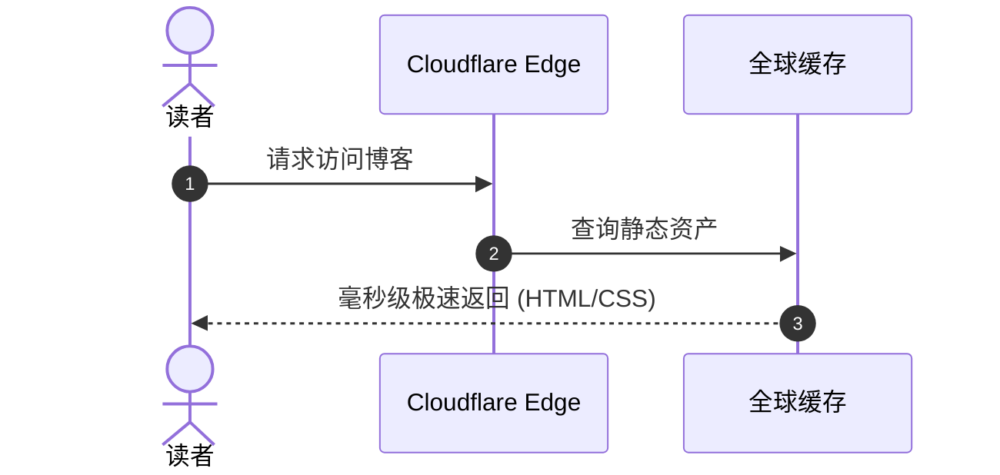
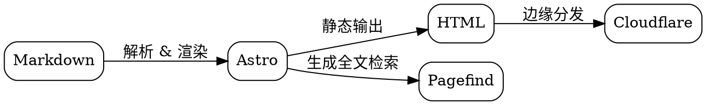

欢迎来到我的博客！

本博客采用 **Astro 框架** 驱动，视觉上融合了 **AstroPaper 的极简文字骨架** 与 **Google Material Design 3 (M3) 的柔和色调、大圆角与物理缓动**，呈现出一种「极简克制中的灵动」。

---

## 🚀 它是如何工作的？

这是一个纯粹的 **GitOps / Jamstack 自动化博客**。你不需要进入任何后台管理系统，日常写文章只需要与 GitHub 交互：

1. **写文章**：在 `src/content/posts/` 目录下新增一个 `.md` 或 `.mdx` 文件。
2. **提交与推送**：执行 `git push`（或者直接在 GitHub 网页端在线编辑提交）。
3. **自动同步与部署**：**Cloudflare Pages** 监听到仓库变动后，会自动在云端执行编译并在 1 分钟内将新文章全球分发上线。
4. **增减自如**：修改、重命名或删除对应的 Markdown 文件，线上博客的文章列表、分类标签与归档都会随之自动增减。

下面是使用 Markdown 内嵌 **Mermaid** 代码块渲染的发布流程图：


---

## 📊 内嵌图表渲染能力

博客已完整支持在 Markdown 中直接编写图表代码，自动编译为响应式 SVG 矢量图，并与 M3 主题暗黑模式自动适配。

### 1. Mermaid 图表

只需使用 ```` ```mermaid ```` 代码块即可：



### 2. Graphviz (DOT 语言) 图表

使用 ```` ```graphviz ```` 或 ```` ```dot ```` 代码块，编译时直接转为高质量 SVG：



---

## 💻 代码高亮与交互体验

代码块全面由 **Shiki** 驱动，提供现代语法高亮、右上角语言标签与一键复制代码按钮：

```python file="quick_sort.py"
def quick_sort(arr: list[int]) -> list[int]:
    """快速排序演示"""
    if len(arr) <= 1:
        return arr
    pivot = arr[len(arr) // 2]
    left = [x for x in arr if x < pivot]
    middle = [x for x in arr if x == pivot]
    right = [x for x in arr if x > pivot]
    return quick_sort(left) + middle + quick_sort(right)

if __name__ == "__main__":
    print(quick_sort([3, 6, 8, 10, 1, 2, 1]))
```

```typescript
// 支持 TypeScript 与现代语言特性
interface PostMeta {
  title: string;
  pubDatetime: Date;
  tags: string[];
}

export function formatPost(post: PostMeta): string {
  return `[${post.pubDatetime.toLocaleDateString()}] ${post.title}`;
}
```

---

## 📝 Markdown 头部写作规范 (Frontmatter)

每篇 Markdown 文件的最顶部需要包含以下元数据：

```yaml
---
author: hqu-little-boy
pubDatetime: 2026-10-26T12:00:00Z
title: 文章标题
featured: false # 是否在首页精选展示 (true / false)
draft: false # 是否为草稿 (true 不会发布上线)
tags:
  - 技术
  - 随笔
description: 文章简要描述或摘要，展示在列表卡片中。
---
```

在这段配置之后，你可以像往常一样书写标准的 Markdown 正文。开始享受纯粹的文字与创作吧！
